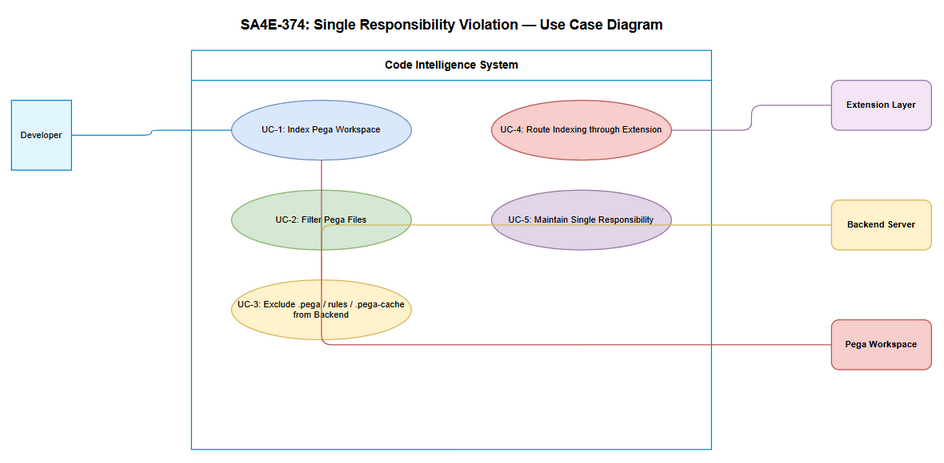
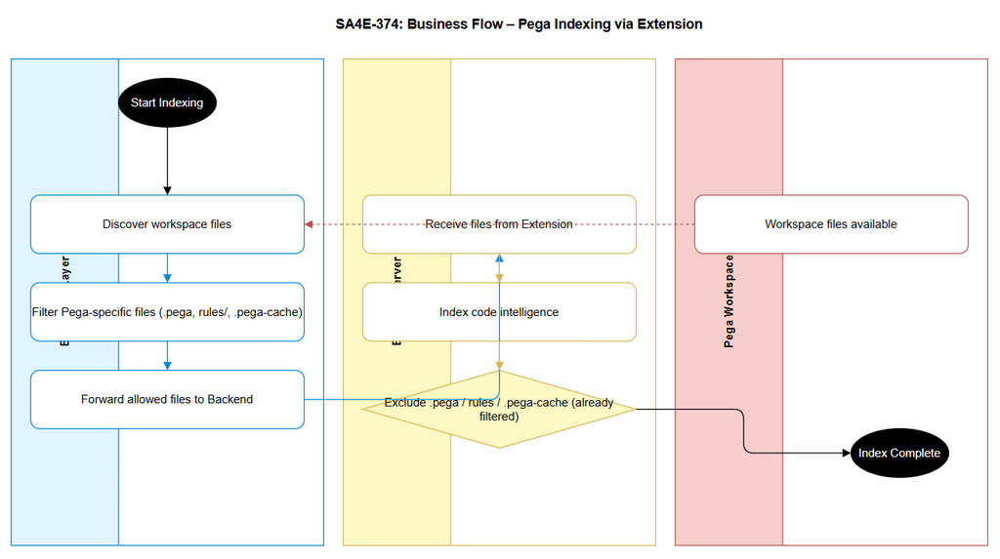

# Business Requirements Document (BRD)

## SA4E-374 — Single Responsibility Violation: Pega workspace indexing đi thẳng tới backend server, không qua extension

---

## Document Information

| Field | Value |
|-------|-------|
| Jira Ticket | SA4E-374 |
| Title | Single Responsibility Violation: Pega workspace indexing đi thẳng tới backend server, không qua extension |
| Author | BA Agent |
| Version | 1.0 |
| Date | 2026-10-19 |
| Status | Draft |

---

## Author Tracking

| Role | Name - Position | Responsibility |
|------|-----------------|----------------|
| Author | BA Agent | Create document |
| Peer Reviewer | TBD | Review document |

---

## Revision History

| Version | Date | Author | Changes |
|---------|------|--------|---------|
| 1.0 | 2026-10-19 | BA Agent | Initiate document — auto-generated from Jira ticket SA4E-374 |

---

## Sign-Off

| Name | Signature and date |
|------|--------------------|
| | ☐ I agree and confirm all criteria on this BRD as expected requirements |
| | ☐ I agree and confirm all criteria on this BRD as expected requirements |

---

## 1. Introduction

### 1.1 Scope

The scope of this change request is to eliminate Single Responsibility Violation in Pega workspace indexing where the backend indexer directly accesses Pega workspace files. The business process must route Pega workspace indexing through the extension layer, enforce separation of concerns, and ensure backend indexer excludes Pega-specific artifacts (.pega files, rules/ directory, .pega-cache).

Key objectives:
- Remove direct backend access to Pega workspace
- Transfer Pega-specific discovery and filtering responsibility to extension layer
- Exclude .pega, rules/, .pega-cache from backend indexer
- Maintain security, logging, and control flow via extension

### 1.2 Out of Scope

- Changes to Pega rule processing logic itself
- Changes to non-Pega code intelligence indexing
- UI changes for end users
- Modification of extension UI beyond indexing control flow

### 1.3 Preliminary Requirement

- Extension layer must support Pega-specific file discovery and filtering
- Backend indexer must be configurable to exclude file patterns and directories
- Code intelligence system must maintain current indexing performance for non-Pega sources

---

## 2. Business Requirements

### 2.1 High Level Process Map

Currently, Pega workspace indexing bypasses the extension and goes straight to backend server, violating SRP. The desired process is: Developer triggers indexing → Extension discovers workspace → Extension filters Pega-specific files → Extension forwards allowed files to Backend → Backend indexes only generic code intelligence files.

*[Edit in draw.io](diagrams/use-case.drawio)*

*[Edit in draw.io](diagrams/business-flow.drawio)*

### 2.2 List of User Stories / Use Cases

| # | Story / Use Case / Epic | Priority | Source Ticket |
|---|-------------------------|----------|---------------|
| 1 | As a Developer, I want Pega workspace indexing to be handled by extension layer so that backend maintains single responsibility | MUST HAVE | SA4E-374 |
| 2 | As a System Architect, I want backend indexer to exclude Pega-specific files so that backend doesn't process .pega, rules/, .pega-cache | MUST HAVE | SA4E-374 |

---

### 2.3 Details of User Stories

---

#### Business Flow

**Step 1:** Developer initiates code intelligence indexing for workspace containing Pega files.

**Step 2:** Extension layer discovers files in workspace, identifies Pega-specific artifacts.

**Step 3:** Extension filters out .pega files, rules/ directory, and .pega-cache.

**Step 4:** Extension forwards only allowed files to Backend Server for indexing.

**Step 5:** Backend Server receives files from Extension, performs generic code intelligence indexing.

**Step 6:** Backend confirms indexing complete and returns results via Extension to Developer.

> **Note:** Backend must never directly access Pega workspace. All Pega-specific logic resides in Extension.

---

#### STORY 1: Route Pega Indexing Through Extension

> As a Developer, I want Pega workspace indexing to be handled by extension layer so that backend maintains single responsibility

**Requirement Details:**

1. Pega workspace indexing requests must be intercepted by extension layer before reaching backend.
2. Extension must perform file discovery and Pega-specific filtering.
3. Backend indexer receives only pre-filtered files from extension.

**Acceptance Criteria:**

1. Backend indexer no longer processes .pega files directly from workspace.
2. Backend indexer excludes rules/ and .pega-cache directories.
3. Extension layer logs indexing requests and filtering actions.
4. Developer initiating indexing sees consistent results via extension-mediated flow.

**Validation Rules:**

- Backend indexer configuration must include exclude patterns: `*.pega`, `rules/**`, `.pega-cache/**`
- Extension must validate file paths before forwarding to backend

**Error Handling:**

- If extension fails to filter, backend must reject files matching exclude patterns with error "Pega-specific file not allowed in backend indexer"

---

#### STORY 2: Backend Excludes Pega-Specific Artifacts

> As a System Architect, I want backend indexer to exclude Pega-specific files so that backend doesn't process .pega, rules/, .pega-cache

**Requirement Details:**

1. Backend indexer configuration updated to remove .pega from processing scope.
2. Backend indexer excludes rules/ and .pega-cache from index discovery.
3. Responsibility for Pega-specific indexing transferred to extension layer.

**Acceptance Criteria:**

1. Backend indexer configuration no longer includes .pega file extension.
2. Backend indexer skips rules/ directory during scan.
3. Backend indexer skips .pega-cache directory during scan.
4. Backend maintains single responsibility for generic code intelligence only.

**Non-Functional Impact:**

- Improved security by preventing backend direct workspace access
- Improved maintainability by separating Pega-specific logic
- Reduced risk of performance degradation from processing large Pega artifacts

---

## 3. Dependencies

| Dependency | Type | Related Ticket | Description |
|------------|------|----------------|-------------|
| Extension Layer Pega Filtering | System | SA4E-374 | Extension must implement Pega file discovery and filtering |
| Backend Indexer Configuration | System | SA4E-374 | Backend must support exclude patterns for .pega, rules/, .pega-cache |
| Code Intelligence Pipeline | Infrastructure | N/A | Ensure pipeline supports extension-mediated flow |

---

## 4. Stakeholders

| Role | Name / Team | Responsibility | Source |
|------|-------------|----------------|--------|
| Reporter/Creator | Duc Nguyen Minh | Reported SRP violation | SA4E-374 |
| BA Agent | BA | Create BRD | Internal |
| Developer | TBD | Implement extension filtering and backend config | SA4E-374 |
| System Architect | TBD | Review SRP compliance | SA4E-374 |

---

## 5. Risks and Assumptions

### 5.1 Risks

| Risk | Impact | Likelihood | Mitigation |
|------|--------|------------|------------|
| Extension layer performance bottleneck | Medium | Medium | Load test extension filtering, optimize file discovery |
| Missing Pega file patterns | High | Medium | Review workspace structure, update exclude patterns iteratively |
| Regression in generic indexing | High | Low | Maintain backend exclude config versioned, run regression tests |

### 5.2 Assumptions

- Extension layer has access to workspace file system via approved API
- Backend indexer configuration can be updated without downtime
- Pega-specific files are identifiable by extension .pega, paths rules/ and .pega-cache

---

## 6. Non-Functional Requirements

| Category | Requirement | Details |
|----------|-------------|---------|
| Security | Prevent direct backend workspace access | All Pega indexing must go through extension layer for logging and control |
| Performance | Maintain indexing latency | Extension filtering overhead < 5% of total indexing time |
| Maintainability | Single Responsibility | Backend handles generic indexing only; extension handles Pega-specific logic |
| Availability | No downtime | Configuration changes applied via feature flag/rolling update |

> If no non-functional requirements are identified from the tickets, state: "No specific non-functional requirements identified. To be confirmed with technical team."

---

## 7. Related Tickets

| Ticket Key | Summary | Status | Type | Relationship |
|------------|---------|--------|------|--------------|
| SA4E-374 | Single Responsibility Violation: Pega workspace indexing đi thẳng tới backend server, không qua extension | To Do | Bug | Main ticket |

---

## 8. Appendix

### Glossary

| Term | Definition |
|------|------------|
| SRP | Single Responsibility Principle |
| Extension Layer | Client-side component mediating workspace access |
| Backend Indexer | Server-side code intelligence indexing service |
| Pega Workspace | Directory containing Pega rules and .pega files |

### Reference Documents

| Document | Link / Location |
|----------|-----------------|
| Jira Ticket SA4E-374 | https://jiraassist.atlassian.net/rest/api/2/issue/SA4E-374 |
| BRD Template | documents/templates/BRD-TEMPLATE.md |
