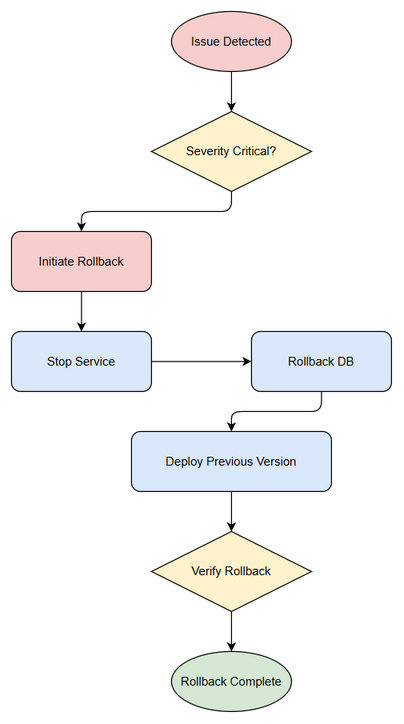

# Deployment Guide (DPG)

## Code Intelligence System — SA4E-374: Single Responsibility Violation Pega workspace indexing

---

## Document Information

| Field | Value |
|-------|-------|
| Jira Ticket | SA4E-374 |
| Title | Single Responsibility Violation: Pega workspace indexing đi thẳng tới backend server, không qua extension |
| Author | DevOps Agent |
| Version | 1.0 |
| Date | 2026-10-20 |
| Status | Draft |
| Related TDD | TDD-v1.0-SA4E-374.docx |

---

## Revision History

| Version | Date | Author | Changes |
|---------|------|--------|---------|
| 1.0 | 2026-10-20 | DevOps Agent | Initiate document — auto-generated from TDD and project context |

---

## Sign-Off

| Name | Role | Signature and date |
|------|------|--------------------|
| | Dev Lead | ☐ Approved for deployment |
| | QA Lead | ☐ Testing completed |
| | Ops Lead | ☐ Infrastructure ready |

---

## 1. Overview

### 1.1 Feature Summary
Elimination of Single Responsibility Violation in Pega workspace indexing. Backend indexer no longer accesses Pega workspace directly. Extension layer handles Pega-specific file discovery, filtering, and manifest submission. Backend enforces exclude patterns for .pega, rules/, .pega-cache.

### 1.2 Deployment Scope

| Item | Type | Description |
|------|------|-------------|
| backend/src/config/schema.ts | Modified | DEFAULT_EXCLUDE includes 'rules' + '.pega-cache'; DEFAULT_EXTENSIONS removes .pega |
| backend/src/config/unified-extensions.ts | Modified | Remove pega from UNIFIED_EXTENSIONS |
| backend/src/engine/indexer/file-scanner/languages.ts | Modified | detectLanguage returns null for .pega |
| backend/src/engine/indexer/project-type/resolver.ts | Modified | FALLBACK_EXCLUDES adds rules/.pega-cache |
| backend/src/engine/indexer/file-scanner/traversal.ts | Modified | shouldExclude logic enhanced |
| backend API | New | POST /api/v1/pega/index-manifest, GET /api/v1/pega/index-status |

### 1.3 Target Environments

| Environment | URL | Deploy Order | Approval Required |
|-------------|-----|-------------|-------------------|
| DEV | http://dev.codeintel.local | 1st | No |
| SIT | http://sit.codeintel.local | 2nd | No |
| UAT | http://uat.codeintel.local | 3rd | QA Sign-off |
| PROD | http://codeintel.company.com | 4th | PM + Business Sign-off |

## 2. Prerequisites

### 2.1 Infrastructure

| Requirement | Status | Notes |
|-------------|--------|-------|
| Backend server container | Ready | Docker image codeintel/backend:1.0 |
| Network access extension→backend | Ready | HTTPS 443 |
| Database PostgreSQL | Ready | For manifest storage |

### 2.2 Software Dependencies

| Dependency | Version | Status |
|-----------|---------|--------|
| Node.js | 20 | Installed |
| Backend runtime | 1.0 | Available |
| VS Code Extension | >=1.0 | Available |

### 2.3 Access Requirements

| Access | Type | Who Needs It |
|--------|------|-------------|
| SSH to server | Key-based | DevOps team |
| Database admin | Credentials | DBA |
| CI/CD pipeline | Service account | Automated |

### 2.4 Backup Requirements

- [ ] Database backup completed before deployment
- [ ] Application backup (previous version artifact saved)
- [ ] Configuration backup

## 3. Pre-Deployment Checklist

| # | Item | Responsible | Status |
|---|------|-------------|--------|
| 1 | Code merged to release branch | Developer | ☐ |
| 2 | All unit tests passed (19/19) | Developer | ☐ |
| 3 | All STC passed (31/31) | QA | ☐ |
| 4 | SIT/UAT sign-off obtained | QA + BA | ☐ |
| 5 | Database backup completed | DBA | ☐ |
| 6 | Configuration files prepared | DevOps | ☐ |
| 7 | Feature flags configured | Developer | ☐ |
| 8 | Monitoring/alerting configured | DevOps | ☐ |
| 9 | Rollback plan reviewed | Team | ☐ |
| 10 | Deployment window confirmed | PM | ☐ |

## 4. Database Migration

### 4.1 Migration Scripts

| Order | Script | Description | Estimated Time |
|-------|--------|-------------|----------------|
| 1 | V1__create_pega_index_manifests.sql | Create pega_index_manifests table | 1 min |
| 2 | V2__alter_files_source.sql | Add source column to files table | 1 min |

### 4.2 Execution Steps

```bash
# Step 1: Backup database
pg_dump -h db-host codeintel > backup_$(date +%Y%m%d).sql

# Step 2: Run migration
flyway migrate -url=jdbc:postgresql://db-host/codeintel

# Step 3: Verify migration
psql -h db-host -c "SELECT table_name FROM information_schema.tables WHERE table_name='pega_index_manifests';"
```

### 4.3 Verification Queries

```sql
-- Verify table created
SELECT * FROM pega_index_manifests LIMIT 1;

-- Verify files source column
SELECT column_name FROM information_schema.columns WHERE table_name='files' AND column_name='source';
```

### 4.4 Rollback Scripts

```sql
-- Rollback migration
DROP TABLE IF EXISTS pega_index_manifests;
ALTER TABLE files DROP COLUMN IF EXISTS source;
```

## 5. Application Deployment

### 5.1 Deployment Flow


### 5.2 Deployment Steps

| Step | Action | Command | Verification |
|------|--------|---------|-------------|
| 1 | Stop existing service | docker stop codeintel-backend | Container stopped |
| 2 | Pull new image | docker pull codeintel/backend:1.53.12 | Image pulled |
| 3 | Update configuration | cp config/schema.ts.production backend/src/config/ | Config applied |
| 4 | Start service | docker run -d --name codeintel-backend -p 48721:48721 codeintel/backend:1.53.12 | Container running |
| 5 | Health check | curl http://localhost:48721/api/health | 200 OK |

### 5.3 Docker Deployment

```bash
# Pull new image
docker pull registry.company.com/codeintel/backend:1.53.12

# Stop existing container
docker stop codeintel-backend

# Start new container
docker run -d --name codeintel-backend \
  -p 48721:48721 \
  -e CODE_INTEL_BACKEND_URL=http://localhost:48721 \
  registry.company.com/codeintel/backend:1.53.12

# Verify
docker logs codeintel-backend --tail 50
```

## 6. Configuration Changes

### 6.1 New Environment Variables

| Variable | Description | DEV | SIT | UAT | PROD |
|----------|-------------|-----|-----|-----|------|
| SRP_GUARD_ENABLED | Enable SRP guard | true | true | true | true |
| PEGA_MANIFEST_API | API path | /api/v1/pega/index-manifest | same | same | same |

### 6.2 Application Properties Changes

| Property | Old Value | New Value | File |
|----------|-----------|-----------|------|
| DEFAULT_EXCLUDE | [.pega] | [.pega, rules, .pega-cache] | schema.ts |
| DEFAULT_EXTENSIONS | includes .pega | removes .pega | schema.ts |
| UNIFIED_EXTENSIONS | includes pega | removed | unified-extensions.ts |

### 6.3 Feature Flags

| Flag | DEV | SIT | UAT | PROD |
|------|-----|-----|-----|------|
| SRP_GUARD | true | true | true | true |
| PEGA_MANIFEST | true | true | true | true |

## 7. Post-Deployment Verification

### 7.1 Health Checks

| Check | Endpoint/Command | Expected Result | Timeout |
|-------|-----------------|-----------------|---------|
| Application health | GET /api/health | 200 OK, srp_guard enabled | 30s |
| Manifest API | POST /api/v1/pega/index-manifest | 202 Accepted | 30s |

### 7.2 Smoke Tests

| # | Scenario | Steps | Expected Result |
|---|----------|-------|-----------------|
| 1 | Index Pega workspace | Trigger index via extension | Backend receives manifest, .pega excluded |
| 2 | SRP violation rejection | POST manifest with rules/ path | 400 PEGA-005 |

### 7.3 Log Verification

| Log Entry | Level | Expected | Location |
|-----------|-------|----------|----------|
| SRP guard active | INFO | Within 60s of start | backend/logs/indexer.log |
| Manifest accepted | INFO | After POST | backend/logs/api.log |

### 7.4 Monitoring Dashboard

- [ ] Application metrics visible
- [ ] Error rate within normal range
- [ ] Response time within SLA

## 8. Rollback Plan

### 8.1 Rollback Flow



### 8.2 Rollback Decision Criteria

| Condition | Action |
|-----------|--------|
| Critical defect found in production | Immediate rollback |
| Manifest API returns 500 > 5% | Immediate rollback |
| Performance degradation > 50% | Immediate rollback |
| SRP guard blocks valid files | Hotfix — no rollback |

### 8.3 Rollback Steps

| Step | Action | Command | Verification |
|------|--------|---------|-------------|
| 1 | Stop new version | docker stop codeintel-backend | Container stopped |
| 2 | Rollback database | flyway undo | Migration reverted |
| 3 | Deploy previous version | docker run ... backend:0.9.9 | Container running |
| 4 | Restore configuration | git checkout previous config | Config restored |
| 5 | Verify rollback | curl /api/health | 200 OK |

### 8.4 Rollback Time Estimate

| Action | Estimated Time |
|--------|---------------|
| Database rollback | 5 min |
| Application rollback | 3 min |
| Verification | 5 min |
| **Total** | **13 min** |

## 9. Environment-Specific Notes

### 9.1 DEV
No approval required. Deploy anytime.

### 9.2 SIT
Run automated STC suite after deploy.

### 9.3 UAT
Requires QA sign-off. Deploy during business hours.

### 9.4 PROD
- **Deployment Window:** Saturday 22:00-02:00
- **Approval Required From:** PM + Business Owner
- **Communication Plan:** Notify #devops Slack before/after
- **On-Call Contact:** DevOps Lead

## 10. Appendix

### Contacts

| Role | Name | Contact |
|------|------|---------|
| DevOps Lead | TBD | devops@company.com |
| DBA | TBD | dba@company.com |

### Related Tickets

| Ticket | Summary | Relationship |
|--------|---------|-------------|
| SA4E-374 | Single Responsibility Violation Pega workspace indexing | Main ticket |
