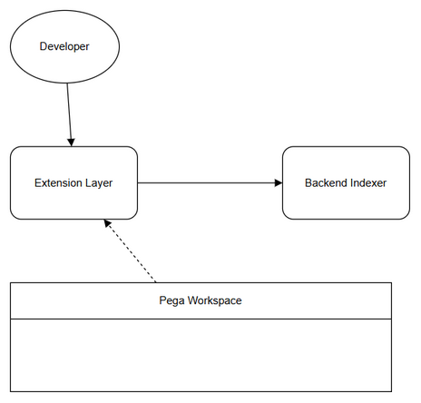
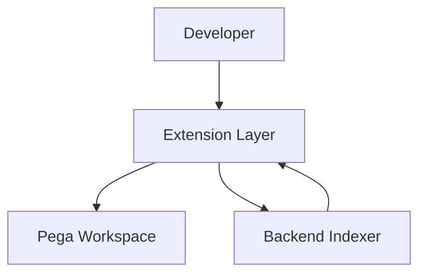
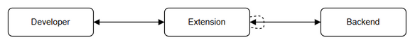
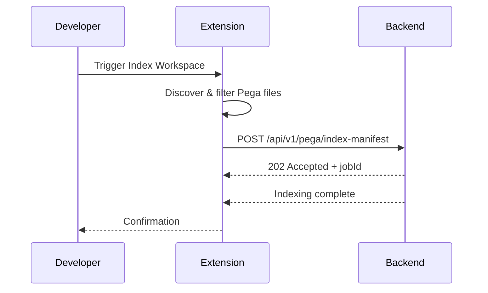
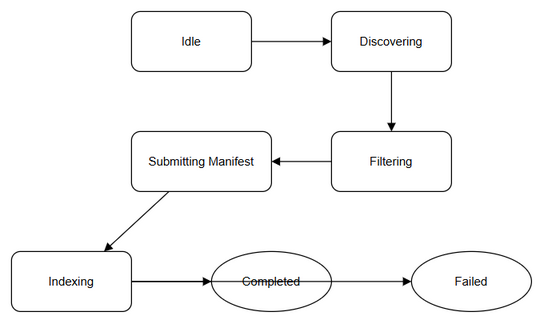
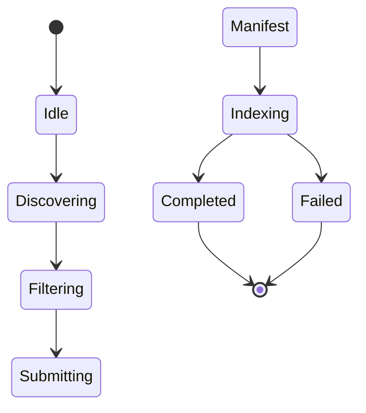

# Functional Specification Document (FSD)

## SA4E-374 — Single Responsibility Violation: Pega workspace indexing đi thẳng tới backend server, không qua extension

---

## Document Information

| Field | Value |
|-------|-------|
| Jira Ticket | SA4E-374 |
| Title | Single Responsibility Violation: Pega workspace indexing đi thẳng tới backend server, không qua extension |
| Author | BA Agent |
| Version | 1.0 |
| Date | 2026-10-19 |
| Status | Draft |
| Related BRD | documents/SA4E-374/BRD.md |

---

## Revision History

| Version | Date | Author | Changes |
|---------|------|--------|---------|
| 1.0 | 2026-10-19 | BA Agent | Initiate document — auto-generated from BRD and TA technical preview |

---

## 1. Introduction

### 1.1 Purpose

This FSD defines the functional specifications for eliminating Single Responsibility Principle violation in Pega workspace indexing. It specifies how Pega-specific discovery and filtering is transferred to the VS Code extension layer, and how the backend indexer is restricted to generic code intelligence only.

### 1.2 Scope

Reference BRD scope: eliminate direct backend access to Pega workspace, route indexing through extension, exclude `.pega`, `rules/`, `.pega-cache` from backend indexer. Technical scope clarifications from TA preview: manifest-based Pega indexing contract `POST /api/v1/pega/index-manifest`, backend exclude patterns enforcement, extension discovery service.

Out of scope: Pega rule processing logic itself, non-Pega indexing changes, UI changes.

### 1.3 Definitions & Acronyms

| Term | Definition |
|------|------------|
| SRP | Single Responsibility Principle |
| Extension Layer | VS Code extension mediating workspace access |
| Backend Indexer | Server-side code intelligence indexing service |
| Pega Workspace | Directory containing Pega rules and .pega files |
| Manifest | JSON payload listing Pega rules to index, submitted by extension |

### 1.4 References

| Document | Location |
|----------|----------|
| BRD | documents/SA4E-374/BRD.md |
| FSD Technical Preview | documents/SA4E-374/FSD-TECH-PREVIEW.md |
| TDD Draft | documents/SA4E-374/TDD.md |

---

## 2. System Overview

### 2.1 System Context Diagram

*[Edit in draw.io](diagrams/system-context.drawio)*

System interacts with Developer via Extension, Extension mediates access to Pega Workspace and Backend Indexer. Backend never accesses Pega Workspace directly.

### 2.2 System Architecture

High-level components:
- **VS Code Extension**: Pega project detection, file discovery, filtering with SRP_EXCLUDES, manifest builder, HTTP client to backend.
- **Backend Indexer**: File scanner with `DEFAULT_EXCLUDE` including `.pega`, `rules/`, `.pega-cache/`. Receives Pega index manifest via API, validates SRP guard.
- **Code Intelligence DB**: Stores generic files and Pega rule catalog.
- **MCP Server**: Provides indexing query interface.

Target flow: Developer triggers indexing → Extension discovers workspace → filters Pega-specific artifacts → forwards allowed files to Backend → Backend indexes only generic code intelligence.

---

## 3. Functional Requirements

### 3.1 Feature: Route Pega Indexing Through Extension

**Source:** BRD Story 1 — As a Developer, I want Pega workspace indexing to be handled by extension layer so that backend maintains single responsibility

#### 3.1.1 Description

Extension intercepts Pega workspace indexing requests, performs file discovery and Pega-specific filtering, forwards only allowed files to backend. Backend receives pre-filtered data.

#### 3.1.2 Use Case

**Use Case ID:** UC-001
**Actor:** Developer
**Preconditions:** Workspace contains Pega project marker `pega-project.json`. Extension is active.
**Postconditions:** Backend indexes only generic files; Pega rules are indexed via manifest.

**Main Flow:**

| Step | Actor | System | Description |
|------|-------|--------|-------------|
| 1 | Developer | | Triggers "Index Workspace" |
| 2 | | Extension | Detects `pega-project.json` |
| 3 | | Extension | Discovers files with SRP_EXCLUDES |
| 4 | | Extension | Builds Pega index manifest |
| 5 | Extension | Backend | POST /api/v1/pega/index-manifest |
| 6 | | Backend | Validates manifest, accepts |
| 7 | Backend | Extension | Returns manifestId & jobId |
| 8 | | Extension | Confirms indexing complete to Developer |

**Alternative Flows:**

| ID | Condition | Steps |
|----|-----------|-------|
| AF-1 | No Pega project | Extension skips Pega discovery, forwards generic files directly |

**Exception Flows:**

| ID | Condition | Steps |
|----|-----------|-------|
| EF-1 | Backend rejects manifest | Extension retries 3x exponential backoff, then queues locally |
| EF-2 | Extension fails filtering | Backend SRP guard rejects files with error PEGA-005 |

*[Edit in draw.io](diagrams/sequence-indexing.drawio)*

#### 3.1.3 Business Rules

| Rule ID | Rule | Source |
|---------|------|--------|
| BR-001 | Extension must intercept Pega workspace indexing before backend | BRD 2.3 STORY1 |
| BR-002 | Extension must apply exclude patterns: .pega/**, rules/**, .pega-cache/**, **/*.pega, **/*.pega.json | TA Preview 4.1 |
| BR-003 | Backend must reject any manifest containing paths matching SRP excludes | TA Preview 5.2 |
| BR-004 | Backend indexer must not directly scan Pega workspace | BRD 1.1 Scope |

#### 3.1.4 Data Specifications

**Input Data:**
| Field | Type | Required | Validation | Description |
|-------|------|----------|------------|-------------|
| projectId | string | Y | UUID format | Project identifier |
| workspaceRoot | string | Y | Absolute path | Workspace root |
| rules[] | array | Y | Max 10k items | List of Pega rules |
| excludePatternsApplied | array | Y | Non-empty | Patterns used by extension |

**Output Data:**
| Field | Type | Description |
|-------|------|-------------|
| manifestId | UUID | Created manifest identifier |
| acceptedCount | int | Number of rules accepted |
| rejectedCount | int | Number rejected |
| indexingJobId | UUID | Job for tracking |

#### 3.1.5 API Contract (Functional View)

**Endpoint:** `POST /api/v1/pega/index-manifest`
**Purpose:** Extension submits Pega rules discovered locally for backend indexing.

**Input Parameters:**
| Parameter | Type | Required | Business Rule | Description |
|-----------|------|----------|---------------|-------------|
| projectId | string | Y | BR-001 | Project ID |
| workspaceRoot | string | Y | | Root path |
| rules | array | Y | BR-002 | Rule metadata |
| excludePatternsApplied | array | Y | BR-002 | Patterns applied |

**Output Data:**
| Field | Type | Description |
|-------|------|-------------|
| manifestId | UUID | |
| acceptedCount | int | |
| indexingJobId | UUID | |

**Business Error Scenarios:**
| Scenario | User Message | Trigger Condition |
|----------|-------------|-------------------|
| Invalid manifest schema | PEGA-001 Invalid manifest | Schema validation fails |
| Workspace unauthorized | PEGA-002 Unauthorized | JWT project mismatch |
| Manifest too large | PEGA-003 Too large | >10MB payload |
| SRP violation | PEGA-005 Rule violates exclude | Path matches .pega/rules |

---

### 3.2 Feature: Backend Excludes Pega-Specific Artifacts

**Source:** BRD Story 2 — As a System Architect, I want backend indexer to exclude Pega-specific files

#### 3.2.1 Description

Backend indexer configuration updated to exclude `.pega`, `rules/`, `.pega-cache` from file scanner. SRP guard middleware rejects violations.

#### 3.2.2 Use Case

**Use Case ID:** UC-002
**Actor:** System Architect
**Preconditions:** Backend config loaded
**Postconditions:** Backend never processes Pega-specific files

**Main Flow:**
1. Backend loads `DEFAULT_EXCLUDE` with `.pega`, `rules`, `.pega-cache`
2. File scanner `shouldExclude()` checks path against patterns
3. `detectLanguage()` returns null for .pega → file skipped
4. Indexer proceeds with generic files only

**Exception Flows:**
| ID | Condition | Steps |
|----|-----------|-------|
| EF-1 | Config contains .pega whitelist | Config validation rejects startup |

#### 3.2.3 Business Rules

| Rule ID | Rule | Source |
|---------|------|--------|
| BR-005 | Backend DEFAULT_EXCLUDE must contain `.pega`, `rules`, `.pega-cache` | BRD 2.3 STORY2 |
| BR-006 | Backend must not include .pega in UNIFIED_EXTENSIONS_WITH_DOT whitelist | TA Preview 4.1 |
| BR-007 | File scanner must reject paths ending .pega or .pega.json | TA Preview 4.1 |
| BR-008 | SRP guard middleware must reject manifest with violating paths | TA Preview 5.2 |

#### 3.2.4 Data Specifications

**Input Data:**
| Field | Type | Required | Validation | Description |
|-------|------|----------|------------|-------------|
| relativePath | string | Y | No .pega/rules | File path from scan |

**Output Data:**
None

---

## 4. Data Model

> Logical data model. Physical implementation in TDD §4.

### 4.1 Entity Relationship Diagram

ER diagram not generated.

### 4.2 Logical Entities

#### Entity: pega_index_manifests

| Attribute | Type | Required | Business Rule | Description |
|-----------|------|----------|---------------|-------------|
| manifest_id | UUID | Y | | Primary key |
| project_id | string | Y | BR-001 | FK to projects |
| submitted_at | datetime | Y | | Submission time |
| rule_count | int | Y | | Number of rules |
| exclude_patterns | JSON | Y | BR-002 | Patterns applied |
| status | enum | Y | | PENDING/ACCEPTED/REJECTED |
| indexing_job_id | UUID | N | | FK to indexing jobs |

**Relationships:**
| From Entity | To Entity | Cardinality | Description |
|-------------|-----------|-------------|-------------|
| pega_index_manifests | indexing_jobs | 1:1 | Manifest triggers job |
| pega_index_manifests | projects | N:1 | Belongs to project |

Impact on existing tables:
- `files` table adds column `source` enum ['code-intel','pega-manifest']
- `indexing_jobs` table adds `source_type`

---

## 5. Integration Specifications

### 5.1 External System: VS Code Extension

| Attribute | Value |
|-----------|-------|
| Purpose | Pega file discovery & filtering |
| Direction | Outbound to Backend |
| Data Format | JSON |
| Frequency | On-demand |

**Data Exchange:**
| Our Data | External Data | Direction | Business Rule |
|----------|--------------|-----------|---------------|
| index-manifest | rules[] | Send | BR-002 |
| job status | indexing status | Receive | |

### 5.2 External System: Pega Workspace

| Attribute | Value |
|-----------|-------|
| Purpose | Source of Pega rules |
| Direction | Read-only |
| Data Format | JSON .pega.json |
| Frequency | On-demand |

---

## 6. Processing Logic

### 6.1 Pega Indexing Manifest Process

**Trigger:** Developer triggers Index Workspace
**Schedule:** On-demand
**Input:** Workspace root, project config
**Output:** Indexed Pega rules in DB

**Processing Steps:**
| Step | Description | Error Handling |
|------|-------------|----------------|
| 1 | Detect pega-project.json | If missing, skip Pega flow |
| 2 | Walk filesystem with SRP_EXCLUDES | Log skipped paths |
| 3 | Build manifest with checksums | On error, retry |
| 4 | POST manifest to backend | Retry 3x, queue if offline |
| 5 | Poll job status | Timeout after 30s |

*[Edit in draw.io](diagrams/state-indexing.drawio)*

---

## 7. Security Requirements

### 7.1 Authentication & Authorization

| Role | Permissions | Features |
|------|-------------|----------|
| Developer | Read/Write | Trigger indexing via extension |
| System Architect | Read | View config |

### 7.2 Data Sensitivity

| Data Type | Classification | Requirement |
|-----------|----------------|-------------|
| Pega rule content | Internal | Do not log content, only metadata |
| Manifest payload | Confidential | TLS 1.3 in transit |

### 7.3 Audit Trail

| Event | Logged Fields | Retention | Reason |
|-------|--------------|-----------|--------|
| Manifest submission | projectId, timestamp, ruleCount | 90 days | Compliance |

---

## 8. Non-Functional Requirements

| Category | Business Requirement | Acceptance Criteria |
|----------|---------------------|---------------------|
| Performance | Extension filtering overhead <5% | <5s for 10k rules |
| Security | No direct backend workspace access | All Pega indexing via extension |
| Maintainability | Single Responsibility | Backend handles generic only |
| Availability | No downtime | Rolling config update |

---

## 9. Error Handling (User-Facing)

### 9.1 Error Scenarios

| Scenario | Severity | User Message | Expected Behavior |
|----------|----------|-------------|-------------------|
| PEGA-001 Invalid manifest | Warning | Manifest schema invalid, please retry | Extension logs error |
| PEGA-002 Unauthorized | Critical | Workspace not authorized | Block indexing |
| PEGA-005 SRP violation | Critical | Pega file not allowed in backend indexer | Reject and alert architect |

### 9.2 Notification Requirements

| Event | Who | Channel | Timing |
|-------|-----|---------|--------|
| Manifest rejected | Developer | In-app | Immediate |

---

## 10. Testing Considerations

### 10.1 Test Scenarios

| ID | Scenario | Input | Expected Output | Priority |
|----|----------|-------|-----------------|----------|
| TC-001 | Index Pega workspace | Workspace with .pega files | Backend excludes .pega, extension submits manifest | High |
| TC-002 | Manifest SRP guard | Manifest with rules/ path | Backend rejects with PEGA-005 | High |
| TC-003 | Config exclude patterns | DEFAULT_EXCLUDE includes .pega | File scanner skips .pega files | High |

---

## 11. Appendix

### Diagrams

| Diagram | File |
|---------|------|
| System Context | [system-context.png](diagrams/system-context.png) |
| Sequence Indexing | [sequence-indexing.png](diagrams/sequence-indexing.png) |
| State Indexing | [state-indexing.png](diagrams/state-indexing.png) |

### Change Log from BRD

- Added API contract details from TA preview
- Added data model for pega_index_manifests
- Added security and audit requirements from TA
- Aligned exclude patterns with TDD draft

---
