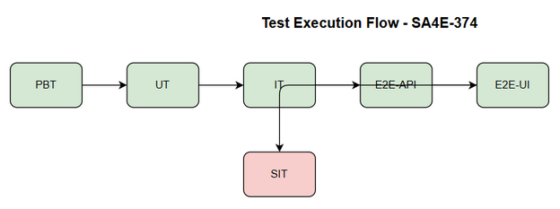
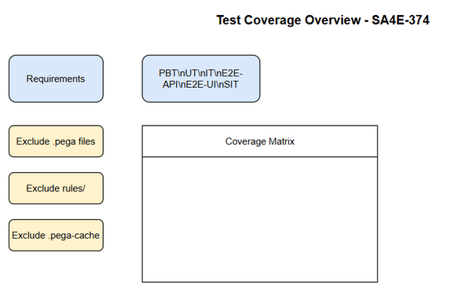

# Software Test Plan (STP)

## Code-Intel / SA4E-374: Single Responsibility Violation: Pega workspace indexing đi thẳng tới backend server, không qua extension

---

## Document Information

| Field | Value |
|-------|-------|
| Jira Ticket | SA4E-374 |
| Title | Single Responsibility Violation: Pega workspace indexing đi thẳng tới backend server, không qua extension |
| Author | QA Agent |
| Version | 1.0 |
| Date | 2026-10-20 |
| Status | Final |
| Related BRD | BRD-v1.0-SA4E-374.md |
| Related FSD | FSD-v1.0-SA4E-374.md |
| Related TDD | TDD-v1.0-SA4E-374.md |

---

## Author Tracking

| Role | Name - Position | Responsibility |
|------|-----------------|----------------|
| Author | QA Agent – QA Engineer | Create document |
| Peer Reviewer | QA Lead – TBD | Review document |

---

## Revision History

| Version | Date | Author | Changes |
|---------|------|--------|---------|
| 0.1 | 2026-10-19 | QA Agent | Framework |
| 1.0 | 2026-10-20 | QA Agent | Complete from BRD/FSD/TDD v1 |

---

## 1. Introduction

### 1.1 Purpose
Define test strategy to verify SRP separation for Pega workspace indexing: backend indexer excludes .pega, rules/, .pega-cache; indexing flows via extension manifest contract POST /api/v1/pega/index-manifest.

### 1.2 Test Objectives
- Verify backend indexer never indexes .pega files
- Verify backend excludes rules/ and .pega-cache
- Verify indexing flow routes via extension
- Verify API contracts POST /api/v1/pega/index-manifest and GET /api/v1/pega/index-status/{jobId}
- Verify error codes PEGA-001, PEGA-002, PEGA-003, PEGA-005
- Verify performance overhead <5% and security no direct backend workspace access

### 1.3 References
| Document | Location |
|----------|----------|
| BRD v1.0 | documents/SA4E-374/BRD.md |
| FSD v1.0 | documents/SA4E-374/FSD.md |
| TDD v1.0 | documents/SA4E-374/TDD.md |

---

## 2. Test Strategy

### 2.1 Test Levels

| Level | Scope | Automation | Tools |
|-------|-------|------------|-------|
| PBT | Correctness properties random inputs | Automated | fast-check |
| UT | Unit/edge case tests | Automated | vitest |
| IT | API integration Hono app in-process | Automated | vitest + Hono app.request() |
| E2E-API | REST endpoint E2E real server | Automated | vitest + fetch |
| E2E-UI | Browser UI E2E | Automated | Playwright |
| SIT | Manual exploratory/edge cases | Manual | Browser |

### 2.2 Test Types
| Type | Description | Applicable |
|------|-------------|------------|
| Functional | Verify features per FSD UC/BR | Yes |
| Regression | Ensure existing indexing not broken | Yes |
| Performance | Extension filtering overhead <5% | Yes |
| Security | No direct backend workspace access | Yes |

### 2.3 Test Approach
Risk-based, automation first. PBT/UT/IT for logic, E2E-API for manifest contract, E2E-UI for extension flow, SIT for visual verification.

### 2.4 Entry/Exit Criteria
Entry: BRD/FSD/TDD v1 approved, code merged to SIT
Exit: 100% test cases executed, 0 Critical/Major open, RTM 100%

### 2.5 Test Cases Summary

| Level | Count | Automated | Manual |
|-------|-------|-----------|--------|
| PBT | 3 | 3 | 0 |
| UT | 8 | 8 | 0 |
| IT | 6 | 6 | 0 |
| E2E-API | 7 | 7 | 0 |
| E2E-UI | 3 | 3 | 0 |
| SIT | 4 | 0 | 4 |
| **Total** | **31** | **27** | **4** |

---

## 3. Test Scope

### 3.1 Features In Scope
| # | Feature | Priority | FSD Reference | Test Type |
|---|---------|----------|---------------|-----------|
| 1 | Backend excludes .pega files | High | UC-002, BR-005/006/007 | Functional |
| 2 | Backend excludes rules/ | High | UC-002, BR-005 | Functional |
| 3 | Backend excludes .pega-cache | High | UC-002, BR-005 | Functional |
| 4 | Extension routes indexing via manifest | High | UC-001, BR-001/002 | Integration |
| 5 | API POST /api/v1/pega/index-manifest | High | FSD 3.1.5 | API |
| 6 | API GET /api/v1/pega/index-status | Medium | TDD 3 | API |
| 7 | Error codes PEGA-001..PEGA-005 | High | FSD 9 | Functional |
| 8 | Performance overhead <5% | Medium | NFR Performance | Non-functional |
| 9 | Security no direct backend access | High | NFR Security | Security |

### 3.2 Features Out of Scope
Pega rule processing logic, non-Pega indexing, UI changes.

---

## 4. Test Environment
SIT: localhost:3000
Test data: testdata/pre-seeded-workspace.csv, create-index-testdata.csv

---

## 5. Test Schedule
TBD

## 6. Resources & Responsibilities
TBD

## 7. Risk & Mitigation
| # | Risk | Mitigation |
|---|------|------------|
| 1 | Extension performance bottleneck | Load test |
| 2 | Missing Pega patterns | Review workspace |

## 8. Defect Management
Standard severity/priority.

## 9. Test Metrics
Execution rate 100%, Pass rate >=95%

## 10. Appendix
Diagrams embedded.

