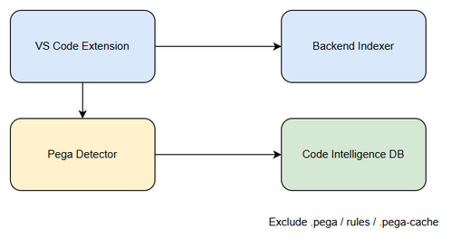
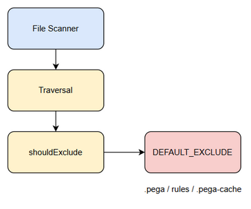

# TDD - SA4E-374: Pega Workspace Indexing Single Responsibility Separation

**Version:** 1.0 - Official
**Date:** 2026-10-20
**Ticket:** SA4E-374
**Status:** Aligned with BRD v1.0 & FSD v1.0

## 1. Introduction

Purpose: Resolve Single Responsibility Violation where Pega workspace indexing bypasses extension layer.
Scope: Exclude .pega, rules/, .pega-cache from backend; transfer Pega indexing to extension via manifest contract.
References: BRD v1.0, FSD v1.0, FSD-TECH-PREVIEW

## 2. System Architecture

Current: Workspace Files -> Backend Indexer -> DB  Violates SRP
Target:
Extension owns Pega discovery with SRP_EXCLUDES [.pega/**, rules/**, .pega-cache/**, **/*.pega, **/*.pega.json]
Extension builds manifest -> POST /api/v1/pega/index-manifest -> Backend
Backend indexer remains generic with DEFAULT_EXCLUDE includes .pega, rules, .pega-cache

## 3. API Design

POST /api/v1/pega/index-manifest
Headers: Authorization Bearer JWT, X-Project-Id
Body: projectId, workspaceRoot, discoveryTime, excludePatternsApplied, rules[], metadata
Response: manifestId, acceptedCount, rejectedCount, indexingJobId
Errors: PEGA-001 Invalid manifest, PEGA-002 Unauthorized, PEGA-003 Too large, PEGA-005 SRP violation

GET /api/v1/pega/index-status/{jobId}

## 4. Database Design

Entity pega_index_manifests
Attributes: manifest_id UUID PK, project_id string, submitted_at datetime, rule_count int, exclude_patterns JSON, status enum, indexing_job_id UUID
Impact: files table adds source enum [code-intel, pega-manifest]; indexing_jobs adds source_type

## 5. Component Design

Backend:
backend/src/config/schema.ts DEFAULT_EXCLUDE includes .pega, rules, .pega-cache
Config validation rejects if includeExtensions contains .pega
backend/src/engine/indexer/file-scanner/traversal.ts shouldExclude enhanced with Pega SRP guard for .pega, .pega.json, rules/, .pega-cache/
detectLanguage returns null for .pega

Extension:
extension/src/indexer.ts / services/IndexingService.ts detects pega-project.json, applies SRP_EXCLUDES, builds manifest, POSTs to backend with retry 3x, polls status

## 6. Business Rules

BR-001 Extension must intercept Pega workspace indexing before backend
BR-002 Extension must apply exclude patterns .pega/**, rules/**, .pega-cache/**, **/*.pega, **/*.pega.json
BR-003 Backend must reject manifest containing paths matching SRP excludes
BR-004 Backend indexer must not directly scan Pega workspace
BR-005 Backend DEFAULT_EXCLUDE must contain .pega, rules, .pega-cache
BR-006 Backend must not include .pega in UNIFIED_EXTENSIONS_WITH_DOT whitelist
BR-007 File scanner must reject paths ending .pega or .pega.json
BR-008 SRP guard middleware must reject manifest with violating paths

## 7. Sequence Diagram

Developer triggers Index Workspace
Extension detects pega-project.json
Extension discovers and filters with SRP_EXCLUDES
Extension builds Pega index manifest
Extension POST /api/v1/pega/index-manifest to Backend
Backend validates SRP guard, returns 202 Accepted + manifestId + indexingJobId
Backend indexes, returns complete
Extension confirms to Developer

Alternative: No Pega project -> skip Pega discovery
Exception: Backend rejects -> retry 3x then queue

## 8. Implementation Checklist

Update DEFAULT_EXCLUDE to include .pega
Add config validation reject .pega whitelist
Enhance shouldExclude with Pega SRP guard
Add unit test for shouldExclude
Implement POST /api/v1/pega/index-manifest with validation
Implement GET /api/v1/pega/index-status
Create pega_index_manifests migration
Verify extension detects pega-project.json and builds manifest
Ensure extension applies SRP_EXCLUDES before submission
Add integration test for PEGA-005 rejection
Update file-scanner tests
Regenerate code-intel index

## 9. Diagrams

*[Edit in draw.io](diagrams/architecture.drawio)*

*[Edit in draw.io](diagrams/component.drawio)*

Notes: Version 1.0 aligned with BRD v1.0 and FSD v1.0. Updated API contract to POST /api/v1/pega/index-manifest, refined exclude patterns, added data model and business rules.
