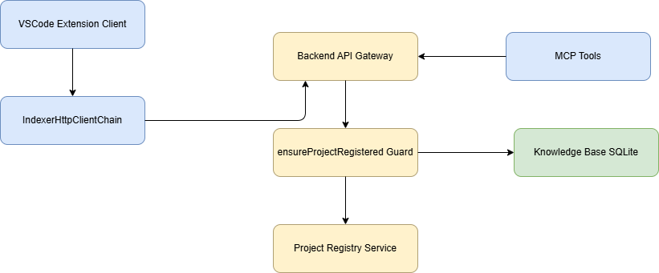
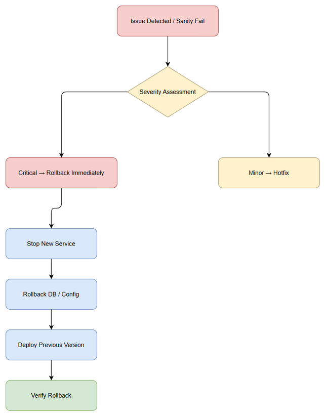

# Deployment Guide (DPG)

## SDLC-Agents-4-Enterprise — SA4E-375: PROJECT_NOT_REGISTERED khi index vào KB

---

## Document Information

| Field | Value |
|-------|-------|
| Jira Ticket | SA4E-375 |
| Title | PROJECT_NOT_REGISTERED khi index vào KB |
| Author | DevOps Agent |
| Version | 1.0 |
| Date | 2026-10-19 |
| Status | Draft |
| Related TDD | TDD.md |

---

## Revision History

| Version | Date | Author | Changes |
|---------|------|--------|---------|
| 1.0 | 2026-10-19 | DevOps Agent | Initiate document — auto-generated from TDD and project context |

---

## Sign-Off

| Name | Role | Signature and date |
|------|------|--------------------|
| | Dev Lead | ☐ Approved for deployment |
| | QA Lead | ☐ Testing completed |
| | Ops Lead | ☐ Infrastructure ready |

---

## 1. Overview

### 1.1 Feature Summary

Fix lỗi PROJECT_NOT_REGISTERED khi index tài liệu vào Knowledge Base qua IndexerHttpClient và MCP tool calls. Triển khai server-side auto-upsert project, ổn định projectId dựa trên workspace identifier, mở rộng auto-register cho tất cả entry points.

### 1.2 Deployment Scope

| Item | Type | Description |
|------|------|-------------|
| code-intel backend | Modified | ensureProjectRegistered chuyển sang auto-upsert, Project Registry Service |
| VSCode Extension | Modified | project-id.ts stable derivation, IndexerHttpClientChain retry logic, MCP auto-register helper |
| project_registry DB | No schema change | Sử dụng INSERT OR IGNORE hiện có |

### 1.3 Target Environments

| Environment | URL | Deploy Order | Approval Required |
|-------------|-----|-------------|-------------------|
| DEV | http://dev.code-intel.local | 1st | No |
| SIT | http://sit.code-intel.local | 2nd | No |
| UAT | http://uat.code-intel.local | 3rd | QA Sign-off |
| PROD | http://code-intel.company.com | 4th | PM + Business Sign-off |

---

## 2. Prerequisites

### 2.1 Infrastructure

| Requirement | Status | Notes |
|-------------|--------|-------|
| Code-Intel backend container | Ready | Docker registry accessible |
| Extension build pipeline | Ready | VSIX artifact available |
| Network access DB | Ready | SQLite file mounted |

### 2.2 Software Dependencies

| Dependency | Version | Status |
|-----------|---------|--------|
| Node.js | 20.x | Installed |
| backend | v1.15.0+ | Pending update |
| extension | 0.9.0+ | Pending update |

### 2.3 Access Requirements

| Access | Type | Who Needs It |
|--------|------|-------------|
| SSH to backend host | Key-based | DevOps team |
| DB admin | File access | DBA |
| CI/CD pipeline | Service account | Automated |

### 2.4 Backup Requirements

- [ ] Database backup completed before deployment
- [ ] Application backup (previous version artifact saved)
- [ ] Configuration backup

---

## 3. Pre-Deployment Checklist

| # | Item | Responsible | Status |
|---|------|-------------|--------|
| 1 | Code merged to release branch | Developer | ☐ |
| 2 | All unit tests passed | Developer | ☐ |
| 3 | All integration tests passed | QA | ☐ |
| 4 | SIT/UAT sign-off obtained | QA + BA | ☐ |
| 5 | Database backup completed | DBA | ☐ |
| 6 | Configuration files prepared | DevOps | ☐ |
| 7 | Feature flags configured | Developer | ☐ |
| 8 | Monitoring/alerting configured | DevOps | ☐ |
| 9 | Rollback plan reviewed | Team | ☐ |
| 10 | Deployment window confirmed | PM | ☐ |

---

## 4. Database Migration

### 4.1 Migration Scripts

| Order | Script | Description | Estimated Time |
|-------|--------|-------------|----------------|
| 1 | N/A | No schema change required | 0 min |

### 4.2 Execution Steps

```bash
# No migration needed. Verify project_registry table exists
sqlite3 .code-intel/project_registry.db "SELECT name FROM sqlite_master WHERE type='table' AND name='project_registry';"
```

### 4.3 Verification Queries

```sql
SELECT project_id, display_name, created_at FROM project_registry LIMIT 5;
```

### 4.4 Rollback Scripts

No DB rollback required for this release.

---

## 5. Application Deployment

### 5.1 Deployment Flow



### 5.2 Deployment Steps

| Step | Action | Command | Verification |
|------|--------|---------|-------------|
| 1 | Stop backend service | docker stop code-intel-backend | Container stopped |
| 2 | Pull new backend image | docker pull registry/code-intel/backend:v1.15.0-sa4e-375 | Image pulled |
| 3 | Start backend container | docker run -d --name code-intel-backend -p 8080:8080 ... | Container running |
| 4 | Verify health | curl http://localhost:8080/health | 200 OK |
| 5 | Update extension | Install VSIX sa4e-375 | Extension activated |

### 5.3 Docker Deployment

```bash
docker pull registry/code-intel/backend:v1.15.0-sa4e-375
docker stop code-intel-backend
docker rm code-intel-backend
docker run -d --name code-intel-backend \
  -p 8080:8080 \
  -e NODE_ENV=production \
  -v /data/code-intel:/app/data \
  registry/code-intel/backend:v1.15.0-sa4e-375
docker logs code-intel-backend --tail 50
```

---

## 6. Configuration Changes

### 6.1 New Environment Variables

| Variable | Description | DEV | SIT | UAT | PROD |
|----------|-------------|-----|-----|-----|------|
| AUTO_REGISTER_ENABLED | Enable server auto-upsert | true | true | true | true |
| PROJECT_ID_STABLE | Use deterministic projectId | true | true | true | true |

### 6.2 Application Properties Changes

| Property | Old Value | New Value | File |
|----------|-----------|-----------|------|
| ensureProjectRegistered.mode | fail-fast | auto-upsert | backend/src/server/routes/admin/context.ts |

### 6.3 Feature Flags

| Flag | DEV | SIT | UAT | PROD |
|------|-----|-----|-----|------|
| autoRegisterProject | true | true | true | true |

---

## 7. Post-Deployment Verification

### 7.1 Health Checks

| Check | Endpoint/Command | Expected Result | Timeout |
|-------|-----------------|-----------------|---------|
| Backend health | GET /health | 200 OK, status: UP | 30s |
| Project registry access | GET /api/admin/projects | 200 OK | 10s |

### 7.2 Smoke Tests

| # | Scenario | Steps | Expected Result |
|---|----------|-------|-----------------|
| 1 | Index document via MCP | Call mem_ingest_file via MCP tool | Success, no PROJECT_NOT_REGISTERED |
| 2 | Index via IndexerHttpClient | Trigger auto-index | Project auto-created, document indexed |
| 3 | Stable projectId | Run twice, check .code-intel/project.json | Same projectId persisted |

### 7.3 Log Verification

| Log Entry | Level | Expected | Location |
|-----------|-------|----------|----------|
| Auto-register project | INFO | After first index | backend logs |
| Project upsert success | INFO | No duplicate creation | backend logs |

### 7.4 Monitoring Dashboard

- [ ] Application metrics visible
- [ ] Error rate within normal range
- [ ] No PROJECT_NOT_REGISTERED alerts

---

## 8. Rollback Plan

### 8.1 Rollback Flow



### 8.2 Rollback Decision Criteria

| Condition | Action |
|-----------|--------|
| Critical defect found in production | Immediate rollback |
| Performance degradation > 50% | Immediate rollback |
| Auto-register creates duplicates | Immediate rollback |
| Minor UI issue | Hotfix — no rollback |

### 8.3 Rollback Steps

| Step | Action | Command | Verification |
|------|--------|---------|-------------|
| 1 | Stop new backend version | docker stop code-intel-backend | Stopped |
| 2 | Deploy previous image | docker run ... v1.14.9 | Running |
| 3 | Restore extension | Install previous VSIX | Activated |
| 4 | Verify health | curl /health | 200 OK |

### 8.4 Rollback Time Estimate

| Action | Estimated Time |
|--------|---------------|
| Application rollback | 5 min |
| Verification | 5 min |
| **Total** | **10 min** |

---

## 9. Environment-Specific Notes

### 9.1 DEV

Fast deploy, no approval.

### 9.2 SIT

Run smoke tests.

### 9.3 UAT

QA sign-off required.

### 9.4 PROD

- **Deployment Window:** Weekend 22:00-02:00
- **Approval Required From:** PM + Business Owner
- **Communication Plan:** Slack #devops-announce
- **On-Call Contact:** DevOps Lead

---

## 10. Appendix

### Contacts

| Role | Name | Contact |
|------|------|---------|
| DevOps Lead | TBD | Email |
| DBA | TBD | Email |

### Related Tickets

| Ticket | Summary | Relationship |
|--------|---------|-------------|
| SA4E-375 | PROJECT_NOT_REGISTERED khi index vào KB | Main ticket |
