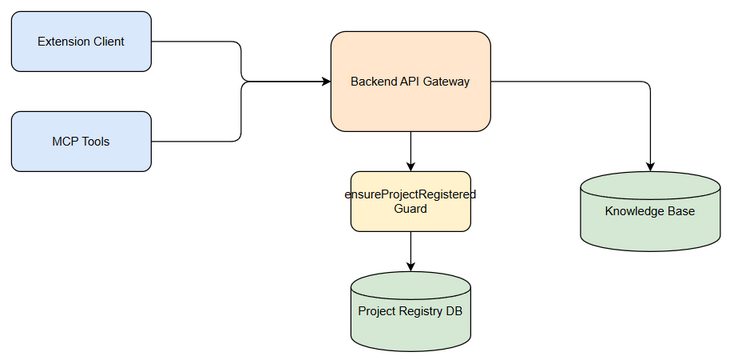
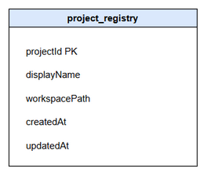
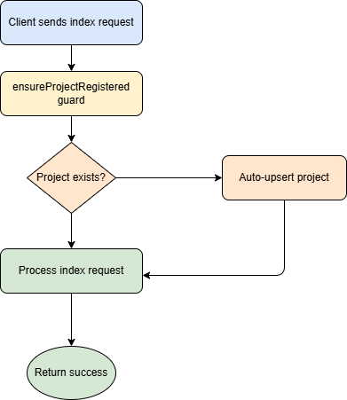

# Functional Specification Document (FSD)

## SA4E-375 — PROJECT_NOT_REGISTERED khi index vào KB

---

## Document Information

| Field | Value |
|-------|-------|
| Jira Ticket | SA4E-375 |
| Title | PROJECT_NOT_REGISTERED khi index vào KB |
| Author | BA Agent |
| Version | 1.0 |
| Date | 2026-10-19 |
| Status | Draft |
| Related BRD | BRD.md |

---

## Revision History

| Version | Date | Author | Changes |
|---------|------|--------|---------|
| 1.0 | 2026-10-19 | BA Agent | Initiate document — auto-generated from BRD and Jira tickets |

---

## 1. Introduction

### 1.1 Purpose

This FSD specifies functional requirements to eliminate `PROJECT_NOT_REGISTERED` errors when indexing documents into Knowledge Base. It defines auto-register upsert behavior for backend guard, stable deterministic projectId derivation, and auto-register support for MCP tool calls and IndexerHttpClient with retry safety.

### 1.2 Scope

Reference BRD scope:
- Backend: project registry, `ensureProjectRegistered` guard auto-upsert
- Extension: IndexerHttpClientChain, MCP tool calls, project-id derivation
- No changes to public API contracts, only additive auto-register behavior

Technical clarifications:
- ProjectId must be stable across runs for same workspace
- Auto-register must be idempotent
- Multi-tenant isolation preserved

### 1.3 Definitions & Acronyms

| Term | Definition |
|------|------------|
| PROJECT_NOT_REGISTERED | Error code returned when project not found in project_registry |
| ensureProjectRegistered | Guard middleware validating project existence |
| projectId | Deterministic identifier for workspace |
| MCP | Model Context Protocol tool calls |
| KB | Knowledge Base |

### 1.4 References

| Document | Location |
|----------|----------|
| BRD | documents/SA4E-375/BRD.md |
| TDD | documents/SA4E-375/TDD.md |
| DISCREPANCY | documents/SA4E-375/DISCREPANCY.md |

---

## 2. System Overview

### 2.1 System Context Diagram

*[Edit in draw.io](diagrams/system-context.drawio)*

Extension Client and MCP Tools invoke Backend API Gateway. Guard `ensureProjectRegistered` checks `project_registry`. If missing, server auto-upserts project and continues request processing. IndexerHttpClient performs client-side auto-register with retry.

### 2.2 System Architecture

Components:
- IndexerHttpClientCore — builds headers, maybeAutoRegister
- IndexerHttpClientTransport — httpPostJson/httpGet with auto-retry
- project-id.ts — deriveProjectId stable, persist to `.code-intel/project.json`
- AdminContext.ensureProjectRegistered — guard with auto-upsert
- Project Registry Service — CRUD SQLite project_registry

---

## 3. Functional Requirements

### 3.1 Feature: Auto-Register Project on Index

**Source:** BRD §3, §5

#### 3.1.1 Description

When a client attempts to index into KB, if project is not registered, system automatically creates/ensures project record instead of returning 404 PROJECT_NOT_REGISTERED.

#### 3.1.2 Use Case

**Use Case ID:** UC-01
**Actor:** Extension User / MCP Tool
**Preconditions:** User has valid JWT, workspace path known
**Postconditions:** Project exists in registry, index request succeeds

**Main Flow:**

| Step | Actor | System | Description |
|------|-------|--------|-------------|
| 1 | Actor | | Sends index request with X-Project-Id, X-Workspace-Root headers |
| 2 | | ensureProjectRegistered | Checks project_registry |
| 3 | | Project Registry | If missing, INSERT OR IGNORE with projectId, displayName, workspacePath |
| 4 | | Backend | Process index request |
| 5 | | System | Return 200 success |

**Alternative Flows:**

| ID | Condition | Steps |
|----|-----------|-------|
| AF-1 | Project exists | Skip insert, continue |
| AF-2 | Client-side pre-register | IndexerHttpClient calls ensureProjectRegisteredClientSide before request |

**Exception Flows:**

| ID | Condition | Steps |
|----|-----------|-------|
| EF-1 | DB failure | Return 500 INTERNAL_ERROR |
| EF-2 | Invalid projectId format | Return 400 validation error |

#### 3.1.3 Business Rules

| Rule ID | Rule | Source |
|---------|------|--------|
| BR-01 | Auto-register is idempotent; duplicate registration returns success | BRD §5 |
| BR-02 | Server must not expose PROJECT_NOT_REGISTERED to client after fix | BRD §3 |
| BR-03 | ProjectId must be stable and deterministic per workspace | BRD §3 |
| BR-04 | Auto-register limited to admin routes with valid JWT | TDD §7.1 |

#### 3.1.4 Data Specifications

**Input Data:**

| Field | Type | Required | Validation | Description |
|-------|------|----------|------------|-------------|
| projectId | string | Y | ^[a-zA-Z0-9_-]{6,32}$ | Deterministic workspace id |
| displayName | string | Y | max 128 | Human readable name |
| workspacePath | string | Y | absolute path | Root folder |

**Output Data:**

| Field | Type | Description |
|-------|------|-------------|
| projectId | string | Registered project id |
| created | boolean | true if newly created |

#### 3.1.5 API Contract (Functional View)

**Endpoint:** `POST /api/admin/projects/register`
**Purpose:** Auto-register project for idempotent upsert

**Input Parameters:**

| Parameter | Type | Required | Business Rule | Description |
|-----------|------|----------|---------------|-------------|
| projectId | string | Y | BR-03 | Stable identifier |
| displayName | string | Y |  | Name |
| workspacePath | string | Y |  | Workspace root |

**Output Data:**

| Field | Type | Description |
|-------|------|-------------|
| projectId | string | Project id |
| created | boolean | Creation flag |

**Business Error Scenarios:**

| Scenario | User Message | Trigger Condition |
|----------|-------------|-------------------|
| Invalid format | Project id invalid | Regex fail |
| DB error | Internal error | DB failure |

---

### 3.2 Feature: Stable Deterministic projectId Derivation

**Source:** BRD §2, DISC-2

#### 3.2.1 Description

projectId derived from workspace metadata without random UUID component. Persisted to `.code-intel/project.json` to guarantee stability across runs.

#### 3.2.2 Use Case

**Use Case ID:** UC-02
**Actor:** Extension
**Preconditions:** Workspace opened
**Postconditions:** projectId consistent

**Main Flow:**

| Step | Actor | System | Description |
|------|-------|--------|-------------|
| 1 | | | Check .code-intel/project.json |
| 2 | | | If exists, load projectId |
| 3 | | | Else derive from workspacePath + git remote + user |
| 4 | | | Persist to project.json |
| 5 | | | Return projectId |

**Business Rules:**

| Rule ID | Rule | Source |
|---------|------|--------|
| BR-05 | No random UUID component in fallback hash | DISC-2 |
| BR-06 | projectId persisted before use | BRD §5 |
| BR-07 | Derivation inputs: workspace absolute path, git remote origin, OS user | TDD §4.2 |

---

### 3.3 Feature: Auto-Register for MCP Tool Calls

**Source:** BRD §3

#### 3.3.1 Description

MCP tool calls indexing into KB must auto-register project client-side before invocation, using shared helper `ensureProjectRegisteredClientSide`.

#### 3.3.2 Use Case

**Use Case ID:** UC-03
**Actor:** MCP Tool
**Preconditions:** Tool configured with project context

**Main Flow:**

| Step | Actor | System | Description |
|------|-------|--------|-------------|
| 1 | | | Prepare request with projectId |
| 2 | | ensureProjectRegisteredClientSide | Call register if needed |
| 3 | | | Execute MCP tool index request |
| 4 | | | Handle success/failure |

---

### 3.4 Feature: IndexerHttpClient Retry Safe

**Source:** BRD §2

#### 3.4.1 Description

IndexerHttpClient must allow retry once per request after auto-register, removing single-shot `_autoRegisterAttempted` flag.

#### 3.4.2 Business Rules

| Rule ID | Rule | Source |
|---------|------|--------|
| BR-08 | Retry allowed up to 1 time per request after auto-register | TDD §4.2 |
| BR-09 | _autoRegisterAttempted changed to per-request flag | TDD §4.2 |

---

## 4. Data Model

### 4.1 Entity Relationship Diagram

*[Edit in draw.io](diagrams/er-diagram.drawio)*

### 4.2 Logical Entities

#### Entity: project_registry

| Attribute | Type | Required | Business Rule | Description |
|-----------|------|----------|---------------|-------------|
| projectId | string | Y | BR-03 | Primary key |
| displayName | string | Y |  | Human name |
| workspacePath | string | Y |  | Absolute path |
| createdAt | datetime | Y |  | Creation timestamp |
| updatedAt | datetime | N |  | Last update |

**Relationships:**
None for this feature; projectId is foreign key for KB entries.

---

## 5. Integration Specifications

### 5.1 External System: Knowledge Base API

| Attribute | Value |
|-----------|-------|
| Purpose | Store indexed documents per project |
| Direction | Inbound |
| Data Format | JSON |
| Frequency | Real-time |

**Data Exchange:**

| Our Data | External Data | Direction | Business Rule |
|----------|--------------|-----------|---------------|
| projectId | project_id | Send | BR-03 |
| document content | entry | Send |  |

---

## 6. Processing Logic

### 6.1 Auto-Register Process

**Trigger:** Index request with unknown project
**Schedule:** On-demand
**Input:** projectId, displayName, workspacePath
**Output:** project record ensured

**Processing Steps:**

| Step | Description | Error Handling |
|------|-------------|----------------|
| 1 | Validate projectId format | Return 400 |
| 2 | Check project_registry |  |
| 3 | INSERT OR IGNORE | Log warn if new |
| 4 | Continue request |  |

**Activity Diagram:**

*[Edit in draw.io](diagrams/business-flow.drawio)*

---

## 7. Security Requirements

### 7.1 Authentication & Authorization

| Role | Permissions | Screens/Features |
|------|-------------|-------------------|
| Authenticated User | Read/Write project | Index API |
| Admin | Register project | POST /api/admin/projects/register |

### 7.2 Data Sensitivity Classification

| Data Type | Classification | Business Requirement |
|-----------|----------------|----------------------|
| projectId | Internal | Tenant isolation |
| workspacePath | Internal | Privacy |

### 7.3 Audit Trail

| Event | Logged Fields | Retention | Business Reason |
|-------|--------------|-----------|-----------------|
| auto_register_project | projectId, source | 90 days | Traceability |

---

## 8. Non-Functional Requirements

| Category | Business Requirement | Acceptance Criteria |
|----------|---------------------|---------------------|
| Performance | Auto-register latency | < 100ms added |
| Availability | No regression | 99.9% uptime |
| Scalability | Support 10k projects | Registry query < 10ms |
| Data Retention | Project metadata | 7 years |

---

## 9. Error Handling (User-Facing)

### 9.1 Error Scenarios

| Scenario | Severity | User Message | Expected Behavior |
|----------|----------|-------------|-------------------|
| PROJECT_NOT_REGISTERED legacy | Warning | Auto-registering project | Transparent retry |
| Invalid projectId | Error | Invalid project identifier | Show validation |
| DB failure | Critical | Internal error | Notify admin |

---

## 10. Testing Considerations

### 10.1 Test Scenarios

| ID | Scenario | Input | Expected Output | Priority |
|----|----------|-------|-----------------|----------|
| TC-01 | Index with new project | Unknown projectId | Project created, index success | High |
| TC-02 | Index with existing project | Known projectId | No duplicate, index success | High |
| TC-03 | projectId stability | Restart extension | Same projectId returned | High |
| TC-04 | MCP auto-register | MCP tool call | Project auto-registered | Medium |

---

## 11. Appendix

### Diagrams

| Diagram | File |
|---------|------|
| System Context | diagrams/system-context.png |
| ER Diagram | diagrams/er-diagram.png |
| Business Flow | diagrams/business-flow.png |

### Change Log from BRD

- Added explicit API contract for POST /api/admin/projects/register
- Clarified stable derivation rules for projectId
- Defined auto-register flow for MCP tools
- Specified idempotent upsert behavior for ensureProjectRegistered guard
