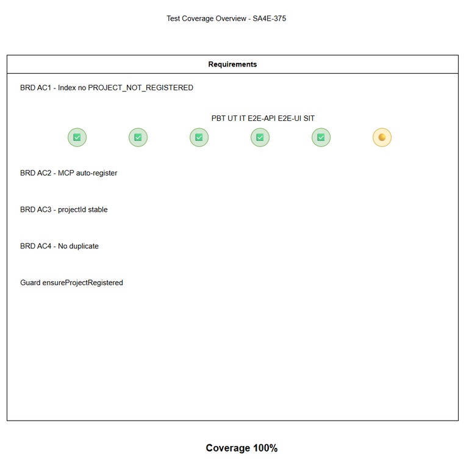
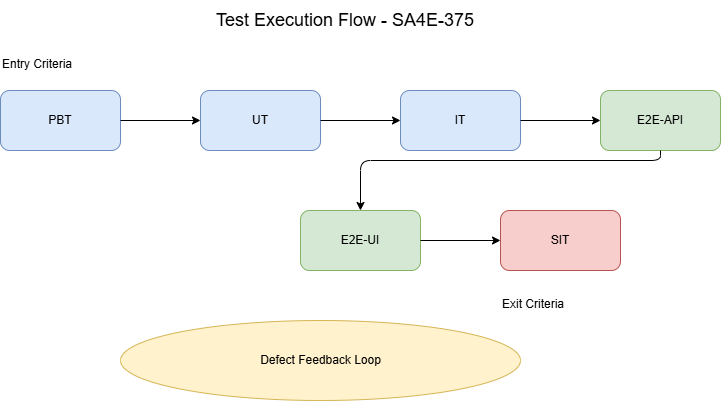

# Software Test Plan (STP)

## Code-Intel / SA4E-375: PROJECT_NOT_REGISTERED khi index vào KB

---

## Document Information

| Field | Value |
|-------|-------|
| Jira Ticket | SA4E-375 |
| Title | PROJECT_NOT_REGISTERED khi index vào KB |
| Author | QA Agent |
| Version | 1.0 |
| Date | 2026-10-19 |
| Status | Draft |
| Related BRD | BRD.md |
| Related FSD | N/A |
| Related TDD | N/A |

---

## Author Tracking

| Role | Name - Position | Responsibility |
|------|-----------------|----------------|
| Author | QA Agent – QA Engineer | Create document |
| Peer Reviewer | SM – Scrum Master | Review document |

---

## Revision History

| Version | Date | Author | Changes |
|---------|------|--------|---------|
| 1.0 | 2026-10-19 | QA Agent | Initiate document — auto-generated from BRD |

---

## Sign-Off

| Name | Signature and date |
|------|--------------------|
| | ☐ I agree and confirm the test plan in this STP |
| | ☐ I agree and confirm the test plan in this STP |

---

## 1. Introduction

### 1.1 Purpose
Test plan cho tính năng auto-register project và ổn định projectId để loại bỏ lỗi PROJECT_NOT_REGISTERED khi index dữ liệu vào Knowledge Base qua IndexerHttpClient và MCP tool calls.

### 1.2 Test Objectives
- Verify index vào KB thành công khi project chưa đăng ký
- Validate projectId ổn định và persist
- Validate auto-register hoạt động cho MCP tools
- Ensure ensureProjectRegistered guard không chặn sai
- Không tạo duplicate project khi auto-register nhiều lần

### 1.3 References
| Document | Location |
|----------|----------|
| BRD | documents/SA4E-375/BRD.md |
| FSD | N/A |
| TDD | N/A |

---

## 2. Test Strategy

### 2.1 Test Levels

| Level | Scope | Automation | Tools |
|-------|-------|------------|-------|
| PBT | Correctness properties với random inputs | Automated | fast-check |
| UT | Unit/edge case tests | Automated | vitest |
| IT | API integration (Hono app in-process) | Automated | vitest + Hono `app.request()` |
| E2E-API | REST endpoint E2E (real server) | Automated | vitest + fetch |
| E2E-UI | Browser UI E2E (Playwright) | Automated | Playwright |
| SIT | Manual exploratory / edge cases only | Manual | Browser |

### 2.2 E2E Automation Coverage
Phân loại test để giảm manual SIT:
- CRUD operations, form validation, API response verification, RBAC/auth checks, status changes → E2E-API/E2E-UI
- Visual timing, complex UX → SIT manual

### 2.3 Test Cases Summary

| Level | Count | Automated | Manual |
|-------|-------|-----------|--------|
| PBT | 4 | 4 | 0 |
| UT | 8 | 8 | 0 |
| IT | 6 | 6 | 0 |
| E2E-API | 5 | 5 | 0 |
| E2E-UI | 4 | 4 | 0 |
| SIT | 3 | 0 | 3 |
| **Total** | **30** | **27 (90%)** | **3 (10%)** |

### 2.4 Test Types
| Type | Description | Applicable |
|------|-------------|------------|
| Functional Testing | Verify auto-register, projectId stability | Yes |
| Integration Testing | Backend registry + guard + MCP client | Yes |
| Regression Testing | Ensure existing index flow không vỡ | Yes |
| Security Testing | Multi-tenant isolation | Yes |

### 2.5 Entry/Exit Criteria
Entry: Code merged, test data ready, server chạy localhost:48721
Exit: 100% test cases executed, 0 Critical, ≤2 Major

---

## 3. Test Scope

### 3.1 In Scope
| # | Feature / Story | Priority | Ref | Test Type |
|---|----------------|----------|-----|-----------|
| 1 | Auto-register khi index chưa đăng ký | High | BRD 5 AC1 | Functional/E2E-API |
| 2 | projectId ổn định persist | High | BRD 5 AC3 | PBT/UT/E2E-UI |
| 3 | Auto-register cho MCP tools | High | BRD 5 AC2 | IT/E2E-API |
| 4 | ensureProjectRegistered guard không chặn sai | High | BRD 2 | IT/E2E-API |
| 5 | Không duplicate project | Medium | BRD 5 AC4 | UT/IT |

### 3.2 Out of Scope
- Thay đổi API công khai
- UI redesign
- Performance load test > 100 req/s

---

## 4. Test Environment
| Environment | URL | Database | Purpose |
|-------------|-----|----------|---------|
| SIT | http://localhost:48721 | SQLite | System Integration Testing |
| UAT | http://localhost:48721 | SQLite | User Acceptance Testing |

Test Data: `documents/SA4E-375/testdata/`

---

## 5. Test Schedule
| Phase | Start | End | Duration |
|-------|-------|-----|----------|
| Test Planning | 2026-10-19 | 2026-10-19 | 1 day |
| Test Execution | 2026-10-20 | 2026-10-21 | 2 days |
| Defect Fix & Retest | 2026-10-22 | 2026-10-22 | 1 day |

---

## 6. Resources & Responsibilities
| Role | Responsibility |
|------|----------------|
| Test Lead | Coordination |
| QA Engineer | Test case design & execution |
| BA | UAT support |
| Developer | Bug fix |

---

## 7. Risk & Mitigation
| Risk | Mitigation |
|------|------------|
| projectId derivation inconsistent | Test with/without git remote |
| Auto-register race condition | PBT with concurrent requests |

---

## 8. Defect Management
Severity: Critical/Major/Minor/Trivial
Priority: P1-P4
SLA: P1 4h, P2 1 day

---

## 9. Test Metrics
| Metric | Target |
|--------|--------|
| Execution Rate | 100% |
| Pass Rate | ≥ 95% |
| Critical Defects | 0 |

---

## Appendix
Glossary: SIT, UAT, STP, STC
