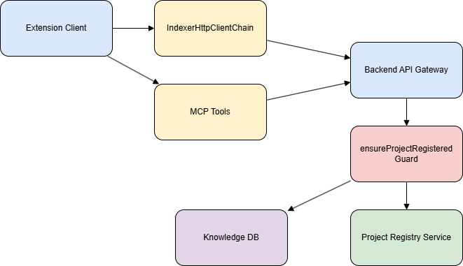
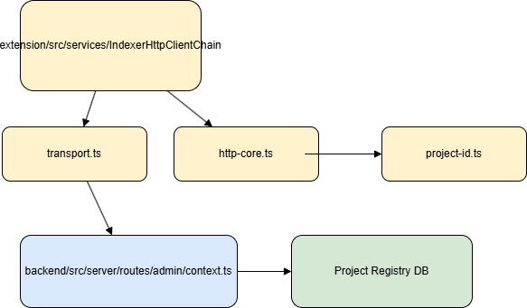

# Technical Design Document (TDD)

## SA4E-375 — PROJECT_NOT_REGISTERED khi index vào KB

---

## Document Information

| Field | Value |
|-------|-------|
| Jira Ticket | SA4E-375 |
| Title | PROJECT_NOT_REGISTERED khi index vào KB |
| Author | SA Agent |
| Version | 2.0 |
| Date | 2026-10-19 |
| Status | Done |
| Related BRD | BRD.md |
| Related FSD | FSD.md |

---

## Revision History

| Version | Date | Author | Changes |
|---------|------|--------|---------|
| 1.0 | 2026-10-19 | SA Agent | Initial design based on BRD |
| 2.0 | 2026-10-19 | SA Agent | Feedback loop: align with FSD v1 — auto-upsert project_registry, deterministic projectId, auto-register MCP tool calls, retry-safe IndexerHttpClient |

---

## 1. Introduction

### 1.1 Purpose
Thiết kế giải pháp khắc phục lỗi `PROJECT_NOT_REGISTERED` khi index tài liệu vào Knowledge Base. Đảm bảo auto-register project idempotent, projectId ổn định định danh, guard server auto-upsert, và client-side auto-register cho MCP tools và IndexerHttpClient.

### 1.2 Scope
- Backend: `ensureProjectRegistered` guard auto-upsert, Project Registry Service, API `POST /api/admin/projects/register`
- Extension: `project-id.ts` deterministic derivation + persist, `IndexerHttpClientCore/Transport` retry-safe, MCP tool helper `ensureProjectRegisteredClientSide`
- Không thay đổi API công khai, chỉ bổ sung hành vi auto-register/upsert

### 1.3 Technology Stack

| Layer | Technology | Version |
|-------|-----------|---------|
| Language | TypeScript | 5.x |
| Backend | Hono + better-sqlite3 | 4.x |
| Extension | VS Code Extension + fetch | 1.x |
| Database | SQLite project_registry | 3.x |
| Build Tool | npm | 10.x |

### 1.4 Design Principles
- Idempotent auto-register
- Stable identity cho multi-tenant
- Fail-closed nhưng tự động khôi phục
- Retry-safe client

### 1.5 Constraints
- Không phá vỡ multi-tenant isolation
- projectId phải stable across runs
- Auto-register chỉ cho admin routes có JWT hợp lệ

### 1.6 References
| Document | Location |
|----------|----------|
| BRD | documents/SA4E-375/BRD.md |
| FSD | documents/SA4E-375/FSD.md |

---

## 2. System Architecture

### 2.1 Architecture Overview
Extension client gửi request qua IndexerHttpClientChain hoặc MCP Tools tới Backend API Gateway. Guard `ensureProjectRegistered` kiểm tra `project_registry`. Nếu chưa tồn tại, server tự động upsert project thay vì trả lỗi 404.


*[Edit in draw.io](diagrams/architecture.drawio)*

### 2.2 Component Diagram

*[Edit in draw.io](diagrams/component.drawio)*

| Component | Responsibility | Technology |
|-----------|----------------|------------|
| IndexerHttpClientCore | buildHeaders, maybeAutoRegister | TypeScript |
| IndexerHttpClientTransport | httpPostJson/httpGet với auto-retry | TypeScript |
| project-id.ts | deriveProjectId stable, persist .code-intel/project.json | TypeScript |
| AdminContext.ensureProjectRegistered | guard auto-upsert | Hono middleware |
| Project Registry Service | CRUD project_registry | better-sqlite3 |
| MCP Auto-Register Helper | ensureProjectRegisteredClientSide | TypeScript |

### 2.3 Deployment Architecture

*[Edit in draw.io](diagrams/deployment-architecture.drawio)*

### 2.4 Communication Patterns

| From | To | Protocol | Pattern | Description |
|------|----|----------|---------|-------------|
| Extension | Backend API | HTTPS | Sync | Index request with X-Project-Id |
| Backend | SQLite | JDBC | Sync | project_registry upsert |
| MCP Tool | Backend API | HTTPS | Sync | Auto-register trước index |

---

## 3. API Design

### 3.1 API Overview
| # | Endpoint | Method | Description | Source |
|---|----------|--------|-------------|--------|
| 1 | /api/admin/projects/register | POST | Auto-register project idempotent | UC-01 |
| 2 | /api/admin/kb/entries | POST | Index entry với guard auto-upsert | UC-01 |

### 3.2 API: POST /api/admin/projects/register
**Implements:** UC-01, BR-01, BR-02, BR-03

| Attribute | Value |
|-----------|-------|
| Method | POST |
| Path | /api/admin/projects/register |
| Auth | Bearer JWT |
| Rate Limit | 60/min |

**Request Headers:**
| Header | Required | Description |
|--------|----------|-------------|
| Authorization | Yes | Bearer {token} |
| Content-Type | Yes | application/json |
| X-Project-Id | Yes | Deterministic project id |
| X-Workspace-Root | Yes | Absolute workspace path |

**Request Body:**
```json
{
  "projectId": "string",
  "displayName": "string",
  "workspacePath": "string"
}
```

**Response 200/201:**
```json
{
  "projectId": "string",
  "created": true
}
```

**Error Responses:**
| Status | Code | Message |
|--------|------|---------|
| 400 | INVALID_PROJECT_ID | Project id invalid |
| 500 | INTERNAL_ERROR | DB failure |

### 3.3 Guard Behavior Change
`ensureProjectRegistered` trước trả 404 PROJECT_NOT_REGISTERED. Sau fix:
- Validate projectId format ^[a-zA-Z0-9_-]{6,32}$
- Check project_registry
- Nếu missing: `INSERT OR IGNORE` với projectId, displayName, workspacePath, createdAt
- Log warn một lần, tiếp tục request
- Idempotent: duplicate registration trả created=false

---

## 4. Database Design

### 4.1 Schema Overview

*[Edit in draw.io](diagrams/er-diagram.drawio)*

### 4.2 DDL Scripts

#### Table: project_registry
```sql
CREATE TABLE project_registry (
    projectId TEXT PRIMARY KEY,
    displayName TEXT NOT NULL,
    workspacePath TEXT NOT NULL,
    createdAt DATETIME NOT NULL DEFAULT CURRENT_TIMESTAMP,
    updatedAt DATETIME
);
```

#### Indexes
```sql
CREATE INDEX idx_project_registry_workspace ON project_registry(workspacePath);
CREATE UNIQUE INDEX idx_project_registry_displayName ON project_registry(displayName);
```

### 4.3 Migration Plan
| Order | Script | Description |
|-------|--------|-------------|
| 1 | V1__create_project_registry.sql | Tạo bảng project_registry |

### 4.4 Query Patterns
| Operation | Query Pattern | Expected Performance |
|-----------|--------------|---------------------|
| Check project exists | SELECT 1 FROM project_registry WHERE projectId = ? | <10ms |
| Upsert project | INSERT OR IGNORE INTO project_registry... | <20ms |

---

## 5. Class / Module Design

### 5.1 Package Structure
```
extension/src/extension/registration/
  project-id.ts
backend/src/server/routes/admin/
  context.ts
  project-router.ts
backend/src/server/services/
  project-registry-service.ts
```

### 5.2 Key Interfaces
```typescript
interface ProjectRegistryService {
  ensureProjectRegistered(projectId: string, displayName: string, workspacePath: string): Promise<{created: boolean}>
}
```

### 5.3 Design Patterns
| Pattern | Where Used | Rationale |
|---------|-----------|-----------|
| Idempotent Upsert | Project Registry Service | Tránh duplicate |
| Guard -> Auto-Remediate | AdminContext.ensureProjectRegistered | Tự động khôi phục |
| Deterministic Derivation | project-id.ts | Stable identity |

### 5.4 Error Handling
| Exception | HTTP Status | Error Code |
|-----------|-------------|------------|
| InvalidProjectId | 400 | INVALID_PROJECT_ID |
| DbError | 500 | INTERNAL_ERROR |

---

## 6. Integration Design

### 6.1 External System: Knowledge Base API
| Attribute | Value |
|-----------|-------|
| Protocol | HTTPS REST |
| Authentication | JWT Bearer |
| Timeout | 30s |
| Retry Policy | 1 retry after auto-register |

**Sequence Diagram:**

*[Edit in draw.io](diagrams/business-flow.drawio)*

---

## 7. Security Design

### 7.1 Authentication
JWT bearer token required cho mọi admin route.

### 7.2 Authorization
Auto-register chỉ tạo project record, không cấp quyền. Project isolation duy trì qua projectId.

### 7.3 Data Protection
projectId derived từ workspace, không chứa secret. `.code-intel/project.json` lưu local.

### 7.4 Input Validation
| Field | Validation |
|-------|------------|
| projectId | ^[a-zA-Z0-9_-]{6,32}$ |
| displayName | max 128 |
| workspacePath | absolute path |

---

## 8. Performance & Scalability

### 8.1 Caching Strategy
projectId cache in-memory 5 min.

### 8.2 Connection Pooling
SQLite connection max 10.

### 8.3 Performance Targets
| Operation | Target |
|-----------|--------|
| Auto-register latency | <100ms added |
| Registry query | <10ms |

---

## 9. Monitoring & Observability

### 9.1 Logging
| Log Event | Level | Fields |
|-----------|-------|--------|
| auto_register_project | WARN | projectId, source |

### 9.2 Metrics
| Metric | Type | Alert Threshold |
|--------|------|-----------------|
| project_register_latency_ms | Histogram | p95 >200ms |
| auto_register_fail_rate | Counter | >5% |

---

## 10. Deployment Considerations

### 10.1 Environment Configuration
| Property | DEV | PROD |
|----------|-----|------|
| DB_PATH | ./data/dev.db | /data/prod.db |

### 10.2 Feature Flags
N/A — additive behavior.

### 10.3 Rollback Strategy
Revert guard to fail-fast, keep data.

---

## 11. Appendix

### Glossary
| Term | Definition |
|------|------------|
| PROJECT_NOT_REGISTERED | Error khi project chưa tồn tại |
| ensureProjectRegistered | Guard auto-upsert |

### Open Questions
| # | Question | Status |
|---|----------|--------|
| 1 | Có cần migration cho project_registry hiện có? | Resolved — INSERT OR IGNORE |
| 2 | MCP tool nào cần thêm auto-register? | Defined in FSD UC-03 |

---
