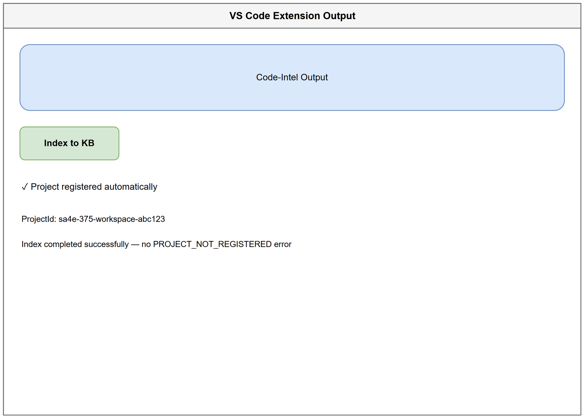

# User Guide — SA4E-375
## PROJECT_NOT_REGISTERED khi index vào KB — Project Registration Auto-Upsert

**Version:** 1.0  
**Date:** 2026-10-19  
**Ticket:** SA4E-375  
**Audience:** End-user, Developer, QA

---

## 1. Mục đích

Hướng dẫn này mô tả cách sử dụng tính năng **Project Registration Auto-Upsert** và **projectId ổn định** được triển khai trong SA4E-375 để loại bỏ lỗi `PROJECT_NOT_REGISTERED` khi index tài liệu vào Knowledge Base.

Sau khi áp dụng fix:
- Index qua IndexerHttpClient không còn lỗi `PROJECT_NOT_REGISTERED`
- MCP tool calls index vào KB tự động đăng ký project nếu chưa tồn tại
- `projectId` được persist trong `.code-intel/project.json` và không thay đổi giữa các lần chạy
- Auto-register idempotent, không tạo duplicate project

---

## 2. Prerequisites

- VS Code Extension Code-Intel đã cài đặt và kích hoạt
- Workspace mở trong VS Code
- Backend API đang chạy và có JWT hợp lệ
- Quyền truy cập workspace root (đọc/ghi file `.code-intel/project.json`)

---

## 3. Hướng dẫn sử dụng

### 3.1 Kiểm tra projectId ổn định

1. Mở workspace trong VS Code
2. Extension sẽ tự động kiểm tra file `.code-intel/project.json` ở root workspace
3. Nếu file chưa tồn tại:
   - System sẽ derive `projectId` từ `workspace absolute path` + `git remote origin` + `OS user`
   - Không sử dụng random UUID component
   - Lưu kết quả vào `.code-intel/project.json`
4. Nếu file đã tồn tại:
   - Load `projectId` từ file, đảm bảo ổn định qua các lần khởi động

**Ví dụ nội dung `.code-intel/project.json`:**
```json
{
  "projectId": "sa4e-375-workspace-abc123",
  "displayName": "SA4E-375 Workspace",
  "workspacePath": "C:\\projects\\kiro\\SDLC-Agents-4-Enterprise"
}
```

### 3.2 Index vào Knowledge Base


*[Edit in draw.io](diagrams/wireframe-project-registration.drawio)*

1. Mở Output Panel → Code-Intel Output
2. Nhấn nút **Index to KB** hoặc chạy lệnh `Code Intel: Index workspace`
3. System sẽ:
   - Gửi request với header `X-Project-Id` và `X-Workspace-Root`
   - Guard `ensureProjectRegistered` kiểm tra `project_registry`
   - Nếu project chưa tồn tại → tự động `INSERT OR IGNORE` project record
   - Tiếp tục xử lý index request
4. Kết quả hiển thị:
   - `✓ Project registered automatically`
   - `ProjectId: ...`
   - `Index completed successfully — no PROJECT_NOT_REGISTERED error`

### 3.3 Sử dụng MCP Tool Calls

Khi sử dụng MCP tool để index vào KB:
1. Tool sẽ gọi helper `ensureProjectRegisteredClientSide` trước khi thực thi
2. Nếu project chưa đăng ký, tool tự động gọi `POST /api/admin/projects/register`
3. Sau khi đăng ký thành công, tiếp tục index request

Không cần thao tác thủ công.

### 3.4 Kiểm tra project đã được đăng ký

- Truy cập backend DB `project_registry` hoặc UI quản trị project
- Tìm `projectId` tương ứng với workspace
- Kiểm tra `createdAt` và `workspacePath`

---

## 4. Troubleshooting lỗi PROJECT_NOT_REGISTERED

### 4.1 Vẫn nhận lỗi PROJECT_NOT_REGISTERED

**Nguyên nhân thường gặp:**
- JWT hết hạn hoặc thiếu
- Header `X-Project-Id` hoặc `X-Workspace-Root` không được gửi

**Cách xử lý:**
1. Kiểm tra Authorization header có Bearer token hợp lệ
2. Đảm bảo extension đã khởi tạo projectId — kiểm tra file `.code-intel/project.json`
3. Restart VS Code extension để reload projectId
4. Kiểm tra backend log: auto-register có được log với level WARN `auto_register_project`

### 4.2 projectId thay đổi mỗi lần chạy

**Nguyên nhân:**
- File `.code-intel/project.json` bị xóa hoặc chưa được tạo
- Derivation fallback dùng random UUID cũ

**Cách xử lý:**
1. Xóa file `.code-intel/project.json` để regenerate theo quy tắc mới
2. Mở lại workspace, extension sẽ tạo lại file với projectId deterministic
3. Verify projectId không thay đổi sau khi đóng/mở lại VS Code

### 4.3 Duplicate project trong registry

**Nguyên nhân:**
- Auto-register không idempotent

**Cách xử lý:**
1. Kiểm tra `project_registry` table — chỉ nên có 1 record cho mỗi `projectId`
2. Nếu phát hiện duplicate, xóa record thừa và giữ record có `createdAt` sớm nhất
3. Đảm bảo `INSERT OR IGNORE` hoạt động đúng ở server

### 4.4 Auto-register không hoạt động với MCP

**Cách xử lý:**
1. Kiểm tra MCP tool config có truyền đúng `projectId`
2. Verify helper `ensureProjectRegisteredClientSide` được gọi trước index request
3. Kiểm tra backend response của `POST /api/admin/projects/register` — phải trả về `created: true/false` không lỗi

---

## 5. FAQ

**Q1: ProjectId được tạo như thế nào?**  
A: Derive từ workspace absolute path + git remote origin + OS user, hash SHA-256, persist vào `.code-intel/project.json`. Không dùng random UUID.

**Q2: Có cần đăng ký project thủ công không?**  
A: Không. Auto-register sẽ tự động tạo project khi index request đầu tiên.

**Q3: Auto-register có ảnh hưởng multi-tenant isolation không?**  
A: Không. Auto-register chỉ tạo project record, không cấp quyền. Isolation duy trì qua `projectId`.

**Q4: Làm sao biết project đã được tạo tự động?**  
A: Output Panel sẽ hiển thị log `auto_register_project` level WARN, và project xuất hiện trong `project_registry`.

**Q5: Có thể thay đổi projectId không?**  
A: Không nên. Thay đổi projectId sẽ tạo project mới và mất dữ liệu index cũ. Nếu cần thay đổi, liên hệ admin.

**Q6: Lỗi `INVALID_PROJECT_ID` là gì?**  
A: projectId không khớp regex `^[a-zA-Z0-9_-]{6,32}$`. Kiểm tra file `.code-intel/project.json` và đảm bảo derivation đúng.

---

## 6. Tham khảo

- BRD: `documents/SA4E-375/BRD.md`
- FSD: `documents/SA4E-375/FSD.md`
- TDD v2: `documents/SA4E-375/TDD.md`
- TEST-REPORT: `documents/SA4E-375/TEST-REPORT.md`

---

*User Guide được tạo bởi BA Agent theo Phase 5.5 review, tuân thủ role boundaries: chỉ tạo tài liệu hướng dẫn người dùng, không sửa code/test.*
