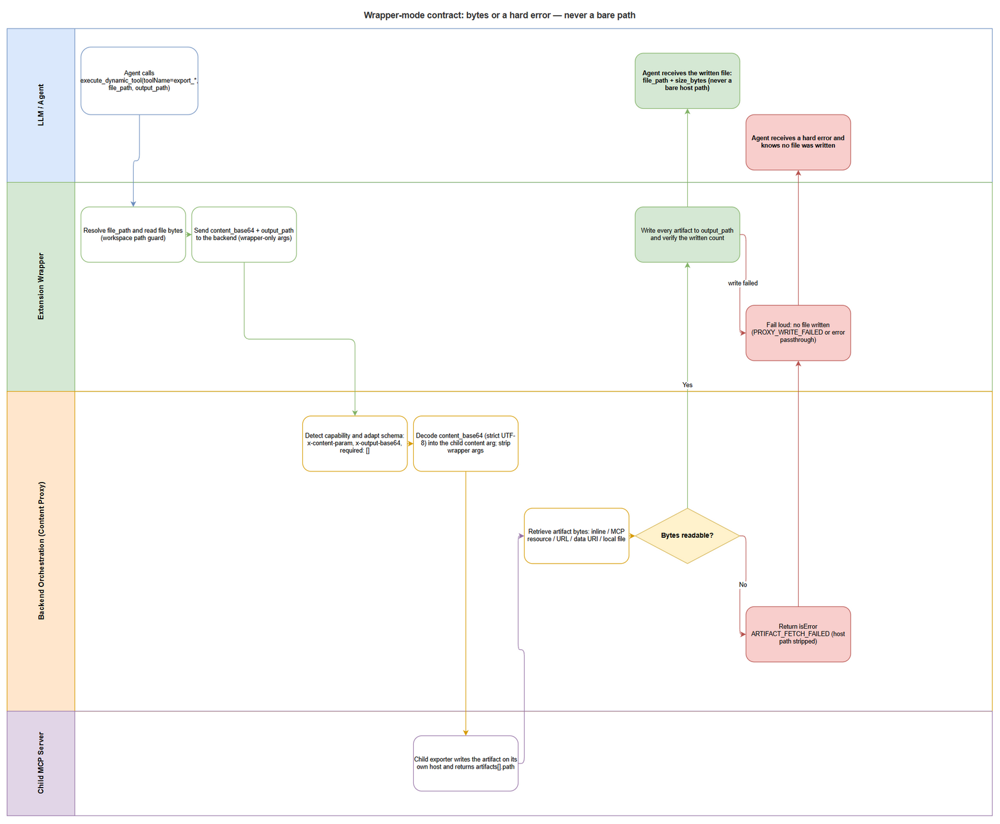
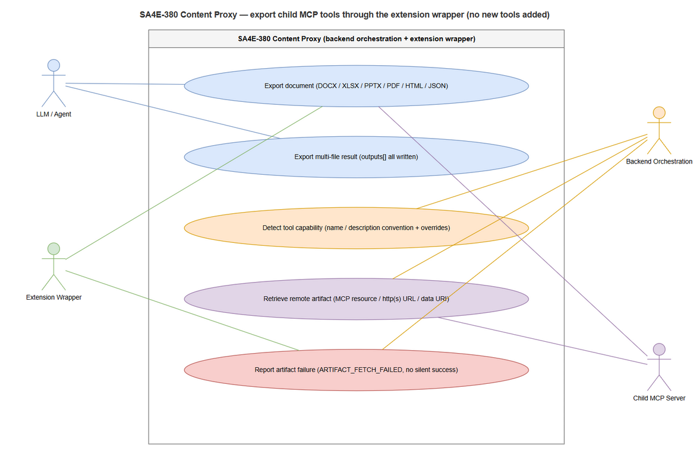

# Business Requirements Document (BRD)

## SDLC Agents 4 Enterprise — SA4E-380: Content Proxy for Child MCP Tools (Export DOCX/XLSX/PPTX/PDF/HTML/JSON Through the Extension Wrapper, No New Tools)

---

## Document Information

| Field | Value |
|-------|-------|
| Jira Ticket | SA4E-380 |
| Title | Content Proxy for child MCP tools: export DOCX/XLSX/PPTX/PDF/HTML/JSON through the extension wrapper (no new tools added) |
| Author | BA Agent |
| Version | 1.0 |
| Date | 2026-10-23 |
| Status | As-built (backfilled) |
| Document Type | Business Requirements Document (BRD) |
| Project | SA4E — SDLC Agents 4 Enterprise |
| Change Type | Enhancement — backend orchestration layer + extension wrapper |
| Jira Priority | High |
| Jira Issue Type | Story |
| Delivery Mode | Documentation backfill. The change is already implemented in the workspace (uncommitted); this BRD records requirements and acceptance criteria as built, it does not request re-implementation. |
| Autonomy Level | L3 (unattended) with human gates at UAT and Deploy |

> **Document nature.** This is an **as-built** requirements document. Every requirement, acceptance criterion and non-functional target below is traceable to the Jira ticket SA4E-380, to the delivered code in the workspace, or to captured live test evidence. Where the delivered implementation does not meet an ideal requirement, the gap is recorded in Section 5 (Risks and Assumptions) instead of being silently omitted.

---

## Author Tracking

| Role | Name - Position | Responsibility |
|------|-----------------|----------------|
| Author | BA Agent – Business Analyst | Create this BRD from Jira SA4E-380, the base64-proxy architecture note and the delivered code |
| Peer Reviewer | TA Agent – Technical Architect | Review completeness, technical consistency and traceability to the architecture note |
| Domain Reviewer | SA Agent – Solution Architect | Verify the requirements match the as-built design before the TDD is written |
| Approver | Duc Nguyen Minh – Product Owner / Ticket Reporter | Confirm business scope, priority and acceptance |

---

## Revision History

| Version | Date | Author | Changes |
|---------|------|--------|---------|
| 1.0 | 2026-10-23 | BA Agent | Initiate document — as-built requirements reconstructed from Jira ticket SA4E-380, `documents/SA4E-29/ARCHITECTURE-BASE64-PROXY.md`, the delivered content-proxy modules and recorded live test evidence |

---

## Sign-Off

| Name | Signature and date |
|------|--------------------|
| | ☐ I agree and confirm all criteria on this BRD as expected requirements |
| | ☐ I agree and confirm all criteria on this BRD as expected requirements |

---

## 1. Introduction

### 1.1 Scope

The SDLC Agents 4 Enterprise platform exposes a large catalogue of **child MCP tools** to the LLM through a single discovery-and-execution path (`find_tools` → `execute_dynamic_tool`). Among those child tools are document exporters — `export_docx`, `export_xlsx`, `export_pptx`, `export_pdf`, `export_html`, `export_json` — served by the `markdown-exporter` child server.

Those exporters were designed for a plain MCP client: they accept a **content argument** (typically `markdown`) and return an **artifact descriptor** whose `path` points at a file on the machine where the child server runs. The platform's extension wrapper, however, works in the opposite direction: the LLM hands it a **source file path**, the wrapper turns that file into bytes, and it expects **bytes back** so it can write the result into the agent workspace.

This mismatch produced two distinct business problems:

1. **The LLM received a path instead of a file.** A tool call reported success, but the only thing the agent got back was a string pointing at a filesystem location it could not read. From the user's perspective the document was never produced.
2. **Silent data loss when the child lived on another host.** When the child server ran remotely, the returned path referred to a filesystem the backend could not reach. The wrapper still reported success, nothing was written, and nobody noticed until someone tried to open a file that did not exist. This is **silent corruption** — the worst possible failure mode for a documentation pipeline, because every downstream step (Jira attachment, UAT evidence, release pack) trusts that the artifact exists.

The scope of SA4E-380 is to close that gap by introducing a **content-proxy layer inside the backend orchestration** plus a **fail-loud output proxy inside the extension wrapper**, so that every file-producing child tool works end-to-end through the wrapper **without registering a single new tool**.

In scope:

- Backend orchestration content-proxy: capability detection, schema adaptation, invocation adaptation, artifact source resolution, artifact naming and result adaptation for child tools whose name matches `export_*`, `render_*` or `generate_*` (or whose description states a file-format output).
- Backend wiring so a remote child can serve artifact bytes through MCP `resources/read`.
- Extension wrapper output side: extract `output_base64` / `outputs[]`, write the file(s) into the agent workspace, and fail loudly when bytes are missing.
- Support for the six document formats already offered by the child exporter: DOCX, XLSX, PPTX, PDF, HTML, JSON.
- Documentation impact: the base64-proxy architecture note and the canonical DOCX export procedure used by agents.

Out of scope (see 1.2 for the full statement): changing the child exporter itself, adding new tools to `tools/list`, UI work, and any change to deployment topology.

### 1.2 Out of Scope

| # | Out of scope item | Rationale |
|---|-------------------|-----------|
| 1 | Modifying the `markdown-exporter` child MCP server | The child is an external dependency. Its path-only result shape is a known constraint, not a defect to be patched in this ticket. |
| 2 | Adding a new tool (for example `export_docx_proxied`) to `tools/list` | Explicitly forbidden by the ticket. Adding tools pollutes the LLM tool surface, breaks the tool-visibility tier model and duplicates discovery. |
| 3 | Any user-interface change | The change is invisible to end users by design; existing agent workflows keep the same tool names and the same commands. |
| 4 | `ARTIFACT_PATH_MAP` (mapping a remote host path onto a locally mounted path) | Considered during design and recorded as a **future option only**. Not implemented in this ticket. |
| 5 | Re-running the backend and extension test suites as part of this documentation task | Test evidence was captured during implementation and is quoted in Section 8. The backfill pipeline does not re-execute suites. |
| 6 | Fixing the pre-existing `ProjectIsolation.derive-project-id.test.ts` UT-11 failure on Windows root paths | Known, unrelated and out of scope. Explicitly not fixed here to keep the change surface minimal. |
| 7 | Changing authentication, authorisation or network topology of child servers | No security model change is requested; the proxy reuses the existing authenticated child connection. |
| 8 | Deployment / release packaging | Covered by a separate DevOps phase; this ticket produces documents only. |
| 9 | **Backend-side periodic cleanup job / cron** | **IN SCOPE** — The backend must run a **periodic cleanup sweep** (configurable interval, default 5 minutes) to remove any orphaned artifact files that were not cleaned up by the immediate post-inlining deletion (e.g., due to process crash, power loss, or permission errors during the primary cleanup). The sweep scans the backend workspace for files matching the artifact naming pattern that are older than a configurable TTL (default 10 minutes) and deletes them. This is a safety net, not a replacement for the immediate cleanup. |

### 1.3 Preliminary Requirement

| # | Prerequisite | Status at time of writing |
|---|--------------|---------------------------|
| 1 | A child MCP server exposing at least one file-producing tool (the `markdown-exporter` exporters) | Available |
| 2 | Backend orchestration capable of enumerating child tools and invoking them (`ProxiedToolRegistry` + `McpClientManager`) | Available (pre-existing) |
| 3 | Extension wrapper able to read a source file and send `content_base64` (input-side base64 proxy) | Available (pre-existing, delivered by the earlier base64-proxy work) |
| 4 | An MCP client that can issue `resources/read` against a child server (needed only for remote children) | Available (wired in this ticket) |
| 5 | A writable agent workspace with an enforced path guard, so the wrapper can place output files safely | Available (pre-existing) |
| 6 | The extension host running the **new** wrapper build | **Pending** — the wrapper on port 9183 still runs pre-change code until the Kiro window is reloaded. See Risk R-3. |

> **Note.** Prerequisite 6 is an operational, not a code, prerequisite. The backend adaptation is already live (the adapted schemas expose the output marker), but the running extension process has not picked up the new output-proxy code. Until the window is reloaded, a DOCX export through the wrapper may complete without creating a file. This is an environment blocker, recorded honestly rather than presented as a defect.

---

## 2. Business Requirements

### 2.1 High Level Process Map

At business level the capability answers one question: **"when an agent asks for a document, does a real document appear, and if not, does the agent know?"**

The process has four participants. The **LLM / Agent** asks for a conversion and supplies a source file path plus (optionally) a destination path. The **Extension Wrapper** turns that source file into bytes and is responsible for placing the returned bytes back onto disk. The **Backend Orchestration (Content Proxy)** translates between the wrapper's byte-oriented contract and the child tool's content-oriented contract, and fetches the produced artifact. The **Child MCP Server** does the actual format conversion on its own host.

The distinguishing feature of the flow is the **wrapper-mode contract**: once a caller has supplied `file_path` or `output_path`, the only acceptable outcomes are *bytes written to disk* or *a hard error*. Returning a bare host path is explicitly forbidden, because a path is indistinguishable from success at the protocol level while guaranteeing that no file exists.

*[Edit in draw.io](diagrams/business-flow.drawio)*

The actors and the use cases they participate in are summarised below. Note that the child server is a participant, not an owner: it produces artifacts, but the backend is accountable for delivering their bytes.

*[Edit in draw.io](diagrams/use-case.drawio)*

| Stage | Who acts | Business outcome |
|-------|----------|------------------|
| Request | LLM / Agent | A conversion request exists with a real source file and a target location |
| Transport in | Extension Wrapper | Source file bytes travel to the backend; no content is invented or truncated |
| Adaptation | Backend Orchestration | The request is expressed in the child tool's own vocabulary; wrapper-only arguments never leak to the child |
| Conversion | Child MCP Server | A format-correct artifact is written on the child's host |
| Retrieval | Backend Orchestration | Artifact bytes are obtained regardless of which host produced them |
| Delivery | Extension Wrapper | The artifact is written into the agent workspace; failures are reported, never masked |
| Confirmation | LLM / Agent | The agent can prove a file exists (path + size) or knows precisely why it does not |

### 2.2 List of User Stories / Use Cases

| # | Story / Use Case / Epic | Priority | Source Ticket |
|---|-------------------------|----------|---------------|
| 1 | As an AI agent, I want to export a document through the wrapper for DOCX, XLSX, PPTX, PDF, HTML and JSON so that I can deliver real files to users and downstream systems | MUST HAVE | SA4E-380 (AC-1) |
| 2 | As a platform owner, I want wrapper mode to never return a bare host path so that a "successful" tool call can never again mean "no file exists" | MUST HAVE | SA4E-380 (AC-2) |
| 3 | As an AI agent working with a remote child server, I want artifacts fetched over MCP resources or URLs so that host location stops being a limitation | MUST HAVE | SA4E-380 (AC-3) |
| 4 | As an AI agent producing multiple deliverables, I want every artifact of a multi-file tool written to disk so that partial output is impossible to mistake for complete output | MUST HAVE | SA4E-380 (AC-4) |
| 5 | As a platform owner, I want zero new tools in `tools/list` so that the LLM tool surface, discovery and visibility tiers stay unchanged | MUST HAVE | SA4E-380 (AC-5) |
| 6 | As a platform maintainer, I want file-producing tools detected automatically by naming/description convention with a per-tool escape hatch so that new exporters work without bespoke code | SHOULD HAVE | SA4E-380 |
| 7 | As an AI agent, I want failures to be loud and specific so that I never build a downstream step on a file that was never written | SHOULD HAVE | SA4E-380 (AC-2, AC-6) |

**Priority rationale.** Stories 1–5 are MUST because each maps directly to an acceptance criterion in the ticket and each is a precondition for the documentation pipeline being trustworthy. Stories 6–7 are SHOULD because they make the capability maintainable and safe over time, but the six exporters already work without them; they are nevertheless implemented and verified.

---

### 2.3 Details of User Stories

---

#### Business Flow

**Step 1:** The LLM / Agent calls `execute_dynamic_tool` with the target child tool name (for example `export_docx`) and arguments containing `file_path` (the source markdown) and, optionally, `output_path` (where the result must land).

**Step 2:** The Extension Wrapper resolves `file_path` inside the agent workspace, applies the workspace path guard, and reads the file bytes. If the file does not exist or is outside the workspace, the call stops here with an error and no child tool is invoked.

**Step 3:** The wrapper sends the request to the backend carrying `content_base64` (the encoded source bytes) and `output_path`. These two arguments are the wrapper's own; they are not part of the child tool's published contract.

**Step 4:** The Backend Orchestration recognises wrapper mode (presence of `content_base64` or `output_path`), decodes the payload with a strict UTF-8 base64 check, maps it onto the child's real content argument (for example `markdown`), and strips the wrapper-only arguments before invoking the child.

**Step 5:** The Child MCP Server runs its converter and writes the artifact on its own host, returning a result that typically contains `artifacts[]` with a host-local `path`.

**Step 6:** The Backend Orchestration retrieves the artifact bytes using the transport-agnostic order: an inline payload, an MCP resource blob, a `resource_link`/URI resolved through the child's `resources/read`, an `http(s)` URL, a `data:` URI, or a local file on the backend host.

**Step 7 (decision):** If no bytes can be obtained while artifacts were declared, the backend returns `isError = true` with `ARTIFACT_FETCH_FAILED`. The message states plainly that the server produced a file on its host but returned no readable content, and that no file was written. The flow ends here — no path is returned.

**Step 8:** If bytes were obtained, the backend replaces host locations with bytes: `output_base64` for a single artifact, `outputs[]` when the child produced several. Only `name`, `mime_type` and `size` survive from the original artifact descriptors; `file_path`, `output_path` and any absolute path are removed.

**Step 9:** The Extension Wrapper decodes each payload and writes it to the resolved destination, using the child's suggested bare file name when the destination is a directory-level match. It then verifies that the number of files written equals the number of payloads received.

**Step 10:** If every artifact was written, the wrapper returns `file_path` and `size_bytes` per file to the LLM. If some or all writes failed, it returns `isError = true` with `PROXY_WRITE_FAILED` and states that no file (or only part of the files) was written. If the backend already reported `ARTIFACT_FETCH_FAILED`, the wrapper passes that error through unchanged.

> **Note 1 — Direct-mode compatibility.** When the same child tool is called *without* `file_path`/`content_base64`/`output_path` (a direct dynamic call), no adaptation of the result happens: the caller receives the child's original lightweight response, including its path. This is deliberate — automation that only needs the descriptor keeps working.
>
> **Note 2 — Why a path is never acceptable in wrapper mode.** A path is a *claim* about a filesystem, not the file. In wrapper mode the caller has already committed to file-in / file-out semantics, so a path silently converts a hard failure into an apparent success. The contract deliberately trades a slightly harsher error surface for the elimination of silent data loss.

---

#### STORY 1: Export a Document Through the Wrapper for Six Formats

> **As an** AI agent, **I want** to export DOCX, XLSX, PPTX, PDF, HTML and JSON documents through the wrapper **so that** I can deliver real files to users and downstream systems instead of describing them.

**Priority:** MUST HAVE · **Source:** SA4E-380, acceptance criterion 1 · **Traceability:** backend detection + schema adaptation + invocation adaptation + result adaptation; extension output proxy

**Requirement Details:**

1. The following six child tools must be callable end-to-end through `execute_dynamic_tool(toolName = ..., arguments = { file_path, output_path })` and must produce a real file at the destination: `export_docx`, `export_xlsx`, `export_pptx`, `export_pdf`, `export_html`, `export_json`.
2. The LLM supplies a **source path**, never raw document content. The wrapper converts the source file into `content_base64`; the backend maps those bytes onto the child's own content argument (for the markdown exporter this is `markdown`).
3. The destination is governed by `output_path` when supplied. When it is not supplied, the backend's suggested bare file name is used and the result is placed next to the source file.
4. The resulting file must be **structurally valid**, not merely non-empty. For OOXML formats (DOCX/XLSX/PPTX) this means a valid package; for XLSX the workbook and first worksheet parts must be present; for PDF the file must start with the `%PDF` header; for JSON the content must parse.
5. Embedded images and rich content must survive the round trip. The live DOCX proof used a 184,761-byte markdown file containing embedded base64 images and produced a 265,062-byte DOCX whose images were intact.
6. On success the agent must receive the resulting `file_path` plus `size_bytes`, so it can assert the file exists without guessing.

**Data Fields:**

| Field | Type | Required | Description | Example |
|-------|------|----------|-------------|---------|
| `toolName` | string | Yes | Dynamic child tool to invoke | `export_docx` |
| `file_path` | string (workspace path) | Yes in wrapper mode | Source document the agent wants converted | `documents/SA4E-375/UG-embedded.md` |
| `output_path` | string (workspace path) | No | Destination path or destination directory | `documents/SA4E-375/UG-v1.docx` |
| `content_base64` | string (base64) | Injected by wrapper | Source bytes; never supplied by the LLM | `LSMjIFVub3B0aW1pemVk...` |
| `markdown` | string | Child-side | Decoded content mapped onto the child's content argument | `# Unoptimized...` |
| `output_base64` | string (base64) | Returned | Artifact bytes for a single-file result | `UEsDBBQABgAI...` |
| `file_name` | string | Returned | Bare file name only (no path fragment) | `UG-v1.docx` |
| `size_bytes` | number | Returned | Written artifact size | `265062` |
| `mime_type` | string | Returned when known | Detected artifact MIME type | `application/vnd.openxmlformats-officedocument.wordprocessingml.document` |

**Acceptance Criteria:**

1. All six exporters are discoverable through `find_tools` and callable through `execute_dynamic_tool` with `file_path` and `output_path`; the published schema does not require the LLM to supply document content.
2. Each of the six calls creates a file at the destination with size greater than zero and with the correct format signature (OOXML package for docx/xlsx/pptx, `%PDF` for pdf, HTML document for html, parseable JSON for json).
3. The XLSX artifact contains `xl/workbook.xml` and `xl/worksheets/sheet1.xml`; the DOCX and PPTX artifacts open as valid OOXML packages.
4. Live execution evidence for the six exporters: xlsx 4,849 B; docx 14,599 B; pptx 29,296 B; pdf 1,967 B (`%PDF` header); html 199 B; json 31 B (valid JSON).
5. Live DOCX with embedded images: 184,761 B markdown input → 265,062 B DOCX output, OOXML valid, embedded images byte-identical after conversion.
6. The agent response contains `file_path` and `size_bytes`, and contains no absolute host path belonging to the child server.
7. The same six tools continue to be reachable for direct (non-wrapper) dynamic calls without behavioural change.

**UI Specifications:** Not applicable — the change is a protocol/orchestration capability with no user-facing screen. Agent-visible output is a tool result text block; its contract is captured in the data fields above and in Story 2.

**Validation Rules:**

- `file_path` must resolve inside the agent workspace; traversal outside the workspace is rejected before any bytes are read.
- The source file must exist and be readable; an unreadable or missing source aborts the call before the child is invoked.
- `content_base64` must be valid base64 with a length divisible by four and must decode to valid UTF-8; payloads that fail either check are rejected rather than passed through.
- The artifact size must be greater than zero and must not exceed the 25 MB inline cap.
- Only a bare file name may be taken from the child's suggested name; any path component is discarded.

**Error Handling:**

- **Source file missing or outside the workspace:** the wrapper returns an error and the child tool is never called. No artifact is produced, so there is nothing to clean up.
- **`content_base64` absent while wrapper mode is active:** the backend returns an error instructing the caller to pass `file_path` so the wrapper can inject content (or to send the content argument directly). The child is not invoked with an empty document.
- **`content_base64` invalid (bad padding, bad alphabet, non-UTF-8 bytes):** the backend returns `Invalid content_base64 payload.` and does not invoke the child. This prevents a corrupted document from being produced and reported as success.
- **Artifact produced but not readable by the backend:** `ARTIFACT_FETCH_FAILED` with the artifact name and server name; no file is written (see Story 3).
- **Destination not writable or blocked by the path guard / symlink guard:** `PROXY_WRITE_FAILED` with the sanitized reason; the agent is told no file was written (see Story 7).

---

#### STORY 2: Wrapper Mode Never Returns a Bare Path

> **As a** platform owner, **I want** every wrapper-mode call to return either file bytes or an explicit error **so that** a "successful" tool call can never again mean "the file does not exist".

**Priority:** MUST HAVE · **Source:** SA4E-380, acceptance criterion 2 · **Traceability:** backend result adapter (wrapper-mode gate, path stripping) + extension output proxy (missing-payload detection)

**Requirement Details:**

1. **Wrapper mode is defined by the presence of specific arguments**, not by an explicit flag. On the backend it is signalled by `content_base64` or `output_path`; on the extension side it is signalled by `file_path` or `content_base64`. This keeps the contract implicit and avoids a second source of truth that could drift.
2. In wrapper mode, a successful response must carry **bytes**: `output_base64` for a single artifact, or `outputs[]` for several.
3. When the child declares artifacts but the backend cannot obtain readable bytes, the result must be a **tool error** (`isError = true`) whose text begins with `ARTIFACT_FETCH_FAILED` and which states that no file was written.
4. The backend must **remove host locations** from the response. `file_path`, `output_path` and the child's absolute `artifacts[].path` are stripped; the surviving artifact metadata is limited to `name`, `mime_type` and `size`.
5. The extension must independently enforce the same rule: if it is in wrapper mode and receives artifact metadata without any `output_base64`, it converts the response into `ARTIFACT_FETCH_FAILED`. Two independent checks are intentional — either one alone would be a single point of silent failure.
6. **Direct (non-wrapper) calls must keep their current behaviour**, including returning the child's path-shaped response. The adaptation must not degrade the experience of automation that never asked for bytes.

**Data Fields:**

| Field | Type | Required | Description | Example |
|-------|------|----------|-------------|---------|
| `wrapperMode` | boolean (derived) | Yes | True when `content_base64`/`output_path` (backend) or `file_path`/`content_base64` (extension) is present | `true` |
| `isError` | boolean | On failure | Marks the tool result as a hard error | `true` |
| `content[0].text` | string | Yes | Human- and agent-readable outcome message | `ARTIFACT_FETCH_FAILED: UG-v1.docx from server 'remote-exporter' could not be read...` |
| `artifacts[].name` | string | Returned | Display metadata retained after stripping | `UG-v1.docx` |
| `artifacts[].mime_type` | string | Returned | Display metadata retained after stripping | `application/pdf` |
| `artifacts[].size` | number | Returned | Display metadata retained after stripping | `1967` |
| `artifacts[].path` | string | **Must be absent** | Host location; stripped by the adapter | — |

**Acceptance Criteria:**

1. In wrapper mode, every non-error response contains `output_base64` or a non-empty `outputs[]`.
2. Any artifact that cannot be read produces `isError = true` with `ARTIFACT_FETCH_FAILED` in the message, and the message explicitly states that no file was written.
3. No wrapper-mode response contains an absolute host path; the only path-like string the agent receives is the destination path it (or the wrapper) chose, which exists because the file was written there.
4. The backend content-proxy test suite passes 21/21, including the remote-artifact and path-only-failure scenarios.
5. A direct call to the same child tool (no wrapper arguments) still returns the child's original response shape unchanged.
6. The failure message names the affected artifact(s) and, when known, the child server, so an operator can tell *which* exporter misbehaved without reading backend logs.

**Validation Rules:**

- A response counts as "carrying bytes" only when `output_base64` is a non-empty string, or `outputs[]` contains at least one entry with a non-empty `output_base64`.
- Empty or whitespace-only base64 strings are treated as "no payload", not as an empty file.
- If artifacts were declared and zero files were resolved, the outcome is an error even when the child reported `success: true`. The child's own success flag is not trusted for artifact delivery.
- Path stripping applies to `file_path`, `output_path` and every `artifacts[].path`; a path fragment must never appear in the message text either.

**Error Handling:**

- **Backend cannot read any declared artifact:** `ARTIFACT_FETCH_FAILED: <names> from server '<child>' could not be read by the backend. The tool produced a file on its host but returned no readable content. Remote servers must expose artifacts as MCP resources (resources/read), http(s) URLs, or data URIs; path-only artifacts require the server to run on the backend host. No file was written.`
- **Backend returned artifact metadata but the extension found no payload:** `ARTIFACT_FETCH_FAILED: <name> was returned without content (the backend could not read the artifact). No file was written.`
- **Child returned a genuine tool error:** the error is propagated untouched; the adapter must not overwrite an existing `isError` result with its own message.

---

#### STORY 3: Retrieve an Artifact Produced by a Remote Child Server

> **As an** AI agent working with a child server that does not share a filesystem with the backend, **I want** its artifacts fetched over MCP resources or URLs **so that** host location stops being a limitation on which exporters I can use.

**Priority:** MUST HAVE · **Source:** SA4E-380, acceptance criterion 3 · **Traceability:** artifact source resolution + MCP `resources/read` wiring on the backend client manager

**Requirement Details:**

1. Artifact retrieval must be **transport-agnostic**. The same code path must work when the child runs next to the backend over stdio and when it runs on another host over a streamable HTTP transport.
2. The retrieval order is fixed and must be attempted in this sequence, because the cheapest and most authoritative source has to win:
   1. **Inline payload** carried in the artifact descriptor (`output_base64`, `content_base64`, `base64` or `data`).
   2. **MCP resource blob** in a standard `resource` content block (base64 `blob` or `text`).
   3. **`resource_link` / URI** resolved by asking the child through `resources/read` — this is the mechanism that crosses hosts.
   4. **`http(s)` URL** fetched by the backend with a 30-second timeout and redirect following.
   5. **`data:` URI** decoded inline.
   6. **`file:` URI or filesystem path** read from the backend host — valid only when the child shares that host.
3. If none of the above yields bytes, the outcome is `ARTIFACT_FETCH_FAILED` (see Story 2). A path-only remote child is a **supported configuration that fails loudly**, not an unsupported case to be worked around.
4. Reading a local path must enforce three guards: the target must be a regular file, it must not be a symlink, and its size must be checked before the file is read.
5. An `http(s)` fetch must reject responses that are not 2xx and responses whose declared `content-length` already exceeds the artifact cap, so an oversized download is never buffered.
6. Any other URI scheme (for example `artifact://` or `mcp://`) is treated as **server-owned** and delegated to the child's `resources/read` rather than guessed at by the backend.
7. **Local artifact cleanup:** When the retrieval path is a local file (step 6), the backend **must delete the temporary artifact file immediately after its bytes have been successfully inlined into `output_base64` / `outputs[]`**. No temporary file may remain on the backend host once the response is sent. This applies to every local read — success or failure of subsequent steps does not change the cleanup obligation.
8. **Periodic cleanup sweep:** The backend **must run a background cleanup task** at a configurable interval (default 5 minutes) that scans the backend workspace for artifact files matching the naming pattern (`export_*`, `render_*`, `generate_*` outputs) that are older than a configurable TTL (default 10 minutes) and deletes them. This sweep handles orphaned files from crashed invocations, permission failures during immediate cleanup, or any other edge case where a file escaped the primary deletion. The sweep logs the number of files removed and any failures. Configuration keys: `artifact.cleanup.intervalMs` and `artifact.cleanup.ttlMs`.

**Data Fields:**

| Field | Type | Required | Description | Example |
|-------|------|----------|-------------|---------|
| `artifacts[].url` | string (http/https) | Optional | URL the backend can fetch directly | `https://files.example/report.pdf` |
| `artifacts[].uri` | string (MCP URI) | Optional | Resource URI resolved through the child | `artifact://exports/report.pdf` |
| `artifacts[].path` | string (filesystem) | Optional | Host-local path; readable only when hosts are shared | `/tmp/exports/report.pdf` |
| `artifacts[].output_base64` | string (base64) | Optional | Inline bytes; wins over any location | `JVBERi0xLjQK...` |
| `resource_link.uri` | string | Optional | Standard MCP link block carrying the artifact URI | `artifact://exports/report.pdf` |
| `resource.blob` | string (base64) | Optional | Standard MCP resource block carrying bytes | `JVBERi0xLjQK...` |
| `readResource(uri)` | function | Internal | Child round-trip used to obtain bytes across hosts | `resources/read` |
| `fetchUrl(url)` | function | Internal | HTTP fetch limited to 30 s and 25 MB | — |

**Acceptance Criteria:**

1. A remote child that exposes its artifact as an MCP resource returns `output_base64` whose bytes equal the resource blob — verified by a dedicated remote-transport test.
2. A remote child that exposes an `http(s)` URL has its artifact fetched and returned as `output_base64`.
3. A `data:` URI artifact is decoded and returned as `output_base64`.
4. A remote child that returns **only** a host-local path produces `isError = true` with `ARTIFACT_FETCH_FAILED`; the response contains no path and no file is written.
5. A local (stdio) child that writes its artifact on the backend host is read successfully from the local filesystem, applying the regular-file, no-symlink and size-cap guards.
6. An oversized artifact (declared or actual size above 25 MB) is rejected rather than buffered, and surfaces as `ARTIFACT_FETCH_FAILED` because no bytes were obtained.
7. Remote-artifact behaviour is covered by automated tests: the remote test module exercises the resource path, the URL path and the path-only failure path.

**Validation Rules:**

- Retrieval is attempted in the documented order; the first source that yields a non-empty buffer within the size cap wins.
- A base64 payload must match the base64 alphabet, have a length divisible by four, and decode to a non-empty buffer within the cap; otherwise that source is treated as unusable and the next source is tried.
- A local read requires a regular file; symlinks are refused even when they resolve inside the workspace.
- The HTTP fetch must complete within 30 seconds; timeouts and non-2xx statuses count as "not readable" rather than being surfaced as protocol errors.
- Only the first artifact of a multi-artifact result is used for the single-output fields; the complete set is emitted through `outputs[]` (Story 4).
- **Local cleanup:** After a successful local read and byte inlining, the backend must verify that the source file no longer exists on the backend host. If the file persists (for example due to a permission error), the backend logs a warning but does not fail the tool call — the artifact bytes have already been delivered.
- **Periodic cleanup sweep:** The background task runs at the configured interval, finds artifact files older than the TTL, and deletes them. Files that cannot be deleted (permission, locked) are logged as warnings; the sweep continues. The sweep must not delete files younger than the TTL or files that do not match the artifact naming pattern. Sweep execution time must be bounded (max 30 seconds per run) to avoid blocking the event loop.

**Error Handling:**

- **Remote child returns only a host-local path:** `ARTIFACT_FETCH_FAILED` with an actionable sentence listing the three supported alternatives (MCP resource, http(s) URL or data URI) and the shared-host requirement for path-only artifacts.
- **`resources/read` fails or returns an empty blob:** treated as "not readable"; the next source in the order is attempted, and the final outcome is `ARTIFACT_FETCH_FAILED` if all sources fail.
- **HTTP timeout, non-2xx status or oversized response:** treated as "not readable"; the fetch never leaves a partial buffer behind and never buffers more than the cap.
- **Local path is a symlink, a directory or above the cap:** refused silently at the source-resolution layer, then surfaced as `ARTIFACT_FETCH_FAILED` with the artifact name, so no information about the host layout is leaked.
- **`readResource` unavailable (no remote client wired):** the URI-based sources are skipped; a path-only result then fails with `ARTIFACT_FETCH_FAILED` rather than pretending the artifact was delivered.
- **Local cleanup failure (file cannot be deleted after inlining):** the backend logs a warning with the artifact name and continues; the tool call succeeds because the bytes were already delivered. The periodic sweep will attempt deletion again on its next run.
- **Periodic sweep failure (partial delete, permission error, scan error):** the sweep logs the failure with the affected file names and continues; it does not affect tool calls. Persistent failures are visible in the backend logs and should be investigated by operators.

---

#### STORY 4: Write Every Artifact of a Multi-File Tool

> **As an** AI agent producing several deliverables in one call, **I want** every artifact written to disk **so that** a partial result can never be mistaken for a complete one.

**Priority:** MUST HAVE · **Source:** SA4E-380, acceptance criterion 4 · **Traceability:** backend multi-artifact shaping (`outputs[]`) + extension multi-output writer with count verification

**Requirement Details:**

1. When a child tool produces more than one artifact, the backend must emit an `outputs[]` array. Each entry carries `file_name`, `mime_type`, `size_bytes` and `output_base64`. The single-artifact fields `output_base64` and `size_bytes` are removed to avoid two competing sources of truth; `file_name` retains the first artifact's name for display.
2. The extension must write **one file per entry**, in array order, and must verify that the number of files written equals the number of payloads received.
3. When `output_path` points at a directory-like destination, each artifact keeps its own suggested bare file name inside that directory. The wrapper must never collapse several artifacts onto one file name.
4. If **no** artifact can be written, the result must be `PROXY_WRITE_FAILED` stating that no artifact could be written for the named tool.
5. If **some but not all** artifacts can be written, the result must be `PROXY_WRITE_FAILED` stating how many succeeded out of how many were expected. Partial silent success is forbidden for the same reason a bare path is forbidden.
6. After a successful write, the response must replace the payload array with **metadata only** (`file_path`, `size_bytes` and the display fields), so that a second round of base64 is never sent back over the wire.

**Data Fields:**

| Field | Type | Required | Description | Example |
|-------|------|----------|-------------|---------|
| `outputs[]` | array | Returned when >1 artifact | One entry per artifact | — |
| `outputs[].file_name` | string | Yes | Bare file name for that artifact | `report.pdf` |
| `outputs[].mime_type` | string | When known | Detected MIME type | `application/pdf` |
| `outputs[].size_bytes` | number | Yes | Size of that artifact | `1967` |
| `outputs[].output_base64` | string (base64) | Yes (pre-write) | Bytes of that artifact | `JVBERi0xLjQK...` |
| `written[]` | array | Returned | Post-write metadata replacement | `[{ file_path, size_bytes, file_name, mime_type }]` |
| `expectedCount` | number (derived) | Internal | Number of payloads received | `3` |
| `writtenCount` | number (derived) | Internal | Number of files actually written | `3` |

**Acceptance Criteria:**

1. A tool returning N artifacts results in exactly N files on disk, each non-empty and each in the correct format.
2. Each written file uses its own artifact's bare file name; two artifacts never overwrite one another.
3. If the wrapper writes fewer files than payloads received, the call returns `isError = true` with `PROXY_WRITE_FAILED: only X/Y artifacts could be written for '<tool>'`.
4. If the wrapper writes zero files while payloads were present, the call returns `isError = true` with `PROXY_WRITE_FAILED: no artifact could be written for '<tool>'`.
5. The successful response contains `outputs[]` entries with `file_path` and `size_bytes`, and contains **no** `output_base64`.
6. Single-artifact results remain unchanged in shape (`file_name`, `size_bytes`, `output_base64` at the top level) and are not wrapped in an `outputs[]` array of length one.

**Validation Rules:**

- Multi-file mode is entered only when the payload array contains more than one entry with a non-empty `output_base64`.
- An entry without a usable `output_base64` is skipped during writing; the count check then fails the call, because a skipped entry means a missing artifact.
- A suggested file name is reduced to its basename; names resolving to `.` or `..` or to an empty string are treated as absent.
- In multi-file mode, a destination that cannot be given a distinct name per artifact is a write failure, not a reason to concatenate or overwrite.

**Error Handling:**

- **Partial write (X of Y):** `PROXY_WRITE_FAILED: only X/Y artifacts could be written for '<tool>'.` The message includes the counts so the agent can decide whether to retry into a different directory.
- **Zero writes:** `PROXY_WRITE_FAILED: no artifact could be written for '<tool>'.`
- **Exception during writing (path guard, symlink guard, permission error, disk error):** `PROXY_WRITE_FAILED: <sanitized reason> — no file was written.` The raw error text is sanitized before it reaches the agent.
- **Artifact fetched but unusable for a given name:** treated as a write failure for that entry; the count verification converts it into the X/Y message rather than silently dropping the file.

---

#### STORY 5: Add No New Tools to the Tool Catalogue

> **As a** platform owner, **I want** the content proxy to register zero new tools **so that** the LLM tool surface, the discovery behaviour and the tool-visibility tiers remain exactly as they are today.

**Priority:** MUST HAVE · **Source:** SA4E-380, acceptance criterion 5 · **Traceability:** proxied tool registry adaptation in place (schema rewrite) rather than tool creation; discovery unchanged

**Requirement Details:**

1. The capability must be delivered as a **transformation of existing child tool definitions**, never as new tool entries. `tools/list` must not gain a single name because of this change.
2. Discovery stays on the existing path: an agent still finds `export_docx` (and the other five) through `find_tools`, and executes it through `execute_dynamic_tool`.
3. The adapted schema must still describe a **callable** tool for the LLM: the child's content argument is removed from `required` (so `required` becomes an empty array when content was the only required argument), `content_base64` is added as a wrapper-owned property, and two non-standard JSON-Schema markers are present:
   - `x-content-param` — names the child argument that the wrapper's `content_base64` maps onto (for the markdown exporter: `markdown`).
   - `x-output-base64: true` — declares that the result will be inlined as `output_base64` in wrapper mode.
4. The published description must advertise byte output, so an LLM or a human reading the schema understands that a file is returned rather than a path. The adapter appends a sentence of the form "Returns output_base64 (base64 file bytes) when invoked through the extension wrapper."
5. The wrapper must hide both `content_base64` and the mapped content argument from the LLM-facing view, exposing `file_path` and `output_path` instead. The LLM must never be asked to produce base64.
6. Adapted schemas must remain valid for standard JSON-Schema validators: the two `x-` markers are annotations and must not break validation.

**Data Fields:**

| Field | Type | Required | Description | Example |
|-------|------|----------|-------------|---------|
| `inputSchema.properties.content_base64` | object (`type: string`) | Added, wrapper-only | Encoded content injected by the wrapper; annotated "Never send this from an LLM" | — |
| `inputSchema.required` | array | Rewritten | Child content argument removed | `[]` |
| `inputSchema['x-content-param']` | string | Added | Child argument receiving the decoded content | `markdown` |
| `inputSchema['x-output-base64']` | boolean | Added | Result will be inlined as base64 | `true` |
| `description` | string | Appended | Advertises byte output | `... Returns output_base64 (base64 file bytes) when invoked through the extension wrapper.` |
| `tool name` | string | Unchanged | No renamed or generated tool identifiers | `export_docx` |

**Acceptance Criteria:**

1. The tool catalogue exposed to the LLM contains no tool whose existence is attributable to this change; no name such as `export_docx_proxied`, `content_proxy` or `fetch_artifact` is introduced.
2. `export_docx` and the other five exporters remain discoverable through `find_tools` and executable through `execute_dynamic_tool`.
3. For an adapted exporter the published schema shows `x-content-param` set to the child's real content argument, `x-output-base64: true`, a `content_base64` property, and a `required` array that no longer contains the content argument.
4. The description of an adapted exporter mentions `output_base64`, and the sentence is not duplicated when the description already mentions it.
5. The LLM-facing view does not expose `content_base64` or the mapped content argument as things the model must supply; it exposes `file_path` and `output_path`.
6. Direct dynamic calls to an adapted exporter still succeed without the wrapper, using the child's original arguments.

**Validation Rules:**

- The adapter must be idempotent in effect: a tool whose schema already declares `content_base64` (for example the drawio PNG export) is **not** adapted again, preventing double mapping.
- `x-content-param` must name a property that actually exists in the child's schema.
- The content argument must be removed from `required` by value, preserving the order and content of every other required entry.
- The output marker sentence is appended only once; an existing mention of `output_base64` suppresses it.

**Error Handling:**

- **Child tool already declares `content_base64`:** detection returns "no capability" and the tool is passed through untouched. No adaptation, no double mapping, no duplicated marker.
- **Child tool has no identifiable content argument:** the schema still gains `x-output-base64` so its artifacts can be inlined, but no `content_base64` is injected. A wrapper call that supplies content to such a tool is rejected as an unusable payload rather than silently ignoring the bytes.
- **Schema lacks `properties` or `required`:** the adapter treats them as empty and produces a minimal valid schema instead of failing the tool listing.
- **Duplicate marker text:** suppressed by the idempotency rule above, so repeated listings do not accumulate sentences.

---

#### STORY 6: Detect File-Producing Tools by Convention, With an Escape Hatch

> **As a** platform maintainer, **I want** file-producing tools recognised automatically from their name or description, with a per-tool override when they do not follow the convention **so that** new exporters work without bespoke integration code.

**Priority:** SHOULD HAVE · **Source:** SA4E-380 scope (detection stage) · **Traceability:** capability detection rules + override table

**Requirement Details:**

1. A child tool is treated as a **file producer** when either condition holds:
   - its name starts with `export_`, `render_` or `generate_`; or
   - its description matches the phrase pattern "`to` + a file format", where the format set is pdf, docx, html, pptx, xlsx, json, png, jpeg/jpg, gif, svg, zip.
2. The gate is deliberately narrow. Tools that merely happen to have a `content`, `body` or `text` argument — for example `jira_create_issue`, `confluence_create_page` or `mem_ingest` — must **not** be adapted, because their "content" is a payload for an external system, not a document to be converted.
3. The content argument is chosen deterministically: the first recognised alias present in the schema, in the priority order `markdown`, `markdown_content`, `content`, `html`, `xml`, `text`, `body`, `source`, `template`; failing that, the single required string argument that is not a path, identifier or metadata field.
4. Arguments that are never document content must be excluded explicitly: `content_base64` and any `*_base64`, `file_path` and any `*_path`/`path`, `url`, `uri`, `dir`, `id` and any `*_id`, `name` and any `*_name`, `key` and any `*_key`, `token`, `secret`, `password`, `mime` and any `*_type`, `type`, `format`, `mode`, `encoding`.
5. Schema shape tolerance: string-like properties declared through `anyOf`/`oneOf` unions (as emitted by pydantic-based servers) must be recognised as string content arguments.
6. A **per-tool override table** must exist for tools that defy both conventions. An override can force the content argument (`contentParam`), force artifact inlining on or off (`fileOutput`), or disable the adapter entirely (`enabled: false`). The table ships **empty**, because convention detection covers every exporter currently available.

**Data Fields:**

| Field | Type | Required | Description | Example |
|-------|------|----------|-------------|---------|
| `FILE_TOOL_NAME_PREFIXES` | string[] | Yes | Name prefixes that mark a file producer | `['export_', 'render_', 'generate_']` |
| `FILE_OUTPUT_DESCRIPTION` | pattern | Yes | Description fallback: "`to` + file format" | `/\bto\s+(pdf|docx|html|pptx|xlsx|json|png|jpe?g|gif|svg|zip)\b/i` |
| `CONTENT_PARAM_ALIASES` | string[] | Yes | Content argument candidates in priority order | `['markdown', 'markdown_content', 'content', 'html', 'xml', 'text', 'body', 'source', 'template']` |
| `NON_CONTENT_PARAM` | pattern | Yes | Argument names that can never be content | `content_base64|file_path|url|id|name|key|token|...` |
| `CONTENT_PROXY_OVERRIDES` | map | Yes (empty) | Per-tool escape hatch | `{ }` |
| `override.contentParam` | string \| null | Optional | Force the content argument; `null` means "no content argument" | `'payload_md'` |
| `override.fileOutput` | boolean | Optional | Force artifact inlining on or off | `false` |
| `override.enabled` | boolean | Optional | Disable adaptation for the tool | `false` |

**Acceptance Criteria:**

1. All six exporters are detected as file producers with **zero per-tool code**, and the override table ships empty.
2. Non-file tools with `content`/`body` arguments are not adapted; the tool catalogue behaviour of `jira_create_issue`, `confluence_create_page` and `mem_ingest` is unchanged.
3. A tool that already declares `content_base64` is not adapted (no double mapping).
4. An override with `enabled: false` removes the tool from adaptation entirely; an override with an explicit `contentParam` forces that argument; an override with `fileOutput: true` enables artifact inlining for a tool whose name and description do not match the convention.
5. Content-argument detection follows the documented priority order, and a schema using `anyOf`/`oneOf` string unions still yields the correct content argument.
6. Detection and override behaviour are covered by automated tests, including the negative cases (non-file tools, already-wrapper-native tools).
7. **Future-proofing:** A child tool added to the child server after this ticket — for example `export_csv` or `render_md` — that matches the naming convention or description pattern is automatically adapted on the next backend restart, with no proxy-layer code change. This is verified by the convention detection unit tests which exercise the detection logic against synthetic tool definitions.

**Validation Rules:**

- Detection runs once per tool definition when the catalogue is built; it must not re-run per invocation (no per-call cost).
- `fileOutput` is decided by override first, then by naming convention; a tool that matches a prefix is a file producer even if the description says nothing.
- `contentParam` is decided by override first, then by alias priority, then by the single-required-string rule; if more than one candidate remains after filtering, the content argument is left undefined rather than guessed.
- An argument whose property is not string-like (number, boolean, object, array without a string variant) is never chosen as the content argument.
- The override lookup is keyed by the **child tool name exactly as published**, with no normalisation that could silently mismatch.

**Error Handling:**

- **No content argument can be determined:** the tool is still eligible for output inlining (`x-output-base64`), but wrapper mode cannot inject content. A wrapper call that sends `content_base64` to such a tool fails with the "missing content" style error rather than dropping the bytes.
- **Override references a non-existent argument:** the override is applied as declared; the resulting invocation then fails with the child's own validation error, which is surfaced to the caller. Configuration errors stay visible instead of being silently corrected.
- **Override disables a tool that callers rely on:** the tool keeps its original (unadapted) behaviour; wrapper-mode calls to it will not inline artifacts, so a path-only child would surface `ARTIFACT_FETCH_FAILED` at the extension side. This is intentional: disabling is an explicit operator decision.
- **Name collision with an ordinary tool (a non-file tool named `export_*`):** the prefix wins; if that is undesirable, the operator adds an override with `fileOutput: false` — the escape hatch exists precisely for this case.

---

#### STORY 7: Fail Loud Instead of Silently Corrupting Output

> **As an** AI agent, **I want** every failure mode to be reported explicitly and specifically **so that** I never build a downstream step on a file that was never written.

**Priority:** SHOULD HAVE · **Source:** SA4E-380, acceptance criteria 2 and 6 · **Traceability:** invocation-side payload validation + result-side retrieval error + extension-side write verification

**Requirement Details:**

1. Four failure classes must each produce a **distinct, actionable** error rather than a success response: unusable input payload, unreadable artifact, zero-write and partial-write.
2. Every error message must state, in plain language, **that no file was written** (or how many of how many were written), so the agent can reason about the state of the workspace without inspecting it.
3. Error text must be **sanitized** before reaching the agent: no absolute host paths, no stack traces, no secrets. Only the displayed artifact name and, where useful, the child server name may appear.
4. Errors must be marked with `isError = true` so the agent runtime treats them as tool failures rather than content.
5. A child tool's own error must be **passed through untouched** — the adapter must never replace a child error with a generic proxy error, because the child's message is usually more specific.
6. Silence is never an acceptable outcome: if the adapter cannot decide what happened, it must choose the error path rather than the success path.

**Data Fields:**

| Field | Type | Required | Description | Example |
|-------|------|----------|-------------|---------|
| `isError` | boolean | On failure | Hard-error marker consumed by the agent runtime | `true` |
| `errorCode` (in text) | string | On failure | Stable prefix used by agents and tests | `ARTIFACT_FETCH_FAILED` / `PROXY_WRITE_FAILED` |
| `content[0].text` | string | On failure | Plain-language cause plus explicit "no file was written" statement | `PROXY_WRITE_FAILED: only 1/3 artifacts could be written for 'export_bundle'.` |
| `serverName` | string | When known | Child server included in retrieval errors | `markdown-exporter` |
| `artifactName` | string (basename) | When known | Artifact identifier included in the message | `report.pdf` |

**Acceptance Criteria:**

1. Wrapper mode with no `content_base64` and no content argument returns an error telling the caller to pass `file_path` so the wrapper can inject content (or to send the content argument directly); the child is not invoked with an empty document.
2. An invalid `content_base64` payload returns `Invalid content_base64 payload.` and the child is not invoked.
3. An artifact that cannot be read returns `ARTIFACT_FETCH_FAILED`, and the message states that no file was written.
4. A partial multi-file write returns `PROXY_WRITE_FAILED` with explicit written/expected counts; a zero-file write returns the zero-artifact variant.
5. Error messages contain no absolute filesystem path and no raw exception text; identifiers are reduced to bare names and free text is sanitized.
6. The live content-proxy verification suite passes 6/6 with the live backend enabled, covering the success path and the failure paths.
7. A child tool error reaches the caller unchanged: the message text, error flag and any structured detail survive the adapter.

**Validation Rules:**

- `isError` on the incoming child result short-circuits the adapter: no artifact retrieval is attempted for a failed invocation.
- The words "No file was written." (or the count-aware equivalent) must be present in every write/retrieval failure message.
- Message construction must never interpolate a raw path; only `basename` values are allowed as identifiers.
- Sanitization applies to exception messages before they are embedded in `PROXY_WRITE_FAILED`.
- A payload that is syntactically valid base64 but decodes to invalid UTF-8 is rejected, because the downstream document would otherwise be corrupted while reporting success.

**Error Handling:**

| Scenario | Error surface | Agent-visible message (essence) |
|----------|---------------|---------------------------------|
| Source file missing / unreadable | Wrapper-side failure | File could not be read; tool not invoked; nothing written |
| Wrapper mode without content | Backend invocation error | Missing content: pass `file_path` so the wrapper can inject `content_base64` (or send the content argument directly) |
| Malformed base64 or non-UTF-8 payload | Backend invocation error | `Invalid content_base64 payload.` |
| Artifact declared but unreadable | `ARTIFACT_FETCH_FAILED` | Artifact name and server named; supported alternatives listed; no file written |
| Backend returned metadata without bytes | `ARTIFACT_FETCH_FAILED` (extension) | Artifact returned without content; no file written |
| Zero files written | `PROXY_WRITE_FAILED` | No artifact could be written for the tool |
| Partial write | `PROXY_WRITE_FAILED` | Only X/Y artifacts could be written |
| Write exception (guard, permission, disk) | `PROXY_WRITE_FAILED` | Sanitized reason plus "no file was written" |
| Child tool error | Pass-through | Child's own message, unchanged |

---

## 3. Dependencies

| Dependency | Type | Related Ticket | Description |
|------------|------|----------------|-------------|
| `markdown-exporter` child MCP server | External system | SA4E-380 | Supplies the six document exporters. Unchanged by this ticket. Its path-only result shape is the root constraint the proxy has to absorb. |
| MCP `resources/read` capability on the child connection | System | SA4E-380 | Required to retrieve artifacts from a child running on a different host. Wired on the backend client manager. |
| Extension base64 proxy (input side) | System | SA4E-29 (related work) | Reads the source file and produces `content_base64`. This ticket extends the same service with the output side. |
| Backend orchestration tool registry and client manager | System | — (pre-existing) | The adaptation is applied while the proxied catalogue is built and during child invocation; no new registration path is introduced. |
| Agent workspace path resolver and symlink guard | System | — (pre-existing) | Enforces that both the source read and the artifact write stay inside the workspace and do not traverse symlinks. |
| Base64-proxy architecture note | Documentation | SA4E-29 | `documents/SA4E-29/ARCHITECTURE-BASE64-PROXY.md`, section "Child Tool Content Proxy", defines the four stages and the retrieval order reproduced in this BRD. |
| Canonical DOCX export procedure | Documentation | SA4E-29 | The file-writing skill that agents follow: `file_path` in, `output_base64` out, `ARTIFACT_FETCH_FAILED` never retried with a raw path. |
| Live DOCX evidence fixture | Test artefact | SA4E-375 | `documents/SA4E-375/UG-embedded.md` (184,761 B) used to prove embedded images survive conversion. |
| Extension host reload | Infrastructure / operational | SA4E-380 | The running extension process must be restarted to pick up the new wrapper code. Currently **pending** (see Risk R-3). |
| Tool visibility tiers | System | SA4E-18 | The "no new tools" requirement exists partly to keep the tier model intact; adding tools would require tier classification. |
| Semantic tool discovery | System | SA4E-42 | `find_tools` remains the only discovery path for dynamic child tools; this change must not bypass it. |

---

## 4. Stakeholders

| Role | Name / Team | Responsibility | Source |
|------|-------------|----------------|--------|
| Product Owner / Requester | Duc Nguyen Minh | Defines the business need, priority and acceptance of the as-built behaviour | Jira reporter and creator of SA4E-380 |
| Business Analyst | BA Agent | Authors this BRD, maintains requirement traceability | This document |
| Solution Architect | SA Agent | Validates that the as-built design satisfies the requirements; authors the TDD | SDLC pipeline role |
| Technical Architect | TA Agent | Reviews technical depth and consistency with the architecture note | SDLC pipeline role |
| Developer | DEV Agent | Implemented the content proxy and the extension output proxy | SDLC pipeline role; code present in workspace |
| QA Engineer | QA Agent | Derives test plan and test cases from this BRD and the FSD; verifies the recorded evidence | SDLC pipeline role |
| DevOps Engineer | DevOps Agent | Packages and releases the change; owns the extension reload procedure | SDLC pipeline role |
| Platform operators | SDLC Agents 4 Enterprise maintainers | Operate the backend and child servers; apply the Kiro window reload when required | Operational responsibility |
| AI agents (consumers) | All agents using `execute_dynamic_tool` | Consume the wrapper contract: pass `file_path`, expect a written file or a hard error | Contract defined in this BRD |
| Extension wrapper (system actor) | `Base64ProxyService` | Reads source bytes and writes artifact bytes on behalf of the LLM | Component named in the ticket scope |
| Child server operator (system actor) | `markdown-exporter` runtime | Produces artifacts on its own host; must expose resources/URLs when remote | Ticket "Out of scope" statement |

---

## 5. Risks and Assumptions

### 5.1 Risks

| # | Risk | Impact | Likelihood | Mitigation |
|---|------|--------|------------|------------|
| R-1 | A remote child returns **only** a host-local path. The backend cannot read bytes that live on another machine, so the call fails. | High — the affected exporter is unusable in that deployment | Medium — applies whenever the child is moved off the backend host | Documented as a supported-but-failing configuration. The child must expose an MCP resource, an http(s) URL or a `data:` URI, or share a volume with the backend. Failure is explicit (`ARTIFACT_FETCH_FAILED`), never silent. `ARTIFACT_PATH_MAP` was considered and is **not implemented**. |
| R-2 | Regression of the fail-loud contract: a future change returns a path again and silent corruption reappears. | High — this is the exact defect the ticket exists to eliminate | Low — two independent guards (backend and extension) plus dedicated tests | Contract stated in the architecture note and in this BRD; `ARTIFACT_FETCH_FAILED` / `PROXY_WRITE_FAILED` covered by automated tests (21/21 backend content-proxy, 6/6 live). Any new exporter must be added with the same contract. |
| R-3 | **Current environment blocker:** the extension wrapper listening on port 9183 still runs pre-change code until the Kiro window is reloaded. The backend adaptation is already live (adapted schemas expose the output marker) but the old wrapper does not write files from `output_base64`, so a DOCX export through the wrapper may produce no file. **Observed 2026-10-23 while producing this BRD:** calling `export_docx` with only `file_path` and `output_path` returned `Missing content: pass file_path so the extension wrapper can inject content_base64 (or send markdown directly).` and no DOCX was created — the backend behaved exactly as specified. | Medium — affects DOCX export and therefore Jira attachment steps; markdown documents are unaffected | High — this is the observed state right now | Operator action: reload the Kiro window (Ctrl+Shift+P → "Reload Window") so the wrapper loads the new code. This is an environment/staleness condition, **not a code defect** — the same code passes the live verification once loaded. Verify by exporting one small DOCX and checking the file exists with a non-zero size. |
| R-4 | The 25 MB artifact cap rejects large documents. | Medium — a large report with many embedded images could exceed the cap | Medium — a 25 MB DOCX is unusual but reachable with dense image content | The cap mirrors the extension pre-read limit, so an artifact above it could not be written anyway. Oversized artifacts fail with `ARTIFACT_FETCH_FAILED` (no partial file). If demand appears, raise the cap on both sides in one change rather than only one. |
| R-5 | HTTP artifact retrieval times out at 30 seconds for slow or very large remote artifacts. | Medium — remote exports fail intermittently | Low–Medium — depends on the remote host | On timeout the artifact is reported as unreadable and the caller gets a hard error. Prefer the MCP-resource path (no HTTP hop) for remote children; keep remote artifacts small. |
| R-6 | Base64 encoding inflates payloads by roughly one third in both directions, increasing response size and memory pressure for large artifacts. | Medium — large documents stress the backend and the extension renderer | Medium — inherent to the approach | The 25 MB cap bounds worst-case memory. Multi-file results are returned as `outputs[]` and, after writing, replaced with metadata so bytes travel only once. |
| R-7 | Name-based detection could over-match an ordinary tool whose name starts with `export_`/`render_`/`generate_`. | Low — an unrelated tool would receive extra schema properties | Low — the prefix convention is domain-specific | The gate also requires a file-producing intent; the override table can disable a specific tool or force `fileOutput: false`. The table is empty today, which is evidence the convention fits the current catalogue. |
| R-8 | Pre-existing, unrelated test failure `ProjectIsolation.derive-project-id.test.ts` UT-11 (Windows root path) remains in the suite. | Low — noise when reading suite results | High — it fails deterministically on Windows | Documented and deliberately **not fixed** in this ticket, to keep the change surface minimal. The backend full suite is reported as 3,493 passing with this one known unrelated failure. |
| R-9 | A caller passes Markdown **content** where a `file_path` is expected. The exported document then contains the literal path string. | Medium — produces a valid but meaningless document | Low — the procedure is documented, but the mistake is easy to make | The canonical procedure states explicitly: never pass content in place of a path. The failure is visible on inspection (tiny, text-only document). A guard against this was not implemented in this ticket and is a candidate follow-up. |
| R-10 | Consumers of direct (non-wrapper) dynamic calls may assume the response shape stays identical. | Low — direct calls are intentionally unchanged | Low | The result adapter is gated on wrapper mode; direct calls return the child's original response. Any future change to that gate must be treated as a breaking change. |
| R-11 | The extension and backend must be in lockstep; an older backend paired with a newer wrapper (or vice versa) can produce confusing behaviour. | Low–Medium — mixed versions during a partial rollout | Low — both ship in the same repository and release | Release both halves together; the extension degrades gracefully (wrapper mode without `output_base64` yields `ARTIFACT_FETCH_FAILED`, not silent success). |

### 5.2 Assumptions

1. **The primary deployment keeps the child exporter on the same host as the backend** (stdio / local). This is the configuration in which all six exporters are verified, and it is the configuration the current product relies on.
2. **A remote child that produces files will expose them as MCP resources or URLs.** A remote path-only child is assumed to be a misconfiguration, and failing it loudly is the accepted behaviour — not a workaround target.
3. **`ARTIFACT_PATH_MAP` is a future option and is not implemented.** No path translation between hosts exists today; the resolution order never guesses a local equivalent of a remote path.
4. **The 25 MB cap is acceptable for current document sizes** and matches the extension's pre-read cap, so the two sides cannot disagree about what is transferable.
5. **Direct (non-wrapper) callers are unaffected.** The adaptation is gated on the presence of wrapper arguments, so existing automation continues to receive the child's original response shape.
6. **The extension host will be reloaded before DOCX export is used operationally.** Until then, the observed absence of an output file is explained by the stale wrapper process, not by the new code (Risk R-3).
7. **Only bare file names may be trusted from a child result.** Any path fragment in a suggested name is discarded by design; the output directory is always decided by the caller or the wrapper.
8. **The six formats delivered by the child exporter are the complete set in scope.** New formats are picked up automatically by convention detection, but they are not acceptance-tested here.
9. **Test evidence quoted in this document was captured during implementation** and is not re-executed by the documentation-backfill pipeline. Counts are recorded as reported: backend content-proxy 21/21; backend full suite 3,493 pass with one known unrelated failure; extension suite 3,255 pass / 6 skipped; live content-proxy 6/6 with the live backend enabled.
10. **The child exporter is not modified.** If a future need arises for a child to expose inline base64 or an MCP resource, that is a separate change to that server, not a change to the proxy.
11. **The tool catalogue may change names but not semantics.** If an exporter is renamed away from the `export_*`/`render_*`/`generate_*` convention, an override must be added; the proxy will not guess.
12. **No user-facing screen is involved**, so usability acceptance is expressed as agent-observable behaviour (file exists / explicit error) rather than UI criteria.

---

## 6. Non-Functional Requirements

| Category | Requirement | Details |
|----------|-------------|---------|
| Capacity — artifact size | A single artifact may be inlined only when its size is greater than zero and at most **25 MB** (26,214,400 bytes). | Enforced by a single constant (`MAX_ARTIFACT_BYTES`) shared by inline base64, local file read, HTTP fetch and `data:` decoding, so every retrieval path applies the same limit. Oversized artifacts produce `ARTIFACT_FETCH_FAILED` rather than a truncated file. |
| Capacity — local cleanup | The backend must not retain any local artifact file after the tool call returns. | Cleanup is performed immediately after bytes are inlined. |
| Capacity — periodic cleanup | A background sweep must run at a configurable interval (default 5 min) to delete orphaned artifact files older than a configurable TTL (default 10 min). | Configuration keys `artifact.cleanup.intervalMs` and `artifact.cleanup.ttlMs`. Sweep logs files removed and any failures. Max sweep duration 30 s. Does not replace immediate cleanup. |
| Performance — HTTP retrieval | A remote artifact fetched over `http(s)` must complete within **30 seconds**, following redirects. | Timeout is enforced with an abort signal. A declared `content-length` above the cap is rejected before download, so an oversized response is never buffered. |
| Performance — local read | A local artifact must be size-checked **before** it is read, not after. | The file is stat-ed first; only regular files within the cap are read. This prevents a multi-hundred-megabyte file from entering memory just to be discarded. |
| Performance — direct calls | Direct (non-wrapper) tool calls must incur **no additional artifact work**. | The result adapter returns immediately unless wrapper mode is active and the tool is a file producer. No extra child round-trip is added to direct calls. |
| Data integrity — input decoding | `content_base64` must be validated as strict base64 **and** decoded as UTF-8; a payload that would corrupt the document must be rejected. | Validation checks the base64 alphabet, length divisibility by four, and successful decode. A corrupted payload fails fast with `Invalid content_base64 payload.` instead of producing a damaged document that reports success. |
| Data integrity — output verification | Every written artifact must have a size greater than zero, and the number of files written must equal the number of payloads received. | Count verification is what turns a partial write into `PROXY_WRITE_FAILED`; without it, a missing artifact would look like success. |
| Security — path disclosure | Responses and error messages must contain **no absolute host path** and no path fragment from the child. | Only `basename` values survive; `file_path`, `output_path` and `artifacts[].path` are stripped from wrapper-mode responses. Exception text is sanitized before being embedded in an error. |
| Security — local read | A local artifact read must accept **regular files only** and must **refuse symlinks**, even when the link resolves inside the workspace. | Prevents an artifact descriptor from being used to read an unintended file through a link. |
| Security — local cleanup | The backend must **delete the local artifact file immediately after inlining its bytes into the response**. No temporary file may persist on the backend host after the tool call returns. | Eliminates accumulation of artifact files on the backend filesystem. Applies to every local read path (step 6 of retrieval order). |
| Security — write confinement | An artifact write must resolve through the workspace path resolver and pass the symlink guard before bytes are written. | Both the directory and the final path are re-resolved; a resolution failure aborts the write with `PROXY_WRITE_FAILED` and leaves no file. |
| Security — credential hygiene | No secret, token or password argument may ever be treated as document content. | Explicit exclusion pattern for `token`, `secret`, `password`, keys and identifiers, so content detection cannot accidentally exfiltrate credentials into a generated document. |
| Reliability — determinism | Given the same child result and the same arguments, the produced file bytes must be identical. | Retrieval order is fixed; the first source that yields bytes wins; no retries that could swap the source between calls. |
| Reliability — observable failures | Every failure must appear as `isError = true` with a stable, greppable code prefix (`ARTIFACT_FETCH_FAILED` / `PROXY_WRITE_FAILED`). | Enables automated assertions in tests and clear diagnosis in agent transcripts. Write failures are additionally logged with the tool name. |
| Compatibility — no new tools | The tool catalogue must gain **zero** entries from this change. | Adaptation rewrites existing definitions in place. Discovery remains `find_tools`; execution remains `execute_dynamic_tool`. |
| Compatibility — direct mode | Direct dynamic calls must keep their pre-change behaviour, including path-shaped responses. | The result adapter is gated on wrapper mode; no path stripping occurs for direct calls. |
| Portability — transport | The same capability must work for a child on the backend host (stdio) and a child on another host (streamable HTTP). | Retrieval is transport-agnostic: inline payload, MCP resource, MCP resource link, http(s) URL, `data:` URI, then local file. |
| Portability — platform | Path handling must work on Windows and POSIX hosts. | `file:` URIs are produced per platform (drive-letter paths and UNC paths are converted correctly; POSIX absolute paths are not mangled on a Windows backend). |
| Extensibility — future child tools | Any new child MCP tool that follows the naming convention (`export_*`, `render_*`, `generate_*`) or description pattern ("to \<format\>") **must work end-to-end through the wrapper without code changes**. The override table handles tools that defy the convention. | Convention detection runs at catalogue build time; new exporters added to the child server are automatically adapted on next backend restart. No proxy-layer code change is required. |
| Test coverage — backend | The content-proxy module must have dedicated automated coverage of detection, schema adaptation, invocation adaptation, result adaptation and remote retrieval. | 21/21 tests passing across the content-proxy suites and the client-manager content-proxy test. |
| Test coverage — extension | The extension suite must pass with the new output proxy, and a live end-to-end check must pass against a running backend. | 3,255 passing / 6 skipped; live content-proxy 6/6 with the live backend enabled. |
| Evidence — real files | Acceptance must be demonstrated with real files, not mocks. | Live DOCX 265,062 B from a 184,761 B markdown source with intact embedded images; live six-format run producing xlsx 4,849 B, docx 14,599 B, pptx 29,296 B, pdf 1,967 B, html 199 B, json 31 B. |

---

## 7. Related Tickets

| Ticket Key | Summary | Status | Type | Relationship |
|------------|---------|--------|------|--------------|
| SA4E-380 | Content Proxy for child MCP tools: export DOCX/XLSX/PPTX/PDF/HTML/JSON through the extension wrapper (no new tools) | In Progress | Story | Main ticket — all requirements in this BRD originate here |
| SA4E-29 | Base64 proxy between extension and backend (architecture note `ARCHITECTURE-BASE64-PROXY.md`) | — | Story | Relates to — defines the "Child Tool Content Proxy" section (four stages, retrieval order, wrapper-mode contract) that this BRD formalises |
| SA4E-375 | User guide DOCX export run | — | Story | Relates to — supplies the live DOCX evidence fixture `documents/SA4E-375/UG-embedded.md` and the 265,062 B output used in Story 1 |
| SA4E-18 | Tool Visibility Tiers (core tool allowlist) | — | Story | Relates to — the "no new tools" requirement protects the tier model from needing re-classification |
| SA4E-42 | `find_tools` re-index (semantic discovery) | — | Story | Relates to — discovery stays on this path; no new discovery mechanism is introduced |
| SA4E-43 | Extension compile fixes (langgraph stubs) | — | Story | Relates to — extension build baseline that the wrapper change builds upon |

> SA4E-380 carries no issue links in Jira (`issuelinks` is empty). The relationships above are drawn from the ticket description's References section and from the evidence paths it cites; they are recorded as *relates to* rather than as formal Jira link types.

---

## 8. Appendix

### 8.1 As-Built Component Map (business view)

The capability is delivered by five cooperating parts. The table maps each part to the business responsibility it owns, so that a reader does not need to inspect code to understand accountability.

| # | Component | Layer | Business responsibility |
|---|-----------|-------|-------------------------|
| 1 | Capability detection | Backend orchestration | Decides which child tools are file producers and which argument carries content. Owns the convention rules and the per-tool override table. |
| 2 | Schema adaptation | Backend orchestration | Rewrites an existing tool definition so the wrapper can recognise it — adds `content_base64`, records the real content argument, advertises byte output, and un-requires the content argument. Adds no tools. |
| 3 | Invocation adaptation | Backend orchestration | Detects wrapper mode, validates and decodes the incoming payload, maps it onto the child's content argument, and strips wrapper-only arguments before the child sees them. |
| 4 | Artifact source + naming + result adaptation | Backend orchestration | Obtains artifact bytes from any supported transport, derives a safe bare file name, strips host locations, and shapes the response as `output_base64` or `outputs[]`. Owns `ARTIFACT_FETCH_FAILED`. **Also deletes the local artifact file immediately after inlining its bytes.** |
| 5 | Output proxy | Extension wrapper | Extracts bytes from the backend response, writes every file into the workspace, verifies the written count, and owns `PROXY_WRITE_FAILED` and the extension-side `ARTIFACT_FETCH_FAILED`. |
| 6 | Periodic cleanup sweep | Backend orchestration | Background task that scans the backend workspace at a configurable interval for orphaned artifact files older than the TTL and deletes them. Safety net for crashed invocations or failed immediate cleanup. Logs sweep statistics and failures. |

### 8.2 Requirement Traceability Matrix

| Story | Priority | Jira acceptance criterion | Primary evidence |
|-------|----------|---------------------------|------------------|
| STORY 1 — Six-format export through the wrapper | MUST | AC-1 | Live six-exporter run (xlsx 4,849 B; docx 14,599 B; pptx 29,296 B; pdf 1,967 B; html 199 B; json 31 B) and live DOCX 265,062 B |
| STORY 2 — Never return a bare path | MUST | AC-2 | Backend content-proxy 21/21; extension full suite 3,255 pass / 6 skipped |
| STORY 3 — Remote artifact retrieval | MUST | AC-3 | Remote transport tests (resource, URL, path-only failure) |
| STORY 4 — Multi-file completeness | MUST | AC-4 | Multi-output write path with count verification; `PROXY_WRITE_FAILED` X/Y message |
| STORY 5 — No new tools in the catalogue | MUST | AC-5 | Adapted schema markers (`x-content-param`, `x-output-base64`, `required: []`); discovery via `find_tools` unchanged |
| STORY 6 — Convention detection + override | SHOULD | Ticket scope (Detection stage) | Detection tests including negative cases (non-file tools, already-wrapper-native tools) |
| STORY 7 — Fail loud | SHOULD | AC-2, AC-6 | Live content-proxy 6/6 with live backend; explicit error codes |

### 8.3 Test Evidence Summary

| # | Evidence | Result |
|---|----------|--------|
| E-1 | Backend content-proxy unit and integration tests | 21/21 passing (includes the remote-artifact module and the client-manager content-proxy test) |
| E-2 | Backend full test suite | 3,493 passing; 1 known unrelated failure (`ProjectIsolation.derive-project-id.test.ts` UT-11, Windows root path) — deliberately not fixed |
| E-3 | Extension full test suite | 3,255 passing / 6 skipped |
| E-4 | Live content-proxy end-to-end (extension against a running backend) | 6/6 passing with the live backend enabled |
| E-5 | Live DOCX with embedded images | `documents/SA4E-375/UG-embedded.md` 184,761 B → DOCX 265,062 B; OOXML valid; embedded images intact |
| E-6 | Live six-exporter run | xlsx 4,849 B (contains `xl/workbook.xml` and `xl/worksheets/sheet1.xml`); docx 14,599 B; pptx 29,296 B; pdf 1,967 B with `%PDF` header; html 199 B; json 31 B with valid JSON |
| E-7 | Contract reproduction check | Path-only remote artifact produces `ARTIFACT_FETCH_FAILED` with "No file was written." and no path in the payload |
| E-8 | Local artifact cleanup verification | After a successful wrapper-mode export where the child returns a local path, the backend host's artifact file is confirmed deleted (stat returns ENOENT) while the response carries `output_base64`. No temporary files remain in the backend workspace after the call. |
| E-9 | Periodic cleanup sweep verification | Artifact files created on the backend host, left orphaned (simulated by killing the process before immediate cleanup), are removed by the sweep within one interval after their age exceeds the TTL. Sweep logs show count and any failures. |

### 8.4 Why the "No New Tool" Constraint Exists

Adding a tool would have been the obvious implementation, and it was rejected for three business reasons worth recording:

1. **Tool-surface economy.** Every additional tool consumes LLM attention and context. Six new tools to wrap six existing ones doubles the surface for zero new capability.
2. **Discovery integrity.** Tools discovered dynamically through `find_tools` and tools listed in `tools/list` are different populations with different lifecycles. A proxy tool would sit in neither cleanly, creating a third category with unclear ownership.
3. **Visibility-tier stability.** The platform classifies tools into visibility tiers. New tools require tier assignment, allowlist updates and documentation — a permanent maintenance cost for a translation concern that belongs in the orchestration layer.

The chosen design keeps the translation entirely inside existing plumbing: the same tool name is published, its schema is rewritten in place, and the wrapper contract is expressed through annotations rather than new entries.

### 8.5 Glossary

| Term | Definition |
|------|------------|
| **Artifact** | A file produced by a child tool as a result of an invocation — for example the DOCX written by `export_docx`. |
| **Artifact descriptor** | The metadata a child returns about an artifact (`path`, `name`, `mime_type`, `size`). A descriptor is not the file. |
| **Bare path** | A filesystem location string returned where file content was expected. Forbidden in wrapper mode because it makes a missing file look like success. |
| **Child MCP server** | An MCP server whose tools are proxied to the LLM by the platform (for example `markdown-exporter`). |
| **Content argument** | The child tool's own parameter that receives document source (for the markdown exporter: `markdown`). |
| **Content proxy** | The backend layer that adapts content-oriented child tools to the wrapper's byte-in / byte-out contract without adding tools. |
| **`content_base64`** | Base64-encoded source bytes injected by the extension wrapper; never supplied by the LLM. |
| **Direct call** | A dynamic tool call made without wrapper arguments. Keeps the child's original response shape. |
| **`data:` URI** | An inline URI carrying the artifact bytes encoded in the URI itself; readable without any host access. |
| **Fail loud** | The design rule that an undeliverable artifact must produce a visible error instead of a plausible-looking success. |
| **`file_path` / `output_path`** | Wrapper-facing arguments: the source file to convert and the destination for the result. Both are wrapper-owned, not child-owned. |
| **Host-local path** | A path meaningful only on the machine where the child server runs; unreadable from another host. |
| **MCP `resources/read`** | The MCP operation used to fetch a resource from a child server; the mechanism that makes remote artifact retrieval possible. |
| **OOXML** | Office Open XML — the package format behind DOCX, XLSX and PPTX. Validity is checked structurally (package parts present), not only by file size. |
| **`output_base64`** | Base64-encoded artifact bytes returned by the backend in wrapper mode for a single-file result. |
| **`outputs[]`** | Array of artifact payloads returned when a tool produces more than one file. |
| **`x-content-param`** | Non-standard JSON-Schema annotation naming the child argument that `content_base64` maps onto. |
| **`x-output-base64`** | Non-standard JSON-Schema annotation declaring that results are inlined as base64 in wrapper mode. |
| **Silent corruption** | A failure mode where the system reports success while no usable file exists. The defect this ticket eliminates. |
| **Local cleanup** | The backend's obligation to delete the child's artifact file from the backend host's filesystem immediately after its bytes have been inlined into `output_base64` / `outputs[]`. No temporary file may persist after the tool call returns. |
| **Periodic cleanup sweep** | A background task running at a configurable interval that deletes artifact files older than a configurable TTL from the backend workspace. Acts as a safety net for files that escaped immediate cleanup (crash, permission error, process kill). |
| **stdio / streamable HTTP** | The two child transports in scope: child on the backend host, or child reachable over HTTP on another host. |
| **Wrapper mode** | The invocation mode entered when wrapper arguments are present; the only mode in which artifacts are inlined and paths are forbidden. |
| **`ARTIFACT_FETCH_FAILED`** | Error code for "the artifact exists on the child's host but its bytes could not be obtained"; no file was written. |
| **`PROXY_WRITE_FAILED`** | Error code for "bytes were obtained but could not be written" (zero-write or partial-write). |

### 8.6 Reference Documents

| Document | Link / Location |
|----------|-----------------|
| Jira ticket SA4E-380 | `https://jiraassist.atlassian.net/browse/SA4E-380` |
| Base64 proxy architecture note (Child Tool Content Proxy section) | `documents/SA4E-29/ARCHITECTURE-BASE64-PROXY.md` |
| Canonical DOCX export procedure (file-writing skill) | `.opencode/skills/file-writing/SKILL.md` |
| Content-proxy configuration (conventions, aliases, caps, overrides) | `backend/src/config/ContentProxy.ts` |
| Backend content-proxy module | `backend/src/modules/orchestration/content-proxy/` |
| Extension output proxy | `extension/src/services/Base64ProxyService/output-proxy.ts` |
| Live DOCX evidence fixture | `documents/SA4E-375/UG-embedded.md` |
| Project status record for this ticket | `documents/SA4E-380/STATUS.json` |

### 8.7 Diagram Index

| # | Diagram | Image | Source (editable) |
|---|---------|-------|-------------------|
| 1 | Business flow — wrapper-mode export from LLM request to written file, including the `ARTIFACT_FETCH_FAILED` branch |  | [business-flow.drawio](diagrams/business-flow.drawio) |
| 2 | Use case — actors (LLM/Agent, Extension Wrapper, Backend Orchestration, Child MCP Server) and the five use cases |  | [use-case.drawio](diagrams/use-case.drawio) |

### 8.8 Open Points for the Next Phase (FSD / TDD)

The following items are intentionally left to the specification and design documents rather than being decided in this BRD:

1. Exact message templates and error-code enumeration, including which codes are retryable by an agent.
2. Concrete API contracts between the extension wrapper and the backend (request/response envelopes).
3. Data-model and configuration reference for the override table, including how overrides are supplied in deployment.
4. Whether the 25 MB cap should be configurable per deployment, and how both sides would stay in sync.
5. Follow-up guard against passing document content where a `file_path` is expected (Risk R-9).
6. Operational runbook steps for the extension reload (Risk R-3) and a smoke check that proves the new wrapper is loaded.
7. **Periodic cleanup configuration defaults** — the exact default values for `artifact.cleanup.intervalMs` (proposed 5 min) and `artifact.cleanup.ttlMs` (proposed 10 min) and whether they should be exposed via environment variables or a config file.
8. **Sweep scheduling** — whether the sweep runs on a fixed timer, a cron expression, or is triggered by an idle hook; and whether multiple backend instances coordinate sweeps (e.g., leader election) or run independently.

> **Already implemented (not open):** Local artifact cleanup (delete after inlining) and convention-based future-proofing for new child tools — both are specified in this BRD and verified in the test evidence.

---

*End of document.*
