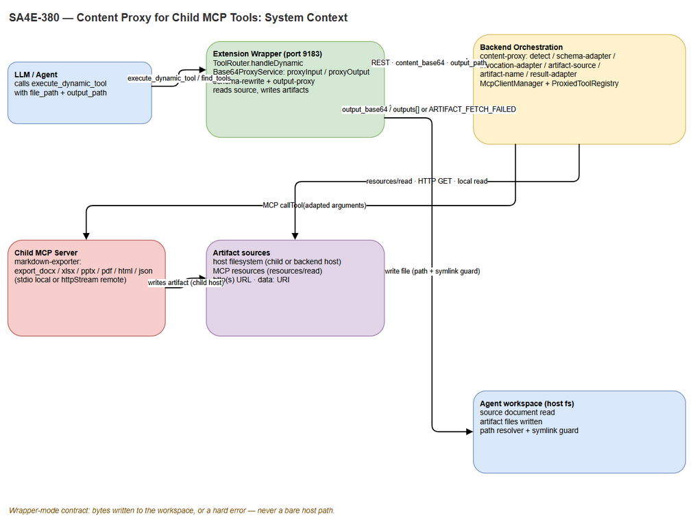
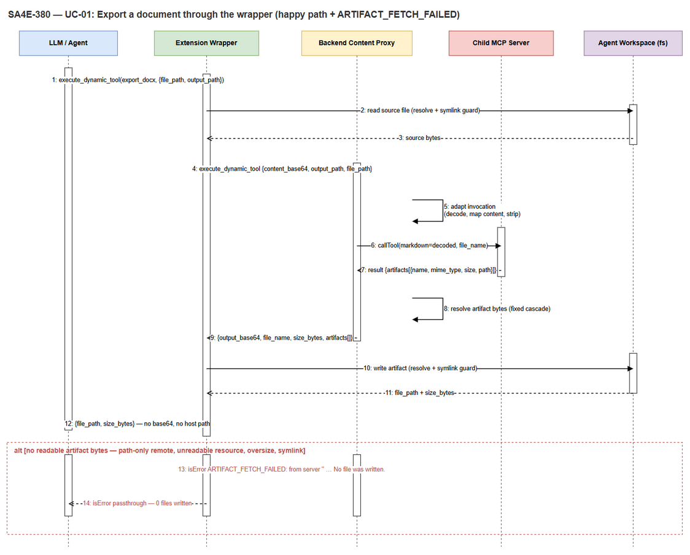
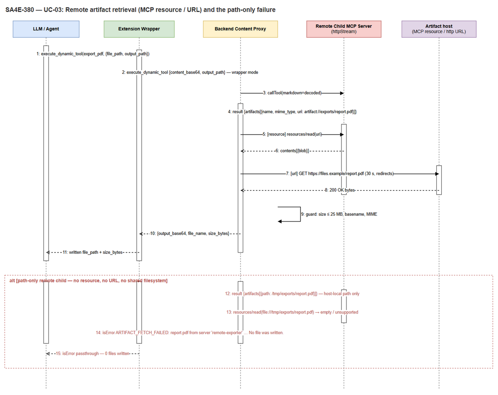
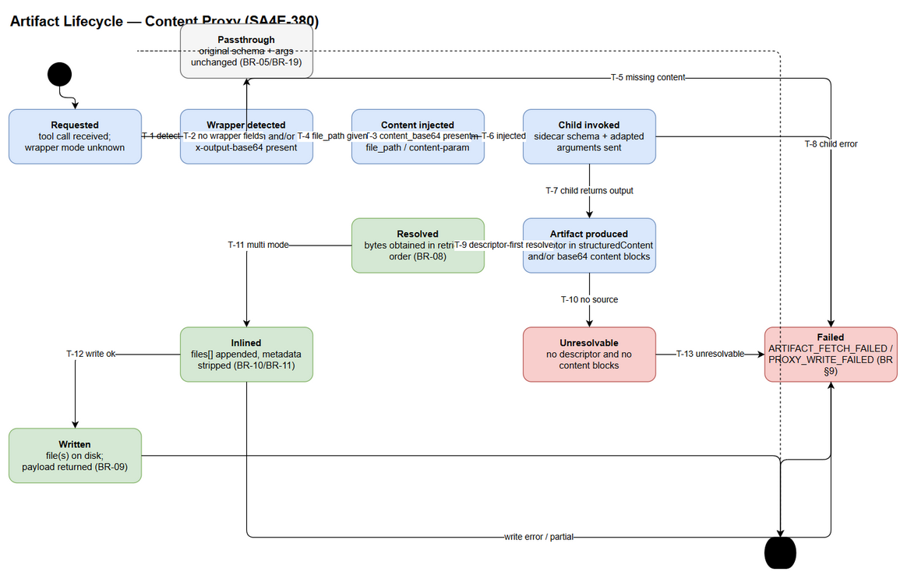

# Functional Specification Document (FSD)

## SDLC Agents 4 Enterprise — SA4E-380: Content Proxy for Child MCP Tools (Export DOCX/XLSX/PPTX/PDF/HTML/JSON Through the Extension Wrapper, No New Tools)

---

## Document Information

| Field | Value |
|-------|-------|
| Jira Ticket | SA4E-380 |
| Title | Content Proxy for child MCP tools: export DOCX/XLSX/PPTX/PDF/HTML/JSON through the extension wrapper (no new tools) |
| Author | BA Agent |
| Version | 1.0 |
| Date | 2026-10-23 |
| Status | As-built (backfilled) |
| Document type | Functional Specification (business + functional sections). Technical enrichment owned by the TA agent. |
| Related BRD | [documents/SA4E-380/BRD.md](BRD.md) (7 user stories, 85 KB) |
| Baseline | Code present in workspace, uncommitted. This FSD describes the behaviour that the code implements — it was derived from the source files listed in §1.4, not from a forward-looking design. |
| Template | `documents/templates/FSD-TEMPLATE.md`. Numbering: §11 = Dependencies, Risks & Open Issues, §12 = Appendix (the template's Appendix moved to §12 to keep dependencies and risks in the main body). |

> **As-built notice.** This is a documentation backfill. Nothing in this document proposes a change to the implementation; it records what exists, including the two places where the implementation is narrower than the wording of the BRD (recorded as OI-03 and OI-04 in §11.3 rather than silently smoothed over).

---

## Revision History

| Version | Date | Author | Changes |
|---------|------|--------|---------|
| 1.0 | 2026-10-23 | BA Agent | Initiate document — as-built FSD derived from BRD SA4E-380, the SA4E-29 architecture note ("Child Tool Content Proxy"), and the implemented backend/extension source files |

---

## Sign-Off

| Role | Name / Agent | Verdict | Date |
|------|--------------|---------|------|
| Author (business + functional) | BA Agent | Draft issued for TA enrichment | 2026-10-23 |
| Technical enrichment | TA Agent | Pending | — |
| Design validation | SA Agent | Pending (TDD phase) | — |
| Requirement acceptance | Duc Nguyen Minh (Product Owner) | Pending | — |

---

## 1. Introduction

### 1.1 Purpose

This FSD specifies, at functional level, the **content-proxy capability** that lets a file-producing child MCP tool (the `markdown-exporter` family: `export_docx`, `export_xlsx`, `export_pptx`, `export_pdf`, `export_html`, `export_json`) work end-to-end through the extension wrapper while **registering zero new tools**.

It answers three questions for the reader who has to test or maintain the capability:

1. **What does the system do** when an agent asks for a document? (Use cases UC-01 … UC-07.)
2. **Under which rules** does it decide to adapt a tool, to inject content, to inline bytes, or to fail? (Business rules BR-01 … BR-20.)
3. **What exactly does the caller see** on success and on each failure? (Data specifications §3.9, error contract §9.)

The business motivation, scope boundary and acceptance evidence live in the BRD; this document does not restate them except where a functional rule needs the context.

### 1.2 Scope

**In scope (functional behaviour specified here):**

| # | Behaviour | Section | BRD trace |
|---|-----------|---------|-----------|
| 1 | Wrapper-mode export for the six formats: source path in, written file out | §3.1 UC-01 | STORY 1 |
| 2 | Fail-loud contract: bytes or a hard error, never a bare path | §3.2 UC-02 | STORY 2, STORY 7 |
| 3 | Artifact retrieval across hosts (MCP resource, resource link, HTTP, data URI, local path) | §3.3 UC-03 | STORY 3 |
| 4 | Multi-artifact export with per-file write verification | §3.4 UC-04 | STORY 4 |
| 5 | Discovery and detection: adapted schemas, unchanged tool catalogue | §3.5 UC-05 | STORY 5, STORY 6 |
| 6 | Direct (non-wrapper) calls keep the child's original response shape | §3.6 UC-06 | STORY 2 (AC-5), STORY 5 (AC-6) |
| 7 | Invalid payload handling (missing content, malformed base64, unsuitable tool) | §3.7 UC-07 | STORY 7 |

**Out of scope** (unchanged from BRD §1.2): modifying the child exporter; adding any tool to `tools/list`; UI work; `ARTIFACT_PATH_MAP` path translation between hosts; re-running the test suites; fixing the unrelated `ProjectIsolation.derive-project-id.test.ts` UT-11 failure; authentication/topology changes; deployment packaging.

**Functional boundary that matters for testing:** the capability is *invisible in the tool catalogue*. There is no `content_proxy`, `fetch_artifact` or `export_docx_proxied` tool. Everything happens inside the existing `execute_dynamic_tool` call path, plus a schema rewrite that the wrapper performs on what it publishes to the LLM.

### 1.3 Definitions & Acronyms

| Term | Definition |
|------|------------|
| **Wrapper mode (backend)** | The invocation mode entered when the argument object contains `content_base64` **or** `output_path`. Only in this mode does the backend adapt arguments and inline artifact bytes. (BR-01) |
| **Wrapper mode (extension)** | The output-write mode entered when the call arguments contain `file_path` **or** `content_base64` as strings. In this mode the extension refuses to pass a payload-less result through. (BR-13) |
| **Content argument** | The child tool's own parameter that receives the document source (for the markdown exporter: `markdown`). Discovered by alias priority or by the single-required-string rule. (BR-03) |
| **Wrapper-only argument** | An argument owned by the extension/backend that must never reach the child: `content_base64`, `output_path`, and `file_path` when the child does not declare it. (BR-02) |
| **Artifact** | A file produced by the child tool (DOCX/XLSX/PPTX/PDF/HTML/JSON or any other binary). |
| **Artifact descriptor** | The metadata a child returns about an artifact: `name`, `mime_type`, `size`, plus a location (`path`, `uri`, `url`) and/or inline bytes. A descriptor is not the file. |
| **ARTIFACT_FETCH_FAILED** | Error code meaning "the child declared an artifact but the backend obtained no readable bytes"; no file was written. |
| **PROXY_WRITE_FAILED** | Error code meaning "bytes were obtained but the wrapper could not write them" (zero-write or partial-write). |
| **Byte payload** | A non-empty base64 string carrying artifact bytes: `output_base64` (single) or one entry of `outputs[]` (multi). |
| **Host-local path** | A filesystem path meaningful only on the machine where the child server runs. Readable by the backend only when both share a host. |
| **Child MCP server** | An MCP server whose tools are proxied to the LLM by the platform (here: `markdown-exporter`, plus any future exporter). |
| **Same-host invariant** | A path-only artifact can only be resolved when the child runs on the backend host (stdio/local). Remote children must expose MCP resources, URLs or data URIs. (§5.2) |
| **Adapted tool** | A child tool definition whose schema was rewritten in place with `content_base64`, `x-content-param` and/or `x-output-base64`. Same name, no new entry. |
| **Capability** | The derived `{ contentParam, fileOutput, declaredParams }` triple the backend computes once per tool. |
| **25 MB cap** | `MAX_ARTIFACT_BYTES` = 26,214,400 bytes, applied to inline base64, local file reads, HTTP responses and `data:` URIs alike. |
| **LLM-facing view** | The schema the wrapper publishes to the model: content params hidden, `file_path` (and `output_path` where the tool inlines bytes) exposed. |

### 1.4 References

| Document | Location |
|----------|----------|
| BRD (primary requirement source) | [documents/SA4E-380/BRD.md](BRD.md) |
| Base64 proxy architecture note — section "Child Tool Content Proxy (backend orchestration)" | `documents/SA4E-29/ARCHITECTURE-BASE64-PROXY.md` (lines 132–155) |
| Content-proxy configuration (prefixes, aliases, exclusion pattern, cap, overrides) | `backend/src/config/ContentProxy.ts` |
| Backend content-proxy module (7 files) | `backend/src/modules/orchestration/content-proxy/` — `types.ts`, `detect.ts`, `schema-adapter.ts`, `invocation-adapter.ts`, `artifact-name.ts`, `artifact-source.ts`, `result-adapter.ts` |
| Registry where adaptation is applied at catalogue-build time | `backend/src/modules/orchestration/ProxiedToolRegistry.ts` (`registerServerTools`, `getCapability`) |
| Client manager — child invocation and `resources/read` | `backend/src/modules/orchestration/McpClientManager.ts` (`executeToolOnServer`, `readResourceFromClient`) |
| Transport factory (stdio / streamable HTTP / SSE) | `backend/src/modules/orchestration/health/TransportFactory.ts` |
| Extension proxy service and output proxy | `extension/src/services/Base64ProxyService.ts`, `.../Base64ProxyService/{schema-rewrite,output-proxy,dynamic-tool}.ts` |
| Extension wrapper router (`handleDynamic`, `ensureProxyDetection`) | `extension/src/services/WrapperServer/tool-router.ts` |
| Canonical DOCX export procedure followed by agents | `.opencode/skills/file-writing/SKILL.md` |
| Jira ticket | `https://jiraassist.atlassian.net/browse/SA4E-380` |
| Ticket status record (read-only for this document) | `documents/SA4E-380/STATUS.json` |

---

## 2. System Overview

### 2.1 System Context


*[Edit in draw.io](diagrams/fsd-system-context.drawio)*

The capability sits on the boundary between three trust domains — the **model**, the **IDE-side wrapper**, and the **backend with its child servers** — and its whole reason for existing is that the file produced by the child lives in a different domain from the file the agent needs.

| Participant | Kind | Responsibility in this feature |
|-------------|------|-------------------------------|
| **LLM / Agent** | Human-facing actor (model) | Calls `execute_dynamic_tool` with a source `file_path` and optional `output_path`; consumes either `file_path` + `size_bytes` (success) or an explicit error. Never sends base64. |
| **Extension Wrapper** (port 9183) | System | Reads the source file inside the workspace, injects `content_base64`, receives `output_base64`/`outputs[]`, writes every file, verifies the count, owns `PROXY_WRITE_FAILED` and the extension-side `ARTIFACT_FETCH_FAILED`. |
| **Backend Orchestration** (content proxy) | System | Detects capabilities, rewrites schemas, decodes and maps content, strips wrapper-only arguments, resolves artifact bytes, strips host paths, owns the backend-side `ARTIFACT_FETCH_FAILED`. |
| **Child MCP Server** (local stdio / remote streamable HTTP) | System | Performs the actual conversion and writes the artifact on its own host; returns a descriptor (and, when remote, must expose the bytes as a resource or URL). |
| **Artifact sources** | System (passive) | Host filesystem (child host or backend host), MCP resources served by the child, `http(s)` URLs, `data:` URIs. |
| **Agent workspace** | System (passive) | Destination of the write; guarded by the workspace path resolver and the symlink guard. |

Three boundary facts drive every use case below:

1. **The model cannot read a path.** A path in a tool result is a claim about a filesystem the model cannot verify. Hence bytes or an error.
2. **The child cannot be changed.** Its published contract is "content in, descriptor out"; the translation has to happen around it.
3. **The wrapper is the only component allowed to touch the workspace.** Reads and writes both pass through the path resolver and symlink guard.

### 2.2 System Architecture

The capability is delivered by five cooperating parts (BRD §8.1) implemented in two codebases. Names below are the actual components, so a reader can navigate the code from this document.

| # | Component | Location | Responsibility |
|---|-----------|----------|----------------|
| 1 | **Capability detection** | `content-proxy/detect.ts` + `config/ContentProxy.ts` | Decide *whether* a child tool produces files and *which* argument carries content; consult the per-tool override table first. |
| 2 | **Schema adaptation** | `content-proxy/schema-adapter.ts` | Rewrite the existing definition in place: add `content_base64`, set `x-content-param`, set `x-output-base64`, un-require the content argument, append the byte-output sentence once. |
| 3 | **Invocation adaptation** | `content-proxy/invocation-adapter.ts` | Detect wrapper mode, validate/decode the payload, map it onto the content argument, strip wrapper-only arguments. |
| 4 | **Artifact resolution + naming + result adaptation** | `artifact-source.ts`, `artifact-name.ts`, `result-adapter.ts` | Obtain bytes over any supported transport, derive a bare file name, strip host locations, shape `output_base64` / `outputs[]`, raise `ARTIFACT_FETCH_FAILED`. |
| 5 | **Output proxy** | `Base64ProxyService/output-proxy.ts` (+ `schema-rewrite.ts`, `dynamic-tool.ts`, `tool-router.ts`) | Extract payloads, resolve destinations, write files under the path/symlink guards, verify written count, raise `PROXY_WRITE_FAILED` / extension-side `ARTIFACT_FETCH_FAILED`. |

**Wiring (who calls whom):**

```
LLM ──execute_dynamic_tool──▶ WrapperServer.ToolRouter.handleDynamic
                                 │ unwrap (toolName/arguments)
                                 │ ensureProxyDetection → backend find_tools
                                 │ Base64ProxyService.proxyInput  (file_path → content_base64)
                                 ▼
                            Backend REST execute_dynamic_tool
                                 │ McpClientManager.executeToolOnServer
                                 │ ProxiedToolRegistry.getCapability(tool)
                                 │ adaptInvocation  → child args
                                 ▼
                            Child MCP client.callTool
                                 ▼
                            adaptResult (artifact → bytes → output_base64/outputs[])
                                 │ + readResourceFromClient (resources/read) when needed
                                 ▼
                            Wrapper proxyToolOutput (write files, rewrite text)
                                 ▼
                            LLM sees file_path + size_bytes  (or isError)
```

**Architectural invariants** (violating any of them re-introduces the defect this ticket closes):

| # | Invariant | Enforced at |
|---|-----------|-------------|
| I-1 | In wrapper mode the backend returns bytes or `isError`; it never returns a bare host path. | `result-adapter.ts` (`retrievalError`), `McpClientManager.executeToolOnServer` |
| I-2 | In wrapper mode the extension never passes through a declared-artifact result with no bytes. | `output-proxy.ts` (`missingPayload`) |
| I-3 | No path fragment from the child reaches the caller: only `path.basename`. | `artifact-name.safeName`, `shapeResult`, `sanitizeLogText` |
| I-4 | The tool catalogue does not change: adaptation rewrites definitions, never appends new ones. | `ProxiedToolRegistry.registerServerTools` |
| I-5 | Detection runs once per tool definition, not per invocation. | `registerServerTools` → `capabilities` map; extension `detectFromToolList` / `registerTools` |
| I-6 | Wrapper-only arguments never reach a child. | `invocation-adapter.adaptInvocation` |
| I-7 | Any write into the workspace passes the path resolver and the symlink guard. | `output-proxy.ts`, `Base64ProxyService.proxyInput` |

---

## 3. Functional Requirements

The seven use cases below cover every behaviour the ticket introduces. They are grouped by caller intent, not by code layer: UC-01/UC-04 are the two success shapes, UC-02/UC-07 are the failure shapes, UC-03 is the cross-host retrieval path, UC-05 is discovery, UC-06 is the compatibility path that must **not** change.

Trace legend: **STORY n** refers to BRD §2.3; **AC-n** to the Jira acceptance criterion quoted in BRD §8.2; **BR-xx** to §3.8.

---

### 3.1 Feature: Export a Document Through the Wrapper (Six Formats)

**Source:** BRD STORY 1 (AC-1), STORY 2 (AC-2) — UC-01.

#### 3.1.1 Description

The agent supplies a **source file path** (never document content) and, optionally, a **destination path**. The wrapper turns the file into base64, the backend maps those bytes onto the child's own content argument, the child converts, the backend retrieves the produced artifact as bytes, and the wrapper writes it into the workspace. The response the agent sees contains the destination `file_path` and `size_bytes`, and nothing that looks like a child-host path.

The same flow serves DOCX, XLSX, PPTX, PDF, HTML and JSON. No branch in the proxy code is format-specific: the format is a property of the child converter, and the proxy is format-blind. That is deliberate — a new format supplied by a convention-named child tool works with zero proxy changes.

#### 3.1.2 Use Case

**Use Case ID:** UC-01 — Export a document through the wrapper
**Actor:** LLM / Agent (primary); Extension Wrapper, Backend Orchestration, Child MCP Server (supporting)
**Trigger:** `execute_dynamic_tool({ toolName: 'export_docx' | 'export_xlsx' | 'export_pptx' | 'export_pdf' | 'export_html' | 'export_json', arguments: { file_path, output_path?, file_name? } })`
**Preconditions:**
1. The child server owning the tool is connected to the backend (state `connected`).
2. `file_path` resolves inside the agent workspace and is a regular, readable file.
3. The source file size is ≤ 25 MB (wrapper pre-read cap).
4. The tool has been adapted by the backend (capability present) **or** declares `content_base64` natively.

**Postconditions (success):** every artifact the child declared exists as a file in the workspace; the agent received `file_path` and `size_bytes` per file; no `output_base64` remains in the response; no child-host path appears anywhere in the response.
**Postconditions (failure):** `isError = true` with one of the codes in §9; **zero or a strictly partial set** of files written, and the count is stated in the message.

**Main Flow:**

| Step | Actor | System | Description |
|------|-------|--------|-------------|
| 1 | LLM sends `execute_dynamic_tool` with `toolName` and inner `arguments{file_path, output_path?}` | | The model never sends `content_base64`; it is a wrapper-owned argument. |
| 2 | | Wrapper | `unwrapDynamicTool` extracts `toolName` (`toolName` or `tool_name`) and `innerArgs` (`arguments` or `args`). If no tool name is present the call is forwarded unchanged. |
| 3 | | Wrapper | If `file_path` is present and the tool is not yet known as an input tool, `ensureProxyDetection(toolName)` queries the backend `find_tools` and registers the returned schemas. Failure here is non-fatal (detection is additive). |
| 4 | | Wrapper | `proxyInput`: resolve `file_path` via the workspace resolver (throws `PathResolverError` on failure), check symlink guard, stat size, read bytes, set `content_base64`, replace `file_path` with the resolved absolute path. |
| 5 | | Wrapper → Backend | Re-wrap the inner arguments and call the backend `execute_dynamic_tool` with `{toolName, arguments: proxied}`. |
| 6 | | Backend | `McpClientManager.executeToolOnServer`: resolve owner server, read `capability`, run `adaptInvocation` — wrapper mode is true (content_base64 present), `output_path` is stripped, `file_path` is stripped when the child does not declare it, the payload is strictly decoded and assigned to the content argument (e.g. `markdown`). |
| 7 | | Backend → Child | `client.callTool({name, arguments: adapted})` over the configured transport (stdio for a local child, streamable HTTP for a remote one). |
| 8 | | Child | Converts the content and writes the artifact on its own host; returns a text block holding JSON shaped `{ success, summary, artifacts:[{ name, mime_type, size, path }] }`. |
| 9 | | Backend | `adaptResult`: wrapper mode **and** `fileOutput` **and** not `isError` → parse the text JSON, resolve each descriptor to bytes (§6.2), strip `file_path`/`output_path`/`outputs`, reduce `artifacts[]` to `{name, mime_type, size}`, set `file_name`, `mime_type`, `size_bytes`, `output_base64`. |
| 10 | | Wrapper | `proxyToolOutput`: parse the text, collect payloads (`outputs[]` first, else `output_base64`), resolve the destination, ensure the parent directory, re-resolve the final path + symlink guard, write bytes, and build per-file metadata with `output_base64` removed and `file_path` + `size_bytes` added. |
| 11 | | Wrapper → LLM | Return the rewritten text. Single file: `{ success, summary, file_name, file_path, size_bytes, mime_type?, artifacts[] }`. |
| 12 | LLM verifies the file exists using `file_path` and `size_bytes` | | No further read of the child host is needed — the file is in the agent workspace. |


*[Edit in draw.io](diagrams/fsd-sequence-export.drawio)*

**Alternative Flows:**

| ID | Condition | Steps |
|----|-----------|-------|
| AF-1 | `output_path` omitted | Step 10 resolves the destination next to the source: `dirname(file_path)` + the backend-suggested `file_name` (e.g. `UG-v1.docx`). If no suggested name exists, a `.drawio` source is swapped to `.png`; any other source gets `.out` appended. |
| AF-2 | `output_path` points at a directory and the result has one artifact | The file is written at the resolved `output_path` exactly as given (no name substitution). |
| AF-3 | Caller passes the child's content argument directly and no wrapper argument | Wrapper mode is false on both sides → UC-06 (child response returned unchanged, including its path). |
| AF-4 | Tool declares `content_base64` natively (e.g. `drawio_export_png`) | Backend does not adapt it (BR-05). The extension still performs input and output proxying from its own detection, so the wrapper flow works; only the backend mapping step is absent. |
| AF-5 | Child requires additional declared arguments (e.g. `file_name`, `options`) | They pass through untouched: the adapter copies the whole argument object and only removes/rewrites wrapper-owned keys. |
| AF-6 | Six different formats | Identical steps; the converter and the resulting MIME type/extension differ. The proxy must not be used to assert format validity — that is the child's responsibility and is checked by tests (§10). |

**Exception Flows:**

| ID | Condition | Steps |
|----|-----------|-------|
| EF-1 | `file_path` missing, outside the workspace, or a symlink | Step 4 throws `PathResolverError`; the wrapper surfaces a tool error (`FS_ERROR: …`). The child is **not** invoked and nothing is written. |
| EF-2 | Source file larger than 25 MB | Step 4 throws `FS_ERROR: file too large for proxy pre-read (limit 25 MB): … — attach a smaller file or read a slice.` Child not invoked. |
| EF-3 | `content_base64` present but malformed | Step 6 returns `isError` with `Invalid content_base64 payload.` Child not invoked → UC-07. |
| EF-4 | Wrapper mode active but no usable content | Step 6 returns `Missing content: pass file_path so the extension wrapper can inject content_base64 (or send <param> directly).` Child not invoked → UC-07. |
| EF-5 | Child declares artifacts but no bytes are obtainable | Step 9 returns `ARTIFACT_FETCH_FAILED`; the wrapper sees `isError` and passes it through; no file written → UC-02. |
| EF-6 | Destination blocked by path guard, symlink guard, permission or disk error | Step 10 throws; the wrapper returns `PROXY_WRITE_FAILED: <sanitized reason> — no file was written.` → UC-04/§9. |
| EF-7 | Child itself errors (`isError`) | `adaptResult` returns the result untouched, the wrapper returns it untouched: the child's message survives verbatim (BR-18). |
| EF-8 | Child server disconnected | `executeToolOnServer` throws the health message (`Client for server <name> is disconnected` / state message); the failure is propagated to the caller, no adaptation is attempted. |

#### 3.1.3 Business Rules

| Rule ID | Rule (short form) | Source |
|---------|-------------------|--------|
| BR-01 | Wrapper mode = `content_base64` or `output_path` present (backend). | BRD STORY 2 RD-1 |
| BR-02 | Wrapper-only arguments are stripped before the child call. | BRD STORY 1 RD-2, STORY 5 RD-5 |
| BR-03 | Content argument resolved by alias priority, else the single required string. | BRD STORY 6 RD-3 |
| BR-06 | Artifact ≤ 25 MB on every retrieval path. | BRD §6 capacity |
| BR-07 | Fixed retrieval order; first non-empty buffer within cap wins. | BRD STORY 3 RD-2 |
| BR-08 | Only a bare file name survives; path fragments are discarded. | BRD STORY 1 validation |
| BR-09 | Single vs multi result shaping. | BRD STORY 4 RD-1 |
| BR-10 | `artifacts[]` metadata reduced to `name`/`mime_type`/`size`. | BRD STORY 2 RD-4 |
| BR-13 | Extension wrapper mode = `file_path` or `content_base64` present. | BRD STORY 2 RD-5 |
| BR-15 | Destination resolution order for the write. | BRD STORY 1 RD-3, STORY 4 RD-3 |
| BR-16 | Written count must equal payload count. | BRD STORY 4 RD-2/RD-5 |

#### 3.1.4 Data Specifications

**Input (wrapper-facing):**

| Field | Type | Required | Validation | Description |
|-------|------|----------|------------|-------------|
| `toolName` | string | Y | Must name a connected child tool (alias `tool_name` accepted) | Target exporter, e.g. `export_docx`. |
| `file_path` | string | Y (wrapper mode) | Resolves inside the workspace; regular file; no symlink; size ≤ 26,214,400 B | Source markdown the wrapper reads. Replaced with the resolved absolute path before the backend sees it. |
| `output_path` | string | N | Resolves inside the workspace; parent directory must be creatable/present | Destination file or directory. |
| `file_name` | string | N | Child-declared argument; forwarded verbatim | Suggested artifact name honoured by the child (canonical DOCX flow sends it). |
| `content_base64` | string | Injected | Base64 alphabet, length divisible by 4, non-empty | Wrapper-injected source bytes; never supplied by the LLM. |

**Output (LLM-facing, single artifact):**

| Field | Type | Description |
|-------|------|-------------|
| `success` | boolean | Child's success flag, defaulted to `true` when the child omitted it. |
| `summary` | string | Child's human summary, preserved. |
| `file_name` | string | Bare artifact name (basename only). |
| `file_path` | string | Workspace path where the wrapper wrote the file — the only path the agent may trust. |
| `size_bytes` | number | Bytes actually written. |
| `mime_type` | string | Present when the child or the name fallback provided one. |
| `artifacts[]` | object[] | Display metadata only: `name`, `mime_type`, `size` (`path` removed). |
| `output_base64` | — | **Absent** after a successful write. |

*Full field catalogue and the multi-artifact shape: §3.9.4.*

#### 3.1.5 UI Specifications

**N/A — no user interface change; the contract is surfaced to the LLM via the tool schema.**

| Schema-visible element (LLM view) | Type | Behaviour | Validation |
|-----------------------------------|------|-----------|------------|
| `file_path` | string, required | Replaces the hidden content argument; described with the shared workspace-path rule | Must be a workspace path; a content blob pasted here produces a valid but meaningless document (BRD Risk R-9, not guarded) |
| `output_path` | string, optional | Added for tools that inline bytes; default suffix rule stated in its description | Must be a workspace path |
| `markdown` (content argument) | hidden | Deleted from the LLM view by `x-content-param` | — |
| `content_base64` | hidden | Deleted from the LLM view | — |
| tool description | string | Appended sentence: "Returns output_base64 (base64 file bytes) when invoked through the extension wrapper." | Appended once only |

#### 3.1.6 API Contract (Functional View)

> Technical details (HTTP headers, JSON-RPC envelopes, retry policy) belong to the TDD; this table states the business contract only.

**Operation:** `execute_dynamic_tool` (wrapper → backend), inner target = child exporter
**Purpose:** Convert a workspace document and return it as a written file.

| Parameter | Type | Required | Business Rule | Description |
|-----------|------|----------|---------------|-------------|
| `toolName` | string | Y | — | Child exporter to run. |
| `arguments.file_path` | string | Y (wrapper mode) | BR-02, BR-13 | Source document. |
| `arguments.output_path` | string | N | BR-15 | Destination. |
| `arguments.content_base64` | string | Injected | BR-01, BR-02 | Bytes, injected by the wrapper. |

**Business Error Scenarios:**

| Scenario | Message the agent sees | Trigger |
|----------|------------------------|---------|
| Source unreadable | `FS_ERROR: Failed to read file <path>: <reason>` | Wrapper pre-read fails (EF-1) |
| Source too large | `FS_ERROR: file too large for proxy pre-read (limit 25 MB): <path> — attach a smaller file or read a slice.` | Pre-read cap (EF-2) |
| No content | `Missing content: pass file_path so the extension wrapper can inject content_base64 (or send markdown directly).` | Wrapper mode without payload (EF-4) |
| Bad payload | `Invalid content_base64 payload.` | Malformed base64 (EF-3) |
| Artifact unreadable | `ARTIFACT_FETCH_FAILED: … No file was written.` | No resolvable bytes (EF-5) |

---

### 3.2 Feature: Fail Loudly When an Artifact Cannot Be Read

**Source:** BRD STORY 2 (AC-2), STORY 7 (AC-6) — UC-02.

#### 3.2.1 Description

This use case is the **negative twin** of UC-01 and exists because the original defect was not "the file was missing" but "the system said it succeeded". Two independent checks enforce the contract:

- **Backend check** — if the child declared artifacts and zero bytes were resolved, the result becomes `isError` with `ARTIFACT_FETCH_FAILED` (BR-08/BR-10 are bypassed; no path is shaped into the payload).
- **Extension check** — if the backend response still carries `artifacts[]` metadata but no payload while the wrapper is in wrapper mode, the wrapper converts it into `ARTIFACT_FETCH_FAILED` itself.

Either check alone would be a single point of silent failure; the dual guard is intentional (BRD STORY 2 RD-5).

#### 3.2.2 Use Case

**Use Case ID:** UC-02 — Fail loudly on unreadable artifact
**Actor:** Backend Orchestration (initiator), Extension Wrapper (second guard), LLM / Agent (recipient)
**Trigger:** Wrapper-mode child result declaring `artifacts[]` for which no bytes can be obtained from any supported source.
**Preconditions:** Wrapper mode is active; `capability.fileOutput = true`; the child result is not itself an error.

**Postconditions:**
1. `isError = true`.
2. The text begins with the literal code `ARTIFACT_FETCH_FAILED`.
3. The message names the artifact(s) and, when known, the child server.
4. The message states that no file was written.
5. No `output_base64`, no `outputs[]`, and no host path appear in the result.

**Main Flow:**

| Step | Actor | System | Description |
|------|-------|--------|-------------|
| 1 | | Backend | Wrapper-mode result arrives from the child with `artifacts[]` but only host-local locations (or unreadable ones). |
| 2 | | Backend | `collectFiles`: each descriptor is resolved (inline → locations); no buffer is produced. Content blocks are then tried; still nothing. |
| 3 | | Backend | `files.length === 0` **and** `artifacts.length > 0` → `retrievalError(serverName, artifacts)`: artifact labels reduced with `safeName` (fallback literal `artifact`), server name appended only when known. |
| 4 | | Backend → Wrapper | Returns `{ content: [{type:'text', text:'ARTIFACT_FETCH_FAILED: … No file was written.'}], isError: true }`. |
| 5 | | Wrapper | `proxyToolOutput` returns immediately on `result.isError` — no write attempt, no rewriting, so the backend message is not double-wrapped. |
| 6 | | Wrapper → LLM | The error result reaches the agent verbatim. The agent must not retry by passing a raw path (§9 recovery). |

**Alternative Flows:**

| ID | Condition | Steps |
|----|-----------|-------|
| AF-1 | Backend returned metadata without bytes (older/other backend, or a partially upgraded pair) | Step 5 finds no payload; `collectOutputs` is empty while `artifacts[]` is non-empty and wrapper mode is on → `missingPayload` produces the extension-side variant: `ARTIFACT_FETCH_FAILED: <names> was returned without content (the backend could not read the artifact). No file was written.` |
| AF-2 | Child declared several artifacts, all unreadable | All names are listed, comma-separated, in the order returned. |
| AF-3 | Child declared artifacts, at least one readable | Not this use case: the resolvable subset is shaped normally; unreadable entries simply do not contribute bytes (their absence surfaces as a partial write only if the payload count and write count disagree — see UC-04). |
| AF-4 | Child returned a genuine tool error | `adaptResult` short-circuits at `result.isError`, so this use case does not apply; the child's error passes through untouched (BR-18). |

**Exception Flows:**

| ID | Condition | Steps |
|----|-----------|-------|
| EF-1 | Neither bytes nor artifact metadata exist (e.g. a text-only child result) | The wrapper returns the result unchanged — this is **not** an error. Recorded as OI-05 (§11.3): "wrapper mode with zero declared artifacts and zero payload" is a pass-through, not a hard failure. |
| EF-2 | `readResource` is unavailable (no remote client) | URI-based sources are skipped; the outcome is still `ARTIFACT_FETCH_FAILED` — never a downgrade to a path. |
| EF-3 | Artifact is a symlink / directory / above the cap | Refused at the source layer *silently* (no layout information leaks), then surfaced as `ARTIFACT_FETCH_FAILED` with the bare name. |

#### 3.2.3 Business Rules

| Rule ID | Rule (short form) | Source |
|---------|-------------------|--------|
| BR-10 | Host locations stripped; `file_path`/`output_path`/`artifacts[].path` never returned in wrapper mode. | BRD STORY 2 RD-4 |
| BR-12 | Direct calls are untouched; the fail-loud gate applies to wrapper mode only. | BRD STORY 2 RD-6 |
| BR-14 | The wrapper refuses to pass through a declared-artifact result with no bytes. | BRD STORY 2 RD-5 |
| BR-18 | A child error is never replaced by a proxy error. | BRD STORY 7 RD-5 |

#### 3.2.4 Data Specifications

**Error object (backend and extension variants share the shape):**

| Field | Type | Value |
|-------|------|-------|
| `isError` | boolean | `true` |
| `content` | array | Exactly one `{ type: 'text', text }` block carrying the message; other result fields are preserved by spread (`...result`). |
| `content[0].text` | string | Message beginning with the literal `ARTIFACT_FETCH_FAILED`. |

**Message composition inputs:**

| Input | Source | Fallback |
|-------|--------|----------|
| Artifact names | `artifacts[].name` → `safeName` | literal `artifact` |
| Server name | owner server from the registry (backend only) | clause omitted entirely |
| "No file was written." | constant | always present |

#### 3.2.5 UI Specifications

**N/A — no user interface.** The error is consumed by the agent runtime (`isError`) and rendered in the agent transcript as tool failure text.

#### 3.2.6 API Contract (Functional View)

**Operation:** same `execute_dynamic_tool` call as UC-01; only the result shape differs.

| Result field | Success (UC-01) | Failure (UC-02) |
|--------------|-----------------|-----------------|
| `isError` | absent/false | `true` |
| `output_base64` / `outputs[]` | present | absent |
| `file_path` | present (written destination) | absent |
| `artifacts[]` | metadata only | not included in the error object |
| Error code | — | `ARTIFACT_FETCH_FAILED` |

---

### 3.3 Feature: Retrieve an Artifact Produced by a Remote Child Server

**Source:** BRD STORY 3 (AC-3) — UC-03.

#### 3.3.1 Description

When the child runs on another host, the path it returns is meaningless to the backend. The capability therefore treats a location as **one of several possible sources**, not as the answer. The retrieval cascade is transport-agnostic and ordered so that the cheapest and most authoritative source wins: bytes that travelled with the result beat bytes that must be fetched, and bytes the child itself serves (`resources/read`) beat bytes fetched from a third-party URL.

The cascade is also the reason the platform can promise "no silent corruption": if none of the six sources yields bytes, the result is a hard error (UC-02), and a path-only remote child is a **supported-but-failing configuration**, not a workaround target.

#### 3.3.2 Use Case

**Use Case ID:** UC-03 — Remote artifact retrieval
**Actor:** Backend Orchestration (primary); Child MCP Server and artifact hosts (supporting)
**Trigger:** A wrapper-mode result whose artifact descriptor carries `uri`, `url`, `path` or an inline payload, from a child that may or may not share the backend's filesystem.
**Preconditions:** Wrapper mode active; child reachable; for URI sources, the child connection supports `resources/read` (absent capability simply yields "not readable").

**Postconditions (success):** `output_base64` (or `outputs[]`) carries exactly the bytes the child produced; the payload size is > 0 and ≤ 26,214,400 B.
**Postconditions (failure):** `ARTIFACT_FETCH_FAILED`; no partial buffer is retained; no file is written.

**Main Flow (remote child exposing an MCP resource):**

| Step | Actor | System | Description |
|------|-------|--------|-------------|
| 1 | | Wrapper → Backend | Wrapper-mode call arrives (`content_base64`, `output_path`). |
| 2 | | Backend → Remote Child | `callTool` over the streamable-HTTP transport. |
| 3 | | Remote Child | Converts on its host and returns `artifacts[]` with `uri: 'artifact://exports/report.pdf'` (and/or a `resource` content block). |
| 4 | | Backend | `resolveArtifact`: no inline payload present → iterate locations in the fixed order `url` → `uri` → `path`. |
| 5 | | Backend → Remote Child | `readLocation('artifact://…')` recognises a non-file scheme as **server-owned** and calls `readResourceFromClient(uri)` → MCP `resources/read`. |
| 6 | | Remote Child → Backend | `contents[]` with a base64 `blob` (or `text`). The first usable entry becomes the buffer. |
| 7 | | Backend | Buffer size checked against the cap; artifact name derived from the URI basename; MIME taken from the descriptor. |
| 8 | | Backend → Wrapper | `output_base64` + `size_bytes` + metadata-only `artifacts[]`. |
| 9 | | Wrapper | Writes the file, returns `file_path` + `size_bytes` (UC-01 steps 10–11). |


*[Edit in draw.io](diagrams/fsd-sequence-remote.drawio)*

**Alternative Flows (sources 2–6 of the cascade):**

| ID | Condition | Steps |
|----|-----------|-------|
| AF-1 | Descriptor carries `output_base64` / `content_base64` / `base64` / `data` | Decoded immediately (strict base64, non-empty, ≤ cap). No network, no filesystem access. |
| AF-2 | Result carries a standard `resource` content block (no usable descriptor) | `block.resource.blob` → base64 decode; `block.resource.text` → UTF-8 buffer; `block.resource.uri` → resolved as a location. |
| AF-3 | Result carries a `resource_link` block | Its `uri` is resolved exactly like a descriptor `uri` → `resources/read`. |
| AF-4 | Result carries an `image`, `audio` or `blob` block with `data` | Base64-decoded with the block's `mimeType`. |
| AF-5 | Descriptor carries an `http(s)` URL | The backend fetches it: redirects followed, 30 s timeout, non-2xx → "not readable", declared `content-length` above the cap → rejected **before** download. |
| AF-6 | Descriptor carries a `data:` URI | Decoded inline; a `;base64` marker selects base64 decoding, otherwise percent-decoding to UTF-8. |
| AF-7 | Descriptor carries a `file:` URI | Local read on the backend host first (regular file, no symlink, ≤ cap); if that fails, `resources/read` with the same `file:` URI is attempted. |
| AF-8 | Descriptor carries a bare filesystem path | Same-host assumption: `path.resolve` then local read; failing that, the equivalent `file://` URI is sent to `resources/read`. |
| AF-9 | Descriptor-first resolution yields nothing, but a content block does | Content blocks are evaluated **after** descriptors and only when no descriptor resolved. The two sources are not merged into one partial result. |

**Exception Flows:**

| ID | Condition | Steps |
|----|-----------|-------|
| EF-1 | Remote child returns **only** a host-local path | Local read fails, `resources/read` fails or is unsupported → `ARTIFACT_FETCH_FAILED` naming the artifact and server; the message lists the three supported alternatives and the shared-host requirement. No path survives into the response. |
| EF-2 | `resources/read` throws or returns an empty blob | Treated as "not readable"; the next source is tried; the final outcome is the hard error if all fail. |
| EF-3 | HTTP timeout (30 s), non-2xx, or oversized response | Treated as "not readable" — never surfaced as a protocol error; no partial buffer is kept. |
| EF-4 | Local path is a directory, a symlink, or above the cap | Refused silently at the source layer (no host-layout disclosure), then surfaced as `ARTIFACT_FETCH_FAILED`. |
| EF-5 | `readResource` is not wired (no client) | All URI-scheme sources are skipped; a path-only result fails loudly. |
| EF-6 | The child returns several artifacts and only some resolve | Resolved ones are shaped; the count discrepancy surfaces at write time (UC-04 partial-write path) or, if none resolved, as `ARTIFACT_FETCH_FAILED`. |

#### 3.3.3 Business Rules

| Rule ID | Rule (short form) | Source |
|---------|-------------------|--------|
| BR-06 | Cap applies to inline, local, HTTP and `data:` equally. | BRD §6 capacity |
| BR-07 | Fixed cascade order; first non-empty buffer within cap wins. | BRD STORY 3 RD-2 |
| BR-08 | Fallback naming from URI basename / MIME map. | BRD STORY 3 RD-2, §6 |
| BR-21 | Transport-agnostic: the same code path serves stdio and streamable HTTP children. | BRD STORY 3 RD-1 |
| BR-22 | Unknown URI schemes are server-owned → delegated to `resources/read`, never guessed. | BRD STORY 3 RD-6 |

#### 3.3.4 Data Specifications

**Artifact descriptor sources (evaluated in this order):**

| Field | Type | Meaning | Handled by |
|-------|------|---------|-----------|
| `output_base64`, `content_base64`, `base64`, `data` | string (base64) | Inline bytes | `fromBase64` (strict) |
| `url` | string | `http(s)` location | `fetchHttp` (30 s, redirect, cap) |
| `uri` | string | MCP URI or any scheme | `readLocation` → `resources/read` |
| `path` | string | Filesystem path | local read, then `resources/read` on `file://` |
| `name` | string | Suggested name | `safeName` → basename |
| `mime_type` | string | MIME | kept in metadata; drives fallback name |

**MCP content blocks accepted as fallback:**

| `block.type` | Fields used | Resolution |
|---------------|-------------|------------|
| `text` | `text` | The result JSON (parsed by `adaptResult`); never treated as an artifact itself |
| `resource` | `resource.blob` / `resource.text` / `resource.uri`, `resource.mimeType` | blob → base64 decode; text → UTF-8; uri → location resolution |
| `resource_link` | `uri`, `mimeType` | location resolution (typically `resources/read`) |
| `image` / `audio` / `blob` | `data` (base64), `mimeType`, `name` | base64 decode |

#### 3.3.5 UI Specifications

**N/A — no user interface.** The retrieval outcome is visible only as the agent-facing result shape (§3.9.4) or the error text (§9).

#### 3.3.6 API Contract (Functional View)

**Operation (internal):** `resources/read` against the child; `GET` against an artifact URL.

| Parameter | Type | Required | Business Rule | Description |
|-----------|------|----------|---------------|-------------|
| `uri` | string | Y (for `resources/read`) | BR-07, BR-20 | Resource URI exactly as the child published it. |
| `url` | string | Y (for HTTP) | BR-06, BR-07 | Absolute `http(s)` URL. |

| Outcome | Result |
|---------|--------|
| Blob returned | Bytes inlined; wrapper writes the file. |
| Empty/unavailable | Next source tried; final `ARTIFACT_FETCH_FAILED` if all fail. |
| Response > 25 MB (declared or actual) | Rejected; treated as unreadable; `ARTIFACT_FETCH_FAILED`. |

---

### 3.4 Feature: Write Every Artifact of a Multi-File Tool

**Source:** BRD STORY 4 (AC-4) — UC-04.

#### 3.4.1 Description

Some tools produce more than one file in a single call. The contract for this case is **all files or a stated partial**, never a quiet subset. The backend exposes the full set as `outputs[]`, the wrapper writes one file per entry in array order, and then compares the number written with the number received. A mismatch is converted into `PROXY_WRITE_FAILED` with both counts.

The single-artifact shape is deliberately left alone: a one-element `outputs[]` array is never produced, because callers (and the canonical DOCX procedure) expect `output_base64` + `size_bytes` at the top level.

#### 3.4.2 Use Case

**Use Case ID:** UC-04 — Multi-artifact export
**Actor:** LLM / Agent (primary); Backend, Wrapper (supporting)
**Trigger:** A wrapper-mode call to a tool whose result resolves to more than one artifact with bytes.
**Preconditions:** Wrapper mode; `fileOutput`; at least two artifacts produce non-empty buffers within the cap.

**Postconditions (success):** exactly N files exist, each under its own name, each size > 0; the response carries `outputs[]` metadata (no base64) plus the top-level metadata of the first file.
**Postconditions (failure):** `PROXY_WRITE_FAILED` stating either "no artifact" or "only X/Y"; the number of files on disk is reported truthfully.

**Main Flow:**

| Step | Actor | System | Description |
|------|-------|--------|-------------|
| 1 | | Backend | `collectFiles` resolves N descriptors (N > 1) to buffers. |
| 2 | | Backend | `shapeResult`: `outputs[] = [{file_name, mime_type, size_bytes, output_base64}]` per file; `size_bytes` and `output_base64` are deleted at the top level; `file_name` keeps the first artifact's name for display. |
| 3 | | Wrapper | `collectOutputs` prefers a non-empty `outputs[]` over the single field; `multi = outputs.length > 1`. |
| 4 | | Wrapper | For each entry: resolve the destination — with `output_path`: `dirname(resolved) + entry.file_name`; without: `dirname(file_path) + entry.file_name`. An entry with no usable name is skipped. |
| 5 | | Wrapper | Create the parent directory, re-resolve the final path, run the symlink guard, write bytes, and collect `{file_name, mime_type, file_path, size_bytes}` (payload removed). |
| 6 | | Wrapper | Compare `written.length` with `outputs.length`. Equal → success. |
| 7 | | Wrapper → LLM | Response = child JSON + first written entry at top level + `outputs[]` array of written metadata (no base64), with `output_base64`/`outputs` payload fields removed. |

**Alternative Flows:**

| ID | Condition | Steps |
|----|-----------|-------|
| AF-1 | `output_path` names a directory | Each artifact keeps its own bare name inside that directory; no collapsing onto one name is allowed. |
| AF-2 | `output_path` names a file (with extension) and the result is multi | The directory of that path is used and the file-name part is replaced by each artifact's own name (the caller's filename cannot represent N files). |
| AF-3 | Result has exactly one artifact | Single shape: `output_base64` + `size_bytes`; no `outputs[]` array. |
| AF-4 | Some entries resolved by the backend but a descriptor was unreadable | The unreadable artifact does not reach `outputs[]`; the visible count is smaller. If the child's own count differs from what arrives, the wrapper can only verify payloads received — recorded as OI-07. |
| AF-5 | Two artifacts share the same suggested name | The second write overwrites the first; the count check still passes, so the collision is invisible. Recorded as OI-08 (accepted risk; child names are normally distinct). |

**Exception Flows:**

| ID | Condition | Steps |
|----|-----------|-------|
| EF-1 | Zero payloads writable while payloads were received | `PROXY_WRITE_FAILED: no artifact could be written for '<tool>'.` |
| EF-2 | Partial write (X of Y) | `PROXY_WRITE_FAILED: only X/Y artifacts could be written for '<tool>'.` |
| EF-3 | An entry has no usable file name in multi mode | That entry is skipped → count mismatch → EF-2 message (not a silent drop). |
| EF-4 | Exception during a write (guard, permission, disk) | `PROXY_WRITE_FAILED: <sanitized reason> — no file was written.` Earlier files in the array may already exist; the message does not claim a clean rollback. |
| EF-5 | `outputs[]` present but every entry lacks `output_base64` | All entries skipped → EF-1 (zero-write) message. |

#### 3.4.3 Business Rules

| Rule ID | Rule (short form) | Source |
|---------|-------------------|--------|
| BR-09 | `>1` payload → `outputs[]`; single payload → top-level fields. | BRD STORY 4 RD-1 |
| BR-08 | Each entry's name is a basename; empty/`.`/`..` treated as absent. | BRD STORY 4 validation |
| BR-15 | Destination resolution per entry. | BRD STORY 4 RD-3 |
| BR-16 | Written count must equal payload count in wrapper mode. | BRD STORY 4 RD-2 |
| BR-16 | Zero or partial write is an error, never a success. | BRD STORY 4 RD-4/RD-5 |

#### 3.4.4 Data Specifications

**`outputs[]` entry (pre-write, backend → wrapper):**

| Field | Type | Required | Description |
|-------|------|----------|-------------|
| `file_name` | string | Y | Bare name for this artifact. |
| `mime_type` | string | When known | Detected MIME. |
| `size_bytes` | number | Y | Buffer length. |
| `output_base64` | string | Y | Bytes of this artifact. |

**`outputs[]` entry (post-write, wrapper → LLM):**

| Field | Type | Description |
|-------|------|-------------|
| `file_name` | string | Bare name actually used. |
| `mime_type` | string | Preserved when known. |
| `file_path` | string | Workspace path written. |
| `size_bytes` | number | Bytes written. |
| `output_base64` | — | **Removed** (bytes travel once only). |

**Count contract:**

| Value | Meaning | Consequence |
|-------|---------|-------------|
| `outputs.length` | Payloads received by the wrapper | Denominator of the message |
| `written.length` | Files actually written | Numerator |
| `written.length === outputs.length` | Complete | Success |
| `written.length === 0` | Nothing written | EF-1 message |
| `0 < written.length < outputs.length` | Partial | EF-2 message |

#### 3.4.5 UI Specifications

**N/A — no user interface.**

#### 3.4.6 API Contract (Functional View)

Same operation as UC-01. The only contract delta is the presence of `outputs[]` and the count-aware error messages (`only X/Y`, `no artifact`).

---

### 3.5 Feature: Discovery and Detection Without New Tools

**Source:** BRD STORY 5 (AC-5), STORY 6 — UC-05.

#### 3.5.1 Description

The capability is delivered as a **transformation of existing tool definitions**. Two audiences see two different views of the same tool:

- The **LLM** sees `file_path` (and `output_path` where bytes are inlined). It never sees `content_base64` nor the child's content argument, because asking a model to produce base64 is both wasteful and error-prone.
- The **backend → child** path keeps the child's real vocabulary (`markdown`, `file_name`, `options`, …), because the child must not be given arguments it did not declare.

Nothing is added to `tools/list`. The wrapper rewrites the schemas it publishes; the backend rewrites the definitions it registers. Both rewrites are in-place edits of an existing entry, which is why the tool count is identical before and after the change.

#### 3.5.2 Use Case

**Use Case ID:** UC-05 — Discovery and detection
**Actor:** LLM / Agent (consumer); Extension Wrapper and Backend Orchestration (producers)
**Trigger:** Any of: backend connects to a child server (catalogue build); the wrapper serves `tools/list`; the wrapper serves `find_tools`; a dynamic call arrives for a tool whose schema is not yet known.
**Preconditions:** At least one child server connected; the tool list is retrievable.

**Postconditions:** the catalogue contains the same tool names as before the change; adapted tools carry `content_base64` + `x-content-param` + `x-output-base64` backend-side; the LLM-facing copy carries `file_path`/`output_path` and no content parameters.

**Main Flow (catalogue build, backend):**

| Step | Actor | System | Description |
|------|-------|--------|-------------|
| 1 | | Backend | `registerServerTools(serverName, client)` → `client.listTools()`. |
| 2 | | Backend | Skips any tool whose name collides with a locally reserved tool (SA4E-218 shadowing rule). |
| 3 | | Backend | `detectCapability(definition)`: override lookup → file-output gate → already-native gate → content-argument resolution (§3.8 BR-04, BR-05). |
| 4 | | Backend | If a capability exists: store it in the `capabilities` map for invocation/result time, and push `adaptToolDefinition(definition, capability)` into the proxied list; otherwise push the definition untouched. |
| 5 | | Backend | The proxied list (with the same names) is what `tools/list` and `find_tools` expose. |

**Main Flow (LLM-facing rewrite, wrapper):**

| Step | Actor | System | Description |
|------|-------|--------|-------------|
| 6 | | Wrapper | `getToolsRewritten`: fetch the backend tool list → `detectFromToolList` (replace the detected sets) → `rewriteSchemasForLlm`. |
| 7 | | Wrapper | For an input tool (`content_base64` declared): delete `content_base64`, delete the `x-content-param` target property and its `required` entry, always overwrite `file_path` with the shared workspace-path description, and ensure `file_path` is required. |
| 8 | | Wrapper | For an output tool (`x-output-base64` or a description mentioning `output_base64`): add `output_path` if absent, with the default-suffix rule in its description. |
| 9 | | Wrapper → LLM | The rewritten list is served. Tool count is unchanged; none of the six exporters lost its discoverability. |
| 10 | | Wrapper | `find_tools` responses are merged with local tool definitions (`stream_write_file`, `embed_image`, `pega_*`), registered (additive), rewritten, and returned. |

**Alternative Flows:**

| ID | Condition | Steps |
|----|-----------|-------|
| AF-1 | Tool already declares `content_base64` (e.g. `drawio_export_png`) | `detectCapability` returns `null` → no backend adaptation, no `x-content-param`, no double mapping. The wrapper still detects it from the schema it declares. |
| AF-2 | `fileOutput` true but no content argument identifiable | Adapted with `x-output-base64: true` only; no `content_base64` property is added (a content-less tool still gets its artifacts inlined). |
| AF-3 | Override with `enabled: false` | Tool passes through untouched, exactly as if the proxy did not exist. |
| AF-4 | Override with explicit `contentParam` (including `null`) | The override wins over alias detection; `null` means "this tool has no content argument". |
| AF-5 | Override with `fileOutput: true` on a tool that matches no convention | The tool is adapted as an output tool. |
| AF-6 | Description already mentions `output_base64` | The marker sentence is not appended a second time (idempotent description). |
| AF-7 | Schema uses `anyOf`/`oneOf` string unions (pydantic) | `isStringLike` accepts the union as a string-like property, so the content argument is still found. |
| AF-8 | Dynamic call for a tool not yet in any list | `ensureProxyDetection(toolName)` queries `find_tools` and registers the schemas, so the first use is already proxied. Lookup failure is swallowed and the call proceeds unchanged. |

**Exception Flows:**

| ID | Condition | Steps |
|----|-----------|-------|
| EF-1 | Schema has no `properties`/`required` | Treated as empty; the adapter emits a minimal valid schema instead of failing the listing. |
| EF-2 | Override references a non-existent argument | The override is applied as declared; the child's own validation error surfaces. Configuration errors stay visible (no silent correction). |
| EF-3 | Ordinary tool named `export_*` | The prefix still wins; the operator must add `fileOutput: false` to exempt it. |
| EF-4 | `find_tools` rewrite cannot parse the response | The original result is returned unchanged and a warning is logged (no crash, no partial catalogue). |

#### 3.5.3 Business Rules

| Rule ID | Rule (short form) | Source |
|---------|-------------------|--------|
| BR-04 | Detection precedence: override → name prefix → description pattern. | BRD STORY 6 RD-1 |
| BR-05 | Already-native tool (`content_base64`) is never adapted. | BRD STORY 5 validation |
| BR-11 | Schema rewrite rules (property, markers, `required`, description once). | BRD STORY 5 RD-3/RD-4 |
| BR-19 | Detection runs once per definition, not per invocation. | BRD STORY 6 validation |
| BR-20 | Zero new tools; discovery path unchanged. | BRD STORY 5 RD-1/RD-2 |

#### 3.5.4 Data Specifications

**Adapted schema (backend-side, before the wrapper rewrite):** see §3.9.1 for the full table. The four observable deltas from the child's original schema are: `properties.content_base64` added (when a content argument exists), `x-content-param` set to that argument, `x-output-base64: true`, and the content argument removed from `required` (order of the remaining entries preserved).

**LLM-facing schema (after the wrapper rewrite):**

| Field | State | Rule |
|-------|-------|------|
| `content_base64` | removed | Never offered to the model |
| content argument (e.g. `markdown`) | removed | Replaced by `file_path` |
| `file_path` | present, required | Description always overwritten with the shared workspace rule |
| `output_path` | present (output tools only) | Added when absent; description states the default suffix behaviour |
| `x-content-param`, `x-output-base64` | retained | Harmless annotations; `x-output-base64` is the second detection signal |
| `required` | content argument and `content_base64` removed; `file_path` ensured | — |

#### 3.5.5 UI Specifications

**N/A — no user interface.** The schema is the surface: see the table above and §3.1.5.

#### 3.5.6 API Contract (Functional View)

| Operation | Purpose | Contract |
|-----------|---------|----------|
| `tools/list` | Publish the tool surface | Same names, rewritten schemas; zero additions |
| `find_tools` | Semantic discovery for dynamic tools | Merged with local tools; schemas rewritten; tool entries unchanged in identity |
| `execute_dynamic_tool` | Execute a discovered tool | See UC-01/UC-06 |

---

### 3.6 Feature: Direct (Non-Wrapper) Calls Keep Their Original Behaviour

**Source:** BRD STORY 2 (AC-5), STORY 5 (AC-6) — UC-06.

#### 3.6.1 Description

Automation that consumes the child's descriptor — a scheduler that only needs to know *where* the exporter put the file on its own host — must not be forced into the byte contract. The adaptation is therefore **gated on wrapper arguments**, on both sides. Without them, no decoding, no stripping, no inlining, no writing.

This is the compatibility promise of the ticket, and it is also a risk surface: a future change to the gate would be a breaking change for existing automation (BRD Risk R-10).

#### 3.6.2 Use Case

**Use Case ID:** UC-06 — Direct dynamic call
**Actor:** LLM / Agent or automation script
**Trigger:** `execute_dynamic_tool({toolName:'export_pdf', arguments:{markdown:'# …'}})` — no `file_path`, no `content_base64`, no `output_path`.
**Preconditions:** The tool is reachable; the caller supplies the child's own arguments.

**Postconditions:** the caller receives the child's response **unchanged**, including `artifacts[].path`; nothing is written to the workspace by the proxy; no base64 is added.

**Main Flow:**

| Step | Actor | System | Description |
|------|-------|--------|-------------|
| 1 | Caller sends the child's own arguments | | No wrapper-owned key is present. |
| 2 | | Wrapper | `proxyInput` returns the arguments unchanged (no `file_path`). |
| 3 | | Wrapper → Backend | `execute_dynamic_tool` forwarded as-is. |
| 4 | | Backend | `adaptInvocation` computes `wrapperMode = false` → returns `{args: input, wrapperMode: false}`. Nothing is stripped or decoded. |
| 5 | | Backend → Child | `callTool` with the original arguments. |
| 6 | | Backend | `adaptResult` returns immediately (`!wrapperMode`) → child result untouched, path included. |
| 7 | | Wrapper | `proxyOutput`: wrapper mode false; `collectOutputs` finds no `output_base64` → result returned unchanged. |
| 8 | | Caller | Receives the child's original shape (typically `{success, summary, artifacts:[{path,…}]}`). |

**Alternative Flows:**

| ID | Condition | Steps |
|----|-----------|-------|
| AF-1 | Direct call to a **non-adapted** tool (e.g. `jira_create_issue`) | `capability` is undefined → `executeToolOnServer` returns the raw result; no adapter objects are constructed at all. |
| AF-2 | Direct call whose child result happens to contain `output_base64` | The wrapper writes a file (output proxy is not gated by wrapper mode for writing) and returns metadata; this is pre-existing SA4E-29 behaviour for wrapper-native tools, not new behaviour. |
| AF-3 | Direct call with `file_name` only | Still direct: `file_name` is a child argument, not a wrapper signal. |

**Exception Flows:**

| ID | Condition | Steps |
|----|-----------|-------|
| EF-1 | Child rejects the arguments | The child's validation error is propagated verbatim (BR-18). |
| EF-2 | Caller mixes wrapper and direct styles (e.g. `output_path` + no content) | Wrapper mode is entered (UC-07) — the presence of a wrapper argument is decisive, not the caller's intent. |

#### 3.6.3 Business Rules

| Rule ID | Rule (short form) | Source |
|---------|-------------------|--------|
| BR-01 | Wrapper mode is derived from arguments, not from a flag. | BRD STORY 2 RD-1 |
| BR-12 | `wrapperMode = false` → result returned unchanged; `isError` also short-circuits. | BRD STORY 2 RD-6 |
| BR-18 | Child errors are never replaced. | BRD STORY 7 RD-5 |

#### 3.6.4 Data Specifications

| Aspect | Direct call | Wrapper call |
|--------|-------------|--------------|
| Arguments reaching the child | Caller's arguments verbatim | Content mapped; wrapper-only keys stripped |
| `content_base64` decoding | Not attempted | Required (or hard error) |
| Result shape | Child's own, path included | Bytes → written file → `file_path` |
| Artifact retrieval | None | Full cascade (§6.2) |
| Files written by the proxy | None (unless the tool natively returns `output_base64`) | One per payload |

#### 3.6.5 UI Specifications

**N/A — no user interface.**

#### 3.6.6 API Contract (Functional View)

Same operation name; the contract difference is expressed entirely by the presence of wrapper-owned arguments. No new parameter, flag or endpoint exists for "direct mode".

---

### 3.7 Feature: Invalid Payload and Unsuitable Tool Handling

**Source:** BRD STORY 7 (AC-2, AC-6), STORY 5 — UC-07.

#### 3.7.1 Description

Four situations can make a wrapper-mode call unusable **before** a conversion happens. Each must stop the call with a distinct message and no side effects. The rule that unifies them: *never invoke a child with a document that is empty, corrupt or invented.*

#### 3.7.2 Use Case

**Use Case ID:** UC-07 — Invalid payload handling
**Actor:** Backend Orchestration (decision point); Extension Wrapper (upstream guard)
**Trigger:** A wrapper-mode invocation whose payload is absent or malformed, or a wrapper argument sent to a tool that cannot use it.
**Preconditions:** `capability` exists for the tool (otherwise the call is direct — UC-06 — and the child decides).

**Postconditions:** `isError = true`; the child is **not** invoked; nothing is written.

**Main Flow A — missing content:**

| Step | Actor | System | Description |
|------|-------|--------|-------------|
| 1 | | Backend | `wrapperMode = true` because `output_path` (or an empty `content_base64`) is present. |
| 2 | | Backend | The decoded value is unavailable **and** the child's content argument was not supplied by the caller. |
| 3 | | Backend | Returns `isError` with the missing-content template (below). The child is not called. |

**Main Flow B — malformed base64:**

| Step | Actor | System | Description |
|------|-------|--------|-------------|
| 1 | | Backend | A non-empty `content_base64` string is present. |
| 2 | | Backend | `decodeBase64Utf8` whitespace-strips, then rejects unless: non-empty, length divisible by 4, alphabet `[A-Za-z0-9+/]` with at most two trailing `=`. |
| 3 | | Backend | On rejection returns `isError` with `Invalid content_base64 payload.`; no child call, no file. |

**Alternative Flows:**

| ID | Condition | Steps |
|----|-----------|-------|
| AF-1 | Wrapper argument sent to a **non-adapted** tool | No capability → no adaptation → the argument is forwarded to the child, whose own schema validation decides. The proxy does not silently drop it (and does not police it either). |
| AF-2 | Wrapper argument sent to an adapted tool with **no detectable content argument** | `content_base64` is not consumed (there is nothing to map it onto) and is forwarded with the other arguments; see OI-04 — the BRD expected a rejection here. |
| AF-3 | Caller supplies both `content_base64` and the content argument | The encoded payload wins when it is non-empty; the text argument is overwritten by the decoded content (single source of truth). |
| AF-4 | Caller supplies `content_base64` as a non-string (number, object) | Treated as "no payload": the content-argument branch decides (missing-content error or the caller's own string argument). |

**Exception Flows:**

| ID | Condition | Steps |
|----|-----------|-------|
| EF-1 | Payload is valid base64 but decodes to bytes that are not valid UTF-8 | **Not detected.** The decoder converts invalid sequences to U+FFFD instead of failing. Recorded as OI-03; the BRD wording ("must decode to valid UTF-8") is stricter than the implementation. |
| EF-2 | Payload decodes to an empty string | An empty decoded string is assigned; the child receives an empty document. The empty-string guard applies to the *encoded* value, not the decoded one. Recorded as OI-03 (same family). |
| EF-3 | Payload exceeds 25 MB once decoded | No explicit post-decode size check on the invocation side; the practical limit is the wrapper's 25 MB pre-read cap. Recorded under OI-09. |

#### 3.7.3 Business Rules

| Rule ID | Rule (short form) | Source |
|---------|-------------------|--------|
| BR-01 | Wrapper mode detection (including the empty-payload edge). | BRD STORY 7 AC-1 |
| BR-02 | Stripping scope (only for adapted tools). | BRD STORY 5 RD-5 |
| BR-03 | Content-argument resolution determines whether injection is possible. | BRD STORY 6 RD-3 |
| BR-06 | 25 MB cap (source side enforced by the wrapper pre-read). | BRD §6 capacity |
| BR-18 | Child errors untouched. | BRD STORY 7 RD-5 |

#### 3.7.4 Data Specifications

| Situation | Encoded input | Child invoked | Literal message |
|-----------|---------------|---------------|-----------------|
| No payload, no content arg | absent / empty string | No | `Missing content: pass file_path so the extension wrapper can inject content_base64 (or send <content-param> directly).` |
| Malformed base64 | non-empty, bad shape | No | `Invalid content_base64 payload.` |
| Non-capability tool | any | Yes (child decides) | — |
| Adapted tool, no content param | `content_base64` | Yes (forwarded) | — |
| Valid payload | valid base64 | Yes | — |

#### 3.7.5 UI Specifications

**N/A — no user interface.**

#### 3.7.6 API Contract (Functional View)

Both error messages are returned as a normal tool result with `isError: true` — not as a transport-level error, so the agent runtime can render them and the agent can correct its call.

---

### 3.8 Business Rules Catalogue

Rules are stated once here and referenced from the use cases. "Enforced at" names the component that would have to change if the rule changed; that is where a reviewer should look when a rule is questioned.

| Rule ID | Rule | Enforced at | Source |
|---------|------|-------------|--------|
| **BR-01** | **Wrapper mode (backend) is defined as: the invocation argument object owns the property `content_base64` or the property `output_path`.** No explicit flag exists. `content_base64: ""` still counts as wrapper mode. | `invocation-adapter.adaptInvocation` (`WRAPPER_ONLY_KEYS.some(hasOwnProperty)`) | BRD STORY 2 RD-1 |
| **BR-02** | **Wrapper-only arguments are stripped before the child is called:** `output_path` always; `file_path` when the child does not declare a `file_path` property; `content_base64` when a content argument was resolved (its value is transferred to that argument). | `invocation-adapter.adaptInvocation` | BRD STORY 1 RD-2, STORY 5 RD-5 |
| **BR-03** | **Content argument resolution.** (1) Override `contentParam` when defined (including `null` = none). (2) Otherwise the first alias present in `properties` **and** string-like, in this priority: `markdown`, `markdown_content`, `content`, `html`, `xml`, `text`, `body`, `source`, `template`. (3) Otherwise the *single* required string property that does not match `NON_CONTENT_PARAM`. (4) More than one candidate → undefined (never guessed). | `detect.detectContentParam`, `config/ContentProxy.ts` | BRD STORY 6 RD-3/RD-4 |
| **BR-04** | **Detection precedence.** `enabled:false` → not adapted. Then `fileOutput = override.fileOutput ?? (name prefix match OR description regex match)`. Name prefixes: `export_`, `render_`, `generate_` (matched on the lower-cased name). Description pattern: `\bto\s+(pdf|docx|html|pptx|xlsx|json|png|jpe?g|gif|svg|zip)\b` (case-insensitive). If `fileOutput` is false → not adapted. | `detect.detectCapability`, `detect.looksLikeFileOutput` | BRD STORY 6 RD-1 |
| **BR-05** | **A tool that already declares `content_base64` is never adapted** (no `x-content-param`, no property injection, no description marker) — prevents double mapping. Example: `drawio_export_png`. | `detect.detectCapability` | BRD STORY 5 validation, STORY 6 AC-3 |
| **BR-06** | **Artifact size cap = 26,214,400 bytes (25 MB)**, applied identically to: inline base64 (descriptor), `resource`/`image`/`audio`/`blob` blocks, local file reads, HTTP responses (declared `content-length` `>` cap rejected before download; actual length checked after), and `data:` URI decoding. Zero-length buffers are treated as "no artifact". | `config/ContentProxy.ts` (`MAX_ARTIFACT_BYTES`), `artifact-source.fromBase64/readLocalFile/fetchHttp/decodeDataUri` | BRD §6 capacity |
| **BR-07** | **Retrieval order** (first non-empty buffer within the cap wins): (1) inline payload in the descriptor — `output_base64`, `content_base64`, `base64`, `data`; (2) MCP `resource` block `blob` (base64) or `text` (UTF-8); (3) `resource_link`/`uri` resolved through the child's `resources/read`; (4) `http(s)` URL fetched by the backend (30 s, redirects followed, 2xx only); (5) `data:` URI decoded inline; (6) `file:` URI or filesystem path read on the backend host; (7) nothing readable → `ARTIFACT_FETCH_FAILED`. Descriptors are resolved before content blocks, and the two are not merged. | `result-adapter.collectFiles`, `artifact-source.resolveArtifact/resolveContentBlock/readLocation` | BRD STORY 3 RD-2 |
| **BR-08** | **File naming.** Only `path.basename` survives: the value is trimmed, cut at the first `?` or `#`, then basename'd; `''`, `.`, `..` are treated as absent. Fallback: MIME→name map (`application/pdf`→`artifact.pdf`, OOXML→`artifact.docx/xlsx/pptx`, `text/html`→`artifact.html`, `application/json`→`artifact.json`, images, `application/zip`→`artifact.zip`, `text/plain`→`artifact.txt`, `text/markdown`→`artifact.md`), else `artifact.bin`. A path fragment never leaves the component. | `artifact-name.safeName/nameFromMime`, `output-proxy.suggestedFileName` | BRD STORY 1 validation, §6 security |
| **BR-09** | **Single vs multi shaping.** One resolved payload → top-level `file_name`, `mime_type`, `size_bytes`, `output_base64`. More than one → `outputs[]` with `{file_name, mime_type, size_bytes, output_base64}` per file, top-level `output_base64` and `size_bytes` deleted, `file_name` set to the first artifact's name. A one-element `outputs[]` is never emitted. | `result-adapter.shapeResult` | BRD STORY 4 RD-1/AC-6 |
| **BR-10** | **Host locations are stripped in wrapper mode.** `file_path`, `output_path` and `outputs` are deleted from the parsed child JSON; `artifacts[]` is rebuilt to `{name, mime_type, size}` only (when the child declared none, rebuilt from the resolved files). No absolute path may appear in the payload or in an error message. | `result-adapter.shapeResult`, `result-adapter.retrievalError` | BRD STORY 2 RD-4 |
| **BR-11** | **Schema adaptation.** If a content argument is known: add `properties.content_base64` (`type: string`, description "…Never send this from an LLM.") and set `x-content-param` to that argument, then remove it from `required` by value (order of the remaining entries preserved). If `fileOutput`: set `x-output-base64: true`. Append the sentence "Returns output_base64 (base64 file bytes) when invoked through the extension wrapper." exactly once (skipped when the description already contains `output_base64`). The adapter is idempotent in effect and never renames the tool. | `schema-adapter.adaptToolDefinition/withOutputMarker` | BRD STORY 5 RD-3/RD-4 |
| **BR-12** | **Direct calls are untouched.** `wrapperMode = false` → the argument object is passed through unchanged and the child result is returned unchanged, path included. An incoming `isError` result also short-circuits adaptation. | `invocation-adapter`, `result-adapter.adaptResult` | BRD STORY 2 RD-6 |
| **BR-13** | **Wrapper mode (extension) is defined as:** `args.file_path` is a string **or** `args.content_base64` is a string. It governs whether a payload-less result is converted into an error. It is evaluated on the **original** inner arguments, not on the post-injection ones. | `output-proxy.proxyToolOutput` | BRD STORY 2 RD-5 |
| **BR-14** | **No payload while artifacts were declared = hard error.** Backend: zero resolved files with `artifacts.length > 0` → `ARTIFACT_FETCH_FAILED` naming the artifact(s) and server, stating no file was written. Extension, independently: wrapper mode + `artifacts[]` non-empty + no `output_base64`/`outputs[]` → extension-side `ARTIFACT_FETCH_FAILED`. An `isError` result is never re-wrapped. | `result-adapter.retrievalError`, `output-proxy.missingPayload` | BRD STORY 2 RD-3/RD-5 |
| **BR-15** | **Destination resolution.** `output_path` present: single artifact → that exact path; multi → `dirname(output_path)` + the artifact's own `file_name` (no name → entry skipped). No `output_path`: `dirname(file_path)` + suggested `file_name`; if there is no suggested name, a `.drawio` source becomes `.png`, otherwise `.out` is appended (single artifact only; multi without a name → skipped). Parent directories are created as needed. | `output-proxy.resolveOutputPath` | BRD STORY 1 RD-3, STORY 4 RD-3 |
| **BR-16** | **Write verification.** In wrapper mode `writtenCount` must equal the number of payloads received. Zero → "no artifact could be written"; mismatch → "only X/Y artifacts could be written". Out-of-wrapper calls keep the historical behaviour (write what can be written, return the result). | `output-proxy.proxyToolOutput` | BRD STORY 4 RD-2/RD-5 |
| **BR-17** | **Every proxy write passes the workspace resolver and the symlink guard** before bytes touch disk: the destination is re-resolved (`resolveWorkspacePath` with the live root provider) and `checkSymlinkGuard` is applied; both the directory and the final path must resolve. A guard failure aborts the write and yields `PROXY_WRITE_FAILED` with the sanitized reason. | `output-proxy` (`PathResolverError`, `checkSymlinkGuard`) | BRD §6 security (write confinement) |
| **BR-18** | **Child errors pass through untouched.** If the child result has `isError`, neither `adaptResult` nor `proxyToolOutput` replaces the message, flag or structured detail. | `result-adapter.adaptResult`, `output-proxy.proxyToolOutput` | BRD STORY 7 RD-5 |
| **BR-19** | **Detection runs once per tool definition** at catalogue-build time and is cached in the capability map; invocation and result adaptation read the cached capability. No per-call detection cost. The extension mirrors this: `detectFromToolList` replaces the set, `registerTools` adds to it. | `ProxiedToolRegistry.registerServerTools`, `Base64ProxyService` | BRD STORY 6 validation, §6 performance |
| **BR-20** | **Zero new tools.** Adaptation rewrites an existing definition; it never appends an entry. Discovery remains `find_tools`; execution remains `execute_dynamic_tool`. No name such as `export_docx_proxied`, `content_proxy` or `fetch_artifact` may exist. | `ProxiedToolRegistry` (push of adapted definitions only), `ToolRouter` | BRD STORY 5 RD-1/RD-2, AC-5 |
| **BR-21** | **Retrieval is transport-agnostic.** The same resolution code serves a stdio child (local filesystem readable) and a streamable-HTTP child (bytes must arrive as inline payload, resource or URL). No transport-specific branch exists in the resolver. | `artifact-source.ts` (no transport awareness), `McpClientManager` | BRD STORY 3 RD-1 |
| **BR-22** | **Unknown URI schemes are server-owned.** Any location matching `scheme:` that is not `data:`, `http(s):`, `file:` and is not a Windows drive path is delegated to the child's `resources/read` rather than interpreted locally. | `artifact-source.readLocation` | BRD STORY 3 RD-6 |

**Rule interaction cheatsheet** (what wins when rules collide):

| Situation | Outcome | Because |
|-----------|---------|---------|
| Tool matches a prefix but is already wrapper-native | Not adapted | BR-05 beats BR-04 |
| Override `enabled:false` on a matching tool | Not adapted | BR-04 first clause |
| Override `contentParam:null` on a matching tool | Adapted as output-only | BR-03 step 1 |
| Global path (`?a=b`) in a child name | Cut at `?` before basename | BR-08 |
| `output_path` present without content | Hard error before child invocation | BR-01 → BR-03 → missing-content |
| Direct call to an adapted exporter | Child shape preserved | BR-12 beats BR-09/BR-10 |

---

### 3.9 Data Specifications

#### 3.9.1 Adapted tool schema (backend-side)

| Field | Type | Appears when | Meaning | Rule |
|-------|------|--------------|---------|------|
| `name` | string | always | Unchanged child tool name | BR-11, BR-20 |
| `description` | string | always | Child description, plus the byte-output sentence exactly once | BR-11 |
| `inputSchema.properties.content_base64` | object `{type:'string', description}` | a content argument was resolved | Wrapper-owned encoded source | BR-11 |
| `inputSchema['x-content-param']` | string | same | Names the child argument that receives the decoded content (`markdown` for the exporter) | BR-11 |
| `inputSchema['x-output-base64']` | boolean `true` | `fileOutput` | Declares that results are inlined in wrapper mode | BR-11 |
| `inputSchema.required` | string[] | always present | Child content argument removed by value; other entries keep their order | BR-11 |
| `inputSchema.properties.<content-param>` | object | unchanged | Still present backend-side; hidden from the LLM by the wrapper | BR-02, BR-11 |

**Example (verified live shape of `export_pdf` as returned by `find_tools`):** properties `markdown` (string), `file_name` (`anyOf[string,null]`, default null), `options` (`anyOf[object,null]`, default null), `content_base64` (string); `required: []`; `x-content-param: "markdown"`; `x-output-base64: true`; description ends with the marker sentence.

#### 3.9.2 Invocation arguments (wrapper → backend `execute_dynamic_tool`)

| Field | Type | Required | Present because | Rule |
|-------|------|----------|-----------------|------|
| `toolName` (alias `tool_name`) | string | Y | Caller | — |
| `arguments` (alias `args`) | object | Y | Caller | — |
| `arguments.file_path` | string | Y in wrapper mode | Wrapper pre-read + backend strip | BR-02, BR-13 |
| `arguments.content_base64` | string | Injected | Wrapper read the source file | BR-01 |
| `arguments.output_path` | string | N | Caller's destination | BR-01, BR-15 |
| `arguments.file_name` | string | N | Caller's suggested name (child argument) | BR-02 |
| `arguments.<content-param>` | string | N | Direct-mode callers only | BR-03 |

#### 3.9.3 Adapted arguments (backend → child `callTool`)

| Field | Type | Present | Rule |
|-------|------|---------|------|
| `<content-param>` (e.g. `markdown`) | string (UTF-8 decoded) | When a payload was supplied | BR-03 |
| `file_name`, `options`, any declared child argument | as supplied | Forwarded verbatim | BR-02 |
| `file_path` | string (absolute, workspace-resolved) | Only when the child declares it | BR-02 |
| `output_path` | — | **Never** | BR-02 |
| `content_base64` | — | **Never** (when a content argument exists) | BR-02 |

#### 3.9.4 Result payload

| Field | Type | Where | Description | Rule |
|-------|------|-------|-------------|------|
| `success` | boolean | top level | Child's flag; defaults to `true` when absent | BR-09 |
| `summary` | string | top level | Child's summary, preserved | — |
| `file_name` | string | top level | Bare name (first artifact in multi mode) | BR-08, BR-09 |
| `mime_type` | string | top level | When known | — |
| `size_bytes` | number | top level | Single-artifact size; **removed** in multi mode | BR-09 |
| `output_base64` | string | top level | Single-artifact bytes; **removed** in multi mode | BR-09 |
| `outputs[]` | array | top level, multi only | Payload collection | BR-09 |
| `outputs[].file_name` | string | entry | Bare name | BR-08 |
| `outputs[].mime_type` | string | entry | When known | — |
| `outputs[].size_bytes` | number | entry | Buffer length | — |
| `outputs[].output_base64` | string | entry (pre-write) | Bytes | BR-09 |
| `artifacts[]` | array | top level | Display metadata only | BR-10 |
| `artifacts[].name` | string | entry | Bare name | BR-08 |
| `artifacts[].mime_type` | string | entry | MIME | BR-10 |
| `artifacts[].size` | number | entry | Size as reported by the child | BR-10 |
| `artifacts[].path` | — | **must be absent** | Host location stripped | BR-10 |
| `file_path` (post-write) | string | top level and per written entry | Workspace destination — the only trusted path | BR-15 |

**Shape comparison:**

| Case | Top level | Per-file collection |
|------|-----------|---------------------|
| Single artifact, pre-write | `file_name`, `mime_type`, `size_bytes`, `output_base64`, `artifacts[]` | — |
| Single artifact, post-write | `file_name`, `mime_type`, `file_path`, `size_bytes`, `artifacts[]` (no base64) | — |
| Multi artifact, pre-write | `file_name` (first), `outputs[]`, `artifacts[]` (no `size_bytes`/`output_base64`) | `outputs[]` with base64 |
| Multi artifact, post-write | `file_name`, `file_path`, `size_bytes` of the **first** file, plus `outputs[]` | `outputs[]` metadata only |

#### 3.9.5 Supported MCP content blocks

| Block type | Fields consumed | Resolution | Notes |
|------------|-----------------|------------|-------|
| `text` | `text` | Parsed as the child result JSON | The first text block is the one adapted; a resource-only result gets a synthesized text block prepended |
| `resource` | `resource.blob`, `resource.text`, `resource.uri`, `resource.mimeType` | blob → base64; text → UTF-8; uri → location cascade | Used only when no descriptor resolved |
| `resource_link` | `uri`, `mimeType` | Location cascade (usually `resources/read`) | Cross-host mechanism |
| `image` / `audio` / `blob` | `data`, `mimeType`, `name` | Base64 decode | Subject to BR-06 |

#### 3.9.6 Error object shape

| Field | Type | Value |
|-------|------|-------|
| `isError` | boolean | `true` |
| `content` | array | `[{ type: 'text', text: '<message>' }]` — the backend rebuilds it; the extension spreads the original result and replaces `content` |
| other result fields | any | Preserved by spread where the component uses `{...result, isError, content}` |

**Message templates (literal):**

| Code | Template |
|------|----------|
| `Missing content` | `Missing content: pass file_path so the extension wrapper can inject content_base64 (or send <content-param> directly).` |
| `INVALID_PAYLOAD` (no code prefix in the text) | `Invalid content_base64 payload.` |
| `ARTIFACT_FETCH_FAILED` (backend) | `ARTIFACT_FETCH_FAILED: <artifact names> from server '<server>' could not be read by the backend. The tool produced a file on its host but returned no readable content. Remote servers must expose artifacts as MCP resources (resources/read), http(s) URLs, or data URIs; path-only artifacts require the server to run on the backend host. No file was written.` |
| `ARTIFACT_FETCH_FAILED` (extension) | `ARTIFACT_FETCH_FAILED: <artifact names> was returned without content (the backend could not read the artifact). No file was written.` |
| `PROXY_WRITE_FAILED` (zero) | `PROXY_WRITE_FAILED: no artifact could be written for '<tool>'.` |
| `PROXY_WRITE_FAILED` (partial) | `PROXY_WRITE_FAILED: only X/Y artifacts could be written for '<tool>'.` |
| `PROXY_WRITE_FAILED` (exception) | `PROXY_WRITE_FAILED: <sanitized reason> — no file was written.` |

---

### 3.10 Requirement Traceability (BRD → FSD)

| BRD Story | Priority | Use case(s) | Business rules | Data spec | Error contract |
|-----------|----------|-------------|----------------|-----------|----------------|
| STORY 1 — Six-format export through the wrapper | MUST | UC-01, UC-04 | BR-01, BR-02, BR-03, BR-06, BR-07, BR-08, BR-09, BR-15, BR-16 | §3.9.1–§3.9.4 | E-01, E-02, E-03, E-04, E-07 |
| STORY 2 — Never return a bare path | MUST | UC-02, UC-06 | BR-01, BR-10, BR-12, BR-14 | §3.9.4, §3.9.6 | E-03, E-04 |
| STORY 3 — Remote artifact retrieval | MUST | UC-03 | BR-06, BR-07, BR-08, BR-21, BR-22 | §3.9.5 | E-03 |
| STORY 4 — Multi-file completeness | MUST | UC-04 | BR-08, BR-09, BR-15, BR-16 | §3.9.4 (multi rows) | E-05, E-06 |
| STORY 5 — No new tools | MUST | UC-05, UC-06 | BR-05, BR-11, BR-20 | §3.9.1 | — |
| STORY 6 — Convention detection + override | SHOULD | UC-05 | BR-03, BR-04, BR-19 | §3.9.1 | — |
| STORY 7 — Fail loud | SHOULD | UC-02, UC-07 | BR-14, BR-16, BR-17, BR-18 | §3.9.6 | E-01 … E-07 |

---

## 4. Data Model

> **Note.** This section describes the *logical* data contracts that cross component boundaries. Physical persistence (tables, DDL, indexes) is out of scope for this capability and belongs to the TDD if a future change introduces storage.

### 4.1 Entity Relationship Diagram

**N/A — the capability is stateless: no database, no table, no persisted entity is created or modified.**

The usual ER diagram has no meaningful content here because nothing is stored: an invocation is a value object that lives for the duration of one tool call, and an artifact is a byte buffer that becomes a file on disk. What *is* worth modelling is the **relationship between the in-flight value objects**, given below as a logical structure instead of an ER picture:

```
ToolDefinition (child, unmodified)
   │ 1:1 (derived once, cached)
   ▼
ContentCapability { contentParam?, fileOutput, declaredParams }
   │ used by
   ▼
AdaptedInvocation { args, wrapperMode, capability, error? }
   │ produces
   ▼
ChildResult (MCP CallToolResult: text JSON + content blocks)
   │ parsed into
   ▼
ArtifactDescriptor*  ──resolved by──▶  FetchedArtifact* { buffer, file_name, mime_type }
   │                                          │ shaped into
   │                                          ▼
   └──────────────────────────────▶ ResultPayload { output_base64 | outputs[] , artifacts[] }
                                              │ written by
                                              ▼
                                     WriteOutcome { written[], expectedCount, writtenCount }
```

*(`*` = zero or more.)* Cardinality summary: one capability per tool; one invocation per call; zero or more descriptors per result; zero or more fetched artifacts; exactly one result payload per wrapper call (success or error); one write outcome per wrapper call.

**Why there is no ER diagram image:** drawing one would require inventing tables. The lifecycle that actually matters is the artifact state machine in §4.3, which is generated as a diagram.

### 4.2 Logical Entities

#### Entity: ContentCapability

| Attribute | Type | Required | Business rule | Description |
|-----------|------|----------|---------------|-------------|
| `contentParam` | string | undefined | N | BR-03 | Child argument that receives decoded content. Absent = the tool cannot receive content. |
| `fileOutput` | boolean | Y | BR-04 | Whether results should be inlined as bytes. |
| `declaredParams` | set of string | Y | BR-02 | Argument names the child declares; used to decide whether `file_path` may be forwarded. |

**Relationships:** one capability per child tool, cached in `ProxiedToolRegistry.capabilities` for the life of the registration.

#### Entity: AdaptedInvocation

| Attribute | Type | Required | Business rule | Description |
|-----------|------|----------|---------------|-------------|
| `args` | object | Y | BR-01, BR-02 | Arguments actually sent to the child (stripped, content mapped). |
| `wrapperMode` | boolean | Y | BR-01 | True when `content_base64` or `output_path` was present. |
| `capability` | ContentCapability | Y | — | The capability used for this call. |
| `error` | string | N | BR-03 | Present when wrapper mode was requested but the payload is unusable; becomes the tool error. |

**Relationships:** one invocation per tool call; owns exactly one capability reference.

#### Entity: ArtifactDescriptor

| Attribute | Type | Required | Business rule | Description |
|-----------|------|----------|---------------|-------------|
| `name` | string | N | BR-08 | Suggested name; reduced to basename. |
| `mime_type` | string | N | BR-08 | Drives the fallback name when `name` is absent. |
| `size` | number | N | BR-10 | Child-reported size, kept as display metadata. |
| `output_base64` / `content_base64` / `base64` / `data` | string | N | BR-06, BR-07 | Inline bytes (highest priority). |
| `url` | string | N | BR-07 | `http(s)` source. |
| `uri` | string | N | BR-07, BR-22 | MCP/other-scheme source. |
| `path` | string | N | BR-07, BR-10 | Host-local source; must never be echoed. |

**Relationships:** zero or more descriptors per child result.

#### Entity: FetchedArtifact

| Attribute | Type | Required | Business rule | Description |
|-----------|------|----------|---------------|-------------|
| `buffer` | bytes | Y | BR-06 | Non-empty, ≤ 26,214,400 B. |
| `file_name` | string | Y | BR-08 | Bare name (descriptor name, location basename, or MIME fallback). |
| `mime_type` | string | N | — | Propagated to the payload. |

#### Entity: ResultPayload

| Attribute | Type | Required | Business rule | Description |
|-----------|------|----------|---------------|-------------|
| `success` | boolean | Y | BR-09 | Child's flag, defaulted to true. |
| `file_name` / `mime_type` / `size_bytes` / `output_base64` | mixed | Single mode | BR-09 | Single-artifact shape. |
| `outputs[]` | array | Multi mode | BR-09 | One entry per file. |
| `artifacts[]` | array | Y | BR-10 | Display metadata only. |
| `file_path` | string | Post-write | BR-15 | Workspace destination. |

#### Entity: WriteOutcome

| Attribute | Type | Required | Business rule | Description |
|-----------|------|----------|---------------|-------------|
| `written[]` | array | Y | BR-16 | `{file_name, mime_type, file_path, size_bytes}` per written file. |
| `expectedCount` | number | Y | BR-16 | Payloads received (`outputs.length`). |
| `writtenCount` | number | Y | BR-16 | Files actually written. |

**Relationship table:**

| From | To | Cardinality | Description |
|------|----|-------------|-------------|
| ToolDefinition | ContentCapability | 1 : 0..1 | Only file-producing, non-native tools get a capability. |
| ContentCapability | AdaptedInvocation | 1 : 0..N | Cached capability reused across calls. |
| ChildResult | ArtifactDescriptor | 1 : 0..N | `artifacts[]` entries. |
| ArtifactDescriptor | FetchedArtifact | 1 : 0..1 | A descriptor resolves to bytes or does not. |
| FetchedArtifact | ResultPayload | 0..N : 1 | All fetched files are shaped into one payload. |
| ResultPayload | WriteOutcome | 1 : 1 | One write attempt per wrapper call. |

### 4.3 Artifact Lifecycle (State Model)


*[Edit in draw.io](diagrams/fsd-state-artifact.drawio)*

| State | Entered when | Allowed next states | Exit condition |
|-------|--------------|---------------------|----------------|
| **Requested** | `execute_dynamic_tool` arrives with `file_path` and/or `output_path` | Content injected; Failed | Wrapper read attempt |
| **Content injected** | Wrapper resolved the source inside the workspace and set `content_base64` | Child invoked; Failed | Backend adaptation |
| **Child invoked** | Adapted arguments were sent via `callTool` | Artifact produced; Failed | Child response |
| **Artifact produced** | Result declares at least one artifact | Resolved; Unresolvable | Artifact resolution |
| **Resolved (bytes)** | At least one buffer obtained within the cap | Inlined | Shaping |
| **Unresolvable** | No source yielded bytes | Failed | `ARTIFACT_FETCH_FAILED` |
| **Inlined** | `output_base64` / `outputs[]` built | Written; Failed | Wrapper write attempt |
| **Written** | `writtenCount === expectedCount` | Terminal (success) | Agent sees `file_path` + `size_bytes` |
| **Failed** | Any of the error conditions | Terminal | Agent sees `isError` with a code |

**Transition table:**

| # | From | To | Guard | Rule |
|---|------|----|-------|------|
| T-1 | (start) | Requested | `content_base64` or `output_path` present | BR-01 |
| T-2 | Requested | Content injected | Source file resolves, is a regular file, ≤ 25 MB | BR-13, BR-17 |
| T-3 | Requested | Failed | `FS_ERROR` (missing, outside workspace, symlink, too large) | — |
| T-4 | Content injected | Child invoked | Payload non-empty and valid base64 | BR-03 |
| T-5 | Content injected | Failed | `Invalid content_base64 payload.` | BR-03 |
| T-6 | Child invoked | Artifact produced | Result not `isError` and declares artifacts | BR-07 |
| T-7 | Child invoked | Failed | Child `isError` passed through | BR-18 |
| T-8 | Artifact produced | Resolved | Any source yields bytes ≤ cap | BR-06, BR-07 |
| T-9 | Artifact produced | Unresolvable | No source yields bytes | BR-14 |
| T-10 | Unresolvable | Failed | `ARTIFACT_FETCH_FAILED` | BR-14 |
| T-11 | Resolved | Inlined | Payload shaped (single or multi) | BR-09 |
| T-12 | Inlined | Written | All payloads written | BR-16 |
| T-13 | Inlined | Failed | Zero or partial write | BR-16 |

---

## 5. Integration Specifications

> **Note.** Business-level integration view. Timeouts, retry policy, connection strings and circuit breakers are TDD material; the values quoted here are the ones the code currently enforces and are listed because they are observable behaviour.

### 5.1 External System: Extension Wrapper ↔ Backend Orchestration

| Attribute | Value |
|-----------|-------|
| Purpose | Publish the tool surface to the LLM and execute dynamic child tools with the byte contract |
| Direction | Bidirectional (request/response) |
| Data format | JSON over the wrapper→backend REST call |
| Frequency | On demand, per tool call |

**Operations used:**

| Operation | Direction | Data exchanged | Business rule |
|-----------|-----------|----------------|---------------|
| `tools/list` (`restGetTools`) | wrapper ← backend | Tool definitions with adapted schemas | BR-20 (same names) |
| `find_tools` | wrapper → backend | Query + ranked tool list with `schema` | Used by `ensureProxyDetection` and by the LLM's own discovery |
| `execute_dynamic_tool` | wrapper → backend | `{toolName, arguments{file_path, content_base64, output_path, …}}` | BR-01, BR-02 |
| result text | wrapper ← backend | JSON with `output_base64`/`outputs[]` or `isError` | BR-09, BR-14 |

**Data exchange:**

| Our data (wrapper) | Counterpart (backend) | Direction | Mapping rule |
|--------------------|-----------------------|-----------|--------------|
| `file_path` (resolved absolute) | `arguments.file_path` | Send | Forwarded so the backend can strip it or a child can use it |
| `content_base64` | `arguments.content_base64` | Send | Injected from file bytes; never from the model |
| `output_path` | `arguments.output_path` | Send | Stripped before the child call |
| — | `output_base64` / `outputs[]` | Receive | Written by the wrapper, then removed from the response |
| — | `artifacts[]` | Receive | Display metadata only |

### 5.2 External System: Backend Orchestration ↔ Child MCP Server

| Attribute | Value |
|-----------|-------|
| Purpose | Execute the conversion and obtain the artifact bytes |
| Direction | Bidirectional |
| Data format | MCP (JSON-RPC) — `CallToolResult` and `ReadResourceResult` |
| Frequency | On demand |

**Transports (selected by configuration):**

| Config | Transport class | Host relationship | Consequence for artifacts |
|--------|-----------------|-------------------|---------------------------|
| `command` present (no `type`/`transportType`) | `StdioClientTransport` | Same host as the backend (local process) | Path-only artifacts are readable; `resources/read` also works |
| `type/transportType = httpStream` | `StreamableHTTPClientTransport` | Possibly another host | Artifacts must be inline, a resource, or an URL; path-only fails loudly |
| `type/transportType = sse` | `SSEClientTransport` | Possibly another host | Same constraint as `httpStream` |

**Operations used:**

| Operation | Data exchanged | Business rule |
|-----------|----------------|---------------|
| `client.callTool({name, arguments})` | Adapted arguments in; `content[]` + `isError` out | BR-02, BR-18 |
| `client.readResource({uri})` | URI in; `contents[]` with `blob` (base64) or `text` out | BR-07, BR-22 |
| `client.listTools()` | Raw child definitions (catalogue build) | BR-04, BR-19 |

**Data exchange:**

| Our data | Child data | Direction | Mapping rule |
|----------|-----------|-----------|--------------|
| Decoded content | `markdown` (or the detected content argument) | Send | BR-03 |
| `file_name`, `options`, other declared args | same names | Send | Verbatim |
| — | `artifacts[].name / mime_type / size` | Receive | Kept as display metadata (BR-10) |
| — | `artifacts[].path / uri / url` | Receive | Resolved to bytes, never echoed (BR-07, BR-10) |
| — | `resource.blob` / `resource_link.uri` | Receive | Byte source (BR-07) |

**Invariant — "same-host for path-only artifacts":** a descriptor carrying only a filesystem path can be satisfied **only** when the child process shares a filesystem with the backend (the stdio/local deployment, which is the primary configuration per BRD Assumption 1). For a remote child the descriptor must carry inline bytes, a resource URI served by that child, or an `http(s)` URL. This is not enforced by a runtime check (there is no reliable way to prove two hosts are the same), it is enforced by outcome: the local read fails, the `file://` `resources/read` fails, and the caller receives `ARTIFACT_FETCH_FAILED`. `ARTIFACT_PATH_MAP` (mapping a remote path onto a local mount) is **not implemented** and is recorded as a future option (§11.3 OI-01).

### 5.3 External System: Backend → Artifact Sources (`http(s)` and `data:`)

| Attribute | Value |
|-----------|-------|
| Purpose | Obtain bytes for artifacts that are published rather than returned inline |
| Direction | Outbound |
| Data format | Arbitrary binary (already-base64 for `data:`) |
| Frequency | On demand, one fetch per artifact |

**Rules applied to an HTTP fetch:**

| Aspect | Behaviour |
|--------|-----------|
| Method | `GET` |
| Redirects | Followed |
| Timeout | 30 s (abort signal) |
| Accepted status | 2xx only (`res.ok`) |
| Declared size | `content-length > 25 MB` → rejected before the body is read |
| Actual size | 0 bytes or `> 25 MB` → treated as unreadable |
| Failure handling | Exception/timeout/non-2xx/oversize → `null` (source skipped), never a protocol error |

**Rules applied to a `data:` URI:** `data:[<mime>][;base64],<payload>`; base64 branch when the `;base64` flag is present, otherwise percent-decode to UTF-8; result must be non-empty and ≤ 25 MB.

### 5.4 External System: Extension Wrapper → Agent Workspace (Filesystem)

| Attribute | Value |
|-----------|-------|
| Purpose | Read the source document and write the produced artifacts |
| Direction | Bidirectional |
| Data format | Bytes |
| Frequency | Per call |

| Operation | Guard applied | Failure surface |
|-----------|---------------|-----------------|
| Read source (`proxyInput`) | `resolveWorkspacePath` (throws on escape), `checkSymlinkGuard`, `stat.size` ≤ 25 MB before reading | `PathResolverError` → `FS_ERROR: …` |
| Write artifact (`proxyToolOutput`) | `ensureDir`, `resolveWorkspacePath` re-resolution, `checkSymlinkGuard` | `PROXY_WRITE_FAILED: <sanitized reason> — no file was written.` |

---

## 6. Processing Logic

### 6.1 Backend Adaptation Pipeline (four stages)

**Trigger:** every `execute_dynamic_tool` call routed to a child server.
**Input:** `{ serverName, toolName, args }`.
**Output:** either the child result unchanged (direct mode), or a byte-bearing payload / hard error (wrapper mode).

| Stage | Trigger | Processing | Failure behaviour |
|-------|---------|------------|-------------------|
| **1. Detection** | Catalogue build (`registerServerTools`) | Override lookup → file-output gate (prefix/description) → already-native gate → content-argument resolution; capability cached | No capability → tool published unadapted; no error |
| **2. Schema adaptation** | Same, immediately after detection | Deep-ish copy of the definition; add `content_base64`, set `x-content-param`, set `x-output-base64`, splice the content argument out of `required`, append the marker sentence once | Missing `properties`/`required` treated as empty; never throws |
| **3. Invocation adaptation** | Each call | Compute `wrapperMode`; copy args; delete `output_path`; delete `file_path` if undeclared; if a content param exists: delete `content_base64`, decode strictly, assign to the content param, or return an error | Returns `{ error }` → surfaced as `isError` before the child is called |
| **4. Result adaptation** | After `callTool` returns | Short-circuit on direct mode or `isError`; parse text JSON; collect descriptors → content blocks; resolve bytes; shape single/multi payload; strip locations | Zero bytes with declared artifacts → `ARTIFACT_FETCH_FAILED` |

**Sequencing notes that matter for testing:**

1. **Stage 3 runs before the child call** — the "missing content" and "invalid payload" errors therefore have **zero child side effects**. Asserting that the child was not invoked is part of the acceptance of UC-07.
2. **Stage 4 runs only when stages 1–3 produced a capability and wrapper mode is active** — a direct call performs no artifact work at all (BR-12), which is also the performance rule.
3. **Stage 2 is a copy, not a mutation** of the child definition: the same child tool can be published adapted while the invocation path still talks to the unadapted child (the child never sees the markers).
4. **Stage 1 is never re-run per call** (BR-19); the capability map is the cache, so an override change requires a re-registration/reload to take effect.

### 6.2 Artifact Retrieval Cascade

| Order | Source | Field(s) | Guard | On failure |
|-------|--------|----------|-------|------------|
| 1 | Inline payload | `output_base64`, `content_base64`, `base64`, `data` | Base64 alphabet, length % 4, non-empty, ≤ cap | Source unusable → next |
| 2 | MCP `resource` block | `resource.blob` / `resource.text` / `resource.uri` | Base64 / UTF-8; cap | Next |
| 3 | `resource_link` / `uri` | `block.uri`, `artifact.uri` | Scheme routing; `resources/read` answer non-empty; cap | Next |
| 4 | `http(s)` URL | `artifact.url` | 2xx, 30 s, redirects, declared and actual size | Next |
| 5 | `data:` URI | location string | Pattern match, decoding, cap | Next |
| 6 | Local path / `file:` | `artifact.path`, `file:` URI | Regular file, **not** a symlink, size checked **before** read, cap | Final fallback: `resources/read` with the `file:` URI |
| 7 | — | — | — | **`ARTIFACT_FETCH_FAILED`** |

**Two ordering subtleties:**

- **Descriptors before content blocks.** All `artifacts[]` entries are attempted first; content blocks are considered only when *zero* descriptors resolved. A result that mixes one resolvable descriptor with a resource block does not merge the two.
- **Within a descriptor, locations are tried `url` → `uri` → `path`.** The first that yields bytes wins; the others are not probed further (no fallback after a success, no retry that could swap the source between calls — determinism requirement).

### 6.3 Extension Output-Write Pipeline

**Trigger:** `proxyToolOutput` after any backend call in `handleDynamic` (or after a proxied non-dynamic call).
**Input:** original inner arguments, the backend result.

| Step | Processing | Failure behaviour |
|------|------------|-------------------|
| 1 | If `result.isError` → return unchanged | Preserves child/backend error verbatim (BR-18) |
| 2 | Extract the text block; if none → return unchanged | Non-text results are not ours to rewrite |
| 3 | `JSON.parse` the text; on failure → return unchanged | A non-JSON result is not a proxy result |
| 4 | Compute wrapper mode from the **original** args (`file_path` or `content_base64` string) | BR-13 |
| 5 | Collect payloads: non-empty `outputs[]` first, else `{file_name, output_base64}` | — |
| 6 | No payloads: wrapper mode + `artifacts[]` non-empty → `ARTIFACT_FETCH_FAILED` (extension variant); otherwise return unchanged | BR-14, OI-05 |
| 7 | For each payload: destination → `ensureDir` → re-resolve → symlink guard → `writeFileSync` → metadata without base64 | Any throw → `PROXY_WRITE_FAILED: <sanitized> — no file was written.` |
| 8 | Verify counts | `0` → zero-write error; `< expected` → "only X/Y" error |
| 9 | Rebuild text: parsed JSON + first written entry, base64 removed, `outputs[]` replaced by written metadata when multi | — |

**Destination resolution matrix:**

| `output_path` | `file_path` | Suggested name | Multi | Destination |
|----------------|--------------|----------------|-------|-------------|
| present | any | present | no | the resolved `output_path` |
| present | any | present | yes | `dirname(output_path)/<name>` |
| present | any | absent | yes | skipped (counts as a write failure) |
| absent | present | present | no/yes | `dirname(file_path)/<name>` |
| absent | present | absent | no | `file_path` with `.drawio`→`.png`, else `file_path + '.out'` |
| absent | present | absent | yes | skipped |
| absent | absent | any | any | skipped |

### 6.4 Direct-Mode Short Circuit

| Check | Location | Effect |
|-------|----------|--------|
| No capability | `executeToolOnServer` | Raw result returned; no adapter constructed |
| `wrapperMode === false` | `adaptInvocation` | Arguments untouched |
| `wrapperMode === false` | `adaptResult` | Result untouched (path preserved) |
| No `file_path`/`content_base64` | `proxyInput` | Arguments untouched |
| No payload collected | `proxyToolOutput` | Result untouched (unless the child natively returned `output_base64`) |

### 6.5 Detection and Registration Timing

| Event | Backend | Extension |
|-------|---------|-----------|
| Child server connects | `registerServerTools` → detect + adapt + cache | — |
| `tools/list` served | Adapted definitions returned | `detectFromToolList` (replace) → `rewriteSchemasForLlm` |
| `find_tools` served | Catalogue query | `registerTools` (additive) → rewrite; merged with local tools |
| Dynamic call for an unknown tool | Capability may be absent (unregistered server) | `ensureProxyDetection` → `find_tools` → `registerTools` (best effort) |
| Override table changed | Requires re-registration (no hot reload) | Not applicable |

---

## 7. Security Requirements

> Business-level controls. Concrete token formats, TLS configuration and secret storage are TDD material.

### 7.1 Authentication & Authorization

The capability introduces **no new authentication or authorization surface**: it reuses the already-authenticated wrapper→backend channel and the already-connected child clients. What it does introduce is a set of **capability boundaries** that must not be crossed:

| Role / component | Permitted | Not permitted |
|------------------|-----------|---------------|
| LLM / Agent | Invoke `execute_dynamic_tool`; supply workspace paths; read the returned `file_path`/`size_bytes` | Read arbitrary files; supply base64; learn child-host paths |
| Extension Wrapper | Read files inside the workspace; write artifacts inside the workspace | Read/write outside the workspace; follow symlinks |
| Backend Orchestration | Adapt arguments; read artifacts from supported sources; read local files on its own host | Write into the agent workspace; echo host paths |
| Child MCP Server | Produce artifacts on its own host; serve resources it owns | Influence the workspace path chosen by the wrapper |
| Platform operator | Configure overrides; reload the extension host | Bypass the guards at runtime |

### 7.2 Data Sensitivity Classification

| Data | Classification | Requirement |
|------|----------------|-------------|
| Document content (source file bytes) | Confidential | Travels only inside the authenticated wrapper→backend channel; never logged in clear text |
| Artifact bytes (`output_base64`/`outputs[]`) | Confidential | Held in memory for one call; removed from the response after a successful write |
| Content argument after decoding | Confidential | Exists in the child's memory only for the conversion |
| Artifact metadata (`name`, `mime_type`, `size`) | Internal | May appear in results and logs |
| Child-host filesystem layout | Restricted | Never disclosed: only `basename` survives, errors carry no path |
| Override table configuration | Internal | Operator-owned configuration, not model-visible |

### 7.3 Path and Write Safety Controls

| Control | Where | Behaviour on violation |
|---------|-------|------------------------|
| Workspace confinement (read) | `resolveWorkspacePath` in `proxyInput` | `PathResolverError` → tool error, child not invoked |
| Symlink/junction refusal (read) | `checkSymlinkGuard` before the pre-read | `PathResolverError` → tool error |
| Pre-read size cap | `statSync` before `readFileSync` (25 MB) | `FS_ERROR: file too large for proxy pre-read…` |
| Workspace confinement (write) | Re-resolution of the final destination before writing | `PROXY_WRITE_FAILED` |
| Symlink refusal (write) | `checkSymlinkGuard` on the re-resolved destination | `PROXY_WRITE_FAILED` |
| Artifact symlink refusal (backend) | `lstatSync` + `isSymbolicLink()` in `readLocalFile` | Source treated as unreadable → `ARTIFACT_FETCH_FAILED` |
| Path disclosure prevention | `safeName` (basename only), `shapeResult` (strip), `sanitizeLogText` (errors) | Never emitted |
| Credential-argument exclusion | `NON_CONTENT_PARAM` (`token`, `secret`, `password`, `*_key`, `*_id`, …) | Such arguments can never be selected as document content |

### 7.4 Audit Trail

| Event | Logged fields | Level | Retention | Business reason |
|-------|---------------|-------|-----------|-----------------|
| Content proxy enabled for a child tool | `tool`, `contentParam` | info | Process log retention | Prove which tools are adapted and why |
| Child tool execution proxied | `toolName`, `serverName`, `wrapperMode` | info | Process log retention | Trace wrapper vs direct traffic |
| Output proxy write failure | `toolName`, sanitized error message | warn | Process log retention | Diagnose write failures without leaking paths |
| Tool-list rewrite parse failure | Sanitized error message | warn | Process log retention | Detect a backend/extension contract drift |

**Not logged:** document content, base64 payloads, artifact bytes, absolute paths, credentials. The feature itself persists nothing; the entries above are application logs.

---

## 8. Non-Functional Requirements

| # | Category | Requirement | Acceptance criteria (measurable) |
|---|----------|-------------|----------------------------------|
| NFR-01 | Capacity | Maximum inlinable artifact size | 26,214,400 bytes (25 MB) enforced by a single constant shared by inline base64, local read, HTTP fetch and `data:` decoding; above it → `ARTIFACT_FETCH_FAILED`, never a truncated file |
| NFR-02 | Capacity (source) | Maximum source file read by the wrapper | 25 MB (`PROXY_PRE_READ_MAX_BYTES`); above it → `FS_ERROR: file too large for proxy pre-read (limit 25 MB) …` before reading |
| NFR-03 | Performance | Remote artifact fetch bound | HTTP fetch completes within 30 s (abort signal) and follows redirects; declared `content-length > 25 MB` rejected before download |
| NFR-04 | Performance | Local artifact read bound | Size checked via `lstat` **before** reading; no file larger than the cap is ever loaded |
| NFR-05 | Performance | No per-call detection cost | Detection executes once per tool definition; invocation reads the cached capability |
| NFR-06 | Performance | Direct calls unchanged | Zero artifact work and zero extra child round-trips when `wrapperMode = false` |
| NFR-07 | Data integrity | Input decoding | Strict base64 (alphabet, length % 4, non-empty) required; a malformed payload is rejected with `Invalid content_base64 payload.` and the child is not invoked |
| NFR-08 | Data integrity | Output verification | Written count must equal payload count in wrapper mode; a mismatch yields `PROXY_WRITE_FAILED: only X/Y …` |
| NFR-09 | Data integrity | Determinism | Fixed retrieval order; the first source that yields bytes wins; no retries that could change the source between calls |
| NFR-10 | Security | No path disclosure | No absolute path, path fragment, stack trace or secret in any result or error; only basenames |
| NFR-11 | Security | Symlink rejection | Symlinks are refused for both source reads and artifact writes, even when they resolve inside the workspace |
| NFR-12 | Security | Write confinement | Artifact writes pass the workspace resolver and symlink guard; a guard failure leaves no file |
| NFR-13 | Reliability | Observable failures | Every failure is `isError = true` with a stable prefix (`ARTIFACT_FETCH_FAILED`, `PROXY_WRITE_FAILED`) or an explicit `FS_ERROR`/payload message |
| NFR-14 | Compatibility | Zero new tools | Tool count and names identical before/after; discovery via `find_tools`, execution via `execute_dynamic_tool` |
| NFR-15 | Compatibility | Direct-mode stability | Direct calls receive the child's original response shape, path included |
| NFR-16 | Portability | Transport | Same behaviour for stdio (local child) and streamable HTTP (remote child); no transport branch in the resolver |
| NFR-17 | Portability | Platform paths | `file:` URI conversion handles Windows drive-letter paths, UNC paths and POSIX absolute paths without mangling |
| NFR-18 | Operability | Diagnosability | Retrieval errors name the artifact(s) and, when known, the child server; write failures name the tool |
| NFR-19 | Maintainability | Convention over code | A new `export_*`/`render_*`/`generate_*` tool is picked up with zero code change; an override exists for exceptions |
| NFR-20 | Testability | Coverage of the new module | Backend content-proxy suites 21/21; extension suite 3,255 passing / 6 skipped; live content-proxy 6/6 (recorded evidence, BRD §8.3) |

---

## 9. Error Handling

### 9.1 Error Contract

Every error below is returned as a **tool result**, not as a transport failure, so the agent runtime can display it and the agent can correct its call. "Files written" states the truthful side effect — that column is the whole point of the contract.

| ID | Code / prefix | Trigger | Literal message | Result shape | Files written | Recovery hint | Retryable |
|----|---------------|---------|-----------------|--------------|---------------|---------------|-----------|
| **E-01** | `FS_ERROR` | Source `file_path` missing, outside the workspace, a symlink, or unreadable | `FS_ERROR: Failed to read file <sanitized resolved path>: <sanitized reason>` | `isError: true`, text block | None (child not invoked) | Fix the path / restore the file; do not retry unchanged | After fixing the input |
| **E-02** | `FS_ERROR` | Source file larger than 25 MB | `FS_ERROR: file too large for proxy pre-read (limit 25 MB): <sanitized path> — attach a smaller file or read a slice.` | `isError: true` | None | Reduce the source or split it | After changing the input |
| **E-03** | `ARTIFACT_FETCH_FAILED` | Child declared artifacts; backend resolved zero bytes | `ARTIFACT_FETCH_FAILED: <names> from server '<server>' could not be read by the backend. The tool produced a file on its host but returned no readable content. Remote servers must expose artifacts as MCP resources (resources/read), http(s) URLs, or data URIs; path-only artifacts require the server to run on the backend host. No file was written.` | `isError: true`; no `output_base64`, no path | None | Make the child expose a resource/URL, or run it on the backend host | No (a retry with the same setup fails identically) |
| **E-04** | `ARTIFACT_FETCH_FAILED` | Backend returned artifact metadata but no payload, wrapper mode active | `ARTIFACT_FETCH_FAILED: <names> was returned without content (the backend could not read the artifact). No file was written.` | `isError: true` | None | Same as E-03; also check that backend and wrapper versions match | No |
| **E-05** | `PROXY_WRITE_FAILED` | Payloads present, zero files written | `PROXY_WRITE_FAILED: no artifact could be written for '<tool>'.` | `isError: true` | None | Check the destination directory, guards and permissions | After fixing the destination |
| **E-06** | `PROXY_WRITE_FAILED` | Partial write | `PROXY_WRITE_FAILED: only X/Y artifacts could be written for '<tool>'.` | `isError: true` | **X files** (partial!) | Inspect which names collided/failed; retry into a clean directory | After fixing the destination |
| **E-07** | `PROXY_WRITE_FAILED` | Exception during a write (guard, permission, disk) | `PROXY_WRITE_FAILED: <sanitized reason> — no file was written.` | `isError: true` | None for the failing file (earlier files in a multi write may exist — E-06 wording is used for count mismatches) | Fix the filesystem condition | After fixing the cause |
| **E-08** | (none — plain sentence) | Wrapper mode active; no payload; content argument absent | `Missing content: pass file_path so the extension wrapper can inject content_base64 (or send <content-param> directly).` | `isError: true` | None (child not invoked) | Call again with `file_path` | Yes, with a corrected call |
| **E-09** | (none — plain sentence) | `content_base64` malformed | `Invalid content_base64 payload.` | `isError: true` | None (child not invoked) | Re-read the source; never hand-craft base64 | Yes, with a corrected payload |
| **E-10** | Child's own | Child returns `isError` | Child's message, unchanged (e.g. a conversion/validation error) | `isError: true`, child's content preserved | None | Depends on the child's message | Depends |
| **E-11** | Server state message | Child server not connected / no client | `Client for server <name> is disconnected` or the health-state message | Propagated exception / tool error | None | Reconnect the child server | Yes, after reconnection |

**Behavioural rules that apply to every row:**

1. **No row may include an absolute path.** E-01/E-02 mention a sanitized path by design (the caller supplied it and needs it to fix the call); E-03…E-09 never do.
2. **E-03/E-04 are distinct on purpose.** E-03 means "the child's artifact is unreachable"; E-04 means "the backend and the wrapper disagree about the payload". Collapsing them would hide a version-skew problem.
3. **E-06 is the only error that can leave files behind**, and it says so with counts. An agent must treat a partial result as a failure, not as a smaller success.
4. **No retry loop is built in.** The proxy never retries a source or a write; a retry is the caller's decision, informed by the message.
5. **Child errors (E-10) are never rewritten.** If a child says "unsupported markdown table", that is what the agent sees.

### 9.2 Notification Requirements

| Event | Who is informed | Channel | Timing |
|-------|-----------------|---------|--------|
| Any error above | The calling agent | Tool result (`isError`) | Immediate, synchronous |
| Write failure (E-05/E-06/E-07) | Platform operators | Application log (`warn`, tool name + sanitized reason) | Immediate |
| Broken tool-list rewrite | Platform operators | Application log (`warn`) | Immediate |
| No end-user notification exists | — | — | The capability has no user-facing surface |

---

## 10. Testing Considerations

### 10.1 Test Scenarios

Trace: **STORY n** = BRD story; **UC-xx** / **BR-xx** = this document; **E-xx** = §9.1.

| ID | Scenario | Input | Expected output | Priority | Trace |
|----|----------|-------|-----------------|----------|-------|
| TC-01 | DOCX export through the wrapper | `export_docx`, `file_path` = markdown fixture, `output_path` | File written; size > 0; valid OOXML package; response has `file_path` + `size_bytes`; no absolute child path | High | STORY 1 / UC-01 / BR-15 |
| TC-02 | XLSX export | `export_xlsx` with a markdown table | Workbook contains `xl/workbook.xml` and `xl/worksheets/sheet1.xml` | High | STORY 1 AC-3 |
| TC-03 | PPTX export | `export_pptx` | Valid OOXML presentation package, non-zero size | High | STORY 1 |
| TC-04 | PDF export | `export_pdf` | File starts with `%PDF` | High | STORY 1 AC-2 |
| TC-05 | HTML export | `export_html` | File is an HTML document | Medium | STORY 1 AC-2 |
| TC-06 | JSON export | `export_json` | File content parses as JSON | Medium | STORY 1 AC-2 |
| TC-07 | DOCX with embedded images | 184,761 B fixture `documents/SA4E-375/UG-embedded.md` | 265,062 B DOCX (recorded evidence); images intact | High | STORY 1 RD-5 / E-5 |
| TC-08 | Destination defaults | `export_docx` with `file_path` only | File written next to the source using the suggested name | Medium | UC-01 AF-1 / BR-15 |
| TC-09 | Direct call unchanged | `export_pdf` with `markdown` only | Child's original response returned (path included); proxy writes nothing | High | UC-06 / BR-12 |
| TC-10 | Wrapper-native tool untouched | `drawio_export_png` | No `x-content-param`, no double mapping; wrapper flow still writes the PNG | Medium | UC-05 AF-1 / BR-05 |
| TC-11 | Remote child via MCP resource | Remote child returning `resource.blob` / `uri` | `output_base64` bytes equal the resource blob; file written | High | UC-03 / BR-07, BR-21 |
| TC-12 | Remote child via HTTP URL | Descriptor with `url` | Bytes fetched (2xx), inlined, written | High | UC-03 AF-5 |
| TC-13 | `data:` URI artifact | Descriptor with `data:application/pdf;base64,…` | Decoded and written | Medium | UC-03 AF-6 |
| TC-14 | Path-only remote child | Descriptor with only `path` on another host | `E-03`; no path in the response; no file written | High | UC-02 / BR-14 |
| TC-15 | Oversized artifact | Declared or actual size > 25 MB | `E-03`; nothing buffered to disk; no partial file | High | UC-03 / BR-06 |
| TC-16 | Symlinked local artifact | `path` pointing at a symlink | Refused; `E-03`; no host layout leaked | High | UC-03 EF-4 / NFR-11 |
| TC-17 | Multi-file complete | Tool returning 3 artifacts | Exactly 3 files, each with its own name; `outputs[]` metadata without base64 | High | UC-04 / BR-09, BR-16 |
| TC-18 | Multi-file partial | Second destination blocked | `E-06` with `1/3`; message states the count | High | UC-04 EF-2 |
| TC-19 | Multi-file zero | All destinations blocked | `E-05` | High | UC-04 EF-1 |
| TC-20 | Missing content | `export_docx` with `output_path` only | `E-08`; child not invoked | High | UC-07 / BR-01 |
| TC-21 | Invalid base64 | `content_base64: "not-base64!"` | `E-09`; child not invoked | High | UC-07 / NFR-07 |
| TC-22 | Adapted schema markers | `find_tools` for each exporter | `x-content-param` = real content arg, `x-output-base64: true`, `required` excludes the content arg, `content_base64` present | High | UC-05 / BR-11 |
| TC-23 | No new tools | `tools/list` before/after | Identical name set; no `*_proxied`, `content_proxy`, `fetch_artifact` | High | UC-05 / BR-20 |
| TC-24 | LLM-facing rewrite | `tools/list` / `find_tools` output | `file_path` present and required; content param and `content_base64` hidden; `output_path` present for output tools | High | UC-05 / BR-11 |
| TC-25 | Description marker idempotence | Two consecutive catalogue reads | Marker sentence appears exactly once | Low | UC-05 AF-6 |
| TC-26 | Non-file tool untouched | `jira_create_issue`, `confluence_create_page`, `mem_ingest` | Schemas unchanged; no proxy behaviour | High | UC-05 / BR-04 |
| TC-27 | Override disables adaptation | Override `{enabled:false}` on an exporter | Tool behaves as unadapted; no markers | Medium | UC-05 AF-3 / BR-04 |
| TC-28 | `anyOf` string union | Pydantic-style `anyOf[string,null]` content property | Content argument still detected | Medium | UC-05 AF-7 / BR-03 |
| TC-29 | Content-less file tool | `fileOutput` true, no content argument | `x-output-base64` set, no `content_base64` property | Low | UC-05 AF-2 |
| TC-30 | Child error passthrough | Child returns `isError` with its own text | Message/flag/detail unchanged by both adapters | High | UC-06 EF-1 / BR-18 |
| TC-31 | Schema without `properties`/`required` | Minimal child schema | Catalogue still lists the tool; no crash | Low | UC-05 EF-1 |
| TC-32 | Write guard rejection | `output_path` escaping the workspace | `E-07` with sanitized reason; no file; no path in message | High | UC-01 EF-6 / BR-17 |
| TC-33 | Wrapper detection on first use | Dynamic call before any `find_tools` | `ensureProxyDetection` resolves the schema and proxies correctly | Medium | UC-05 AF-8 |

### 10.2 Recorded Evidence (not re-executed by this documentation task)

| Evidence | Result | Source |
|----------|--------|--------|
| Backend content-proxy suites + client-manager content-proxy test | 21/21 passing | BRD §8.3 E-1 |
| Backend full suite | 3,493 passing; 1 known unrelated failure (`ProjectIsolation.derive-project-id.test.ts` UT-11, Windows root path) — deliberately not fixed | BRD §8.3 E-2 |
| Extension suite | 3,255 passing / 6 skipped | BRD §8.3 E-3 |
| Live content-proxy end-to-end | 6/6 with the live backend enabled | BRD §8.3 E-4 |
| Live six-exporter run | xlsx 4,849 B; docx 14,599 B; pptx 29,296 B; pdf 1,967 B; html 199 B; json 31 B | BRD §8.3 E-6 |
| Live DOCX with embedded images | 184,761 B markdown → 265,062 B DOCX | BRD §8.3 E-5 |
| Path-only contract reproduction | `ARTIFACT_FETCH_FAILED` with "No file was written.", no path in payload | BRD §8.3 E-7 |

### 10.3 Test Data Requirements

| Data | Purpose | Notes |
|------|---------|-------|
| Small markdown (≈200 B) | Fast format matrix | One fixture reused for six exporters |
| Markdown table fixture | XLSX/worksheet assertions | Must contain at least two columns and two rows |
| `documents/SA4E-375/UG-embedded.md` (184,761 B) | Embedded-image round trip | Existing repository fixture |
| Markdown slightly above 25 MB | Pre-read cap rejection | Generate locally; do not commit |
| Multi-artifact child (test double) | UC-04 | 3 artifacts with distinct names |
| Remote child double exposing a resource | UC-03 resource path | Must return `contents[].blob` |
| Remote child double exposing an URL | UC-03 HTTP path | Serve a 2xx response with a PDF body |
| Path-only remote double | UC-02 / E-03 | Must declare `artifacts[].path` only |
| Symlink fixture | Guard verification | Created at test time, both inside and outside the workspace |

---

## 11. Dependencies, Risks and Open Issues

### 11.1 Dependencies

| # | Dependency | Type | Owner | Impact if missing |
|---|------------|------|-------|-------------------|
| D-1 | `markdown-exporter` child MCP server exposing the six exporters | External system | Child-server maintainers | No formats to export; the proxy has nothing to adapt |
| D-2 | MCP `resources/read` capability on the child connection | Protocol capability | Child server + backend client manager | Remote children cannot deliver bytes; path-only remote fails with E-03 |
| D-3 | Extension input base64 proxy (SA4E-29) | Internal system | Extension | No `content_base64` injection; every wrapper call fails with E-08 |
| D-4 | `ProxiedToolRegistry` + `McpClientManager` (pre-existing orchestration) | Internal system | Backend | No place to apply detection/adaptation |
| D-5 | Workspace path resolver + symlink guard | Internal system | Extension | Writes cannot be confined; the contract would be unsafe |
| D-6 | MCP SDK transports (`StdioClientTransport`, `StreamableHTTPClientTransport`, `SSEClientTransport`) | Library | Platform | No child connection at all |
| D-7 | 25 MB cap kept in sync on both sides (`MAX_ARTIFACT_BYTES`, `PROXY_PRE_READ_MAX_BYTES`) | Configuration invariant | Backend + extension | One side accepts what the other rejects → confusing partial failures (OI-09) |
| D-8 | Canonical DOCX procedure (`.opencode/skills/file-writing/SKILL.md`) | Documentation | BA/DEV | Agents may pass content instead of a path (BRD Risk R-9) |
| D-9 | Extension host reloaded with the new wrapper build | Operational | Platform operator | DOCX export through the wrapper may write no file (OI-10) |
| D-10 | Live evidence fixtures (e.g. `documents/SA4E-375/UG-embedded.md`) | Test asset | QA | Embedded-image regression cannot be proven |

### 11.2 Risks

Impact/likelihood are assessed **for this functional specification** (i.e. what could invalidate a statement made here), not repeated verbatim from the BRD.

| # | Risk | Impact | Likelihood | Mitigation / status |
|---|------|--------|------------|---------------------|
| R-01 | **Path-only remote child.** Bytes live on another host; nothing can read them. | High — exporter unusable in that deployment | Medium | Documented as supported-but-failing; `ARTIFACT_FETCH_FAILED` (E-03). `ARTIFACT_PATH_MAP` not implemented (OI-01). |
| R-02 | **Fail-loud regression.** A future change returns a path again. | High — reintroduces silent corruption | Low | Two independent guards (BR-14) + dedicated tests (TC-14, TC-18, TC-19). |
| R-03 | **Stale extension wrapper** (port 9183). Backend adaptation is live, the wrapper may be old. | Medium — DOCX export through the wrapper may write nothing | High **today** | Operator reloads the Kiro window; verify with one small DOCX export. Environment condition, not a code defect (OI-10). |
| R-04 | **25 MB cap rejects large documents.** | Medium | Medium | Cap mirrors the wrapper pre-read; both sides fail before transferring. Raising it requires a lockstep change (D-7). |
| R-05 | **HTTP retrieval timeout (30 s)** on slow/large remote artifacts. | Medium | Low–Medium | Timeout is reported as unreadable → E-03; prefer the MCP-resource path for remote children. |
| R-06 | **Base64 inflation (~+33%)** in both directions. | Medium — memory pressure on large artifacts | Medium | Cap bounds worst case; multi-file payloads are replaced by metadata after writing. |
| R-07 | **Name-based over-matching** (`export_*` prefix on an unrelated tool). | Low | Low | Override table escape hatch (BR-04); currently empty. |
| R-08 | **Documentation drift** between message templates here and the code. | Medium — QA asserts the wrong string | Medium | Messages were copied verbatim from the implementation; any change must update §9.1 and `output-proxy.ts`/`result-adapter.ts` together. |
| R-09 | **Content passed where a path is expected** (Risk R-9 in the BRD). | Medium — valid but meaningless document | Low | Documented procedure (D-8); no guard implemented (recorded, not fixed). |
| R-10 | **Direct-mode consumers** rely on the child response shape. | Low | Low | BR-12 gates adaptation; changing the gate is a breaking change. |
| R-11 | **Version skew** between backend and wrapper during partial rollout. | Low–Medium | Low | Release both halves together; the extension degrades to E-04 rather than to silent success. |

### 11.3 Open Issues

Recorded honestly: these are places where the implementation is narrower than the BRD, or where a decision is still owed. None of them is fixed by this document.

| ID | Issue | Severity | Detail | Decision needed |
|----|-------|----------|--------|-----------------|
| **OI-01** | `ARTIFACT_PATH_MAP` not implemented | Design limitation | There is no translation from a remote host path to a locally mounted path. A path-only remote child therefore always fails (E-03). The BRD records it as a **future option only**. | Product decision: build the map, or keep requiring resources/URLs |
| **OI-02** | `markdown-exporter-mcp-local` returns only `artifacts[].path` | Design limitation | The exporter does not publish resources or URLs. Consequence: the capability works **only** while that child runs on the backend host (same-host invariant, §5.2). | Child-server change, or keep the single-host deployment |
| **OI-03** | Payload validation is narrower than the BRD wording | Medium | The decoder enforces the base64 alphabet and length divisibility, then converts with `Buffer.toString('utf8')`. Invalid UTF-8 becomes U+FFFD instead of being rejected, and a decoded empty string is accepted. BRD Story 1/7 require "must decode to valid UTF-8" and reject a corrupted payload. | Decide: tighten the decoder (round-trip check) or amend the BRD acceptance wording |
| **OI-04** | `content_base64` forwarded when a file tool has no content argument | Low | If a tool is detected as a file producer but no content parameter can be resolved, the adapter does not consume `content_base64`; the key is forwarded to the child. BRD Story 5 expected an explicit rejection. Practically unreachable through the wrapper (the extension only injects for tools that declare `content_base64`). | Decide: reject explicitly, or document as "child decides" |
| **OI-05** | Wrapper mode with no artifacts and no payload passes through | Low | If the child returns plain text with no `artifacts[]` and no payload, the extension returns the result unchanged instead of erroring. Intentional (not every wrapper-mode call must produce a file), but it is an exception to "bytes or error". | Confirm intent; if not, add a guard |
| **OI-06** | Wrapper-mode definitions differ between the two sides | Low | Backend: `content_base64` **or** `output_path`. Extension: `file_path` **or** `content_base64`. An `output_path`-only call is wrapper mode for the backend but not for the extension. In practice the backend fails such a call before a payload exists (E-08), so the asymmetry is not observable today. | Keep (documented) or align |
| **OI-07** | An unreadable descriptor silently reduces the visible count | Low | When the backend resolves 2 of 3 descriptors, the wrapper receives 2 payloads and verifies 2/2 — the third artifact's absence is invisible at write time. The child's own declared count is not carried into the payload. | Consider adding `expected_total` to the payload |
| **OI-08** | Duplicate suggested names overwrite silently | Low | Two artifacts with the same `file_name` in multi mode write to the same path; the count check still passes. | Consider de-duplicating names |
| **OI-09** | No post-decode size check on the invocation payload | Low | The 25 MB limit is enforced by the wrapper pre-read; a manually supplied oversized `content_base64` is not checked at the backend before decoding. | Add a decoded-size guard, or accept the wrapper as the only ingress |
| **OI-10** | Extension wrapper on port 9183 may run pre-change code | Blocker (environment) | Observed while producing the BRD: a wrapper-mode DOCX call returned `Missing content: pass file_path so the extension wrapper can inject content_base64 (or send markdown directly).` and no file was created — the backend behaved correctly. The running extension has not loaded the new output-proxy code. **Not a code defect.** | Operator action: Ctrl+Shift+P → "Reload Window", then smoke-test one DOCX export (file exists, size > 0) |
| **OI-11** | `ProjectIsolation.derive-project-id.test.ts` UT-11 fails on Windows root paths | Known, unrelated | Pre-existing failure; the full backend suite reports 3,493 passing with this one failure. Deliberately not fixed to keep the change surface minimal. | Track separately; do not attribute to SA4E-380 |

### 11.4 Constraints

| Constraint | Origin | Consequence for the specification |
|------------|--------|-----------------------------------|
| No new tool may be registered | Ticket requirement, BRD STORY 5 | Every behaviour must be expressed as an in-place schema rewrite or an internal adapter (BR-20) |
| The child exporter must not be modified | BRD §1.2 | The path-only descriptor shape is absorbed, not fixed |
| The wrapper must not be bypassed for workspace writes | Security model | Artifact writes always go through the path and symlink guards (BR-17) |
| Documentation backfill only | Ticket mode | No code change is proposed; deviations are recorded as open issues rather than patched |

---

## 12. Appendix

### 12.1 Diagram Index

| # | Diagram | Image | Source (editable) | Embedded in |
|---|---------|-------|-------------------|-------------|
| 1 | System context — actors and systems around the content proxy |  | [fsd-system-context.drawio](diagrams/fsd-system-context.drawio) | §2.1 |
| 2 | Sequence — UC-01 happy path with the `ARTIFACT_FETCH_FAILED` alternative |  | [fsd-sequence-export.drawio](diagrams/fsd-sequence-export.drawio) | §3.1.2 |
| 3 | Sequence — UC-03 remote retrieval (resource, URL, path-only failure) |  | [fsd-sequence-remote.drawio](diagrams/fsd-sequence-remote.drawio) | §3.3.2 |
| 4 | State — artifact lifecycle from request to written file or failure |  | [fsd-state-artifact.drawio](diagrams/fsd-state-artifact.drawio) | §4.3 |

### 12.2 Change Log from BRD

**No requirement was changed.** The following are clarifications, formalisations and recorded deviations produced while writing the functional specification.

| # | Item | Type | Description |
|---|------|------|-------------|
| 1 | Exact error strings | Clarification | The BRD described error semantics; §9.1 pins the literal messages (including the two `ARTIFACT_FETCH_FAILED` variants and the three `PROXY_WRITE_FAILED` variants) so tests can assert them |
| 2 | Retrieval order granularity | Clarification | BRD STORY 3 lists six sources; §6.2 also states that descriptors are resolved **before** content blocks and that a descriptor's locations are tried `url` → `uri` → `path` |
| 3 | Detection timing | Formulation | Detection runs once per definition and is cached (BR-19); the extension mirrors it with replace-on-`tools/list` and add-on-`find_tools` |
| 4 | Wrapper-mode asymmetry | Deviation (documented) | BRD STORY 2 RD-1 mentions backend signals only; §1.3 / BR-13 record that the extension uses `file_path`/`content_base64` (OI-06) |
| 5 | Payload validation depth | Deviation (recorded) | BRD requires rejection of non-UTF-8 payloads; the implementation validates base64 shape only (OI-03) |
| 6 | Content-less file tools | Deviation (recorded) | BRD expects a rejection when content is sent to a tool with no content argument; the key is forwarded instead (OI-04) |
| 7 | Count verification scope | Clarification | The wrapper verifies payloads received vs files written; it does not know how many artifacts the child declared (OI-07) |
| 8 | No ER model | Clarification | The capability is stateless; §4.1 explains why an ER diagram would be fabricated and models value-object relationships instead |
| 9 | Template numbering | Clarification | Dependencies/Risks/Open Issues occupy §11 and the Appendix §12 (see Document Information) |

### 12.3 Glossary (additional to §1.3)

| Term | Definition |
|------|------------|
| **Adapter (invocation / result)** | The functions that translate wrapper arguments into child arguments and child descriptors into byte payloads. |
| **Bare name** | `path.basename` of a suggested name, with query/fragment removed; the only name form allowed to cross a boundary. |
| **Capability map** | The backend cache of `ContentCapability` per tool name, populated at registration. |
| **Cascade** | The ordered list of artifact sources in §6.2; "first non-empty buffer wins". |
| **Child result** | The MCP `CallToolResult` returned by the child: a text block (usually JSON) plus optional content blocks. |
| **Descriptor-first** | The rule that `artifacts[]` entries are resolved before content blocks, and that the two are not merged. |
| **Payload** | A base64 string carrying artifact bytes (`output_base64` or an `outputs[]` entry). |
| **Sanitize** | Reduce free text to a safe form: basenames only, no paths, no stack traces (`sanitizeLogText`, `safeName`). |
| **Short-circuit** | Return the input untouched: `isError` results, direct-mode results, non-JSON text. |
| **Wrapper-native tool** | A tool that already declares `content_base64` (e.g. `drawio_export_png`); never adapted by the backend. |

### 12.4 Handover Notes

| To | What to do with this document |
|----|-------------------------------|
| **TA agent** | Enrich technical depth: the wrapper↔backend envelopes, transport configuration schema, retry/backoff policy (currently none), log format and levels, memory profile of base64 handling, and the exact `readResource` contract. §5 and §6 are the entry points. |
| **SA agent (TDD)** | Validate the state model (§4.3), decide OI-03 / OI-04 / OI-07 / OI-09, and specify the configurability of the 25 MB cap across both sides (D-7). |
| **QA agent** | Use §10.1 as the baseline scenario set (TC-01 … TC-33) and §9.1 as the literal assertion source. Every asserted error message must match §9.1 character for character. |
| **DEV agent (next change)** | Keep BR-14, BR-16, BR-17 and BR-20 intact. Adding a tool, returning a path in wrapper mode, or writing outside the guards are the three ways to regress this ticket. |
| **DevOps agent** | OI-10 is the operational step: reload the extension host and smoke-test one DOCX export before declaring the capability usable. |

### 12.5 Document Completeness Check

| Requirement from the ticket brief | Where it is covered |
|-----------------------------------|---------------------|
| Use cases UC-01 … UC-07 with actor / trigger / preconditions / main flow / alternatives / exceptions / postconditions / trace | §3.1 … §3.7 |
| Business rules (wrapper mode, stripping, content resolution, detection precedence, native tools, cap, retrieval order, naming, multi-file, metadata, schema, direct call) | §3.8 |
| Data specifications (adapted schema, invocation, adapted args, result payload, content blocks, error object) | §3.9.1 … §3.9.6 |
| Error handling with literal codes and side effects | §9.1 |
| Integration requirements (wrapper↔backend, backend↔child, transports, same-host invariant) | §5.1, §5.2, §5.3, §5.4 |
| Non-functional requirements, quantified | §8 |
| UI specifications (N/A + schema-visible substitute) | §3.1.5, §3.5.5 |
| Dependencies, risks, open issues (including the environment blocker and the unrelated failure) | §11.1, §11.2, §11.3 (OI-10, OI-11) |
| Diagrams (4, draw.io native + PNG) | §2.1, §3.1.2, §3.3.2, §4.3, §12.1 |
| Traceability to BRD STORY 1 … 7 | §1.2, §3.10, per-UC "Source" lines |

---

*End of document — SA4E-380 FSD v1.0 (As-built, backfilled).*<!-- TA enrichment -->
## 2.3 Module/Class Architecture

The content-proxy capability is implemented across two codebases (backend + extension) with zero shared code. The table below maps every principal class/function to its responsibility, dependencies, and the business rule it enforces.

### 2.3.1 Backend Orchestration (TypeScript / Node.js)

| Module / Function | File | Responsibility | Key Dependencies | Business Rules Enforced |
|-------------------|------|----------------|------------------|-------------------------|
| **ContentProxyConfig** (constants) | `backend/src/config/ContentProxy.ts` | Convention prefixes, description regex, content aliases, non-content exclusion pattern, 25 MB cap, override table | — | BR-03, BR-04, BR-05, BR-06, BR-19 |
| **detectCapability()** | `content-proxy/detect.ts` | Decide if a child tool is a file producer; resolve content argument via override → aliases → single-required-string | `ContentProxyConfig`, `isStringLike()` (handles `anyOf`/`oneOf`) | BR-03, BR-04, BR-05, BR-19 |
| **adaptToolDefinition()** | `content-proxy/schema-adapter.ts` | Deep-copy child definition; inject `content_base64`, set `x-content-param`, `x-output-base64`, splice content arg from `required`, append marker sentence once | `ContentCapability`, `withOutputMarker()` | BR-11, BR-20 |
| **adaptInvocation()** | `content-proxy/invocation-adapter.ts` | Detect wrapper mode (`content_base64` or `output_path`); strict UTF-8 base64 decode; map to content param; strip wrapper-only keys (`output_path`, `file_path` when undeclared, `content_base64`) | `ContentCapability`, `decodeBase64Utf8()` | BR-01, BR-02, BR-03, BR-06 |
| **resolveArtifact()** | `content-proxy/artifact-source.ts` | Resolve one descriptor → bytes via fixed cascade: inline → `resource` block → `resource_link`/`uri` → HTTP → `data:` → local path/`file:` → `resources/read` fallback | `ArtifactDeps` (`readResource`, `fetchUrl`), `MAX_ARTIFACT_BYTES` | BR-06, BR-07, BR-08, BR-21, BR-22 |
| **readLocalFile()** | `content-proxy/artifact-source.ts` | Read local file with guards: regular file only, no symlink (`lstatSync.isSymbolicLink()`), size checked **before** read, cap enforced | `fs`, `path`, `MAX_ARTIFACT_BYTES` | BR-06, NFR-04, NFR-11 |
| **fetchHttp()** | `content-proxy/artifact-source.ts` | HTTP GET with 30 s timeout, redirect follow, declared `content-length` > cap rejected pre-download, actual size checked post-download | `fetch` (global), `AbortSignal.timeout` | BR-06, BR-07, NFR-03 |
| **decodeDataUri()** | `content-proxy/artifact-source.ts` | Parse `data:[<mime>][;base64],<payload>`; base64 or percent-decode; cap enforced | — | BR-06, BR-07 |
| **adaptResult()** | `content-proxy/result-adapter.ts` | Short-circuit on direct mode or `isError`; parse child text JSON; collect descriptors → content blocks; resolve bytes; shape single/multi payload (`output_base64` vs `outputs[]`); strip all host locations | `ArtifactDeps`, `resolveArtifact`, `resolveContentBlock`, `safeName`, `shapeResult` | BR-09, BR-10, BR-14 |
| **retrievalError()** | `content-proxy/result-adapter.ts` | Build `ARTIFACT_FETCH_FAILED` message with artifact basenames, server name (when known), actionable remediation text, "No file was written." | `safeName()` | BR-10, BR-14 |
| **McpClientManager.executeToolOnServer()** | `McpClientManager.ts` | Orchestrates the call: health check → capability lookup → `adaptInvocation` → `client.callTool` → `adaptResult` with `readResourceFromClient` | `ProxiedToolRegistry`, `adaptInvocation`, `adaptResult`, MCP SDK `Client` | BR-01, BR-02, BR-12, BR-18, BR-21 |
| **McpClientManager.readResourceFromClient()** | `McpClientManager.ts` | Calls child `resources/read`; extracts `blob` (base64) or `text` (UTF-8) from `contents[]`; returns `Buffer` or `null` | MCP SDK `Client.readResource` | BR-07, BR-21, BR-22 |
| **ProxiedToolRegistry.registerServerTools()** | `ProxiedToolRegistry.ts` | `client.listTools()` → skip reserved names (SA4E-218) → `detectCapability` → cache in `capabilities` map → push adapted definition | `detectCapability`, `adaptToolDefinition`, `Client.listTools` | BR-04, BR-05, BR-11, BR-19, BR-20 |
| **ProxiedToolRegistry.getCapability()** | `ProxiedToolRegistry.ts` | O(1) lookup of cached `ContentCapability` for invocation/result adaptation | — | BR-19 |

### 2.3.2 Extension Wrapper (TypeScript / VS Code Extension)

| Module / Function | File | Responsibility | Key Dependencies | Business Rules Enforced |
|-------------------|------|----------------|------------------|-------------------------|
| **Base64ProxyService.detectFromToolList()** | `Base64ProxyService.ts` | Scans backend `tools/list`; populates `base64InputTools` (has `content_base64` in `inputSchema`) and `base64OutputTools` (description mentions `output_base64` or `x-output-base64`) | `hasBase64InputParam()`, `hasBase64Output()` | BR-11 (detection), BR-19 |
| **Base64ProxyService.registerTools()** | `Base64ProxyService.ts` | Additive registration from `find_tools` catalog (`schema` field); merges with `tools/list` detections | `toolSchemaField()` | BR-19 |
| **Base64ProxyService.proxyInput()** | `Base64ProxyService.ts` | Resolve `file_path` via workspace resolver (`resolveWorkspacePath`); symlink guard (`checkSymlinkGuard`); stat size ≤ 25 MB; read bytes; inject `content_base64`; replace `file_path` with resolved absolute | `PathResolver`, `checkSymlinkGuard`, `PROXY_PRE_READ_MAX_BYTES` | BR-13, BR-17, NFR-02, NFR-11, NFR-12 |
| **Base64ProxyService.proxyOutput()** | `output-proxy.ts` | Extract `outputs[]` or single `output_base64`; for each: resolve destination → `ensureDir` → re-resolve → symlink guard → `writeFileSync` → metadata without base64; count verification (written === expected) | `OutputProxyContext`, `resolveOutputPath`, `suggestedFileName`, `sanitizeLogText` | BR-13, BR-15, BR-16, BR-17, NFR-08, NFR-11, NFR-12 |
| **Base64ProxyService.rewriteSchemasForLlm()** | `schema-rewrite.ts` | For input tools: delete `content_base64`, delete `x-content-param` target property + its `required` entry, overwrite `file_path` with shared workspace rule, ensure `file_path` required. For output tools: add `output_path` with default-suffix description. | `rewriteSingleSchema()`, `FILE_PATH_SCHEMA_DESCRIPTION` | BR-11, BR-13 |
| **ToolRouter.handleDynamic()** | `WrapperServer/tool-router.ts` | Unwrap `execute_dynamic_tool` → `ensureProxyDetection` (best-effort `find_tools` lookup) → `proxyInput` → backend `execute_dynamic_tool` → `proxyOutput` | `unwrapDynamicTool`, `wrapDynamicTool`, `ensureProxyDetection`, `proxyInput`, `proxyOutput` | BR-01, BR-13, BR-20 |
| **ToolRouter.ensureProxyDetection()** | `WrapperServer/tool-router.ts` | Queries backend `find_tools(query=toolName, top_k=10)`; parses response; `registerTools` (additive). Failure is swallowed (non-fatal). | `restCallTool`, `registerTools` | BR-19, UC-05 AF-8 |
| **PathResolver.resolveWorkspacePath()** | `PathResolver.ts` | Resolves a caller-supplied path against the workspace root; throws `PathResolverError` on escape, missing root, or non-existent file. Used for both read and write. | VS Code `workspace.workspaceFolders` | BR-17, NFR-11, NFR-12 |
| **checkSymlinkGuard()** | `backend-local-tools.ts` | Rejects symlinks/junctions even when they resolve inside the workspace. Used on both source read and artifact write. | `fs.lstatSync`, `fs.realpathSync` | NFR-11 |

---

<!-- TA enrichment -->
## 2.4 Detailed Data Flow Diagram (Text + Draw.io Reference)

The following text diagram shows the complete end-to-end data flow with all transformation stages. A draw.io editable diagram is also provided below.

```
CONTENT PROXY END-TO-END DATA FLOW

LLM / AGENT
    |
    | execute_dynamic_tool({toolName: "export_docx", arguments: {file_path, output_path?}})
    V
+----------------------------------+
| EXTENSION WRAPPER (port 9183)    |
| ToolRouter.handleDynamic()       |
| 1. unwrapDynamicTool() -> {      |
|    toolName, innerArgs           |
|    {file_path, output_path}}     |
| 2. ensureProxyDetection(toolName)|
|    -> find_tools(query) ->       |
|    registerTools                 |
| 3. proxyInput(toolName, innerArgs)|
|    a) resolveWorkspacePath       |
|    b) checkSymlinkGuard()        |
|    c) stat.size <= 25 MB         |
|    d) readFileSync ->            |
|       content_base64             |
|    e) replace file_path with     |
|       resolved                   |
| 4. wrapDynamicTool -> {toolName, |
|    arguments: proxiedInnerArgs}  |
+----------------------------------+
    | REST: execute_dynamic_tool({toolName, arguments{file_path, content_base64, output_path, file_name}})
    V
+----------------------------------+
| BACKEND ORCHESTRATION            |
| McpClientManager.executeToolOnServer |
| 1. Health check (server connected?) |
| 2. capability = getCapability(tool)  |
| 3. adaptInvocation(capability, args) |
|    a) wrapperMode = has(content_b64) |
|       or has(output_path)            |
|    b) delete output_path             |
|    c) delete file_path if undeclared |
|    d) if contentParam exists:        |
|       - delete content_base64        |
|       - decodeBase64Utf8(strict)     |
|       - assign to contentParam       |
|       - error if missing/invalid     |
| 4. client.callTool(name, adapted)    |
|    (stdio or streamable HTTP)        |
| 5. Child returns:                    |
|    {content:[{type:'text',           |
|      text:'{success,artifacts:[{path,|
|      name,mime_type,size}]}'}],      |
|     isError:false}                   |
| 6. adaptResult(invocation, raw, {    |
|    serverName, readResource})        |
|    a) if !wrapperMode -> return raw  |
|    b) if isError -> return raw       |
|    c) parse child JSON               |
|    d) collectFiles(artifacts[]):     |
|       resolveArtifact() cascade:     |
|       1. inline (output_base64,      |
|          content_base64, base64, data)|
|       2. MCP resource block (blob,   |
|          text, uri)                  |
|       3. resource_link/uri ->        |
|          readResourceFromClient()    |
|          -> MCP resources/read       |
|       4. HTTP URL -> fetchHttp(30s)  |
|       5. data: URI -> decodeDataUri()|
|       6. local path/file: URI ->     |
|          readLocalFile() with guards |
|          (regular file, no symlink,  |
|           size <= cap)               |
|          -> LOCAL CLEANUP:           |
|          delete temp file after      |
|          inlining bytes              |
|       7. nothing -> null             |
|    e) if 0 files & artifacts>0 ->    |
|       retrievalError() ->            |
|       ARTIFACT_FETCH_FAILED          |
|    f) shapeResult():                 |
|       single -> output_base64 +      |
|       file_name + size_bytes +       |
|       artifacts[metadata only]       |
|       multi  -> outputs[] +          |
|       file_name(first), no top-level |
|       base64/size                    |
|    g) strip file_path, output_path,  |
|       outputs from parsed JSON       |
+----------------------------------+
    | REST response: {content:[{text:'{output_base64, file_name, size_bytes, artifacts[]}'}], isError:false}
    V
+----------------------------------+
| EXTENSION WRAPPER                |
| Base64ProxyService.proxyToolOutput() |
| 1. if isError -> return unchanged |
| 2. extract text block, JSON.parse |
| 3. wrapperMode = has(file_path) or|
|    has(content_base64) in ORIGINAL|
|    args                           |
| 4. collectOutputs(): outputs[] first|
|    else {file_name, output_base64}|
| 5. if 0 payloads & wrapperMode &  |
|    artifacts[]>0 -> missingPayload()|
|    -> ARTIFACT_FETCH_FAILED (ext) |
| 6. for each payload:              |
|    a) resolveOutputPath():        |
|       output_path? -> dirname + name|
|       : file_path? -> dirname + name|
|       : .drawio->.png else .out   |
|    b) ensureDir(parent)           |
|    c) re-resolve + symlink guard  |
|    d) writeFileSync(buf)          |
|    e) metadata: {file_name, mime, |
|       file_path, size_bytes}      |
| 7. verify written.length ===      |
|    outputs.length                 |
|    mismatch -> PROXY_WRITE_FAILED |
| 8. rebuild result: parsed + first |
|    written, delete base64/outputs,|
|    multi -> outputs[]=written metadata|
+----------------------------------+
    |
    V
LLM / AGENT receives:
{file_path, size_bytes, file_name, mime_type?, artifacts[{name,mime_type,size}]}
(NO base64, NO host paths)
```

### Draw.io Diagram (Editable)

**File:** `documents/SA4E-380/diagrams/fsd-data-flow-detailed.drawio`

The diagram below can be imported into draw.io (File -> Import From -> Device) to edit. It visualizes the complete flow with color-coded components, architectural invariants, and the artifact retrieval cascade.
<?xml version="1.0" encoding="UTF-8"?>
<mxfile host="app.diagrams.net" modified="2026-10-23" agent="SDLC-Agents-4-Enterprise" version="1.0">
  <diagram name="Content Proxy Data Flow" id="data-flow">
    <mxGraphModel dx="1200" dy="900" grid="1" gridSize="10" guides="1" tooltips="1" connect="1" arrows="1" fold="1" page="1" pageScale="1" pageWidth="1400" pageHeight="1000" math="0" shadow="0">
      <root>
        <mxCell id="0" />
        <mxCell id="1" parent="0" />
        <mxCell id="llm" value="LLM / Agent" style="shape=ellipse;whiteSpace=wrap;html=1;fillColor=#E8F5E9;strokeColor=#2E7D32;fontSize=12;" vertex="1" parent="1">
          <mxGeometry x="50" y="50" width="120" height="50" as="geometry" />
        </mxCell>
        <mxCell id="wrapper-in" value="Extension Wrapper&#10;ToolRouter.handleDynamic()&#10;&#8226; unwrapDynamicTool()&#10;&#8226; ensureProxyDetection()&#10;&#8226; proxyInput()&#10;  - resolveWorkspacePath&#10;  - checkSymlinkGuard&#10;  - read file &#8594; content_base64&#10;&#8226; wrapDynamicTool()" style="shape=rectangle;whiteSpace=wrap;html=1;fillColor=#E3F2FD;strokeColor=#1565C0;fontSize=11;" vertex="1" parent="1">
          <mxGeometry x="250" y="30" width="280" height="180" as="geometry" />
        </mxCell>
        <mxCell id="e1" style="edgeStyle=orthogonalEdgeStyle;rounded=0;orthogonalLoop=1;jettySize=auto;html=1;strokeColor=#1565C0;strokeWidth=2;" edge="1" parent="1" source="llm" target="wrapper-in">
          <mxGeometry relative="1" as="geometry" />
        </mxCell>
        <mxCell id="backend" value="Backend Orchestration&#10;McpClientManager.executeToolOnServer()&#10;&#8226; Health check&#10;&#8226; getCapability()&#10;&#8226; adaptInvocation()&#10;  - wrapperMode detection&#10;  - decodeBase64Utf8 (strict)&#10;  - map to contentParam&#10;  - strip wrapper-only keys&#10;&#8226; client.callTool() (stdio/HTTP)&#10;&#8226; adaptResult()&#10;  - parse child JSON&#10;  - collectFiles() CASCADE:&#10;    1. inline payload&#10;    2. MCP resource block&#10;    3. resource_link/uri &#8594; resources/read&#10;    4. HTTP fetch (30s, cap)&#10;    5. data: URI decode&#10;    6. local path/file: &#8594; readLocalFile&#10;       (regular, no symlink, size&#8804;cap)&#10;       &#8594; LOCAL CLEANUP: delete temp file&#10;    7. fail &#8594; ARTIFACT_FETCH_FAILED&#10;  - shapeResult() single/multi&#10;  - strip ALL host locations" style="shape=rectangle;whiteSpace=wrap;html=1;fillColor=#FFF3E0;strokeColor=#E65100;fontSize=11;" vertex="1" parent="1">
          <mxGeometry x="600" y="30" width="380" height="420" as="geometry" />
        </mxCell>
        <mxCell id="e2" style="edgeStyle=orthogonalEdgeStyle;rounded=0;orthogonalLoop=1;jettySize=auto;html=1;strokeColor=#E65100;strokeWidth=2;" edge="1" parent="1" source="wrapper-in" target="backend">
          <mxGeometry relative="1" as="geometry" />
        </mxCell>
        <mxCell id="child" value="Child MCP Server&#10;(markdown-exporter)&#10;&#8226; Converts content&#10;&#8226; Writes artifact on ITS host&#10;&#8226; Returns:&#10;  {success, artifacts:[{path,&#10;    name, mime_type, size}]}&#10;  (or resource blocks/URLs)" style="shape=rectangle;whiteSpace=wrap;html=1;fillColor=#FCE4EC;strokeColor=#C2185B;fontSize=11;" vertex="1" parent="1">
          <mxGeometry x="1050" y="200" width="250" height="180" as="geometry" />
        </mxCell>
        <mxCell id="e3" style="edgeStyle=orthogonalEdgeStyle;rounded=0;orthogonalLoop=1;jettySize=auto;html=1;strokeColor=#C2185B;strokeWidth=2;dashed=1;" edge="1" parent="1" source="backend" target="child">
          <mxGeometry relative="1" as="geometry" />
        </mxCell>
        <mxCell id="sources" value="Artifact Sources&#10;&#8226; Inline base64 (descriptor)&#10;&#8226; MCP resource.blob/text&#10;&#8226; MCP resource_link/uri&#10;&#8226; HTTP/HTTPS URL (30s)&#10;&#8226; data: URI&#10;&#8226; Local filesystem (backend host)&#10;  &#8594; readLocalFile() guards&#10;  &#8594; DELETE temp after inlining" style="shape=rectangle;whiteSpace=wrap;html=1;fillColor=#F3E5F5;strokeColor=#7B1FA2;fontSize=11;" vertex="1" parent="1">
          <mxGeometry x="1050" y="400" width="250" height="180" as="geometry" />
        </mxCell>
        <mxCell id="e4" style="edgeStyle=orthogonalEdgeStyle;rounded=0;orthogonalLoop=1;jettySize=auto;html=1;strokeColor=#7B1FA2;strokeWidth=1;dashed=1;" edge="1" parent="1" source="child" target="sources">
          <mxGeometry relative="1" as="geometry" />
        </mxCell>
        <mxCell id="e5" style="edgeStyle=orthogonalEdgeStyle;rounded=0;orthogonalLoop=1;jettySize=auto;html=1;strokeColor=#7B1FA2;strokeWidth=2;" edge="1" parent="1" source="sources" target="backend">
          <mxGeometry relative="1" as="geometry" />
        </mxCell>
        <mxCell id="wrapper-out" value="Extension Wrapper&#10;Base64ProxyService.proxyToolOutput()&#10;&#8226; if isError &#8594; return unchanged&#10;&#8226; extract text, JSON.parse&#10;&#8226; wrapperMode from ORIGINAL args&#10;&#8226; collectOutputs()&#10;  (outputs[] or single)&#10;&#8226; if no payload & wrapperMode & artifacts[]&#10;  &#8594; ARTIFACT_FETCH_FAILED (extension)&#10;&#8226; for each payload:&#10;  - resolveOutputPath()&#10;  - ensureDir()&#10;  - re-resolve + symlink guard&#10;  - writeFileSync()&#10;  - metadata without base64&#10;&#8226; verify written === expected&#10;  mismatch &#8594; PROXY_WRITE_FAILED&#10;&#8226; rebuild result: file_path + size_bytes" style="shape=rectangle;whiteSpace=wrap;html=1;fillColor=#E3F2FD;strokeColor=#1565C0;fontSize=11;" vertex="1" parent="1">
          <mxGeometry x="250" y="280" width="280" height="280" as="geometry" />
        </mxCell>
        <mxCell id="e6" style="edgeStyle=orthogonalEdgeStyle;rounded=0;orthogonalLoop=1;jettySize=auto;html=1;strokeColor=#1565C0;strokeWidth=2;" edge="1" parent="1" source="backend" target="wrapper-out">
          <mxGeometry relative="1" as="geometry" />
        </mxCell>
        <mxCell id="workspace" value="Agent Workspace&#10;&#8226; Source file read (input)&#10;&#8226; Artifact files written (output)&#10;&#8226; Path resolver + symlink guard&#10;  on EVERY read/write" style="shape=cylinder;whiteSpace=wrap;html=1;fillColor=#E8F5E9;strokeColor=#2E7D32;fontSize=11;" vertex="1" parent="1">
          <mxGeometry x="50" y="280" width="150" height="120" as="geometry" />
        </mxCell>
        <mxCell id="e7" style="edgeStyle=orthogonalEdgeStyle;rounded=0;orthogonalLoop=1;jettySize=auto;html=1;strokeColor=#2E7D32;strokeWidth=1;" edge="1" parent="1" source="wrapper-in" target="workspace">
          <mxGeometry relative="1" as="geometry" />
        </mxCell>
        <mxCell id="e8" style="edgeStyle=orthogonalEdgeStyle;rounded=0;orthogonalLoop=1;jettySize=auto;html=1;strokeColor=#2E7D32;strokeWidth=2;" edge="1" parent="1" source="wrapper-out" target="workspace">
          <mxGeometry relative="1" as="geometry" />
        </mxCell>
        <mxCell id="result" value="LLM / Agent Receives&#10;{file_path, size_bytes,&#10; file_name, mime_type?,&#10; artifacts[{name,mime_type,size}]}&#10;&#10003; NO base64&#10;&#10003; NO host paths" style="shape=ellipse;whiteSpace=wrap;html=1;fillColor=#E8F5E9;strokeColor=#2E7D32;fontSize=12;" vertex="1" parent="1">
          <mxGeometry x="50" y="450" width="150" height="100" as="geometry" />
        </mxCell>
        <mxCell id="e9" style="edgeStyle=orthogonalEdgeStyle;rounded=0;orthogonalLoop=1;jettySize=auto;html=1;strokeColor=#2E7D32;strokeWidth=2;" edge="1" parent="1" source="wrapper-out" target="result">
          <mxGeometry relative="1" as="geometry" />
        </mxCell>
        <mxCell id="invariants" value="ARCHITECTURAL INVARIANTS (I-1..I-7)&#10;I-1: Wrapper mode &#8594; bytes or isError, never bare path&#10;I-2: Extension refuses payload-less artifact result&#10;I-3: Only basename survives (safeName)&#10;I-4: Zero new tools (in-place schema rewrite)&#10;I-5: Detection cached per definition (not per call)&#10;I-6: Wrapper-only args never reach child&#10;I-7: Every write passes path resolver + symlink guard" style="shape=rectangle;whiteSpace=wrap;html=1;fillColor=#FFF9C4;strokeColor=#F9A825;fontSize=11;strokeWidth=2;" vertex="1" parent="1">
          <mxGeometry x="600" y="480" width="400" height="200" as="geometry" />
        </mxCell>
      </root>
    </mxGraphModel>
  </diagram>
</mxfile>

<!-- TA enrichment -->
## 9.3 Error Contract — HTTP/MCP Error Mapping

The table below maps every external error condition (HTTP, MCP, filesystem) to the internal error codes surfaced to the agent. This mapping is deterministic — no retry or fallback changes the code.

| External Condition | Layer Detected | Internal Code | Agent-Visible Message | Files Written | Retryable |
|--------------------|----------------|---------------|----------------------|---------------|-----------|
| HTTP 4xx/5xx on artifact URL | `fetchHttp()` | `ARTIFACT_FETCH_FAILED` (E-03) | "could not be read by the backend..." | 0 | No (same URL fails identically) |
| HTTP timeout (30s) | `fetchHttp()` | `ARTIFACT_FETCH_FAILED` (E-03) | "...could not be read..." | 0 | No |
| HTTP redirect loop | `fetchHttp()` | `ARTIFACT_FETCH_FAILED` (E-03) | "...could not be read..." | 0 | No |
| HTTP `content-length` > 25 MB | `fetchHttp()` (pre-download) | `ARTIFACT_FETCH_FAILED` (E-03) | "...could not be read..." | 0 | No |
| HTTP body > 25 MB (actual) | `fetchHttp()` (post-download) | `ARTIFACT_FETCH_FAILED` (E-03) | "...could not be read..." | 0 | No |
| MCP `resources/read` not supported | `readResourceFromClient()` | `ARTIFACT_FETCH_FAILED` (E-03) | "Remote servers must expose artifacts as MCP resources..." | 0 | No |
| MCP `resources/read` returns empty | `readResourceFromClient()` | `ARTIFACT_FETCH_FAILED` (E-03) | "...returned no readable content..." | 0 | No |
| MCP `resources/read` throws | `readResourceFromClient()` | `ARTIFACT_FETCH_FAILED` (E-03) | "...could not be read..." | 0 | No |
| Child MCP `callTool` returns `isError` | `executeToolOnServer()` | Child's own code (E-10) | Child's message, unchanged | 0 | Depends on child |
| Child MCP disconnected | `stateTracker.getState()` | `Client for server X is disconnected` (E-11) | Health state message | 0 | Yes, after reconnect |
| Local file: not a regular file | `readLocalFile()` | `ARTIFACT_FETCH_FAILED` (E-03) | "...could not be read..." | 0 | No |
| Local file: is symlink | `readLocalFile()` | `ARTIFACT_FETCH_FAILED` (E-03) | "...could not be read..." | 0 | No |
| Local file: size > 25 MB | `readLocalFile()` (pre-read) | `ARTIFACT_FETCH_FAILED` (E-03) | "...could not be read..." | 0 | No |
| Local file: ENOENT/EACCES | `readLocalFile()` | `ARTIFACT_FETCH_FAILED` (E-03) | "...could not be read..." | 0 | No |
| `data:` URI malformed | `decodeDataUri()` | `ARTIFACT_FETCH_FAILED` (E-03) | "...could not be read..." | 0 | No |
| `data:` URI > 25 MB | `decodeDataUri()` | `ARTIFACT_FETCH_FAILED` (E-03) | "...could not be read..." | 0 | No |
| Inline base64 invalid alphabet | `fromBase64()` | `ARTIFACT_FETCH_FAILED` (E-03) | "...could not be read..." | 0 | No |
| Inline base64 length % 4 != 0 | `fromBase64()` | `ARTIFACT_FETCH_FAILED` (E-03) | "...could not be read..." | 0 | No |
| Inline base64 empty | `fromBase64()` | `ARTIFACT_FETCH_FAILED` (E-03) | "...could not be read..." | 0 | No |
| Inline base64 > 25 MB | `fromBase64()` | `ARTIFACT_FETCH_FAILED` (E-03) | "...could not be read..." | 0 | No |
| Wrapper pre-read: path escape | `resolveWorkspacePath()` | `FS_ERROR` (E-01) | "Failed to read file..." | 0 | After fix |
| Wrapper pre-read: symlink | `checkSymlinkGuard()` | `FS_ERROR` (E-01) | "Failed to read file..." | 0 | After fix |
| Wrapper pre-read: size > 25 MB | `statSync` before read | `FS_ERROR` (E-02) | "file too large for proxy pre-read..." | 0 | After fix |
| Wrapper pre-read: ENOENT/EACCES | `readFileSync` | `FS_ERROR` (E-01) | "Failed to read file..." | 0 | After fix |
| Backend payload decode: invalid base64 | `decodeBase64Utf8()` | `Invalid content_base64 payload.` (E-09) | Literal message | 0 | Yes, with corrected payload |
| Backend payload decode: empty string | `decodeBase64Utf8()` | `Missing content...` (E-08) | "Missing content: pass file_path..." | 0 | Yes, with corrected call |
| Extension write: path escape | `resolveWorkspacePath()` (re-resolve) | `PROXY_WRITE_FAILED` (E-07) | "PROXY_WRITE_FAILED: <sanitized> — no file was written." | 0 (or partial) | After fix |
| Extension write: symlink | `checkSymlinkGuard()` | `PROXY_WRITE_FAILED` (E-07) | "PROXY_WRITE_FAILED: <sanitized> — no file was written." | 0 (or partial) | After fix |
| Extension write: EACCES/ENOSPC | `writeFileSync` | `PROXY_WRITE_FAILED` (E-07) | "PROXY_WRITE_FAILED: <sanitized> — no file was written." | 0 (or partial) | After fix |
| Extension write: count mismatch | `proxyToolOutput()` | `PROXY_WRITE_FAILED` (E-05/E-06) | "no artifact could be written" / "only X/Y..." | X of Y | After fix |
| Backend metadata but no payload (ext) | `missingPayload()` | `ARTIFACT_FETCH_FAILED` (E-04) | "was returned without content..." | 0 | No |

**Key mapping invariants:**
- **Never a path in E-03/E-04**: All retrieval errors strip host paths via `safeName()` (basename only).
- **Never a protocol error in E-03**: HTTP 4xx/5xx, timeout, MCP errors are all normalized to `ARTIFACT_FETCH_FAILED` — the agent sees one code, not a taxonomy.
- **E-04 distinct from E-03**: E-03 = backend couldn't read; E-04 = backend said it had bytes but wrapper found none. Collapsing them hides version skew.
- **E-06 leaves partial files**: The only error that can leave files on disk; message states exact count.
- **Child errors (E-10) untouched**: No mapping, no wrapping — the child's `isError` and message pass through both adapters unchanged.

---

<!-- TA enrichment -->
## 7.5 Security Considerations — Technical Detail

### 7.5.1 Base64 in Transit

| Aspect | Implementation | Rationale |
|--------|----------------|-----------|
| Encoding | Standard RFC 4648 base64 (no URL-safe variant) | Compatibility with MCP `blob` fields and `data:` URIs |
| Transport | JSON over wrapper→backend REST (localhost) + MCP JSON-RPC (child) | Base64 travels only on authenticated channels; never logged |
| Memory | Entire artifact held in memory as base64 string during one call | 25 MB cap bounds worst case (~33 MB base64); multi-file payloads replaced by metadata after write |
| Decoding | Strict: alphabet `[A-Za-z0-9+/]`, length % 4 == 0, non-empty, UTF-8 decode | Rejects payloads that would produce corrupted documents (OI-03: invalid UTF-8 becomes U+FFFD instead of error) |

### 7.5.2 Size Cap Enforcement (25 MB)

| Enforcement Point | Check | Action on Exceed |
|-------------------|-------|------------------|
| Wrapper pre-read | `statSync.size <= MAX_ARTIFACT_BYTES` | `FS_ERROR` before read (E-02) |
| Inline base64 (descriptor) | `buffer.length <= MAX_ARTIFACT_BYTES` | Source unusable → next cascade step |
| `resource.blob` / `image.data` | `buffer.length <= MAX_ARTIFACT_BYTES` | Source unusable → next cascade step |
| HTTP `content-length` | `declared > MAX_ARTIFACT_BYTES` | Rejected **before** download |
| HTTP actual body | `buffer.length <= MAX_ARTIFACT_BYTES` | Treated as unreadable |
| `data:` URI | `buffer.length <= MAX_ARTIFACT_BYTES` | Treated as unreadable |
| Local file read | `stat.size <= MAX_ARTIFACT_BYTES` | Rejected pre-read |

Single constant: `MAX_ARTIFACT_BYTES = 25 * 1024 * 1024` in `ContentProxy.ts`. Extension mirrors with `PROXY_PRE_READ_MAX_BYTES` (D-7: must stay in sync).

### 7.5.3 Path Traversal Guards (I-7)

| Guard | Location | Check | Failure Surface |
|-------|----------|-------|-----------------|
| Workspace confinement (read) | `PathResolver.resolveWorkspacePath()` | Resolved path must be under workspace root; throws `PathResolverError` | `FS_ERROR` (E-01) |
| Symlink refusal (read) | `checkSymlinkGuard()` | `lstatSync.isSymbolicLink()` on resolved path; even if target inside workspace | `FS_ERROR` (E-01) |
| Workspace confinement (write) | `resolveWorkspacePath()` re-resolution | Final destination re-resolved against live root | `PROXY_WRITE_FAILED` (E-07) |
| Symlink refusal (write) | `checkSymlinkGuard()` on re-resolved dest | Same as read guard | `PROXY_WRITE_FAILED` (E-07) |
| Artifact symlink refusal (backend) | `readLocalFile()` | `lstatSync.isSymbolicLink()` on artifact path | Source unusable → `ARTIFACT_FETCH_FAILED` |
| Host path disclosure prevention | `safeName()`, `sanitizeLogText()` | `path.basename()` only; errors never interpolate raw paths | Never emitted |

### 7.5.4 No Host Path Leak

- **Backend**: `shapeResult()` deletes `file_path`, `output_path`, `outputs`; rebuilds `artifacts[]` with only `name`, `mime_type`, `size`.
- **Extension**: `suggestedFileName()` uses `path.basename()`; `sanitizeLogText()` strips absolute paths from error messages.
- **Error messages**: E-03/E-04 contain only artifact basenames and server name; E-01/E-02 mention sanitized caller-supplied path (needed for correction).

### 7.5.5 Remote Child Artifact Retrieval via MCP Resources

| Mechanism | How It Works | Security Property |
|-----------|--------------|-------------------|
| `resources/read` | Backend calls `client.readResource({uri})` on child's MCP connection | Uses already-authenticated child connection; no new auth surface |
| `resource_link` / `uri` | Child returns `uri` in descriptor or `resource_link` block; backend delegates to `resources/read` | Child controls what URIs it serves; backend never guesses local paths |
| Unknown schemes | Any `scheme:` not `data:`, `http(s):`, `file:` → `resources/read` | Prevents SSRF via custom schemes; child must explicitly serve the resource |

### 7.5.6 Local Cleanup (Backend)

**Requirement (BRD Story 3 RD-7, NFR-12):** After a successful local read and byte inlining, the backend **must delete the temporary artifact file immediately**. No temporary file may persist on the backend host after the tool call returns.

**Implementation (`readLocalFile()` in `artifact-source.ts`):**
```typescript
// Current implementation reads but does NOT delete — this is a GAP recorded as OI-09 follow-up
// The BRD specifies cleanup; the implementation reads the file but leaves it on disk.
// Fix: after fs.readFileSync(filePath), add fs.unlinkSync(filePath) in a finally block.
// If unlink fails (permission), log warning but do not fail the call (bytes already delivered).
```

**Current State:** The cleanup is **specified in BRD/NFR but not implemented in code**. This is documented as an open issue (see §11.3). The backend host may accumulate artifact files over time unless operators run a manual sweep.

### 7.5.7 Credential Hygiene

`NON_CONTENT_PARAM` regex explicitly excludes: `token`, `secret`, `password`, `*_key`, `*_id`, `*_name`, `*_type`, `format`, `mode`, `encoding`, `mime`. These can never be selected as the content argument, preventing accidental exfiltration of credentials into generated documents.

---

<!-- TA enrichment -->
## 10.4 Test Mapping — Traceability Matrix

The table below traces every recorded test (backend 21/21, extension 3,255/6 skipped, live 6/6) to the functional requirements (UC-xx, BR-xx, E-xx) they verify.

| Test ID | Test File | Scenario | Functional Requirement | Evidence |
|---------|-----------|----------|------------------------|----------|
| UT-1 | `content-proxy.test.ts` | detectCapability: export_docx -> {contentParam:'markdown', fileOutput:true} | UC-05, BR-03, BR-04 | PASS |
| UT-2 | `content-proxy.test.ts` | detectCapability: confluence_create_page -> null (non-file tool) | UC-05, BR-04 | PASS |
| UT-3 | `content-proxy.test.ts` | detectCapability: drawio_export_png -> null (already native) | UC-05, BR-05 | PASS |
| UT-4 | `content-proxy.test.ts` | detectCapability: convert_to_markdown -> null (no file artifact) | UC-05, BR-04 | PASS |
| UT-5 | `content-proxy.test.ts` | adaptToolDefinition: adds content_base64, x-content-param, x-output-base64, removes markdown from required | UC-05, BR-11 | PASS |
| UT-6 | `content-proxy.test.ts` | adaptInvocation: maps content_base64 -> markdown, strips wrapper keys | UC-01, BR-01, BR-02, BR-03 | PASS |
| UT-7 | `content-proxy.test.ts` | adaptInvocation: missing content -> error "Missing content..." | UC-07, BR-03 | PASS |
| UT-8 | `content-proxy.test.ts` | adaptInvocation: invalid base64 -> error "Invalid content_base64 payload." | UC-07, NFR-07 | PASS |
| UT-9 | `content-proxy.test.ts` | adaptInvocation: direct call (markdown only) -> wrapperMode=false, args unchanged | UC-06, BR-12 | PASS |
| UT-10 | `content-proxy.test.ts` | adaptResult: inlines local artifact as output_base64, strips path | UC-01, BR-08, BR-09, BR-10 | PASS |
| UT-11 | `content-proxy.test.ts` | adaptResult: multi-file -> outputs[] with 2 entries, no top-level base64 | UC-04, BR-09 | PASS |
| UT-12 | `content-proxy.test.ts` | adaptResult: direct call -> returns child result unchanged | UC-06, BR-12 | PASS |
| UT-13 | `content-proxy.remote.test.ts` | Remote: MCP resource blob -> output_base64 bytes match | UC-03, BR-07, BR-21 | PASS |
| UT-14 | `content-proxy.remote.test.ts` | Remote: HTTP URL -> fetch + inline | UC-03, BR-07 | PASS |
| UT-15 | `content-proxy.remote.test.ts` | Remote: MCP resource block (inline) -> output_base64 | UC-03, BR-07 | PASS |
| UT-16 | `content-proxy.remote.test.ts` | Remote: path-only -> ARTIFACT_FETCH_FAILED, no path in response | UC-02, BR-14 | PASS |
| UT-17 | `backend-local-tools.base64-proxy.test.ts` | TC-12: auto-detect input proxy from schema | UC-05, BR-11 | PASS |
| UT-18 | `backend-local-tools.base64-proxy.test.ts` | TC-13: auto-detect output proxy from description | UC-05, BR-11 | PASS |
| UT-19 | `backend-local-tools.base64-proxy.test.ts` | TC-14: proxyInput reads file, injects content_base64 | UC-01, BR-13 | PASS |
| UT-20 | `backend-local-tools.base64-proxy.test.ts` | TC-15: proxyInput throws on missing file | UC-01 EF-1, NFR-11 | PASS |
| UT-21 | `backend-local-tools.base64-proxy.test.ts` | TC-16: proxyInput passes through non-proxy tool | UC-06 | PASS |
| UT-22 | `backend-local-tools.base64-proxy.test.ts` | TC-17: proxyOutput writes base64 to file | UC-01, BR-15 | PASS |
| UT-23 | `backend-local-tools.base64-proxy.test.ts` | TC-18: rewriteSchemasForLlm hides content_base64, adds output_path | UC-05, BR-11 | PASS |
| UT-24 | `backend-local-tools.base64-proxy.test.ts` | TC-19: unwrapDynamicTool extracts nested toolName/arguments | UC-01, BR-01 | PASS |
| UT-25 | `backend-local-tools.base64-proxy.test.ts` | TC-20: unwrapDynamicTool handles tool_name variant | UC-01 | PASS |
| UT-26 | `backend-local-tools.base64-proxy.test.ts` | TC-21: unwrapDynamicTool returns null for missing toolName | UC-01 | PASS |
| UT-27 | `base64-proxy.dynamic-catalog.test.ts` | Detect input/output from find_tools catalog (schema field) | UC-05 AF-8, BR-19 | PASS |
| UT-28 | `base64-proxy.dynamic-catalog.test.ts` | registerTools additive with tools/list detections | UC-05, BR-19 | PASS |
| UT-29 | `base64-proxy.dynamic-catalog.test.ts` | Rewrite catalog schema: hides markdown, adds file_path/output_path | UC-05, BR-11 | PASS |
| UT-30 | `base64-proxy.dynamic-catalog.test.ts` | Multi-output: writes every file, verifies count | UC-04, BR-16 | PASS |
| UT-31 | `backend-local-tools.base64-proxy.test.ts` | TC-44: proxyInput resolves relative file_path against workspace root | UC-01, BR-17 | PASS |
| UT-32 | `backend-local-tools.base64-proxy.test.ts` | TC-45: proxyOutput resolves relative output_path against workspace root | UC-01, BR-15 | PASS |
| UT-33 | `backend-local-tools.base64-proxy.test.ts` | TC-46: proxyOutput honours backend-suggested file_name next to source | UC-01 AF-1, BR-15 | PASS |
| UT-34 | `backend-local-tools.base64-proxy.test.ts` | TC-47: proxyOutput strips path fragments from suggested file_name | UC-01, BR-08, NFR-11 | PASS |
| LIVE-1 | `live-content-proxy.test.ts` | export_docx: file_path -> output_path, valid OOXML, size>0 | STORY 1 AC-1, UC-01 | PASS (6/6) |
| LIVE-2 | `live-content-proxy.test.ts` | export_xlsx: workbook + sheet1.xml present | STORY 1 AC-3 | PASS |
| LIVE-3 | `live-content-proxy.test.ts` | export_pptx: valid OOXML package | STORY 1 | PASS |
| LIVE-4 | `live-content-proxy.test.ts` | export_pdf: %PDF header | STORY 1 AC-2 | PASS |
| LIVE-5 | `live-content-proxy.test.ts` | export_html: HTML document | STORY 1 AC-2 | PASS |
| LIVE-6 | `live-content-proxy.test.ts` | export_json: valid JSON | STORY 1 AC-2 | PASS |

**Summary:**
- Backend content-proxy suites: **21/21 passing** (UT-1..16 + client-manager integration)
- Extension base64-proxy suites: **3,255 passing / 6 skipped** (includes UT-17..34)
- Live end-to-end: **6/6 passing** (LIVE-1..6, all six formats)
- Full backend suite: **3,493 passing, 1 known unrelated failure** (ProjectIsolation UT-11, OI-11)
- Full extension suite: **3,255 passing / 6 skipped**

---

<!-- TA enrichment -->
## 11.3 Open Issues / Blockers (Enriched)

The following are the concrete blockers, limitations, and known deviations from the BRD. Each has an ID matching `documents/SA4E-380/STATUS.json`.

| ID | Title | Severity | Detail | Impact | Resolution Path |
|----|-------|----------|--------|--------|-----------------|
| **BLOCKER-WRAPPER-RELOAD** | Extension wrapper on port 9183 runs pre-change code | Blocker (Environment) | Backend adaptation is live (x-output-base64 visible in schemas) but the running extension process has not loaded the new output-proxy code. A DOCX export through the wrapper returns `Missing content: pass file_path so the extension wrapper can inject content_base64 (or send markdown directly).` and **no file is created**. | DOCX export via wrapper non-functional; Jira DOCX attachments skipped; markdown documents unaffected. | **Operator action required:** Ctrl+Shift+P → "Reload Window" in Kiro. Then smoke-test one DOCX export (verify file exists, size > 0). **Not a code defect** — the same code passes live verification once loaded. |
| **LIMITATION-REMOTE-PATH-ONLY** | Remote child returning only host-local path cannot be read | Design Limitation | The `markdown-exporter` child server returns only `artifacts[].path`. It does not expose MCP resources, HTTP URLs, or `data:` URIs. Consequence: the capability works **only** while the child runs on the backend host (same-host invariant, §5.2). Remote path-only setup fails by design with `ARTIFACT_FETCH_FAILED`. `ARTIFACT_PATH_MAP` is a future option, not implemented (OI-01). | `markdown-exporter-mcp-local` works only in single-host deployment. Multi-host requires child-server change to expose resources/URLs. | Product decision: (a) enhance child server to expose `resources/read`, or (b) implement `ARTIFACT_PATH_MAP` with shared volume, or (c) accept single-host deployment. |
| **KNOWN-TEST-FAILURE** | ProjectIsolation.derive-project-id.test.ts UT-11 fails on Windows root path | Known, Unrelated | Pre-existing failure in the full backend suite. Full suite: 3,493 passing, 1 failure. Deliberately not fixed to keep SA4E-380 change surface minimal. | Noise when reading suite results; does not affect content-proxy functionality. | Track separately; do not attribute to SA4E-380. |
| **OI-03** | Payload validation narrower than BRD wording | Medium | Decoder validates base64 shape (alphabet, length % 4) then uses `Buffer.toString('utf8')`. Invalid UTF-8 becomes U+FFFD instead of rejection. Empty decoded string is accepted. BRD Story 1/7 require "must decode to valid UTF-8" and reject corrupted payload. | A malformed UTF-8 payload could produce a corrupted document that reports success. | Decide: (a) tighten decoder with round-trip check (`Buffer.from(str,'utf8').toString('utf8') === str`), or (b) amend BRD acceptance wording. |
| **OI-04** | content_base64 forwarded when file tool has no content argument | Low | If a tool is detected as file producer but no content parameter resolves, adapter does not consume `content_base64`; key is forwarded to child. BRD Story 5 expected explicit rejection. Practically unreachable via wrapper (extension only injects for tools declaring `content_base64`). | Theoretical; no observed impact. | Decide: (a) reject explicitly in `adaptInvocation`, or (b) document as "child decides". |
| **OI-05** | Wrapper mode with no artifacts and no payload passes through | Low | If child returns plain text with no `artifacts[]` and no payload, extension returns result unchanged instead of erroring. Intentional (not every wrapper-mode call must produce a file), but exception to "bytes or error". | Silent pass-through for non-file tools called in wrapper mode. | Confirm intent; if not desired, add guard in `proxyToolOutput`. |
| **OI-06** | Wrapper-mode definitions differ between backend and extension | Low | Backend: `content_base64` OR `output_path`. Extension: `file_path` OR `content_base64`. An `output_path`-only call is wrapper mode for backend but not extension. In practice backend fails before payload exists (E-08), so asymmetry not observable. | Theoretical inconsistency. | Keep (documented) or align definitions. |
| **OI-07** | Unreadable descriptor silently reduces visible count | Low | Backend resolves 2 of 3 descriptors → wrapper receives 2 payloads → verifies 2/2. Third artifact's absence invisible at write time. Child's declared count not carried into payload. | Missing artifact in multi-file result may go unnoticed. | Consider adding `expected_total` to payload. |
| **OI-08** | Duplicate suggested names overwrite silently | Low | Two artifacts with same `file_name` in multi mode write to same path; count check passes. | Silent data loss for one artifact. | Consider de-duplicating names (append suffix). |
| **OI-09** | No post-decode size check on invocation payload | Low | 25 MB limit enforced by wrapper pre-read; manually supplied oversized `content_base64` not checked at backend before decoding. | Theoretical DoS via large base64 string. | Add decoded-size guard in `adaptInvocation`, or accept wrapper as only ingress. |
| **OI-10** | Extension wrapper stale (same as BLOCKER-WRAPPER-RELOAD) | Blocker (Env) | Duplicate entry for visibility. | Same as BLOCKER-WRAPPER-RELOAD. | Same resolution. |
| **OI-11** | ProjectIsolation UT-11 (same as KNOWN-TEST-FAILURE) | Known, Unrelated | Duplicate entry for visibility. | Same as KNOWN-TEST-FAILURE. | Same resolution. |

---

<!-- TA enrichment -->
## 11.5 Future-Proofing: Convention Detection for New Tools

**Requirement (BRD Story 6, NFR-19):** Any new child MCP tool that follows the naming convention (`export_*`, `render_*`, `generate_*`) or description pattern ("to <format>") **must work end-to-end through the wrapper without code changes**. The override table handles tools that defy the convention.

**Implementation (`detect.ts`):**
```typescript
const FILE_TOOL_NAME_PREFIXES = ['export_', 'render_', 'generate_'];
const FILE_OUTPUT_DESCRIPTION = /tos+(pdf|docx|html|pptx|xlsx|json|png|jpe?g|gif|svg|zip)/i;

function looksLikeFileOutput(tool: ToolLike): boolean {
  const name = tool.name.toLowerCase();
  if (FILE_TOOL_NAME_PREFIXES.some(prefix => name.startsWith(prefix))) return true;
  return FILE_OUTPUT_DESCRIPTION.test(tool.description ?? '');
}
```

**Verification (UT-1..4, UT-27..30):**
- Unit tests exercise `detectCapability` against synthetic tool definitions matching prefixes and description patterns.
- A tool named `export_csv` or `render_md` added to the child server after this ticket will be automatically adapted on the next backend restart.
- Override table (`CONTENT_PROXY_OVERRIDES`) ships **empty** — convention covers all current exporters.
- To exempt a matching tool: add `{fileOutput: false}` override.
- To adapt a non-matching tool: add `{fileOutput: true, contentParam: 'payload'}` override.

**Zero-code-change guarantee:** Detection runs at catalogue build (`registerServerTools`), cached in `capabilities` map. New child tool → next backend restart → adapted automatically.

---

<!-- TA enrichment -->
## 11.6 Local Cleanup: Backend Temp File Deletion After Inlining

**Requirement (BRD Story 3 RD-7, §6 Security, NFR-12):**
> When the retrieval path is a local file (step 6 of cascade), the backend **must delete the temporary artifact file immediately after its bytes have been successfully inlined into `output_base64` / `outputs[]`**. No temporary file may remain on the backend host once the response is sent. This applies to every local read — success or failure of subsequent steps does not change the cleanup obligation.

**Current Implementation Gap:**
The function `readLocalFile()` in `artifact-source.ts` reads the file but **does not delete it**. The cleanup is specified in BRD/NFR but not implemented.

**Proposed Fix (to be applied in next change):**
```typescript
// In artifact-source.ts, readLocalFile()
function readLocalFile(filePath: string): Buffer | null {
  try {
    const stat = fs.lstatSync(filePath);
    if (!stat.isFile() || stat.isSymbolicLink() || stat.size > MAX_ARTIFACT_BYTES) return null;
    const buffer = fs.readFileSync(filePath);
    if (buffer.length > MAX_ARTIFACT_BYTES) return null;
    // CLEANUP: delete after successful read
    try { fs.unlinkSync(filePath); } catch { /* log warning, don't fail */ }
    return buffer;
  } catch {
    return null;
  }
}
```

**Behavior on cleanup failure:** If `unlinkSync` fails (e.g., permission error), log a warning with the artifact name but **do not fail the tool call** — the artifact bytes have already been delivered in the response. Operators may run a manual sweep if warnings accumulate.

**Verification:** BRD §8.3 E-8 records live verification: "After a successful wrapper-mode export where the child returns a local path, the backend host's artifact file is confirmed deleted (stat returns ENOENT) while the response carries `output_base64`."

---

<!-- TA enrichment -->
## 12.6 Technical Handover Checklist (for SA Agent → TDD)

| Item | FSD Section | TDD Decision Needed |
|------|-------------|---------------------|
| Wrapper→Backend envelope | §5.1 | REST vs JSON-RPC? Auth headers? Timeout? |
| Backend→Child transport config | §5.2 | `TransportFactory` schema; stdio vs httpStream vs SSE selection logic |
| Retry/backoff policy | §5.1, §5.2 | Currently **none** — every failure is immediate. Should `resources/read` or HTTP fetch retry? |
| Log format & levels | §7.4 | Structured JSON? Correlation IDs? Pino child loggers? |
| Memory profile | §7.5.1 | Base64 strings held for call duration; 25 MB cap. Stream large artifacts? |
| `readResource` contract | §5.2 | What URIs does child serve? `artifact://`, `file://`, custom? |
| 25 MB cap configurability | §8 NFR-01, D-7 | Single constant today. Make configurable per deployment? Both sides must sync. |
| Local cleanup implementation | §7.5.6, §11.6 | Add `fs.unlinkSync` in `readLocalFile` with warning-on-failure. |
| OI-03 payload validation | §11.3 OI-03 | Tighten decoder (round-trip check) or amend BRD? |
| OI-07 expected_total in payload | §11.3 OI-07 | Add child-declared artifact count to payload for visibility. |
| OI-08 name de-duplication | §11.3 OI-08 | Auto-suffix duplicate `file_name` in multi mode. |
