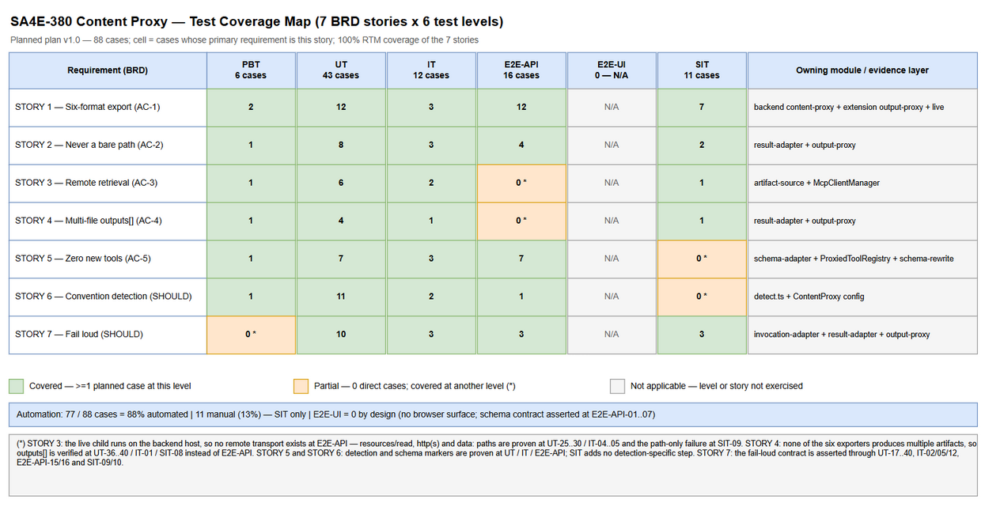
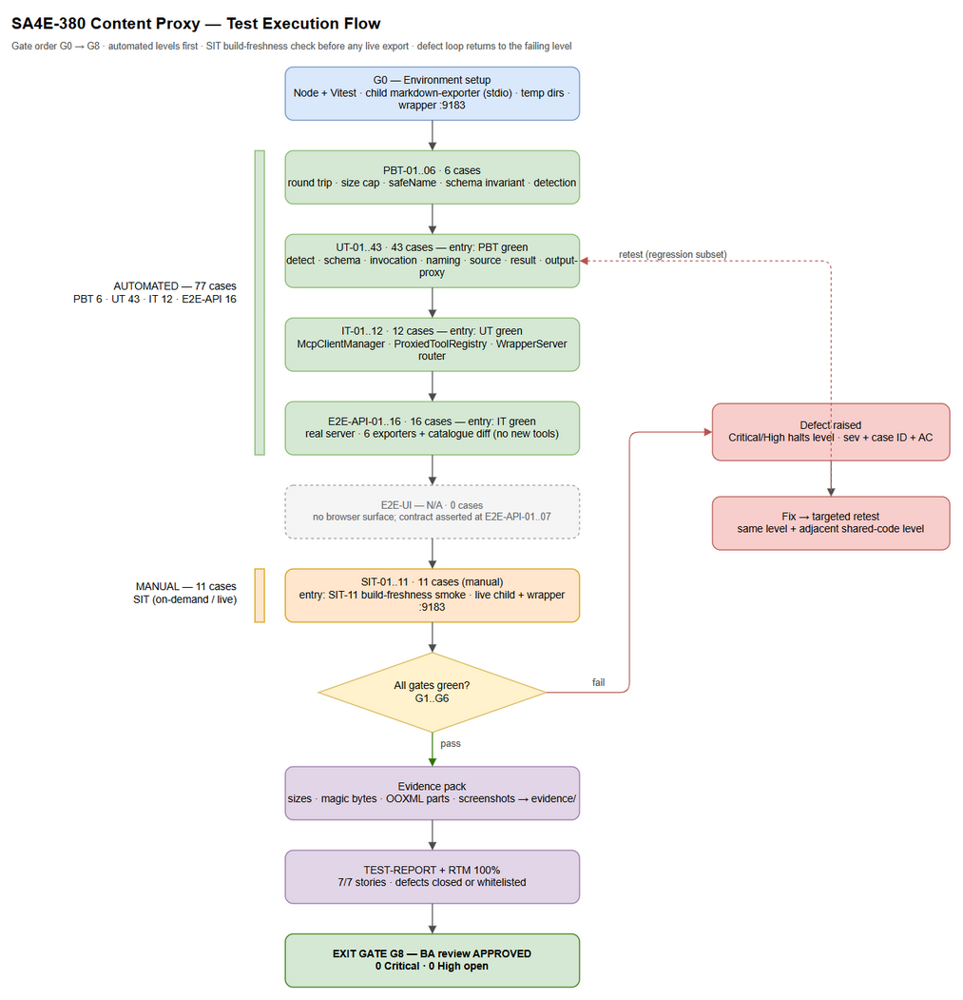

# Software Test Plan (STP)

## SDLC Agents 4 Enterprise — SA4E-380: Content Proxy for Child MCP Tools (Export DOCX/XLSX/PPTX/PDF/HTML/JSON Through the Extension Wrapper, No New Tools)

---

## Document Information

| Field | Value |
|-------|-------|
| Jira Ticket | SA4E-380 |
| Title | Content Proxy for child MCP tools: export DOCX/XLSX/PPTX/PDF/HTML/JSON through the extension wrapper (no new tools added) |
| Author | QA Agent |
| Version | 1.0 |
| Date | 2026-10-23 |
| Status | As-built (backfilled) |
| Document Type | Software Test Plan (STP) |
| Project | SA4E — SDLC Agents 4 Enterprise |
| Related BRD | BRD.md — v1.0, 2026-10-23 (`documents/SA4E-380/BRD.md`) |
| Related FSD | Not produced for this ticket. The BRD carries the seven user stories, acceptance criteria and error semantics; FSD is recorded as `not_started` in `documents/SA4E-380/STATUS.json` |
| Related TDD | Phase 3, in progress at the time of writing. This plan is derived from the BRD, the base64-proxy architecture note and the as-built code, and does not depend on TDD wording |
| Related STC | `documents/SA4E-380/STC.md` — Phase 4b (not produced in this invocation) |
| Evidence Basis | Test evidence captured during implementation and quoted from the BRD (§8.3) — **evidence from prior runs, not re-executed by this plan author** |

> **Document nature.** This is an **as-built** test plan. The change is already implemented in the workspace (uncommitted) and the requirement baseline is the backfilled BRD. Nothing in this document requests re-implementation, modifies code, or re-runs a test suite. Where automated coverage is still to be written, the case is labelled *planned* and its target level is stated.

---

## Author Tracking

| Role | Name - Position | Responsibility |
|------|-----------------|----------------|
| Author | QA Agent – QA Engineer | Author this STP from BRD SA4E-380, the base64-proxy architecture note and the delivered code |
| Peer Reviewer | BA Agent – Business Analyst | Verify business coverage and the Requirements Traceability Matrix (mandatory review gate, see §13.4) |
| Peer Reviewer | SA Agent – Solution Architect | Verify that test levels align with the as-built design and the TDD |
| Approver | Duc Nguyen Minh – Product Owner / Ticket Reporter | Confirm scope, priority and acceptance of the as-built behaviour |

---

## Revision History

| Version | Date | Author | Changes |
|---------|------|--------|---------|
| 1.0 | 2026-10-23 | QA Agent | Initiate document — as-built test strategy, six test levels, RTM over the seven BRD stories, risk-based prioritisation and known blockers |

---

## Sign-Off

| Name | Signature and date |
|------|--------------------|
| | ☐ I agree and confirm the test plan in this STP |
| | ☐ I agree and confirm the test plan in this STP |

---

## 1. Introduction

### 1.1 Purpose

This test plan defines how the delivered **content proxy** for child MCP tools is verified: the backend orchestration layer that adapts file-producing child tools (`export_docx`, `export_xlsx`, `export_pptx`, `export_pdf`, `export_html`, `export_json`) to the extension wrapper's byte-in / byte-out contract, plus the extension-side output proxy that writes the returned bytes into the agent workspace.

The business problem is not "a missing feature" but a **failure mode**: before this change a successful tool call could return a bare host path while no file existed. Every downstream step (Jira attachment, UAT evidence, release pack) trusts that the artifact exists. The test plan therefore treats *silent corruption* as the primary risk to eliminate, and organises its highest-priority cases around proving that wrapper mode returns either **bytes on disk** or **a hard, specific error**.

The plan is written for an as-built delivery: it fixes the level structure, coverage targets, data strategy, evidence rules and exit gates that the detailed test cases (`STC.md`, Phase 4b) must satisfy.

### 1.2 Test Objectives

Each objective maps one-to-one to a user story and acceptance criterion in the BRD. Objectives OBJ-1..OBJ-5 are mandatory (MUST HAVE); OBJ-6 and OBJ-7 are recommended (SHOULD HAVE) and are also verified because they are implemented.

| ID | Objective | BRD source | Acceptance criterion |
|----|-----------|------------|----------------------|
| OBJ-1 | Prove that all six exporters work end-to-end through `execute_dynamic_tool(toolName, { file_path, output_path })` and produce a structurally valid file | STORY 1 | AC-1 |
| OBJ-2 | Prove that wrapper mode never returns a bare host path — either bytes or `ARTIFACT_FETCH_FAILED` | STORY 2 | AC-2 |
| OBJ-3 | Prove that artifacts produced by a child on another host are retrievable over MCP `resources/read`, http(s), `data:` URI or an inline payload | STORY 3 | AC-3 |
| OBJ-4 | Prove that every artifact of a multi-file result is written, and that partial writes fail loudly with counts | STORY 4 | AC-4 |
| OBJ-5 | Prove that `tools/list` gains zero new entries while the adapted schemas remain callable and self-describing | STORY 5 | AC-5 |
| OBJ-6 | Prove that file-producing tools are detected by convention (name prefix or description), with a per-tool override, and that non-file tools are not adapted | STORY 6 | Ticket scope — Detection stage |
| OBJ-7 | Prove that every failure class is loud, specific, sanitised and states that no file was written (or how many of how many) | STORY 7 | AC-2, AC-6 |

### 1.3 References

| Document | Location | Used for |
|----------|----------|----------|
| BRD — SA4E-380 (v1.0) | `documents/SA4E-380/BRD.md` | Requirement baseline: 7 stories, acceptance criteria, error semantics, NFR table, evidence E-1..E-7 |
| Base64 proxy architecture note | `documents/SA4E-29/ARCHITECTURE-BASE64-PROXY.md` — section "Child Tool Content Proxy" | Four-stage design (detection, schema, invocation, result) and the retrieval order |
| Content proxy configuration | `backend/src/config/ContentProxy.ts` | Conventions, alias priority, non-content exclusions, 25 MB cap, override table |
| Backend content proxy module | `backend/src/modules/orchestration/content-proxy/` | As-built behaviour under test (`detect`, `schema-adapter`, `invocation-adapter`, `artifact-source`, `artifact-name`, `result-adapter`, `types`) |
| Backend wiring | `backend/src/modules/orchestration/McpClientManager.ts`, `ProxiedToolRegistry.ts` | Invocation adaptation, `resources/read` wiring, registry adaptation |
| Extension output proxy | `extension/src/services/Base64ProxyService/output-proxy.ts`, `schema-rewrite.ts`, `extension/src/services/WrapperServer/tool-router.ts` | Output write path, LLM-facing schema rewrite, dynamic tool routing |
| Live DOCX fixture | `documents/SA4E-375/UG-embedded.md` (184,761 B) | Embedded-image round-trip proof |
| STP template | `documents/templates/STP-TEMPLATE.md` | Document structure |
| Ticket status record | `documents/SA4E-380/STATUS.json` | Phase state and recorded blockers (read-only for QA) |

### 1.4 Glossary

| Term | Definition |
|------|------------|
| Content proxy | Backend orchestration layer that adapts content-oriented child tools to the wrapper's byte-in / byte-out contract **without registering new tools** |
| Wrapper mode | Invocation mode entered when wrapper arguments are present — backend: `content_base64` or `output_path`; extension: `file_path` or `content_base64`. In this mode a bare path is forbidden |
| Direct call | A dynamic tool call without wrapper arguments; the child's original (path-shaped) response must be preserved |
| Artifact | A file produced by a child tool as the result of an invocation |
| Artifact descriptor | Metadata about an artifact (`path`, `name`, `mime_type`, `size`); a descriptor is not the file |
| `output_base64` / `outputs[]` | Inlined artifact bytes for a single-file result / for a multi-file result |
| `assets` marker | Non-standard JSON-Schema annotations added by the adapter: `x-content-param` (names the child content argument) and `x-output-base64: true` (declares byte output) |
| OOXML | Office Open XML — the ZIP-based package behind DOCX, XLSX and PPTX; validity is checked structurally (package parts present), not by size |
| Path-only artifact | An artifact descriptor that exposes only a host-local filesystem path; unreadable when the child runs on another host |
| `ARTIFACT_FETCH_FAILED` | Error code: the artifact exists on the child's host but its bytes could not be obtained; no file was written |
| `PROXY_WRITE_FAILED` | Error code: bytes were obtained but could not be written (zero-write or partial-write) |
| `LIVE_BACKEND=1` | Environment flag that enables the live content-proxy suite against a running backend |
| Silent corruption | A failure mode where the system reports success while no usable file exists — the defect this ticket eliminates |

---

## 2. Test Strategy

### 2.1 Test Levels

The capability spans two runtimes (TypeScript backend, TypeScript extension) and one external child server, so a single level cannot prove the contract. The plan uses six levels with strictly increasing realism; each level has its own entry/exit criteria and none substitutes for another.

| Level | Scope | Automation | Tools |
|-------|-------|------------|-------|
| PBT | Correctness properties over random inputs (base64 round trip, size cap, name safety, schema invariants) | Automated | `fast-check` + vitest |
| UT | Unit and edge-case tests of every content-proxy module and the extension output proxy | Automated | vitest |
| IT | Wiring: `McpClientManager.executeToolOnServer`, `ProxiedToolRegistry` registration/clear, WrapperServer router — child stubbed in-process | Automated | vitest + in-process fake MCP `Client` |
| E2E-API | Real backend server + real wrapper: `execute_dynamic_tool` for the six exporters, schema assertions on `tools/list` / `find_tools` | Automated | vitest + HTTP (`fetch`) |
| E2E-UI | Browser UI end-to-end | **N/A** | — (see §2.5) |
| SIT | Live end-to-end with the real child server, multi-file output, remote path-only failure, embedded-image DOCX, write confinement | On-demand / manual (6 of 11 are harness-assisted) | Live backend + Kiro window, wrapper port 9183 |

### 2.2 Test Levels — Detail

#### 2.2.1 PBT — Property-Based Testing

| Attribute | Value |
|-----------|-------|
| Objective | Prove the invariants that make silent corruption impossible, over randomised inputs rather than hand-picked examples |
| Technique | `fast-check` properties executed under vitest; failures shrink to a minimal counter-example which is then frozen as a UT regression case |
| Environment | Backend workspace, no server, no filesystem writes outside a temp dir |
| Entry criteria | Content-proxy modules exported as pure functions (`adaptInvocation`, `safeName`, `resolveArtifact` helpers); `fast-check ^4.9.0` present in `backend/package.json` |
| Exit criteria | 100% of properties pass with ≥100 runs each; no counter-example retained |
| Planned cases | **6** (PBT-01..06) |
| Automation | 100% |

Properties in scope:

1. **Round trip** — for arbitrary UTF-8 text, `adaptInvocation` with `content_base64 = base64(text)` yields `markdown === text` (PBT-01).
2. **Byte fidelity** — for arbitrary buffers, base64 encode → inline → decode returns byte-identical content (PBT-02).
3. **Size cap** — the inline resolver accepts a payload only when `0 < length ≤ 25 MB`; anything outside that window resolves to "no bytes" instead of a truncated buffer (PBT-03). Oversized inputs are generated as *metadata* (declared sizes / mocked streams), never as 25 MB literals.
4. **Name safety** — `safeName` never returns a value containing `/` or `\`, never returns `.` or `..`, and is idempotent (PBT-04).
5. **Schema invariant** — after adaptation the content argument never appears in `required`, `x-content-param` always names a property that exists, and the `output_base64` sentence appears at most once (PBT-05).
6. **Detection monotonicity** — any tool whose name starts with `export_`/`render_`/`generate_` is treated as a file producer unless it already declares `content_base64` or an override disables it (PBT-06).

#### 2.2.2 UT — Unit Testing

| Attribute | Value |
|-----------|-------|
| Objective | Pin the exact behaviour of every module boundary: which tools are detected, what the adapted schema looks like, how arguments are mapped, how bytes are retrieved, how names are derived, how results are reshaped, how files are written |
| Technique | Table-driven vitest cases with explicit fixtures; child results constructed as literal JSON; filesystem effects confined to `os.tmpdir()` |
| Environment | Backend workspace (`backend/src/modules/orchestration/content-proxy/__tests__/`) and extension workspace (`extension/src/__tests__/`) |
| Entry criteria | Modules compile (`tsc`); no network access required; temp directory available |
| Exit criteria | All UT cases pass; every error code (`ARTIFACT_FETCH_FAILED`, `PROXY_WRITE_FAILED`, `Invalid content_base64 payload.`, missing-content message) asserted by exact prefix |
| Planned cases | **43** (UT-01..43) |
| Automation | 100% |

Module allocation (used by the STC numbering plan in §A.2):

| Module | Cases | What is pinned |
|--------|-------|----------------|
| `detect.ts` — capability + overrides | UT-01..07 (7) | Prefix detection; description fallback ("… to PDF"); non-file tools (`jira_create_issue`, `confluence_create_page`, `mem_ingest`) rejected; wrapper-native tool (`drawio_export_png`) untouched; `enabled: false`, `contentParam`, `fileOutput` overrides |
| `detect.ts` — content-argument choice | UT-08..11 (4) | Alias priority order; single-required-string fallback; ambiguity → undefined; `NON_CONTENT_PARAM` exclusions; `anyOf`/`oneOf` string unions |
| `schema-adapter.ts` | UT-12..16 (5) | `content_base64` added; `x-content-param`; `x-output-base64`; content arg removed from `required` with order preserved; marker sentence appended once; missing `properties`/`required` tolerated |
| `invocation-adapter.ts` | UT-17..21 (5) | `content_base64` → `markdown`; `output_path`/`file_path` stripped; direct call untouched; missing-content error; invalid base64 (bad alphabet, bad padding, non-UTF-8) → `Invalid content_base64 payload.` |
| `artifact-name.ts` | UT-22..24 (3) | Basename only; query/fragment stripped; `.`/`..`/empty → null; MIME fallback table; `artifact.bin` default |
| `artifact-source.ts` | UT-25..30 (6) | Inline precedence; MCP `resource`/`resource_link` blocks; `data:` URI; http(s) non-2xx / timeout / declared oversize; local read guards (regular file, no symlink, size cap); unknown scheme delegated to `readResource` |
| `result-adapter.ts` | UT-31..35 (5) | Single artifact → `output_base64` + `size_bytes` + `file_name`; multi → `outputs[]` with top-level payload removed; direct call unchanged; `isError` pass-through; unresolved artifacts → `ARTIFACT_FETCH_FAILED` naming artifacts and server |
| Extension `output-proxy.ts` | UT-36..40 (5) | Single write; multi-file distinct names; metadata without bytes → `ARTIFACT_FETCH_FAILED`; zero/partial write → `PROXY_WRITE_FAILED` with counts; exception text sanitised and non-wrapper passthrough |
| Extension `schema-rewrite.ts` | UT-41..43 (3) | Hides `content_base64` and the mapped content arg; exposes `file_path`/`output_path` with `file_path` required; output description and extension mapping (.drawio→.png, otherwise append) |

#### 2.2.3 IT — Integration Testing

| Attribute | Value |
|-----------|-------|
| Objective | Prove the wiring, not the units: that a child invocation actually passes through detection → schema adaptation → invocation adaptation → result adaptation, that `resources/read` is used for cross-host artifacts, and that the wrapper router wires input proxy → backend call → output proxy |
| Technique | In-process fake MCP `Client` (`listTools` + `callTool`) injected into `McpClientManager`; real registry, real adapters, real temp filesystem. Extension side uses `WrapperServer` with a stubbed REST transport |
| Environment | Backend `backend/src/modules/orchestration/__tests__/`; extension `extension/src/__tests__/`; no network |
| Entry criteria | UT green; temp dir writable; fake client can return both JSON-text and MCP resource blocks |
| Exit criteria | Adapted and non-adapted tools coexist in one catalogue; a path-only remote result never escapes as a path; wrapper writes exactly N files for N payloads |
| Planned cases | **12** (IT-01..12) |
| Automation | 100% |

Coverage intent: IT-01..05 exercise `McpClientManager.executeTool` (wrapper mapping, missing content, direct passthrough, remote `resources/read`, unreachable remote); IT-06..08 cover `ProxiedToolRegistry` (adapted registration, non-file tools untouched, `clear()` dropping capabilities); IT-09..12 cover the extension `WrapperServer` router (catalogue rewrite, `file_path` → `content_base64` → written bytes, first-use auto-detection, missing bytes → `ARTIFACT_FETCH_FAILED`).

> **Coverage note (honest gap).** IT-01..05 and IT-09..12 already exist and passed in a prior run (9 cases). IT-06..08 (registry registration / non-file exclusion / `clear()`) are **planned**: today the registry behaviour is only exercised indirectly through `McpClientManager`, which constructs it. The gap is deliberate and small, and is closed in STC Phase 4b rather than being reported as a defect.

#### 2.2.4 E2E-API — Automated End-to-End (real server)

| Attribute | Value |
|-----------|-------|
| Objective | Verify the externally visible contract exactly as an agent sees it: the tool catalogue, the adapted schemas, and the six export calls through `execute_dynamic_tool` against a real running backend |
| Technique | Start backend + child `markdown-exporter-mcp-local`; issue `tools/list`, `find_tools` and `execute_dynamic_tool`; assert HTTP status, response envelope, file existence, format signature and absence of host paths |
| Environment | Local backend, child on the same host (stdio/local); writable temp workspace; `LIVE_BACKEND` not required |
| Entry criteria | Server started with the current code; child tools discovered; baseline `tools/list` snapshot captured **before** the first export |
| Exit criteria | Zero new tool names versus baseline; six export calls write six valid files; direct-call shape unchanged; both negative payload cases return the exact documented error |
| Planned cases | **16** (E2E-API-01..16) |
| Automation | 100% |

Case allocation: E2E-API-01 catalogue invariant (baseline diff = 0); E2E-API-02..07 schema contract per exporter (`required: []`, `x-content-param: markdown`, `x-output-base64: true`, `content_base64` present, description mentions `output_base64`); E2E-API-08..13 one export per format with signature assertions (DOCX/PPTX OOXML package, XLSX plus `xl/workbook.xml` and `xl/worksheets/sheet1.xml`, PDF `%PDF`, HTML document, JSON parseable) and response shape (`file_path`, `size_bytes`, no `output_base64`); E2E-API-14 direct call unchanged; E2E-API-15 wrapper mode without content → "Missing content: pass file_path…"; E2E-API-16 invalid `content_base64` → `Invalid content_base64 payload.` with no file written.

> **Note on the schema contract.** E2E-API-01..07 are the *only* place where the "no new tools" guarantee is observable from outside the process, so they are mandatory even though the same markers are asserted at UT level. They also double as the substitute for the missing UI surface (see §2.5).

#### 2.2.5 E2E-UI — Not Applicable

| Attribute | Value |
|-----------|-------|
| Objective | N/A — the change has no browser surface |
| Reason | SA4E-380 is a protocol/orchestration capability between the agent, the extension wrapper and the child MCP server. There is no screen, no route and no component; the agent-visible output is a tool-result text block. Automating a browser would test nothing this ticket changes |
| Substitute coverage | The **schema-visible contract** (what an LLM or a human reading the tool catalogue actually sees) is verified at **E2E-API-01..07**; the **agent-visible result contract** (`file_path`, `size_bytes`, error codes) at **E2E-API-08..16** and **SIT-01..11** |
| Planned cases | **0** |
| Automation | N/A |

> This level is recorded explicitly rather than omitted, so that the 0 in the summary table is a decision and not an oversight. If a future ticket exposes a document-export screen, Playwright cases must be added here and the level becomes active.

#### 2.2.6 SIT — System Integration Testing (live, on-demand)

| Attribute | Value |
|-----------|-------|
| Objective | Prove the capability against the **real child server and the real extension wrapper**, including the cases that cannot be asserted in-process: embedded images surviving conversion, multi-artifact writes, remote path-only failure, write confinement, and whether the running wrapper build is current |
| Technique | `LIVE_BACKEND=1` live suite for the six exporters; manual/staged execution for the remaining scenarios with file-size, hash and package-part inspection; evidence captured as file listings and screenshots |
| Environment | Backend running locally; `markdown-exporter-mcp-local` as a stdio child; extension wrapper on port **9183** inside the Kiro window; temp workspace with writable `documents/SA4E-380/evidence/` |
| Entry criteria | Backend started with current code; wrapper process confirmed to be the **post-change build** (SIT-11 smoke check); fixture `documents/SA4E-375/UG-embedded.md` present |
| Exit criteria | SIT-01..10 pass; SIT-11 recorded as PASS or as BLOCKED with the reload action stated; no unexplained file; every failure path leaves **zero** files behind |
| Planned cases | **11** (SIT-01..11) |
| Automation | 0% in CI — 6 of 11 are exercised by the on-demand harness `extension/src/__tests__/live-content-proxy.test.ts` (`LIVE_BACKEND=1`), which is excluded from CI by design; the tester runs it and interprets the artifacts |

SIT case intent: SIT-01..06 = the six exporters through the wrapper (each asserts a non-zero file with the correct signature and a response containing `file_path` + `size_bytes`); SIT-07 = embedded-image DOCX (184,761 B source → 265,062 B output, OOXML valid, images intact); SIT-08 = multi-artifact result (`outputs[]`) writes N distinct files; SIT-09 = remote child returning only a host-local path → `ARTIFACT_FETCH_FAILED` with "No file was written." and no path in the payload; SIT-10 = write confinement (destination outside the workspace, or a symlinked target) → `PROXY_WRITE_FAILED` and no file; SIT-11 = wrapper-build smoke check / reload verification (see §12, BLOCKER-WRAPPER-RELOAD).

### 2.3 Test Cases Summary

| Level | Count | Automated | Manual |
|-------|-------|-----------|--------|
| PBT | 6 | 6 | 0 |
| UT | 43 | 43 | 0 |
| IT | 12 | 12 | 0 |
| E2E-API | 16 | 16 | 0 |
| E2E-UI | 0 | 0 | 0 |
| SIT | 11 | 0 | 11 |
| **Total** | **88** | **77 (88%)** | **11 (13%)** |

> Percentages are rounded; `77/88 = 87.5%`. SIT cases carry no CI automation by design: six of them are driven by an on-demand harness, but a human still starts the environment, interprets the artifacts and records evidence, so they are counted as manual.

**Existing versus planned.** The counts above are the target set to be documented in `STC.md` (Phase 4b). They are not all new tests — the delivered code already carries automated coverage from a prior run:

| Source | Cases | Level | Status |
|--------|-------|-------|--------|
| `backend/.../content-proxy/__tests__/content-proxy.test.ts` | 12 | UT | Existing — passing |
| `backend/.../content-proxy/__tests__/content-proxy.remote.test.ts` | 4 | UT | Existing — passing |
| `backend/.../__tests__/McpClientManager.content-proxy.test.ts` | 5 | IT | Existing — passing |
| `extension/src/__tests__/base64-proxy.dynamic-catalog.test.ts` | 4 | UT | Existing — passing |
| `extension/src/__tests__/wrapper-server.dynamic-export.test.ts` | 4 | IT | Existing — passing |
| `extension/src/__tests__/live-content-proxy.test.ts` (`LIVE_BACKEND=1`) | 6 | SIT | Existing — passing on demand |
| **Subtotal existing** | **35** | | |
| Planned additions (PBT 6, UT 23, IT 3, E2E-API 16, SIT 5) | 53 | Mixed | To be authored/documented in Phase 4b |
| **Total planned** | **88** | | |

> **Evidence rule.** The 35 existing cases are quoted from the implementation-phase runs recorded in BRD §8.3 (E-1..E-4): backend content-proxy **21/21**, backend full suite **3,493 pass** with one known unrelated failure, extension suite **3,255 pass / 6 skipped**, live content-proxy **6/6**. This plan does not re-run them and does not claim new results. The 53 planned cases are labelled as planned throughout.

### 2.4 Test Types

| Type | Description | Applicable |
|------|-------------|------------|
| Functional Testing | Detection, schema adaptation, invocation mapping, artifact retrieval, result shaping, output writing for six formats | Yes — primary |
| Integration Testing | Backend ↔ child MCP server; extension wrapper ↔ backend; registry ↔ client manager | Yes — primary |
| Regression Testing | Direct (non-wrapper) dynamic calls unchanged; wrapper-native tools (`drawio_export_png`) not double-adapted; non-file tools (`jira_create_issue`, `confluence_create_page`, `mem_ingest`) unaffected; full backend + extension suites | Yes |
| Security Testing | No absolute host path in responses or error text; write confined to the workspace with symlink guard; credentials (`token`, `secret`, `password`, keys) never treated as document content | Yes — targeted, not a penetration test |
| Performance Testing | 30 s HTTP artifact timeout with redirect following; size check **before** read; no extra artifact work on direct calls; no oversized response buffered | Yes — targeted assertions, no load profile |
| Compatibility Testing | Windows and POSIX path handling (`file:` URI, drive letters, UNC); stdio vs streamable-HTTP child transport; Node/TypeScript runtime versions in the repo | Yes |
| Usability Testing | No UI. Agent-observable clarity of error messages reviewed during SIT (does the message state whether a file exists?) | Partial — qualitative |
| Load / Stress Testing | No concurrency or throughput target is defined for this capability | No |
| Accessibility Testing | No user interface | No |

### 2.5 Automation Coverage and the E2E-UI Decision

Automation is the default. The plan targets **88% of cases automated** and confines manual effort to what a machine cannot judge: whether a produced Office document actually renders, whether the running wrapper build is current, and whether an error message is intelligible to an agent.

| Scenario type | Classified as | Rationale |
|---------------|---------------|-----------|
| Base64/UTF-8 round trip, name safety, size cap | PBT / UT | Pure functions, deterministic, cheap to randomise |
| Tool detection, schema markers, argument mapping | UT | Input → output is fully observable in-process |
| Child invocation wiring, `resources/read` fallback | IT | Requires the real client manager and registry; child stubbed in-process |
| Six exporters through `execute_dynamic_tool` | E2E-API | Real server, real files, real signatures — no browser needed |
| Catalogue invariant (no new tools) | E2E-API | Only observable from outside the process, via `tools/list` |
| Multi-file `outputs[]` write | UT / IT / SIT | Deterministic at UT/IT; live confirmation at SIT |
| Remote path-only failure | UT / IT / SIT | Assertion on error text and absence of path |
| Write confinement / symlink guard | UT / SIT | Unit-level guard plus a real filesystem check |
| Wrapper build staleness (reload) | SIT (manual) | Depends on the Kiren/Kiro host process state, not on code |
| Visual validity of a DOCX/PPTX (renders, images intact) | SIT (manual) | Requires opening the file in an Office renderer |

**E2E-UI decision.** The level exists in the plan at **0 cases, N/A**, because the ticket introduces no browser surface. The usual reason for E2E-UI automation — verifying that a UI reflects a backend change — has no object here. The schema-visible contract that a UI *would* have displayed to a human is instead asserted directly at E2E-API-01..07 (markers, `required`, description text), which is a stricter check than inspecting a rendered page.

### 2.6 Entry and Exit Criteria, Quality Gates

| Gate | Level | Entry criteria | Exit criteria |
|------|-------|----------------|---------------|
| G0 | Environment | Repository checked out with the as-built code; Node + dependencies installed; `fast-check` and vitest resolvable; writable temp directory | Environment smoke check passes (vitest starts, one trivial test runs) |
| G1 | PBT | Pure functions importable | 6/6 properties pass, ≥100 runs each, no retained counter-example |
| G2 | UT | G1 passed | 43/43 pass; every error code asserted by prefix; no test writes outside its temp dir |
| G3 | IT | G2 passed; fake client helpers available | 12/12 pass; adapted and non-adapted tools coexist; no path escapes wrapper mode |
| G4 | E2E-API | Backend + child server running current code; baseline `tools/list` captured | 16/16 pass; zero new tool names; six valid files; both negative payload cases exact |
| G5 | Regression | G4 passed | Backend full suite: 0 unexpected failures (3,493 pass baseline; UT-11 whitelisted, see §12.3). Extension suite: 3,255 pass / 6 skipped, 0 failures |
| G6 | SIT | Wrapper build confirmed current (SIT-11); fixture present; evidence directory ready | SIT-01..10 pass; SIT-11 PASS or BLOCKED with the reload action recorded; no orphan files after failure cases |
| G7 | Traceability | STC published with RTM | RTM covers **7/7 stories** and every acceptance criterion listed in §11; 0 orphan test cases |
| G8 | Review | G7 passed | BA review gate returns **APPROVED** (see §13.4) |

**Overall exit criteria for the ticket**

1. 100% of in-scope cases executed (88/88), with any BLOCKED case justified by an environment blocker recorded in §12 — not by an untested requirement.
2. Pass rate ≥ 95% of executed cases; **0 Critical** and **0 High** defects open.
3. No silent-corruption path remains: every wrapper-mode failure produces `ARTIFACT_FETCH_FAILED` or `PROXY_WRITE_FAILED`.
4. Zero new tool names attributable to the change.
5. RTM 100% for the seven BRD stories.
6. One known unrelated failure (`ProjectIsolation.derive-project-id.test.ts` UT-11) explicitly whitelisted with rationale (§12.3) — it must not be counted as a pass, and must not block exit.

---

## 3. Test Scope

### 3.1 In Scope

| # | Area | Priority | BRD reference | Levels |
|---|------|----------|---------------|--------|
| 1 | Backend content-proxy modules: `detect`, `schema-adapter`, `invocation-adapter`, `artifact-source`, `artifact-name`, `result-adapter`, `types` | High | STORY 1, 2, 3, 6, 7 | PBT, UT |
| 2 | Backend wiring: `McpClientManager.executeToolOnServer` (invocation + result adaptation, `resources/read` fallback) and `ProxiedToolRegistry` (adapted registration, non-file exclusion, `clear()`) | High | STORY 2, 3, 5 | IT |
| 3 | Extension output side: `Base64ProxyService/output-proxy.ts` (collect outputs, resolve destination, write, count-check, fail loud), `schema-rewrite.ts` (LLM-facing view), `WrapperServer/tool-router.ts` (dynamic routing) | High | STORY 1, 2, 4, 7 | UT, IT, SIT |
| 4 | Six exporters end-to-end: `export_docx`, `export_xlsx`, `export_pptx`, `export_pdf`, `export_html`, `export_json` | High | STORY 1 (AC-1, AC-2) | E2E-API, SIT |
| 5 | Artifact retrieval paths: inline payload, MCP `resource` blob, `resource_link`/`uri` via `resources/read`, http(s) URL, `data:` URI, local path with guards | High | STORY 3 | UT, IT, SIT |
| 6 | Multi-artifact results (`outputs[]`) with one file per entry and count verification | High | STORY 4 | UT, IT, SIT |
| 7 | Fail-loud contract: missing content, invalid base64, unreadable artifact, zero/partial write, sanitised messages | High | STORY 7 | UT, E2E-API, SIT |
| 8 | Schema/catalogue contract: adapted markers, `required: []`, description sentence, zero new tools | High | STORY 5 | UT, IT, E2E-API |
| 9 | Convention detection and the per-tool override escape hatch (table ships empty) | Medium | STORY 6 | PBT, UT, IT, E2E-API |
| 10 | Direct (non-wrapper) call compatibility | Medium | STORY 2 (AC-5), STORY 5 (AC-6) | UT, IT, E2E-API |
| 11 | Path disclosure and write confinement (security-relevant behaviour) | High | NFR — Security | UT, SIT |
| 12 | Embedded-image DOCX round trip (fixture `documents/SA4E-375/UG-embedded.md`) | Medium | STORY 1 (AC-5) | SIT |
| 13 | Platform path handling: Windows drive / UNC / POSIX in `file:` URI conversion | Low–Medium | NFR — Portability | UT |


*[Edit in draw.io](diagrams/test-coverage.drawio)*

### 3.2 Out of Scope

| # | Item | Reason |
|---|------|--------|
| 1 | Modifying the `markdown-exporter` child MCP server | External dependency; its path-only result shape is the constraint the proxy absorbs, not a defect (BRD §1.2 #1) |
| 2 | Adding any tool to `tools/list` (e.g. `export_docx_proxied`) | Explicitly forbidden by the ticket; tested as an **invariant** (E2E-API-01), never implemented |
| 3 | Any UI change, screen, or Playwright suite | No browser surface exists for this capability |
| 4 | `ARTIFACT_PATH_MAP` (remote-host path → local mount) | Designed as a future option only; not implemented (BRD §1.2 #4) |
| 5 | Deployment, packaging, CI pipeline changes, release notes | Separate DevOps phase; this ticket produces documents only |
| 6 | Re-running the backend/extension suites as a *documentation* activity | Evidence is quoted from prior runs (BRD §1.2 #5, assumption 9) |
| 7 | Fixing `ProjectIsolation.derive-project-id.test.ts` UT-11 (Windows root path) | Pre-existing, unrelated; deliberately whitelisted (§12.3) |
| 8 | Load, stress, throughput and soak testing | No performance target is defined for the capability beyond the 30 s / 25 MB guards |
| 9 | Authentication/authorisation model of child servers | Unchanged by this ticket; the proxy reuses the existing authenticated connection |
| 10 | Rendering fidelity of third-party Office viewers (Word vs LibreOffice differences) | SIT checks structural validity and image presence, not pixel equality across renderers |
| 11 | Jira attachment of exported DOCX | Blocked by the stale wrapper (BLOCKER-WRAPPER-RELOAD); see §12.1 and §2.6 exit criteria |

---

## 4. Test Environment

### 4.1 Environment Requirements

| Environment | Component | Endpoint / Location | Purpose |
|-------------|-----------|---------------------|---------|
| Local backend | Node/TypeScript backend (`npm run dev` → `tsx src/index.ts`) | `http://127.0.0.1:3000` (default local port) | E2E-API, SIT |
| Extension host | Kiro window running the built extension; wrapper HTTP server | `http://127.0.0.1:9183` | SIT (real wrapper) |
| Test wrapper | `WrapperServer` started in-process by the harness | ephemeral port; the live harness uses `127.0.0.1:48721` | IT, live harness |
| Child MCP server | `markdown-exporter-mcp-local` spawned by the backend over stdio/local | no fixed port (stdio) | E2E-API, SIT |
| Filesystem — backend temp | `os.tmpdir()/content-proxy-*` | created/removed per suite | UT, IT |
| Filesystem — wrapper temp | `TMP_DIR` from `extension/src/__tests__/wrapper-server.helpers` | cleaned in `afterAll` | IT, live harness |
| Filesystem — workspace | agent workspace root enforced by `PathResolver` + symlink guard | `documents/SA4E-380/evidence/` for captured evidence | SIT |

### 4.2 Runtime and Device Requirements

| Component | Version | OS | Required |
|-----------|---------|----|----------|
| Node.js | 20 LTS or newer (repo baseline) | Windows 11 (primary), POSIX for portability checks | Yes |
| TypeScript | repo-pinned (`tsc` build must pass) | — | Yes |
| vitest | repo-pinned | — | Yes |
| fast-check | `^4.9.0` (present in `backend/package.json`) | — | Yes (PBT) |
| `@modelcontextprotocol/sdk` client | repo-pinned | — | Yes (IT fake client typing) |
| Office renderer (Word / LibreOffice) | any current version | — | Optional — SIT-07 visual confirmation only |
| draw.io desktop | current | — | No — used to export plan diagrams, not to run tests |
| Browser | — | — | **No** — no UI surface (§2.2.5) |

### 4.3 External Dependencies

| System | Dependency | Mock / Stub available |
|--------|------------|-----------------------|
| `markdown-exporter-mcp-local` | Six exporters, each returning `artifacts[]` with a host-local path | Yes — IT uses an in-process fake MCP `Client` returning literal JSON; UT calls the resolvers directly |
| MCP `resources/read` on the child connection | Needed to cross hosts; wired in `McpClientManager.readResourceFromClient` | Yes — IT injects a `readResource` dependency that returns a fixed buffer |
| Extension wrapper (port 9183) | Real file-in / file-out semantics | Yes — IT starts `WrapperServer` in-process with a stubbed REST transport |
| Agent workspace path resolver + symlink guard | Confines reads and writes | No — must be the real implementation; stubbing it would invalidate SIT-10 |
| Kiro extension host | Loads the built wrapper code | No — this is the operational blocker tracked as SIT-11 / §12.1 |
| npm registry | Dependency install at build time | Not needed during test execution (dependencies pre-installed) |

### 4.4 Test Data Requirements

Detailed data design is in §10. Summary: one small markdown fixture (~20 B), one large embedded-image fixture (`documents/SA4E-375/UG-embedded.md`, 184,761 B), invalid-payload fixtures, path-only and oversize descriptors synthesised as metadata, and a multi-artifact descriptor pair. No fixture exceeds 25 MB on disk; oversize behaviour is proven with declared sizes and mocked streams so CI never materialises a 25 MB file.

---

## 5. Test Schedule

This is a documentation backfill, so the schedule describes the remaining work to close the plan (`STC` authoring and verification), not a multi-sprint programme.

| Phase | Start | End | Duration | Milestone |
|-------|-------|-----|----------|-----------|
| Test planning (this STP) | 2026-10-23 | 2026-10-23 | 0.5 day | STP v1.0 reviewed by BA |
| Test case design (STC, Phase 4b) | 2026-10-23 | 2026-10-24 | 1 day | STC published with 88 cases + RTM |
| Test data preparation | 2026-10-23 | 2026-10-24 | 0.5 day | `documents/SA4E-380/testdata/*.csv` + fixtures referenced by cases |
| Automated verification of existing coverage | 2026-10-24 | 2026-10-24 | 0.5 day | 35 existing cases re-confirmed on the current workspace (optional, on request) |
| E2E-API execution (real server, six exporters) | 2026-10-24 | 2026-10-24 | 0.5 day | 16/16 or defects raised |
| SIT execution (live wrapper + child) | 2026-10-24 | 2026-10-25 | 1 day | SIT-01..10 pass; SIT-11 resolved or recorded BLOCKED |
| Defect fix and retest | on demand | on demand | — | 0 Critical / 0 High open |
| Test report + exit gate | 2026-10-25 | 2026-10-25 | 0.25 day | TEST-REPORT v1.0 + BA approval |

**Milestones and deliverables**

| Milestone | Deliverable | Owner |
|-----------|-------------|-------|
| M1 — Plan approved | `STP.md` v1.0 (+ diagrams, PNG exports) | QA Agent → BA review |
| M2 — Cases approved | `STC.md` v1.0 with RTM at 100% and CSV test data | QA Agent → BA review |
| M3 — Automation green | PBT/UT/IT/E2E-API execution results | QA Agent |
| M4 — Live verification | SIT evidence in `documents/SA4E-380/evidence/` | QA Agent |
| M5 — Exit | `TEST-REPORT.md` (or CSV tracker) + exit decision | QA Agent → SM |

---

## 6. Resources & Responsibilities

| Role | Name | Responsibility |
|------|------|----------------|
| Test Lead | QA Agent | Owns this plan, the case set, the RTM, execution and the exit recommendation |
| QA Engineer | QA Agent | Authors PBT/UT/IT/E2E-API/SIT cases; runs SIT; captures evidence; raises defects |
| Business Analyst | BA Agent | Clarifies acceptance criteria; performs the mandatory business-coverage review gate (§13.4) |
| Solution Architect | SA Agent | Confirms the test levels match the TDD; answers design questions on retrieval order and marker semantics |
| Developer | DEV Agent | Fixes defects found in this plan; keeps unit tests aligned with module behaviour |
| DevOps Engineer | DevOps Agent | Owns the Kiro window reload procedure and any environment bring-up (port 9183 wrapper) |
| Product Owner | Duc Nguyen Minh | Accepts the as-built behaviour; decides on future options (`ARTIFACT_PATH_MAP`, cap configurability) |

**Tooling**

| Tool | Purpose |
|------|---------|
| vitest (`npm test`, `test:unit`, `test:e2e-api`) | PBT, UT, IT, E2E-API execution |
| fast-check | Property generation and shrinking |
| `LIVE_BACKEND=1` + `extension/src/__tests__/live-content-proxy.test.ts` | On-demand live harness for SIT-01..06 |
| `unzip -l` / ZIP inspection (Node or shell) | OOXML package-part assertions (DOCX/XLSX/PPTX) |
| File-size / hash comparison | Proving artifacts are byte-complete, not truncated |
| `documents/SA4E-380/evidence/` | Screenshots, file listings, response payloads captured during SIT |
| draw.io desktop | Diagram source and PNG export for this plan |

---

## 7. Risk & Mitigation

### 7.1 Testing Risks

| # | Risk | Impact | Likelihood | Mitigation |
|---|------|--------|------------|------------|
| TR-1 | A test asserts "file exists" without asserting **format validity**, letting a corrupt artifact pass | High — defeats the purpose of the plan | Medium | Every export case asserts a signature (OOXML package, `%PDF`, HTML document, parseable JSON) and, for XLSX, specific package parts |
| TR-2 | Oversize behaviour is "tested" by creating a real 25 MB file, slowing CI and hiding the real guard | Medium — slow, flaky suite | Medium | Oversize is proven with **declared** `content-length` and synthesised metadata; no 25 MB fixture is committed |
| TR-3 | The stale wrapper on port 9183 makes SIT-01..08 fail for environmental reasons and be misreported as code defects | High — wrong defect, wasted cycle | High (observed 2026-10-23) | SIT-11 runs **first** as a build-freshness smoke check; if it fails, SIT-01..08 are BLOCKED (not FAILED) until the window is reloaded |
| TR-4 | Remote-artifact behaviour is assumed rather than simulated, so the path-only branch is never executed | High — the exact failure this ticket eliminates stays unverified | Medium | IT injects a `readResource` that returns null and asserts the `ARTIFACT_FETCH_FAILED` text; SIT-09 reproduces it end-to-end with a path-only descriptor |
| TR-5 | Evidence from prior runs is re-quoted as if freshly executed | Medium — false confidence | Low | Every quoted count carries provenance ("evidence from prior runs, not re-executed"); planned cases are labelled *planned* |
| TR-6 | The 25 MB cap and the extension's pre-read cap drift apart, so one side accepts what the other rejects | Medium — inconsistent behaviour near the limit | Low | Both caps are asserted at their boundary (accept exactly at cap, reject above); drift is a documented follow-up (§12.4) |
| TR-7 | Detection over-matches and adapts an ordinary tool with a `body` argument (`confluence_create_page`, `jira_create_issue`) | Medium — unrelated tools change shape | Low | Negative detection cases are mandatory (UT-02, UT-03); E2E-API-01 diffs the whole catalogue rather than spot-checking |
| TR-8 | Tests depend on absolute paths on one OS, so the suite passes on the author's machine only | Medium — false green | Medium | Temp dirs via `os.tmpdir()`; explicit Windows drive / UNC / POSIX `file:` URI cases (UT-27) |
| TR-9 | Manual SIT evidence is not captured, making PASS unverifiable later | Medium — audit gap | Medium | Evidence path mandatory per SIT case; `documents/SA4E-380/evidence/` prepared before execution |

### 7.2 Risk-Based Prioritisation

Priority derives from **business consequence**, not from implementation difficulty. P1 must be green before the ticket can exit; P2 must be green or have an accepted workaround; P3 is scheduled but may be deferred with a recorded decision.

| Risk ID | Risk | Consequence if it materialises | Priority | Levels covering it |
|---------|------|-------------------------------|----------|--------------------|
| RK-01 | **Silent corruption** — wrapper mode returns success while no file exists, or returns a bare path | Worst case: every downstream step (Jira attachment, release pack, UAT evidence) trusts a non-existent file | **P1** | UT-17..21, UT-31..35, IT-01, IT-05, IT-12, E2E-API-11..16, SIT-09 |
| RK-02 | **Host path leak** in a response or an error message | Information disclosure; violates the fail-loud contract and the NFR "no absolute host path" | **P1** | UT-22..24, UT-31..35, E2E-API-08..13, SIT-09, SIT-10 |
| RK-03 | **Oversize artifact** buffered or truncated at the 25 MB cap | Memory pressure, OOM, or a silently truncated document | **P1** | PBT-03, UT-25..30 (http + local guards) |
| RK-04 | **Input corruption** — invalid base64 or non-UTF-8 payload converted into a document | A valid-looking but meaningless document, reported as success | **P1** | PBT-01, UT-17..21, E2E-API-16 |
| RK-05 | **Partial multi-file write** accepted as success | Agent believes it produced N deliverables when it produced fewer | **P1** | UT-36..40, IT-01, SIT-08 |
| RK-06 | **New tool leaks into the catalogue** | Breaks the tool-surface invariant and the visibility-tier model (BRD §8.4) | **P1** | UT-12..16, IT-06, E2E-API-01..07 |
| RK-07 | **Wrapper stale code** on port 9183 (observed) | Export appears to succeed with no file; DOCX/Jira attachment unusable | **P1** (operational) | SIT-11 first, then SIT-01..08 |
| RK-08 | **Remote child unreachable / `resources/read` missing** | Remote exporters unusable; must fail loudly rather than silently | **P2** | UT-25..30, IT-04, IT-05, SIT-09 |
| RK-09 | **Over-detection** adapts non-file tools (`jira_create_issue`, `confluence_create_page`, `mem_ingest`) | Unrelated tools change shape; regression across the platform | **P2** | UT-01..11, E2E-API-01 |
| RK-10 | **Double adaptation** of a wrapper-native tool (`drawio_export_png`) | Double mapping of content, broken export currently working | **P2** | UT-03, UT-11, IT-07, E2E-API-01 |
| RK-11 | **Direct-call regression** — a non-wrapper caller loses the path-shaped response | Breaks existing automation that never asked for bytes | **P2** | UT-20, UT-33, IT-03, E2E-API-14 |
| RK-12 | **Platform path handling** (Windows drive / UNC / POSIX) mis-converts a `file:` URI | Artifact unreadable on one OS family | **P3** | UT-27, UT-29 |
| RK-13 | **Write outside the workspace** via `output_path` or a symlinked target | Security-relevant: a tool result could place a file outside the agent workspace | **P1** | UT-39, SIT-10 |
| RK-14 | **Backend/extension version skew** during a partial rollout | Confusing failures; mitigated by the extension failing loud rather than silently | **P3** | SIT-11 |

Coverage check: every P1 risk has at least one **automated** case (UT/IT/E2E-API) plus a live confirmation where the behaviour is only observable end-to-end (RK-01, RK-07, RK-13).

---

## 8. Defect Management

### 8.1 Severity Levels

Severity is defined by **user-visible consequence** in this capability, not by generic wording, because "the file does not exist but the tool said OK" is the failure mode the ticket exists to remove.

| Severity | Definition (this ticket) | Example |
|----------|--------------------------|---------|
| **Critical** | Silent corruption or data loss: the agent is told a file exists when it does not, wrong bytes are written under a plausible name, one artifact overwrites another, or a host path is disclosed | Wrapper mode returns `success: true` with a bare path and no file; `outputs[]` with 3 entries writes 2 files and reports success; response contains `/home/child/exports/report.pdf` |
| **High** | A supported format fails outright, produces an invalid file, or the fail-loud code is missing/misleading | `export_pdf` writes a 0-byte file; DOCX opens as a corrupt package; error text says "export failed" without stating that no file was written |
| **Medium** | Correct file delivered but metadata or schema is wrong; behaviour differs from the documented contract without hiding a failure | `size_bytes` reports the base64 length instead of the byte length; `mime_type` missing; `x-output-base64` absent so the wrapper cannot inline; description sentence duplicated |
| **Low** | Cosmetic, documentation or diagnostic-only | Message wording awkward; log line lacks the tool name; STP/STC typo |
| **Trivial** | Internal cleanliness with no observable effect | Redundant branch, unused import in a test file |

### 8.2 Priority Levels

| Priority | Definition | Fix SLA |
|----------|------------|---------|
| P1 | Blocks the ticket — silent corruption, path leak, workspace escape, catalogue invariant broken | Same day (≤ 4 working hours) |
| P2 | Must fix before the ticket is signed off — a supported format or branch is broken | ≤ 1 business day |
| P3 | Should fix if time permits — metadata, wording, diagnostics | ≤ 3 business days |
| P4 | Defer to a follow-up ticket (e.g. `ARTIFACT_PATH_MAP`, cap configurability) | Next release / new ticket |

### 8.3 Defect Lifecycle

```
New → Open → In Progress → Fixed → Ready for Retest → Verified → Closed
                                    ↘ Reopened → In Progress
```

Rules for this ticket:

1. A defect is only **Verified** when the failing case is re-executed at the **same level** that caught it, plus the adjacent level if the fix touched shared code (e.g. a `result-adapter` fix requires UT + IT + E2E-API).
2. A defect caused by the stale wrapper (port 9183) is **not a code defect**: it is recorded as BLOCKED against SIT-11 and closed with the reload evidence, not fixed in code.
3. Every Critical/High defect must reference the BRD acceptance criterion it violates and the case ID that exposed it.
4. Environment blockers are logged separately from defects so that defect density is not inflated by infrastructure noise.

### 8.4 Suspension and Resumption Criteria

**Suspend testing when:**

| # | Condition | Action |
|---|-----------|--------|
| S-1 | The backend cannot start, or the child `markdown-exporter-mcp-local` is unavailable | Suspend E2E-API/SIT; keep PBT/UT/IT running (they do not need the server) |
| S-2 | The wrapper on port 9183 is confirmed stale **and** the Kiro window cannot be reloaded | Suspend SIT-01..10; record BLOCKED; escalate to DevOps/PO. PBT/UT/IT/E2E-API continue |
| S-3 | A Critical defect makes the wrapper report success with no file | Suspend further SIT runs until fixed; the contract under test is not trustworthy |
| S-4 | Workspace/temp filesystem is not writable, or the symlink guard cannot be exercised | Suspend SIT-10 and all write-path cases; continue read-path cases |
| S-5 | More than 30% of executed cases fail for the same root cause | Stop, fix the root cause, then restart the level from its entry criteria |

**Resume when:** the blocking condition is cleared, the affected level's entry criteria are re-satisfied, and a smoke check (one export producing a non-zero file, or one unit suite run) passes.

**Do not resume by:** lowering assertions, skipping the failing case, or accepting a path-shaped response as success. The fail-loud contract is the deliverable.

---

## 9. Test Metrics & Reporting

### 9.1 Metrics

| Metric | Formula | Target |
|--------|---------|--------|
| Test execution rate | Executed / Planned × 100% | 100% (88/88), BLOCKED counted and justified |
| Pass rate | Passed / Executed × 100% | ≥ 95% |
| Automation coverage | Automated cases / Total × 100% | ≥ 88% |
| RTM coverage | Requirements with ≥1 case / Total requirements × 100% | 100% (7/7 stories) |
| Critical defect count | Open Critical defects | 0 |
| High defect count | Open High defects | 0 |
| Defect density | Defects / Executed cases | ≤ 0.1 |
| Evidence completeness | SIT cases with a file path in `evidence/` / SIT cases executed | 100% |
| Format validity rate | Artifacts passing signature/package checks / artifacts produced | 100% |

### 9.2 Reporting

| Report | Frequency | Audience |
|--------|-----------|----------|
| Execution status (per level) | At each gate G1..G6 | QA Agent, SM |
| Defect summary | On every Critical/High defect | DEV Agent, SM, PO |
| SIT evidence pack | End of SIT | BA Agent (review gate), PO |
| Test completion report (`TEST-REPORT.md` / CSV tracker) | End of testing | All stakeholders |
| Traceability statement | With STC and at exit | BA Agent, SM |

---

## 10. Test Data Strategy

### 10.1 Fixtures

All fixtures are referenced by case ID so the STC can point at exact data rather than describing it.

| ID | Fixture | Concrete value | Purpose | Used by |
|----|---------|----------------|---------|---------|
| TD-01 | Small markdown | `# Hello\n\nWorld.\n` (~20 B) | Happy-path export for all six formats | E2E-API-08..13, SIT-01..06 |
| TD-02 | Large markdown with embedded images | `documents/SA4E-375/UG-embedded.md` — **184,761 B** | Prove embedded images survive conversion | SIT-07 |
| TD-03 | Empty file | 0 B markdown | Source with no content — must either export an empty-but-valid document or fail explicitly, never hang | UT-17, SIT-05 variant |
| TD-04 | Invalid base64 | `!!!not-base64!!!` | Reject before the child is invoked | UT-19, E2E-API-16 |
| TD-05 | Oversize artifact (> 25 MB) | **metadata only**: descriptor with `size: 26214401` and a mocked http response declaring `content-length: 26214401` | Prove the cap rejects without buffering — **no 25 MB file is created in CI** | PBT-03, UT-28, UT-30 |
| TD-06 | Path-only remote artifact | `{ name: 'UG.docx', path: '/remote/secret/UG.docx' }` with `readResource` returning null | Prove `ARTIFACT_FETCH_FAILED` with no path leak | UT-32, IT-05, SIT-09 |
| TD-07 | Multi-artifact result | Two descriptors: `report.pdf` (1,967 B) and `data.json` (31 B), both inline base64 | Prove `outputs[]` writes 2 distinct files | UT-37, SIT-08 |
| TD-08 | Unicode + CRLF markdown | `# Kiểm thử\r\n\r\n😀 emoji — “quotes”\r\n` | Prove UTF-8 round trip and line-ending tolerance | PBT-01, SIT-01 variant |
| TD-09 | Wrapper-native tool schema | `drawio_export_png` declaring its own `content_base64` | Prove no double adaptation | UT-03, UT-11, IT-07 |
| TD-10 | Non-file tools | `jira_create_issue` (`description`), `confluence_create_page` (`body`), `mem_ingest` (`content`) | Prove over-detection does not happen | UT-02, E2E-API-01 |
| TD-11 | Path traversal source | `../../etc/passwd`, `C:\\Windows\\win.ini`, `/etc/hosts` as `file_path` | Prove workspace confinement before any read | UT-40, E2E-API-15 variant, SIT-10 |
| TD-12 | Symlinked destination | temp dir with `link.docx` → outside the workspace | Prove the symlink guard aborts the write | UT-39, SIT-10 |
| TD-13 | Boundary artifact sizes | exactly `26214400` (at cap, accepted) and `26214401` (one byte over, rejected), both synthetic | Prove the cap is inclusive and exact | PBT-03, UT-30 |

### 10.2 CSV Test Data Files (created with STC in Phase 4b)

The STC will ship machine-readable test data under `documents/SA4E-380/testdata/`. The files are declared here so the STC and the automation reference the same source of truth. Each CSV carries a `test_case_id` column and an `expected_result` / `expected_http_code` column, and uses concrete values (not "valid data").

| File | Rows (planned) | Key columns | Covers |
|------|----------------|-------------|--------|
| `pre-seeded-tools.csv` | ~10 | `tool_name, description, has_content_base64, content_arg, expected_detected, expected_content_param` | UT-01..11, E2E-API-01..07 |
| `export-formats-testdata.csv` | ~8 | `test_case_id, format, tool_name, source_fixture, expected_magic, expected_min_size, expected_parts` | E2E-API-08..13, SIT-01..06 |
| `payload-validation-testdata.csv` | ~12 | `test_case_id, content_base64, args_present, expected_is_error, expected_message_prefix, child_invoked` | UT-17..21, E2E-API-15..16 |
| `artifact-source-testdata.csv` | ~14 | `test_case_id, descriptor_json, read_resource_result, fetch_result, expected_resolved, expected_error` | UT-25..35 |
| `naming-testdata.csv` | ~12 | `test_case_id, input_name, mime_type, expected_safe_name` | UT-22..24, PBT-04 |
| `multi-artifact-testdata.csv` | ~6 | `test_case_id, outputs_count, output_path_mode, expected_files, expected_error` | UT-37, IT-01, SIT-08 |
| `write-confinement-testdata.csv` | ~8 | `test_case_id, output_path, symlink_target, expected_result, expected_files_written` | UT-39..40, SIT-10 |
| `live-evidence.csv` | ~7 | `test_case_id, exporter, expected_bytes, observed_bytes, magic, package_parts` | SIT-01..07 |

### 10.3 Data Rules

1. **No oversized fixture on disk.** The 25 MB boundary is proven with declared sizes and mocked streams (§10.1 TD-05/TD-13). A real 25 MB artefact would slow CI and, worse, would test the fixture rather than the guard.
2. **Concrete values only.** `"# Hello"`, `"!!!not-base64!!!"`, `"/remote/secret/UG.docx"`, `184761`, `265062` — never "a valid markdown" or "a large file".
3. **Deterministic locations.** Every case works inside `os.tmpdir()/content-proxy-*` or the wrapper harness `TMP_DIR`, created in `beforeAll` and removed in `afterAll`; nothing is written into the repository outside `documents/SA4E-380/evidence/`.
4. **No secrets or credentials in fixtures.** Content detection excludes `token`/`secret`/`password`/keys by design (BRD §6), so no such value is ever needed to test it — a dummy literal is used where a negative case requires one.
5. **Evidence is immutable.** SIT file sizes and hashes are recorded as observed values in `live-evidence.csv`; the BRD reference values (xlsx 4,849 B; docx 14,599 B; pptx 29,296 B; pdf 1,967 B; html 199 B; json 31 B; DOCX 265,062 B) are used for comparison, not overwritten.

---

## 11. Requirements Traceability Matrix (RTM)

Coverage rule: every BRD story and every acceptance criterion must have at least one case at a level that can actually observe it. The ranges below are the planned STC IDs (§13.2).

| Requirement | Source | Test levels | Planned test cases | Evidence of correctness | Coverage |
|-------------|--------|-------------|--------------------|-------------------------|----------|
| **STORY 1** — Export DOCX/XLSX/PPTX/PDF/HTML/JSON through the wrapper (AC-1.1..1.7) | BRD §2.3 STORY 1; AC-1 | PBT, UT, IT, E2E-API, SIT | PBT-02; UT-12..21; UT-31..35; IT-01, IT-09..11; E2E-API-02..13; SIT-01..07 | Live six-exporter run (E-6) + live DOCX (E-5); E2E-API signature assertions | ✅ 100% |
| **STORY 2** — Wrapper mode never returns a bare path (AC-2.1..2.6) | BRD §2.3 STORY 2; AC-2 | PBT, UT, IT, E2E-API, SIT | PBT-05; UT-17..21; UT-31..35; IT-01, IT-03, IT-05, IT-12; E2E-API-11..16; SIT-09 | Backend content-proxy 21/21 (E-1); path-only reproduction (E-7) | ✅ 100% |
| **STORY 3** — Remote artifact retrieval (AC-3.1..3.7) | BRD §2.3 STORY 3; AC-3 | PBT, UT, IT, SIT | PBT-03; UT-25..30; IT-04, IT-05; SIT-09 | Remote-transport tests (resource / URL / path-only) in E-1; SIT-09 end-to-end | ✅ 100% |
| **STORY 4** — Write every artifact of a multi-file tool (AC-4.1..4.6) | BRD §2.3 STORY 4; AC-4 | PBT, UT, IT, SIT | PBT-02; UT-36..40; IT-01; SIT-08 | `outputs[]` write path with count verification; X/Y error assertions | ✅ 100% |
| **STORY 5** — Zero new tools in the catalogue (AC-5.1..5.6) | BRD §2.3 STORY 5; AC-5 | PBT, UT, IT, E2E-API | PBT-05, PBT-06; UT-12..16; UT-41..43; IT-06..08; E2E-API-01..07 | Adapted-schema markers visible in the live catalogue; baseline diff = 0 | ✅ 100% |
| **STORY 6** — Convention detection with a per-tool escape hatch (AC-6.1..6.6) | BRD §2.3 STORY 6 | PBT, UT, IT, E2E-API | PBT-06; UT-01..11; IT-06, IT-07; E2E-API-01 | Detection tests incl. negative cases and empty override table (E-1) | ✅ 100% |
| **STORY 7** — Fail loud instead of silently corrupting (AC-7.1..7.7) | BRD §2.3 STORY 7; AC-2, AC-6 | UT, IT, E2E-API, SIT | UT-17..21; UT-31..40; IT-02, IT-05, IT-12; E2E-API-15, E2E-API-16; SIT-09, SIT-10 | Live content-proxy 6/6 (E-4); explicit `ARTIFACT_FETCH_FAILED` / `PROXY_WRITE_FAILED` assertions | ✅ 100% |

**Non-functional requirements traced separately** (BRD §6):

| NFR | Requirement | Cases | Coverage |
|-----|-------------|-------|----------|
| NFR-1 | Artifact size `0 < size ≤ 25 MB` (26,214,400 B), single shared constant | PBT-03, UT-28, UT-30, TD-13 | ✅ |
| NFR-2 | HTTP retrieval ≤ 30 s, redirects followed, declared oversize rejected before download | UT-28 | ✅ |
| NFR-3 | Local artifact size-checked **before** read | UT-29 | ✅ |
| NFR-4 | Direct calls incur no additional artifact work | UT-20, UT-33, IT-03, E2E-API-14 | ✅ |
| NFR-5 | Strict base64 + UTF-8 input validation | PBT-01, UT-19, E2E-API-16 | ✅ |
| NFR-6 | Output verification: non-zero size, written count equals payload count | UT-36..40, SIT-08 | ✅ |
| NFR-7 | No absolute host path in responses or errors | UT-22..24, UT-35, E2E-API-08..13, SIT-09 | ✅ |
| NFR-8 | Local read: regular files only, symlinks refused | UT-29, SIT-10 | ✅ |
| NFR-9 | Write confined to workspace with symlink guard | UT-39, UT-40, SIT-10 | ✅ |
| NFR-10 | No credential-like argument treated as content | UT-10 | ✅ |
| NFR-11 | Determinism: same input → same bytes, fixed retrieval order | PBT-02, UT-25, UT-31 | ✅ |
| NFR-12 | Observable failures with stable code prefixes | UT-19, UT-32, UT-35, UT-38, E2E-API-15, E2E-API-16 | ✅ |
| NFR-13 | Zero new tools; discovery unchanged | E2E-API-01..07 | ✅ |
| NFR-14 | Direct mode keeps pre-change behaviour | UT-20, UT-33, IT-03, E2E-API-14 | ✅ |
| NFR-15 | Transport portability (stdio vs streamable HTTP) | UT-25..30, IT-04 | ✅ |
| NFR-16 | Platform portability (Windows drive / UNC / POSIX) | UT-27, UT-29 | ✅ |

**Coverage summary:** 7/7 stories (100%), 16/16 traced NFRs (100%), 0 orphan cases — every planned case ID in this document appears in at least one RTM row.

---

## 12. Known Limitations & Blockers

Recorded honestly, as built. None of these is fixed by this ticket.

### 12.1 BLOCKER-WRAPPER-RELOAD — stale wrapper on port 9183

| Attribute | Value |
|-----------|-------|
| Symptom | `export_docx` called with only `file_path` and `output_path` returns `Missing content: pass file_path so the extension wrapper can inject content_base64 (or send markdown directly).` and no DOCX is created |
| Root cause | The extension process listening on **9183** still runs **pre-change** wrapper code. The backend adaptation is already live (the adapted schemas expose `x-output-base64`), but the old wrapper does not write files from `output_base64` |
| Nature | **Environment / process staleness — not a code defect.** The same code passes the live verification once loaded |
| Action | Reload the Kiro window (Ctrl+Shift+P → "Reload Window") so the wrapper picks up the new build; then run SIT-11 and one small DOCX export to confirm |
| Test consequence | SIT-11 is executed **first**. If it fails, SIT-01..08 are **BLOCKED** (not FAILED) and are excluded from the pass-rate denominator only with a recorded justification |
| Exit consequence | **DOCX export through the wrapper, and therefore Jira DOCX attachment, is NOT part of this ticket's exit criteria.** Exit may be granted with SIT-11 BLOCKED and all other cases green |

### 12.2 LIMITATION-REMOTE-PATH-ONLY — path-only remote child fails by design

A remote child that returns only a host-local path cannot be read: the bytes live on another machine. The backend returns `ARTIFACT_FETCH_FAILED` with an actionable message and writes nothing. This is a **supported configuration that fails loudly**, not an unsupported case to work around.

- `ARTIFACT_PATH_MAP` (remote path → locally mounted path) was considered and is **not implemented**; it remains a future option.
- Remote children must expose artifacts as an MCP resource (`resources/read`), an `http(s)` URL, or a `data:` URI — or share a volume with the backend.
- Test consequence: SIT-09 asserts the failure (error prefix, "No file was written.", no path in the payload). It must never be "fixed" by making the test accept a path.

### 12.3 KNOWN-TEST-FAILURE — `ProjectIsolation.derive-project-id.test.ts` UT-11

| Attribute | Value |
|-----------|-------|
| Failure | UT-11 fails on a Windows root path |
| Relationship to SA4E-380 | None — pre-existing and unrelated to the content proxy |
| Decision | Deliberately **not fixed**, to keep the change surface minimal |
| Reporting | Backend full suite is reported as **3,493 pass** with this **one known unrelated failure** |
| Handling in this plan | Whitelisted at gate G5: it is neither counted as a pass nor allowed to block exit. It must be listed by name in the test report so the whitelist is visible, never silently absorbed |

### 12.4 Deferred items and follow-ups

| # | Item | Reason deferred |
|---|------|-----------------|
| 1 | `ARTIFACT_PATH_MAP` | Future option; no path translation between hosts exists today |
| 2 | Configurable 25 MB cap | Both sides must change together; a single shared constant is safer for now |
| 3 | Guard against passing document content where `file_path` is expected (BRD Risk R-9) | Visible on inspection (tiny text-only document); candidate follow-up |
| 4 | Automated smoke check that proves the new wrapper build is loaded | Would turn SIT-11 into an automated case; needs a version handshake between wrapper and backend |

### 12.5 Evidence provenance

All quantitative results in this plan (21/21, 3,493 pass, 3,255 pass / 6 skipped, 6/6, 265,062 B, 4,849 / 14,599 / 29,296 / 1,967 / 199 / 31 B) are **quoted from the implementation-phase runs recorded in BRD §8.3 (E-1..E-7)**. They are **evidence from prior runs, not re-executed** by this planning activity. No new test run was performed while authoring this document, and no result is extrapolated.

---

## 13. Appendix

### 13.1 Assumptions

1. **The child exporter runs on the backend host** (stdio/local) for E2E-API and SIT. This is the configuration in which all six formats are verified and the configuration the product currently relies on.
2. **A remote child that produces files exposes them as MCP resources or URLs.** A path-only remote child is treated as a misconfiguration that must fail loudly — not as a workaround target.
3. **The extension host will be reloaded before DOCX export is used operationally** (§12.1). Until then, a missing DOCX is explained by the stale wrapper process.
4. **The 25 MB cap is shared by both sides** and matches the extension pre-read cap, so neither side accepts what the other rejects.
5. **Direct (non-wrapper) callers are unaffected**; the adaptation is gated on wrapper arguments.
6. **Only bare file names are trusted from a child result**; the output directory is decided by the caller or the wrapper.
7. **The six formats are the complete acceptance set.** New formats are picked up by convention detection but are not acceptance-tested here.
8. **Evidence quoted in this plan was captured during implementation** (§12.5) and is not re-executed by the documentation backfill.
9. **No user-facing screen exists**, so usability is assessed as agent-observable behaviour (a file exists, or a precise error explains why not).
10. **The TDD does not change the test levels.** If the TDD later specifies additional interfaces, §2.2 is extended at the same levels rather than adding a seventh level.

### 13.2 STC Numbering Plan (Phase 4b)

The STC will use the six level prefixes, never a level-less `TC-nnn`. The numbering below is fixed so that this STP and the STC can be cross-referenced before the STC exists.

| Level | ID range | Count | Primary story attribution |
|-------|----------|-------|---------------------------|
| PBT | PBT-01..06 | 6 | 01 → S1/S7; 02 → S1/S4; 03 → S3/NFR-1; 04 → S2/S6; 05 → S5/S2; 06 → S6 |
| UT | UT-01..07 detection + overrides; 08..11 content-arg choice; 12..16 schema; 17..21 invocation; 22..24 naming; 25..30 artifact source; 31..35 result adapter; 36..40 extension output proxy; 41..43 extension schema rewrite | 43 | Spread across S1, S2, S3, S5, S6, S7 |
| IT | IT-01..05 `McpClientManager`; 06..08 `ProxiedToolRegistry`; 09..12 `WrapperServer` router | 12 | S1, S2, S3, S5, S7 |
| E2E-API | E2E-API-01 catalogue invariant; 02..07 schema contract per exporter; 08..13 export per format; 14 direct call; 15 missing content; 16 invalid base64 | 16 | S1, S2, S5, S7 |
| E2E-UI | — | 0 | N/A (§2.2.5) |
| SIT | SIT-01..06 six exporters live; 07 embedded-image DOCX; 08 multi-artifact; 09 remote path-only; 10 write confinement; 11 wrapper-build smoke | 11 | S1, S2, S3, S4, S7 |
| **Total** | | **88** | 7/7 stories |

Every STC case will carry: `ID, Level, Priority, Type, Requirement (STORY/AC/NFR), Preconditions, Steps, Expected result, Test data reference (TD-xx or CSV file+row), Automation target (file path) or Manual, Status`. Cases without a test-data reference are not accepted — the CSV files in §10.2 are the single source of truth for values.

### 13.3 Evidence Register

| ID | Evidence | Recorded result | Re-executed by this plan? |
|----|----------|-----------------|---------------------------|
| E-1 | Backend content-proxy unit + integration tests (12 + 4 + 5) | **21/21 passing** | No — quoted |
| E-2 | Backend full suite | **3,493 passing**, 1 known unrelated failure (UT-11) | No — quoted |
| E-3 | Extension full suite | **3,255 passing / 6 skipped** | No — quoted |
| E-4 | Live content-proxy end-to-end (`LIVE_BACKEND=1`) | **6/6 passing** | No — quoted |
| E-5 | Live DOCX with embedded images | `documents/SA4E-375/UG-embedded.md` **184,761 B** → DOCX **265,062 B**, OOXML valid, images intact | No — quoted |
| E-6 | Live six-exporter run | xlsx **4,849 B** (`xl/workbook.xml`, `xl/worksheets/sheet1.xml`); docx **14,599 B**; pptx **29,296 B**; pdf **1,967 B** (`%PDF`); html **199 B**; json **31 B** (valid JSON) | No — quoted |
| E-7 | Path-only contract reproduction | `ARTIFACT_FETCH_FAILED` with "No file was written." and no path in the payload | No — quoted |

### 13.4 Review Gate — BA Approval Required

This test plan is **not complete** until the BA Agent returns **APPROVED**. The gate checks five dimensions against the BRD:

| # | Dimension | What the BA Agent verifies |
|---|-----------|----------------------------|
| 1 | Business coverage | Every user story and acceptance criterion has at least one mapped case (RTM §11) |
| 2 | Business rules / semantics | Expected results reflect intended business behaviour (a file exists, or a precise error), not merely a status code |
| 3 | Edge and failure behaviour | Alternative and exception paths from the BRD are covered — notably path-only remote, partial write, invalid payload |
| 4 | Scope discipline | No requirement missing; no case testing something outside the BRD (§3.2) |
| 5 | Evidence integrity | Quoted counts match BRD §8.3 and are not presented as new runs |

**Verdict handling.** APPROVED → the plan proceeds to STC Phase 4b. CHANGES REQUESTED → each gap is treated as a defect (missing case, wrong expected result, or out-of-scope case), the RTM is corrected back to 100%, and the plan is resubmitted. Maximum **2 fix→re-review iterations**; after that the QA Agent stops and reports the remaining gaps to the SM, stating whether the blocker is an ambiguous requirement that only the BA Agent can resolve.

### 13.5 Diagram Index

| # | Diagram | Image | Source (editable) | Purpose |
|---|---------|-------|-------------------|---------|
| 1 | Test coverage map — 7 BRD stories × 6 test levels × owning module, with automation ratio |  | [test-coverage.drawio](diagrams/test-coverage.drawio) | Shows where each story is verified and where coverage is partial (dashed/amber cells), so gaps are visible rather than implied |
| 2 | Test execution flow — environment setup → PBT/UT → IT → E2E-API (6 exporters) → E2E-UI (N/A) → SIT live → defect loop → exit gate |  | [test-execution-flow.drawio](diagrams/test-execution-flow.drawio) | Shows the gate order, the defect feedback loop and which levels run before an environment blocker can invalidate a run |

### 13.6 Document Control

| Item | Value |
|------|-------|
| Source of truth | `documents/SA4E-380/BRD.md` v1.0 (requirements), `documents/SA4E-29/ARCHITECTURE-BASE64-PROXY.md` (design intent), as-built code (behaviour) |
| Scope of this document | Test planning only — no code, no test code, no test execution |
| Follow-up document | `documents/SA4E-380/STC.md` (Phase 4b) — 88 planned cases, CSV data in `documents/SA4E-380/testdata/` |
| Explicitly not done | Jira attachment, `STATUS.json` update, DOCX/XLSX export of this plan (owned by SM/DevOps) |

---

*End of document.*
