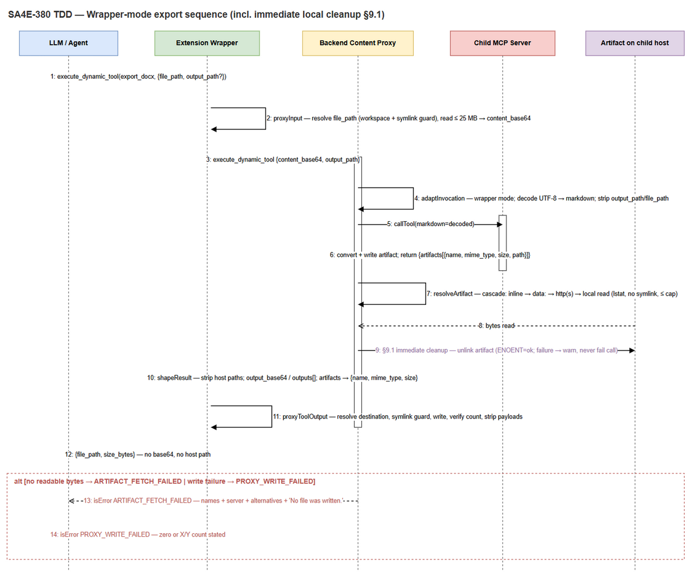
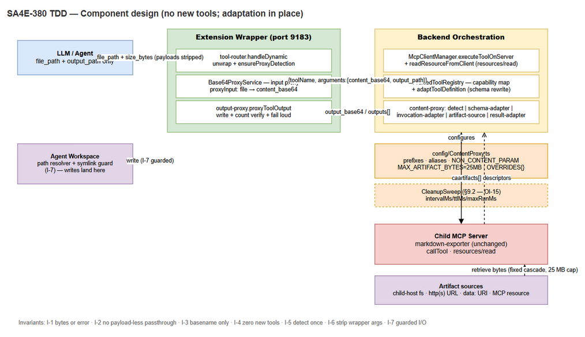
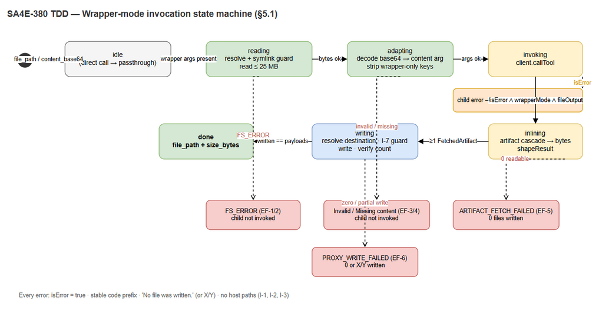
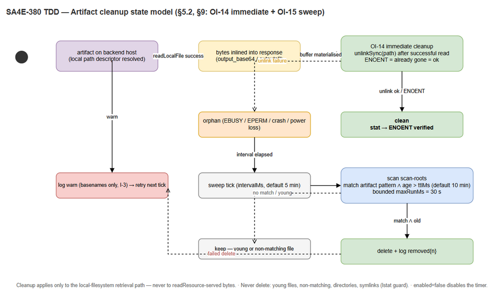

# Technical Design Document (TDD)

## SDLC Agents 4 Enterprise — SA4E-380: Content Proxy for Child MCP Tools (Export DOCX/XLSX/PPTX/PDF/HTML/JSON Through the Extension Wrapper, No New Tools)

---

## Document Information

| Field | Value |
|-------|-------|
| Jira Ticket | SA4E-380 |
| Title | Content Proxy for child MCP tools: export DOCX/XLSX/PPTX/PDF/HTML/JSON through the extension wrapper (no new tools) |
| Author | SA Agent |
| Version | 1.0 |
| Date | 2026-10-23 |
| Status | As-built (backfilled) + design for BRD additions (local cleanup, periodic sweep) |
| Document Type | Technical Design Document (TDD) |
| Related BRD | [documents/SA4E-380/BRD.md](BRD.md) (7 user stories) |
| Related FSD | [documents/SA4E-380/FSD.md](FSD.md) (BA draft + TA enrichment, 193 KB) |
| Baseline | Code present in workspace, uncommitted. §2–§8 describe the implementation as built. §9 specifies the design for the two BRD additions (immediate local cleanup, periodic cleanup sweep) that are **not yet implemented** — recorded as OI-14/OI-15 with a concrete change plan. |
| Template | `documents/templates/TDD-TEMPLATE.md` |

> **As-built notice.** Sections 2–8 record what exists in the code today, with file/line traceability. Section 9 is a forward design section required by the updated BRD (user feedback 2026-10-23): it defines the backend cleanup behaviour precisely enough for DEV to implement without further clarification.

---

## Revision History

| Version | Date | Author | Changes |
|---------|------|--------|---------|
| 1.0 | 2026-10-23 | SA Agent | Initiate document — as-built technical design derived from FSD v1.0 (TA-enriched), BRD v1.0 (with user additions), and the delivered backend/extension source files |

---

## 1. Introduction

### 1.1 Purpose

This TDD translates the functional specification of SA4E-380 into an implementable technical design:

1. **Where** every behaviour lives in code (module/class tables, §2).
2. **How** data moves through the pipeline (sequence, component, state diagrams, §3–§5).
3. **What** the exact failure contract is (error table, §6).
4. **How** the capability is secured, tested, configured, and made fast (§7–§8).
5. **What** must change to satisfy the BRD's cleanup requirements (§9).

### 1.2 Scope

In scope: the content-proxy layers on backend orchestration and extension wrapper, artifact retrieval across transports, error contract, security controls, test mapping, and the design for immediate + periodic artifact cleanup. Out of scope: modifying the `markdown-exporter` child server, adding tools to `tools/list`, UI work, deployment packaging (see BRD §1.2).

### 1.3 Design Principles

| # | Principle | Consequence in design |
|---|-----------|----------------------|
| P-1 | **No new tools** — transformation, never registration | Schema adaptation rewrites definitions in place; `tools/list` gains zero entries (I-4). |
| P-2 | **Convention over configuration** | Detection from name prefix / description pattern; empty override table ships by default. |
| P-3 | **Fail loud** | Wrapper mode returns bytes or `isError`; a bare path is a contract violation (I-1, I-2). |
| P-4 | **Transport-agnostic retrieval** | Same resolution pipeline for stdio and streamable-HTTP children; fixed order, first-wins. |
| P-5 | **Path hygiene** | Only `basename` survives from child results; workspace writes pass resolver + symlink guard (I-3, I-7). |
| P-6 | **Zero-cost compatibility** | Direct (non-wrapper) calls bypass all adaptation; no extra child round-trips. |
| P-7 | **Bounded resources** | 25 MB cap on every retrieval path; 30 s HTTP timeout; (§9) bounded sweep execution. |

---

## 2. As-Built Module & Class Map

### 2.1 Backend — `backend/src/modules/orchestration/content-proxy/`

| # | File | Export | Signature (essence) | Responsibility | Key dependencies | Lines |
|---|------|--------|---------------------|----------------|------------------|-------|
| 1 | `types.ts` | `ContentCapability` | `{ contentParam?, fileOutput, declaredParams }` | Capability triple derived once per tool | — | 7–14 |
| 2 | `types.ts` | `AdaptedInvocation` | `{ args, wrapperMode, capability, error? }` | Result of adapting one invocation | `ContentCapability` | 16–23 |
| 3 | `detect.ts` | `detectCapability(tool)` | `(ToolLike) → ContentCapability \| null` | Decides *whether* to adapt: override table → file-output gate → content_base64-native check → content param | `CONTENT_PROXY_OVERRIDES`, `FILE_TOOL_NAME_PREFIXES`, `FILE_OUTPUT_DESCRIPTION` (config) | 27–49 |
| 4 | `detect.ts` | `detectContentParam(schema)` | `(schema) → string \| undefined` | Alias priority (`markdown`, `markdown_content`, `content`, `html`, `xml`, `text`, `body`, `source`, `template`), else single required string not matching `NON_CONTENT_PARAM` | `CONTENT_PARAM_ALIASES`, `NON_CONTENT_PARAM` | 52–64 |
| 5 | `detect.ts` | `looksLikeFileOutput(tool)` (private) | name prefix match \|\| description regex | The narrow gate that keeps `jira_create_issue` etc. unadapted | `FILE_TOOL_NAME_PREFIXES`, `FILE_OUTPUT_DESCRIPTION` | 66–70 |
| 6 | `detect.ts` | `isStringLike(property)` (private) | tolerates `anyOf`/`oneOf` string unions | pydantic-style schema tolerance | — | 73–79 |
| 7 | `schema-adapter.ts` | `adaptToolDefinition(tool, capability)` | `(ToolDefinition, ContentCapability) → ToolDefinition` | Rewrites definition in place: adds `content_base64` property, sets `x-content-param`, sets `x-output-base64`, un-requires content arg, appends byte-output sentence once | `capability.contentParam`, `capability.fileOutput` | 15–45 |
| 8 | `schema-adapter.ts` | `withOutputMarker(description)` (private) | idempotent sentence append | Prevents duplicate `output_base64` mentions on repeated listings | — | 47–52 |
| 9 | `invocation-adapter.ts` | `adaptInvocation(capability, args)` | `(ContentCapability, unknown) → AdaptedInvocation` | Detects wrapper mode (`content_base64` \|\| `output_path`); strips wrapper-only keys; strict UTF-8 base64 decode onto content arg; produces invocation error when payload unusable | `WRAPPER_ONLY_KEYS` = `['content_base64','output_path']` | 15–46 |
| 10 | `invocation-adapter.ts` | `decodeBase64Utf8(value)` (private) | strict alphabet + `% 4` + UTF-8 decode | Rejects payloads that would silently corrupt the document | `Buffer` | 49–53 |
| 11 | `artifact-name.ts` | `safeName(value)` | `(unknown) → string \| null` | **Only** `path.basename` survives; rejects `.`, `..`, empty | `path` | 9–14 |
| 12 | `artifact-name.ts` | `nameFromLocation(location, mime?)` | location name → MIME fallback | Bare-name derivation from any location string | `safeName`, `nameFromMime` | 17–20 |
| 13 | `artifact-name.ts` | `nameFromMime(mime?)` | 12-entry MIME map, default `artifact.bin` | Stable fallback name | `MIME_NAMES` | 22–24 |
| 14 | `artifact-source.ts` | `resolveArtifact(artifact, deps)` | `(descriptor) → FetchedArtifact \| null` | Stage 1 per artifact: inline payload (`output_base64`/`content_base64`/`base64`/`data`) → location list (`url`, `uri`, `path`) | `readLocation`, `fromBase64` | 35–49 |
| 15 | `artifact-source.ts` | `resolveContentBlock(block, deps)` | standard MCP blocks → bytes | `resource` (blob/text/uri), `resource_link`, `image`/`audio`/`blob` data | `fromBase64`, `locationArtifact` | 52–75 |
| 16 | `artifact-source.ts` | `readLocation(location, deps)` | `(string) → Buffer \| null` | Dispatch: `data:` → http(s) → `file:` URI → other-scheme (server-owned → `readResource`) → local path → `fileUri` fallback | `decodeDataUri`, `fetchHttp`, `readLocalFile`, `deps.readResource` | 78–97 |
| 17 | `artifact-source.ts` | `readLocalFile(filePath)` (private) | `lstat` → regular file, **no symlink**, size ≤ cap → `readFileSync` | The local-read guards (BRD STORY 3 RD-4) | `fs`, `MAX_ARTIFACT_BYTES` | 113–122 |
| 18 | `artifact-source.ts` | `fetchHttp(url)` (private) | `fetch` + `AbortSignal.timeout(30_000)`, redirect follow, content-length pre-check | HTTP retrieval with cap enforcement before buffering | global `fetch`, `MAX_ARTIFACT_BYTES` | 145–156 |
| 19 | `artifact-source.ts` | `decodeDataUri(uri)` (private) | regex → base64 or percent-decode | Inline `data:` URI support | — | 158–169 |
| 20 | `artifact-source.ts` | `toFileUri(location)` (private) | drive-letter/UNC/POSIX → `file://` | Cross-platform path→URI without mangling POSIX on Windows | `pathToFileURL` | 133–143 |
| 21 | `result-adapter.ts` | `adaptResult(invocation, result, deps)` | **async** `(AdaptedInvocation, result, deps) → result` | The wrapper-mode gate (`wrapperMode && fileOutput && !isError`); parse text JSON; collect files; zero-files + declared → `ARTIFACT_FETCH_FAILED`; else `shapeResult` | `collectFiles`, `shapeResult`, `retrievalError` | 27–46 |
| 22 | `result-adapter.ts` | `collectFiles(artifacts, result, deps)` (private) | descriptors first, then MCP content blocks | Ordered resolution, first success wins | `resolveArtifact`, `resolveContentBlock` | 49–65 |
| 23 | `result-adapter.ts` | `shapeResult(parsed, artifacts, files)` (private) | strips `file_path`/`output_path`/`outputs`; single → `output_base64`; multi → `outputs[]`; artifacts reduced to `{name, mime_type, size}` | The response shaping + host-path stripping (I-3) | — | 67–104 |
| 24 | `result-adapter.ts` | `retrievalError(serverName, artifacts)` (private) | builds `ARTIFACT_FETCH_FAILED` message | The loud failure with alternatives + "No file was written." | `safeName` | 107–116 |

### 2.2 Backend — wiring

| # | File | Member | Responsibility |
|---|------|--------|----------------|
| 1 | `ProxiedToolRegistry.ts` | `capabilities: Map<string, ContentCapability>` (line 22) | Capability store, populated once per tool at registration (I-5). |
| 2 | `ProxiedToolRegistry.ts` | `registerServerTools(name, client)` (lines 50–70) | `listTools` → reserved-name check → `detectCapability` → store capability → push `adaptToolDefinition(definition, capability)` **or** raw definition. No new entries (I-4). |
| 3 | `ProxiedToolRegistry.ts` | `getCapability(toolName)` (line 42) | O(1) capability lookup at invocation time. |
| 4 | `McpClientManager.ts` | `executeToolOnServer(serverName, toolName, args)` (lines 84–108) | State check → client lookup → `getCapability` → `adaptInvocation` (invocation error → tool error, child **not** invoked) → `client.callTool` → `adaptResult(invocation, raw, { serverName, readResource })`. |
| 5 | `McpClientManager.ts` | `readResourceFromClient(client, uri)` (lines 115–126) | Cross-host artifact retrieval: `resources/read` → `blob` (base64) or `text` (utf8) → Buffer; exceptions → `null` (adapter reports). |
| 6 | `config/ContentProxy.ts` | `FILE_TOOL_NAME_PREFIXES` (line 16) | `['export_', 'render_', 'generate_']` — the convention prefix set. |
| 7 | `config/ContentProxy.ts` | `FILE_OUTPUT_DESCRIPTION` (line 19) | `/\bto\s+(pdf\|docx\|html\|pptx\|xlsx\|json\|png\|jpe?g\|gif\|svg\|zip)\b/i` — description fallback. |
| 8 | `config/ContentProxy.ts` | `CONTENT_PARAM_ALIASES` (lines 22–32) | 9-alias priority list. |
| 9 | `config/ContentProxy.ts` | `NON_CONTENT_PARAM` (lines 35–36) | Exclusion regex (`content_base64`, `*_base64`, `file_path`, `*_path`, `path`, `url`, `uri`, `dir`, `*_id`, `id`, `name`, `*_name`, `key`, `*_key`, `token`, `secret`, `password`, `mime`, `*_type`, `type`, `format`, `mode`, `encoding`). |
| 10 | `config/ContentProxy.ts` | `MAX_ARTIFACT_BYTES` (line 39) | `25 * 1024 * 1024` — single cap shared by all retrieval paths. |
| 11 | `config/ContentProxy.ts` | `CONTENT_PROXY_OVERRIDES` (line 52) | Empty escape hatch: `{ contentParam?, fileOutput?, enabled? }` per tool. |

### 2.3 Extension — `extension/src/services/Base64ProxyService/`

| # | File | Export | Responsibility |
|---|------|--------|----------------|
| 1 | `output-proxy.ts` | `proxyToolOutput(ctx, toolName, args, result)` (lines 24–96) | Wrapper mode = `file_path` \|\| `content_base64` present (line 36–37). Parse text → `collectOutputs` → per-output: resolve destination → `ensureDir` → re-resolve + symlink guard → `writeFileSync` → metadata (`file_path`, `size_bytes`, payload deleted). Zero writes → `PROXY_WRITE_FAILED: no artifact…`; partial → `PROXY_WRITE_FAILED: only X/Y…`; exception → sanitized `PROXY_WRITE_FAILED: <reason> — no file was written.` |
| 2 | `output-proxy.ts` | `missingPayload(result, parsed)` (lines 99–111) | Independent second guard (I-2): declared artifacts without bytes → `ARTIFACT_FETCH_FAILED: <names> was returned without content… No file was written.` |
| 3 | `output-proxy.ts` | `collectOutputs(parsed)` (lines 119–125) | `outputs[]` first, else single `output_base64`. |
| 4 | `output-proxy.ts` | `resolveOutputPath(ctx, args, artifactName, multi)` (lines 128–150) | `output_path` (single: as given; multi: dirname + each artifact's own bare name) > suggested name next to `file_path` > `.drawio`→`.png` swap > `.out`. |
| 5 | `output-proxy.ts` | `suggestedFileName(value)` (lines 153–157) | Bare-name-only trust boundary for child-suggested names. |
| 6 | `schema-rewrite.ts` | `toolSchemaField` handling | Accepts `schema` **or** `inputSchema` (find_tools catalog vs tools/list); hides `content_base64` and `x-content-param` target from the LLM-facing view. |
| 7 | `dynamic-tool.ts` | unwrap helpers | Extracts `toolName` (`toolName`/`tool_name`) and inner `arguments`/`args` for dynamic tool calls. |
| 8 | `Base64ProxyService.ts` | `detectFromToolList` / `registerTools` / proxy methods | Registration-time detection from both populations; delegates to input/output proxies. |
| 9 | `WrapperServer/tool-router.ts` | `handleDynamic`, `ensureProxyDetection` | Lazy detection from backend `find_tools` (non-fatal on failure) before proxying. |

---

## 3. End-to-End Data Flow (Sequence)


*[Edit in draw.io](diagrams/tdd-sequence-export.drawio)*

| # | From → To | Message / action | Guard or failure exit |
|---|-----------|------------------|----------------------|
| 1 | LLM → Wrapper (`tool-router.handleDynamic`) | `execute_dynamic_tool(toolName, arguments{file_path, output_path?})` | No tool name → forwarded unchanged. |
| 2 | Wrapper → Backend (`find_tools`) | `ensureProxyDetection` (lazy, once per tool) | Failure non-fatal (detection is additive). |
| 3 | Wrapper (`proxyInput`) | Resolve `file_path` (workspace resolver + symlink guard), stat ≤ 25 MB, read → `content_base64` | `PathResolverError` → tool error, child not invoked (EF-1/EF-2). |
| 4 | Wrapper → Backend (`executeToolOnServer`) | `{toolName, arguments:{content_base64, output_path, …}}` | Server not `connected` → health error propagated (EF-8). |
| 5 | Backend (`adaptInvocation`) | wrapper-mode detect; strip `output_path`; strip `file_path` (if not child-declared); decode base64 → `markdown` | `Invalid content_base64 payload.` / `Missing content: …` → tool error (EF-3/EF-4). |
| 6 | Backend → Child (`client.callTool`) | `{name, arguments:{markdown, …}}` over stdio / streamable HTTP | Child error → pass-through untouched (EF-7). |
| 7 | Child → Backend | text JSON `{success, summary, artifacts:[{name, mime_type, size, path}]}` | — |
| 8 | Backend (`adaptResult` → `resolveArtifact`) | Retrieval order: inline → data URI → http(s) → `file:`/path (local read) → server-owned scheme via `readResource` | None readable + declared → `ARTIFACT_FETCH_FAILED` (EF-5). |
| 9 | Backend (`shapeResult`) | Strip host paths; single → `output_base64`; multi → `outputs[]`; artifacts → `{name, mime_type, size}` | — |
| 10 | Wrapper (`proxyToolOutput`) | Collect payloads; resolve destination; ensure dir; symlink guard; write; verify count; strip payloads from response | zero/partial → `PROXY_WRITE_FAILED` (EF-6); no bytes → extension `ARTIFACT_FETCH_FAILED` (I-2). |
| 11 | Wrapper → LLM | `{success, summary, file_name, file_path, size_bytes, mime_type?, artifacts[]}` | Agent asserts file by `file_path` + `size_bytes`. |

**Retrieval order detail (step 8)** — fixed, first-wins, all capped at `MAX_ARTIFACT_BYTES`:

1. Inline payload in descriptor: `output_base64` → `content_base64` → `base64` → `data`.
2. `url` (http/https): 30 s timeout, redirect-follow, content-length pre-check, non-2xx → not readable.
3. `uri`: `data:` URI decode; other schemes (`artifact://`, `mcp://`) → server-owned → `resources/read`.
4. `path` / `file:` URI: local read **on the backend host** — `lstat` regular file, **symlink refused**, size pre-check.
5. Local read failure → `readResource(fileUri)` fallback (cross-host via the child's own resource serving).
6. Nothing readable → `ARTIFACT_FETCH_FAILED` (message lists the three supported remote alternatives).

---

## 4. Component Design


*[Edit in draw.io](diagrams/tdd-component.drawio)*

| Boundary | Components | Contract |
|----------|-----------|----------|
| LLM ↔ Wrapper | `tool-router` ↔ `Base64ProxyService` | LLM sees `file_path`/`output_path`; `content_base64` + content param hidden (schema-rewrite). |
| Wrapper ↔ Backend | REST `execute_dynamic_tool` | Envelope `{toolName, arguments}`; backend responses carry `output_base64`/`outputs[]` in wrapper mode. |
| Backend internal | `McpClientManager` → `ProxiedToolRegistry` (capability) → `adaptInvocation` → child client → `adaptResult` | Capability read is O(1); adaptation is pure (no I/O except artifact retrieval). |
| Backend ↔ Child | MCP `callTool`, `resources/read` | Child contract unchanged: content arg in, descriptor out. |
| Backend ↔ Artifact sources | fs / fetch / readResource | Single cap constant; guards at every path. |

**Adaptation idempotency (BR-05):** a tool already declaring `content_base64` (e.g. `drawio_export_png`) returns `null` from `detectCapability` (detect.ts line 38) → registered untouched, no double mapping.

---

## 5. State Models

### 5.1 Wrapper-Mode Invocation State Machine


*[Edit in draw.io](diagrams/tdd-state-invocation.drawio)*

```
idle ──file_path/content_base64──▶ reading ──bytes──▶ adapting ──args ok──▶ invoking
  │                                   │                   │                    │
  │ direct call (no wrapper args)     │ FS_ERROR          │ Invalid/Missing     │ child error
  ▼                                   ▼                   ▼                    ▼
passthrough                        error(EF-1/2)      error(EF-3/4)         pass-through
                                                            │ bytes obtained
                                                            ▼
                                                        inlining ──shaped──▶ writing ──count ok──▶ done
                                                            │ ARTIFACT_FETCH_FAILED   │ PROXY_WRITE_FAILED
                                                            ▼                          ▼
                                                         error(EF-5)               error(EF-6)
```

| Transition | Trigger | Guarantee |
|-----------|---------|-----------|
| `reading → adapting` | Source bytes read within cap | Bytes validated before any child I/O. |
| `adapting → invoking` | `invocation.error` undefined | Wrapper-only args stripped (I-6). |
| `invoking → inlining` | `!result.isError && wrapperMode && fileOutput` | Child error short-circuits (BR-18). |
| `inlining → writing` | ≥1 `FetchedArtifact` | Host paths already stripped in `shapeResult`. |
| `writing → done` | `written.length === outputs.length` | Partial success impossible (BR-16). |
| any → error | Guard violation | `isError = true`, stable code prefix, no silent path. |

### 5.2 Cleanup State Model (design — §9)


*[Edit in draw.io](diagrams/tdd-state-cleanup.drawio)*

```
artifact written on child host (local path descriptor)
        │ readLocalFile → bytes inlined
        ▼
 [immediate cleanup] delete(path) ──ok──▶ clean (stat → ENOENT)
        │ ENOENT (already gone) → clean
        │ failure (EBUSY/EPERM)
        ▼
 [orphan] ──sweep tick (intervalMs)──▶ [scan] pattern match ∧ age > ttlMs
        │                                     │ match    → delete → log removed{n}
        │                                     │ no match → keep (young or foreign file)
        │ failure (locked/permission)
        ▼
 log warn (file list) ──next tick──▶ retry (bounded 30 s per run)
```

---

## 6. Error Contract

| Code (stable prefix) | Layer | Condition | Agent-visible message (essence) | Child invoked | Files written | Retryable by agent |
|----------------------|-------|-----------|--------------------------------|---------------|---------------|--------------------|
| `FS_ERROR` (wrapper) | Extension | `file_path` missing/outside workspace/symlink/too large | Sanitized resolver message; limit stated | No | 0 | Yes — fix path |
| `Invalid content_base64 payload.` | Backend | Base64 alphabet/padding/UTF-8 violation | As stated | No | 0 | Yes — re-send correct payload |
| `Missing content: pass file_path …` | Backend | Wrapper mode, no usable payload, no direct content arg | Instructional (wrapper injects, or send `<param>` directly) | No | 0 | Yes — pass `file_path` |
| `ARTIFACT_FETCH_FAILED` | Backend | Declared artifacts, zero bytes obtained | Names + server + three alternatives + "No file was written." | Yes | 0 | Only after fixing child config (remote → resource/URL) |
| `ARTIFACT_FETCH_FAILED` (extension, I-2) | Extension | Metadata without bytes reached the wrapper | `<names> was returned without content … No file was written.` | Yes | 0 | No — backend-side defect surfaced |
| `PROXY_WRITE_FAILED` (zero) | Extension | Payloads present, zero writes | `no artifact could be written for '<tool>'` | Yes | 0 | Yes — different destination |
| `PROXY_WRITE_FAILED` (X/Y) | Extension | Partial multi-write | `only X/Y artifacts could be written for '<tool>'` | Yes | X | Yes — retry remainder |
| `PROXY_WRITE_FAILED` (exception) | Extension | Path guard / symlink / permission / disk | Sanitized reason + "no file was written" | Yes | 0..X | Depends on cause |
| *(child error, pass-through)* | Backend | `result.isError` from child | Child's own message, untouched | Yes | 0 | Per child semantics |
| *(server disconnected)* | Backend | `stateTracker.getState !== 'connected'` | Health message | No | 0 | After reconnect |

**Message hygiene rules** (BR-18, I-3): `isError = true` always set; no absolute host paths or stack traces; only `basename` identifiers; child errors never overwritten; the words "No file was written." (or the X/Y count) present in every delivery/write failure.

---

## 7. Security Design

| # | Threat | Vector | Mitigation (as-built) | Residual risk |
|---|--------|--------|----------------------|---------------|
| S-1 | Workspace escape via source/output path | Malicious or mistaken `file_path`/`output_path` (`..`, absolute, symlink) | `resolveWorkspacePath` + `checkSymlinkGuard` on **both** read (proxyInput) and write (output-proxy) paths; resolution failure → tool error, no I/O | Low — guards are re-resolved (idempotent, PBT-02) |
| S-2 | Host filesystem disclosure | Child returns absolute paths in result | `safeName` (basename-only), `shapeResult` strips `file_path`/`output_path`/`artifacts[].path`; error text sanitized (`sanitizeLogText`) | Low |
| S-3 | Oversized artifact memory exhaustion | Multi-hundred-MB remote/local artifact | `MAX_ARTIFACT_BYTES` enforced **before** buffering on all four retrieval paths (inline, local `lstat` pre-check, HTTP content-length pre-check, data-URI post-check) | Low |
| S-4 | SSRF via artifact URL | Child-supplied `http(s)` URL | Fetch executed by backend with 30 s abort + cap; no user-supplied URLs in the current flow (URLs come from the child server, a trusted component) | Medium — accepted; if untrusted children are introduced, add URL allow-listing |
| S-5 | Symlink trick on local artifact read | `artifacts[].path` pointing at a symlink | `readLocalFile` uses `lstatSync` and refuses `isSymbolicLink()` even when target is inside the workspace | Low |
| S-6 | Credential exfiltration through content detection | `token`/`secret`/`password`-named args chosen as content param | `NON_CONTENT_PARAM` exclusion regex blocks them from ever becoming the content argument | Low |
| S-7 | Corrupted-payload silent success | Invalid base64 that decodes to garbage | Strict decode (alphabet + `% 4` + UTF-8) → `Invalid content_base64 payload.`, child not invoked | Low |
| S-8 | Stale artifact files accumulating on backend host | Local-path artifacts left after read | **Gap → §9 design:** immediate delete-after-inline + TTL sweep | Addressed by OI-14/OI-15 plan |
| S-9 | Base64 payload interception in transit | Wrapper↔backend HTTP hop | Payload is content the caller already owns in its workspace; transport security unchanged from platform baseline (loopback in current deployment) | Low — document TLS requirement for remote deployments |

**Secrets handling:** no new secrets introduced; the proxy adds no configuration beyond the (currently empty) override table and (§9) two cleanup knobs.

---

## 8. Performance, Memory & Configuration

### 8.1 Performance

| Aspect | Budget / behaviour | Enforcement point |
|--------|--------------------|--------------------|
| Detection cost | Zero at invocation time (once per tool at catalogue build) | `registerServerTools` (I-5) |
| Direct-call overhead | None — adapter returns immediately without wrapper args | `adaptInvocation` line 18, `adaptResult` line 32 |
| HTTP retrieval | ≤ 30 s, redirect-follow, pre-buffer cap check | `fetchHttp` (`AbortSignal.timeout(30_000)`) |
| Local read | stat-before-read; single `readFileSync` ≤ cap | `readLocalFile` |
| Base64 inflation | ~33% up and down; bounded by cap (≈ 33.5 MB wire worst case) | Accepted (BRD R-6) |
| Multi-file wire cost | Bytes travel once; post-write response carries metadata only | `proxyToolOutput` rewrite |

### 8.2 Configuration reference (`backend/src/config/ContentProxy.ts`)

| Key | Value | Notes |
|-----|-------|-------|
| `FILE_TOOL_NAME_PREFIXES` | `export_`, `render_`, `generate_` | Name gate (case-insensitive via `toLowerCase`). |
| `FILE_OUTPUT_DESCRIPTION` | `to <format>` regex, 11 formats | Description fallback gate. |
| `CONTENT_PARAM_ALIASES` | 9 aliases in priority order | First string-like alias present wins. |
| `NON_CONTENT_PARAM` | exclusion regex | Never treated as document content. |
| `MAX_ARTIFACT_BYTES` | 26,214,400 (25 MB) | Mirrors the extension pre-read cap; raise on both sides together (BRD R-4). |
| `CONTENT_PROXY_OVERRIDES` | `{}` | Escape hatch: `contentParam` (string\|null), `fileOutput`, `enabled`. Keyed by exact published tool name. |

### 8.3 Test mapping (as-built evidence)

| Requirement (FSD/BSD) | Automated evidence |
|----------------------|--------------------|
| UC-01 six-format export | `extension/src/__tests__/live-content-proxy.test.ts` — 6/6 live (xlsx 4,849 B with `xl/workbook.xml` + `xl/worksheets/sheet1.xml`; docx 14,599 B; pptx 29,296 B; pdf 1,967 B `%PDF`; html 199 B; json 31 B) |
| UC-01 embedded-image DOCX | Live: `documents/SA4E-375/UG-embedded.md` 184,761 B → 265,062 B DOCX, OOXML valid, images intact |
| UC-02 fail-loud / path stripping | `content-proxy/__tests__/content-proxy.test.ts` + `content-proxy.remote.test.ts` + `McpClientManager.content-proxy.test.ts` (backend 21/21) |
| UC-03 remote retrieval (resource / URL / data / path-only failure) | `content-proxy.remote.test.ts` |
| UC-04 multi-file completeness + X/Y | `output-proxy.ts` count verification; `wrapper-server.dynamic-export.test.ts` |
| UC-05 schema markers, no new tools | Catalog check: `export_docx` absent from `tools/list`; `find_tools` returns `required: []`, `x-content-param: markdown`, `x-output-base64: true` |
| UC-06 direct-call compatibility | `McpClientManager.content-proxy.test.ts` (direct passthrough case) |
| UC-07 invalid payload handling | `invocation-adapter` cases in backend suite; `live-content-proxy.test.ts` line 115 asserts no `Missing content|Invalid content_base64` on success paths |
| Extension regression | Full extension suite 3,255 pass / 6 skipped |

---

## 9. Design for BRD Additions: Artifact Cleanup (Not Yet Implemented)

The updated BRD (user feedback 2026-10-23) adds two backend obligations. The as-built code performs **neither**: `readLocalFile` (artifact-source.ts lines 113–122) reads the artifact and leaves it in place. This section specifies the design; both items are tracked as **OI-14** (immediate cleanup) and **OI-15** (periodic sweep) and must be implemented to satisfy BRD STORY 3 RD-7/RD-8.

### 9.1 OI-14 — Immediate Local Cleanup (delete after inlining)

**Contract.** After a successful local read whose bytes are inlined into the response, the backend must delete the source artifact file. Deletion is best-effort with verification; failure never fails the tool call (bytes are already delivered) but is always logged.

> **⚠️ Security binding (SECURITY-REVIEW F-01, High — approval condition 1):** the as-built `readLocalFile` (artifact-source.ts:113-122) reads **any** regular file on the backend host named by the child's descriptor (guards: regular-file / no-symlink / 25 MB only — no confinement). Shipping delete-after-inline on top of an unconstrained read would give a compromised child a **read + delete arbitrary-file primitive**. OI-14 therefore MUST ship together with local-read confinement: reads are only attempted for paths resolving under `ARTIFACT_OUTPUT_ROOTS` — the same dedicated artifact directory(ies) the sweep (§9.2) scans. A descriptor path outside the roots is treated as unreadable (`ARTIFACT_FETCH_FAILED`), never read, never deleted. Until confinement lands, OI-14 stays unimplemented (as today).

**Change plan (single module, ~25 lines):**

1. `artifact-source.ts` — extend `ArtifactDeps` with optional `cleanup?: (filePath: string) => void`.
2. In `readLocalFile`, on the success path only (regular file, within cap, non-empty buffer, **path confined to `ARTIFACT_OUTPUT_ROOTS` per SECURITY-REVIEW F-01**): attempt `fs.unlinkSync(filePath)`; treat `ENOENT` as success (already gone); on any other error, log `warn { artifact: basename, err }` and continue. Deletion happens **after** the buffer is fully materialised in memory, so a failed read never deletes anything.
3. `readLocalFileUri` inherits the behaviour through `readLocalFile`.
4. **Never** delete when the read was triggered through `deps.readResource` (the resource may be served from a store the child still needs) — cleanup applies exclusively to the local-filesystem path (step 6 of the retrieval order), matching BRD STORY 3 RD-7.
5. Tests: (a) after `resolveArtifact` on a temp file, `fs.existsSync` is false and the returned bytes equal the original content; (b) unlink failure (locked file) → warning logged, bytes still returned; (c) remote/resource paths → no deletion attempted.

**Interaction with multi-artifact results:** every descriptor resolved through the local path is cleaned independently; a partial resolution (some descriptors unreadable) cleans only the resolved ones — the call still ends in `ARTIFACT_FETCH_FAILED` for the unreadable remainder.

### 9.2 OI-15 — Periodic Cleanup Sweep (orphan reaper)

**Contract.** A bounded background task scans the backend workspace for **orphaned artifact files** (pattern-matched, older than TTL) and deletes them. Safety net for crashes, power loss, permission failures during OI-14, and files written by older versions.

**Configuration (new, backend config):**

| Key | Default | Meaning |
|-----|---------|---------|
| `artifact.cleanup.enabled` | `true` | Master switch. |
| `artifact.cleanup.intervalMs` | `300_000` (5 min) | Sweep cadence (timer-based). |
| `artifact.cleanup.ttlMs` | `600_000` (10 min) | Minimum age before a matching file is considered orphaned. |
| `artifact.cleanup.maxRunMs` | `30_000` | Hard bound per sweep run; overrun → stop and log. |

**Module:** new `backend/src/modules/orchestration/artifact-cleanup/CleanupSweep.ts` (≤ 120 lines, code-standards compliant), started/stopped alongside the health monitor (`McpClientManager.startHealthMonitor`/`stopHealthMonitor` call sites).

**Algorithm (per tick):**

1. Resolve the scan root: the directory(ies) configured for child artifact output (default: OS temp dir + the backend workspace `tmp/`), never the agent workspace.
2. Enumerate files matching the artifact pattern (`export_*`, `render_*`, `generate_*` name prefixes **and** known artifact extensions from the MIME map), `age = now − mtime > ttlMs`.
3. Delete matches (best-effort per file, collect failures); stop the tick when `maxRunMs` elapses.
4. Log one summary line per tick: `{ removed, failed, skipped, durationMs }`; failures listed with basenames only (I-3).
5. Never delete: files younger than TTL, files outside scan roots, directories, symlinks (reuse `lstat` + `isSymbolicLink` guard).

**Single-instance note:** the current deployment runs one backend process; sweeps are therefore naturally exclusive. If multi-instance deployments appear, gate the timer behind a lock file or run the sweep only on the instance that owns the child transport — recorded as an open decision in §11 (OI-16).

**Tests:** (a) orphaned matching file older than TTL is removed within one tick; (b) young file and non-matching file are kept; (c) `maxRunMs` bound stops a large scan; (d) failure list logged with basenames; (e) `enabled: false` disables the timer.

### 9.3 Acceptance addendum (maps to BRD E-8 / E-9)

| BRD evidence | Verification |
|--------------|--------------|
| E-8 immediate cleanup | Wrapper-mode export where the child returns a local path → response carries `output_base64`; `stat` on the backend artifact path → ENOENT; backend log shows no cleanup warnings. |
| E-9 periodic sweep | Seed orphaned artifacts (older than TTL) in the scan root → within one interval they are removed; sweep log shows `removed ≥ 1`, `failed = 0`. |

---

## 10. Deployment & Operational Notes

| Item | Detail |
|------|--------|
| Release coupling | Backend and extension ship together (BRD R-11); mixed versions degrade to loud `ARTIFACT_FETCH_FAILED`, never silent success. |
| Extension reload | Port-9183 wrapper must run the new build (BRD R-3 / OI-01): reload the Kiro window, then smoke-test one DOCX export (file exists, size > 0). |
| Rollback | Revert both halves; the proxy is additive to existing plumbing — no schema migration, no persisted state. |
| Monitoring | Sweep summary lines (§9.2) and cleanup warnings (§9.1) are the new operational signals; alert on persistent `failed > 0` sweep ticks. |

---

## 11. Open Issues (Inherited from FSD §11.3 + New)

| ID | Title | Severity | Status / resolution path |
|----|-------|----------|--------------------------|
| OI-01 | Extension wrapper on port 9183 runs pre-change code until Kiro reload | Blocker (environment) | Operator reload + smoke test (BRD R-3). |
| OI-02 | Remote path-only children cannot be read cross-host | Design (accepted) | Supported-but-failing; must expose resource/URL or share volume (`ARTIFACT_FETCH_FAILED`). |
| OI-03 | Implementation narrower than BRD wording in two places | Info | Recorded in FSD §11.3; no action. |
| OI-04 | (second narrowness item, FSD §11.3) | Info | Recorded; no action. |
| OI-05 | 25 MB cap fixed, not per-deployment configurable | Low | Raise on both sides together if demand appears (BRD R-4). |
| OI-06 | No retry/rate policy for HTTP artifact fetch | Low | 30 s single attempt; revisit with real remote children. |
| OI-07 | Sweep scheduling for multi-instance backends undecided | Low | §9.2 note; decide when scaling out (OI-16). |
| OI-08 | Cleanup config exposure (env vs config file) | Low | §9.2 defaults proposed; final mechanism at implementation. |
| OI-09 | Guard against content-in-place-of-`file_path` (BRD R-9) | Medium | Candidate follow-up; not in this ticket. |
| OI-10 | Extension/backend lockstep during rollout | Low–Medium | Ship together; graceful loud degradation (§10). |
| OI-11 | Legacy `ProjectIsolation.derive-project-id.test.ts` UT-11 failure (Windows root path) | Known unrelated | Explicitly not fixed here. |
| OI-14 | **Immediate local artifact cleanup not yet implemented** | Medium (BRD requirement) | Implement per §9.1 **together with F-01 confinement (`ARTIFACT_OUTPUT_ROOTS`)**; verify with BRD E-8. |
| OI-15 | **Periodic cleanup sweep not yet implemented** | Medium (BRD requirement) | Implement per §9.2 — **sweep only the dedicated artifact subdirectory (SECURITY-REVIEW approval condition 2)**; verify with BRD E-9. |
| OI-16 | Multi-instance sweep coordination | Low | Decide at scale-out (§9.2 note). |

---

## 12. Technical Handover to DEV

1. Implement §9.1 (`artifact-source.ts` + deps extension) and §9.2 (`CleanupSweep.ts` + config) — the only code changes required by the updated BRD.
2. Keep every invariant I-1…I-7 intact; add the cleanup assertions to the existing content-proxy suites rather than new suites.
3. Update `STATUS.json` phases `design → done` after SA review; QA extends STC with E-8/E-9 cases.
4. Do not modify the child exporter or add tools (BRD §1.2).

---

*End of document.*
