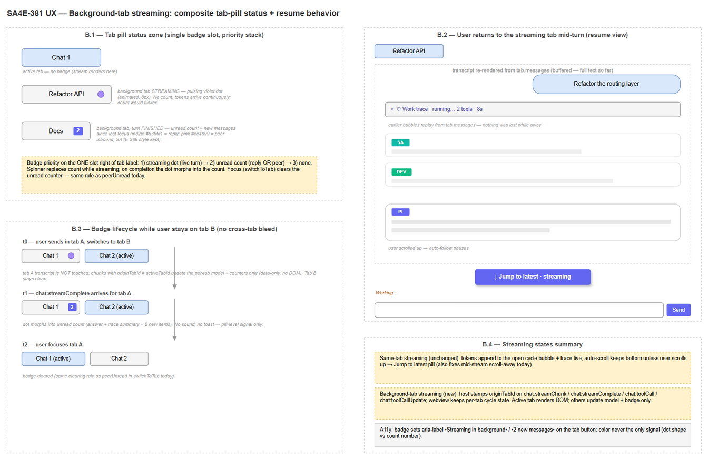
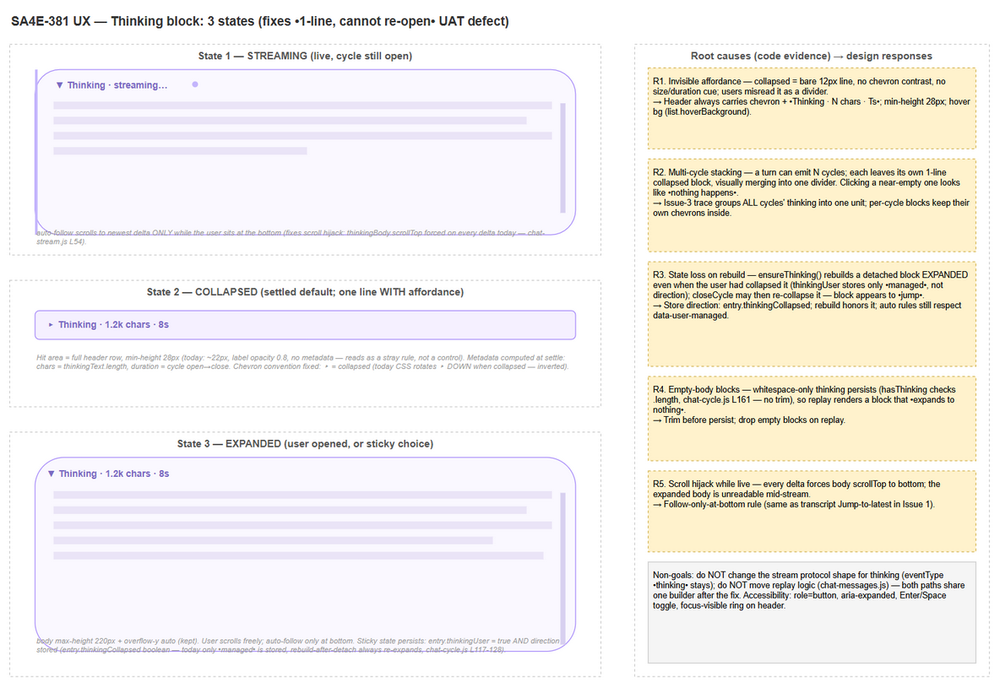
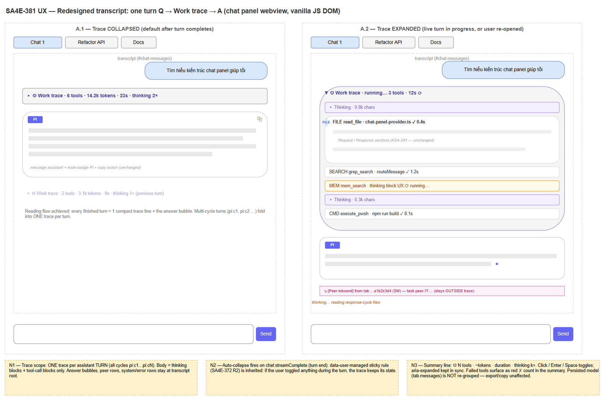

# UI-SPEC — SDLC CHAT Transcript Redesign (SA4E-381-chat-ux)

**Document:** UI/UX Specification — chat transcript layout redesign
**Scope:** SDLC CHAT webview (`extension/webview-assets/chat/`), host protocol (`extension/src/chat-panel/`)
**Status:** Draft v1.0 — pending BA business-correctness review (Phase 2b.5) and TA feasibility check (Phase 2c)
**Author:** UI agent. **Evidence base:** UAT user reports + code audit (file:line references verified against working tree 2026-10-24)
**Language:** English (per SDLC doc convention). Wireframes: draw.io only (no Mermaid).

---

## 0. Summary of the Three Problems

| # | Problem | Type | Severity | Root layer |
|---|---------|------|----------|------------|
| 1 | Stream response "bleeds" into a different tab's transcript when the user switches tabs mid-turn | Functional bug + UX gap | High — corrupts the wrong tab's transcript model | Host protocol: stream events carry no `originTabId`; webview renders into whichever DOM is active |
| 2 | Thinking box shrinks to one bare line and appears impossible to re-open | UX defect (affordance + state) | Medium — user cannot recover reasoning content | No metadata/affordance on the collapsed line; multi-cycle stacking; sticky state loses direction; scroll hijack |
| 3 | File/tool/thinking debris scattered across the transcript; hard to read the Q → work → A flow | Redesign request | Medium — reading efficiency | Thinking blocks and tool containers render as independent siblings per cycle |

Shared design principle for all three: **the transcript reads as Question → [work trace, collapsed] → Answer.** Everything the agent *does* (thinking, tool calls) folds into one trace unit per turn; everything the agent *says* (answer bubbles, peer rows, system rows) stays visible at the transcript root.

---

## 1. Design System Baseline (extracted from existing code — mandatory constraints)

New UI MUST reuse these tokens/patterns; no new design language is introduced.

| Property | Value | Source |
|---|---|---|
| Theming | VS Code CSS variables, light/dark adaptive; semantic tokens in `ui-tokens.css` (`--surface-*`, `--text-*`, `--border-*`, `--badge-bg/fg`) | `webview-assets/ui-tokens.css` |
| Accent (streaming/active) | Indigo `#6366f1` (progress bar, focus border), left-rail gradient on `.message.assistant.streaming` | `chat.css` L815–835 |
| Thinking accent | Violet `#a78bfa` (border-left 3px), streaming rail `#c4b5fd`, body text `#94a3b8` italic | `chat.css` L1602–1633, `chat-blocks.css` L31–33 |
| Peer accent | Pink `#f472b6` / `#ec4899` (peer rows, `.tab-peer-badge`) | `chat.css` L543–575 |
| Status colors | running `#f59e0b`, completed `#10b981`, failed `#ef4444`, interrupted `#94a3b8` | `chat-tools.js` `statusIcon`, `chat.css` L701–703 |
| Radii | 8px blocks/cards, 4px chips, 16px tab badges | `chat.css` L643, L568 |
| Font sizes | 13px messages, 12px tool/thinking text, 11px meta, 10px badges, 9px node badges | existing classes |
| Layout | `#chat-messages` flex column; tab bar with pill buttons (`.tab-item` + `.tab-label` + `.tab-close`); input dock fixed at bottom | `index.html`, `chat-tabs.js` L112–154 |

**Reusable components (do NOT rebuild):** `.thinking-block/-header/-body`, `.ksa247-tool-container` + `.tool-container-summary/-body` (KSA-247/KSA-290), `.tool-call-block` (KSA-281 Request/Response), `.message.user/assistant/error`, `.node-badge`, `.tab-peer-badge`, `.tool-peer-hint` (SA4E-369), copy actions (`ChatExportUI.attachCopyAction` / `attachToolCopyAction`), markdown pipeline + code actions.

**Invariants that must survive the redesign:** node badges (`pi:c1`…), per-message/per-tool copy, chat export (Markdown/JSON read from `tab.messages`, never from DOM), persistence (`saveStateToDisk` debounce), approval bars (`.tool-approval-bar`), sticky user-choice semantics (SA4E-372 R2: `data-user-managed` + persisted `thinkingUser` / `userManaged.userExpanded`).

---

## 2. Issue 1 — Cross-Tab Stream Bleed (functional bug + UX)

### 2.1 Current behavior (evidence)

1. Host → webview stream events carry **no tab identity**: `chat:streamChunk` and `chat:streamComplete` have only `streamId`/`nodeId` (`message-protocol.ts` L95–96). Same for `chat:toolCall` / `chat:toolCallUpdate` (L104–105).
2. The webview router dispatches them straight to renderers with no routing (`chat-inbox.js` L20–21, L44–54).
3. Renderers append to the single live DOM: `S.handleStreamChunk` → `S.ensureBubble`/`S.ensureThinking`/tool container (`chat-stream.js` L14–58; `chat-cycle.js` L97–128; `chat-tools.js` L22–64), and persist tool entries into **the currently active tab** (`chat-toolcall.js` L187–207) and cycle entries into `S.getTab(S.activeTabId)` (`chat-cycle.js` L77–81).
4. `switchToTab` wipes the transcript DOM (`messagesEl.innerHTML = ""`, `chat-tabs.js` L44). Mid-stream, the next chunk recreates detached bubbles/thinking/containers (`ensureBubble`/`ensureThinking` check `parentNode === messagesEl`) and appends them to the **new tab's** transcript; subsequent tool entries are persisted into the **new tab's model**.

**User-visible result (UAT):** send a message in tab A → switch to tab B → the rest of tab A's response streams into tab B's chatbox, polluting both DOM and persisted history.

### 2.2 Root cause

- **Functional:** stream/tool events are broadcast without an origin tab; webview state (`S.currentCycle`, `S.activeToolContainer`, `S.isStreaming`) is a global singleton, so exactly one stream can render correctly at a time — the active one at open time.
- **UX:** even after routing is fixed, the user has **no signal** that a background tab is working, no signal when it finishes, and no affordance to catch up when returning mid-stream (plus today's transcript auto-scroll fights manual scrolling during same-tab streaming).

### 2.3 Proposed design

#### 2.3.1 Two streaming modes

| Mode | Trigger | Transcript behavior |
|---|---|---|
| **Same-tab streaming** (unchanged today) | `originTabId === activeTabId` | Live rendering exactly as current: cycle bubble + live trace + working bar; auto-follow scroll (see 2.3.4) |
| **Background-tab streaming** (new) | `originTabId !== activeTabId` | **Data-only mode**: chunk text is appended to the origin tab's model (cycle entries, thinking buffer, tool entries), counters update, tab pill status updates. **Zero DOM writes** to `#chat-messages`. Tab B's transcript stays byte-identical |

#### 2.3.2 Composite tab-pill status badge (single slot, priority stack)

Extend the SA4E-369 badge concept (`.tab-peer-badge`, `chat-peer-ui.js` L76–83) into one status slot rendered right of `.tab-label` (`renderTabBar`, `chat-tabs.js` L112–154):

| Priority | State | Visual | Semantics |
|---|---|---|---|
| 1 | `tab.streaming === true` | Pulsing violet dot (8px, `#a78bfa`, reuses `.thinking-block.streaming::after` pulse style) | A turn is streaming in this (background) tab. No number — a live token count would flicker |
| 2 | `tab.unread > 0` | Count pill (indigo `#6366f1` for a new reply; pink `#ec4899` for peer inbound — peer style unchanged) | Turn finished (or peer message arrived) since the tab was last focused |
| 3 | idle | nothing | — |

Rules:
- The spinner replaces any count while streaming; on `chat:streamComplete` for a background tab the dot **morphs** into the unread count (dot → number, 200ms fade).
- Focus clears the unread counter — same clearing rule as `peerUnread` today (`chat-tabs.js` L38–41).
- Tab model gains two persisted fields: `tab.streaming: boolean`, `tab.unread: number` (peer: `peerUnread` stays as-is; a stream-finish unread and a peer unread may coexist → show the larger count in pink if either is peer-related, else indigo; simplest rule: **peer pink wins ties**).

#### 2.3.3 Returning to a background-streaming tab (resume view)

When the user switches to tab A mid-turn:
1. Transcript re-renders from `tab.messages` (the buffered model — already the replay path, `chat-tabs.js` L46–58). Because chunks were appended to the model, **nothing is lost and nothing re-streams**: the bubble shows all text received so far, then live chunks continue appending from the next delta.
2. Scroll lands at bottom (streaming tabs ignore the saved `scrollPosition` on switch-back while `tab.streaming`).
3. The working bar and live trace resume (cycle state is keyed per origin tab — see handoff doc).

#### 2.3.4 "Jump to latest" pill (covers both modes)

- Shown when the user scrolls up more than ~80px from the bottom **while the tab is streaming** (same-tab or resumed background tab).
- Indigo pill floating above the input dock, right-aligned: `↓ Jump to latest · streaming`.
- Click = scroll to bottom + re-enable auto-follow. Auto-follow (existing `scrollToBottom` on each chunk) is **suspended** while the user is scrolled up; resumes on click or on manual scroll back to bottom. This also fixes today's same-tab scroll-fight (`S.scrollToBottom()` fires on every chunk, `chat-stream.js` L57).

#### 2.3.5 State machine (tab pill)

```
IDLE ──(turn starts in bg)──► STREAMING(bg) ──(streamComplete)──► UNREAD(n) ──(tab focus)──► IDLE
IDLE ──(turn starts here)──► ACTIVE-STREAMING (no badge; pill shows working bar instead)
any ──(peer inbound)──► UNREAD(peer, pink, stacks with rules above)
```

### 2.4 Wireframe



### 2.5 Acceptance criteria

| AC# | Given | When | Then |
|---|---|---|---|
| AC1-1 | Turn streaming in tab A | User switches to tab B | Tab B transcript shows zero new rows from tab A's stream; tab A pill shows the pulsing violet dot |
| AC1-2 | Background streaming in tab A | Turn completes | Tab A pill dot morphs into unread count; tab B transcript still untouched |
| AC1-3 | Unread badge on tab A | User focuses tab A | Badge clears; transcript shows the full answer (replayed from model) with correct order (Q → trace → A) |
| AC1-4 | Same-tab streaming, user scrolls up >80px | — | Auto-follow pauses; "Jump to latest · streaming" pill appears above input |
| AC1-5 | Jump pill visible | User clicks it | Transcript scrolls to bottom; auto-follow resumes; pill disappears |
| AC1-6 | Background tab streaming | Reload webview (F5) | Pill states rebuild from persisted tab model (`streaming` resets to false for interrupted streams; unread count persists) |
| AC1-7 | Badge on any tab pill | Screen reader / keyboard focus | Tab button exposes `aria-label` including "streaming in background" or "N new messages" |

---

## 3. Issue 2 — Thinking Block: One-Line Collapse, Cannot Re-Open (UX defect)

### 3.1 Current behavior (evidence)

- Collapsed state hides the body entirely and shrinks the block to a single ~22px line: `.thinking-block.collapsed .thinking-body { display:none }` (`chat.css` L1623); header = chevron + "Thinking" label at 12px, label dimmed to `opacity: .8` when collapsed (`chat-blocks.css` L23–25).
- Auto-collapse on cycle close (`chat-cycle.js` L131–135 via L152–155) turns **every** cycle's thinking into such a line. A turn can emit N cycles (`maybeCloseCycle`, L189–198), so N thin lines stack and visually merge into one divider — the UAT report "thu thành 1 dòng nhỏ".
- Click handlers **do exist** on both live (`chat-cycle.js` L40–45) and replay (`chat-messages.js` L44–54) paths, and the chevron is not `display:none` (unlike the tool chevron, `chat.css` L791–792). The "cannot re-open" experience is explained by four compounding defects rather than a single missing handler:
  - **R1 — invisible affordance:** the bare dim line reads as a stray rule, not a control; hit target ≈22px with no metadata telling the user there is content inside.
  - **R2 — multi-cycle stacking:** clicking a later, nearly-empty cycle's line "does nothing" visually.
  - **R3 — state loss on rebuild:** `ensureThinking` recreates a detached block always expanded and only restores `data-user-managed` (`chat-cycle.js` L117–128) — the *direction* of the user's choice is not stored (`thinkingUser` is a boolean flag, L43, L69); combined with auto-collapse the block appears to "jump" states.
  - **R4 — empty-body blocks:** whitespace-only thinking persists (`hasThinking` tests `.length`, L161 — no trim), so some replayed blocks expand to visually nothing.
  - **R5 — scroll hijack while live:** every delta forces `thinkingBody.scrollTop = scrollHeight` (`chat-stream.js` L53–54); an expanded live body cannot be scrolled by the user, reinforcing "it's broken".
- Cosmetic inversion: chevron rotates **down when collapsed** (`chat.css` L1622) — opposite of the VS Code convention (collapsed ▸, expanded ▼).

### 3.2 Proposed design — three explicit states

| State | Header | Body | Notes |
|---|---|---|---|
| **1 · STREAMING** (cycle open) | `▼ Thinking · streaming…` + pulsing violet dot (existing `::after`, `chat-blocks.css` L11–20) + violet left rail | Visible, `max-height: 220px`, `overflow-y: auto`; **follow-only-at-bottom**: auto-scroll fires only if the user is at (or within 10px of) the body bottom; otherwise a tiny ↓ affordance appears at the body's bottom edge | Left rail `#c4b5fd` (existing) |
| **2 · COLLAPSED** (settled default) | `▸ Thinking · 1.2k chars · 8s` — full-row hover background (`--vscode-list-hoverBackground`), **min-height 28px**, cursor pointer | Hidden (`display:none`, kept) | Metadata computed at settle: chars = `thinkingText.length`, duration = cycle open→close ms via `S.formatDuration` |
| **3 · EXPANDED** (user opened / sticky) | `▼ Thinking · 1.2k chars · 8s` | Visible, scrollable, user-controlled scrolling | Sticky: user click stores `data-user-managed` **and** direction |

Design decisions:
- **Chevron convention fixed:** collapsed ▸ (pointing right), expanded ▼ (pointing down). Today's CSS is inverted.
- **Sticky choice stores direction:** entry gains `thinkingCollapsed: boolean` alongside `thinkingUser`; rebuild-after-detach honors it; replay honors it (replaces the directionless `thinkingUser` semantics — `thinkingUser` stays for backward compatibility of persisted state).
- **Trim before persist:** `thinkingText.trim()` before `entry.thinking` is written; empty/whitespace blocks are dropped on replay (fixes R4).
- **Trace integration (Issue 3):** all of a turn's thinking blocks live inside the work-trace body, so R2's stacking illusion disappears; per-block chevrons remain for per-cycle drill-down.
- **Accessibility:** header gets `role="button"`, `aria-expanded`, `tabindex="0"`, Enter/Space toggle (mirrors tool block, `chat-toolcall.js` L75–83), `:focus-visible` outline.

### 3.3 Transitions

```
STREAMING ──(cycle closes, user never touched)──► COLLAPSED          (auto rule)
STREAMING ──(user clicks)──► EXPANDED/COLLAPSED + data-user-managed  (sticky; auto rules stop)
COLLAPSED ──(click/Enter)──► EXPANDED (stores thinkingCollapsed=false)
EXPANDED ──(click/Enter)──► COLLAPSED (stores thinkingCollapsed=true)
any ──(webview reload)──► replay honors persisted direction
```

### 3.4 Wireframe



### 3.5 Acceptance criteria

| AC# | Given | When | Then |
|---|---|---|---|
| AC2-1 | Settled turn with thinking | Transcript renders | Each cycle's thinking shows one line: chevron + "Thinking" + char count + duration; row height ≥28px; hover background |
| AC2-2 | Collapsed thinking block | Click / Enter / Space | Body expands with scrollable content; `aria-expanded="true"`; chevron points down |
| AC2-3 | Expanded settled block | Click again | Collapses; choice persisted (`thinkingCollapsed=true`); survives reload and replay |
| AC2-4 | Multi-cycle turn | Trace collapsed (Issue 3) | Only the trace summary line is visible — no stack of bare thinking lines |
| AC2-5 | Live streaming thinking | User scrolls body up | Auto-follow pauses; no scroll fight; resumes only at bottom |
| AC2-6 | Whitespace-only thinking | Turn completes | No thinking block persists/renders for that cycle |
| AC2-7 | Block in any state | Keyboard-only navigation | Header focusable, `:focus-visible` ring, Enter/Space toggle |

---

## 4. Issue 3 — Work-Trace Container per Assistant Turn (redesign)

### 4.1 Current behavior (evidence)

- A turn renders as: user message → *(per response cycle)* thinking block + answer bubble + tool container (`chat-cycle.js` header comment; SA4E-371). The tool container (KSA-247/KSA-290) already groups a cycle's tool calls behind a summary header with count badge + status dots (`chat-tools.js` L22–64, L91–139).
- But thinking blocks sit **outside** the tool container, one per cycle, plus separate bubbles → the transcript shows interleaved debris: N thin thinking lines, tool summary cards, narration bubbles. The user must visually reconstruct the flow Q → work → A.
- Containers auto-collapse only under the all-terminal rule (`chat-tools.js` L79–88); they do not collapse at turn end, and thinking never groups with tools.

### 4.2 Proposed design — one trace unit per turn

**Concept:** upgrade the KSA-247 container into a per-turn **work-trace**: a single collapsible unit containing *all* cycles' thinking blocks and *all* tool-call blocks of the turn. Answer bubbles, peer rows, system/error rows stay at the transcript root.

```html
<div class="work-trace" data-turn="turn-…" data-state="running|done"
     aria-expanded="true|false">                      <!-- presentation-only wrapper -->
  <div class="trace-summary" role="button" tabindex="0">
    ▸/▼  ⚙ Work trace · 6 tools · 14.2k tokens · 23s · thinking 2×
    <!-- live variant:  ⚙ Work trace · running… 3 tools · 12s ⟳ -->
  </div>
  <div class="trace-body">
    <!-- existing DOM moved inside, order preserved: -->
    <div class="thinking-block …">…</div>             <!-- per cycle, unchanged -->
    <div class="ksa247-tool-container …">…</div>      <!-- per cycle, unchanged -->
  </div>
</div>
```

#### 4.2.1 Summary line (collapsed result)

- Format: `⚙ Work trace · {N} tools · ~{tokens} tokens · {duration} · thinking {k}×`
  - `{N}` = tool-call blocks in the turn (existing `data-tool-count` logic).
  - `{tokens}` optional phase-2 metric (from context-usage tracker deltas); omit if unavailable — do not block on it.
  - `{duration}` = turn start → `chat:streamComplete`.
  - `thinking {k}×` = number of cycles that produced thinking.
  - Failure surfaces: red `✗ 1` appended if any tool failed (reuse `.tc-dot.failed`).
- Font 12px, violet-tinted text `#4945a8`-style accent consistent with thinking family; hover background; min-height 30px.

#### 4.2.2 Interaction model (state machine)

```
TURN START        → trace created OPEN (data-state=running), summary shows live progress
                    (same visibility as today: tool blocks expand on render, thinking streams)
DURING TURN       → new tool containers & thinking blocks are adopted into the trace body
                    (reuse adoptPreCycleContainers / placeAdoptedContainers mechanics, generalized)
TURN END          → (chat:streamComplete) trace auto-collapses → summary line only
                    UNLESS data-user-managed (user toggled anything during the turn) → keep state
USER TOGGLE       → click/Enter/Space on summary toggles body; sets data-user-managed (sticky, R2)
REPLAY            → rebuild: group contiguous thinking/tool entries between user messages
                    into one trace per turn; honor persisted per-block user choices
```

Sticky semantics inherited from SA4E-372 R2: once the user toggles the trace (or any inner block), auto rules never touch that element again — identical philosophy to `applyContainerCollapse` (`chat-tools.js` L79–88) and `collapseThinking` (`chat-cycle.js` L131–135).

#### 4.2.3 Boundaries (what stays OUTSIDE the trace)

| Element | Placement | Reason |
|---|---|---|
| Answer bubbles (`.message.assistant` + node badge + copy) | Root | This is what the user reads — the "A" of Q→trace→A |
| User messages | Root | Anchor of each turn |
| Peer rows (`.message.peer-inbound/.peer-reply`, SA4E-369) | Root | Peer traffic is conversation-level, not this turn's machinery |
| System/error rows (`.message.error`, resume prompts, approval cards) | Root | Must never be hidden inside a collapsed trace — errors/approvals are actionable |
| Tool approval bars (`.tool-approval-bar`) | Inside their block, but **a pending approval forces the trace open** (same override as `chat-toolcall.js` L178–183) | Consent must be visible |

#### 4.2.4 Replay & export safety

- The trace is **presentation-only**: `tab.messages` keeps its flat chronological entry list (`assistant` entries with thinking + `tool` entries with toolData). Rebuild-on-render groups them by turn boundaries (user message ⇒ new turn; sealed at next user message or end of history).
- Export (`chat:exportConversation`) and copy actions read the model, not the DOM — unchanged by design. Verified: `export-ui.js` copy actions attach at render time to bubbles/blocks; those elements are moved, not re-created.
- Mid-stream tab switches (Issue 1) interact cleanly: trace state is per-origin-tab; a background turn's trace is buffered into the model and renders on return.

### 4.3 Wireframe



### 4.4 Acceptance criteria

| AC# | Given | When | Then |
|---|---|---|---|
| AC3-1 | Turn completes | Trace auto-collapses | Exactly one summary line for the whole turn: `⚙ N tools · duration · thinking k×`; answer bubble visible below it |
| AC3-2 | User toggles trace mid-turn | Turn ends | Trace keeps the user's state (no auto-collapse) — sticky `data-user-managed` |
| AC3-3 | Live turn | Trace open | Thinking + tool blocks appear inside the trace body in stream order; live progress in summary (`running… N tools · Ts`) |
| AC3-4 | Turn with peer_send / peer rows | Any state | Peer rows render at transcript root, never inside the trace |
| AC3-5 | Tool requires approval | Approval pending | Trace force-opens; approval bar visible (today's behavior preserved) |
| AC3-6 | Reload / replay | History renders | One trace per turn, grouping identical to live render; per-block user choices (userExpanded / thinking direction) honored |
| AC3-7 | Export / copy | User exports Markdown/JSON or copies a message/tool | Output byte-identical to current behavior (model-driven, DOM-independent) |
| AC3-8 | Failed tool in turn | Trace collapsed | Summary appends red `✗ n` failed count |
| AC3-9 | Trace summary | Keyboard | Focusable, `aria-expanded` synced, Enter/Space toggles |

---

## 5. Cross-Cutting Requirements

| Area | Requirement |
|---|---|
| Performance | Trace wrapper must not re-create per chunk; adoption reuses parent-node checks (`ensureBubble` pattern). No layout thrash: collapsed trace hides body via `display:none` (existing pattern) |
| Persistence | New tab fields (`streaming`, `unread`) + entry fields (`thinkingCollapsed`) must round-trip `chat:saveState` / `tab:updated` without breaking older persisted states (absent field = default) |
| A11y (WCAG 2.1 AA intent) | All new interactive rows: role=button, aria-expanded, keyboard toggle, focus-visible; badge info mirrored into `aria-label` (color never sole signal: dot shape vs count number vs label text) |
| Responsive | Chat panel width 300–800px: summary line ellipsifies the middle (`text-overflow: ellipsis` on the metrics span), badges never wrap to a second row |
| File-size budget | New/edited webview files stay ≤200 lines / functions ≤20 lines — split trace logic into a new module (see handoff doc) |

---

## 6. Open Questions for BA Review (Step 2b.5)

1. **Unread count semantics:** count = new *messages* (answer + trace summary) or new *turns*? Spec assumes messages (bubble + trace = 2). BA to confirm.
2. **Tokens metric in trace summary:** include in v1 (data available from context-usage tracker) or defer? Spec marks it optional.
3. **Trace per turn vs per cycle:** spec chooses per-turn (reading flow). If BA prefers per-cycle fidelity (pi:c1/c2 visibility), the summary gains a cycle breakdown line instead.
4. **Auto-collapse timing:** immediately on `chat:streamComplete` vs 1s delay (let the user see the final token)? Spec assumes immediate + sticky override.
5. **Peer + reply unread tie-break:** pink wins (spec) — confirm.

---

## 7. Appendix — Artifacts

| Artifact | Path |
|---|---|
| Wireframe — transcript redesign (collapsed/expanded) | `diagrams/wireframe-transcript-redesign.png` (+ `.drawio`) |
| Wireframe — background-tab streaming | `diagrams/wireframe-background-tab-streaming.png` (+ `.drawio`) |
| Wireframe — thinking block 3 states | `diagrams/wireframe-thinking-block-states.png` (+ `.drawio`) |
| Implementation handoff (dev split, estimates, regression risks) | `IMPLEMENTATION-HANDOFF.md` |

---

## 8. Appendix — Component & CSS Specification (for DEV)

### 8.1 New DOM contracts

```html
<!-- Tab pill status zone (renderTabBar, chat-tabs.js) -->
<button class="tab-item" data-tab-id="…" aria-label="Chat 1 — 2 new messages">
  <span class="tab-label">Chat 1</span>
  <span class="tab-status-badge streaming" aria-hidden="true"></span>  <!-- priority 1 -->
  <span class="tab-status-badge unread">2</span>                        <!-- priority 2 -->
  <span class="tab-peer-badge">3</span>                                 <!-- legacy peer, kept -->
  <span class="tab-close">×</span>
</button>

<!-- Work trace (presentation-only wrapper; chat-trace.js) -->
<div class="work-trace" data-turn="turn-…" data-state="done" data-user-managed?>
  <div class="trace-summary" role="button" tabindex="0" aria-expanded="false">
    <span class="trace-chevron">▸</span>
    <span class="trace-gear">⚙</span>
    <span class="trace-text">Work trace</span>
    <span class="trace-metrics">6 tools · 14.2k tokens · 23s · thinking 2×</span>
    <span class="tc-status-dots">…</span>       <!-- reuse existing dots -->
  </div>
  <div class="trace-body"> …thinking-block(s) + ksa247-tool-container(s)… </div>
</div>

<!-- Thinking header (one builder shared by live + replay) -->
<div class="thinking-header" role="button" tabindex="0" aria-expanded="false">
  <span class="thinking-chevron">▸</span>
  <span class="thinking-label">Thinking</span>
  <span class="thinking-meta">· 1.2k chars · 8s</span>
</div>

<!-- Jump to latest pill (chat-jump-pill.js, floats above input dock) -->
<button class="chat-jump-pill" hidden>↓ Jump to latest · streaming</button>
```

### 8.2 CSS variable mapping (no hard-coded literals where a token exists)

| New class | Key properties | Values / source |
|---|---|---|
| `.tab-status-badge` | geometry | clone of `.tab-peer-badge` (16px, radius 8px, `chat.css` L561–575) |
| `.tab-status-badge.streaming` | dot | `background:#a78bfa`; pulse via `@keyframes blink` (L583–586) or `peer-pulse` (L805–808) |
| `.tab-status-badge.unread` | pill | `background: var(--vscode-badge-background, #6366f1)`; peer override keeps `#ec4899` |
| `.work-trace` | card | `border:1px solid rgba(128,128,128,.12); border-radius:8px; margin:8px 0; contain:style` (match `.ksa247-tool-container` L638–648) |
| `.trace-summary` | row | `min-height:30px; padding:6px 12px; font-size:12px; cursor:pointer; background:var(--vscode-sideBar-background)` (match L651–662); hover `--vscode-list-hoverBackground` |
| `.trace-body` | collapse | `display:none` when `.tc-collapsed` on `.work-trace` (same pattern as L706–711) |
| `.thinking-header` | hit area | `min-height:28px; padding:6px 10px` (bump from L1611–1620); hover bg; `:focus-visible` ring `--vscode-focusBorder` |
| `.thinking-block.collapsed .thinking-chevron` | direction | `transform:none` (▸ right); expanded rotates to ▼ — **inverts** L1622 |
| `.thinking-meta` | metadata | `font-weight:400; opacity:.7; margin-left:auto` (right-aligned within header) |
| `.chat-jump-pill` | float | `position:sticky; bottom:calc(input + 8px); align-self:flex-end; background:var(--vscode-button-background,#6366f1); color:#fff; border-radius:14px; box-shadow:0 2px 8px rgba(0,0,0,.3); z-index:50` |

### 8.3 Naming & placement rules

- New webview modules: `chat-tabroute.js`, `chat-trace.js`, `chat-jump-pill.js` — IIFE style, register on `window.ChatState`, load order in `index.html` after `chat-core.js` and before first use (`chat-inbox.js` last is safe; verify current script order).
- Class prefix `trace-` / `tab-status-` is new namespace — no collision with legacy `tc-*` (KSA-290) which stays for the inner tool container.
- All user-facing strings in English; timestamps/durations via `S.formatDuration` (`chat-tool-helpers.js` L77–80).
