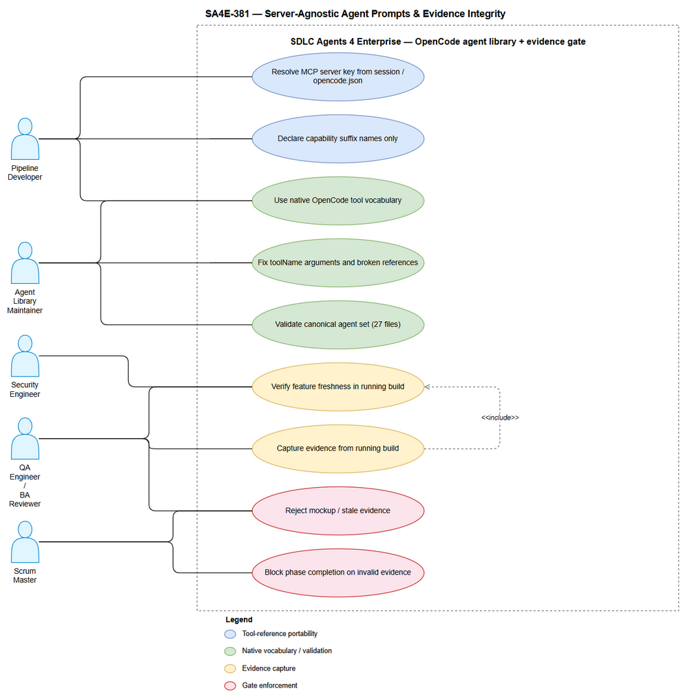
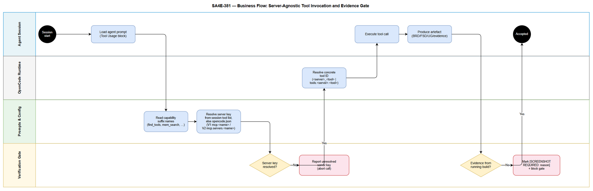

# Business Requirements Document (BRD)

## SDLC Agents 4 Enterprise — SA4E-381: Normalize OpenCode MCP Tool References to User-Defined Server Names

---

## Document Information

| Field | Value |
|-------|-------|
| Jira Ticket | SA4E-381 |
| Project | SA4E — SDLC Agents 4 Enterprise |
| Title | [Agents] Normalize OpenCode MCP tool references to user-defined server names |
| Author | BA Agent |
| Version | 1.2 |
| Date | 2026-10-24 |
| Status | Draft — v1.2 resolves DISC-1…DISC-10 from `DISCREPANCY.md` v1.0 (see §1.2 and Appendix C) |
| Supersedes | v1.1 (2026-10-24) — scope item 8 corrected, config-count and hash-role statements qualified, mirror-maintenance premise corrected; no requirement, priority or acceptance criterion added or removed. v1.0 → v1.1 corrected evidence rows and criterion definitions per FSD §C.3.1 |
| Issue Type | Task |
| Priority | Medium |
| Change Class | Internal engineering change — agent prompts, rules, skills and operational documentation. No end-user UI, no runtime feature code. |

---

## Author Tracking

| Role | Name - Position | Responsibility |
|------|-----------------|----------------|
| Author | BA Agent – Business Analyst | Create document |
| Reporter / Product Owner | Duc Nguyen Minh – Project Owner (SA4E) | Requirement source, acceptance of scope |
| Peer Reviewer | TA Agent – Technical Architect | Review portability and platform-neutrality of the requirement statements |
| Peer Reviewer | SA Agent – Solution Architect | Confirm feasibility of server-key resolution and validation approach |

---

## Revision History

| Version | Date | Author | Changes |
|---------|------|--------|---------|
| 1.0 | 2026-10-24 | BA Agent | Initiate document — derived from Jira ticket SA4E-381, its description/acceptance criteria/validation notes, and related tickets SA4E-317 and SA4E-224 |
| 1.1 | 2026-10-24 | BA Agent | **BRD correction after TA FSD enrichment** — applied the 7 corrections listed in FSD §C.3.1: Item 4 (argument key: 49 `toolName` / 10 `tool_name`, ✅ withdrawn), Item 5 (file count: 169 = 65 + 51 + 52 + 1), Item 6 (policy file count: 192 carrying / 208 referencing), Item 7 (config count: 3 in delivery scope), Item 8 (US-2 AC-2 block definition + hash), Item 9 (US-2 AC-3 resolves-as-kind + 4 current broken rule-path refs), Item 10 (US-1 RD-1: 15 declared / 14 advertised). Derived consistency edits: Appendix A item 7 and SM-4 (3/3 configs), US-4 data-field examples, discrepancies D-1/D-2 closed with stated definitions |
| 1.2 | 2026-10-24 | BA Agent | **Feedback loop 1 — resolves DISC-1…DISC-10** (FSD v1.2 §C.4 is the technical record; this revision carries the business-facing corrections): **DISC-7** §1.2 item 8 replaced — the genuine exclusion is **structural skill-directory parity between mirrors**, not `tool_name` cleanup, which is in scope and **blocking**; **DISC-1** §1.2 gains the excluded items for mirror regeneration/blind copy and §4 dependency + §5 assumption reworded (mirrors are hand-maintained snapshots, no generator); **DISC-6** US-4 RD-3/AC-2, the Validation Report data fields and SM-4 now distinguish the **local workspace (3 configs)** from a **clean clone (2 configs)** — the count is derived, not asserted; **DISC-8** US-2 AC-2 block definition separates the **pre-change baseline hash** from the **expected post-change hash** and removes the truncated hash as an expected value; **DISC-10** US-2 AC-2/VR-2.5 state that the acceptance test is the hash of the **block region only**, so the duplicate-prose deletion is hash-neutral; **DISC-9** US-1 AC-3 notes V2 coverage is forward-compatibility via a synthetic fixture |

> **Correction note (v1.1).** This revision exists because the technical enrichment pass re-measured three evidence rows and one criterion definition and found them wrong or unfalsifiable (FSD §C.3.1). A wrong evidence row is worse than an absent one: it certifies a pass that did not happen. Everything not listed above is unchanged from v1.0, and no new requirement was introduced.

---

## Sign-Off

| Name | Signature and date |
|------|--------------------|
| Duc Nguyen Minh (Project Owner) | ☐ I agree and confirm all criteria on this BRD as expected requirements |
| Agent Library Maintainer | ☐ I agree and confirm all criteria on this BRD as expected requirements |

---

## 1. Introduction

### 1.1 Scope

The SDLC Agents 4 Enterprise product ships one canonical set of nine SDLC agent definitions (SM, BA, TA, SA, QA, DEV, DevOps, UI, Security) plus rules and skills, converted for six platforms: Kiro, OpenCode, Antigravity, Claude Code, Codex, and GitHub Copilot. The OpenCode build is the primary developer-facing runtime for this repository.

OpenCode exposes MCP tools under a **server key chosen by the user** in configuration:

- V1 shape: `mcp.<server-name>`
- V2 shape: `mcp.servers.<server-name>`

The concrete callable tool ID therefore depends on that user-chosen key — either `<server-name>_<tool>` (direct tool mode) or `tools.<server-name>.<tool>` (Code Mode). The key is **not** a product constant.

**The defect this change request addresses:** several OpenCode agent, rule, and skill prompts hardcoded one specific server-key prefix in tool references, and several OpenCode files still used tool names that only exist on the Kiro platform. As a result:

- Renaming the MCP server key — or switching to the packaged OpenCode conversion, which ships a differently-named key — silently broke tool calls, because the prompt told the agent to invoke a tool ID that does not exist in the session.
- Agents attempted to call Kiro-only tool names (`invokeSubAgent`, `fsWrite`, `fsAppend`, `readFile`, `readCode`, `executePwsh`, `contextFiles`) inside OpenCode, where those tools are not available.
- Broken cross-references remained (conversion agents pointed at `.kiro/steering/*` paths that do not exist in an OpenCode install), and the draw.io rule was missing from the combined rule set.
- Separately, in the same change set, User Guide (UG) evidence had no enforced provenance rule, so wireframes, mockups, and stale screenshots could be presented as proof of implemented behaviour.

This BRD captures the **business requirement** for the normalized, server-agnostic behaviour, for the native-OpenCode tool vocabulary, for the evidence-integrity policy, and for a repeatable validation gate. It states *what must be true*, not how each file is edited.

The change covers 27 OpenCode agent files — 9 active, 9 conversion mirror, 9 packaged-extension mirror — the associated rules and skills, the root and platform `AGENTS.md` guidance, the UG template, and the review/gate rules that consume UG evidence.

### 1.2 Out of Scope

| # | Excluded item | Rationale |
|---|---------------|-----------|
| 1 | Renaming or re-configuring any MCP server in a user's `opencode.json` | The requirement is that prompts survive a rename; performing the rename is a user decision. |
| 2 | Changing any MCP server implementation, tool schema, or orchestration behaviour | No server-side behaviour change is required to satisfy this CR. |
| 3 | Adding or removing SDLC phases, agents, or platform targets | Scope is limited to prompt/documentation correctness and evidence policy. |
| 4 | Changing application runtime code, APIs, database schema, or extension features | Ticket context states this is a prompt/documentation change; implementation status is already recorded as done in `STATUS.json`. |
| 5 | Retro-fitting historical UG/test/security artefacts produced before the policy existed | Not evidence-bearing for the current build; re-capture is a per-ticket decision. |
| 6 | Providing substitutes for platforms that have no capture capability | Capture-capability expansion is a separate initiative. |
| 7 | Aesthetic or UX redesign of any deliverable template | Only the evidence-provenance content of `UG-TEMPLATE.md` is in scope. |
| 8 | **Structural parity of the two tracked mirrors** — i.e. making the skill directories that exist in `.opencode/`, `conversions/opencode/.opencode/` and `extension/resources/conversions/opencode/.opencode/` match one another | **v1.2 (DISC-7).** The mirrors are hand-maintained snapshots, not generated artefacts (FSD §3.6.5). Measured structure is 48 / 31 / 32 skill directories; the conversion mirror carries three directories that exist nowhere else (`agent-self-learning`, `pega-kb-search`, `role-boundaries`) and the packaged-extension mirror carries those plus `kotlin-code-standards`, while both omit 20 of the active tree's directories. Making them match is a 100+ file structural refactor with its own review surface, raised as a follow-up under OI-07. **A blind copy of the active tree over a mirror would delete the mirror-only directories and is prohibited.** Note what is *not* excluded here: the `tool_name` cleanup, the canonical-block alignment and the 4 dead rule-path references are **in scope and blocking** (US-1 AC-4, US-2 AC-2/AC-3). |
| 9 | Building a canonical-block or mirror generator, or "regenerating" the mirrors from the active tree | **v1.2 (DISC-1).** No such generator exists: `scripts/sync-conversions.mjs` copies `extension/` only and never `.opencode/`; `extension/scripts/copy-resources.js` transports an already-materialised mirror one hop further. Creating one is outside a prompt-correctness change request and outside its change budget (NFR-20). This CR **declares** the drift with evidence instead of regenerating it — the SM agent alone differs by 1311 lines (1716 active vs 405 in each mirror), which is why a blind copy is unsafe. |
| 10 | Rewriting the mirror agent bodies to the active generation | Same reason as item 9: the body/structural drift is a *declared* known state (OI-07), reported in every validation report, not repaired here. Parity is claimed **for the block region only**. |
| 11 | Renaming `code-intel-dynamic-tools.md` | Decision OI-03: the filename coupling is accepted for this CR and contained by BR-35; the rename has its own follow-up ticket. |

> **Correction note on the former item 8 (v1.2).** v1.0/v1.1 listed "Creating FSD, TDD, STP, or STC for this ticket — this deliverable is BRD-only" as an exclusion. That documentation-pipeline decision was **superseded** by the SM when the ticket was routed through the full SDLC: FSD v1.2 (`documents/SA4E-381/FSD.md`) and TDD v1.0 (`documents/SA4E-381/TDD.md`) now exist and are inputs to this BRD's evidence base. The exclusion was also misleading in a second way: read alongside the FSD it suggested the `tool_name` residue would be left alone, whereas OI-05 is a **blocking** work item (14 prompt-example defects, 6 of them in the active tree). The genuinely excluded structural item now occupies item 8.

### 1.3 Preliminary Requirement

| # | Prerequisite | Status / Note |
|---|--------------|---------------|
| 1 | A configured MCP server (any user-chosen key) reachable from the OpenCode session | Available — the pipeline itself depends on it |
| 2 | Canonical source of the nine agent definitions and of the shared rules/skills | Available — `.opencode/` is the source of truth |
| 3 | Tracked mirrors that must stay in sync with `.opencode/` | Available — `.opencode/` is gitignored; tracked mirrors are `conversions/opencode/` and `extension/resources/conversions/opencode/` |
| 4 | Ability to read the effective tool list of a session, or read `opencode.json` | Available — both resolution paths are open to the agent |
| 5 | A method to produce and inspect a running build for evidence capture | Available per deliverable type — see Section 2.3 Story 3 |
| 6 | Agreement on the canonical Tool Usage block wording | Must be identical across all 27 OpenCode agent files |
| 7 | Related agents SA4E-317 (system prompt + skills) and SA4E-224 (multi-platform conversions) completed | SA4E-224 Done; SA4E-317 In Progress |

---

## 2. Business Requirements

### 2.1 High Level Process Map

The change has two coupled business processes that must both hold for the pipeline to be trustworthy:

**Process A — Server-agnostic tool invocation.** Resolve the user-configured MCP server key at runtime, bind capability suffixes to concrete tool IDs, and invoke tools without ever embedding a product-assumed key in a prompt.

**Process B — Evidence-bearing deliverable production.** Produce BRD/FSD/UG/test/security artefacts, and for any artefact that makes a claim about application behaviour, capture proof from the actual running build before the artefact passes a review gate.

Process A is what makes Process B possible on any machine: without a resolvable server key, no Jira data, no knowledge-base write, no DOCX export, and no draw.io export can happen — so no deliverable is produced at all.

*[Edit in draw.io](diagrams/use-case.drawio)*

*[Edit in draw.io](diagrams/business-flow.drawio)*

**High-level business flow (narrative):**

**Step 1:** A developer starts an OpenCode session. OpenCode loads the selected agent definition together with the project `AGENTS.md`, the always-on rules, and the phase skill.

**Step 2:** The agent reads its Tool Usage block. That block names capabilities only — `find_tools`, `execute_dynamic_tool`, `mem_search`, `mem_ingest`, `mem_ingest_file`, `stream_write_file`, `embed_image`, `drawio_auto_layout`, `drawio_export_png` — plus the two ID forms (`<server-name>_<tool>` for direct tool mode, `tools.<server-name>.<tool>` for Code Mode). No concrete server key appears.

**Step 3:** The agent resolves the real server key: first from the session's tool list, and if that is not conclusive, from `opencode.json` in the active install (V1 `mcp.<server-name>`, V2 `mcp.servers.<server-name>`).

**Step 4:** For a nested capability (Jira, DOCX export, XLSX export, draw.io CLI, database, browser), the agent calls `find_tools` with a semantic query to obtain the exact tool name, then calls `execute_dynamic_tool` with `toolName` (camelCase) and an `arguments` object.

**Step 5:** The tool executes and the agent produces the artefact for the current phase.

**Step 6:** If the artefact asserts application behaviour (UG, test report, security finding), the agent resolves the runtime profile from the project, detects whether an instance is already running, and **reuses** it. A second instance is never started.

**Step 7:** The agent verifies feature freshness — the running build must contain the feature this ticket introduced. If the instance is stale, that same instance is restarted and the reason is recorded.

**Step 8:** The agent captures evidence by deliverable type (browser screenshot for web UI, app-window screenshot for Electron, OS-level or harness screenshot for native desktop, emulator/device screenshot for mobile, real terminal transcript for CLI, real request/response for API/MCP, real input/output plus logs for a data pipeline) and stores it under `documents/{TICKET}/diagrams/`.

**Step 9:** Reviewers apply the gate. BA rejects wireframes, mockups, Stitch screens, and placeholders in a UG; QA compares screenshots against the current build; SM blocks phase completion when evidence is missing or invalid.

**Step 10:** If capture is genuinely impossible, the agent records `[SCREENSHOT REQUIRED: reason]` inline and reports the gap to SM. A silent omission is itself a defect.

> **Note:** The two processes are not independent. Because Process A removes hardcoded server keys, the same prompt now runs unmodified on the active workspace install, the OpenCode conversion mirror, and the packaged extension mirror — which is exactly what allows a single evidence policy to be enforced consistently across all three.

---

### 2.2 List of User Stories / Use Cases

| # | Story / Use Case / Epic | Priority | Source Ticket |
|---|-------------------------|----------|---------------|
| 1 | As a developer running the SDLC pipeline on OpenCode, I want agent prompts to resolve the MCP server key from the live session or from `opencode.json` instead of hardcoding it, so that renaming the configured server key — or switching to the packaged conversion — does not break any tool call. | MUST HAVE | SA4E-381 |
| 2 | As a maintainer of the agent library, I want every OpenCode agent, rule, and skill file to reference only tools that actually exist in OpenCode, so that agents never attempt to invoke a Kiro-only tool and fail mid-pipeline. | MUST HAVE | SA4E-381 |
| 3 | As a QA engineer, BA reviewer, or Scrum Master, I want User Guide and test/security evidence to come from the actual running build, with the running instance reused and its freshness verified, so that wireframes, mockups, and stale screenshots can never be accepted as proof of implemented behaviour. | MUST HAVE | SA4E-381 |
| 4 | As a Scrum Master, I want one canonical, machine-checkable state for the OpenCode agent set — 27/27 agents with the canonical Tool Usage block and valid frontmatter, parseable `opencode.json` files, and no broken cross-references — so that every pipeline run starts from a known-good configuration. | SHOULD HAVE | SA4E-381 |
| 5 | As a platform maintainer, I want the same server-agnostic tool guidance applied to the root `AGENTS.md` and to the non-OpenCode platform copies, so that agent behaviour is consistent whether the pipeline runs on Kiro, OpenCode, Antigravity, Claude Code, Codex, or GitHub Copilot. | SHOULD HAVE | SA4E-381 |

---

### 2.3 Details of User Stories

---

#### Business Flow

The end-to-end business flow of the primary capability (Story 1) is described in Section 2.1 Steps 1–5. The evidence-integrity flow (Story 3) is Section 2.1 Steps 6–10.

**Step 1:** Prompt authoring declares capability suffixes only.

**Step 2:** At session start, the effective tool list exposes the user-chosen server key.

**Step 3:** The agent resolves the key and binds suffix to a concrete tool ID.

**Step 4:** The agent invokes the dynamic tool with `toolName` and an `arguments` object.

**Step 5:** The tool result returns to the agent and the phase artefact is produced.

> **Note:** If the key cannot be resolved, the correct behaviour is a clear, actionable failure — name the capability that could not be resolved and where the key was looked for — never a silent fallback to a guessed key.

---

#### STORY 1: Server-Key Portability for MCP Tool References

> As a developer running the SDLC pipeline on OpenCode, I want agent prompts to resolve the MCP server key from the live session or from `opencode.json` instead of hardcoding it, so that renaming the configured server key — or switching to the packaged conversion — does not break any tool call.

**Requirement Details:**

1. Every OpenCode agent, rule, and skill prompt must reference MCP tools by **capability suffix**, never by a fully-qualified tool ID that embeds a product-assumed server key. The capability suffix set in scope is: `find_tools`, `execute_dynamic_tool`, `mem_search`, `mem_ingest`, `mem_ingest_file`, `mem_get`, `mem_crud`, `code_search`, `get_curated_context`, `stream_write_file`, `embed_image`, `drawio_auto_layout`, `drawio_export_png`, `orchestration_status`, `agent_log` — **15 suffixes**.

   > **v1.1 note (OI-08).** The register stays at 15. The canonical Tool Usage block *delivered* in 27/27 agent files advertises **14** of them — `mem_crud` is absent from the block's "Core capabilities" sentence. This is a register-versus-block mismatch that must be decided once (add `mem_crud` to the block, or mark it "available, not advertised"); it must **not** be read as 27 block defects, because the block is byte-identical across all 27 files (AC-2).
2. Each prompt that names an MCP capability must document **both** callable ID forms, because the form depends on the OpenCode invocation mode:
   - Direct tool mode: `<server-name>_<tool>` — e.g. `<server-name>_find_tools`
   - Code Mode (default in current OpenCode): `tools.<server-name>.<tool>` — e.g. `tools.<server-name>.find_tools`
3. Each prompt must state the resolution procedure, in this order:
   1. Inspect the session's tool list for the capabilities listed above (`find_tools`, `execute_dynamic_tool`, `mem_search`, …) and take the prefix actually exposed.
   2. If the session list is not conclusive, read the active install's `opencode.json` and take the server key from the V1 shape `mcp.<server-name>` or the V2 shape `mcp.servers.<server-name>`.
   3. Never invent, guess, or fall back to a remembered name.
4. Prompts must support **both** configuration shapes simultaneously. A workspace may be on V1 while a packaged conversion ships V2, and the same prompt text must be correct in both.
5. Nested (child-server) capabilities must be invoked through the two-step dynamic pattern: `find_tools` with a semantic query to obtain the exact tool name, then `execute_dynamic_tool` with `toolName` and an `arguments` object. The argument key is `toolName` (camelCase); `tool_name` is not accepted. `arguments` must be an object, never a JSON string.
6. The requirement applies to every location the OpenCode agent set is delivered from: the active workspace `.opencode/`, the OpenCode conversion mirror, and the packaged-extension mirror.
7. Where a prompt needs to mention the server concept generically, it must use a placeholder (`<server-name>`, "the configured MCP server key") or a descriptive phrase ("configured MCP server key"), not a literal key.

**Data Fields (Reference Record — the information each prompt must be able to derive):**

| Field | Type | Required | Description | Example |
|-------|------|----------|-------------|---------|
| capability_suffix | String | Yes | Platform-independent capability name declared in the prompt | `find_tools` |
| server_key | String | Yes (resolved at runtime) | User-chosen MCP server key from session or config | `<server-name>` |
| config_shape | Enum | Yes | Which `opencode.json` shape the key was read from | `V1` \| `V2` |
| direct_tool_id | String | Conditional | Resolved ID in direct tool mode | `<server-name>_find_tools` |
| code_mode_tool_id | String | Conditional | Resolved ID in Code Mode | `tools.<server-name>.find_tools` |
| nested_tool_name | String | Conditional | Exact nested tool name returned by `find_tools` | `jira_get_issue` |
| tool_arguments | Object | Conditional | Argument object passed to `execute_dynamic_tool` | `{"issue_key":"SA4E-381"}` |

**Acceptance Criteria:**

1. No hardcoded MCP server-key prefix of the form `<server-key>_` or `<server_key>_` remains in any OpenCode agent, rule, or skill prompt. (The literal legacy strings are recorded verbatim in the SA4E-381 Jira description; this document deliberately uses placeholders so it does not re-introduce a hardcoded server name.)
2. Agents continue to work when the MCP server key is renamed — resolution succeeds from the session tool list or from `opencode.json` without any prompt edit.
3. Both configuration shapes are honoured: a workspace configured in V1 shape and a workspace configured in V2 shape both resolve the same capability.

   **v1.2 (DISC-9) — coverage qualification:** no V2 configuration exists in this repository (all five `opencode.json` files are V1), so the V2 branch is **forward compatibility** and is verified with a **synthetic fixture** (`tests/fixtures/opencode-v2.json`, authored by QA during test planning — it is a test artefact, not a production file). The requirement itself is unchanged: the same prompt text must be correct under both shapes. If the fixture is not available, the V2 check is recorded as a **labelled waiver** with that reason — a wrong-but-silent V2 branch is worse than a declared gap.
4. `execute_dynamic_tool` invocations use `toolName` with an `arguments` object; no `tool_name` key remains in prompt examples.
5. An unresolvable server key produces an explicit, actionable error naming the capability and the locations searched — no silent guess and no silent skip.
6. A renamed-key smoke test passes: with a different server key configured, a capability such as `mem_search` or `find_tools` still resolves and executes.

**Interface Specification (prompt contract — no end-user UI in this change):**

| No. | Element | Type | Required | Description | Note |
|-----|---------|------|----------|-------------|------|
| 1 | Tool Usage block | Prompt section | Yes | Declares capability suffixes and both ID forms | Identical wording across all 27 OpenCode agent files |
| 2 | Server-resolution paragraph | Prompt section | Yes | States resolution order: session tool list → `opencode.json` V1/V2 | Must explicitly forbid guessing |
| 3 | Nested-tool pattern | Prompt section | Yes | Two-step `find_tools` → `execute_dynamic_tool(`toolName`, arguments)` | Must show `arguments` as an object |
| 4 | Placeholder convention | Prompt convention | Yes | `<server-name>` / "configured MCP server key" in all examples | Prevents re-introducing a literal key |
| 5 | Configuration-shape note | Prompt section | Yes | Names both `mcp.<name>` (V1) and `mcp.servers.<name>` (V2) | Neither shape may be assumed |

**UI Specifications:** Not applicable — this change request has no user-facing screen. The "interface" is the prompt text contract specified above.

**Validation Rules:**

- **VR-1.1:** A prompt line that contains a concrete server-key prefix followed by an underscore in a tool reference is invalid.
- **VR-1.2:** A prompt example that shows only one of the two ID forms is incomplete; both must be present where an MCP capability is described.
- **VR-1.3:** A prompt that names a resolution source but not both `opencode.json` shapes is incomplete.
- **VR-1.4:** `toolName` must be camelCase in every `execute_dynamic_tool` example.
- **VR-1.5:** `arguments` must be shown as an object literal, not as a quoted JSON string.
- **VR-1.6:** Where the server concept is mentioned generically, the placeholder form must be used.

**Error Handling:**

- **Server key not discoverable from session tool list:** Read `opencode.json` (V1, then V2). If still unresolved, stop the tool call and report: which capability was needed, which sources were checked, and that the user must confirm the configured server key. Do not proceed with a guessed ID.
- **Direct/Code-Mode ID mismatch:** Report the mode detected and the ID form used; retry once with the other form before failing.
- **Nested tool name not found by `find_tools`:** Report the semantic query used and the candidates returned; do not invent a nested tool name.
- **Wrong argument key passed (`tool_name`):** The call is rejected by the server. Correct to `toolName` and retry once; a repeated occurrence is a prompt defect to be fixed at source.

---

#### STORY 2: Native OpenCode Tool Vocabulary Across the Agent Set

> As a maintainer of the agent library, I want every OpenCode agent, rule, and skill file to reference only tools that actually exist in OpenCode, so that agents never attempt to invoke a Kiro-only tool and fail mid-pipeline.

**Requirement Details:**

1. All OpenCode-scope files — agent definitions, always-on rules, phase skills, and shared skills — must reference **native OpenCode tools only**: `task`, `bash`, `read`, `write`, `edit`, `glob`, `grep`, `skill` (plus `webfetch` / `websearch` where a role legitimately needs them).
2. Kiro-only tool names must not appear anywhere in the OpenCode scope. The retired names and their required native replacements are:

   | Retired Kiro-only name | Native OpenCode replacement | Behavioural note |
   |------------------------|------------------------------|------------------|
   | `invokeSubAgent` | `task` | Sub-agent delegation; the OpenCode `task` tool carries the agent type and prompt |
   | `fsWrite` | `write` | Create or overwrite a file |
   | `fsAppend` | `edit` | Append/modify is expressed as an edit of existing content |
   | `readFile`, `readCode`, `read_file` | `read` | A single read tool covers text, directory listings, images, and PDFs |
   | `executePwsh` | `bash` | Shell execution |
   | `contextFiles` | *(removed — no replacement)* | Context is supplied by the runtime; prompts must not ask for a context-file list |

3. The canonical **Tool Usage block** must be textually identical across all 27 OpenCode agent files, and each file must keep valid YAML frontmatter whose permission keys correspond to real native tools.
4. Phase routing performed by the Scrum Master must use the `skill` tool to load the phase skill (`phase-1-requirements`, `phase-2-specification`, … `phase-7-deployment`), not a platform-specific invocation syntax.
5. Cross-references inside conversion agents must be valid for an OpenCode install. In particular, references to `.kiro/steering/*` paths must be repointed to the corresponding `.opencode/` rules or skills paths, because `.kiro/steering` does not exist in an OpenCode install.
6. The draw.io rule (`.opencode/rules/sdlc/drawio.md`) must be present in the combined rule set so diagram generation guidance is available to every agent that produces diagrams.
7. The requirement applies identically to the three delivery locations; a fix applied only to the active workspace is incomplete.

**Data Fields (Tool Mapping Register):**

| Field | Type | Required | Description | Example |
|-------|------|----------|-------------|---------|
| retired_tool_name | String | Yes | Kiro-only tool name that must not appear | `invokeSubAgent` |
| native_replacement | String | Yes | Native OpenCode tool that replaces it | `task` |
| file_location | Enum | Yes | Which delivery location the file belongs to | `active` \| `conversion` \| `extension` |
| agent_file | String | Yes | Agent definition file name | `sm-agent.md` |
| frontmatter_valid | Boolean | Yes | YAML frontmatter parses and declares real native tools | `true` |
| tool_usage_block_present | Boolean | Yes | Canonical Tool Usage block present and unmodified | `true` |

**Acceptance Criteria:**

1. Zero occurrences of `invokeSubAgent`, `fsWrite`, `fsAppend`, `readFile`, `readCode`, `executePwsh`, or `contextFiles` remain in any OpenCode agent, rule, or skill file.
2. 27/27 OpenCode agent files — 9 active + 9 conversion + 9 packaged extension — carry the canonical Tool Usage block and valid frontmatter.

   **Block definition (v1.2) — so the criterion is checkable:** the block starts at the marker line `### MCP tools — server name is user-defined` and ends immediately before the next heading matching `^#{2,3} `. The delivered block is **26 lines**; the normalised SHA-256 is taken with trailing whitespace stripped per line and CRLF→LF, joined with `\n`, no trailing newline. Two hashes exist in two distinct roles (hash-role rule: FSD §3.1.6.8; BRD Appendix A item 13):

   | Role | Full SHA-256 | Use |
   |------|--------------|-----|
   | **Pre-change baseline** (v1 block as it stands today) | `AB85A19BC13B64FD7D0D2ED4FF6E10912228D1A847C57B4C4F8FC53BF1CF4B8E` | Reference and "before" evidence **only**. It is what a regression would restore |
   | **Expected post-change** (v2 block, after the two block-text edits) | `AFD53DF661BF1120A03D3A584A4DBC67B4C90B7EB7BD5435F7E56288F9789A30` | The acceptance value |

   The comparison is always the **full 64-hex value**; a 12-hex prefix is printed for humans and is never the expected value (a truncated hash compared "close enough" is not a comparison). Today **1 distinct hash across 27 files**.

   **Equality is claimed for the block region only** — and the acceptance test is the hash of that region alone. Three consequences that a reader must not collapse into one:
   - Agent *bodies* are not identical across locations: 8 of 9 mirrors differ by 13–20 lines and the SM mirror is a different generation (405 vs 1716 lines), recorded as declared drift under OI-07.
   - The 9 active agent files carry a **7-line trailing duplicate** of tool-usage guidance **outside** the block; deleting it is a **body edit** and **must not change the block hash** (OI-06, FSD §C.2.6). A body deletion that moves the hash means it entered the block and is a defect.
   - The block is an **always-on instruction only in the installed `.opencode/` tree**; the two mirrors carry byte-identical copies as packaged documentation and load nothing (FSD §3.6.5, DISC-3). Identity is still required — it is what a packaged user receives.
3. No broken `.opencode` cross-references remain; conversion agents no longer point at `.kiro/steering/*`.

   **Resolves-as-kind rule (v1.1):** a reference must resolve **as the kind of artifact it names** — a path under `.opencode/rules/` must exist as a file, and content that lives in a skill must be referenced by its skill id, not by a rule path.

   **Current state: not met.** 4 rule-path references resolve to nothing (OI-09): `.opencode/skills/fresh-context-review/SKILL.md:32` and `.opencode/skills/phase-6-testing/SKILL.md:39` both point at `.opencode/rules/sdlc/code-standards.md`; `.opencode/skills/phase-6-testing/SKILL.md:142` points at `.opencode/rules/sdlc/fresh-context-review.md`; `.opencode/skills/sm-core/SKILL.md:472` points at `.opencode/rules/sdlc/loop-constraints.md`. The three target contents exist as `skills/code-standards`, `skills/fresh-context-review`, and `skills/loop-constraints`. `.kiro/steering/*` references are **0** (that part of the criterion already holds).
4. The draw.io rule is present in the rule set and is referenced where diagram generation is required.
5. Scrum Master phase routing is expressed through the `skill` tool.
6. An agent definition loaded in OpenCode declares no tool that OpenCode cannot resolve.

> **Note on "identical" (v1.2).** AC-2 and VR-2.5 measure the **block region**, not whole files. Whole-file equality is a *mirror-generation* property, not a block property: per-agent line counts (active / conversion / extension) are ba 644/626/626 · dev 517/504/504 · devops 556/538/538 · qa 828/808/808 · sa 555/535/535 · security 607/589/589 · **sm 1716/405/405** · ta 432/414/414 · ui 518/501/501. The SM mirror missing ~1,300 lines cannot behave like the active workspace, so any claim of 27/27 parity beyond the block is false. **v1.2 correction:** re-synchronising the mirrors is **not** performed in this CR and is **not** a "generation step" either — no generator exists (§1.2 items 8–10). The drift is **declared with evidence** and reported in every validation pass; body/structural regeneration is a separate ticket (OI-07). A blind copy of the active tree over a mirror is prohibited because it would delete the mirror-only skill directories.

**Interface Specification (agent-definition contract — no end-user UI in this change):**

| No. | Element | Type | Required | Description | Note |
|-----|---------|------|----------|-------------|------|
| 1 | YAML frontmatter | Metadata block | Yes | `description`, `mode`, `permission` block | Permission keys must be native tool names |
| 2 | Canonical Tool Usage block | Prompt section | Yes | Capability suffixes + both ID forms | Identical wording in all 27 files |
| 3 | Role Boundaries reference | Prompt section | Yes | Points to the shared role-boundaries rule | Must resolve in an OpenCode install |
| 4 | Skill references | Prompt section | Yes | Phase/shared skills addressed by their `skill` id | No platform-specific path syntax |
| 5 | Delegation syntax | Prompt section | Yes | `task` with agent type + prompt | No `invokeSubAgent` |

**UI Specifications:** Not applicable — no user-facing screen is introduced or modified by this change request.

**Validation Rules:**

- **VR-2.1:** Any occurrence of a retired Kiro-only name in the OpenCode scope is a blocking defect.
- **VR-2.2:** A file counts as "valid" only if frontmatter parses **and** the canonical Tool Usage block is present; either alone is insufficient.
- **VR-2.3:** A cross-reference that resolves to a path absent from an OpenCode install (e.g. `.kiro/steering/*`) is a broken reference and is a defect.
- **VR-2.4:** The three delivery locations must be checked independently — a green result on one location does not discharge the others.
- **VR-2.5:** The canonical Tool Usage block must be byte-identical across the 27 files (modulo line endings) — measured on the block region as delimited in AC-2, with a single distinct normalised SHA-256 over the 27 extractions. Divergence outside that boundary is not a block divergence.

**Error Handling:**

- **Agent requests a non-existent tool:** The runtime cannot execute it. Report the missing tool and the capability it was meant to serve; the fix is at prompt source, not a runtime workaround.
- **Skill reference does not resolve:** Report the skill id and the searched locations; do not inline the skill content as a substitute.
- **Conversion mirror diverges from active workspace (v1.2 — DISC-1):** The active workspace **is** the source of truth for the block region and for the enumerated defect lines, and only those are corrected. For *body* or *structural* divergence the correct action is to **record the divergence with per-file evidence and declare it** (FSD §3.6.5, OI-07) — **not** to re-sync by copying the active tree over the mirror. A blind copy deletes skill directories that exist only in the mirror and silently changes packaged contents; a section-level copy leaves the file in two generations and is the false-"synchronised" outcome OI-07 warns about.
- **Duplicate/conflicting rules:** The more specific rule wins; a conflict that cannot be resolved is escalated to the maintainer rather than silently ignored.

---

#### STORY 3: Evidence Provenance for UG, Test, and Security Artefacts

> As a QA engineer, BA reviewer, or Scrum Master, I want User Guide and test/security evidence to come from the actual running build, with the running instance reused and its freshness verified, so that wireframes, mockups, and stale screenshots can never be accepted as proof of implemented behaviour.

**Requirement Details:**

1. **Core rule.** Any artefact that makes a claim about application behaviour — UG, deployment guide runbook evidence, release notes evidence, test report, security finding, or phase report — must be supported by evidence captured from the **actual running build**. Wireframes, design mockups, Stitch screens, draw.io mockups, test fixtures, and placeholder images are not valid evidence. They belong to the Specification phase only.
2. **Reuse a running instance.** Before starting an application, the agent must:
   1. Resolve the runtime profile from the project (README, `package.json`, `build.gradle.kts`, `pyproject.toml`, `docker-compose.yml`, or the TDD Deployment section).
   2. Detect an existing instance — in order: health endpoint (`/health`, `/actuator/health`, `/api/health`, MCP `initialize`), then port/process/container (`Get-NetTCPConnection`, `lsof`, `docker compose ps`), then a PID file if the project uses one.
   3. If an instance is already running, **reuse it** and do not start a second instance.
   4. Never hardcode `npm start` or a fixed port.
3. **Verify feature freshness.** The running instance must contain the feature this ticket introduced, checked per deliverable type:

   | Deliverable | Freshness check |
   |-------------|-----------------|
   | API / backend | Call the new endpoint; validate response schema; check OpenAPI/Swagger |
   | MCP server | `tools/list` contains the new tool; invoke it once |
   | Web UI | Open the new route; assert the new element/text in the DOM |
   | CLI | Run the new subcommand or `--help` entry |
   | Desktop / mobile | Open the new screen; check in-app build/version info |
   | Data pipeline | Run a smoke input; validate the new output |

   If build/commit information is exposed (`/version`, commit hash, image tag), it must be compared with the current branch. If the instance is **stale**, that same instance is restarted and the reason is recorded (e.g. "Running app is stale: missing route X"). If the instance belongs to someone else and cannot be restarted, the agent reports to SM instead of terminating it.
4. **Capture by deliverable type.** Web UI → browser-automation screenshot of each primary screen/route. Electron → automated app-window screenshot. Native desktop → OS-level screenshot or app screenshot harness. Mobile → emulator/device screenshot (`adb`, `xcrun simctl`). CLI → real terminal transcript with expected output. API/MCP → real request/response examples. Data pipeline → real input/output sample plus logs.
5. **Storage and embedding.** Evidence is stored at `documents/{TICKET}/diagrams/{kind}-{screen}.png` and embedded inline as ``. For UI deliverables, UG Section 5 requires, per primary screen: the actual screenshot, a Key Elements table, and a User Actions table (steps + expected result).
6. **No silent gaps.** If capture is impossible, the agent writes `[SCREENSHOT REQUIRED: reason]` inline and reports the gap to SM. Fabricating, reusing a mockup, or silently omitting the section is a defect.
7. **Policy propagation.** The policy must be applied consistently to the writer, the reviewer, and the gate: the UG template, DEV Step 9, SM Phase 5.5 gate, BA and QA review rules, SA runtime-profile requirements (Runtime Profile, Screen Inventory, Feature Verification points), UI prohibitions, and DevOps/Security evidence rules.
8. **Role responsibilities must be explicit** for SM (blocks phase completion), BA (rejects mockups), TA (verifies implementation evidence provenance), SA (defines runtime profile and verification points), QA (runs the real app and compares), DEV (owns capture), DevOps (verified commands and deployed build), UI (mockups for FSD only; never UG screenshots), and Security (findings require a fresh, feature-verified instance).

**Data Fields (Evidence Record):**

| Field | Type | Required | Description | Example |
|-------|------|----------|-------------|---------|
| ticket_key | String | Yes | Ticket the evidence belongs to | `SA4E-381` |
| deliverable_type | Enum | Yes | Kind of artefact the evidence supports | `Web UI` \| `Electron` \| `CLI` \| `API/MCP` \| `Data pipeline` \| `Native desktop` \| `Mobile` |
| screen_or_route | String | Conditional | Screen, route, subcommand, or endpoint captured | `/admin/mcp` |
| runtime_profile_source | String | Yes | Where the start command was resolved from | `README` / `docker-compose.yml` |
| instance_detection_method | Enum | Yes | How an existing instance was found | `health` \| `port` \| `process` \| `container` \| `pidfile` \| `none-running` |
| instance_reused | Boolean | Yes | Whether an existing instance was reused | `true` |
| restart_reason | String | Conditional | Why a stale instance was restarted | `Running app is stale: missing route X` |
| freshness_evidence | String | Yes | Proof the build contains the ticket feature | `tools/list contains new tool` |
| build_identity | String | Conditional | Commit hash / image tag / in-app version | `HEAD 718a2c1` |
| artefact_path | String | Yes | Stored evidence path | `diagrams/ug-admin-mcp.png` |
| capture_gap | String | Conditional | Explicit gap marking when capture is impossible | `[SCREENSHOT REQUIRED: no emulator available]` |

**Acceptance Criteria:**

1. No UG, test report, or security artefact is accepted with a wireframe, mockup, Stitch screen, draw.io mockup, or placeholder presented as application evidence.
2. The capture procedure reuses an existing running instance; a duplicate instance is never started because the agent failed to look.
3. Feature freshness is verified against the running build before capture, and staleness results in a restart of that same instance with the reason recorded.
4. Every captured artefact is stored under `documents/{TICKET}/diagrams/` with the `{kind}-{screen}.png` convention and embedded inline.
5. An impossible capture is recorded as `[SCREENSHOT REQUIRED: reason]` and reported to SM — never silently omitted.
6. The policy is present in the UG template, DEV Step 9, SM Phase 5.5 gate, BA/QA review rules, SA runtime profile, UI prohibitions, and DevOps/Security evidence rules, and the same rule text is applied across all supported platforms.
7. A BA review rejects a UG whose Section 5 uses non-build evidence; an SM gate blocks phase completion on the same condition.

**UI Specifications:** Not applicable in the sense of a new product screen. The policy constrains *how existing screens are evidenced*; no screen is added or changed by this CR.

**Validation Rules:**

- **VR-3.1:** Evidence type must match deliverable type; a mockup for a web UI is invalid, a terminal transcript for a web UI is invalid.
- **VR-3.2:** An instance-detection step must be recorded before any start action.
- **VR-3.3:** A freshness check must be recorded before any capture.
- **VR-3.4:** An artefact without a stored file path and an inline reference is incomplete.
- **VR-3.5:** A gap must be explicit; absence of evidence with no gap marker is a hard failure.
- **VR-3.6:** The policy text must be materially identical across platforms; a platform-specific weakening is a defect.

**Error Handling:**

- **Application will not start:** Do not substitute mockups. Record `[SCREENSHOT REQUIRED: app failed to start — <reason>]` and report to SM.
- **Running instance is stale:** Restart that same instance, record the reason, re-verify freshness, then capture. Do not start a second instance.
- **Instance owned by another person/process:** Report to SM; do not terminate it.
- **Capture tooling unavailable (no emulator, no browser driver, no OS screenshot path):** Record the explicit gap with the missing capability named.
- **Evidence accidentally produced from a previous build:** Delete it, re-capture from the verified instance, and note the re-capture in the artefact.

---

#### STORY 4: Canonical, Machine-Checkable Agent State

> As a Scrum Master, I want one canonical, machine-checkable state for the OpenCode agent set — 27/27 agents with the canonical Tool Usage block and valid frontmatter, parseable `opencode.json` files, and no broken cross-references — so that every pipeline run starts from a known-good configuration.

**Requirement Details:**

1. A **validation pass** must exist and be repeatable. It must check, at minimum:
   1. Every OpenCode `.md` file for forbidden legacy server-key prefixes.
   2. Every OpenCode `.md` file for retired Kiro-only tool names.
   3. All 27 agent files for the canonical Tool Usage block.
   4. All 27 agent files for valid YAML frontmatter.
   5. Every `opencode.json` for JSON parse validity.
   6. Cross-references for resolvability (`skills`, rules, templates).
   7. The working tree for whitespace errors (`git diff --check`).
2. The validation must be **Evidenced**, not asserted: the counts checked and the results must be recorded so SM can verify the gate without re-running the whole pipeline.
3. The expected canonical facts for this change set are: 27 agent files (9 + 9 + 9), **3 `opencode.json` candidate paths in delivery scope** — root `opencode.json`, `conversions/opencode/opencode.json`, `extension/resources/conversions/opencode/opencode.json` (`.kilo/worktrees` copies and the vendored provider fixtures are **named exclusions**, not silent omissions) — and, of those three, **3 present on a local workspace but only 2 on a clean clone**, because `.gitignore` ignores `/opencode.json`. Also 0 forbidden prefixes and 0 retired tool names. A scan that checks "the two files" leaves the packaged-extension configuration unchecked — the copy whose breakage a packaged user hits first. A scan that insists on "3 files" fails on every fresh checkout, which is precisely where the gate matters (v1.2 — DISC-6).
4. Because `.opencode/` is gitignored, the **tracked evidence of record** is the pair of mirrors: `conversions/opencode/` and `extension/resources/conversions/opencode/`. A validation that passes only on the untracked working copy does not discharge the requirement.
5. Validation must be re-runnable after any prompt edit, so a future rename of the server key or a new platform can be checked the same way.

**Data Fields (Validation Report):**

| Field | Type | Required | Description | Example |
|-------|------|----------|-------------|---------|
| scope | Enum | Yes | Which file set was scanned | `OpenCode .md` |
| files_checked | Integer | Yes | Number of files scanned | `169` (65 active + 51 conversion + 52 extension + 1 root `AGENTS.md`) |
| forbidden_prefix_hits | Integer | Yes | Occurrences of a hardcoded server-key prefix | `0` |
| retired_tool_hits | Integer | Yes | Occurrences of Kiro-only tool names | `0` |
| agents_expected | Integer | Yes | Expected agent file count | `27` |
| agents_valid | Integer | Yes | Agent files with canonical block + valid frontmatter | `27` |
| config_files_checked | Integer | Yes | `opencode.json` files validated — **derived** from the 3 candidate paths that exist | `3` on a local workspace · **`2` on a clean clone** |
| config_files_parse_ok | Integer | Yes | Files found that parsed | `3` / `2` (equals `checked`) |
| config_files_absent | List | Yes | Candidate paths that do not exist, each with a `required` flag | `["opencode.json"]` on a clean clone (`required: false`) |
| incomplete | Boolean | Yes | `true` only when a **required** source is missing | `false` |
| diff_check_result | Enum | Yes | Result of `git diff --check` | `clean` |

> **v1.2 (DISC-6): why the count is derived and not a constant.** `.gitignore` ignores `/opencode.json` and `/.opencode`, so the install-root configuration exists only on a developer machine that has configured one. A validator that asserts `3` will report a **phantom MISSING** for file #3 on CI and on any fresh checkout. The pass condition is therefore `parse_ok == checked`, absent paths listed with their `required` flag, and `incomplete == false` — not "the number is 3".

**Acceptance Criteria:**

1. 27/27 OpenCode agent files pass both checks (canonical Tool Usage block **and** valid frontmatter).
2. All **3 `opencode.json` candidate paths in delivery scope** are accounted for without error — root, conversion mirror, packaged-extension mirror. Each path that exists parses; each path that does not exist is listed as absent with its `required` flag. A local workspace accounts for 3, a clean clone for 2 (root absent, `required: false`), and both are passes. The two `.kilo/worktrees` copies and the vendored provider fixtures are excluded **by name** in the report (v1.2 — DISC-6).
3. The scan of OpenCode `.md` files reports zero hardcoded server-key prefixes and zero retired Kiro-only tool names.
4. No broken `.opencode` cross-references remain (definition and current 4 broken rule-path references: see US-2 AC-3, OI-09).
5. `git diff --check` reports no whitespace errors.
6. The validation result is recorded with the counts above, so SM can verify without re-deriving them.
7. The same validation can be re-run after further prompt changes and produces a comparable report.

**UI Specifications:** Not applicable — validation output is CLI/console text, not a product screen.

**Validation Rules:**

- **VR-4.1:** A pass result is only valid when both the count of files checked and the count of expected agents are stated; "no errors found" without a scope is not evidence.
- **VR-4.2:** A pass on the active workspace alone is insufficient; both tracked mirrors must be validated.
- **VR-4.3:** A JSON parse failure in any `opencode.json` is a blocking defect.
- **VR-4.4:** Frontmatter validity and Tool Usage block presence are separately reported; a single combined "valid" flag is not acceptable.

**Error Handling:**

- **Scan finds a forbidden prefix:** Report file and line, fix at source, re-scan the full scope rather than only the reported file.
- **JSON parse error:** Report the file, the offset, and the offending fragment; do not "fix" by deleting the section.
- **Agent count mismatch:** Report the count per delivery location (active / conversion / extension) so the missing location is identifiable.
- **Pass claimed but scope smaller than expected:** Treat as a failed validation and re-run with the correct scope.

---

#### STORY 5: Consistent Guidance Across Platforms and Documentation

> As a platform maintainer, I want the same server-agnostic tool guidance applied to the root `AGENTS.md` and to the non-OpenCode platform copies, so that agent behaviour is consistent whether the pipeline runs on Kiro, OpenCode, Antigravity, Claude Code, Codex, or GitHub Copilot.

**Requirement Details:**

1. The **root `AGENTS.md`** must carry the server-agnostic guidance, so the rule applies even before a specific agent definition is loaded.
2. The **Antigravity copies** must carry the same guidance, expressed in that platform's format, so behaviour does not diverge between platforms.
3. The **UG evidence policy** must be applied across platforms — the ticket records 184 agent/prompt files across Kiro, OpenCode, Antigravity, Claude Code, Codex, and Copilot — using the canonical rule as the single source of truth.
4. A platform copy may be **weaker** than the canonical only where that platform lacks the capability (e.g. no screenshot tool). A weaker copy must degrade explicitly (gap marker) — never silently.
5. Documentation that describes how agents work (`AGENTS.md` and platform conversion guides) must not contradict the canonical rule set.

**Data Fields (Platform Coverage Matrix):**

| Field | Type | Required | Description | Example |
|-------|------|----------|-------------|---------|
| platform | Enum | Yes | Target platform | `Kiro` \| `OpenCode` \| `Antigravity` \| `Claude Code` \| `Codex` \| `GitHub Copilot` |
| canonical_rule_path | String | Yes | Source-of-truth rule the copy derives from | `.opencode/rules/sdlc/ug-evidence.md` |
| applied | Boolean | Yes | Rule applied to this platform | `true` |
| degradation_note | String | Conditional | Capability the platform lacks, if any | `no OS screenshot API` |

**Acceptance Criteria:**

1. Root `AGENTS.md` contains the server-agnostic tool guidance and does not contradict the canonical Tool Usage contract.
2. Antigravity copies contain the equivalent guidance in their own format.
3. The UG evidence policy is applied to all six named platforms, and the applied file count is recorded.
4. Where a platform cannot satisfy a requirement, the degradation is explicit in that platform's copy.
5. No platform copy reintroduces a hardcoded server-key prefix or a retired tool name.

**UI Specifications:** Not applicable.

**Validation Rules:**

- **VR-5.1:** A platform listed in scope with no policy application is a gap.
- **VR-5.2:** A platform copy that contradicts the canonical rule is a defect, regardless of whether it is stricter or looser.
- **VR-5.3:** A degradation without an explicit note is a silent weakening and is a defect.
- **VR-5.4:** Root `AGENTS.md` is part of the OpenCode scan scope and must pass the same forbidden-string checks.

**Error Handling:**

- **Platform not installable/available for verification:** Report as "applied, not runtime-verified" with the reason; do not claim runtime verification.
- **Platform-specific syntax conflicts with canonical wording:** Preserve the canonical semantics and adapt syntax; record the adaptation in the conversion guide.
- **Copy drift detected:** Regenerate from the canonical source rather than patching the copy.

---

## 3. Dependencies

| Dependency | Type | Related Ticket | Description |
|------------|------|----------------|-------------|
| OpenCode agent/runtime with tool list exposure and `task` / `skill` tools | System | N/A | The native vocabulary in Story 2 presupposes these OpenCode capabilities; without them the mapping cannot be completed |
| Configured MCP server (user-chosen key) exposing `find_tools`, `execute_dynamic_tool`, and the memory/code/drawio capabilities | External | N/A | Story 1 has no effect without a reachable server; the whole pipeline depends on it |
| `opencode.json` present in the active install | System | N/A | Fallback resolution source for the server key (V1/V2 shapes) |
| SA4E-317 — Configure System Prompt + Skills for SDLC agent behavior | Internal (predecessor) | SA4E-317 | Establishes how project steering becomes the effective agent behaviour; canonical Tool Usage block assumes that mechanism |
| SA4E-224 — Complete & verify multi-platform SDLC agent conversions | Internal (predecessor) | SA4E-224 | Established the 9-agent + skills canonical sets and the conversion/extension mirror layout that Story 2 and Story 5 operate on |
| `.opencode/` gitignored with tracked mirrors | Infrastructure | N/A | Puts `conversions/opencode/` and `extension/resources/conversions/opencode/` in the path of review and release |
| Extension resource-packaging step (`copy-resources`) | Infrastructure | SA4E-224 | Transports `conversions/opencode/` → `extension/resources/conversions/opencode/` so the packaged copy carries the change. **v1.2:** this is the *second* hop only. The **first** hop (active `.opencode/` → `conversions/opencode/.opencode/`) has **no** automation — those mirror files are maintained by hand (DISC-1, FSD §3.6.5), so a change reaches the mirror only if it is written there |
| Mirror-maintenance capacity (hand-maintained snapshots) | Process | N/A | Because the first hop is manual, the mirrors carry declared drift (48 / 31 / 32 skill directories; SM agent 1716 vs 405 lines). Correcting that drift is a separate, reviewable piece of work (OI-07), not a side effect of this CR |
| draw.io rendering capability (MCP export tool, else CLI) | System | N/A | Required by the draw.io rule added in Story 2 and by diagram deliverables of every later phase |
| DOCX export capability (`export_docx` through the extension wrapper) | System | SA4E-380 | Downstream document deliverables (including this BRD's DOCX export) depend on it |
| Project running-build start procedure (README / build files / TDD Deployment) | Infrastructure | N/A | Story 3 forbids hardcoded start commands; the runtime profile must be resolvable from the project |

---

## 4. Stakeholders

| Role | Name / Team | Responsibility | Source |
|------|-------------|----------------|--------|
| Project Owner / Reporter | Duc Nguyen Minh | Requirement source; accepts scope and sign-off | Jira SA4E-381 reporter & creator |
| Agent Library Maintainer | SDLC Agents 4 Enterprise team | Owns the 27 OpenCode agent files, rules, skills, and mirrors | Ownership inferred from ticket scope (agent-library change) |
| Scrum Master | SM Agent | Enforces Phase 5.5 gate; verifies validation evidence (Story 4) | Role definition — `.opencode/rules/sdlc/role-boundaries.md` |
| Business Analyst | BA Agent | Authors BRD/FSD; rejects non-build evidence in UG | Role definition; UG evidence policy §6 |
| Technical Architect | TA Agent | Verifies implementation evidence provenance | UG evidence policy §6 |
| Solution Architect | SA Agent | Defines Runtime Profile, Screen Inventory, Feature Verification points in TDD | UG evidence policy §6 |
| QA Engineer | QA Agent | Runs the real app, compares screenshots with the current build, rejects stale/mockup evidence | UG evidence policy §6 |
| Developer | DEV Agent | Owns UG evidence capture per deliverable type | UG evidence policy §6–§7 |
| DevOps Engineer | DevOps Agent | Deployment/runbook evidence against the deployed build | UG evidence policy §6 |
| UI Designer | UI Agent | Produces mockups for FSD only; never UG screenshots | UG evidence policy §6 |
| Security Engineer | Security Agent | Security findings require a fresh, feature-verified instance | UG evidence policy §6 |
| Platform consumers | Kiro / OpenCode / Antigravity / Claude Code / Codex / GitHub Copilot users | Consume the resulting agent set; benefit from portability and consistent evidence rules | Ticket scope (multi-platform application) |

---

## 5. Risks and Assumptions

### 5.1 Risks

| Risk | Impact | Likelihood | Mitigation |
|------|--------|------------|------------|
| A future agent file is authored by copy-pasting an older prompt and reintroduces a concrete server key | High | Medium | Story 4 validation is re-runnable and checks the whole scope; placeholder convention documented (VR-1.6) |
| Only the active `.opencode/` workspace is fixed while the tracked mirrors drift | High | High (because `.opencode/` is gitignored) | Story 4 VR-4.2 requires validation of both mirrors; Story 2 VR-2.4 forbids single-location sign-off |
| OpenCode changes its configuration shape or tool-ID form in a future release | Medium | Medium | Prompts support V1 and V2 simultaneously and express capabilities abstractly; resolution is runtime-driven, not compile-time |
| Renamed server key resolves in one invocation mode but not the other (direct vs Code Mode) | Medium | Medium | VR/Error handling defines a one-retry cross-form attempt before failing, with the mode reported |
| Evidence policy is applied to writer roles but not to reviewers, so invalid evidence still passes | High | Medium | Story 3 requirement 7 explicitly covers UG template, DEV Step 9, SM gate, BA/QA review, SA profile, UI prohibitions, DevOps/Security |
| Agents silently skip evidence capture in environments without screenshot tooling | High | Medium | `[SCREENSHOT REQUIRED: reason]` is mandatory; silent omission is a hard failure; SM blocks phase completion |
| A stale running instance is used, so evidence does not contain the ticket feature | High | Medium | Mandatory freshness verification before capture; restart of the same instance with recorded reason |
| Duplicate instances started, corrupting shared state or processes | Medium | Medium | Detection-before-start order (health → port/process/container → PID file); explicit prohibition on a second instance |
| Validation evidence is asserted from memory rather than from an executed scan | Medium | Medium | Story 4 requires recorded counts (files checked, agents valid, config files parsed) — see Appendix A |
| Broad blast radius (184 files) causes unintended regressions in non-OpenCode platforms | Medium | Medium | Changes are textual and additive per platform; Story 5 requires per-platform application with explicit degradation notes |
| Behavioural divergence between platforms after the policy is applied | Medium | Medium | Canonical rule as single source; copies must not contradict it (VR-5.2) |
| Documented figures in the ticket and the repository's current scan do not match, weakening the gate | Low | Medium | Appendix A records both ticket-stated and independently re-verified figures and flags the discrepancy for confirmation |

### 5.2 Assumptions

- The user-chosen MCP server key is discoverable at runtime either from the session tool list or from `opencode.json`; there is no third source required.
- Both `opencode.json` shapes (V1 `mcp.<name>`, V2 `mcp.servers.<name>`) remain valid for the supported OpenCode versions during the life of this change.
- The nine agent roles and their responsibilities do not change; only how they reference tools and how they evidence behaviour changes.
- `.opencode/` remains the canonical source and continues to be gitignored, so the tracked mirrors remain the review surface.
- **v1.2 (DISC-1):** the two tracked mirrors are **hand-maintained snapshots** of the active tree — there is no generator that produces `conversions/opencode/.opencode/` from `.opencode/`. This CR assumes the drift between them (skill directories, agent body generations) is **declared** rather than repaired: the block region plus the enumerated defect lines are corrected, and structural/body parity is deferred (OI-07). Copying the active tree over a mirror is **not** a permitted way to discharge parity.
- The packaged extension is regenerated from the mirrors as part of the release process (`copy-resources` transports `conversions/opencode/` → `extension/resources/conversions/opencode/`), so a mirror fix reaches packaged users. This is the **only** automated hop in the chain.
- Capability suffixes (`find_tools`, `execute_dynamic_tool`, `mem_search`, …) are stable names across the supported server versions.
- Reviewers (BA/QA/SM) have access to the same evidence artefacts and can distinguish a build screenshot from a mockup.
- Projects in scope expose a resolvable runtime profile; where they do not, capture is declared as a gap rather than improvised.
- No application runtime code, API contract, or database schema changes as part of this CR.

---

## 6. Non-Functional Requirements

### 6.1 Success Metrics

| # | Metric | Baseline (before) | Target (after) | Measurement method | Source |
|---|--------|-------------------|----------------|--------------------|--------|
| SM-1 | Hardcoded MCP server-key prefixes in OpenCode prompts | Present in multiple agent/rule/skill prompts | **0 occurrences** | Full-text scan of OpenCode `.md` scope | SA4E-381 AC 1, Validation |
| SM-2 | Retired Kiro-only tool names in OpenCode files | Present in multiple agent files | **0 occurrences** | Full-text scan for the seven retired names | SA4E-381 AC 3, Validation |
| SM-3 | OpenCode agent files valid (canonical Tool Usage block + frontmatter) | Below target | **27 / 27 (100%)** | Per-file validation across three delivery locations | SA4E-381 AC 4 |
| SM-4 | `opencode.json` files parseable | To be confirmed | **Every config that exists parses: `parse_ok == checked`** — 3/3 on a local workspace, **2/2 on a clean clone** (root config is gitignored); `incomplete: false` in both cases | JSON parse validation of the closed 3-path delivery scope, with absent paths listed and flagged `required: false` | SA4E-381 AC 5 |
| SM-5 | Broken `.opencode` cross-references | Present (conversion agents pointed at `.kiro/steering/*`) | **0** | Reference resolution check | SA4E-381 AC 5 |
| SM-6 | Working-tree whitespace errors | Unknown | **`git diff --check` clean** | Version-control check | SA4E-381 Validation |
| SM-7 | Renamed-server smoke test | Tool calls fail after rename | **Capability resolves and executes after rename** | Rename the key in config, run one `mem_search` / `find_tools` capability | SA4E-381 AC 2 |
| SM-8 | UG evidence provenance | Mockups/wireframes accepted | **0 accepted non-build artefacts** | BA review + SM gate sampling on UG deliverables | Story 3 |
| SM-9 | Silent evidence gaps | Possible | **0 silent gaps; every gap carries `[SCREENSHOT REQUIRED: reason]`** | UG / TEST-REPORT inspection | Story 3 AC 5 |
| SM-10 | Platform coverage of the evidence policy | Partial | **All 6 platforms applied** (Kiro, OpenCode, Antigravity, Claude Code, Codex, GitHub Copilot) | Per-platform presence check | Story 5 AC 3 |
| SM-11 | Duplicate app instances started during evidence capture | Unknown | **0** | Detection-before-start record in each UG capture | Story 3 AC 2 |
| SM-12 | Time to author a new agent file correctly | Author must rediscover the required text | **Copy the canonical Tool Usage block** — no re-derivation | Author feedback / review comments | Story 4 |

### 6.2 Non-Functional Requirement Register

| ID | Category | Requirement | Details |
|----|----------|-------------|---------|
| NFR-01 | Compatibility | Prompt text must be correct under both `opencode.json` shapes (V1 `mcp.<name>`, V2 `mcp.servers.<name>`) and both invocation modes (direct tool mode, Code Mode) | No prompt may assume one shape or one mode; both ID forms are documented side by side |
| NFR-02 | Portability | The same agent files must run unmodified on any install regardless of the configured server key | Zero coupling between prompt text and a specific server key |
| NFR-03 | Maintainability | One canonical Tool Usage block, identical across 27 files; a change is made once and propagated | Reduces divergent prompt drift; DV-2.5 requires byte-identical blocks |
| NFR-04 | Consistency | The UG evidence policy text must be materially identical across the six platforms and across writer/reviewer/gate roles | VR-3.6, VR-5.2 |
| NFR-05 | Verifiability | Every acceptance criterion must be checkable by a repeatable scan, not by inspection opinion | Story 4 defines the scan fields and expected counts |
| NFR-06 | Auditability | Deliverables must record the runtime profile source, instance-detection method, freshness evidence, and build identity | Evidence Record fields in Story 3 |
| NFR-07 | Reliability | Validation must be idempotent — re-running it on an unchanged tree yields the identical report | Prevents flaky gates |
| NFR-08 | Safety of execution | Agents must never start a duplicate application instance, never terminate an instance owned by someone else, and never hardcode a start command | Story 3 requirement 2 and error handling |
| NFR-09 | Security | Prompts must not embed credentials or concrete environment endpoints; frontmatter permissions must be least-privilege for the role | Permission keys restricted to the tools the role needs |
| NFR-10 | Data handling | Captured evidence must not expose secrets, tokens, or personal data; screenshots of configuration screens must be reviewed for masked secrets | Applies to UG, test reports, and security artefacts |
| NFR-11 | Performance | Server-key resolution must not add a measurable delay to a session; resolution is a single inspection of the tool list with a single config fallback | No repeated probing, no retry storms |
| NFR-12 | Extensibility | Adding a new platform must require only a new conversion copy plus an explicit degradation note, not a change to the canonical rule semantics | Story 5 |
| NFR-13 | Traceability | Every functional statement must cite its source: ticket acceptance criterion, validation note, or canonical rule section | See the source column throughout this BRD |
| NFR-14 | Usability of documentation | A new maintainer must be able to determine "which tools may I use and how do I call them" from the agent file alone, without reading platform source | Tool Usage block is self-contained |
| NFR-15 | Reversibility | Changes are textual and additive; a rollback must not require data migration or code revert beyond the prompt files | Reduces release risk for a 184-file change set |

> No performance, availability, or scalability SLO applies to this change in the classical sense: the deliverables are prompt/documentation files, and runtime load is unchanged. Performance is therefore expressed only as NFR-11 (no added session latency) and availability is inherited from the OpenCode runtime and the MCP server, which this CR does not modify.

---

## 7. Related Tickets

| Ticket Key | Summary | Status | Type | Relationship |
|------------|---------|--------|------|--------------|
| SA4E-381 | [Agents] Normalize OpenCode MCP tool references to user-defined server names | In Progress | Task | Main ticket |
| SA4E-317 | Configure System Prompt + Skills for SDLC agent behavior | In Progress | Task | Related (referenced in SA4E-381 notes) — establishes how project steering and skills become the effective agent behaviour |
| SA4E-224 | Complete & verify multi-platform SDLC agent conversions (OpenCode/Antigravity/Claude Code/GitHub Copilot/Codex) | Done | Task | Related (referenced in SA4E-381 notes) — established the 9-agent canonical sets and the conversion/extension mirror layout |
| SA4E-380 | Content Proxy for Child MCP Tools (Export DOCX/XLSX/PPTX/PDF/HTML/JSON Through the Extension Wrapper) | Done (per workspace artefacts) | Task | Downstream dependency — provides the export capability used by document deliverables |
| — | No issue links, subtasks, comments, or attachments exist on SA4E-381 | — | — | Verified via Jira API: `issuelinks: []`, `subtasks: []`, `comment.total: 0`, `attachment: []` |

---

## 8. Appendix

### A. Verification Evidence (as recorded)

**A.1 Figures stated on the Jira ticket**

| # | Check | Ticket-stated result |
|---|-------|----------------------|
| 1 | OpenCode `.md` files checked | 160 files — 0 hardcoded prefixes / 0 Kiro tool names |
| 2 | Agents validated (Tool Usage block + frontmatter) | 27 / 27 |
| 3 | `opencode.json` files parsed | 2 — parse OK |
| 4 | `git diff --check` | Clean |
| 5 | Agent/prompt files where the UG evidence policy was applied | 184 files across Kiro, OpenCode, Antigravity, Claude Code, Codex, GitHub Copilot |

**A.2 Independent re-verification while authoring this BRD (v1.0 scan; items 4, 7, 11 and 12 re-measured for v1.1 per FSD §D.2)**

| # | Check | Method | Observed result |
|---|-------|--------|-----------------|
| 1 | Agent file count, three delivery locations | Directory enumeration of `agents/` in active, conversion, and packaged-extension mirrors | 9 + 9 + 9 = **27** ✅ matches |
| 2 | Hardcoded server-key prefixes in OpenCode scope | Full-text scan of `.opencode/**/*.md` for `<old-key>_` and `<old_key>_` patterns | **0 matches** ✅ matches ticket |
| 3 | Retired Kiro-only tool names in OpenCode scope | Full-text scan for the seven retired names | **0 matches** ✅ matches ticket |
| 4 | Argument-key convention | Literal count of `toolName` vs `tool_name` in the OpenCode scope (active / conversion / extension), with every `tool_name` hit classified per FSD §3.1.6.7 | **49 `toolName` / 10 `tool_name`** — active scope: **6 defects + 4 exclusions**; each mirror: **4 defects + 3 exclusions**. ❌ **not met** (v1.1 — supersedes the v1.0 row "33 `toolName` / 0 `tool_name` ✅") |
| 5 | Evidence policy rule present | File existence check | `.opencode/rules/sdlc/ug-evidence.md` **present** ✅ |
| 6 | draw.io rule present | File existence check | `.opencode/rules/sdlc/drawio.md` **present** ✅ |
| 7 | `opencode.json` parse validity | JSON parse of the closed 3-path set in delivery scope (root + conversion + packaged extension); absent paths listed, not assumed | **3/3 parse OK on a local workspace; 2/2 on a clean clone** ✅ — the packaged-extension config is included (the ticket's count of 2 did not cover it, OI-04), and the install-root config is gitignored so its absence is legitimate, not a MISSING (v1.2 — DISC-6) |
| 8 | Configuration key divergence (why Story 1 matters) | Inspect declared MCP server keys in each config | Root config declares **1** key; conversion copy declares **2 differently-named** keys — a hardcoded key would break at least one of them ✅ confirms the defect premise |
| 9 | `git diff --check` | Version-control whitespace check | **exit 0 (clean)**; only line-ending normalisation warnings ✅ matches ticket |
| 10 | Broken `.kiro/steering` references in conversion mirror | Full-text scan of `conversions/opencode/**/*.md` | **0 matches** ✅ matches AC |
| 11 | OpenCode `.md` file count in this workspace | Recursive enumeration of the four scan roots (BR-30), with `**/node_modules/**`, `.kilo/worktrees/**`, `**/.git/**` excluded | **65 active / 51 conversion / 52 extension / 1 root `AGENTS.md` = 169**; exclusions named (BR-30). The ticket's 160 is `superseded` — not reproducible under any definition tried (OI-01) |
| 12 | Files carrying the UG evidence policy marker repo-wide | Two labelled scans (BR-31): **Definition A — policy-carrying** = canonical section heading `UG Evidence & Running-App Policy` present; **Definition B — policy-referencing** = any of `UG Evidence`, `ug-evidence`, `SCREENSHOT REQUIRED` | **192 policy-carrying / 208 policy-referencing**, definitions stated. The ticket's 184 is `superseded` because it does not say which definition it used (OI-02) |
| 13 | Canonical-block hash roles (v1.2 — DISC-8) | SHA-256 over the 26-line block region of each agent file, normalised (CRLF→LF, trailing whitespace stripped, `\n` join, no trailing newline); extracted twice — once from the tree as it stands and once after applying the two v2 block-text edits | **Pre-change (v1)** `AB85A19BC13B64FD7D0D2ED4FF6E10912228D1A847C57B4C4F8FC53BF1CF4B8E` — 1 distinct value across 27 files, **reference only**. **Expected post-change (v2)** `AFD53DF661BF1120A03D3A584A4DBC67B4C90B7EB7BD5435F7E56288F9789A30` — the acceptance value. Both recomputed on 2026-10-24 during BRD v1.2 authoring; the 12-hex prefix is display only, never the compared value |
| 14 | Mirror structure (v1.2 — DISC-1) | Directory enumeration of `skills/` in each of the three locations, plus per-agent line counts | **48 active / 31 conversion / 32 extension** skill directories. Conversion-only: `agent-self-learning`, `pega-kb-search`, `role-boundaries`; extension-only: those three plus `kotlin-code-standards`; **20** active directories absent from both. Agent bodies: 8 of 9 differ by 13–20 lines, **SM 1716 vs 405**. Declared drift (OI-07), not repaired here |
| 15 | Duplicate tool-usage prose in agent files (v1.2 — DISC-10) | Search for the trailing "MCP Dynamic Tools" section in agent files, and confirm it lies **outside** the block region | **9 active files carry it (7 lines each), 0 in either mirror.** Located after the block ends, so it is a **body** defect and hash-neutral: the block hash is identical in 27/27 both before and after its deletion |

**A.2.1 Argument-key evidence (item 4) in detail — v1.1**

`tool_name` is not automatically a defect. Each hit is classified into exactly one bucket — `D` = prompt-example defect (**blocking**), `X-1` = prohibition statement, `X-2` = internal implementation identifier, `X-3` = JSON-RPC parameter *value* — and every non-blocking hit is listed with file, line and bucket so the exclusion stays auditable (FSD §3.1.6.7, BR-33).

*Defects in the active scope — 6 (bucket `D`), all blocking:*

| # | File:line (baseline 2026-10-24) | Current form | Required form |
|---|-------------------------------|--------------|---------------|
| 1 | `.opencode/rules/sdlc/agent-self-learning.md:20` | `execute_dynamic_tool(tool_name, arguments)` | `execute_dynamic_tool(toolName, arguments)` |
| 2 | `.opencode/rules/sdlc/drawio.md:261` | `tool_name = "export_drawio"` | `toolName = "export_drawio"` |
| 3 | `.opencode/rules/sdlc/drawio.md:279` | `"tool_name": "export_drawio"` | `"toolName": "export_drawio"` |
| 4 | `.opencode/skills/drawio/SKILL.md:267` | `tool_name = "export_drawio"` | `toolName = "export_drawio"` |
| 5 | `.opencode/skills/drawio/SKILL.md:285` | `"tool_name": "export_drawio"` | `"toolName": "export_drawio"` |
| 6 | `.opencode/skills/orchestration/SKILL.md:162` | `execute_dynamic_tool(tool_name="jira_search", …)` | `execute_dynamic_tool(toolName="jira_search", …)` |

*The same class in each mirror — 4 defects per mirror:* `rules/sdlc/agent-self-learning.md:20`, `rules/sdlc/drawio.md:261`, `rules/sdlc/drawio.md:279`, and `skills/agent-self-learning/SKILL.md:21`. The mirrors keep the drawio **rule** occurrences but ship `drawio-diagrams` instead of the drawio skill, and carry `agent-self-learning` as a skill file rather than a rule file — which is why the mirror count is 4 and not 5.

*Exclusions in the active scope — 4 occurrences across 3 buckets (non-blocking, each one listed):*

| Bucket | Occurrence | Why it is not a defect | Residual action |
|--------|-----------|------------------------|-----------------|
| `X-1` prohibition | `rules/sdlc/pega-kb-search.md:72` | The line states that the key is `toolName` and **not** `tool_name`; deleting the string would delete the prohibition | None |
| `X-2` internal identifier | `skills/orchestration/SKILL.md:94`, `:116` | Documentation of the server's own Python implementation (`_execute(engine, tool_name, …)`, `tool_name → RouteEntry`), not an agent instruction | None |
| `X-3` JSON-RPC value | `skills/mcp-fallback-http/SKILL.md:19` | The string is the *value* of a JSON-RPC `name` member — a placeholder for the tool name, not an argument key | Rename the placeholder to `"<nested-tool-name>"` in the same change set so the bucket stops recurring |

Each mirror carries **3** exclusions (`X-1` 2 + `X-3` 1). Reconciliation: `SC-4_total = 24` → `14 defects + 10 exclusions`. A report whose arithmetic does not reconcile is not evidence.

**Bucket totals (v1.2 — DISC-5).** Aggregated across the three locations the 10 exclusions are **`X-1` 5, `X-2` 2, `X-3` 3** — active `1/2/1` plus each mirror `2/0/1`. The invariant that must hold in every report is `sum(by_bucket) == excluded` and `defects + excluded == SC-4_total`; a report whose per-bucket numbers do not sum to `excluded` is a procedure defect. The FSD v1.1 example was internally inconsistent here (`3 + 6 + 3 = 12` against `excluded: 10`) and is corrected in FSD v1.2 §3.1.6.8.

*Why the v1.0 row could not stand.* "33 / 0 ✅" was a `toolName`-only count with no `tool_name` measurement and no classification, so it certified a pass that did not happen. Withdrawing the ✅ is the substance of correction 1 in FSD §C.3.1 and it changes no requirement: **US-1 AC-4 was, and remains, not met** until the 14 occurrences (6 active + 4 per mirror) are fixed at source.

**A.3 Discrepancies raised in v1.0 and their disposition in v1.1**

| # | Discrepancy | Most likely cause | Action |
|---|-------------|-------------------|--------|
| D-1 | Ticket states 160 OpenCode `.md` files checked; v1.0 scanned 95 under `.opencode/` only, without the stated exclusion set and without the mirrors | Different scope — the ticket figure is not reproducible under any definition tried (active-only, all-locations, with/without vendored files) | **Closed in v1.1** — scope fixed by BR-30/OI-01: 65 active + 51 conversion + 52 extension + 1 root `AGENTS.md` = **169**; the 95 is withdrawn and the ticket's 160 is marked `superseded` so SM-1/SM-2 stay auditable |
| D-2 | Ticket states 184 policy-applied files; v1.0's repo-wide marker scan counted 216 | The ticket does not state which definition it used; the marker scan also matches incidental mentions, which is a second, different definition | **Closed in v1.1** — both definitions reported and labelled (BR-31/OI-02): **192 policy-carrying** / **208 policy-referencing**. US-5 AC-3 closes on Definition A; the single unlabelled 216 is withdrawn |

> **BA note:** Both were *counting-scope* questions, not requirement gaps. They are now closed by stating a definition rather than by tolerating a discrepancy — a validation gate is only as strong as its stated scope (NFR-05, VR-4.1, BR-30/BR-31).

> **BA observation (candidate follow-up):** The dynamic-tools rule file's *name* still embeds the historical server key, even though its content is now server-agnostic and the ticket's acceptance criteria (which target prompt *content*) are fully met. Since a file name is not a tool reference, this does not violate AC 1; it is raised so the maintainer can decide whether a rename belongs in a follow-up ticket or would churn too many cross-references. *(v1.1: TA decision OI-03 — the coupling is accepted for this CR and contained by BR-35; the rename is deferred to its own ticket.)*

### B. Scope Inventory (files affected by the change set)

| Area | Location | Nature of change |
|------|----------|------------------|
| Active OpenCode agents | `.opencode/agents/` (9 files) | Canonical Tool Usage block; native tool names; server-key resolution; frontmatter |
| OpenCode conversion agents | `conversions/opencode/.opencode/agents/` (9 files) | Same as active, plus broken `.kiro/steering/*` references repointed |
| Packaged-extension OpenCode agents | `extension/resources/conversions/opencode/.opencode/agents/` (9 files) | Same as conversion (packaged copy) |
| Always-on rules | `.opencode/rules/` (+ mirrors) | Server-agnostic guidance; `toolName`; new draw.io rule; new UG evidence rule |
| Skills | `.opencode/skills/` (+ mirrors) | Server-agnostic guidance; phase skill wording |
| Root guidance | `AGENTS.md`, `conversions/opencode/AGENTS.md`, `extension/resources/conversions/opencode/AGENTS.md`, Antigravity copies | Server-agnostic guidance + evidence policy |
| Config | `opencode.json`, `conversions/opencode/opencode.json`, `extension/resources/conversions/opencode/opencode.json` | Must parse; server keys declared per install (not modified by this CR) |
| UG template | `documents/templates/UG-TEMPLATE.md` (+ packaged copy) | Evidence-provenance requirements in Section 5 |
| Cross-platform evidence policy | Kiro, OpenCode, Antigravity, Claude Code, Codex, GitHub Copilot copies | Policy applied in each platform's format |

### C. Glossary

| Term | Definition |
|------|------------|
| **MCP server key** | The identifier the user assigns to an MCP server in `opencode.json`. It is user-defined, not a product constant, and it determines the callable tool ID. Declared as `mcp.<server-name>` (V1) or `mcp.servers.<server-name>` (V2). |
| **Capability suffix** | The stable, platform-independent tail of a tool name that identifies what a tool does — e.g. `find_tools`, `execute_dynamic_tool`, `mem_search`. Prompts reference capabilities by suffix and bind them to a concrete server key at runtime. |
| **Direct tool mode** | An OpenCode tool-invocation mode where a tool is addressed as `<server-name>_<tool>` — i.e. server key and tool name joined by an underscore. |
| **Code Mode** | The default OpenCode invocation mode where tools are addressed as `tools.<server-name>.<tool>`. Both modes must be documented because the same prompt runs under either. |
| **Dynamic tool** | A tool exposed by a child MCP server that is not statically known to the agent. It is discovered with `find_tools` (semantic query) and executed with `execute_dynamic_tool` using `toolName` plus an `arguments` object. |
| **Kiro-only tool name** | A tool name that exists on the Kiro platform but not in OpenCode — e.g. `invokeSubAgent`, `fsWrite`, `fsAppend`, `readFile`, `readCode`, `executePwsh`, `contextFiles`. Presence of any of these in an OpenCode file is a defect. |
| **Canonical Tool Usage block** | The single, agreed prompt section that declares the capability suffixes, both ID forms, the server-key resolution order, and the nested-tool call pattern. It must be identical across all 27 OpenCode agent files. |
| **Conversion mirror** | A tracked copy of the agent set generated for a specific platform or packaging target — here `conversions/opencode/` and its packaged counterpart under `extension/resources/conversions/opencode/`. Tracked because `.opencode/` itself is gitignored. |
| **Running build** | The application instance actually executing the current code, as opposed to a design artefact. Evidence for UG/test/security artefacts must originate here. |
| **Feature freshness** | The verified property that the running build contains the feature introduced by the ticket under work — proven by calling the new endpoint, opening the new route/command/screen, or finding the new tool in `tools/list`. |
| **UG evidence** | The proof attached to a User Guide (screenshot, terminal transcript, request/response, input/output sample) that demonstrates real application behaviour; must be captured from the running build for that ticket. |
| **Capture gap** | An explicit, reason-bearing marker — `[SCREENSHOT REQUIRED: reason]` — recorded when evidence cannot be captured. A missing capture without this marker is a hard failure, not a gap. |
| **Wireframe / mockup / Stitch screen** | Design-phase artefacts that illustrate intended appearance. Valid input to the Specification phase, invalid as evidence of implemented behaviour in a UG, test report, or security report. |
| **Delivery location** | One of the three places the OpenCode agent set is delivered from: active workspace (`.opencode/`), conversion mirror, packaged-extension mirror. A change to the **canonical block or to an enumerated defect line** is complete only when all three are updated (v1.2 — DISC-1: the two mirrors are hand-maintained, so "updated" means written by hand, not regenerated). |
| **Declared drift** | A known, measured difference between the active tree and a mirror (missing skill directories, older agent body) that is **recorded in the validation report and not repaired** by this change set. Declared drift is not a defect of this CR; an *undeclared* difference is (v1.2 — DISC-1, OI-07). |
| **Phase skill** | A skill loaded by the Scrum Master through the `skill` tool to drive one SDLC phase (`phase-1-requirements` … `phase-7-deployment`). |

### D. Reference Documents

| Document | Link / Location |
|----------|-----------------|
| Jira ticket SA4E-381 | https://jiraassist.atlassian.net/browse/SA4E-381 |
| Jira ticket SA4E-317 | https://jiraassist.atlassian.net/browse/SA4E-317 |
| Jira ticket SA4E-224 | https://jiraassist.atlassian.net/browse/SA4E-224 |
| UG evidence policy (canonical rule) | `.opencode/rules/sdlc/ug-evidence.md` |
| draw.io rule | `.opencode/rules/sdlc/drawio.md` |
| Role boundaries rule | `.opencode/rules/sdlc/role-boundaries.md` |
| Dynamic tools execution rule | `.opencode/rules/code-intel-dynamic-tools.md` — **note:** the file name itself still embeds the historical server key; the rule *content* is server-agnostic. Renaming this file is a candidate follow-up outside this CR's acceptance criteria. |
| Agent definitions (active) | `.opencode/agents/` |
| Agent definitions (conversion mirror) | `conversions/opencode/.opencode/agents/` |
| Agent definitions (packaged extension mirror) | `extension/resources/conversions/opencode/.opencode/agents/` |
| OpenCode configuration (active install) | `opencode.json` |
| OpenCode configuration (conversion) | `conversions/opencode/opencode.json` |
| UG template | `documents/templates/UG-TEMPLATE.md` |
| Root agent guidance | `AGENTS.md` |
| BRD template used for this document | `documents/templates/BRD-TEMPLATE.md` |
| Diagram sources | `documents/SA4E-381/diagrams/use-case.drawio`, `documents/SA4E-381/diagrams/business-flow.drawio` |
| Functional Specification | `documents/SA4E-381/FSD.md` (v1.2) |
| Technical Design Document | `documents/SA4E-381/TDD.md` (v1.0) |
| Discrepancy report resolved by v1.2 | `documents/SA4E-381/DISCREPANCY.md` (v1.0) |

### E. Feedback Loop 1 — Business-Facing Resolutions (DISC-1 … DISC-10)

This BRD v1.2 exists to close the ten discrepancies the SA Agent raised against the FSD v1.1 / BRD v1.1 pair. The technical record is FSD v1.2 §C.4; the table below records **what changed on the business side**, i.e. which statement a reader of *this* document would previously have taken as true and should now take differently.

| DISC | Sev. | Business statement affected | What a reader would have concluded before | What v1.2 says | Status |
|------|------|-----------------------------|--------------------------------------------|-----------------|--------|
| **DISC-1** | High | §1.2 (scope), §3 (dependencies), §5.2 (assumptions), Story 2 error handling | "The mirrors are generated; fix the active tree and regenerate them" | Mirrors are **hand-maintained snapshots**; no generator exists. In scope: block alignment, enumerated `tool_name` lines, 4 dead rule paths. **Out of scope: structural parity.** Blind copy prohibited — it would delete mirror-only skill directories. Resolution: **declare the drift, do not regenerate** | Resolved |
| **DISC-2** | Med | (FSD NFR-20 — no BRD-side cap existed) | — | No BRD change required: the BRD states no file-count ceiling. FSD NFR-20 raised to ≤ 45 with the 41-file minimum. Recorded here for traceability only | N/A (FSD-only) |
| **DISC-3** | Med | Story 2 AC-2 note; §C glossary "delivery location" | "The block is always-on in all three locations" | Always-on **in the installed `.opencode/` tree only**; the mirrors are packaged documentation copies that nothing loads. Byte identity is still required — it is what a packaged user receives | Resolved |
| **DISC-4** | Med | Story 1 RD-3/AC-3 (resolution sources) | "Read `.opencode/opencode.json`" — a path that exists nowhere | Only **three real paths** are configuration sources (install root, conversion mirror, packaged-extension mirror). A fourth path must never be invented; a missing file is reported, not guessed around | Resolved |
| **DISC-5** | Med | Appendix A.2.1 argument-key evidence | Per-bucket numbers that summed to 12 against an `excluded` of 10 | Bucket totals stated explicitly: **`X-1` 5, `X-2` 2, `X-3` 3 = 10**, with the invariant `sum(by_bucket) == excluded` | Resolved |
| **DISC-6** | Med | Story 4 RD-3, AC-2, Validation Report fields, SM-4, Appendix A item 7 | "The report must say 3 config files" — a check that fails on every fresh checkout | The count is **derived**: **3 on a local workspace, 2 on a clean clone** (root config is gitignored). Pass = every file that exists parses, absent paths listed with `required`, `incomplete: false` | Resolved |
| **DISC-7** | Low | **§1.2 item 8** | An out-of-scope item that, read alongside the FSD, implied the `tool_name` residue would be left alone | Item 8 now names the genuinely excluded thing — **structural skill-directory parity between mirrors**. `tool_name` cleanup is in scope and **blocking** (14 defects). Items 9–11 added for the other excluded work (generator, body regeneration, file rename) | Resolved |
| **DISC-8** | Low | Story 2 AC-2 block definition | One truncated hash serving as both "current" and "expected", so the example was stale the moment the fix landed | Two hashes in two roles: **pre-change baseline** (reference only) and **expected post-change** (acceptance), both full 64-hex; the 12-hex prefix is display only | Resolved |
| **DISC-9** | Low | Story 1 AC-3 (V2 shape) | "Both shapes are honoured" as if both were exercised | Still required, but stated as **forward compatibility** verified by a synthetic `tests/fixtures/opencode-v2.json` (QA-owned, no production file change). Absent fixture ⇒ **labelled waiver**, not a silent pass | Resolved — with a named QA dependency |
| **DISC-10** | Med | Story 2 AC-2 note, VR-2.5 | "The block diverges between agents" — implying a hash repair | The block is **27/27 identical**. The defect is a **redundant second copy** of tool-usage guidance **outside** the block (9 files × 7 lines). Deleting it is a **body edit**: the acceptance test is the hash of the **block region only**, and a body deletion that moves that hash is itself a defect | Resolved |

> **Nothing in this revision weakens a requirement.** DISC-2 and DISC-5 corrected arithmetic; DISC-6 corrected an unreachable pass condition; DISC-1/DISC-3/DISC-7/DISC-10 corrected *premises* about how the repository is maintained; DISC-8 corrected a stale example; DISC-9 named a coverage gap that already existed. Every acceptance criterion that failed before (US-1 AC-4, US-2 AC-3) still fails until the work is done, and every criterion that passed (US-2 AC-2) still passes for the same measured reason.

---

**End of Document**
