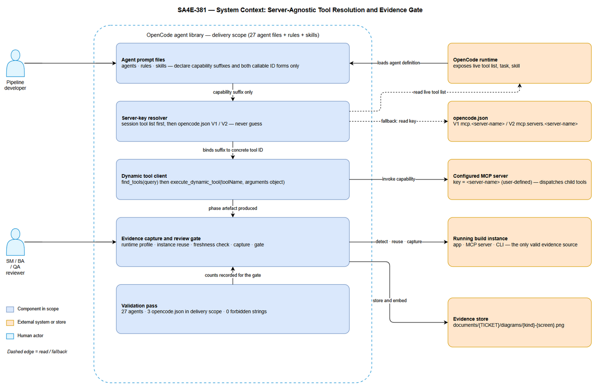
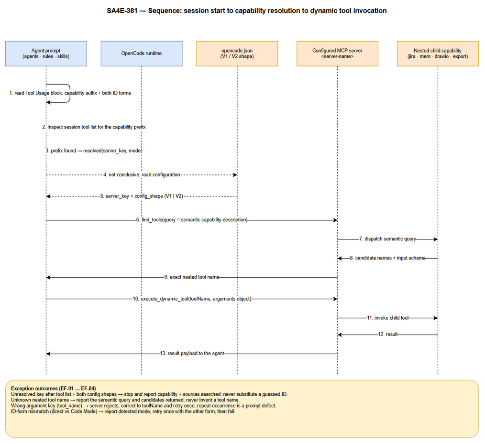
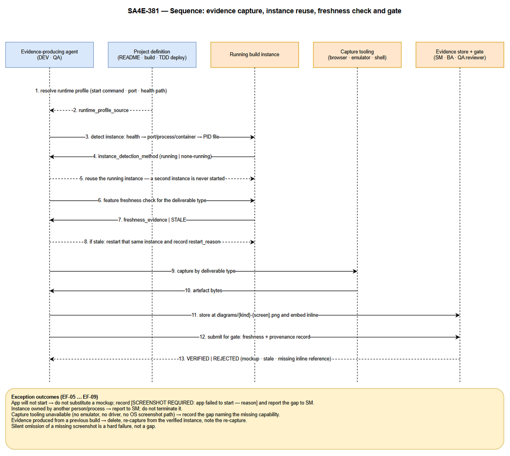
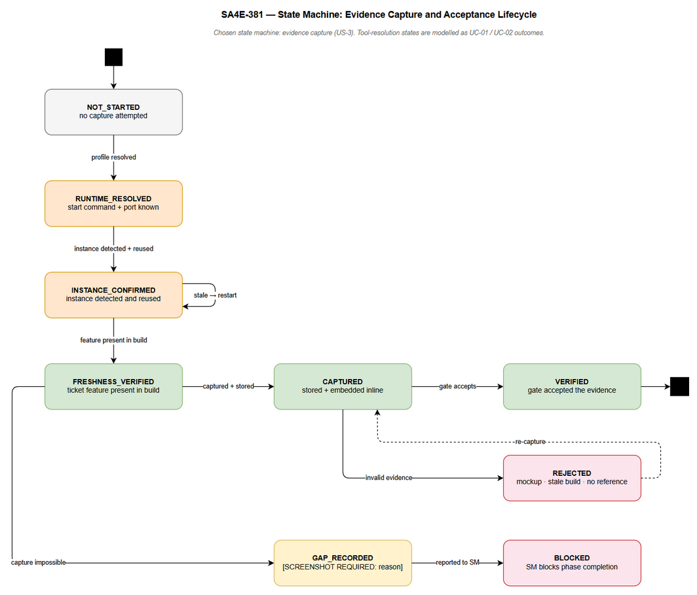
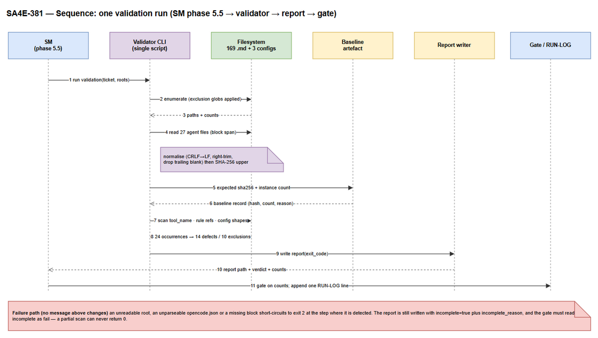

# Functional Specification Document (FSD)

## SDLC Agents 4 Enterprise — SA4E-381: Normalize OpenCode MCP Tool References to User-Defined Server Names

---

## Document Information

| Field | Value |
|-------|-------|
| Jira Ticket | SA4E-381 |
| Project | SA4E — SDLC Agents 4 Enterprise |
| Title | [Agents] Normalize OpenCode MCP tool references to user-defined server names |
| Author | BA Agent (v1.0); TA Agent (v1.1 technical enrichment, no section removed); BA Agent (v1.2 feedback-loop corrections) |
| Version | 1.2 |
| Date | 2026-10-24 |
| Status | Draft — v1.2 resolves DISC-1…DISC-10 from `DISCREPANCY.md` v1.0; ready for SA/QA consumption |
| Document Type | Functional Specification (Phase 2 — Specification) |
| Related BRD | `documents/SA4E-381/BRD.md` (v1.2) |
| Related TDD | `documents/SA4E-381/TDD.md` (v1.0) — §5.6 decisions and Appendix C deviations referenced by this revision |
| Discrepancy Input | `documents/SA4E-381/DISCREPANCY.md` (v1.0, 10 items: 1 High / 6 Medium / 3 Low) — all resolved in v1.2, see §C.4 |
| Change Class | Internal engineering change — agent prompts, rules, skills, operational documentation. No end-user UI, no runtime feature code, no API or schema change. |
| Diagram Set | `documents/SA4E-381/diagrams/` — system context, 2 sequence diagrams, 1 state diagram |
| TA Review | TA Agent — technical enrichment completed 2026-10-24 (v1.1). Section map: §3.1.6, §3.6.6, §3.7, §4.5, §5.8, §6.5–§6.8, §8 (NFR-17…NFR-25), §9 (E-19…E-21), §10.2 (TC-25…TC-33), §11.C §C.2/§C.3, §11.F |
| Conformance Baseline | Independently re-scanned by TA on 2026-10-24; evidence in Appendix D §D.2. Two criteria do **not** hold on the tree as it stands: **US-1 AC-4** (14 `tool_name` prompt defects — §C.2.5) and **US-2 AC-3** (4 rule-path references that resolve to nothing — §C.3 OI-09). **US-2 AC-2 passes**: the canonical block is byte-identical in 27/27 under the boundary now defined in §3.6.2; the trailing sections the BA draft counted as a block failure are a separate, decided item (§C.2.6 OI-06) |
| v1.2 Verification | All ten discrepancy items re-verified against the working tree by the BA before correction: 27 agent files with 1 distinct block hash (`AB85A19BC13B`); 10 `/` 7 `/` 7 `tool_name` hits (24 = 14 defects + 10 exclusions, buckets 5/2/3); exactly 3 real `opencode.json` paths and **no** `.opencode/opencode.json`; `.gitignore` ignoring `/opencode.json`; skill-directory counts 48 `/` 31 `/` 32 with L2-only and L3-only directories; SM agent 1716 vs 405 lines; the v2 block hash `AFD53DF661BF…` recomputed from TDD Appendix A |

---

## Author Tracking

| Role | Name - Position | Responsibility |
|------|-----------------|----------------|
| Author | BA Agent – Business Analyst | Author this FSD from the BRD and the Jira ticket |
| Reviewer | TA Agent – Technical Architect | Enrich technical depth; verify runtime-profile and verification-point coverage |
| Reviewer | SA Agent – Solution Architect | Confirm functional feasibility; consume this FSD for the TDD |
| Consumer | QA Agent – QA Engineer | Derive STP/STC from the use cases, business rules and test scenarios |
| Consumer | DEV Agent – Developer | Implement prompt corrections and own evidence capture |

---

## Revision History

| Version | Date | Author | Changes |
|---------|------|--------|---------|
| 1.0 | 2026-10-24 | BA Agent | Initiate document — derived from BRD v1.0, Jira ticket SA4E-381, and a conformance re-scan of the working tree performed during authoring (see Appendix D) |
| 1.1 | 2026-10-24 | TA Agent | Technical enrichment in place (no section removed, no BA text rewritten): tool-ID grammar and resolution algorithm (§3.1.6), scan patterns and validation-report contract (§3.1.6.6–§3.1.6.8), canonical-block boundary and hash evidence (§3.6.2), new rules BR-30…BR-37 (§3.6.6), additional alternative and exception flows AF-20…AF-28 / EF-30…EF-40 (§3.7), machine-checkable entities (§4.5), integration contracts (§5.8), pseudocode P-05…P-08 (§6.5–§6.8), NFR-17…NFR-25, error codes E-19…E-21 and templates M-06/M-07, test scenarios TC-25…TC-33, decisions for OI-01…OI-06 plus new issues OI-07/OI-08/OI-09 (§11.C §C.2–§C.3), TA re-scan evidence (§11.D §D.2), DEV implementation checklist (§11.F) |
| 1.2 | 2026-10-24 | BA Agent | **Feedback loop 1 — resolves DISC-1…DISC-10** from `DISCREPANCY.md` v1.0 (see §C.4 for the item-by-item record): DISC-1 mirror maintenance model — mirrors are **hand-maintained snapshots**, not generated artefacts (§3.6.5, BR-36, §C.3 OI-07, W-06); DISC-2 NFR-20 raised from ≤ 30 to **≤ 45** touched files with the 41-file minimum stated (§8, §11.F); DISC-3 "always-on" narrowed to the **installed `.opencode/` tree** (§C.2.6); DISC-4 config-path enumeration fixed to the **3 real paths**, fourth path prohibited (§3.1.6.1 G-6, R-4, §5.8.2); DISC-5 acceptance-example arithmetic corrected (`excluded: 10`, `by_bucket {5, 2, 3}`, `defects: 0`) with the `sum(by_bucket) == excluded` invariant (§3.1.6.8, NFR-23); DISC-6 `config_files_checked` redefined as **derived**, clean clone legitimately 2 (§3.1.6.8, §3.4.4, §C.2.4, TC-28); DISC-7 BRD §1.2 item 8 corrected (BA, BRD v1.2); DISC-8 block-hash roles separated — pre-change baseline vs expected post-change, full hashes, prefix demoted to display only (§3.6.2, §3.1.6.8, §10.3); DISC-9 V2 branch covered by a **synthetic fixture** under `tests/fixtures/` (§10.2 TC-03, §10.3); DISC-10 OI-06 reworded as a **duplicate-prose removal (body edit, hash-neutral)** — the acceptance test remains the block-region hash (BR-32) |

---

## 1. Introduction

### 1.1 Purpose

This FSD specifies, at functional level, **how the OpenCode agent set must behave** so that the business requirements in BRD SA4E-381 hold:

1. MCP tools are referenced by capability, never by a hardcoded server key, and are bound to a real tool identifier at runtime (BRD US-1).
2. Agent, rule and skill files reference only tools that exist in OpenCode (BRD US-2).
3. Artefacts that assert application behaviour are evidenced only from the actual running build (BRD US-3).
4. The state of the OpenCode agent set is canonical and machine-checkable (BRD US-4).
5. The same guidance holds on the root `AGENTS.md` and on the non-OpenCode platform copies (BRD US-5).

The document is written for the phases that follow: the TDD must not need to re-derive behaviour from the BRD, and QA must be able to read a use case and write a test case without ambiguity.

**Audience:** SA, QA, DEV, DevOps, Security, and maintainers of the prompt library.

### 1.2 Scope

**In scope — functional behaviour specified here:**

| # | Functional area | BRD source | Sections |
|---|-----------------|-----------|----------|
| 1 | Server-key resolution and capability binding | US-1 (MUST) | §3.1, §3.6, §6.1 |
| 2 | Native OpenCode tool vocabulary in agent/rule/skill files | US-2 (MUST) | §3.2 |
| 3 | Evidence provenance for UG, test and security artefacts | US-3 (MUST) | §3.3, §6.3 |
| 4 | Canonical, machine-checkable agent state (validation pass) | US-4 (SHOULD) | §3.4, §6.4 |
| 5 | Cross-platform and documentation parity | US-5 (SHOULD) | §3.5 |

**Out of scope** (inherited from BRD §1.2, restated so nobody re-opens it here):

- Renaming or re-configuring any MCP server in a user's `opencode.json`; changing MCP server implementation, tool schema, or orchestration behaviour.
- Adding or removing SDLC phases, agents or platform targets.
- Changing application runtime code, APIs, database schema or extension features.
- Retro-fitting historical UG/test/security artefacts produced before the policy existed.
- Providing capture substitutes for platforms with no capture capability.
- Aesthetic redesign of deliverable templates; only the evidence-provenance content of `UG-TEMPLATE.md` is in scope.

**Technical scope clarifications added by this FSD:**

1. This FSD does **not** prescribe the literal English wording of the canonical Tool Usage block. It prescribes the **normative properties** that any accepted wording must satisfy (BR-01 … BR-07, §3.6). Wording is a DEV decision validated against those rules.
2. The deliverable of this change is **prompt and documentation text plus one repeatable validation procedure**. There is no module, class, route, table or migration to design. Consequently §4 (Data Model) describes *logical records carried inside markdown/JSON artefacts*, and §5 (Integration) describes *existing external systems the prompts talk to*, not systems introduced by this change.
3. Only the OpenCode platform build is functionally specified here. Kiro, Antigravity, Claude Code, Codex and GitHub Copilot copies are constrained by BR-27 … BR-29 (parity and explicit degradation) but their platform-specific wording is not specified.

### 1.3 Definitions & Acronyms

| Term | Definition |
|------|------------|
| **MCP server key** | The identifier the user assigns to an MCP server in `opencode.json`. User-defined, not a product constant. Declared as `mcp.<server-name>` (V1 shape) or `mcp.servers.<server-name>` (V2 shape). Written in this document as `<server-name>`. |
| **Capability suffix** | The stable, platform-independent tail of a tool name that identifies what the tool does — e.g. `find_tools`, `execute_dynamic_tool`, `mem_search`. Prompts name capabilities by suffix; the concrete ID is bound at runtime. |
| **Direct tool mode** | OpenCode invocation mode where a tool is addressed as `<server-name>_<tool>`. |
| **Code Mode** | Default OpenCode invocation mode where a tool is addressed as `tools.<server-name>.<tool>`. |
| **Tool ID form** | One of the two callable spellings above. A prompt that names only one form is incomplete (BR-02). |
| **Dynamic / nested tool** | A tool exposed by a child MCP server, not statically known to the agent. Discovered with `find_tools`, executed with `execute_dynamic_tool`. |
| **Canonical Tool Usage block** | The single agreed prompt section declaring capability suffixes, both ID forms, the resolution order and the nested-call pattern. Must be byte-identical across the 27 OpenCode agent files (BR-11). |
| **Delivery location** | One of three places the OpenCode agent set ships from: active workspace `.opencode/`, `conversions/opencode/`, `extension/resources/conversions/opencode/`. |
| **Retired tool name** | A Kiro-only tool name that must not appear in OpenCode scope: `invokeSubAgent`, `fsWrite`, `fsAppend`, `readFile`, `readCode`, `executePwsh`, `contextFiles`. |
| **Running build** | The application instance actually executing the current code, as opposed to a design artefact. The only valid evidence source. |
| **Feature freshness** | The verified property that the running build contains the feature the ticket under work introduced. |
| **Evidence record** | The structured provenance record accompanying a captured artefact (ticket, deliverable type, detection method, freshness evidence, path). |
| **Capture gap** | Explicit marker `[SCREENSHOT REQUIRED: reason]` recorded when evidence cannot be captured. Absence of evidence without this marker is a hard failure, not a gap. |
| **Gate** | The review checkpoint (BA review, QA verification, SM Phase 5.5) that refuses an artefact whose evidence is invalid. |
| **Validation pass** | The repeatable scan defined in BR-23 … BR-26 that proves the canonical agent state. |
| **Conformance gap** | A difference between a requirement in this FSD and the observed state of the working tree. Recorded in Appendix C, not silently tolerated. |

### 1.4 References

| Document | Location |
|----------|----------|
| BRD for SA4E-381 | `documents/SA4E-381/BRD.md` |
| Jira ticket | https://jiraassist.atlassian.net/browse/SA4E-381 |
| UG evidence policy (canonical rule) | `.opencode/rules/sdlc/ug-evidence.md` |
| Dynamic tool execution rule | `.opencode/rules/code-intel-dynamic-tools.md` (content is server-agnostic; the file *name* embeds the workspace key — coupling accepted for this CR and contained, see §C.2.3 OI-03) |
| draw.io rule | `.opencode/rules/sdlc/drawio.md` |
| Dynamic-tool bootstrapping (transport detail) | `.opencode/rules/sdlc/tool-usage-dynamic.md` — HTTP JSON-RPC bootstrap (`initialize` → `tools/list` → `tools/call`), port discovery from `.code-intel/settings.json`; referenced by §5.8.1 |
| Server-key rule (always-on) | `.opencode/rules/sdlc/role-boundaries.md`, `.opencode/rules/sdlc/guardrails.md` — the workspace-level statements that the server key is user-defined |
| Role boundaries rule | `.opencode/rules/sdlc/role-boundaries.md` |
| UG template | `documents/templates/UG-TEMPLATE.md` |
| Root agent guidance | `AGENTS.md` |
| Code intelligence — runtime code structure | `.analysis/code-intelligence/project-structure.md` |
| Diagram sources | `documents/SA4E-381/diagrams/*.drawio` |

---

## 2. System Overview

### 2.1 System Context Diagram


*[Edit in draw.io](diagrams/system-context.drawio)*

**What the diagram shows.** The system under specification is the **OpenCode agent library plus the runtime interaction contract it depends on**. It has five internal components and five external systems:

| Element | Kind | Function specified in |
|---------|------|-----------------------|
| Agent prompt files (agents · rules · skills) | Internal component | §3.1.1, §3.2 |
| Server-key resolver | Internal component | §3.1, §6.1 |
| Dynamic tool client | Internal component | §3.1.2 (UC-02) |
| Evidence capture and review gate | Internal component | §3.3, §6.3 |
| Validation pass | Internal component | §3.4, §6.4 |
| OpenCode runtime | External system | Provides the live tool list, `task`, `skill` |
| `opencode.json` (V1 / V2) | External configuration | Fallback resolution source |
| Configured MCP server `<server-name>` | External system | Executes capabilities, dispatches child tools |
| Running build instance | External system | Sole valid evidence source |
| Evidence store (`documents/{TICKET}/diagrams/`) | External store | Artefact destination |

**Key flows visible in the diagram**

1. The runtime loads the agent definition and the always-on rules (solid edge, left pair).
2. The resolver reads the **live tool list first** (dashed edge) and only then the configuration file (dashed edge) — the asymmetry is deliberate and is the core of BR-03.
3. The dynamic tool client invokes the configured server with the resolved ID; the server dispatches the child tool. The prompt never names the child tool directly.
4. The evidence component talks to the running build, and stores artefacts in the evidence store.
5. The validation pass feeds counts upward into the gate.

> **No concrete server key appears in this document, in the diagram, or in the prompts it specifies.** The literal `<server-name>` token is a placeholder by design (BR-07). This is itself a testable property (BR-01).

### 2.2 System Architecture

The change set is **textual**. It introduces no executable unit. The architecture is therefore a five-layer contract, not a component topology:

| Layer | Content | Physical location | Owner role |
|-------|---------|-------------------|-----------|
| L1 — Prompt artefacts | 9 agent definitions × 3 delivery locations; always-on rules; phase and shared skills | `.opencode/`, `conversions/opencode/`, `extension/resources/conversions/opencode/` | Maintainer |
| L2 — Runtime resolution | Bind capability suffix to a concrete tool ID using the live tool list, else `opencode.json` | Runtime behaviour described by prompt text | Agent (executor) |
| L3 — Dynamic invocation | `find_tools` → exact nested tool name → `execute_dynamic_tool(toolName, arguments)` | Runtime behaviour described by prompt text | Agent (executor) |
| L4 — Deliverable and evidence production | Phase artefacts (BRD/FSD/TDD/STP/STC/UG/DPG/RLN) and their evidence | `documents/{TICKET}/` | Phase agent |
| L5 — Validation and gate | 7-check validation pass; BA/QA review; SM Phase 5.5 gate | Procedure + phase reports | SM, BA, QA |

**Relationship to repository runtime code.** Per `.analysis/code-intelligence/project-structure.md`, the runtime codebase is a Hono-based backend mounted at `/api/v1` (`backend/src`) plus a TypeScript/Svelte extension (`extension/src`), with a knowledge module persisting to SQLite. **This change request adds no route, module, entity or schema in either.** The change surface is L1 (prompt text) and L5 (procedure). That is why §4 and §5 below specify logical records and pre-existing external systems rather than new tables and endpoints.

**Why the layers are coupled.** L1 correctness is what permits L2 to resolve on *any* install. L2 resolving is what permits L3 to execute. L3 executing is what permits L4 to exist. L4 evidence is what L5 accepts. A break at L1 ⇒ no Jira data, no KB write, no DOCX export, no draw.io export ⇒ no deliverable at all; a break at L5 ⇒ deliverables exist but are untrustworthy. Both failure modes are specified in §9.

---

## 3. Functional Requirements

Feature-to-story traceability:

| Feature | BRD story | Use cases | Business rules |
|---------|-----------|-----------|----------------|
| F-01 Server-key resolution and tool binding | US-1 | UC-01, UC-02 | BR-01 … BR-08 |
| F-02 Native OpenCode tool vocabulary | US-2 | UC-03 | BR-09 … BR-15 |
| F-03 Evidence provenance and review gate | US-3 | UC-04, UC-05 | BR-16 … BR-22 |
| F-04 Canonical, machine-checkable agent state | US-4 | UC-06 | BR-23 … BR-26 |
| F-05 Cross-platform and documentation parity | US-5 | UC-07 | BR-27 … BR-29 |

### 3.1 Feature F-01 — Server-Key Resolution and Tool Binding

**Source:** BRD US-1 (Requirement Details 1–7, Acceptance Criteria 1–6, Validation Rules VR-1.1 … VR-1.6).

#### 3.1.1 Description

An agent that needs an MCP capability (Jira read, knowledge-base write, DOCX export, draw.io export, code search) must be able to go from **what it needs** to **a callable tool identifier** without any identifier being hardcoded in prompt text.

The behaviour has three parts:

1. **Declaration** — the prompt declares a *capability suffix* and documents both callable ID forms. It contains no concrete server key.
2. **Resolution** — at the moment of use, the agent inspects the live session tool list for the capability. If that is not conclusive, it reads the active install's `opencode.json` and takes the server key from either configuration shape.
3. **Binding** — the resolved key plus the detected invocation mode yields the callable ID. For nested capabilities the agent then discovers the exact nested tool name and executes it through `execute_dynamic_tool`.

Resolution is a *read-only* operation on runtime state and configuration. It never mutates configuration, never restarts the server, and never invents a key.

#### 3.1.2 Use Cases

**Use Case ID:** UC-01
**Name:** Resolve the MCP server key and bind a capability suffix to a callable tool ID
**Actor:** Agent executing a phase (any of SM, BA, TA, SA, QA, DEV, DevOps, UI, Security)
**Preconditions:**
- The agent definition is loaded and carries the canonical Tool Usage block (BR-11).
- A capability is required for the current task and is named by suffix only.

**Postconditions:**
- Either a callable tool ID is bound and recorded (resolved), or an explicit, actionable failure is reported (unresolved).
- No configuration file is modified.

**Main Flow:**

| Step | Actor | System | Description |
|------|-------|--------|-------------|
| 1 | Agent reads its Tool Usage block | | Extracts the capability suffix needed (e.g. `find_tools`, `mem_search`) and the two ID forms |
| 2 | | Runtime | Exposes the effective tool list for the session |
| 3 | Agent inspects the tool list | | Searches for the capability suffix; records the prefix actually exposed and the invocation mode |
| 4 | Agent binds the ID | | Composes `<server-name>_<tool>` (direct tool mode) or `tools.<server-name>.<tool>` (Code Mode) |
| 5 | Agent records the outcome | | Writes the resolution outcome (resolved · server_key · mode · config_shape) into the phase context |
| 6 | Agent invokes the capability | | Continues to UC-02 when the capability is nested, else calls it directly |

**Alternative Flows:**

| ID | Condition | Steps |
|----|-----------|-------|
| AF-01 | Session tool list does not expose the capability (empty list, different naming, or Code Mode disabled) | Agent reads the active install's `opencode.json`; resolves from V1 `mcp.<server-name>`; if that shape is absent, resolves from V2 `mcp.servers.<server-name>`; continues at main-flow step 4 with `config_shape` recorded |
| AF-02 | Workspace is on V1 shape while the packaged conversion ships V2 shape | The same prompt text resolves both, because the prompt names both shapes and the resolver tries them in order; no prompt edit is required (BR-04) |
| AF-03 | Both ID forms plausibly present in the tool list | Agent prefers the form that matches the documented invocation mode of the session, records the choice, and proceeds |
| AF-04 | Capability is already bound earlier in the same session | Agent reuses the bound ID for the remainder of the session; no repeated probing (NFR-11) |

**Exception Flows:**

| ID | Condition | Steps |
|----|-----------|-------|
| EF-01 | Server key unresolvable from the tool list **and** from both configuration shapes | Stop the tool call. Report: the capability that could not be resolved, the sources inspected in order, and that the user must confirm the configured server key. Do not substitute a guessed ID (BR-08, E-01) |
| EF-02 | Detected mode and used ID form disagree (call fails with "tool not found") | Report the mode detected and the ID form used; retry **once** with the other form; if that also fails, treat as EF-01 (E-02) |
| EF-03 | Two configuration shapes declare different keys and the tool list is ambiguous | Resolve against each declared key in declared order, stop at the first that exposes the capability, and record which key succeeded |

**Sequence diagram — resolution and invocation**


*[Edit in draw.io](diagrams/sequence-tool-resolution.drawio)*

**Use Case ID:** UC-02
**Name:** Discover and invoke a nested (dynamic) capability
**Actor:** Agent executing a phase
**Preconditions:** UC-01 has produced a bound tool ID for `find_tools` and `execute_dynamic_tool`.

**Postconditions:** The nested capability executed, or a report names the discovery query and the candidates returned without inventing a tool name.

**Main Flow:**

| Step | Actor | System | Description |
|------|-------|--------|-------------|
| 1 | Agent calls `find_tools` | | Semantic query describing the capability (e.g. "export drawio diagram to png") |
| 2 | | MCP server | Returns candidate tool names with input schemas |
| 3 | Agent selects the exact `toolName` | | Chooses the best match; records the query used and the candidate chosen |
| 4 | Agent calls `execute_dynamic_tool` | | Passes `toolName` (camelCase) and an `arguments` **object** |
| 5 | | MCP server | Validates `arguments` against the discovered schema and invokes the child tool |
| 6 | | MCP server | Returns the result payload |
| 7 | Agent consumes the result | | Continues the phase task; records a lesson learned when a new tool combination was found |

**Alternative Flows:**

| ID | Condition | Steps |
|----|-----------|-------|
| AF-05 | The first semantic query returns weak or ambiguous matches | Re-query with at least two further formulations (action phrasing, predicted tool name, domain keyword) before concluding the tool is absent (§8, NFR-14) |
| AF-06 | Tool requires a visibility toggle before it becomes callable | The agent reports the requirement and requests the toggle; it does not fabricate a callable name |
| AF-07 | Schema declares required parameters the agent has not yet resolved | Agent resolves the values from project context first; if still missing, asks the user rather than sending empty values |

**Exception Flows:**

| ID | Condition | Steps |
|----|-----------|-------|
| EF-04 | `find_tools` returns no candidate for the capability | Report the semantic query and the candidate list (possibly empty); state the capability that could not be reached; do not invent a nested tool name (E-03) |
| EF-05 | `arguments` passed as a JSON string instead of an object | Server rejects the call. Re-send with an object literal; a repeated occurrence is a prompt defect to fix at source, not a runtime workaround (E-04) |
| EF-06 | Argument key sent as `tool_name` instead of `toolName` | Call is rejected. Correct to `toolName` and retry once; log as a prompt defect (E-04) |
| EF-07 | Child server is down while the parent server is up | Report which child capability failed; check orchestration status; do not retry in a loop (E-06) |

#### 3.1.3 Business Rules

| Rule ID | Rule | Source |
|---------|------|--------|
| BR-01 | Every OpenCode agent, rule and skill prompt references MCP tools by **capability suffix**; a tool reference containing a concrete server-key prefix followed by an underscore is invalid. | BRD US-1 RD-1, VR-1.1 |
| BR-02 | Where a prompt names an MCP capability it must document **both** callable ID forms: `<server-name>_<tool>` and `tools.<server-name>.<tool>`. A prompt showing only one form is incomplete. | BRD US-1 RD-2, VR-1.2 |
| BR-03 | Resolution order is fixed: (1) live session tool list, (2) `opencode.json` V1 `mcp.<server-name>`, (3) `opencode.json` V2 `mcp.servers.<server-name>`. Inventing, guessing or falling back to a remembered key is prohibited. | BRD US-1 RD-3 |
| BR-04 | Both configuration shapes must be supported **simultaneously**; no prompt may assume one shape or one invocation mode. | BRD US-1 RD-4, VR-1.3 |
| BR-05 | Nested capabilities are invoked by the two-step pattern `find_tools` → `execute_dynamic_tool`. The argument key is `toolName` (camelCase); `arguments` is an object literal, never a JSON string. | BRD US-1 RD-5, VR-1.4, VR-1.5 |
| BR-06 | The requirement applies to all three delivery locations independently; a green result on one location does not discharge the others. | BRD US-1 RD-6, VR-2.4 |
| BR-07 | A generic mention of the server concept uses the placeholder `<server-name>` or the phrase "the configured MCP server key" — never a literal key. | BRD US-1 RD-7, VR-1.6 |
| BR-08 | An unresolvable key produces an explicit failure naming the capability and the sources searched, with no silent skip. | BRD US-1 AC-5, Error Handling |

#### 3.1.4 Data Specifications

**Input Data (Capability Reference Record — derived per invocation):**

| Field | Type | Required | Validation | Description |
|-------|------|----------|------------|-------------|
| `capability_suffix` | String | Yes | Must match one of the 15 declared suffixes (§3.6.1) | Capability the prompt asked for |
| `session_tool_list` | Array of strings | Yes | Non-empty; may be empty in a degraded runtime, in which case AF-01 applies | Effective tool list exposed by the runtime |
| `config_candidates` | Array of {key, shape} | Conditional | Required when the tool list is inconclusive | Keys declared under `mcp` (V1) or `mcp.servers` (V2) |
| `invocation_mode` | Enum | Yes | `direct` \| `code_mode` | Mode detected for the session |

**Output Data (resolution outcome):**

| Field | Type | Description |
|-------|------|-------------|
| `server_key` | String | Server key actually in force; recorded as the literal key of the *user's* install, not as a product constant |
| `config_shape` | Enum `V1` \| `V2` \| `unknown` | Which configuration shape the key was read from; `unknown` when resolved from the tool list |
| `direct_tool_id` | String | `<server-name>_<tool>` |
| `code_mode_tool_id` | String | `tools.<server-name>.<tool>` |
| `resolution_status` | Enum `resolved` \| `unresolved` | Whether a concrete tool id was bound |
| `failure_context` | Object | Present only when `unresolved`: `capability_suffix`, `sources_searched[]` |

**Nested-call record:**

| Field | Type | Required | Validation | Description |
|-------|------|----------|------------|-------------|
| `discovery_query` | String | Yes | Non-empty, semantic (not a tool id) | Query sent to `find_tools` |
| `nested_tool_name` | String | Yes | Must be a name returned by `find_tools` | Exact tool name executed |
| `tool_arguments` | Object | Yes | Must satisfy the discovered `inputSchema` | Arguments object |
| `retry_count` | Integer | Yes | 0 or 1 | Cross-form / argument-key retries are limited to one |

#### 3.1.5 UI Specifications

**Not applicable — this change introduces no user-facing screen.** Any table, report or console output produced while executing UC-01/UC-02 is operational output of the agent runtime, not a product interface. BRD US-1 also records "UI Specifications: Not applicable"; the "interface" of this feature is the prompt-text contract in §3.6.

#### 3.1.6 API Contract (Functional View) — MCP Tool Invocation

> The contract below is the *functional* view of the tool call the prompts must produce. Transport, headers, retries and timeouts belong to the TDD.

**Operation 1 — discovery:** `find_tools`
**Purpose:** Translate a capability description into the exact nested tool name and its schema.

| Parameter | Type | Required | Business Rule | Description |
|-----------|------|----------|---------------|-------------|
| `query` | String | Yes | BR-05 | Semantic description of the capability needed |
| `threshold` | Number | No | BR-05 | Similarity floor; narrowing only, never used to force a match |
| `top_k` | Integer | No | BR-05 | Maximum candidates returned |

**Operation 2 — execution:** `execute_dynamic_tool`
**Purpose:** Execute a discovered nested capability.

| Parameter | Type | Required | Business Rule | Description |
|-----------|------|----------|---------------|-------------|
| `toolName` | String | Yes | BR-05 | Exact name returned by `find_tools`; camelCase key |
| `arguments` | Object | Yes | BR-05 | Arguments object validated against the discovered schema |

**Output data:**

| Field | Type | Description |
|-------|------|-------------|
| `candidates[]` | Array | Names, descriptions and input schemas of matching tools |
| `result` | Any | Tool-specific payload returned by the child capability |
| `error` | Object | Present on failure: code, message, and whether the failure is retryable |

**Business Error Scenarios:**

| Scenario | User Message (agent-facing) | Trigger Condition |
|----------|----------------------------|-------------------|
| Key not resolvable | "Capability `{suffix}` could not be resolved: not in the session tool list, not in `mcp.<name>`, not in `mcp.servers.<name>`. Confirm the configured MCP server key." | BR-03, BR-08 |
| Unknown nested tool | "No tool matched query `{query}`; candidates returned: `{list}`." | EF-04 |
| Wrong argument key | "The server rejected the call: unknown argument `tool_name`. Use `toolName`." | EF-06 |
| Arguments not an object | "The server rejected the call: `arguments` must be an object, not a JSON string." | EF-05 |
| Mode mismatch | "Tool `{id}` not found in `{mode}` mode. Retried with `{other_id}`." | EF-02 |

<!-- TA enrichment: begin §3.1.6.1-§3.1.6.8 -->

#### 3.1.6.1 Tool-ID grammar (normative)

The two callable forms are not two spellings of one string; they are two grammars, and the resolver must treat them as such or it will mis-parse a legitimate server key.

```
tool_id       := direct_id | code_mode_id
direct_id     := server_key "_" suffix
code_mode_id  := "tools." server_key "." suffix
server_key    := the key the user declared under  mcp  (V1)  or  mcp.servers  (V2)
suffix        := a capability suffix from §3.6.1, or a nested tool name returned by find_tools
```

| # | Rule | Why it matters |
|---|------|----------------|
| G-1 | `server_key` is user-chosen and may itself contain `_`, `-` or `.` | A resolver that splits on the **first** `_` or the **last** `.` mis-binds a key such as `my_team-server` |
| G-2 | The resolver therefore binds by **suffix subtraction**: given a known suffix `s` and an observed id that ends with `_s` (direct) or `tools.<key>.s` (Code Mode), the key is the remainder — no separator search is needed | Deterministic even for keys containing the separator characters |
| G-3 | Code Mode is the default in current OpenCode; direct mode is the V1-era form. A prompt must never assume either (§3.6.2 #2, #3) | BR-02, BR-04 |
| G-4 | The placeholder forms `<server-name>_<tool>` / `tools.<server-name>.<tool>` are **documentation tokens**, never callable | BR-07; the scan patterns in §3.1.6.6 must not match them |
| G-5 | A nested tool name is **not** a tool ID. `jira_get_issue` is passed as the `toolName` *value* to `execute_dynamic_tool`; it is never composed with a server key by the prompt author | BR-05 |

**Configuration-path enumeration (normative, v1.2 — resolves DISC-4).** The set of `opencode.json` files a resolver may read is **closed and exhaustive**. Exactly three paths exist across the delivery locations, in this resolution order:

| # | Configuration source | Path | Present on a clean clone |
|---|----------------------|------|--------------------------|
| 1 | Active install root | `opencode.json` | **No** — ignored by `.gitignore` (local-only) |
| 2 | OpenCode conversion mirror | `conversions/opencode/opencode.json` | Yes |
| 3 | Packaged-extension mirror | `extension/resources/conversions/opencode/opencode.json` | Yes |

`.opencode/opencode.json` **does not exist in any of the three locations** and never has in this repository — the pre-fix canonical block (v1) named it, and that is the OI-04/BR-37 defect this change set removes. The consequence is not cosmetic: a reader who follows the dead path finds nothing and cannot distinguish "no server configured" from "wrong path", which is the failure class this CR exists to eliminate.

> ⛔ **A fourth path must never be invented.** If a resolver or a prompt needs a configuration source that is not one of the three rows above, the correct behaviour is to report the source-by-source failure (§3.1.6.2 R-6, M-01) — not to add a path. A path added "for completeness" is a defect of the same class as a hardcoded server key.

#### 3.1.6.2 Resolution algorithm (normative, P-05 in §6.5)

| Step | Operation | Failure branch |
|------|-----------|----------------|
| R-1 | Enumerate the session tool identifiers `L` (as exposed by the runtime) | `L` empty → R-4 |
| R-2 | For the required suffix `s`: collect `D = { id ∈ L : id ends with "_" + s }` and `C = { id ∈ L : id matches tools.<key>.<s> }` | Both empty → R-4 |
| R-3 | Bind the key by suffix subtraction (G-2); record `invocation_mode = direct` if the match came from `D`, `code_mode` if from `C`; if both are non-empty prefer the mode whose identifiers resolve in this session (AF-03) → **resolved**, `config_shape = unknown` | Ambiguous and neither form callable → R-4 |
| R-4 | Read the active install's `opencode.json`; take the declared keys from `mcp` (V1). For each declared key `k`, form the candidate ids for both modes. If the file is absent (the normal case on a clean clone — it is gitignored), record `config_source_absent` and continue to the next source **without** treating absence as an error | File absent / unparseable → R-5 (record `config_source_error`), then R-6 |
| R-5 | If V1 yielded no key, read `mcp.servers` (V2) and repeat the candidate formation → **resolved**, `config_shape = V1\|V2`. The source list is the closed set of §3.1.6.1: install root → conversion mirror → packaged-extension mirror. Each source is tried once, in that order, and the first one that yields a declared key wins | No declared key in any of the three sources → R-6 |
| R-6 | Emit `unresolved` with `sources_searched[]` in the order actually attempted — **all three named paths plus their presence status** — emit M-01; stop the call | BR-08, E-01. A guessed or remembered key is prohibited. Adding a fourth source is prohibited (§3.1.6.1) |

**Caching.** A successful resolution is cached per `(capability_suffix, session)` and reused; the configuration file is not re-read for the same suffix in the same session (NFR-11). A *failed* resolution is **not** cached, because the user may repair the configuration mid-session.

**Mode retry.** A runtime `tool not found` on a syntactically valid ID triggers exactly one retry with the other form (E-02). The retry is attempted on the same key, never on a different key.

#### 3.1.6.3 Contract — discovery operation (`find_tools`)

| Element | Value |
|---------|-------|
| Purpose | Map a capability description to the exact nested tool name plus its input schema |
| Invocation | Direct: `<server-name>_find_tools` · Code Mode: `tools.<server-name>.find_tools` |
| Side effects | None (read-only lookup) |

Request:

```json
{ "query": "export drawio diagram to png", "threshold": 0.3, "top_k": 5 }
```

Response:

```json
{ "candidates": [
    { "name": "drawio_export_png", "description": "Rasterise .drawio XML to PNG",
      "input_schema": { "type": "object", "required": ["file_path"],
                        "properties": { "file_path": {"type": "string"}, "output_path": {"type": "string"} } } }
] }
```

| Constraint | Rule |
|------------|------|
| `query` is semantic prose, never a tool id | BR-05, P-02 step 1 |
| `threshold` narrows; it must not be used to force a match out of an empty result | AF-05 |
| Empty `candidates[]` is a valid response and is **not** an error to be worked around | E-03 |

#### 3.1.6.4 Contract — execution operation (`execute_dynamic_tool`)

| Element | Value |
|---------|-------|
| Invocation | Direct: `<server-name>_execute_dynamic_tool` · Code Mode: `tools.<server-name>.execute_dynamic_tool` |
| Argument key | `toolName` — camelCase, exact |
| Argument payload | `arguments` — **object**, validated by the server against the discovered `input_schema` |

Request (valid):

```json
{ "toolName": "drawio_export_png",
  "arguments": { "file_path": "documents/SA4E-381/diagrams/system-context.drawio",
                 "output_path": "documents/SA4E-381/diagrams/system-context.png" } }
```

Rejection classes and the required agent response:

| Rejection | Server signal | Agent action | Error code |
|-----------|---------------|--------------|-----------|
| Unknown `toolName` | tool-not-found for the nested name | Re-run discovery with a different formulation; never substitute a name | E-03 |
| Wrong argument key (`tool_name`) | unknown/extra argument | Correct to `toolName`, retry once, record as prompt defect | E-04 |
| `arguments` sent as a string | schema violation (`expected object`) | Re-send as an object literal, retry once | E-04 |
| Missing required argument | schema violation naming the property | Resolve from project context, else ask the user | AF-07 |
| Child server down | transport/route error while the parent responds | One status check, then stop | E-06 |

#### 3.1.6.5 Capability-to-transport mapping

Not every capability in the register is reached the same way. The prompt must not wrap a directly callable capability in the dynamic pattern for symmetry's sake.

| Capability class | Register entries | How it is called |
|------------------|------------------|------------------|
| Server-level (directly callable, no discovery) | `find_tools`, `execute_dynamic_tool`, `mem_search`, `mem_ingest`, `mem_ingest_file`, `mem_get`, `mem_crud`, `code_search`, `get_curated_context`, `stream_write_file`, `embed_image`, `drawio_auto_layout`, `drawio_export_png`, `orchestration_status`, `agent_log` | Call the resolved ID directly |
| Nested (child server) | Jira issue operations, DOCX/XLSX export, draw.io CLI, database, browser automation | Discover with `find_tools`, execute with `execute_dynamic_tool` |

> **TA Note.** The mapping above is a *contract*, not a claim about the current server build. If a capability listed as server-level is in fact served by a child server in a given install, discovery wins: the dynamic pattern is always a legal fallback (§3.1.2 AF-05). The reverse is not true — a nested capability must never be assumed callable directly.

#### 3.1.6.6 Scan patterns (normative)

The validation pass (UC-06) and the static test scenarios (TC-05, TC-06, TC-10) must use these patterns verbatim, otherwise two runs produce different counts and the report is not comparable (BR-26).

| Pattern ID | Purpose | Regular expression | Pass condition |
|------------|---------|--------------------|----------------|
| `SC-1` | Hardcoded server key in a **tool reference** (direct form) | `\b[A-Za-z0-9][A-Za-z0-9._-]*_(find_tools\|execute_dynamic_tool\|mem_search\|mem_ingest\|mem_ingest_file\|mem_get\|mem_crud\|code_search\|get_curated_context\|stream_write_file\|embed_image\|drawio_auto_layout\|drawio_export_png\|orchestration_status\|agent_log)\b` | 0 hits |
| `SC-2` | Hardcoded server key in a **tool reference** (Code Mode form) | `\btools\.[A-Za-z0-9_-]+(?:\.[A-Za-z0-9_-]+)*\.(same suffix alternation as SC-1)\b` | 0 hits |
| `SC-3` | Retired Kiro-only tool names | `\b(invokeSubAgent\|fsWrite\|fsAppend\|readFile\|readCode\|read_file\|executePwsh\|contextFiles)\b` | 0 hits outside prohibition mentions (AF-09) |
| `SC-4` | Wrong argument key | `\btool_name\b` | 0 hits after applying the classification in §3.1.6.7 |
| `SC-5` | `arguments` shown as a quoted string | `"arguments"\s*:\s*"` and `arguments\s*=\s*"` | 0 hits |
| `SC-6` | Server key leaking into a path or filename (the OI-03 class) | key-shaped token in a `.md` path or heading — evaluated against the *decided* key-coupling policy, reported as **advisory**, not blocking | Advisory count reported |

`SC-1`/`SC-2` must **not** match the placeholder tokens. Both `<server-name>` and `<server>` contain `<` and `>`; therefore a match requires the character before the separator to be in `[A-Za-z0-9]` (enforced by the `[A-Za-z0-9]` tail before `_` and the `[A-Za-z0-9_-]` class in `SC-2`). This is the mechanical reason the delivered `<server>_<tool>` text passes while `some-key_find_tools` does not.

#### 3.1.6.7 Occurrence classification for `SC-4` (`tool_name`)

A bare `tool_name` hit is not automatically a defect. The scan must classify each hit into exactly one bucket, and the report must list every non-defect hit with its bucket and line so the exclusion stays auditable (VR-4.1 spirit: a suppressed hit is a claim, and claims need evidence).

| Bucket | Definition | Detection rule | Counted as |
|--------|------------|----------------|-----------|
| `D` — prompt-example defect | `tool_name` used as the argument key of an `execute_dynamic_tool` example, or as the invocation parameter in prose that tells an agent how to call the tool | The hit is inside a fenced block or inline call example naming `execute_dynamic_tool`, **or** the line matches `execute_dynamic_tool\(.*tool_name` | Blocking |
| `X-1` — prohibition statement | The hit appears in a warning that the key is **not** `tool_name` | The same line contains `toolName` **and** a negation token (`NOT`, `not`, `NEVER`, `⛔`) | Non-blocking, listed |
| `X-2` — internal implementation identifier | Function/method parameter or routing-table field in the server's own source, quoted as documentation | The hit is inside a `python`/`py` fence, or the line matches `_execute\(\|RouteEntry\|def \|self\.` | Non-blocking, listed |
| `X-3` — JSON-RPC parameter **value** | The hit is the literal string value of a JSON-RPC `name` member in a `tools/call` body, i.e. a placeholder for the tool name, not an argument key | The line matches `name\s*[=:]\s*"tool_name"` | Non-blocking, listed; **rename the placeholder to `"<nested-tool-name>"` in the same change set** to stop future misclassification |

Defect form examples (must be fixed):

```
execute_dynamic_tool(tool_name = "export_drawio", arguments = { ... })     # bucket D
{ "tool_name": "export_drawio", "arguments": { ... } }                     # bucket D
```

Correct form:

```
execute_dynamic_tool(toolName = "export_drawio", arguments = { ... })
```

#### 3.1.6.8 Validation-report contract

The report is machine-produced and human-consumed. One JSON document is the record; the markdown table in the phase report is a rendering of it. Both carry the same fields (§3.4.4) plus the fields below, which exist so two runs can be diffed field-by-field.

```json
{
  "schema": "sa4e.validation-report/1",
  "run_timestamp": "2026-10-24T00:00:00Z",
  "scope": {
    "roots": [".opencode", "conversions/opencode/.opencode",
              "extension/resources/conversions/opencode/.opencode", "AGENTS.md"],
    "exclude_globs": ["**/node_modules/**", ".kilo/worktrees/**", "**/.git/**"],
    "scope_definition_version": "1"
  },
  "counts": {
    "files_checked": { "active": 65, "conversion": 51, "extension": 52, "root_agents_md": 1, "total": 169 },
    "agents_expected": 27, "agents_valid": 27,
    "agents_block_ok": 27, "agents_frontmatter_ok": 27,
    "config_files_checked": 3, "config_files_parse_ok": 3,
    "config_files_required": 3, "config_files_absent": [], "incomplete": false,
    "config_files_excluded": [".kilo/worktrees/pickled-hook/conversions/opencode/opencode.json",
                              ".kilo/worktrees/pickled-hook/extension/resources/conversions/opencode/opencode.json"]
  },
  "hits": {
    "forbidden_prefix": { "SC-1": 0, "SC-2": 0, "items": [] },
    "retired_tool": { "SC-3": 0, "mentions": [] },
    "argument_key": { "SC-4_total": 10, "defects": 0, "excluded": 10,
                      "by_bucket": { "X-1": 5, "X-2": 2, "X-3": 3 }, "items": [] },
    "arguments_as_string": { "SC-5": 0 }
  },
  "canonical_block": { "sha256": "AFD53DF661BF1120A03D3A584A4DBC67B4C90B7EB7BD5435F7E56288F9789A30",
                       "sha256_prefix": "AFD53DF661BF",
                       "start_marker": "### MCP tools — server name is user-defined",
                       "end_condition": "next heading matching ^#{2,3} ",
                       "identical_across": 27 },
  "cross_references": { "rule_paths_checked": 8, "unresolved": [], "skill_ids_checked": 51, "unresolved_ids": [] },
  "diff_check_result": "clean",
  "result": "PASS"
}
```

> **Scope of the example (v1.2).** The example above is the **post-fix** state of a run on the **local working tree**, where all three `opencode.json` files exist. It is illustrative, not a golden file: every number in it is produced by the procedure, never copied from this document. Before the fix, the same run yields `SC-4_total: 24`, `defects: 14`, `excluded: 10` (same buckets) and `canonical_block.sha256_prefix: AB85A19BC13B` (§C.4 DISC-8).

**Arithmetic invariants (normative — resolves DISC-5).** A report is evidence only if these hold; a report that violates one is a procedure defect, not a tree defect:

| Invariant | Statement |
|-----------|-----------|
| **I-1** | `sum(by_bucket.values) == excluded` — every excluded hit is counted in exactly one bucket |
| **I-2** | `defects + excluded == SC-4_total` |
| **I-3** | Post-fix: `defects == 0` and `SC-4_total == excluded` (the remaining hits are, by definition, the enumerated exclusions) |
| **I-4** | `config_files_parse_ok <= config_files_checked <= 3` and `config_files_checked == 3 - count(config_files_absent)` |
| **I-5** | `agents_block_ok <= agents_expected` and `1 distinct sha256` across the `agents_block_ok` set |

The v1.1 example violated **I-1** as written (`3 + 6 + 3 = 12 ≠ 10`), and its per-bucket split was wrong even where the total was right. A golden fixture built from that example would have failed a correct implementation and forced DEV to "fix" working code to match a broken expectation. The corrected split derives from the per-location measurement (active `X-1` 1 / `X-2` 2 / `X-3` 1; each mirror `X-1` 2 / `X-2` 0 / `X-3` 1 → totals **5 / 2 / 3**).

**Rendering rule.** The markdown table must print, for every integer, its scope on the same line (`files_checked (active)` = 65, not "files checked: 65"). A number without a scope is not evidence (BR-24).

**Hash roles (normative — resolves DISC-8).** Two hashes appear in this document and they must never be interchanged:

| Role | Value | Where it may be used |
|------|-------|----------------------|
| **Pre-change baseline (v1 block)** | `AB85A19BC13B64FD7D0D2ED4FF6E10912228D1A847C57B4C4F8FC53BF1CF4B8E` | §3.6.2 baseline row, Appendix D §D.2, TC-25 "before" evidence. **Reference only** — it is the value a *regression* would restore |
| **Expected post-change (v2 block)** | `AFD53DF661BF1120A03D3A584A4DBC67B4C90B7EB7BD5435F7E56288F9789A30` | Acceptance example above, §11.F exit checklist, TC-25 "after" evidence. **The expected value after W-02 + W-03** |
| Diagnostic — W-02 applied, W-03 not (line 16 only) | `CF4B144D45B54B05C9B5559FCEBF4D9D5240D375BB72D0022AFABC1EDAE3256D` | Diagnosing a partial application |
| Diagnostic — W-03 applied, W-02 not (line 13 only) | `34949886374740585025233888AA43D845A6A31620AD4C7CC14C9E81F4736659` | Diagnosing a partial application |

- **Algorithm and normalisation:** SHA-256 over the block extracted per §3.6.2, with `\r\n` → `\n`, trailing whitespace stripped per line, lines joined with `\n`, no trailing newline. The full 64-hex value is the comparison value.
- **The 12-hex prefix is a display affordance only.** It exists so a human can scan a report; it is never the acceptance comparison. A truncated hash compared "close enough" is not a comparison.
- **Which work item moves the hash:** only the two block-text edits do — W-03 (line 13, config enumeration) and W-02 (line 16, `mem_crud`). W-01 (argument-key fixes) and W-04 (duplicate-prose removal) do **not** change the block hash, by construction; see BR-32 and §C.2.6.

**Field semantics fixed by this FSD** (so the TDD does not have to invent them):

| Field | Definition |
|-------|-----------|
| `files_checked` | Count of `.md` files under the scope roots after `exclude_globs`, per root plus the root `AGENTS.md` |
| `agents_block_ok` | Agents whose canonical block (§3.6.2 + boundary in §3.6.2 TA note) hashes equal to the baseline |
| `agents_frontmatter_ok` | Agents whose YAML frontmatter parses and whose permission keys are all native tool names |
| `argument_key.defects` | `SC-4` hits classified `D` (blocking) |
| `argument_key.excluded` | `SC-4` hits classified `X-1`/`X-2`/`X-3`, each listed with file, line and bucket; must satisfy invariant **I-1** |
| `config_files_checked` | **Derived, never asserted:** the number of the three §3.1.6.1 candidate paths that **exist** on the scanned tree. Not a constant (see below) |
| `config_files_required` | The number of candidate paths that *must* exist for a complete run. Today `2` — the conversion and packaged-extension copies are tracked; the root `opencode.json` is gitignored and therefore absent on a clean clone |
| `config_files_absent` | The candidate paths that did not exist, listed by path. Absence of a *required* path sets `incomplete: true`; absence of the local-only root config does not |
| `incomplete` | `true` when a required source is missing. A run with `incomplete: true` may report sub-results but must not report `result: PASS` for US-4 AC-2 |
| `canonical_block.sha256` | **Authoritative** full 64-hex SHA-256 over the normalised block, per the algorithm above |
| `canonical_block.sha256_prefix` | First 12 hex characters of `canonical_block.sha256` — **display only**, for human scanning; never the comparison value |


<!-- TA enrichment: end §3.1.6.1-§3.1.6.8 -->

---

### 3.2 Feature F-02 — Native OpenCode Tool Vocabulary

**Source:** BRD US-2 (Requirement Details 1–7, Acceptance Criteria 1–6, Validation Rules VR-2.1 … VR-2.5).

#### 3.2.1 Description

An agent definition that requests a tool the runtime cannot resolve fails mid-pipeline. In OpenCode the resolvable vocabulary is `task`, `bash`, `read`, `write`, `edit`, `glob`, `grep`, `skill` (plus `webfetch` / `websearch` where the role legitimately needs them). A file that names a Kiro-only tool is therefore defective regardless of how correct its intent is.

The feature specifies: the mapping from every retired name to its native replacement, the canonical Tool Usage block that must be identical across the agent set, the frontmatter rules, skill-based phase routing, and cross-reference resolvability inside an OpenCode install.

#### 3.2.2 Use Case

**Use Case ID:** UC-03
**Name:** Validate an agent, rule or skill file against the native OpenCode tool vocabulary
**Actor:** Maintainer (authoring) and validation pass (checking)
**Preconditions:** The file is inside OpenCode scope (one of the three delivery locations, or the root `AGENTS.md`).

**Postconditions:** The file is either accepted as vocabulary-clean, or rejected with each offending token and its line reported.

**Main Flow:**

| Step | Actor | System | Description |
|------|-------|--------|-------------|
| 1 | Maintainer opens the file | | File is an agent definition, always-on rule, or skill |
| 2 | | Validator | Scans for the seven retired tool names |
| 3 | | Validator | Scans for a concrete server-key prefix followed by an underscore in a tool reference |
| 4 | | Validator | Confirms the canonical Tool Usage block is present and matches the reference text |
| 5 | | Validator | Parses YAML frontmatter; confirms every permission key is a native tool name |
| 6 | | Validator | Resolves every `.opencode/` cross-reference to an existing path or skill id |
| 7 | | Validator | Reports per-file result as separate facts (vocabulary, block, frontmatter, references) |

**Alternative Flows:**

| ID | Condition | Steps |
|----|-----------|-------|
| AF-08 | File is a non-OpenCode platform copy | Native names differ per platform; only the **guidance** is checked for parity (UC-07), the native-name scan applies to OpenCode scope only |
| AF-09 | Retired name appears inside an explicit prohibition statement (e.g. "use `task`, never `invokeSubAgent`") | The occurrence is classified as a *mention*, recorded in the report, and is not counted as a blocking hit. The classification is stated explicitly so the count is auditable (VR-4.1) |

**Exception Flows:**

| ID | Condition | Steps |
|----|-----------|-------|
| EF-08 | A retired name is found in an executable prompt position | Blocking defect: report file, line and required native replacement; fix at source; re-scan the **full** scope, not only the reported file (E-08) |
| EF-09 | Frontmatter parses but declares a tool the runtime cannot resolve | File counts as invalid: frontmatter validity alone is insufficient (VR-2.2) |
| EF-10 | A referenced skill id does not resolve | Report the id and the searched locations; do not inline the skill body as a substitute (E-07) |
| EF-11 | Conversion mirror diverges from the active workspace | Active workspace is source of truth; re-sync the mirror and record the divergence (BR-15) |

#### 3.2.3 Business Rules

| Rule ID | Rule | Source |
|---------|------|--------|
| BR-09 | OpenCode-scope files reference only native OpenCode tools: `task`, `bash`, `read`, `write`, `edit`, `glob`, `grep`, `skill` (plus `webfetch` / `websearch` where justified by the role). | BRD US-2 RD-1 |
| BR-10 | The seven retired Kiro-only names must not appear in OpenCode scope: `invokeSubAgent`→`task`, `fsWrite`→`write`, `fsAppend`→`edit`, `readFile`/`readCode`/`read_file`→`read`, `executePwsh`→`bash`, `contextFiles`→ removed. | BRD US-2 RD-2, VR-2.1 |
| BR-11 | The canonical Tool Usage block is byte-identical (modulo line endings) across the 27 OpenCode agent files and every file keeps valid YAML frontmatter. | BRD US-2 RD-3, VR-2.5 |
| BR-12 | A file is "valid" only when frontmatter parses **and** the canonical block is present; the two facts are reported separately. | BRD US-2 VR-2.2, VR-4.4 |
| BR-13 | Phase routing by the Scrum Master is expressed through the `skill` tool with a phase skill id — no platform-specific invocation syntax. | BRD US-2 RD-4 |
| BR-14 | Cross-references must resolve inside an OpenCode install; `.kiro/steering/*` paths are broken references and are defects. The draw.io rule must be present in the rule set. | BRD US-2 RD-5, RD-6, VR-2.3 |
| BR-15 | On divergence between active workspace and a mirror, the active workspace wins; the mirror is re-synchronised and the divergence recorded. | BRD US-2 Error Handling, VR-2.4 |

#### 3.2.4 Data Specifications

**Input (Tool Mapping Register entry):**

| Field | Type | Required | Validation | Description |
|-------|------|----------|------------|-------------|
| `retired_tool_name` | String | Yes | Must be one of the seven | Name that must not appear |
| `native_replacement` | String | Yes | Must be a native OpenCode tool or the token `removed` | Replacement |
| `file_location` | Enum | Yes | `active` \| `conversion` \| `extension` | Delivery location of the file |
| `agent_file` | String | Yes | Existing file name | File under review |
| `frontmatter_valid` | Boolean | Yes | — | YAML parses and permission keys are native |
| `tool_usage_block_present` | Boolean | Yes | — | Canonical block present and unmodified |

**Output (per-file verdict):** `file`, `location`, `vocabulary_hits[]`, `mention_only[]`, `block_present`, `frontmatter_valid`, `broken_references[]`, `verdict` ∈ {`clean`, `defect`}.

#### 3.2.5 UI Specifications

**Not applicable — no screen, no dialog, no report page.** The output of UC-03 is console/CLI text captured in the validation report (§3.4.4). BRD US-2 states the same.

#### 3.2.6 API Contract (Functional View)

**Not applicable.** This feature constrains file content, not a service operation. The only "contract" is the file-shape contract in §3.6.2 (frontmatter, canonical block, role-boundaries reference, skill references, delegation syntax).

---

### 3.3 Feature F-03 — Evidence Provenance and Review Gate

**Source:** BRD US-3 (Requirement Details 1–8, Acceptance Criteria 1–7, Validation Rules VR-3.1 … VR-3.6).

#### 3.3.1 Description

Any deliverable that claims something about application behaviour must be backed by evidence captured from the **actual running build**. The feature specifies four things: how an instance is found and reused, how feature freshness is proven, how evidence is captured per deliverable type, and how reviewers refuse evidence that did not come from the build.

The behaviour is a lifecycle: resolve the runtime profile, confirm an instance, verify freshness, capture, store, submit, and be accepted or rejected. It is specified as a state machine in §6.3 and as two use cases here.

#### 3.3.2 Use Cases

**Use Case ID:** UC-04
**Name:** Capture evidence from the running build
**Actor:** DEV Agent (owner of capture), QA Agent (verification capture), DevOps and Security Agent (deployment/security evidence)
**Preconditions:**
- A deliverable asserting application behaviour is being produced or verified.
- The project exposes a resolvable runtime profile (README, `package.json`, `build.gradle.kts`, `pyproject.toml`, `docker-compose.yml`, or the TDD Deployment section).

**Postconditions:** Either an artefact exists at the storage convention with a complete evidence record, or an explicit capture gap is recorded and reported.

**Main Flow:**

| Step | Actor | System | Description |
|------|-------|--------|-------------|
| 1 | Agent resolves the runtime profile | | Reads start command, port, health path from the project definition; records `runtime_profile_source` |
| 2 | Agent detects an existing instance | | Probes in order: health endpoint (`/health`, `/actuator/health`, `/api/health`, MCP `initialize`) → port / process / container → PID file |
| 3 | | Running instance | Answers the probe (or does not) |
| 4 | Agent applies the reuse rule | | An existing instance is reused; a second instance is **never** started |
| 5 | Agent verifies feature freshness | | Checks per deliverable type that the build contains this ticket's feature (§3.3.3) |
| 6 | Agent compares build identity | | Where `/version`, commit hash or image tag is exposed, compares with the current branch |
| 7 | Agent captures | | Uses the method mandated for the deliverable type (§3.3.3) |
| 8 | Agent stores and embeds | | Writes `documents/{TICKET}/diagrams/{kind}-{screen}.png` and references it inline |
| 9 | Agent completes the evidence record | | Records every field in §3.3.4 |

**Alternative Flows:**

| ID | Condition | Steps |
|----|-----------|-------|
| AF-10 | No instance running | Start exactly one instance using the resolved start command; then continue at step 5 |
| AF-11 | Instance running but stale (feature absent) | Restart **that same** instance, record `restart_reason`, re-verify freshness at step 5, then capture |
| AF-12 | Deliverable type has no visual surface (CLI, API, MCP, data pipeline) | Capture the mandated non-visual evidence: terminal transcript, request/response pair, or input/output sample plus logs |
| AF-13 | A previous run already produced evidence for the same ticket and the build has not changed | The existing artefact may be reused only if its recorded build identity still matches the current build; otherwise re-capture |

**Exception Flows:**

| ID | Condition | Steps |
|----|-----------|-------|
| EF-12 | Application will not start | Do not substitute a mockup. Record `[SCREENSHOT REQUIRED: app failed to start — <reason>]`, report to SM (E-09) |
| EF-13 | Instance is owned by another person or process | Report to SM; do not terminate it (E-10) |
| EF-14 | Capture tooling unavailable (no emulator, no browser driver, no OS screenshot path) | Record the gap naming the missing capability; report to SM (E-11) |
| EF-15 | Evidence accidentally produced from a previous build | Delete it, re-capture from the freshly verified instance, note the re-capture (E-12) |
| EF-16 | Two instances of the same app are already running | Do not add a third; select per project convention (most recent health-agreeing instance), record the ambiguity, and report it |

**Sequence diagram — evidence capture and gate**


*[Edit in draw.io](diagrams/sequence-ug-evidence.drawio)*

**Use Case ID:** UC-05
**Name:** Apply the evidence gate to a deliverable
**Actor:** BA Agent, QA Agent, SM Agent
**Preconditions:** An artefact claims application behaviour and carries (or fails to carry) evidence.

**Postconditions:** The artefact is accepted, or rejected with a named defect and a required action.

**Main Flow:**

| Step | Actor | System | Description |
|------|-------|--------|-------------|
| 1 | Reviewer opens the artefact | | Reads the evidence section and the evidence record |
| 2 | Reviewer checks provenance | | Confirms each element came from the running build, not from a design artefact |
| 3 | Reviewer checks freshness | | Confirms the recorded freshness evidence exists and matches the deliverable type |
| 4 | Reviewer checks completeness | | Confirms a stored file path plus an inline reference exist for each required element |
| 5 | Reviewer records the verdict | | `APPROVED` or `CHANGES REQUESTED` with a concrete gap list |

**Alternative Flows:**

| ID | Condition | Steps |
|----|-----------|-------|
| AF-14 | Reviewer is QA and compares screenshots with the running build | QA opens the same route/screen on the current build and compares; mismatch is a rejection |
| AF-15 | Reviewer is SM at Phase 5.5 | SM blocks phase completion when a UI deliverable lacks actual screenshots, freshness evidence, or BA/QA verification |

**Exception Flows:**

| ID | Condition | Steps |
|----|-----------|-------|
| EF-17 | Section 5 uses wireframes, mockups, Stitch screens, draw.io mockups or placeholders | Reject; name the offending element; require re-capture from the build (E-13) |
| EF-18 | Screenshots are stale relative to the current build | Reject; require re-capture with a recorded `restart_reason` or new freshness evidence |
| EF-19 | Application started twice because the agent did not look | Record as a process defect in the review; the artefact is surfaced to SM even if the images are valid (NFR-08) |
| EF-20 | Capture gap omitted silently | Hard failure — not a gap. Block and require an explicit `[SCREENSHOT REQUIRED: reason]` |

#### 3.3.3 Freshness Check and Capture Method by Deliverable Type

| Deliverable type | Freshness check (before capture) | Capture method (evidence) |
|------------------|----------------------------------|---------------------------|
| API / backend | Call the new endpoint; validate response schema; check OpenAPI/Swagger | Real request/response example |
| MCP server | `tools/list` contains the new tool; invoke it once | Real request/response example |
| Web UI | Open the new route; assert the new element/text in the DOM | Browser-automation screenshot of each primary screen/route |
| CLI | Run the new subcommand or its `--help` entry | Real terminal transcript with expected output |
| Electron | Open the new window/screen; check in-app version info | Automated app-window screenshot |
| Native desktop | Open the new screen; check in-app build/version info | OS-level screenshot or app screenshot harness |
| Mobile | Open the new screen on the device/emulator | Emulator/device screenshot (`adb`, `xcrun simctl`) |
| Data pipeline | Run a smoke input; validate the new output | Real input/output sample plus logs |

#### 3.3.4 Data Specifications

**Input:** the ticket under work, the deliverable type, and the project's runtime definition.

**Output (Evidence Record):**

| Field | Type | Required | Validation | Description |
|-------|------|----------|------------|-------------|
| `ticket_key` | String | Yes | Matches `[A-Z]+-\d+` | Ticket the evidence belongs to |
| `deliverable_type` | Enum | Yes | One of the eight types in §3.3.3 | Artefact kind |
| `screen_or_route` | String | Conditional | Required for Web UI, Electron, native, mobile, CLI, API/MCP | Screen, route, subcommand or endpoint captured |
| `runtime_profile_source` | String | Yes | Must name a real project file or the TDD Deployment section | Where the start command was resolved from |
| `instance_detection_method` | Enum | Yes | `health` \| `port` \| `process` \| `container` \| `pidfile` \| `none-running` | How the instance state was established |
| `instance_reused` | Boolean | Yes | `true` whenever an instance was already running | Reuse outcome |
| `restart_reason` | String | Conditional | Required whenever a restart happened | Why the stale instance was restarted |
| `freshness_evidence` | String | Yes | Must reference the check performed for that type | Proof the build contains the ticket feature |
| `build_identity` | String | Conditional | Commit hash, image tag or in-app version when exposed | Build the evidence came from |
| `artefact_path` | String | Yes (unless gap) | `documents/{TICKET}/diagrams/{kind}-{screen}.png` | Stored evidence |
| `inline_reference` | String | Yes (unless gap) | `` | Reference in the deliverable |
| `capture_gap` | String | Conditional | Required when capture was impossible; must start with `[SCREENSHOT REQUIRED:` | Explicit gap marker |

#### 3.3.5 UI Specifications

**Not applicable.** The feature constrains *how existing screens are evidenced*; it adds and changes no screen. BRD US-3 states the same. The mockup that a UI deliverable needs during the Specification phase remains a phase input — it is simply never valid as UG evidence.

#### 3.3.6 API Contract (Functional View)

**Not applicable** in the service sense. The "interface" is the evidence-record shape above plus the storage convention; both are consumed by the gate (UC-05).

#### 3.3.7 Business Rules

| Rule ID | Rule | Source |
|---------|------|--------|
| BR-16 | Evidence for any claim about application behaviour must originate from the actual running build. Wireframes, mockups, Stitch screens, draw.io mockups, test fixtures and placeholders are valid inputs to the Specification phase and invalid as evidence. | BRD US-3 RD-1, VR-3.1 |
| BR-17 | Instance detection precedes any start action and follows the fixed order: health endpoint → port/process/container → PID file. An existing instance is reused; a duplicate is never started; start commands are never hardcoded. | BRD US-3 RD-2, VR-3.2 |
| BR-18 | Feature freshness must be verified before capture, using the check for the deliverable type. A stale instance is restarted **in place** and the reason recorded; an instance owned by another party is reported, not terminated. | BRD US-3 RD-3, VR-3.3 |
| BR-19 | Capture method must match deliverable type; a mockup for a web UI is invalid, and a terminal transcript for a web UI is invalid. | BRD US-3 RD-4, VR-3.1 |
| BR-20 | Evidence is stored at `documents/{TICKET}/diagrams/{kind}-{screen}.png` and embedded inline. An artefact without a stored path and an inline reference is incomplete. | BRD US-3 RD-5, VR-3.4 |
| BR-21 | A capture gap must be explicit (`[SCREENSHOT REQUIRED: reason]`) and reported to SM. Absence of evidence without a marker is a hard failure. | BRD US-3 RD-6, VR-3.5 |
| BR-22 | The policy binds writer, reviewer and gate roles alike, and its text must be materially identical across platforms; a platform-specific weakening is a defect. | BRD US-3 RD-7, RD-8, VR-3.6 |

---

### 3.4 Feature F-04 — Canonical, Machine-Checkable Agent State

**Source:** BRD US-4 (Requirement Details 1–5, Acceptance Criteria 1–7, Validation Rules VR-4.1 … VR-4.4).

#### 3.4.1 Description

The Scrum Master must be able to accept a claim of "the agent set is correct" only when the claim is accompanied by an executed scan with recorded counts. The feature specifies the seven checks of the validation pass, the fields of its report, and the rules that make the report trustworthy: scope stated, both tracked mirrors covered, JSON parse failures blocking, and separate reporting of frontmatter validity versus canonical-block presence.

#### 3.4.2 Use Case

**Use Case ID:** UC-06
**Name:** Execute the validation pass and record its evidence
**Actor:** SM Agent (gate), Maintainer or DEV Agent (producer of the run)
**Preconditions:** The working tree contains the change set; both tracked mirrors are present.

**Postconditions:** A validation report with counts exists; the gate can decide without re-running the scan.

**Main Flow:**

| Step | Actor | System | Description |
|------|-------|--------|-------------|
| 1 | Agent fixes the scan scope | | Enumerates OpenCode `.md` scope, the 27 agent files (9 + 9 + 9), and the `opencode.json` files of the delivery locations |
| 2 | | Validator | Check 1 — scan scope for concrete server-key prefixes followed by an underscore |
| 3 | | Validator | Check 2 — scan scope for the seven retired tool names |
| 4 | | Validator | Check 3 — canonical Tool Usage block present in all 27 agent files |
| 5 | | Validator | Check 4 — YAML frontmatter parses and declares native permission keys |
| 6 | | Validator | Check 5 — every `opencode.json` in the delivery scope parses as JSON |
| 7 | | Validator | Check 6 — cross-references (skills, rules, templates) resolve |
| 8 | | Validator | Check 7 — `git diff --check` reports no whitespace errors |
| 9 | Agent records the report | | Writes the counts of §3.4.4 into the phase report and RUN-LOG |
| 10 | SM consumes the report | | Verifies the gate without re-deriving the numbers |

**Alternative Flows:**

| ID | Condition | Steps |
|----|-----------|-------|
| AF-16 | Re-run after a prompt edit | The same procedure is executed; the report is comparable field-by-field with the previous one (idempotency, BR-26) |
| AF-17 | A check is added for a new platform | The new check is added to the procedure, not to the acceptance criteria of this ticket |

**Exception Flows:**

| ID | Condition | Steps |
|----|-----------|-------|
| EF-21 | Forbidden prefix found | Report file and line; fix at source; re-scan the **full** scope (E-14) |
| EF-22 | JSON parse error | Report file, offset and offending fragment; never "fix" by deleting the section (E-15) |
| EF-23 | Agent count mismatch | Report the count per delivery location so the missing location is identifiable (E-16) |
| EF-24 | Pass claimed with a scope smaller than expected | Treat as a failed validation; re-run with the correct scope (E-17) |
| EF-25 | Working tree only scanned, mirrors skipped | Validation is incomplete regardless of the active-workspace result (BR-25) |

#### 3.4.3 Business Rules

| Rule ID | Rule | Source |
|---------|------|--------|
| BR-23 | A repeatable validation pass must exist and cover the seven checks in UC-06 main flow steps 2–8. | BRD US-4 RD-1 |
| BR-24 | The result must be evidenced with explicit counts — files checked, agents expected, agents valid, config files checked/parsed, diff-check result — and the scope must be stated. "No errors found" without a scope is not evidence. | BRD US-4 RD-2, VR-4.1, VR-4.4 |
| BR-25 | Because `.opencode/` is gitignored, the evidence of record is the pair of tracked mirrors; a pass on the untracked working copy does not discharge the requirement. | BRD US-4 RD-4, VR-4.2 |
| BR-26 | The validation must be idempotent: re-running it on an unchanged tree yields an identical report. | BRD US-4 RD-5, BRD NFR-07 |

#### 3.4.4 Data Specifications

**Input:** the file scope, the canonical Tool Usage block reference text, the expected agent count (27), the delivery-location list.

**Output (Validation Report):**

| Field | Type | Required | Validation | Example |
|-------|------|----------|------------|---------|
| `scope` | Enum | Yes | `OpenCode .md` \| `agent files` \| `config files` | `OpenCode .md` |
| `files_checked` | Integer | Yes | ≥ 1 and consistent with the stated scope | 65 (active workspace) — or 169 for the full four-root scope (§C.2.1) |
| `forbidden_prefix_hits` | Integer | Yes | 0 for a pass; each hit carries file+line | 0 |
| `retired_tool_hits` | Integer | Yes | 0 for a pass (mentions reported separately) | 0 |
| `agents_expected` | Integer | Yes | 27 | 27 |
| `agents_valid` | Integer | Yes | 27 for a pass | 27 |
| `config_files_checked` | Integer | Yes | **Derived:** the number of the three §3.1.6.1 candidate paths that exist on the scanned tree | 3 on a local workspace; **2 on a clean clone** |
| `config_files_parse_ok` | Integer | Yes | Equal to checked for a pass | 3 (local) / 2 (clean clone) |
| `config_files_absent` | List | Yes | Paths from the closed set that do not exist; each carries `required: true\|false` | `[]` locally; `["opencode.json"]` on a clean clone |
| `incomplete` | Boolean | Yes | `true` when a **required** source is absent | `false` |
| `cross_reference_failures` | Integer | Yes | 0 for a pass | 0 |
| `diff_check_result` | Enum | Yes | `clean` \| `errors` | `clean` |

> **Note on `config_files_checked` (v1.2 — resolves DISC-6).** The v1.1 wording ("must equal the number of `opencode.json` files in delivery scope", value `3`) made the field a *hardcoded constant* and produced a check that fails in exactly the environment where the gate matters most. `.gitignore` ignores `/opencode.json` (and `/.opencode`), so the install-root configuration is **local-only**: a fresh `git clone` has 2 of the 3 candidate paths.
>
> The field is therefore **derived, never asserted**: `config_files_checked` = how many of the three closed-set paths exist. A clean clone reporting `2` is **correct**; a clean clone reporting `3` means the tool counted a path it did not read. The pass condition is not "the number is 3" but:
>
> 1. `config_files_parse_ok == config_files_checked` (every file found parsed), **and**
> 2. every absent path is listed in `config_files_absent` with its `required` flag, **and**
> 3. `incomplete == false` — which holds on a clean clone, because the absent path is the non-required local one.
>
> `config_files_required = 2` today (conversion mirror + packaged-extension mirror — both tracked). If a future change makes the root config tracked, `required` becomes 3 and this row is updated with it. A validator that hardcodes `3` reports a phantom MISSING on file #3 and fails CI on every fresh checkout.

> **TA Note (resolution of the count question, §C.2.4).** Three configurations sit inside the delivery locations, and two further copies exist only under `.kilo/worktrees/` (excluded) plus two vendored fixtures under `node_modules/` (excluded). The *closed set* is therefore 3 and is decided, not open; the *checked count* is whatever that set yields on the tree being scanned (see the note above). BRD US-4 RD-3/AC-2 say "3 in delivery scope" (v1.1) and are further qualified in BRD v1.2 to distinguish the local workspace (3) from a clean clone (2).


#### 3.4.5 UI Specifications

**Not applicable** — output is CLI/console text captured in a phase report. BRD US-4 states the same.

#### 3.4.6 API Contract (Functional View)

**Not applicable.** No service is exposed; the report is a document artefact.

---

### 3.5 Feature F-05 — Cross-Platform and Documentation Parity

**Source:** BRD US-5 (Requirement Details 1–5, Acceptance Criteria 1–5, Validation Rules VR-5.1 … VR-5.4).

#### 3.5.1 Description

The rule must hold before a specific agent definition is loaded (root `AGENTS.md`), and it must hold on the five non-OpenCode platforms in their own format. Where a platform genuinely cannot satisfy a requirement, the copy degrades **explicitly** rather than silently. Documentation describing how agents work must not contradict the canonical rule set.

#### 3.5.2 Use Case

**Use Case ID:** UC-07
**Name:** Apply the server-agnostic policy and the evidence policy to a platform copy
**Actor:** Platform maintainer
**Preconditions:** The canonical rule text exists and is authoritative.

**Postconditions:** The platform copy carries equivalent guidance, or carries an explicit degradation note.

**Main Flow:**

| Step | Actor | System | Description |
|------|-------|--------|-------------|
| 1 | Maintainer identifies the platform | | Kiro, OpenCode, Antigravity, Claude Code, Codex, GitHub Copilot |
| 2 | Maintainer locates the canonical rule | | Takes the rule text from the canonical source, not from another copy |
| 3 | Maintainer adapts syntax only | | Preserves semantics; adapts invocation syntax to the platform format |
| 4 | Maintainer checks platform capability | | Determines whether the platform can satisfy each requirement |
| 5 | Maintainer records the coverage entry | | `applied`, `canonical_rule_path`, and `degradation_note` when capability is missing |
| 6 | | Validator | Confirms the copy does not reintroduce a hardcoded key or a retired name |

**Alternative Flows:**

| ID | Condition | Steps |
|----|-----------|-------|
| AF-18 | Platform cannot capture evidence (no screenshot API) | Apply the rule with an explicit degradation note; the copy must still require the gap marker |
| AF-19 | Platform-specific syntax conflicts with canonical wording | Preserve canonical semantics, adapt syntax, and record the adaptation in the conversion guide |

**Exception Flows:**

| ID | Condition | Steps |
|----|-----------|-------|
| EF-26 | A platform in scope has no policy application | Recorded as a gap (VR-5.1) and reported to SM |
| EF-27 | A copy contradicts the canonical rule (stricter or looser) | Defect regardless of direction (VR-5.2) |
| EF-28 | A degradation appears without a note | Silent weakening — defect (VR-5.3) |
| EF-29 | Platform not installable for runtime verification | Report as "applied, not runtime-verified" with the reason; never claim runtime verification (E-18) |

#### 3.5.3 Business Rules

| Rule ID | Rule | Source |
|---------|------|--------|
| BR-27 | The root `AGENTS.md` carries the server-agnostic guidance, so the rule applies before any specific agent definition is loaded, and it is part of the OpenCode scan scope. | BRD US-5 RD-1, VR-5.4 |
| BR-28 | Platform copies must be materially equivalent to the canonical rule. A copy may be weaker only where the platform lacks the capability, and the weakening must be declared in a degradation note. | BRD US-5 RD-3, RD-4, VR-5.2, VR-5.3 |
| BR-29 | Documentation describing how agents work must not contradict the canonical rule set; copy drift in a *documentation copy* is resolved by regenerating that copy from the canonical source. **Qualified in v1.2:** the tracked `.opencode` mirrors are the exception — they are hand-maintained snapshots (§3.6.5), so their *structural* drift is declared under BR-36 rather than repaired by regeneration. | BRD US-5 RD-5, Error Handling; v1.2 qualifier per DISC-1 |

#### 3.5.4 Data Specifications

**Output (Platform Coverage Matrix entry):**

| Field | Type | Required | Validation | Description |
|-------|------|----------|------------|-------------|
| `platform` | Enum | Yes | One of the six | Target platform |
| `canonical_rule_path` | String | Yes | Must resolve | Source of truth the copy derives from |
| `applied` | Boolean | Yes | — | Whether the rule is applied |
| `degradation_note` | String | Conditional | Required when `applied = true` and a requirement cannot be met | Capability the platform lacks |
| `runtime_verified` | Boolean | Yes | `false` is allowed and must carry a reason | Whether the platform was exercised |

#### 3.5.5 UI Specifications

**Not applicable.** No screen is introduced or modified.

#### 3.5.6 API Contract (Functional View)

**Not applicable.**

---

### 3.6 Normative Tool and Prompt Contract

This section is the single normative statement of the prompt-text contract. Every acceptance criterion in BRD US-1 and US-2 that concerns prompt content resolves here. DEV implements against it; QA tests against it; the validation pass (UC-06) checks it mechanically.

#### 3.6.1 Capability Suffix Register (closed list for this change set)

| # | Capability suffix | Purpose |
|---|-------------------|---------|
| 1 | `find_tools` | Semantic discovery of nested tools |
| 2 | `execute_dynamic_tool` | Execution of a discovered nested tool |
| 3 | `mem_search` | Knowledge-base search |
| 4 | `mem_ingest` | Knowledge-base write (inline content) |
| 5 | `mem_ingest_file` | Knowledge-base write (server reads the file) |
| 6 | `mem_get` | Retrieve a knowledge entry by id |
| 7 | `mem_crud` | Knowledge-entry maintenance |
| 8 | `code_search` | Symbol/code search |
| 9 | `get_curated_context` | Combined code + memory + graph context |
| 10 | `stream_write_file` | Large-file write without buffering |
| 11 | `embed_image` | Inline base64 embedding for DOCX export |
| 12 | `drawio_auto_layout` | Diagram layout correction |
| 13 | `drawio_export_png` | Diagram rasterisation |
| 14 | `orchestration_status` | Child-server health |
| 15 | `agent_log` | Agent progress logging |

A file may name a capability outside this register only if the capability is genuinely new; adding one is a change to this register, not an ad-hoc addition to a single prompt.

#### 3.6.2 Required Content of the Canonical Tool Usage Block

| # | Element | Requirement | Rule |
|---|---------|-------------|------|
| 1 | Capability declaration | Names capabilities by suffix from §3.6.1 — never by a fully-qualified ID | BR-01 |
| 2 | Direct tool mode form | Documents `<server-name>_<tool>` with a worked example using the placeholder | BR-02 |
| 3 | Code Mode form | Documents `tools.<server-name>.<tool>` with a worked example using the placeholder | BR-02 |
| 4 | Resolution order | States: live session tool list → `opencode.json` V1 → `opencode.json` V2 | BR-03 |
| 5 | Anti-guess clause | States explicitly: never invent, guess or reuse a remembered key | BR-03 |
| 6 | Configuration-shape note | Names both `mcp.<name>` and `mcp.servers.<name>`; neither may be assumed | BR-04 |
| 7 | Nested-tool pattern | Two steps: `find_tools` with a semantic query, then `execute_dynamic_tool` with `toolName` + an `arguments` **object** | BR-05 |
| 8 | Placeholder convention | Generic server mentions use `<server-name>` or "the configured MCP server key" | BR-07 |

**Placeholder token as actually delivered.** The 27 agent files spell the placeholder `<server>` (short form), e.g. ``Direct tool mode: `<server>_<tool>` — e.g. `<server>_find_tools` `` and ``Code Mode (default): `tools.<server>.<tool>` ``. `<server>`, `<server-name>` and "the configured MCP server key" are equivalent accepted placeholders; a scan that looks only for the literal string `<server-name>` will report a false negative. Whatever token is chosen, it must not be a concrete key and must be used consistently within a file.

<!-- TA enrichment: canonical block boundary + register reconciliation -->

**TA Note — canonical block boundary (normative, closes OI-06's ambiguity).** "The canonical Tool Usage block" must be a *bounded* artifact or it cannot be compared. This FSD fixes the boundary as follows, and the validation pass must use it:

| Property | Definition |
|----------|------------|
| Start marker | The exact line `### MCP tools — server name is user-defined` (level-3 heading, inside the `## 🛠️ Tool Usage (OpenCode)` section) |
| End condition | The line immediately before the next heading matching `^#{2,3} ` (in every delivered file this is `### Skill Loading`) |
| Normalisation before hashing | Strip the `\r` of CRLF, strip trailing whitespace on each line, join with `\n`, no trailing newline |
| Baseline — **pre-change (v1 block)**, reference only | SHA-256 over the normalised block: `AB85A19BC13B64FD7D0D2ED4FF6E10912228D1A847C57B4C4F8FC53BF1CF4B8E` (prefix `AB85A19BC13B`), **identical in 27/27 files** (§D.2 row "canonical block hash"). This is the value **before** W-02/W-03; it must be recorded as the "before" state and must **not** be used as an expected value |
| Expected post-change (v2 block) | `AFD53DF661BF1120A03D3A584A4DBC67B4C90B7EB7BD5435F7E56288F9789A30` (prefix `AFD53DF661BF`), expected in **27/27** after W-02 + W-03. Recomputed from TDD Appendix A during v1.2 authoring, not copied from the TDD's prose. Partial applications are diagnosable: W-02 applied alone → `CF4B144D45B5…`; W-03 applied alone → `349498863747…` (full values in §3.1.6.8) |
| Consequence | Content **outside** the boundary is not part of the block, and a difference there is not a block divergence. It is either a delivery-location divergence (BR-15) or out of scope for US-2 AC-2 |

> **Hash-role discipline (v1.2 — resolves DISC-8).** Two hashes now exist in this document in two different roles, and treating them as interchangeable is the defect DISC-8 recorded. The rule: the **pre-change** hash belongs to the baseline section and to "before" evidence; the **expected post-change** hash belongs to acceptance examples and to the exit checklist. Neither is ever compared as a 12-hex prefix — the full 64-hex value is the comparison, the prefix is printed for humans. A report that cites the pre-change hash as its expected value after the fix will report a false failure on a correct tree.


**TA Note — the register declares 15 suffixes, the delivered block names 14.** §3.6.1 lists `mem_crud` (#7); the block as delivered in all 27 files lists `mem_search`, `mem_ingest`, `mem_ingest_file`, `mem_get`, `code_search`, `get_curated_context`, `stream_write_file`, `embed_image`, `drawio_auto_layout`, `drawio_export_png`, `orchestration_status`, `agent_log`, `find_tools`, `execute_dynamic_tool` — 14, without `mem_crud`. This is a register-versus-content inconsistency, not a defect in either direction: `mem_crud` is a legitimate server capability that the delivered block simply does not advertise. It is recorded as OI-08 and must be resolved in the same edit that touches the block (either add `mem_crud` to all 27, or mark it in §3.6.1 as "available, not advertised by the block"). A validator must not report the block as incomplete for this reason.

**TA Note — 27/27 already hash-equal.** The block half of US-2 AC-2 therefore **already holds** on the tree as it stands. What does not hold is the stricter reading that the whole agent body is identical: the 9 active agents carry a 7-line trailing **duplicate** of tool-usage guidance ("MCP Dynamic Tools", outside the block — §C.2.6) and an "SDLC Steering Skills" list that the 18 mirror agents lack, and the SM mirror agent is a materially older generation of the file (405 lines versus 1716). All of these are outside the block boundary: the duplicate is deleted as a body edit (OI-06), the body/structural drift is declared rather than regenerated (OI-07, §3.6.5). Neither item moves the block hash.

#### 3.6.3 Resolution Order (normative)

| Order | Source | Read operation | Consequence |
|-------|--------|----------------|-------------|
| 1 | Live session tool list | Inspect the exposed tool identifiers for the capability suffix | If matched → bound; `config_shape = unknown` |
| 2 | `opencode.json` V1 | Read `mcp` keys, take `<server-name>` | If matched → bound; `config_shape = V1` |
| 3 | `opencode.json` V2 | Read `mcp.servers` keys, take `<server-name>` | If matched → bound; `config_shape = V2` |
| 4 | None | — | Fail explicitly (BR-08). **No fourth source, no remembered key, no guess.** |

#### 3.6.4 Invocation Shape (normative)

| Element | Correct | Incorrect (must not appear in any prompt example) |
|---------|---------|---------------------------------------------------|
| Wrapper tool | `execute_dynamic_tool` | Calling the nested tool directly |
| Tool-name key | `toolName` (camelCase) | `tool_name`, `name`, `toolname` |
| Arguments | Object literal, e.g. `{ "issue_key": "SA4E-381" }` | JSON string `"{\"issue_key\": \"SA4E-381\"}"` |
| Discovery | `find_tools` with a semantic query, run before execution | Guessing a nested tool name |

#### 3.6.5 Delivery-Location Obligation

| Location | Path (files as delivered) | Obligation |
|----------|---------------------------|-----------|
| Active workspace | `.opencode/` | Canonical source; gitignored |
| OpenCode conversion mirror | `conversions/opencode/.opencode/` | Tracked; must carry the same block and be validated |
| Packaged extension mirror | `extension/resources/conversions/opencode/.opencode/` | Tracked; must carry the same block and be validated |

The two mirrors nest the agent set under their own `.opencode/` directory — `conversions/opencode/.opencode/agents/`, `…/rules/`, `…/skills/`. A validation pass pointed at `conversions/opencode/` without descending into the nested `.opencode/` will count the wrong files; this is one plausible explanation for the count divergence in OI-01/OI-04 and must be excluded before the divergence is blamed on missing content.

A change is complete only when all three locations satisfy §3.6.2–§3.6.4 (BR-06).

**Mirror maintenance model (normative, v1.2 — resolves DISC-1).** The two mirrors are **hand-maintained snapshots of the active tree, not generated artefacts.** There is no generator in this repository, and the two scripts that look like candidates do not perform this hop:

| Hop | Mechanism | What it actually does | Status |
|-----|-----------|-----------------------|--------|
| Active `.opencode/` → `conversions/opencode/.opencode/` | **none** | The mirror is materialised by manual/agent edit. `scripts/sync-conversions.mjs` copies `extension/` → `conversions/opencode/extension/` and never touches `.opencode/` | **Hand-maintained — this is the hop under repair** |
| `conversions/opencode/` → `extension/resources/conversions/opencode/` | `extension/scripts/copy-resources.js` | Transports an already-materialised mirror one hop further. It copies; it does not build | Automated |

**Scope of this change set against the mirrors.** Only three defect classes are in scope, and each is enumerated before it is touched:

1. **Canonical-block instances** — the block region of all 27 agent files, edited as one 27-file write of the v2 text (§3.6.2, Appendix A of the TDD). This is safe across generations because the block is byte-identical in 27/27 today.
2. **Enumerated `tool_name` lines** — 14 prompt-example occurrences at named file:line (§C.2.5). Also safe, because each is a local line edit at a known address.
3. **4 dead rule-path references** — named file:line (§C.3 OI-09).

**Explicitly out of scope: structural parity.** Which skill directories exist in which mirror is **not** repaired by this ticket. The measured structure is: active 48 skill directories, conversion mirror 31, packaged-extension mirror 32. The conversion mirror carries three skill directories that exist **nowhere else** (`agent-self-learning`, `pega-kb-search`, `role-boundaries`); the packaged-extension mirror carries those three **plus** `kotlin-code-standards`; both mirrors omit 20 of the active tree's skill directories. Agent bodies also differ by generation: 8 of 9 by 13–20 lines and the SM agent by **1311 lines** (1716 active vs 405 in each mirror — §C.3 OI-07).

> ⛔ **Blind copy is destructive and prohibited.** "Copy the active tree over the mirrors" would (a) delete the L2-only and L3-only skill directories listed above, (b) silently change packaged-package contents beyond this CR, and (c) replace the 405-line SM mirror with a 1716-line file in a change set whose NFR-20 budget does not contain it. A DEV agent that finds the mirrors structurally different has found **expected drift**, not a task: it records the drift table (TC-32) and proceeds with the three enumerated classes above.

**Resolution: declare the drift, do not regenerate.** This is the accepted resolution recorded in TDD §5.6.7. The reason is concrete, not a preference: a generator would have produced identical trees, and the observed difference is 20 missing directories plus a 1311-line agent body. Regenerating correctly is a 100+ file refactor with its own review surface — it belongs in a dedicated ticket, not in a prompt-correctness CR. Until then every validation report carries the drift table and claims parity **for the block region only**.

**Runtime status of the mirrors (resolves DISC-3).** The canonical block is an **always-on instruction in the installed `.opencode/` tree only** — that is the tree whose `opencode.json` and directory convention the runtime discovers. The two mirrors carry **byte-identical copies as packaged documentation**: neither mirror `opencode.json` declares an `instructions[]` array and nothing else references their `.md` files, so their content is inert at runtime. Two consequences follow and both matter:

- Byte identity is still required (BR-11) — a packaged user receives the mirror as their installed tree, so identical text is what makes the packaged copy correct.
- The mirrors do **not** need to be *live* to be correct, only *identical* in the block region. This removes the false justification for copying the active tree wholesale: if the mirrors are not executed here, their extra/missing skill directories do not change any behaviour **in this repository** — they change what a packaged user receives, which is exactly why the structural question is a separate, declared ticket (§C.3 OI-07).


<!-- TA enrichment: begin §3.6.6 -->

#### 3.6.6 Additional business rules established by technical analysis

Rules BR-01…BR-29 are the behavioural contract. The rules below are **operational** rules: they do not change what the prompts must say, they make the *checking* of what the prompts say deterministic. They exist because the conformance re-scan (§D.2) produced counts that a reasonable reader could not reproduce without them.

| Rule ID | Rule | Source | Enforced by |
|---------|------|--------|-------------|
| BR-30 | The validation scan scope is fixed: the three `.opencode` roots, the root `AGENTS.md`, and the `opencode.json` files inside the three delivery locations. Exclusions are fixed and must be named in the report: `**/node_modules/**`, `.kilo/worktrees/**`, `**/.git/**`. A scan that cannot state its roots and exclusions is not a scan. | TA — resolves OI-01/OI-04 ambiguity; serves BRD US-4 RD-1 | UC-06 step 1, P-07, TC-30 |
| BR-31 | Counts are reported **per root** plus a stated total, and every count carries the definition used to produce it. For the evidence-policy file count, the report states whether it counts policy-**carrying** files (the canonical section heading present) or policy-**referencing** files (any marker present). Both may be reported; a single unlabelled number may not. | TA — resolves OI-02; serves BRD US-4 RD-2, VR-4.1 | M-04, P-07 step 9, TC-29 |
| BR-32 | The canonical Tool Usage block is delimited by the start marker and end condition in §3.6.2 (TA note) and is accepted as identical when the normalised SHA-256 matches across all 27 files. Divergence outside the boundary is not a block divergence. **The acceptance test is the hash of the block region only** (v1.2 — resolves DISC-10): no body edit, duplicate-prose removal or section strip can move it, and a body difference must never be reported as a block failure. | TA — resolves OI-06; serves BRD US-2 VR-2.5; v1.2 clarification per DISC-10 | P-07 step 4, TC-25 |
| BR-33 | A `tool_name` occurrence is classified into exactly one of buckets `D`, `X-1`, `X-2`, `X-3` (§3.1.6.7). Only `D` is blocking; every non-blocking occurrence is listed with file, line and bucket in the report. | TA — resolves OI-05; serves BRD US-1 AC-4, VR-1.4 | P-07 step 3, TC-26 |
| BR-34 | A reference to rule content must resolve **as the kind of artifact it names**: a path reference under `.opencode/rules/` must exist as a file; if the content lives in a skill, the reference is written as a skill id, not as a rule path. | TA — new finding; serves BRD US-2 AC-3, VR-2.3 | P-07 step 7, TC-27 |
| BR-35 | A rule, skill or agent **filename** must not embed a concrete server key. A capability-neutral name is required for any artifact the server-key policy introduces. Where an existing artifact violates this, the coupling is either removed or explicitly accepted with a recorded rationale. | TA — closes OI-03 decision; serves BRD US-1 RD-7 by intent | §C.2 OI-03, TC-31 |
| BR-36 | The tracked mirrors are **hand-maintained snapshots**, not generated artefacts; there is no generator that produces `conversions/opencode/.opencode/` from the active tree (DISC-1, TDD §5.6.7). Where a mirror file is a different *generation* (materially different body, not merely missing the block), that is recorded as **declared drift** with per-file evidence and is neither repaired by copying a single section into it nor "fixed" by copying the active tree over it. Structural parity (which skill directories exist in which mirror) is out of scope for this change set. **Resolution: declare, do not regenerate.** | TA — new finding (SM agent 405 vs 1716 lines); v1.2 amendment per DISC-1; serves BRD US-2 RD-7, BR-15 | §3.6.5 mirror maintenance model, §C.3 OI-07, TC-32 |
| BR-37 | The resolution procedure enumerates **all** `opencode.json` files of the delivery locations as configuration sources, in the order: active install root, conversion mirror, packaged-extension mirror. A prompt that names only the first two paths understates the delivery set. | TA — observed in the delivered block ("`opencode.json` / `.opencode/opencode.json`"); serves BRD US-1 RD-3, RD-6 | §5.8.2, TC-28 |

> **TA Note on rule numbering.** BR-01…BR-29 keep their original numbering and wording. BR-30…BR-37 are additive; §11.B carries their traceability rows so the coverage check remains 1:1. Appendix D §D.2 lists the single new prompt-text consequence: BR-37 requires one line in the block's resolution step, and BR-35/BR-36 require decisions rather than edits (see §C.2).

<!-- TA enrichment: end §3.6.6 -->

---

### 3.7 Additional Alternative and Exception Flows (TA enrichment)

The flows below extend UC-01…UC-07 without changing their main flows. Each one was derived from an observed failure mode in the delivered prompt set or from the integration contracts in §5.8 — none is hypothetical. Numbering continues the existing series (AF-19 and EF-29 are the last entries in §3.1–§3.5).

| Flow | Extends | Condition | Required behaviour |
|------|---------|-----------|--------------------|
| AF-20 | UC-01 | An `opencode.json` in the delivery set does not parse | Skip that file, continue to the next declared source, record `config_source_error` with file and offset, and raise E-15 at validation time. A malformed config must not stop a session that has another usable source |
| AF-21 | UC-01 | More than one declared server exposes the same capability suffix | Prefer the server named in the runtime's instruction set; otherwise take the first in declared order; record `ambiguity: true` with both keys withheld from deliverables |
| AF-22 | UC-01 | The runtime reloads mid-session and the cached binding no longer exists | Invalidate the cache entry, re-resolve **once**, record `cache_invalidated`. A second failure becomes EF-01, not a retry loop |
| AF-23 | UC-02 | Candidates come from more than one child server | Select by `input_schema` fit against the available arguments; if two candidates fit equally, surface both to the user rather than choosing silently |
| AF-24 | UC-02 | The nested tool returns a paginated or truncated payload | Follow the tool's own pagination contract; never re-invoke with guessed `limit`/`offset` values |
| AF-25 | UC-04 | A probe answers on the expected port but the responder is not this project's build | Classify as a **foreign instance** (EF-13): report to SM, do not terminate, do not capture |
| AF-26 | UC-05 | The reviewer cannot open a referenced artefact (missing attachment, broken relative path) | Reject as incomplete under BR-20; never approve on the strength of the description |
| AF-27 | UC-06 | The scan is launched from a sub-directory | Resolve roots against the repository root and record the working directory; a scan whose CWD is not the repo root is invalid (E-19 family) |
| AF-28 | UC-07 | The platform has no sub-agent equivalent to `task` | Express delegation in that platform's native mechanism, or degrade explicitly with a note (BR-28); never silently drop the capability |
| EF-30 | UC-01 | The capability suffix is misspelled or absent from the register (§3.6.1) | Report as a prompt defect naming the suffix and the register location. Do **not** fuzzy-match the nearest capability — a wrong tool that "looks right" is worse than a failure |
| EF-31 | UC-02 | A nested object argument is passed stringified (`"{...}"`) inside `arguments` | Schema rejection; correct the nesting at the call site and retry once. Record as the same defect class as E-04 |
| EF-32 | UC-03 | An agent file exists in 2 of 3 delivery locations | Report the missing location by name; the delivery is partial. Do not report a 27-count as reached |
| EF-33 | UC-03 | The canonical block is present but its heading level changed (`##` instead of `###`) | The extractor cannot find the start marker. Report as block-boundary drift (BR-32), not as missing content — the fixes differ |
| EF-34 | UC-04 | The evidence directory is not writable | Record the gap with the path and the reason; never inline an absolute temporary path as a substitute |
| EF-35 | UC-04 | Capture produces a blank or single-colour image (renderer not ready) | Treat as a failed capture; one retry after a readiness check, then a gap. A blank image presented as evidence is E-13 |
| EF-36 | UC-05 | Two reviewers reach different verdicts | The stricter verdict stands until the artefact is fixed; both verdicts and their reasons are recorded. Reviewers do not outvote a defect |
| EF-37 | UC-06 | A file's encoding (BOM, CRLF) makes two otherwise equal lines differ | Normalise explicitly per BR-32 and report the file; never rewrite a file's encoding to make a scan pass |
| EF-38 | UC-06 | The block hash differs because the block was **intentionally** edited | Re-baseline in the same commit as the edit, with the reason recorded in the report (`baseline_change_reason`). An unrecorded re-baseline is indistinguishable from a regression |
| EF-39 | UC-07 | A platform copy is **stricter** than the canonical rule | Still a defect (VR-5.2 is direction-agnostic): divergence, not strength, is the problem |
| EF-40 | UC-07 | A platform's file layout differs (one combined `AGENTS.md` + a dedicated evidence skill, as Antigravity ships) | Count coverage per platform **format**, with a format note; do not report a per-agent-file shortfall (§C.2.2) |

> **TA Note — why these are additions rather than rewrites.** AF-20/AF-22 matter because a session must not die on a malformed or reloaded configuration; AF-21/AF-23 because multiple servers can expose the same capability and a silent pick is a portability trap; AF-25/EF-35 because "an instance answered" and "our instance answered" are different facts, and a blank screenshot is the most common false evidence; EF-30 because fuzzy-matching a misspelled capability produces a plausible wrong call; EF-32/EF-33 because partial delivery and boundary drift are the two ways a "27/27" claim becomes false without anyone editing a file; EF-37/EF-38 because Windows line endings and intentional re-baselining are the two routine causes of a phantom diff in this repository; EF-40 because a per-file coverage model would report Antigravity as 2/9 when it is in fact 2/2.

---

## 4. Data Model

> **Note:** This change introduces no database, no table and no migration. The entities below are **logical records carried inside prompt text, phase reports and evidence artefacts**. Their field sets are the contract the validation pass and the review gate read. Physical persistence and any future indexing are TDD concerns.

### 4.1 Entity Overview

| Entity | Carrier | Created by | Consumed by |
|--------|---------|-----------|-------------|
| CAPABILITY_REFERENCE | Agent phase context (transient) | UC-01 | UC-02, §9 diagnostics |
| NESTED_TOOL_INVOCATION | Agent phase context (transient) | UC-02 | §9 diagnostics, knowledge base lesson |
| AGENT_ARTEFACT | `.md` file in one of three locations | Maintainer | UC-03, UC-06 |
| VALIDATION_REPORT | Phase report + RUN-LOG | UC-06 | SM gate |
| EVIDENCE_RECORD | UG / TEST-REPORT / security artefact + evidence file | UC-04 | UC-05 gate |
| PLATFORM_COVERAGE | Platform conversion guide | UC-07 | SM gate, maintainer review |

No ER diagram is provided because there is no relational store; relationships are document references, listed in §4.3.

### 4.2 Logical Entities

#### Entity: CAPABILITY_REFERENCE

| Attribute | Type | Required | Business Rule | Description |
|-----------|------|----------|---------------|-------------|
| `capability_suffix` | String (closed enum, 15 values) | Yes | BR-01 | Capability requested |
| `server_key` | String | Yes when resolved | BR-03 | Key in force in the user's install |
| `config_shape` | Enum `V1` \| `V2` \| `unknown` | Yes | BR-04 | Where the key was read from |
| `invocation_mode` | Enum `direct` \| `code_mode` | Yes | BR-02 | Mode detected for the session |
| `direct_tool_id` | String | Conditional | BR-02 | `<server-name>_<tool>` |
| `code_mode_tool_id` | String | Conditional | BR-02 | `tools.<server-name>.<tool>` |
| `resolution_status` | Enum `resolved` \| `unresolved` | Yes | BR-08 | Outcome |
| `sources_searched` | Array of Enum | Yes when unresolved | BR-08 | Ordered list actually inspected |

#### Entity: NESTED_TOOL_INVOCATION

| Attribute | Type | Required | Business Rule | Description |
|-----------|------|----------|---------------|-------------|
| `discovery_query` | String | Yes | BR-05 | Semantic query |
| `nested_tool_name` | String | Yes | BR-05 | Exact name returned by discovery |
| `tool_arguments` | Object | Yes | BR-05 | Validated against the discovered schema |
| `retry_count` | Integer (0..1) | Yes | §9 E-02, E-04 | Cross-form / argument-key retries |
| `result_status` | Enum `success` \| `rejected` \| `not_found` | Yes | — | Outcome |

#### Entity: AGENT_ARTEFACT

| Attribute | Type | Required | Business Rule | Description |
|-----------|------|----------|---------------|-------------|
| `file_path` | String | Yes | BR-06 | Location inside one delivery location |
| `delivery_location` | Enum `active` \| `conversion` \| `extension` | Yes | BR-06 | Which location |
| `agent_role` | Enum (9 roles) | Yes for agent files | BR-11 | SM, BA, TA, SA, QA, DEV, DevOps, UI, Security |
| `tool_usage_block_present` | Boolean | Yes | BR-11 | Canonical block present and unmodified |
| `frontmatter_valid` | Boolean | Yes | BR-12 | YAML parses; permission keys native |
| `vocabulary_hits` | Array of {name, line} | Yes | BR-10 | Retired names in executable positions |
| `mention_only` | Array of {name, line} | Yes | AF-09 | Retired names inside prohibition statements |
| `broken_references` | Array of String | Yes | BR-14 | Unresolvable cross-references |

#### Entity: VALIDATION_REPORT

| Attribute | Type | Required | Business Rule | Description |
|-----------|------|----------|---------------|-------------|
| `scope` | Enum | Yes | BR-24 | File set scanned |
| `files_checked` | Integer | Yes | BR-24 | Files scanned |
| `forbidden_prefix_hits` | Integer | Yes | BR-01, BR-24 | Must be 0 for a pass |
| `retired_tool_hits` | Integer | Yes | BR-10 | Must be 0 for a pass |
| `agents_expected` / `agents_valid` | Integer | Yes | BR-11, BR-23 | 27 / 27 for a pass |
| `config_files_checked` / `config_files_parse_ok` | Integer | Yes | BR-24, OI-04 | Equal counts for a pass |
| `cross_reference_failures` | Integer | Yes | BR-14 | 0 for a pass |
| `diff_check_result` | Enum `clean` \| `errors` | Yes | BR-23 | Whitespace check |
| `run_timestamp` | ISO-8601 | Yes | BR-26 | Enables idempotency comparison |

#### Entity: EVIDENCE_RECORD

Attributes exactly as §3.3.4 (`ticket_key`, `deliverable_type`, `screen_or_route`, `runtime_profile_source`, `instance_detection_method`, `instance_reused`, `restart_reason`, `freshness_evidence`, `build_identity`, `artefact_path`, `inline_reference`, `capture_gap`). Rules BR-16 … BR-21 apply.

#### Entity: PLATFORM_COVERAGE

Attributes exactly as §3.5.4 (`platform`, `canonical_rule_path`, `applied`, `degradation_note`, `runtime_verified`). Rules BR-27 … BR-29 apply.

### 4.3 Relationships

| From Entity | To Entity | Cardinality | Description |
|-------------|-----------|-------------|-------------|
| CAPABILITY_REFERENCE | NESTED_TOOL_INVOCATION | 1 : 0..N | One resolved capability can drive several nested calls in a session |
| NESTED_TOOL_INVOCATION | AGENT_ARTEFACT | N : 1 | A nested call is made *because* a prompt asked for the capability — traceable through the suffix |
| AGENT_ARTEFACT | VALIDATION_REPORT | N : 1 | Each artefact appears as one checked item in one report run |
| VALIDATION_REPORT | AGENT_ARTEFACT | 1 : N | A report covers the whole scope, not a single file |
| EVIDENCE_RECORD | VALIDATION_REPORT | 0..N : 0..1 | Evidence supports deliverables; the validation report evidences the agent-set state |
| PLATFORM_COVERAGE | AGENT_ARTEFACT | 1 : N | One platform entry governs the copies of that platform |

### 4.4 Data Retention and Locality

| Data | Retention | Locality | Note |
|------|-----------|----------|------|
| CAPABILITY_REFERENCE / NESTED_TOOL_INVOCATION | Session lifetime | Agent context | Not persisted; a resolvable decision is not an audit record |
| VALIDATION_REPORT | Life of the ticket | `documents/{TICKET}/` + RUN-LOG | Must survive to the gate |
| EVIDENCE_RECORD + artefacts | Life of the ticket (project retention policy beyond) | `documents/{TICKET}/diagrams/` | Must be committed or attached for the gate |
| PLATFORM_COVERAGE | Life of the platform copy | Conversion guide | Regenerated with the copy |

<!-- TA enrichment: begin §4.5-§4.6 -->

### 4.5 Additional logical entities (machine-checkable)

The four entities in §4.2 are *behavioural* records — they describe what an agent decided. The validation pass needs *mechanical* records that describe what a scanner observed. Without them, two runs cannot be diffed (BR-26) and a count cannot be defended (BR-24).

#### Entity: SCAN_SCOPE

| Attribute | Type | Required | Business Rule | Description |
|-----------|------|----------|---------------|-------------|
| `scope_id` | Integer (versioned) | Yes | BR-30 | Increments only when the roots or exclusions change; a report compares only against the same `scope_id` |
| `roots[]` | Array of String | Yes | BR-30 | `.opencode`, `conversions/opencode/.opencode`, `extension/resources/conversions/opencode/.opencode`, `AGENTS.md` |
| `exclude_globs[]` | Array of String | Yes | BR-30 | `**/node_modules/**`, `.kilo/worktrees/**`, `**/.git/**` |
| `file_extensions[]` | Array of String | Yes | BR-30 | `[".md"]` for the text scans; `[".json"]` for the configuration check |
| `files_per_root` | Object (root → Integer) | Yes | BR-31 | `{active: 65, conversion: 51, extension: 52, root_agents_md: 1}` |

#### Entity: TOOL_NAME_OCCURRENCE

| Attribute | Type | Required | Business Rule | Description |
|-----------|------|----------|---------------|-------------|
| `file_path` | String | Yes | BR-33 | File containing the hit |
| `line` | Integer | Yes | BR-33 | 1-based line number |
| `bucket` | Enum `D` \| `X-1` \| `X-2` \| `X-3` | Yes | BR-33 | Classification per §3.1.6.7 |
| `defect` | Boolean | Yes | BR-33 | `true` iff `bucket = D`; the only blocking value |
| `exclusion_rule` | String | Conditional | BR-33 | Required when `defect = false`; names the rule that excluded it (`X-1` prohibition / `X-2` internal identifier / `X-3` JSON-RPC value) |
| `snippet` | String | Yes | BR-33 | The line, truncated to 120 characters, so a reviewer can confirm the bucket without opening the file |

#### Entity: CANONICAL_BLOCK

| Attribute | Type | Required | Business Rule | Description |
|-----------|------|----------|---------------|-------------|
| `start_marker` | String | Yes | BR-32 | `### MCP tools — server name is user-defined` |
| `end_condition` | String | Yes | BR-32 | Next heading matching `^#{2,3} ` (exclusive) |
| `normalisation` | Enum | Yes | BR-32 | `strip-CR`, `trim-trailing-whitespace`, `join-LF` |
| `sha256` | String (hex) | Yes | BR-32 | Hash of the normalised block; baseline prefix `AB85A19BC13B` |
| `identical_across` | Integer | Yes | BR-32 | `27` for a pass |
| `suffixes_declared[]` | Array of String | Yes | BR-32 | The capability suffixes the block actually names (14 as delivered — see OI-08) |

#### Entity: CROSS_REFERENCE

| Attribute | Type | Required | Business Rule | Description |
|-----------|------|----------|---------------|-------------|
| `source_file` / `source_line` | String / Integer | Yes | BR-34 | Where the reference was found |
| `reference_text` | String | Yes | BR-34 | The raw text (path or skill id) |
| `reference_kind` | Enum `rule_path` \| `skill_id` \| `template_path` \| `phase_skill_id` | Yes | BR-34 | What the text claims to be |
| `resolves` | Boolean | Yes | BR-34 | Path exists, or skill id has a directory |
| `searched_locations[]` | Array of String | Yes when `resolves = false` | BR-34 | Evidence for the failure report (E-07) |

#### Entity: DELIVERY_CONFIG

| Attribute | Type | Required | Business Rule | Description |
|-----------|------|----------|---------------|-------------|
| `path` | String | Yes | BR-30, BR-37 | `opencode.json` inside a delivery location |
| `location` | Enum `active` \| `conversion` \| `extension` | Yes | — | Which delivery location |
| `config_shape` | Enum `V1` \| `V2` | Yes | BR-04 | Which key layout the file uses |
| `declared_keys[]` | Array of String | Yes | BR-03, BR-37 | Server keys declared in this file (the user's keys, never reproduced in prompts) |
| `parses` | Boolean | Yes | BR-23, E-15 | JSON validity |
| `in_scope` | Boolean | Yes | BR-30 | `false` for `.kilo/worktrees/**` copies, with the exclusion recorded |

### 4.6 Consistency review against the delivered prompt files

The §4.2 entities were checked against the actual files rather than against the BRD's prose. Findings:

| # | FSD statement | Observed on the tree | Verdict | Action |
|---|---------------|----------------------|---------|--------|
| C-1 | §3.6.1 register: 15 capability suffixes | The delivered block names **14** (`mem_crud` absent) | Inconsistent | OI-08; resolve in the same edit that touches the block |
| C-2 | BR-11: block identical across 27 files | Normalised SHA-256 identical in **27/27** (`AB85A19BC13B`) under the boundary defined in §3.6.2 | Consistent | None — the block half of US-2 AC-2 is already met |
| C-3 | BR-12: frontmatter parses, permissions native | **27/27** files open with `---`, close within 30 lines, and declare `description` + `mode` | Consistent | None |
| C-4 | BR-15: mirrors track the active workspace | 8 of 9 agents differ by 13–20 lines (the two trailing sections); the SM mirror differs by **1311 lines** (405 vs 1716) | Inconsistent | OI-07 — mirror generation lag, not a one-section fix |
| C-5 | BR-14 / TC-12: every cross-reference resolves | 4 references point at **rule paths that do not exist** (`.opencode/rules/sdlc/code-standards.md`, `…/fresh-context-review.md`, `…/loop-constraints.md`); the content exists as **skills** of the same names | Inconsistent | OI-09 + BR-34; repoint to skill ids in 4 lines |
| C-6 | §3.6.3 R-4/R-5: configuration sources are `opencode.json` (V1/V2) | 3 files exist in delivery scope; the delivered block names only 2 paths (`opencode.json` / `.opencode/opencode.json`) | Inconsistent (incomplete) | BR-37; one line in the block, applied to all 27 |
| C-7 | §4.2 `EVIDENCE_RECORD` fields | Field set matches the delivered UG template and the evidence rule text; no field is missing and none is extra | Consistent | None |
| C-8 | §3.3.3 capture methods | All eight deliverable types have both a freshness check and a capture method; no type is left without a method | Consistent | None |

**Relationship added by §4.5** (extends §4.3, does not replace it):

| From Entity | To Entity | Cardinality | Description |
|-------------|-----------|-------------|-------------|
| SCAN_SCOPE | VALIDATION_REPORT | 1 : N | Every report cites exactly one scope version; the same scope may be run many times |
| TOOL_NAME_OCCURRENCE | AGENT_ARTEFACT | N : 1 | Each occurrence lives in exactly one artefact |
| CANONICAL_BLOCK | AGENT_ARTEFACT | 1 : 27 | One canonical block definition, instantiated once per agent file |
| CROSS_REFERENCE | AGENT_ARTEFACT | N : 1 | References originate in an artefact and are resolved inside a delivery location |
| DELIVERY_CONFIG | SCAN_SCOPE | N : 1 | Configuration files are enumerated by the scope, not by a hardcoded count |

<!-- TA enrichment: end §4.5-§4.6 -->

---

## 5. Integration Specifications

> **Note:** All five integrations pre-exist this change. What the change introduces is a *server-agnostic way to address them*. No endpoint, credential or schema is added.

### 5.1 External System: Configured MCP Server (`<server-name>`)

| Attribute | Value |
|-----------|-------|
| Purpose | Provides tool discovery and execution for Jira, knowledge base, code intelligence, draw.io and document export |
| Direction | Bidirectional (request/response) |
| Data Format | JSON (JSON-RPC style request/response; tool arguments are objects) |
| Frequency | On demand, several times per phase |

**Data Exchange:**

| Our Data | External Data | Direction | Business Rule |
|----------|--------------|-----------|---------------|
| `capability_suffix` | Tool identifier | Send (implicit in selection) | BR-01, BR-03 |
| `discovery_query` | `candidates[]` | Send / Receive | BR-05 |
| `nested_tool_name` + `tool_arguments` | `result` | Send / Receive | BR-05 |
| Resolution failure context | — | Local only | BR-08 |

**Functional constraints:** the server key is not known at authoring time; the same prompt must work against any key. Server-side change is explicitly out of scope.

### 5.2 External System: `opencode.json` (V1 / V2)

| Attribute | Value |
|-----------|-------|
| Purpose | Fallback source of the server key when the session tool list is inconclusive |
| Direction | Inbound (read-only) |
| Data Format | JSON |
| Frequency | Once per unresolved capability; not repeatedly (NFR-11) |

**Data Exchange:**

| Our Data | External Data | Direction | Business Rule |
|----------|--------------|-----------|---------------|
| — | `mcp.<server-name>` | Receive | BR-03, BR-04 |
| — | `mcp.servers.<server-name>` | Receive | BR-03, BR-04 |
| `config_shape` | — | Local record | BR-04 |

**Constraint:** the prompts never write to this file and never assert a count of such files; the count is a validation-report field with an open question (OI-04).

### 5.3 External System: Jira (SA4E project)

| Attribute | Value |
|-----------|-------|
| Purpose | Requirement source; ticket status and attachment target |
| Direction | Bidirectional |
| Data Format | JSON via nested `jira_*` tools |
| Frequency | On demand at phase start / phase close |

**Data Exchange:** `issue_key` → issue fields; `fields` → summary/description/AC; attachments → phase artefacts (DOCX, `.drawio`).

**Business rule:** accessed exclusively through the dynamic-tool pattern (BR-05). No prompt may contain a hardcoded Jira tool ID with a server prefix.

### 5.4 External System: Knowledge Base (local memory)

| Attribute | Value |
|-----------|-------|
| Purpose | Cross-agent context; every document is ingested so downstream agents read from the base rather than from full files |
| Direction | Bidirectional |
| Data Format | Markdown content + metadata (type, tags, source) |
| Frequency | After each document is produced; on demand before authoring |

**Data Exchange:** `mem_ingest_file(file_path, type)` → entry; `mem_search(query)` → ranked entries; `mem_crud(action=get, id)` → full entry.

**Business rule:** documents are ingested in full, not summarised, so the downstream agent has the complete specification (BRD pipeline rule). The BRD for this ticket is entry #841; this FSD is ingested on completion.

### 5.5 External System: draw.io and DOCX export

| Attribute | Value |
|-----------|-------|
| Purpose | Diagram rasterisation (`drawio_export_png`) and Word export (`export_docx` after `embed_image`) |
| Direction | Outbound |
| Data Format | `.drawio` XML in; PNG/ DOCX out |
| Frequency | Per diagram and per document |

**Business rule:** both are nested capabilities reached through `find_tools` → `execute_dynamic_tool`; export failures must be reported with the diagram name, never silently skipped.

### 5.6 External System: Running Build Instance

| Attribute | Value |
|-----------|-------|
| Purpose | Sole valid source of evidence for behavioural claims |
| Direction | Inbound (probe, capture) |
| Data Format | HTTP responses, DOM, screenshots, terminal output, request/response pairs |
| Frequency | Per deliverable that asserts behaviour |

**Data Exchange:**

| Our Data | External Data | Direction | Business Rule |
|----------|--------------|-----------|---------------|
| Health probe / port / process query | Liveness, port, PID | Receive | BR-17 |
| Freshness probe (route, endpoint, subcommand, `tools/list`) | Feature present / absent | Receive | BR-18 |
| Capture command | Artefact bytes | Receive | BR-19 |
| — | `build_identity` | Receive when exposed | BR-18, NFR-06 |

**Constraint:** the agent must never start a duplicate instance and must never terminate an instance owned by someone else (EF-13, EF-16).

### 5.7 External System: Evidence Store (filesystem)

| Attribute | Value |
|-----------|-------|
| Purpose | Durable location for captured artefacts referenced by deliverables |
| Direction | Outbound |
| Data Format | PNG (screenshots), text (transcripts), JSON (request/response) |
| Frequency | Per captured artefact |

**Data Exchange:** `{ticket_key}`, `{kind}`, `{screen}` → `documents/{TICKET}/diagrams/{kind}-{screen}.png`; the same relative path is reused in the inline markdown reference (BR-20).

<!-- TA enrichment: begin §5.8 -->

### 5.8 Integration contracts (implementation-grade)

§5.1–§5.7 describe *why* the systems are touched. This sub-section describes *how* each is addressed so that a prompt author, a validator and a test author work from one description. No new endpoint, credential or schema is introduced; every contract below is pre-existing behaviour that the prompts must use correctly.

#### 5.8.1 Configured MCP server — transport and method mapping

| Aspect | Contract |
|--------|----------|
| Transport | HTTP JSON-RPC 2.0 over the configured server URL (`httpStream` transport). The URL is resolved from runtime state, never hardcoded: `.code-intel/settings.json` → `mcpUrl` (written by the server at startup), else the `url` of the server entry in the active `opencode.json` |
| Session bootstrap | `initialize` (`protocolVersion: "2024-11-05"`, `capabilities: {}`, `clientInfo`) → `tools/list` → `tools/call`. The same three methods are what a *manual* re-check uses when the runtime tool list is inconclusive (UC-01 AF-01, TC-07) |
| Tool discovery (protocol level) | `tools/list` returns `result.tools[]` with `name`, `description`, `inputSchema`. This is the authoritative source for the capability→ID binding, and the source the health check uses for the "MCP server" deliverable type (§3.3.3) |
| Tool execution (protocol level) | `tools/call` with `params.name` = **resolved tool ID** (either `<server-name>_<tool>` or the flat name the server registers) and `params.arguments` = object |
| Playback / bootstrap fallback | When native MCP tools are unavailable to the session, the rule `.opencode/rules/sdlc/tool-usage-dynamic.md` permits the agent to bootstrap over HTTP. The bootstrap result must be recorded (`server: CONNECTED/DOWN`, `tools loaded: N`) before any dependent step runs |
| Timeouts | 10 s for `initialize` and `tools/list`; 30 s for `tools/call` (an export or a Jira write is slower than a lookup) |
| Retry | At most **one** retry per call, and only for a transport failure. `Connection refused` after one retry = server DOWN → report; **no restart loop, no automatic server start beyond the single documented attempt** (§9.4) |
| Failure taxonomy | Connection refused → server down (E-06 family); unknown tool → E-03; schema violation → E-04; child-server route missing → E-06 |
| Security | The server URL, any token and the declared key are **read-only inputs**. They may not be quoted into a deliverable, a prompt or a validation report (BR-07, NFR-09) |

Capability-neutral call shapes (placeholders only — these strings are what a prompt may contain):

```
Direct tool mode: <server-name>_find_tools          → tools.<server-name>.find_tools
Direct tool mode: <server-name>_execute_dynamic_tool → tools.<server-name>.execute_dynamic_tool
```

#### 5.8.2 `opencode.json` — resolution source contract

| Aspect | Contract |
|--------|----------|
| Files in delivery scope | **3 candidate paths, exhaustively enumerated** (§3.1.6.1): repository root `opencode.json`, `conversions/opencode/opencode.json`, `extension/resources/conversions/opencode/opencode.json` (BR-30, BR-37). There is **no** `.opencode/opencode.json` in any location and a fourth path must never be invented (DISC-4) |
| Files actually present | **Not fixed:** the root config is gitignored (`/opencode.json`, `/.opencode` in `.gitignore`) and is therefore local-only. A local workspace has 3; a clean clone has **2**. `config_files_checked` is derived from what exists and `incomplete: true` is raised only when a *required* path (the two tracked mirrors) is absent (DISC-6) |
| Files explicitly out of scope | 2 copies under `.kilo/worktrees/pickled-hook/**` (worktree scratch state) and any `opencode.json` inside `node_modules/**` (third-party fixtures). Exclusions are named in the report, not silently dropped (§C.2 OI-04) |
| Shapes | V1: `mcp.<server-name>` → server definition. V2: `mcp.servers.<server-name>` → server definition. Both must be read, in that order, without assuming either |
| Read semantics | Read-only, once per unresolved capability. The prompts never write, never reformat, never "repair" this file |
| Key extraction | Enumerate the keys under `mcp` (V1). If none, enumerate under `mcp.servers` (V2). A key is a **server key**, not a tool name — it is the value the user chose, and it must be echoed only as `<server-name>` in any deliverable |
| Parse failure | Blocking for the validation pass (E-15): report file, offset and offending fragment; do not delete the section to make the check pass |
| Ambiguity | Multiple declared keys, or a key present in both shapes: resolve against each declared key in declared order, stop at the first that exposes the capability, record which key won (EF-03) |

Reading model (illustrative; the key names are the user's, not the product's):

```jsonc
// V1 shape
{ "mcp": { "<server-name>": { "type": "local" | "remote", "url": "…", "command": [...] } } }

// V2 shape
{ "mcp": { "servers": { "<server-name>": { "url": "…" } } } }
```

#### 5.8.3 Jira — nested capability contract

| Aspect | Contract |
|--------|----------|
| Access path | Nested capability. The prompt names the *purpose* ("fetch issue SA4E-381 with fields summary,description,status"), discovery returns the concrete `jira_*` tool name, execution passes a flat `arguments` object |
| Prohibited form | `<server-name>_jira_get_issue` — a composed ID for a nested tool. This is the exact class `SC-1` detects |
| Read contract | `issue_key` → issue fields (`summary`, `description`, `status`, `issuelinks`, `attachment`). The ticket URL is metadata for humans, never a fetch mechanism |
| Write contract | Transitions, comments and attachments are the SM agent's responsibility in the pipeline, not this change's. This change only requires that *how* they are invoked is server-agnostic |
| Failure modes | Issue not found (report the key), permission denied (report and stop — do not retry as a different tool), child server down (E-06) |
| Test-data rule | Behavioural tests use a read-only fetch (e.g. this ticket) so that TC-01/TC-08 cannot mutate a live issue |

#### 5.8.4 Knowledge base (local memory) — write and read contract

| Aspect | Contract |
|--------|----------|
| Write (file-based, preferred) | `mem_ingest_file(file_path, type, tags, source)` — the server reads the file from disk; the agent does not load the content into context first. Types in use: `REQUIREMENT`, `ARCHITECTURE`, `PROCEDURE`, `DECISION`, `LESSON_LEARNED`, `CONTEXT` |
| Write (inline) | `mem_ingest(content, type, tags, source)` — only for content that does not exist as a file |
| Read | `mem_search(query, type?, detail?)` → ranked entries; `mem_get(id)` → full entry. Downstream agents read from the KB rather than re-reading whole documents |
| Metadata contract for this ticket | `title: "{TICKET} FSD — {summary}"`, `tags: fsd,{TICKET},SA4E,specification,sdlc`, `source: "{TICKET}"` |
| Failure modes | Ingestion failure is a **warning**, not a deliverable failure (the file is the primary artefact); a search that returns nothing is not evidence that a document does not exist — fall back to `read` before concluding absence |
| Ordering | Ingest **after** the file is finalised on disk, never before (an ingest of a half-written file poisons the KB for every later agent) |

#### 5.8.5 draw.io and DOCX export — nested capability contract

| Aspect | Contract |
|--------|----------|
| Diagram rendering | `drawio_export_png(file_path, output_path?)` — input `.drawio`, output `.png`. Paths resolve against the workspace root; the export is rejected if the source is outside it |
| Layout repair | `drawio_auto_layout(file_path, algorithm?, spacing?, direction?)` — used before export when the diagram was generated programmatically |
| Fallback | The draw.io CLI. A fallback is allowed; a **silent** fallback is not — the artefact must record which renderer produced the PNG |
| DOCX export | `embed_image` (markdown → self-contained markdown with base64 images) then the export tool (`export_docx`). The embedded intermediate is deleted after export |
| Failure modes | Export failure → report the diagram name and the renderer attempted; never emit a document that references a PNG that was not produced (BR-20 completeness rule) |
| Determinism | Re-exporting an unchanged `.drawio` must produce an artefact of the same dimensions; a dimension change signals a layout mutation and must be reviewed, not ignored |

#### 5.8.6 Running build — probe, freshness and capture contract

| Aspect | Contract |
|--------|----------|
| Profile resolution order | README → `package.json` scripts → `build.gradle.kts` → `pyproject.toml` → `docker-compose.yml` → TDD Deployment section. The **first** source that yields a start command wins and is recorded as `runtime_profile_source` |
| Probe order | Health endpoint (`/health`, `/actuator/health`, `/api/health`, MCP `initialize`) → port (`Get-NetTCPConnection`, `lsof`) → process / container (`docker compose ps`) → PID file. First positive result determines `instance_detection_method` |
| Reuse rule | A positive probe ⇒ reuse. A second instance is never started (BR-17). Foreign instance ⇒ report, never terminate (EF-13) |
| Freshness assertion per type | API: call the new endpoint and validate the schema · MCP: `tools/list` contains the new tool and one invocation succeeds · Web UI: the new route renders and the new element/text is in the DOM · CLI: the new subcommand or its `--help` entry exists · Desktop/mobile: the new screen opens and in-app version is read · Data pipeline: a smoke input produces the new output |
| Build identity | Where exposed (`/version`, commit hash, image tag), compare with the current branch. A mismatch is staleness, and staleness means restart-in-place with `restart_reason` (BR-18) |
| Capture | Strictly by deliverable type (§3.3.3). A terminal transcript is not web-UI evidence; a mockup is not evidence of anything |
| Storage | `documents/{TICKET}/diagrams/{kind}-{screen}.png`, referenced inline with a **relative** path (`diagrams/...`). Absolute local paths must never appear in a delivered document |
| Gap | If any step above cannot be completed, the outcome is `[SCREENSHOT REQUIRED: <reason>]` plus an SM notification. Nothing is silently omitted (BR-21) |

<!-- TA enrichment: end §5.8 -->

---

## 6. Processing Logic

### 6.1 P-01 — Capability Resolution

**Trigger:** any point in any phase where an agent needs an MCP capability.
**Schedule:** on demand; at most once per (capability, session) pair.
**Input:** capability suffix from the prompt; live session tool list; `opencode.json` as fallback.
**Output:** a bound tool ID, or an explicit unresolved outcome.

| Step | Description | Error Handling |
|------|-------------|----------------|
| 1 | Read the capability suffix from the Tool Usage block | Suffix absent from the block → prompt defect; report and stop (EF-03 scope) |
| 2 | Inspect the live tool list for an identifier ending in the suffix | List empty or inconclusive → continue to step 3 |
| 3 | Detect the invocation mode (direct vs Code Mode) from the exposed identifiers | Mode ambiguous → record ambiguity, prefer the mode whose identifiers actually match (AF-03) |
| 4 | If the tool list was inconclusive, read `opencode.json` and take the key from `mcp` (V1) | File absent/unparseable → continue to step 5, note the source failure |
| 5 | If V1 is absent, take the key from `mcp.servers` (V2) | Absent → go to step 8 |
| 6 | Compose the callable ID for the detected mode | Composition impossible (no key) → step 8 |
| 7 | Record `resolved` with key, shape and mode; reuse for the rest of the session | — |
| 8 | Record `unresolved` with the sources searched, and report | Stop the tool call; do not fall back to a remembered key (BR-08) |

**Timing:** the resolution must not add measurable session latency — at most one tool-list inspection and at most one configuration read per unresolved capability (NFR-11). A resolved capability is cached for the session (AF-04).

**Flow:** see the sequence diagram in §3.1.2 (UC-01).

### 6.2 P-02 — Nested Tool Discovery and Execution

**Trigger:** a resolved capability that is not directly callable and must be reached through the dynamic-tool wrapper.
**Schedule:** on demand.
**Input:** semantic query; discovered schema; argument values from project context.
**Output:** tool result payload, or a naming/argument failure report.

| Step | Description | Error Handling |
|------|-------------|----------------|
| 1 | Compose a semantic query describing the capability, not a guessed tool name | — |
| 2 | Call `find_tools` with the query | No candidates → re-query with at least two alternative formulations before concluding absence (AF-05) |
| 3 | Review candidates and their input schemas; select the exact `toolName` | Ambiguous candidates → prefer the one whose schema matches the required arguments; record the choice |
| 4 | Build the `arguments` **object** against the schema | Required value unavailable → resolve from project context, else ask the user (AF-07) |
| 5 | Call `execute_dynamic_tool(toolName, arguments)` | Rejection on key name → correct to `toolName`, retry once (EF-06); rejection on type → convert to object, retry once (EF-05) |
| 6 | Consume the result; on a new proven pattern, ingest a lesson learned | Child server down → report and check orchestration status; no retry loop (EF-07) |

### 6.3 P-03 — Evidence Capture

**Trigger:** a deliverable is about to assert application behaviour (UG, DPG runbook evidence, RLN evidence, test report, security finding, phase report).
**Schedule:** per deliverable, after implementation of the ticket feature.
**Input:** project runtime definition; deliverable type; ticket key.
**Output:** stored artefact(s) + evidence record, or an explicit capture gap.

| Step | Description | Error Handling |
|------|-------------|----------------|
| 1 | Resolve the runtime profile from the project (never assume a start command) | No resolvable profile → gap: `[SCREENSHOT REQUIRED: runtime profile not resolvable]` |
| 2 | Detect an existing instance in the fixed order (health → port/process/container → PID file) | Detection inconclusive → treat as none-running and record the method tried |
| 3 | Reuse if running; otherwise start exactly one | Two instances already running → do not add a third; record and report (EF-16) |
| 4 | Verify feature freshness for the deliverable type | Feature absent → restart that same instance, record `restart_reason`, re-verify (AF-11) |
| 5 | Compare build identity where exposed | Mismatch with current branch → treat as stale (step 4) |
| 6 | Capture with the mandated method | Tooling unavailable → gap naming the missing capability (EF-14) |
| 7 | Store at the path convention and embed inline | Cannot write the path → gap; never inline an absolute local path |
| 8 | Complete the evidence record | Missing required field → artefact is incomplete; do not submit |
| 9 | Report the gap to SM when a gap exists | Silent omission → hard failure (EF-20) |

**State machine**


*[Edit in draw.io](diagrams/state-evidence-capture.drawio)*

The evidence lifecycle is the state machine chosen for this feature. States and transitions:

| From | To | Guard / trigger |
|------|----|-----------------|
| (initial) | `NOT_STARTED` | Deliverable known to need evidence |
| `NOT_STARTED` | `RUNTIME_RESOLVED` | Runtime profile resolved from a project source |
| `RUNTIME_RESOLVED` | `INSTANCE_CONFIRMED` | An instance was detected (health, port, process, container or PID file) and is being reused |
| `INSTANCE_CONFIRMED` | `INSTANCE_CONFIRMED` | Instance is stale → restart **the same** instance, record `restart_reason`, re-detect |
| `INSTANCE_CONFIRMED` | `FRESHNESS_VERIFIED` | The ticket feature is present in the running build and the check is recorded |
| `FRESHNESS_VERIFIED` | `CAPTURED` | Artefact captured by the mandated method, stored, and embedded inline |
| `CAPTURED` | `VERIFIED` | Gate accepts: real build, freshness evidence present, file path and inline reference present |
| `CAPTURED` | `REJECTED` | Mockup, wireframe, stale build, missing reference, or start-command violation detected |
| `REJECTED` | `CAPTURED` | Re-capture from the verified instance (dashed — repeat capture) |
| `FRESHNESS_VERIFIED` | `GAP_RECORDED` | Capture impossible: no tooling, app will not start, or instance owned by another party |
| `GAP_RECORDED` | `BLOCKED` | Gap reported to SM; SM blocks phase completion |
| `VERIFIED` | (final) | Artefact accepted and attached |

> **Why this state machine was chosen over a resolution state machine.** Tool-resolution outcomes (`resolved` / `unresolved` / `invoked` / `failed`) are single-shot decisions fully described by UC-01/UC-02 and their sequence diagram; they require no persistent lifecycle. Evidence capture, by contrast, has a genuine multi-state lifecycle with a repeatable re-capture edge, two distinct terminal states (`VERIFIED`, `BLOCKED`) and a gate that can send work backwards — which is what a state diagram is for.

### 6.4 P-04 — Validation Pass

**Trigger:** completion of a prompt change set; re-run before each gate decision; re-run after any prompt edit.
**Schedule:** on demand, idempotent.
**Input:** file scope, canonical block reference, expected agent count.
**Output:** validation report with counts (§3.4.4), attached to the phase report.

| Step | Description | Error Handling |
|------|-------------|----------------|
| 1 | Enumerate scope: OpenCode `.md` files, 27 agent files across three locations, `opencode.json` files in delivery scope | Scope cannot be enumerated → validation fails; do not report a pass |
| 2 | Scan for concrete server-key prefixes in tool references | Hit → report file+line, fix at source, re-scan full scope (EF-21) |
| 3 | Scan for the seven retired tool names, separating hits from prohibition mentions | Hit → blocking defect (EF-21) |
| 4 | Verify the canonical Tool Usage block in all 27 agent files | Mismatch → report the differing file; the canonical text wins |
| 5 | Parse frontmatter and check permission keys are native | Parse failure or non-native key → file invalid (EF-09) |
| 6 | Parse each `opencode.json` in delivery scope | Parse error → report file, offset, fragment (EF-22) |
| 7 | Resolve cross-references (skills, rules, templates) | Unresolvable → report the reference and searched locations (EF-10) |
| 8 | Run `git diff --check` | Errors → report file+line; line-ending normalisation warnings are recorded, not ignored |
| 9 | Emit the report with all counts and the scope statement | Any count missing → the report is not evidence (BR-24) |

**Idempotency:** two consecutive runs on an unchanged tree must produce identical counts. Any difference is a defect in the procedure, not in the tree (BR-26).

<!-- TA enrichment: begin §6.5-§6.8 -->

### 6.5 P-05 — Capability resolution (pseudocode)

Project language is TypeScript (`.analysis/code-intelligence/project-structure.md`); the pseudocode below is written in that language so DEV can lift the shape directly into the rule text or a helper script. It is deliberately free of any concrete server key.

```ts
// Implements: BR-01, BR-02, BR-03, BR-04, BR-08, G-1..G-5 (§3.1.6.1)
// Called once per (capability_suffix, session); result cached on success only.
type Mode = "direct" | "code_mode";
type Shape = "V1" | "V2" | "unknown";

interface Resolution {
  status: "resolved" | "unresolved";
  serverKey?: string;            // user's key — recorded, never printed to a deliverable
  mode?: Mode;
  configShape: Shape;
  directId?: string;             // `${serverKey}_${suffix}`
  codeModeId?: string;           // `tools.${serverKey}.${suffix}`
  sourcesSearched: string[];     // ordered, for M-01
}

function resolveCapability(suffix: CapabilitySuffix, ctx: SessionContext): Resolution {
  const searched: string[] = ["session-tool-list"];

  // R-1..R-3 — bind from the live list by SUFFIX SUBTRACTION (never split on a separator)
  for (const id of ctx.toolIds) {
    if (id.endsWith(`_${suffix}`)) {
      const key = id.slice(0, -(suffix.length + 1));
      if (!key.includes(".") && !key.startsWith("<")) {
        return { status: "resolved", serverKey: key, mode: "direct", configShape: "unknown",
                 directId: id, codeModeId: `tools.${key}.${suffix}`, sourcesSearched: searched };
      }
    }
    const m = id.match(/^tools\.(.+)\.([A-Za-z0-9_]+)$/);          // G-2
    if (m && m[2] === suffix) {
      return { status: "resolved", serverKey: m[1], mode: "code_mode", configShape: "unknown",
               directId: `${m[1]}_${suffix}`, codeModeId: id, sourcesSearched: searched };
    }
  }

  // R-4..R-5 — configuration fallback, V1 then V2, in delivery-location order (BR-37)
  for (const cfg of ctx.deliveryConfigs) {                          // 3 files, §5.8.2
    searched.push(`${cfg.location}:opencode.json`);
    const keysV1 = Object.keys(cfg.raw?.mcp ?? {}).filter(k => k !== "servers");
    const keysV2 = Object.keys(cfg.raw?.mcp?.servers ?? {});
    const candidates: Array<[string, Shape]> =
      keysV1.map(k => [k, "V1"] as [string, Shape]).concat(keysV2.map(k => [k, "V2"] as [string, Shape]));
    for (const [key, shape] of candidates) {
      return { status: "resolved", serverKey: key, mode: ctx.preferredMode ?? "code_mode", configShape: shape,
               directId: `${key}_${suffix}`, codeModeId: `tools.${key}.${suffix}`, sourcesSearched: searched };
    }
  }

  // R-6 — explicit, actionable failure. No remembered key, no guess (BR-08 / E-01 / M-01)
  return { status: "unresolved", configShape: "unknown", sourcesSearched: searched };
}
```

**Invariants the implementation must preserve**

| # | Invariant | Consequence if broken |
|---|-----------|-----------------------|
| I-1 | `sourcesSearched` is append-only and ordered exactly as attempted | M-01 becomes unactionable; E-01 cannot be triaged |
| I-2 | A resolved entry is cached; an unresolved one is not | Re-reading config on every call violates NFR-11; caching a failure hides a user's repair |
| I-3 | Neither `directId` nor `codeModeId` is written into prompt text or a deliverable — only the placeholder forms | BR-07 violation, NFR-09 exposure |
| I-4 | One cross-form retry, on the same key | Retry storms (E-02 escalation cap) |

### 6.6 P-06 — Nested discovery and invocation (pseudocode)

```ts
// Implements: BR-05, AF-05, AF-07, EF-04..EF-07 (§3.1.6.3, §3.1.6.4)
async function discoverAndInvoke(purpose: string, args: Record<string, unknown>, cap: Resolved): Promise<unknown> {
  const formulated = [purpose, toActionPhrase(purpose), toDomainKeywords(purpose)];   // AF-05: >= 3 formulations
  let candidates: ToolCandidate[] = [];

  for (const q of formulated) {
    candidates = await call(cap, "find_tools", { query: q, top_k: 5 });
    if (candidates.length > 0) break;
  }
  if (candidates.length === 0) throw new ToolError("E-03", { queries: formulated, candidates: [] });

  const chosen = pickBySchemaMatch(candidates, Object.keys(args));   // P-02 step 3
  try {
    return await call(cap, "execute_dynamic_tool", { toolName: chosen.name, arguments: args });
  } catch (e) {
    if (isWrongArgumentKey(e) || isStringArguments(e)) {             // E-04: exactly one corrective retry
      return await call(cap, "execute_dynamic_tool", { toolName: chosen.name, arguments: args });
    }
    throw e;                                                          // E-06: no retry loop
  }
}
```

**Anti-patterns the pseudocode exists to prevent** (each corresponds to a real defect class):

| Anti-pattern | Why it is wrong | Detected by |
|--------------|-----------------|-------------|
| `execute_dynamic_tool(tool_name = "export_drawio", …)` | The server rejects the key; the agent then retries in a loop | `SC-4` bucket `D` |
| `arguments = "{\"file_path\": \"…\"}"` | A string is not an object; the schema check fails | `SC-5` |
| Guessing `export_drawio` without discovery | The name is server-build-specific; a rebuild renames it | E-03 |
| Falling back to a static tool that does something similar | Produces a plausible but wrong artefact — worse than a failure | BR-08 intent |
| Passing `{}` when a required argument is unknown | Server-side validation error, and the reason is hidden | AF-07 |

### 6.7 P-07 — Validation pass (pseudocode)

```ts
// Implements: BR-23..BR-26, BR-30..BR-36 (§3.4, §3.1.6.6-§3.1.6.8)
function runValidationPass(scope: ScanScope): ValidationReport {
  const files = enumerateMarkdown(scope.roots, scope.exclude_globs);      // BR-30: exclusions named
  const agents = files.filter(isAgentFile);
  const report: ValidationReport = initReport(scope, files);

  report.hits.forbiddenPrefix = scan(files, [SC1, SC2]);                  // must be 0
  report.hits.retiredTool     = scan(files, [SC3], { classifyMentions: true });  // AF-09
  report.hits.argumentKey     = scan(files, [SC4]).map(classifyOccurrence);      // BR-33
  report.hits.argumentsString = scan(files, [SC5]);                       // must be 0

  for (const a of agents) {                                               // BR-32
    const block = extractBlock(a.text, BLOCK_START, /^#{2,3} /);
    report.agentsBlockOk += sha256(normalise(block)) === BASELINE ? 1 : 0;
    report.agentsFrontmatterOk += parsesYamlFrontmatter(a.text) && permissionsAreNative(a.text) ? 1 : 0;
  }

  for (const cfg of enumerateConfigs(scope)) {                            // BR-30/BR-37: closed 3-path set
    if (!cfg.exists) {                                                     // DISC-6: absence is data, not a MISSING
      report.configFilesAbsent.push({ path: cfg.path, required: cfg.required });
      continue;                                                            // never counted as "checked"
    }
    report.configFilesChecked += 1;                                        // derived: count of paths that exist
    report.configFilesParseOk += tryParseJson(cfg) ? 1 : 0;
  }
  report.incomplete = report.configFilesAbsent.some(a => a.required);       // only a required absent path fails

  invariant(report.hits.argumentKey, a => sum(a.byBucket) === a.excluded);  // I-1
  invariant(report.hits.argumentKey, a => a.defects + a.excluded === a.total); // I-2
  invariant(report.counts, c => c.configFilesParseOk <= c.configFilesChecked && c.configFilesChecked <= 3); // I-4

  report.crossReferences = resolveReferences(files, scope);               // BR-34
  report.diffCheck = gitDiffCheck();                                      // BR-23 check 7
  return finalise(report);                                                // BR-24: every count scoped
}

function classifyOccurrence(hit: Hit): "D" | "X-1" | "X-2" | "X-3" {
  if (/name\s*[=:]\s*"tool_name"/.test(hit.line)) return "X-3";           // JSON-RPC value
  if (/toolName/.test(hit.line) && /\b(NOT|not|NEVER|⛔)\b/.test(hit.line)) return "X-1";  // prohibition
  if (/_execute\(|RouteEntry|^\s*def |self\./.test(hit.line) || hit.fence === "python") return "X-2";
  return "D";                                                             // blocking defect
}
```

**Report discipline** (this is where most "green" reports fail review):

1. Every integer is emitted with its scope, in the same line (M-04).
2. `agentsBlockOk` and `agentsFrontmatterOk` are **separate** fields; there is no combined "valid" boolean (VR-2.2, VR-4.4).
3. `argumentKey.excluded` is printed as a list, not as a subtraction; a reviewer must be able to re-derive `total − excluded = defects`, and `sum(by_bucket) == excluded` is asserted by the code (§3.1.6.8 I-1).
4. The run prints `scope_id`; a comparison of two runs with different `scope_id` is meaningless and must be rejected.
5. The procedure is read-only with respect to the tree; it may not "fix" a file it scanned.
6. `configFilesChecked` is a **counter of files that exist**, never a constant. A hardcoded `3` fails on a clean clone, where the root `opencode.json` is absent by `.gitignore` — the environment where the gate matters most (DISC-6).
7. `agentsBlockOk` compares the **full** normalised hash, not the printed prefix (DISC-8).

**Sequence of one validation run (v1.2).** The diagram shows the call sequence the procedure above implies; the numbers in it are the **pre-change baseline** (24 occurrences → 14 defects / 10 exclusions), so a post-fix run legitimately shows 10 → 0 / 10 (§3.1.6.8, DISC-5).


*[Edit in draw.io](diagrams/sequence-validation-run.drawio)*


### 6.8 P-08 — Evidence capture gate (pseudocode)

```ts
// Implements: BR-16..BR-22, BR-17 probe order, BR-18 freshness (§3.3, §5.8.6)
async function captureWithGate(deliverable: Deliverable): Promise<EvidenceRecord | CaptureGap> {
  const profile = resolveRuntimeProfile(deliverable.project);             // never a hardcoded start command
  if (!profile) return gap("runtime profile not resolvable", deliverable);

  const probe = await detectInstance(profile);                            // health -> port -> process -> pidfile
  let instance = probe.instance;
  if (!instance) instance = await startExactlyOne(profile);               // AF-10
  else if (probe.ambiguous) record.externalAmbiguity = true;              // EF-16: never a third instance

  if (!(await isFresh(instance, deliverable.featureProbe))) {             // BR-18
    await restartInPlace(instance);
    record.restartReason = `stale: ${deliverable.featureProbe.describe()}`;
    if (!(await isFresh(instance, deliverable.featureProbe))) return gap("freshness unprovable after restart", deliverable);
  }

  const artefact = await captureByType(deliverable.type, instance);       // BR-19: type dictates the method
  if (!artefact) return gap(`capture tooling unavailable: ${deliverable.type}`, deliverable);

  writeFile(`documents/${deliverable.ticket}/diagrams/${artefact.kind}-${artefact.screen}.png`, artefact.bytes);
  return { ...record, artefactPath: `diagrams/${artefact.kind}-${artefact.screen}.png`,
           inlineReference: ``,
           buildIdentity: await readBuildIdentity(instance) };
}

// The gate is a separate function on purpose: a reviewer must be able to run it
// on an existing deliverable without re-capturing anything.
function evidenceGate(doc: Deliverable): "APPROVED" | "CHANGES_REQUESTED" {
  const section = doc.section5();
  if (section.usesNonBuildArtefact()) return reject("E-13: wireframe/mockup/placeholder");
  if (!section.hasFreshnessEvidence()) return reject("E-12: no freshness evidence");
  if (section.hasSilentGap()) return reject("E-13: evidence missing without [SCREENSHOT REQUIRED]");
  if (!section.everyArtefactHasFileAndInlineRef()) return reject("E-13: dangling or orphan evidence");
  return "APPROVED";
}
```

**Why the gate is separate from the capture.** Capture is a producer; the gate is a *verifier with no write access*. Merging them is the mechanism by which an agent that captured nothing can still "pass" — it grades its own work. UC-05 exists precisely to keep the two apart, and the SM Phase 5.5 gate calls `evidenceGate` only.

<!-- TA enrichment: end §6.5-§6.8 -->

---

## 7. Security Requirements

> **Note:** This change introduces no authentication mechanism. The security requirement is that the prompts must not *create* exposure while becoming portable.

### 7.1 Authentication & Authorization

| Role | Permissions | Artefacts |
|------|-------------|-----------|
| Agent Library Maintainer | Write agent/rule/skill files in all three delivery locations; maintain the two **hand-maintained** mirrors (no generator exists — §3.6.5, BR-36) | `.opencode/`, `conversions/opencode/`, `extension/resources/conversions/opencode/` |
| Phase Agent (SM, BA, TA, SA, QA, DEV, DevOps, UI, Security) | Read prompt artefacts; write its own phase deliverables | `documents/{TICKET}/` |
| DEV Agent | Owns evidence capture; may start exactly one instance | UG evidence, `diagrams/` |
| BA Agent | Reject invalid evidence; may not author evidence | UG review verdict |
| QA Agent | Verify evidence against the running build | TEST-REPORT, review verdict |
| SM Agent | Block phase completion; update STATUS.json and RUN-LOG | `STATUS.json`, `RUN-LOG.md` |
| Security Agent | Report findings only; may not fix code or prompts | SECURITY-*.md |

**Least privilege at the prompt level:** each agent file's frontmatter declares only the tools its role needs (BR-12, NFR-09). A global permission grant is a defect, not a convenience.

### 7.2 Data Sensitivity Classification

| Data Type | Classification | Business Requirement |
|-----------|---------------|---------------------|
| Prompt text (agents, rules, skills) | Internal | Must not embed credentials, tokens or concrete environment endpoints (NFR-09) |
| `opencode.json` content (server keys, URLs) | Internal | Read-only; prompts must never copy a concrete key or URL into text (BR-07) |
| Validation report counts | Internal | Attachable to Jira; contains no secrets |
| Captured evidence (screenshots, transcripts, request/response) | Confidential | Must be reviewed for masked secrets, tokens and personal data before attaching (NFR-10) |
| Jira ticket content pulled into deliverables | Confidential | Handled per project policy; no secrets in BRD/FSD text |

**Explicit prohibition:** a configuration screenshot that shows an API key or token is not acceptable evidence until the value is masked; the evidence record must note the masking.

<!-- TA enrichment: begin §7.2.1 -->

### 7.2.1 TA Note — secrets present in the configuration this feature reads

The feature requires agents to **read** `opencode.json` (§5.8.2). That file, in this repository, also holds provider credentials in plaintext (`provider.*.options.apiKey`) and a server URL. Reading it for a server key therefore puts a credential-bearing file inside a routine code path. The requirements that follow are consequences, not new policy:

| # | Requirement | Why | Verified by |
|---|-------------|-----|-------------|
| S-1 | The resolution step extracts **only** the `mcp` keys. The `provider` section is never read, never logged, never summarised | The agent has no use for a provider credential, and a value that is never read cannot leak | Code review of the resolver; §6.5 pseudocode |
| S-2 | A report records key **counts and shapes**, never key **values**: `declared_keys: ["<server-name>"]` is a placeholder, not the user's literal key | A validation report is attached to Jira (NFR-09, §7.2) | Report inspection (TC-28) |
| S-3 | Evidence that captures a configuration screen must mask secrets, and the masking must be noted in the evidence record | A screenshot of `opencode.json` is the single most likely way a credential reaches a ticket | TC-24 + NFR-10 |
| S-4 | A report must not contain token-like strings (≥ 32 characters, high-entropy). Where such a string is unavoidable, it is redacted before the report leaves the machine | Cheap, automatable check that keeps the report safe to attach | One-line regex assertion in the report finaliser |
| S-5 | The `.opencode/rules/**` set is delivered as **always-on instructions in the installed `.opencode/` tree** — that workspace configuration lists the dynamic-tools rule in its `instructions` array. The two mirrors declare no `instructions[]` and are packaged documentation, not a runtime-loaded tree (§3.6.5, DISC-3) | Confirms that removing the redundant agent-level pointer (OI-06 duplicate deletion) loses no guidance *in the tree where the rule is actually loaded* | Configuration inspection; §C.2.6 |

> **TA Note.** S-4 is deliberately a heuristic, not a secret scanner: the goal is to keep an accidental credential out of a Jira attachment, not to certify the repository. A false positive costs one redaction; a false negative costs a leaked key.

<!-- TA enrichment: end §7.2.1 -->

### 7.3 Audit Trail

| Event | Logged Fields | Retention | Business Reason |
|-------|--------------|-----------|-----------------|
| Capability resolution failure | capability suffix, sources searched, session mode | Session / phase report | Diagnosing portability regressions (SM-7) |
| Validation pass run | scope, all counts, timestamp | Life of ticket | Gate must verify without re-running (BR-24) |
| Evidence captured | full evidence record (§3.3.4) | Life of ticket | Provenance and freshness audit (NFR-06) |
| Evidence rejected | artefact, defect class, required action | Life of ticket | Proves the gate works (SM-8) |
| Capture gap recorded | gap text, missing capability, reporter | Life of ticket | Silent gaps are the failure mode being prevented (SM-9) |
| Phase transition | phase, verdict, artefact list | Life of ticket | RUN-LOG traceability |

---

## 8. Non-Functional Requirements

> No classical availability, throughput or scalability SLO applies: the deliverables are prompt and documentation files and the runtime load is unchanged (BRD §6.2 note). Performance is expressed only as "no added session latency"; availability is inherited from the OpenCode runtime and the MCP server, both of which this change does not modify.

| ID | Category | Requirement | Quantified acceptance criterion | BRD source |
|----|----------|-------------|--------------------------------|-----------|
| NFR-01 | Compatibility | Prompt text correct under both configuration shapes and both invocation modes | A V1 install and a V2 install each resolve the same capability with no prompt edit | NFR-01 |
| NFR-02 | Portability | Same agent files run unmodified regardless of the configured key | Zero coupling between prompt text and a specific key: 0 hardcoded prefixes in scope | NFR-02, SM-1 |
| NFR-03 | Maintainability | One canonical Tool Usage block; change made once | 27/27 agent files carry the identical block (byte-identical, line endings normalised) | NFR-03, SM-3 |
| NFR-04 | Consistency | Evidence policy materially identical across platforms and roles | 6/6 platforms applied; writer/reviewer/gate all reference the rule | NFR-04, SM-10 |
| NFR-05 | Verifiability | Every acceptance criterion checkable by a repeatable scan | 100% of ACs in US-1…US-5 map to a check or a named test scenario (§10) | NFR-05 |
| NFR-06 | Auditability | Deliverables record runtime source, detection method, freshness evidence, build identity | 4/4 evidence fields populated for every captured artefact | NFR-06 |
| NFR-07 | Reliability | Validation idempotent | Two consecutive runs on an unchanged tree produce identical counts | NFR-07, BR-26 |
| NFR-08 | Safety of execution | No duplicate instance; no termination of a foreign instance; no hardcoded start command | 0 duplicate starts; 0 foreign terminations; 0 hardcoded start commands in capture records | NFR-08, SM-11 |
| NFR-09 | Security | No credentials or concrete endpoints in prompts; least-privilege permissions | 0 credential-like strings; every frontmatter permission key is a native tool | NFR-09 |
| NFR-10 | Data handling | Evidence must not expose secrets | 100% of configuration-screen evidence reviewed for masking; masking noted in the record | NFR-10 |
| NFR-11 | Performance | Resolution adds no measurable latency | ≤ 1 tool-list inspection + ≤ 1 config read per unresolved capability; ≤ 1 cross-form retry; no retry storm | NFR-11 |
| NFR-12 | Extensibility | New platform = new conversion copy + degradation note | No change to canonical rule semantics required | NFR-12 |
| NFR-13 | Traceability | Every functional statement cites its source | 100% of BR-01…BR-29 carry a BRD source; every UC carries a story reference | NFR-13 |
| NFR-14 | Diagnostic quality | A missing tool must not be declared absent on one attempt | ≥ 3 distinct discovery queries before concluding a capability is unavailable (AF-05) | Derived from project tool-discovery rule |
| NFR-15 | Reversibility | Rollback is textual | Rollback requires no data migration and no code revert beyond prompt files | NFR-15 |
| NFR-16 | Documentation usability | Maintainer can determine "which tools may I use and how do I call them" from the agent file alone | The Tool Usage block alone answers both questions; no platform source reading required | NFR-14 |

> **TA Note on NFR-13.** Read as a statement about the whole rule set, not the 29 original rules: **every** rule carries a source — BR-01…BR-29 cite a BRD clause, and BR-30…BR-37 cite the finding that produced them (§3.6.6 "Source" column: §C.2 decisions, §D.2 measurements). The count in the acceptance column is therefore 37/37 traced, 29/29 BRD-derived. NFR-13's wording is left unedited because it is a BA statement about the BA rule set.

<!-- TA enrichment: begin NFR-17..NFR-25 -->

| ID | Category | Requirement | Quantified acceptance criterion | BRD source |
|----|----------|-------------|--------------------------------|-----------|
| NFR-17 | Determinism | Two runs of the validation pass on an unchanged tree, same `scope_id`, must be diff-free | `diff` of the two JSON reports (excluding `run_timestamp`) is empty; 0 differing fields | NFR-07, BR-26 |
| NFR-18 | Performance (validation) | The full pass completes in interactive time on a developer machine | ≤ 60 s wall clock for 169 `.md` files (65 + 51 + 52 + `AGENTS.md`) and 3 `opencode.json`; ≤ 1 s per JSON parse; no network access required | NFR-11 (analogue) |
| NFR-19 | Report usability | The report fits a review comment and a phase report | JSON ≤ 32 KB; markdown rendering ≤ 120 lines; every count on one line with its scope | BR-24 |
| NFR-20 | Change economy | The corrective change set must stay reviewable | **≤ 45 touched files** (v1.2 — was ≤ 30, which was arithmetically impossible; see note below). Minimum for this change set: **41 files** = 27 agent files carrying the v2 block + 10 rule/skill files with `tool_name` fixes + 3 skill files with repointed rule paths + 1 baseline artefact (9 of the 27 agent files also lose the duplicate prose — no extra files). Per-file limits unchanged: ≤ 3 changed lines/agent file for BR-37, exactly −7 removed lines/agent file for the OI-06 strip. **0 new files inside `.opencode` scope**; one synthetic V2 fixture under `tests/fixtures/` is permitted (§10.2 TC-03, DISC-9) and the renamed rule only if OI-03 is taken | NFR-15 (reversibility) |
| NFR-21 | Non-duplication | A normative statement lives in exactly one place | 0 duplicated copies of the resolution order or the nested-call pattern outside the canonical block; measured by `SC-1`-class scan of the trailing sections | BR-11 intent |
| NFR-22 | Reference integrity | Every `.opencode/` rule/skill/path reference resolves inside a delivery location | Unresolved references = 0 (baseline today: 4 references to 3 nonexistent rule paths, OI-09) | BR-14, VR-2.3 |
| NFR-23 | Auditability of exclusions | Every non-blocking scan hit is listed, never subtracted silently | `argumentKey.excluded` lists 10 items today — **`X-1` 5, `X-2` 2, `X-3` 3** (v1.2; the v1.1 parenthetical "3 × `X-1`, plus `X-2`/`X-3`" was wrong and is corrected per DISC-5) — each with file, line and bucket, satisfying `sum(by_bucket) == excluded`; 0 unlabelled suppressions | VR-4.1, BR-33 |
| NFR-24 | Runtime call economy | Resolution and discovery must not add calls per use | ≤ 3 tool calls for a first-time resolution (1 `tools/list`, ≤ 1 config read, ≤ 1 cross-form retry); ≤ 1 call for a cached capability; discovery ≤ 4 `find_tools` calls (initial + 3 formulations) | NFR-11, NFR-14 |
| NFR-25 | Documentation freshness | FSD/BRD statements about counts must match the report that closes the ticket | 100% of numeric claims in FSD Appendix D and BRD Appendix A reproduced by the final run, or explicitly marked superseded | NFR-05, SM-6 |

> **TA Note on measurement.** NFR-17/NFR-18/NFR-19 are measured by running the procedure twice and timing it; NFR-20/NFR-21/NFR-22 by the scan itself; NFR-23 by reading the report; NFR-24 by counting calls in one session transcript. None of these requires a new tool: they are properties of the existing scan plus one manual transcript read. If a test environment cannot hold the tree constant for two runs (e.g. a concurrently regenerated mirror), the run must be repeated after the mirror settles rather than the criterion being waived.

> **BA Note on NFR-20 (v1.2 — resolves DISC-2).** The v1.1 target of **≤ 30 files** could not be met by any ordering of the work, so it could only be violated silently or satisfied by dropping a requirement. The arithmetic:

| Group | Files | Why it cannot be dropped |
|-------|-------|--------------------------|
| Agent files carrying the block (IT-04) | **27** | BR-11: all 27 must carry the identical v2 block |
| — of which also lose the duplicate trailing prose (IT-03, OI-06) | 9 of the 27 | Already counted — no extra files |
| Rules/skills with `tool_name` fixes (IT-01, OI-05) | **10** | 4 active + 6 mirror instances; none is an agent file |
| Skills with repointed rule paths (IT-02, OI-09) | **3** | `fresh-context-review`, `phase-6-testing`, `sm-core` — no overlap with the 10 above |
| Baseline artefact (IT-05) | **1** | Single source of the expected hash |
| **Total distinct files** | **41** | |

The block edit alone consumes 27 files, leaving 3 slots for the 14 further files required by OI-05/OI-09: `27 + 14 > 30` regardless of sequence. The three `opencode.json` files are **read, not edited** — BR-37/OI-04 is discharged by fixing the block's own enumeration (line 13), which lives inside the 27 agent files — so they correctly do not appear in the budget. **NFR-20 is therefore raised to ≤ 45**, which keeps the intent ("bounded, reviewable change set") while being satisfiable, and leaves a 4-file allowance for incidental fixes discovered during the work. The alternative reading — "≤ 30 files **excluding** the 27 canonical-block instances", yielding 14 — is recorded in TDD §1.5 and Appendix C as the working assumption; both readings are satisfied by a change set of 41 because `41 − 27 = 14 ≤ 30`. A QA check for NFR-20 must therefore state **which reading** it applies.


<!-- TA enrichment: end NFR-17..NFR-25 -->

**Success metrics** (carried forward from BRD §6.1 so the gate has one place to look): SM-1 … SM-12 with their stated targets — 0 hardcoded prefixes; 0 retired names; 27/27 agents; config files parse (count per OI-04); 0 broken references; `git diff --check` clean; renamed-key smoke test passes; 0 non-build artefacts accepted; 0 silent gaps; 6 platforms applied; 0 duplicate instances; new agent file authored by copying the canonical block.

---

## 9. Error Handling

Two error vocabularies exist and must not be confused:

- **EF-NN** (§3.x exception flows) — the use-case-level catalogue: "what alternate path does this use case take". These are behavioural.
- **E-NN** (this section) — the reportable condition: "what does the agent print, to whom, and can the phase continue". These are operational.

Several EF rows collapse into one E code because they share a single report shape and a single recovery owner. The mapping is given in the *Related flows* column so a reviewer can walk either direction.

### 9.1 Error Code Register

| Code | Condition | Severity | Detection | Expected behaviour | Recovery & owner | Related flows |
|------|-----------|----------|-----------|--------------------|------------------|---------------|
| E-01 | Configured server key cannot be resolved from the session tool list **or** from either `opencode.json` shape | Blocker | Resolution procedure (§3.6.3) exhausts all three sources | Stop the tool call. Emit the message template M-01: capability needed, sources inspected in order, and the instruction to confirm the configured key. Never substitute a guessed or remembered key. | User confirms/repairs the MCP configuration, then the agent retries from step 1. Owner: user; reporter: agent. | EF-01, EF-03 |
| E-02 | Call rejected because the ID form does not match the detected invocation mode | Major | Runtime "tool not found" on a syntactically valid ID | Record `invocation_mode` and the form attempted; retry **once** with the other form (§3.6.4). A second failure escalates to E-01. | Agent self-recovers on retry; a recurring pattern is a prompt defect for the maintainer. | EF-02 |
| E-03 | `find_tools` returns no usable candidate for the requested capability | Major | Empty or irrelevant candidate list after ≥ 3 query formulations | Emit M-02: the queries used and the candidates returned (including "none"). Do not invent a nested tool name and do not fall back to a static tool that does not implement the capability. | Maintainer extends the child server's tool set or the prompt's capability wording. Owner: maintainer. | EF-04, AF-05 |
| E-04 | Argument contract violated — key sent as `tool_name`, or `arguments` sent as a JSON string | Major | Server rejects the call; or static review finds the wrong key in a prompt example | Correct to `toolName` with an object literal and retry once. Record it as a prompt defect at source: the fix belongs in the prompt, not in a per-call workaround. | Agent retries; maintainer fixes every occurrence in scope (see OI-05 for the current residue). | EF-05, EF-06, VR-1.4, VR-1.5 |
| E-05 | Capability exists but is not callable until it is made visible in the session | Minor | Tool absent from the callable list yet documented as installed | Report the capability, the toggle required, and the request to enable it. Do not fabricate a callable name and do not silently substitute a different tool. | User enables the capability; agent continues. Owner: user. | AF-06 |
| E-06 | Parent MCP server is reachable but a child server behind it is down | Major | Orchestration status shows the child as unavailable; calls to its tools fail | Report which child capability failed and which parent capability is still usable. **One** status check, then stop — no retry loop. | User restarts the child server; agent resumes the phase step. Owner: user. | EF-07 |
| E-07 | A referenced skill id does not resolve | Major | `skill` call returns not-found, or static scan finds an id with no matching skill directory | Report the id and every location searched. Do not inline the skill body as a substitute, because the inlined copy silently diverges from the source of truth. | Maintainer adds the skill or corrects the reference. Owner: maintainer. | EF-10 |
| E-08 | A retired Kiro-only name appears in an executable prompt position | Blocker | Static scan over the full delivery scope (§3.4 UC-06) | Blocking defect: report file, line, and the required native replacement from the mapping register (BR-10). Fix at source, then re-scan the **full** scope — never only the reported file. | Maintainer fixes; validation re-run. | EF-08 |
| E-09 | Application will not start, so no build evidence can be captured | Major | Start attempt fails; log/health check shows no listener | Do not substitute a mockup. Record `[SCREENSHOT REQUIRED: app failed to start — <reason>]` and report to SM (BR-21). The gap is a first-class artefact, not an omission. | SM decides: fix the build, defer the phase, or accept a documented gap. Owner: SM. | EF-12 |
| E-10 | An instance is already running, or is owned by another person/process | Minor | Detection step (§3.3.2 UC-04 step 2) finds a live instance | If it is our build and fresh: reuse it, do not start a second one. If it is foreign: report to SM and stop capture — never terminate it. Two instances already running: add no third; select per project convention and record the choice. | Agent proceeds with the reused instance, or SM resolves ownership. Owner: agent / SM. | EF-13, EF-16, EF-19 |
| E-11 | Capture tooling is unavailable (no browser driver, no emulator, no OS screenshot path) | Major | Capture step cannot produce a real artefact | Record an explicit gap naming the missing capability; report to SM. The gap must be visible in the deliverable — a silently shorter evidence section is a failure (E-13). | SM accepts the documented gap or provides tooling. Owner: SM. | EF-14 |
| E-12 | Evidence originates from a build that does not contain the ticket's feature | Blocker | Freshness check fails: route/command/UI element missing, or build identity differs | Delete the stale artefact, restart **that same** instance, record `restart_reason`, re-verify freshness, then re-capture. Never present stale evidence as current. | Agent re-captures; SM verifies the recorded reason. | EF-15, EF-18, VR-3.3 |
| E-13 | Gate violation — non-build artefact presented as evidence, or a capture gap omitted | Blocker | Reviewer (BA/QA) or SM gate inspects the evidence section | Reject the deliverable and name the offending element (wireframe, mockup, Stitch screen, draw.io mockup, placeholder, missing gap marker). Phase cannot complete until re-captured or the gap is declared. | Author re-captures; reviewer re-reviews. Owner: author; gate: reviewer/SM. | EF-17, EF-20, VR-3.5 |
| E-14 | A hardcoded server-key prefix or non-native tool name is present | Blocker | Static scan; or frontmatter declares a tool the runtime cannot resolve | Report file and line, the required replacement, and fix at source. Re-scan the full scope including both tracked mirrors. A frontmatter that parses but declares an unresolvable tool is still invalid (BR-12). | Maintainer fixes; validation re-run. | EF-09, EF-21, VR-1.1, VR-4.3 |
| E-15 | An `opencode.json` (or agent frontmatter) fails to parse | Blocker | JSON/YAML parse error during the validation pass | Report file, offset, and the offending fragment. Never "fix" by deleting the section or by loosening the check. | Maintainer repairs the file; validation re-run. | EF-22 |
| E-16 | Agent file count does not equal the expected 27 (9 per delivery location) | Major | Count per location during the validation pass | Report the count **per location** so the deficient location is identifiable; a single total is not acceptable. | Maintainer restores the missing file(s). | EF-23, SM-4 |
| E-17 | A pass is claimed on a scope smaller than required (active workspace only, mirrors skipped, or a copy that diverges from the canonical rule) | Blocker | Reviewer inspects the reported scope against BR-25; or diff between copies | Treat the pass as failed and re-run with the correct scope. Include both tracked mirrors even though `.opencode/` is gitignored. A copy that is stricter or looser than the canonical rule is a defect in either direction. | Validation re-run; maintainer re-syncs the mirror. | EF-11, EF-24, EF-25, EF-27, EF-28 |
| E-18 | A platform in scope cannot be runtime-verified (not installable in this environment) | Minor | Platform coverage review | Report "applied, not runtime-verified" with the reason and the canonical rule it derives from. Never claim runtime verification that did not happen; never drop the platform from the matrix silently. | SM records the limitation; platform owner verifies later. Owner: platform owner. | EF-26, EF-29 |
| E-19 | "The canonical block is identical in 27/27" is asserted without a boundary definition, or a divergence **outside** the boundary is reported as a block failure | Major | Validation report review: no `start_marker`/`sha256` in the report, or a file flagged although its block hash matches | State the boundary and the hash (§3.6.2 TA note). Report block equality from the hash; report trailing-section divergence as a separate, non-blocking fact with its own rule reference (BR-15/BR-36). The two must not be merged into one verdict. | Validation owner fixes the procedure; maintainer decides the trailing-section policy (OI-06). | UC-06, TC-25, BR-32 |
| E-20 | A cross-reference points at a **rule path** that does not exist, while the content exists as a skill (or vice versa) | Major | Reference resolution step (P-07) returns unresolved for a path under `.opencode/rules/` | Report source file, line, the raw reference and the searched locations. Correct the reference to the kind that actually exists (skill id for skill content), then re-run the reference check across all three locations. Do not create a stub rule file to satisfy the scanner. | Maintainer fixes the 4 known references (OI-09); validator adds the kind check (BR-34). | BR-14, BR-34, TC-27 |
| E-21 | A reported count uses a definition different from the one the requirement assumes (e.g. policy-carrying vs policy-referencing files; 2 vs 3 `opencode.json`) | Major | Reviewer cannot reproduce the number, or two reports disagree while both claim a pass | Emit both numbers with their definitions (BR-31) and state which one closes the criterion. The ticket's historical figure is marked `superseded` rather than reconciled by argument. | SM accepts the definition; BA records it in the BRD correction. | OI-01, OI-02, OI-04, BR-31, TC-29 |

**Severity semantics**

| Severity | Meaning | Effect on phase |
|----------|---------|-----------------|
| Blocker | The artefact or the deliverable cannot be accepted as-is | Phase does not exit; SM gate fails |
| Major | A required behaviour is wrong or unproven | Must be fixed before the phase exit review |
| Minor | Correctable without redoing the work; does not hide a failure | Fix in the same change set or record explicitly |

### 9.2 Notification Requirements

| Trigger | Notified party | Channel | Required content |
|---------|----------------|---------|------------------|
| Any Blocker (E-01, E-08, E-12, E-13, E-14, E-15, E-17) | SM | Phase report + `RUN-LOG.md` entry | Code, file/line or artefact path, what was attempted, what is blocked |
| Any Major (E-02…E-04, E-06, E-07, E-09, E-11, E-16, E-18) | SM, and the maintainer when the fix is at source | Phase report | Code, capability affected, recovery owner |
| E-03 unresolved after 3 queries | Maintainer | Phase report | Queries used, candidates returned, capability requested |
| E-05, E-10 | User (interactive session) | In-conversation message | What to enable / which instance is in the way |
| E-18 | SM + platform owner | Phase report + coverage matrix row | Platform, reason it cannot be verified, canonical rule path |
| E-19, E-20, E-21 | SM + maintainer | Phase report | The code, the file/line pair, the definition or boundary that was missing, and the rule that supplies it |
| Reproduced defect fixed at source | SM | `RUN-LOG.md` | File, line, old form, new form, re-scan counts |

There is no paging, no alerting integration and no metrics endpoint in this change: notification is textual, synchronous and recorded. Silent suppression of any code above is itself a defect (E-13 family).

### 9.3 Message Templates (normative shape)

The exact wording is free; the *fields* are not. Every message must carry enough information for the reader to act without re-deriving the situation.

| ID | Template |
|----|----------|
| M-01 | `MCP capability '${capability_suffix}' could not be resolved. Sources inspected in order: (1) session tool list, (2) opencode.json V1 mcp.<server-name>, (3) opencode.json V2 mcp.servers.<server-name>. Confirm the configured server key, then retry. No guessed ID was used.` |
| M-02 | `Capability '${capability_suffix}' not found. Queries: ${query_list}. Candidates returned: ${candidate_list or "none"}. No nested tool name was invented.` |
| M-03 | `Evidence gap: ${deliverable} / ${use_case} — ${reason}. Missing capability: ${capability}. Reported to SM.` |
| M-04 | `Validation scope: ${location} — files checked ${n}, agents expected ${m}, agents valid ${k}, hardcoded prefixes ${p}, retired names ${r}, broken references ${b}. Result: ${PASS\|FAIL}.` |
| M-05 | `Copy divergence: ${canonical_path} vs ${copy_path} — ${difference}. A copy may be weaker only where the platform lacks the capability, and then only with an explicit degradation note.` |
| M-06 | `Canonical block check: start="${start_marker}", sha256=${sha256_prefix}. Identical in ${k}/27 agent files. Trailing-section content is reported separately and is not part of this verdict.` |
| M-07 | `Count definition: ${metric} measured as "${definition}" = ${n} (${per_root_breakdown}). Comparing against a figure that used a different definition is not a regression report.` |

### 9.4 Retry Policy

| Situation | Retries | Then |
|-----------|---------|------|
| Cross-form ID retry (E-02) | 1 | Escalate to E-01 |
| Argument-key correction (E-04) | 1 | Record as prompt defect and fail the call |
| `find_tools` re-query (E-03, AF-05) | Up to 3 distinct formulations | Escalate to E-03 |
| Child server status check (E-06) | 1 | Stop; do not loop |
| Any network/transport failure | 1 | Report; do not enter a backoff loop |

No exponential backoff, no automatic restart of the MCP server, and no retry across a configuration edit: a configuration change is a user action, and the agent waits for it.

---

## 10. Testing Considerations

### 10.1 Test Approach

This change set has **no user-facing UI**, so no UI/E2E automation applies. Verification is of two kinds only:

1. **Static conformance scans** over the delivered file set — repeatable, count-based, and re-runnable (BR-23, BR-26). These carry the bulk of the acceptance criteria.
2. **Behavioural checks** executed in a live OpenCode session with a real MCP server — resolution, invocation, and error reporting.

Every check must report an explicit scope and explicit counts (BR-24). "No errors found" without a scope is a failed test, not a pass (VR-4.1).

This section supplies the scenarios; the QA agent derives the executable test cases and the RTM in `STC.md`/`STP.md` from it. Any scenario the QA agent cannot execute in this environment must be marked as a manual check with the reason, not dropped.

### 10.2 Test Scenarios

| TC | Objective | Requirement | Preconditions | Steps (condensed) | Expected result | Type |
|----|-----------|-------------|---------------|-------------------|-----------------|------|
| TC-01 | Renamed-key smoke test | US-1 AC-6, SM-6 | Working MCP server; capability `mem_search` or `find_tools` available | Change the configured server key in `opencode.json` to a different name; open a fresh session; invoke the capability; grep the agent prompts for any edit made to accommodate the rename | Capability resolves and executes; prompt files unchanged (git status clean for `.opencode/`) | Behavioural |
| TC-02 | V1 configuration shape resolves | US-1 AC-3, BR-04 | `opencode.json` in V1 shape (`mcp.<name>`) | Start a session; run UC-01; record `config_shape`; invoke a capability | Resolution succeeds with `config_shape=V1` | Behavioural |
| TC-03 | V2 configuration shape resolves | US-1 AC-3, BR-04 | A **synthetic V2 fixture** at `tests/fixtures/opencode-v2.json` (`mcp.servers.<name>`), authored by QA under the test-fixture tree (DISC-9) | Point the resolver at the fixture — or copy it into a scratch install — and run UC-01; record `config_shape` | Resolution succeeds with `config_shape=V2`; the prompt text used is identical to TC-02 (no prompt file differs between the two runs). **If the fixture does not exist, the scenario is reported as `waived — no V2 fixture` with that reason; it is not silently dropped and no production file is edited to synthesise one** | Behavioural |
| TC-04 | Both ID forms documented | US-1 AC-3, VR-1.2, BR-02 | Prompt set in scope | Scan every prompt that names an MCP capability for the direct form and the Code Mode form | Both forms present in each such prompt; prompts showing only one form = defect | Static |
| TC-05 | Zero hardcoded server-key prefixes | US-1 AC-1, SM-1, BR-01, VR-1.1 | None | Regex scan of all `.md` files in the three delivery locations for `<key>_` tool-reference patterns and for known legacy key strings | 0 hits; total files scanned reported | Static |
| TC-06 | `toolName` contract with no `tool_name` in examples | US-1 AC-4, VR-1.4, VR-1.5, BR-05 | None | Scan for `tool_name`; classify each hit as prompt-example (defect) or internal API/JSON-RPC parameter (legitimate); scan for `arguments` passed as a quoted string | 0 prompt-example hits; 0 string-form arguments; classification table produced (see OI-05) | Static |
| TC-07 | Unresolvable key produces an actionable error | US-1 AC-5, BR-08, E-01 | Ability to break the config temporarily | Remove/rename the server entry in `opencode.json`; invoke a capability | Message M-01 emitted: capability named, three sources listed in order, no guessed ID used, no silent skip; phase step stops | Behavioural |
| TC-08 | Nested tool discovery and invocation | US-1 (BR-05), UC-02 | Live MCP server with ≥ 1 nested tool | Run UC-02 for a known nested capability (e.g. Jira issue fetch); record the query and chosen `toolName`; pass an `arguments` object | Result payload returned; no `tool_name` used; no invented tool name | Behavioural |
| TC-09 | Discovery failure does not invent a name | NFR-14, AF-05, E-03 | None | Request a capability that does not exist using 3 distinct query formulations | Message M-02 with queries and empty candidate list; agent stops; no fabricated tool name | Behavioural |
| TC-10 | Zero retired Kiro-only names | US-2 AC-1, BR-10, E-08 | None | Scan the full scope for the 7 retired names | 0 hits across active + both mirrors | Static |
| TC-11 | 27/27 agents carry block + valid frontmatter, reported separately | US-2 AC-2, SM-4, VR-4.4, E-16 | None | Enumerate agent files per delivery location; check block presence and frontmatter validity as two separate facts | 9/9 + 9/9 + 9/9 = 27/27 on both checks; report shows per-location counts and separate flags | Static |
| TC-12 | Cross-references resolve; no `.kiro/steering` | US-2 AC-3, BR-14, E-07 | None | Extract all referenced paths/skill ids; verify existence | 0 broken references; 0 `.kiro/steering` paths in OpenCode scope | Static |
| TC-13 | draw.io rule present and referenced | US-2 AC-4 | None | Check rule file exists; check at least one agent/skill references it where diagrams are produced | Rule present; reference present | Static |
| TC-14 | SM phase routing uses `skill` | US-2 AC-5, BR-13 | None | Inspect SM agent definition and phase-routing sections | Routing expressed via `skill` with phase skill ids; no platform-specific invocation syntax | Static |
| TC-15 | Instance reuse — no duplicate start | US-3 AC-2, BR-17, E-10 | An instance of the app already running | Capture evidence for one screen without stopping the running instance | Same PID/port reused; no second instance started; `instance_detection` recorded before any start | Behavioural |
| TC-16 | Stale build is restarted, not bypassed | US-3 AC-3, BR-18, E-12 | Running build that does not contain the ticket feature | Attempt capture; then restart that instance with the new build and re-capture | Staleness detected and stated; same instance restarted; `restart_reason` recorded; new artefact differs from the old one | Behavioural |
| TC-17 | Mockup rejected as evidence | US-3 AC-1, AC-7, BR-16, E-13 | A UG draft whose Section 5 uses a wireframe/mockup | Run the BA review and the SM gate on the draft | Both reject with the offending element named; phase completion blocked | Review (manual) |
| TC-18 | Silent gap detected; explicit gap accepted | US-3 AC-5, VR-3.5, BR-21 | Two UG variants: one with evidence silently missing, one with `[SCREENSHOT REQUIRED: ...]` | Run the gate on each | Variant 1: hard failure. Variant 2: gap accepted and reported to SM | Review (manual) |
| TC-19 | Validation scope includes both mirrors and is idempotent | US-4 AC-2, AC-7, VR-4.2, BR-25, BR-26, E-17 | None | Run the validation pass twice on an unchanged tree; once with mirrors excluded | Run 1 and run 2 reports identical; mirror-excluded run reported as failed scope, not a pass | Static |
| TC-20 | Config files parse; `git diff --check` clean | US-4 AC-2, AC-5, VR-4.3, E-15 | None | JSON-parse every `opencode.json` in scope; run `git diff --check` | 0 parse errors; 0 whitespace errors; file count reported (see OI-04) | Static |
| TC-21 | Root `AGENTS.md` and Antigravity copies carry the guidance | US-5 AC-1, AC-2, BR-27, BR-29 | None | Inspect root `AGENTS.md` and the Antigravity copies for the server-agnostic guidance and for contradictions with the canonical contract | Guidance present in each; 0 contradictions | Static |
| TC-22 | Six platforms applied with count recorded; degradations explicit | US-5 AC-3, AC-4, BR-28, E-18 | None | Build the platform coverage matrix; verify each row | 6/6 rows `applied=true`; every weaker copy carries a degradation note naming the missing capability; file count recorded (see OI-02) | Static |
| TC-23 | No platform copy reintroduces a prefix or retired name | US-5 AC-5 | None | Scan all platform copies, not only OpenCode | 0 hits | Static |
| TC-24 | Evidence paths and inline references are complete | US-3 AC-4, BR-20, VR-3.4 | A deliverable with captured evidence | Verify each artefact exists at `documents/{TICKET}/diagrams/{kind}-{screen}.png` and is referenced inline | Every artefact has a stored file and an inline reference; no orphan files, no dangling references | Static |
| TC-25 | Canonical block is byte-identical under an explicit boundary | US-2 AC-2, VR-2.5, BR-11, BR-32 | 27 agent files; baseline captured **before** any edit | Extract the block from the start marker to the next `^#{2,3} ` heading; normalise; SHA-256 each; compare **full 64-hex** values against the baseline artefact | **Before** W-02/W-03: 27/27 = `AB85A19BC13B64FD7D0D2ED4FF6E10912228D1A847C57B4C4F8FC53BF1CF4B8E`. **After** W-02/W-03: 27/27 = `AFD53DF661BF1120A03D3A584A4DBC67B4C90B7EB7BD5435F7E56288F9789A30`. A W-02-only or W-03-only tree is diagnosable by its intermediate hash (§3.1.6.8). The prefix is printed for humans but the comparison uses the full value; trailing-section differences are reported separately, never as block failures | Static |
| TC-26 | `tool_name` occurrences are classified, not merely counted | US-1 AC-4, VR-1.4, BR-33 | None | Run `SC-4`; classify every hit `D`/`X-1`/`X-2`/`X-3`; verify the defect list against the expected 6 active / 4 per mirror split | Before: `SC-4_total 24 = 14 defects + 10 excluded`, `by_bucket {X-1: 5, X-2: 2, X-3: 3}`. After: `SC-4_total 10 = 0 defects + 10 excluded`, same buckets. `sum(by_bucket) == excluded` and `defects + excluded == total` both re-derivable from the report (§3.1.6.8 I-1/I-2) | Static |
| TC-27 | Rule/skill references resolve as the kind they name | US-2 AC-3, VR-2.3, BR-34, E-20 | None | Extract every `.opencode/rules/**` path reference and every skill id; check existence of the named kind | 0 unresolved after the fix; before the fix, exactly the 4 known lines are reported (3 distinct missing rule paths) | Static |
| TC-28 | Configuration scope is the closed 3-path set, with a derived checked count | US-4 AC-2, BR-30, BR-37, DISC-6 | Two trees: the local workspace and a clean clone (root `opencode.json` absent) | Enumerate the three §3.1.6.1 paths; JSON-parse each that exists; list absent paths with `required`; list excluded copies | Local: `config_files_checked = 3`, `config_files_parse_ok = 3`, `incomplete: false`. Clean clone: `config_files_checked = 2`, `config_files_parse_ok = 2`, `config_files_absent: ["opencode.json"]`, `incomplete: false`. A run that reports `3` on a clean clone, or `MISSING` on file #3, **fails**. `.kilo/worktrees/**` and `node_modules/**` copies listed as excluded; no path outside the closed set is read | Static |
| TC-29 | Count definitions are stated and reproducible | US-4 AC-6, VR-4.1, BR-31, E-21 | None | Compute the policy file count under both definitions (heading-present vs any-marker) | Two labelled numbers reported with their definitions; a single unlabelled number = fail; the ticket's figure marked superseded or reproduced | Static |
| TC-30 | Two runs with the same scope are diff-free | US-4 AC-7, NFR-17, BR-26, BR-30 | Unchanged tree | Run the pass twice, same `scope_id`; diff the JSON reports excluding `run_timestamp` | Empty diff; `scope_id` printed in both; a differing field is a procedure defect, not a tree defect | Static |
| TC-31 | No server key in artifact filenames or headings | US-1 RD-7 (by intent), BR-35 | None | Scan `.opencode/**` file names and level-1 headings for key-shaped tokens | 0 blocking findings; each remaining coupling listed with a decision reference (accepted or scheduled) | Static |
| TC-32 | Mirror drift is **declared and quantified**, not regenerated | US-2 RD-7, BR-15, BR-36 (as amended v1.2), DISC-1 | None | Compare each active agent with its two mirrors: line count, section presence, block hash. Compare skill-directory sets per location. Then run `git status` to prove no mirror file was edited for parity | Per-file drift table produced and attached; block hash identical everywhere (`AB85A19BC13B` pre-change / `AFD53DF661BF` post-change); body drift listed with magnitude (SM 1716 vs 405 is the standing example); skill-directory counts 48 / 31 / 32 with the L2-only and L3-only directories named; **`git status` shows no mirror file modified for parity**. Regenerating or copying the active tree over a mirror **fails** this scenario | Static |
| TC-34 | The change set stays inside the NFR-20 budget | NFR-20 (as amended v1.2), DISC-2 | `git diff --name-status` against the base commit | List every touched file; group it as agent-with-block / `tool_name` fix / rule-path fix / baseline artefact; count the groups | Total ≤ **45**; every touched file falls in one of the four groups; the 27 agent files are present; no file outside the groups; the V2 fixture under `tests/fixtures/` (if present) is reported separately as a test artefact, not counted in the `.opencode` budget | Static |
| TC-33 | The gate runs without capture and rejects independent of the producer | US-3 AC-1, AC-7, BR-16, BR-21, E-13 | Three drafts: mockup evidence, silent gap, dangling inline reference | Run the gate only (no capture step) on each draft | All three rejected with a named defect; gate performs no capture and writes nothing | Review (manual) |

> TC numbering runs to **34**: 24 from the BA draft (US-5 and the storage rules needed their own scenarios; the earlier draft target of 20 was too coarse to keep one AC per scenario) plus 9 added by technical enrichment, plus TC-34 added in v1.2 for the amended NFR-20. All 31 acceptance criteria are covered — the mapping is in Appendix B.

> **TA Note.** TC-25…TC-33 were added by technical enrichment. They do not add acceptance criteria — each one makes an existing criterion *checkable by machine* where the original scenario depended on a human reading a file. TC-25/TC-26/TC-27 are the three that currently fail or would fail on the tree as it stands (see §C.2/§C.3); the rest pass but have no repeatable form until they are written down.

> **BA Note (v1.2).** Four scenarios changed shape under the feedback loop, and each change removes an untestable expectation rather than adding work: **TC-03** now names a synthetic V2 fixture instead of assuming a V2 config exists (DISC-9 — all five `opencode.json` files in the tree are V1, so the branch had zero coverage); **TC-25** compares full 64-hex hashes with explicit before/after roles instead of one truncated literal (DISC-8); **TC-28** now requires the clean-clone tree as a second fixture, because the single-file expectation it had was unreachable there (DISC-6); **TC-32** asserts the *drift table* and a clean `git status` instead of "all per-agent deltas = 0", which no legitimate action on this ticket could produce (DISC-1).

### 10.3 Test Environment and Data

| Item | Requirement |
|------|-------------|
| Runtime | An OpenCode install able to open a session and load the agent set; a V1 configuration for TC-02 and a **synthetic V2 fixture** (`tests/fixtures/opencode-v2.json`) for TC-03 |
| MCP server | Reachable, with at least one nested tool available; ability to break and restore the configuration for TC-07 and TC-09 |
| File scope | Active workspace `.opencode/`, `conversions/opencode/`, `extension/resources/conversions/opencode/`, root `AGENTS.md`, platform conversion copies |
| Two trees required | The **local workspace** (3 configs) and a **clean clone** (2 configs — root `opencode.json` is gitignored) for TC-28. A single-tree run cannot discharge the derived-count rule (§3.4.4) |
| Test data | One benign nested-tool invocation (e.g. a read-only Jira fetch of SA4E-381); one deliverable draft with mockup evidence and one with an explicit gap (TC-17, TC-18); the synthetic V2 fixture for TC-03 |
| Fixtures to avoid | Do not use the CR's own final deliverable as the only fixture: a validation pass that only inspects its own output cannot detect a scope error. Do **not** synthesise a V2 config by editing a production `opencode.json` — the fixture lives under `tests/fixtures/` and production files stay V1 (DISC-9) |
| Tooling | Shell + repo-level scan; a JSON parser; `git diff --check`. No new framework is introduced by this change |
| Baseline artefacts | (TA) The canonical block text as delivered, captured **before** any edit, so `sha256` comparison has a reference; and the defect list of OI-05/OI-09 captured before the fix, so the "after" report proves a change rather than asserting one. (BA v1.2) The artefact must store the **full 64-hex** baseline `AB85A19BC13B64FD7D0D2ED4FF6E10912228D1A847C57B4C4F8FC53BF1CF4B8E` together with `recorded_at`, `change_reason` and `changed_in_commit`; the expected post-change value `AFD53DF661BF1120A03D3A584A4DBC67B4C90B7EB7BD5435F7E56288F9789A30` is recorded **separately** and never overwrites the baseline — a re-baseline is an event with a reason, not an edit (DISC-8, EF-38) |

### 10.4 Entry and Exit Criteria

| Gate | Criterion |
|------|-----------|
| Entry | FSD approved; file scope enumerated; MCP server reachable; baseline scan captured so a later comparison is possible |
| Exit | TC-01…TC-34 executed or explicitly waived with a reason; 0 Blocker errors open; all US-1…US-5 acceptance criteria covered by a passed scenario; validation report attached with explicit counts and a printed `scope_id` |
| Waiver rule | A scenario may be waived only if the environment genuinely cannot support it (e.g. no second platform install). The waiver must name the capability that is missing — the same rule the evidence policy applies to gaps (BR-21, E-18) |

### 10.5 Out of Scope for Testing

- No product UI testing, no cross-browser matrix, no accessibility testing — there is no screen in this change set.
- No load, stress or soak testing — the change adds no runtime component (BRD §6.2).
- No migration or data-integrity testing — no schema and no stored data are touched.
- No penetration testing beyond the prompt-content checks in §7 (no secret material in prompts); the change does not alter authentication or authorization behaviour.

---

## 11. Appendix

### A. Diagram Index

| File | Type | Embedded in | Purpose |
|------|------|-------------|---------|
| `diagrams/system-context.png` | System context | §2.1 | System boundary, the three delivery locations, the configured MCP server, `opencode.json`, the running build and the evidence store |
| `diagrams/sequence-tool-resolution.png` | Sequence | §3.1.2 (UC-02) | Session start → capability resolution → discovery → dynamic invocation, including the two failure paths |
| `diagrams/sequence-ug-evidence.png` | Sequence | §3.3.2 (UC-04) | Instance detection → freshness check → capture → gate decision, including gap handling |
| `diagrams/state-evidence-capture.png` | State | §6.3 (P-03) | Evidence-capture lifecycle and the acceptance decision (§6.3 states the choice of this machine over the resolution machine) |
| `diagrams/sequence-validation-run.png` | Sequence | §6.7 (P-07) | One validation run end-to-end: enumerate → block hash → scans → report → gate. Numbers shown are the pre-change baseline (§6.7 caption) |

The BRD set (`use-case.png`, `business-flow.png`) is referenced from `documents/SA4E-381/BRD.md` §2.1 and is not duplicated here.

> **Diagram coverage note (v1.2).** Seven further `.drawio`/`.png` pairs in the same directory are **design-phase (TDD) diagrams** — `architecture`, `component`, `module-dependency`, `data-model`, `deployment`, plus the TDD's own uses of `sequence-tool-resolution` and `state-validation-run`. They are referenced from `documents/SA4E-381/TDD.md` and are deliberately not re-embedded here: this FSD is the functional view, and duplicating the architecture set would create two sources of truth for the same picture. Every `.drawio` file in the directory is referenced by at least one document (FSD, BRD or TDD); there are no orphan diagrams.

The BRD set (`use-case.png`, `business-flow.png`) is referenced from `documents/SA4E-381/BRD.md` §2.1 and is not duplicated here. All diagram sources are editable `.drawio` files in the same directory; the `.png` exports are what the documents embed.

No ER diagram is included: the "data model" in §4 is a set of logical records carried in prompt text and report output, with no persistent store and no referential constraints the runtime enforces. A diagram of six independent records would add no information.

> **TA Note (diagram decision).** Technical enrichment added **no new diagram**, deliberately. The three behaviours a diagram could add — capability resolution, discovery/execution and the evidence gate — are already carried by the existing sequence and state diagrams, and the new content of this revision (scan scope, block boundary, classification buckets, count definitions) is tabular, not sequential: a diagram would restate four tables. The validation pass, the one genuinely procedural addition, is expressed as pseudocode (§6.7) because its correctness is a matter of field-by-field comparison, which a picture cannot express. If a later reader wants one diagram for this ticket, the highest-value candidate is a decision tree for `classifyOccurrence` (§3.1.6.7) — not a re-drawing of the runtime flow.

### B. Traceability Matrix (BRD → FSD → Test)

Every acceptance criterion in BRD §2.3 is listed. "UC" is the use case that realizes it; "BR" the rules that constrain it; "TC" the scenario in §10.2 that proves it.

#### US-1 — Server-key portability (F-01)

| BRD ref | Requirement | UC | BR | TC |
|---------|-------------|----|----|----|
| US-1 AC-1 | No hardcoded server-key prefix in any prompt | UC-06 | BR-01, BR-07 | TC-05 |
| US-1 AC-2 | Agents keep working when the key is renamed | UC-01 | BR-03, BR-04 | TC-01 |
| US-1 AC-3 | Both configuration shapes honoured | UC-01 (AF-01, AF-02) | BR-04 | TC-02, TC-03, TC-04 |
| US-1 AC-4 | `toolName` with an `arguments` object; no `tool_name` | UC-02 | BR-05 | TC-06, TC-08 |
| US-1 AC-5 | Unresolvable key produces an explicit, actionable error | UC-01 (EF-01) | BR-08 | TC-07 |
| US-1 AC-6 | Renamed-key smoke test passes | UC-01, UC-02 | BR-03, BR-05 | TC-01, TC-08 |

#### US-2 — Native OpenCode tool vocabulary (F-02)

| BRD ref | Requirement | UC | BR | TC |
|---------|-------------|----|----|----|
| US-2 AC-1 | Zero retired Kiro-only names in OpenCode scope | UC-03, UC-06 | BR-10 | TC-10 |
| US-2 AC-2 | 27/27 agents carry the canonical block and valid frontmatter | UC-03 | BR-11, BR-12 | TC-11 |
| US-2 AC-3 | No broken `.opencode` references; no `.kiro/steering` | UC-03 | BR-14 | TC-12 |
| US-2 AC-4 | draw.io rule present and referenced | UC-03 | BR-09, BR-14 | TC-13 |
| US-2 AC-5 | SM phase routing via the `skill` tool | UC-03 | BR-13 | TC-14 |
| US-2 AC-6 | A loaded agent declares no unresolvable tool | UC-03 | BR-12 | TC-11 |

#### US-3 — Evidence provenance (F-03)

| BRD ref | Requirement | UC | BR | TC |
|---------|-------------|----|----|----|
| US-3 AC-1 | No wireframe/mockup/placeholder accepted as evidence | UC-05 | BR-16, BR-19 | TC-17 |
| US-3 AC-2 | Reuse a running instance; never start a duplicate | UC-04 | BR-17 | TC-15 |
| US-3 AC-3 | Freshness verified; stale → restart the same instance with the reason recorded | UC-04 | BR-18 | TC-16 |
| US-3 AC-4 | Stored under `documents/{TICKET}/diagrams/` and embedded inline | UC-04 | BR-20 | TC-24 |
| US-3 AC-5 | Impossible capture recorded as a gap and reported | UC-04 (EF-12) | BR-21 | TC-18 |
| US-3 AC-6 | Policy present in all named artefacts and applied across platforms | UC-05 | BR-22 | TC-22 |
| US-3 AC-7 | BA review rejects and SM gate blocks on non-build evidence | UC-05 | BR-16, BR-22 | TC-17, TC-18 |

#### US-4 — Canonical, machine-checkable state (F-04)

| BRD ref | Requirement | UC | BR | TC |
|---------|-------------|----|----|----|
| US-4 AC-1 | 27/27 agents pass both checks | UC-06 | BR-23, BR-24 | TC-11 |
| US-4 AC-2 | Both `opencode.json` files parse without error | UC-06 | BR-23 | TC-20 |
| US-4 AC-3 | Scan reports zero prefixes and zero retired names | UC-06 | BR-23 | TC-05, TC-10 |
| US-4 AC-4 | No broken `.opencode` cross-references | UC-06 | BR-23 | TC-12 |
| US-4 AC-5 | `git diff --check` reports no whitespace errors | UC-06 | BR-23 | TC-20 |
| US-4 AC-6 | Result recorded with explicit counts | UC-06 | BR-24 | TC-11, TC-19 |
| US-4 AC-7 | Re-runnable and comparable | UC-06 | BR-26 | TC-19 |

#### US-5 — Cross-platform and documentation parity (F-05)

| BRD ref | Requirement | UC | BR | TC |
|---------|-------------|----|----|----|
| US-5 AC-1 | Root `AGENTS.md` carries the guidance, no contradiction | UC-07 | BR-27, BR-29 | TC-21 |
| US-5 AC-2 | Antigravity copies carry equivalent guidance | UC-07 | BR-28 | TC-21 |
| US-5 AC-3 | Policy applied to all six platforms; count recorded | UC-07 | BR-28 | TC-22 |
| US-5 AC-4 | Degradation explicit where a platform lacks the capability | UC-07 | BR-28 | TC-22 |
| US-5 AC-5 | No platform copy reintroduces a prefix or retired name | UC-07 | BR-29 | TC-23 |

**Coverage check:** 31 acceptance criteria, 31 mapped rows; 37 business rules (29 from the BA draft, 8 added by technical enrichment), all assigned to at least one use case or one validation check; 33 test scenarios, each mapped to at least one criterion. No criterion is covered by a scenario that does not also name the rule it exercises.

<!-- TA enrichment: begin §B.6 -->

#### B.6 Traceability of the rules added by technical enrichment

These rules do not introduce a new acceptance criterion; each one makes an existing criterion checkable. The BRD column names the BRD item the rule serves, so the mapping stays anchored to the business requirement rather than to this document.

| Rule | Serves BRD item | UC / process step | TC | Failure it prevents |
|------|-----------------|-------------------|----|---------------------|
| BR-30 Scan scope | US-4 RD-1, RD-2 | UC-06 step 1, P-07 step 1 | TC-28, TC-30 | Two reports with different scopes compared as if equal (OI-01) |
| BR-31 Count definition | US-4 RD-2, VR-4.1 | P-07 step 9, M-04 | TC-29 | "216 vs 184" resolved by argument instead of by definition (OI-02) |
| BR-32 Block boundary | US-2 RD-3, VR-2.5 | P-07 step 4, M-06 | TC-25 | A true block match reported as a failure — or a false match reported as a pass (OI-06) |
| BR-33 Occurrence classification | US-1 RD-5, AC-4, VR-1.4 | P-07 step 3 | TC-26 | A legitimate prohibition statement counted as a defect, or a real defect excused as "internal" (OI-05) |
| BR-34 Reference kind | US-2 RD-5, VR-2.3 | P-07 step 7, E-20 | TC-27 | A path reference that resolves to nothing while the content exists as a skill (OI-09) |
| BR-35 Artifact naming | US-1 RD-7 (intent) | §C.2 OI-03 decision | TC-31 | The delivery set remaining coupled to this workspace's key (OI-03) |
| BR-36 Mirror generation | US-2 RD-7, Error Handling | §C.3 OI-07 | TC-32 | A mirror that looks synchronised because one section was copied into an older file (OI-07) |
| BR-37 Config enumeration | US-1 RD-3, RD-6 | §5.8.2, P-05 | TC-28 | The packaged-extension configuration never being consulted (OI-04) |

**Coverage of the new scenarios:** TC-25 → US-2 AC-2 + BR-32; TC-26 → US-1 AC-4 + BR-33; TC-27 → US-2 AC-3 + BR-34; TC-28 → US-4 AC-2 + BR-30/BR-37; TC-29 → US-4 AC-6 + BR-31; TC-30 → US-4 AC-7 + BR-26/BR-30; TC-31 → BR-35 (decision-dependent); TC-32 → US-2 RD-7 + BR-36; TC-33 → US-3 AC-1/AC-7. No new scenario exists without a rule, and no new rule exists without a scenario.

<!-- TA enrichment: end §B.6 -->

---

### C. Open Issues

These are carried into the design phase as unknowns. None of them blocks the FSD from being implemented; two of them (OI-04, OI-06) change what "done" means, so the SM must resolve them before the US-4 validation can be declared passed.

| ID | Issue | Evidence | Impact | Proposed resolution | Owner | Status |
|----|-------|----------|----------|---------------------|-------|--------|
| OI-01 | The ticket states **160** OpenCode `.md` files were checked; a scan of `.opencode/` finds **95** (or **65** excluding the vendored `node_modules` directory) | Scan of `.opencode/`, all `.md`, excluding `node_modules`: 65 files; all three delivery locations combined: 65 + 51 + 52 = **168** | The "files checked" figure in any validation report is not comparable to the ticket's, so a reader cannot tell whether coverage improved or the scope narrowed. This is the divergence the BRD recorded as D-1 | Treat the ticket's 160 as a **three-location** count (today ≈ 168), not an `.opencode/`-only count, and state the scope explicitly in every report (BR-24) | Ticket author / SM | Open — needs confirmation, not a code change |
| OI-02 | The ticket states **184** agent/prompt files where the UG evidence policy was applied; a marker scan finds **216** | Repo-wide scan for `UG Evidence`, `ug-evidence`, `SCREENSHOT REQUIRED` (excluding dependencies and VCS internals): 216 files | US-5 AC-3 requires "the applied file count is recorded" — with two irreconcilable numbers the criterion cannot be closed | Narrow the definition: count files that carry the canonical policy *section*, not files that merely mention it; record both numbers with their definitions. BRD records this as D-2 | Platform maintainer / SM | Open |
| OI-03 | The rule file `.opencode/rules/code-intel-dynamic-tools.md` embeds the configured server key in its **filename**, and 9 active agent files reference that path | Filename present in all three locations. Reference hits: 9 in `.opencode/agents/` (`ba`, `dev`, `devops`, `qa`, `sa`, `security`, `sm`, `ta`, `ui` — one line each: "Chi tiết bắt buộc xem rule `.opencode/rules/code-intel-dynamic-tools.md`"); 0 references in either mirror | AC-1.1 forbids a hardcoded key in a *tool reference*; a filename is not a tool reference, so the letter of the AC holds. The intent does not: renaming the server key now implies renaming a rule file and editing 9 agent files. It is also the one place where the delivery set is coupled to this workspace's key | Rename to a capability-neutral path (e.g. `dynamic-tools.md`) and update the 9 references, or explicitly accept the coupling and record it. Not required for AC-1.1 to pass | Maintainer | Open — decision needed |
| OI-04 | The requirement says "**both** `opencode.json` files parse"; the delivery scope contains **3** | `opencode.json` at repository root, `conversions/opencode/opencode.json`, `extension/resources/conversions/opencode/opencode.json`; plus 2 more under `.kilo/worktrees/pickled-hook/` (outside delivery scope) | US-4 AC-2 as written under-counts by one. A validator that checks "the two files" may leave the packaged extension's config unchecked | Validate every `opencode.json` inside the three delivery locations = 3 files; treat the `.kilo/worktrees` copies as out of scope and say so | Maintainer / SM | Open |
| OI-05 | Argument-key residue: `tool_name` still appears **10** times in `.opencode` scope (7 in each mirror), and the BRD's own evidence claims **0** | Defects (6, in prompt examples): `.opencode/rules/sdlc/agent-self-learning.md:20`; `.opencode/rules/sdlc/drawio.md:261,279`; `.opencode/skills/drawio/SKILL.md:267,285`; `.opencode/skills/orchestration/SKILL.md:162`. Legitimate (4): `.opencode/rules/sdlc/pega-kb-search.md:72` (prohibition statement); `.opencode/skills/mcp-fallback-http/SKILL.md:19`, `.opencode/skills/orchestration/SKILL.md:94,116` (internal API / JSON-RPC parameter names) | **US-1 AC-4 currently fails.** BRD Appendix A item 4 states "33 `toolName` / 0 `tool_name`"; the actual active-scope counts are **49 `toolName` / 10 `tool_name`** (mirrors: 40 / 7 each). The BRD's verification table must be corrected — a wrong evidence row is worse than a missing one, because it certifies a pass that did not happen | Fix the 6 prompt-example occurrences at source and re-scan; correct BRD Appendix A item 4 in a BRD v1.1. The 4 legitimate occurrences are excluded by definition in the scan pattern and must be listed so the exclusion stays auditable | Maintainer (fix) + BA (BRD correction) | Open — blocking for US-1 AC-4 |
| OI-06 | **9 active agent files carry a redundant second copy of tool-usage guidance** (7 lines each, outside the canonical block). It is a *duplicate*, not a *block divergence* — the block itself is 27-of-27 byte-identical (`AB85A19BC13B…`) | `Dynamic Tools` / `dynamic-tools` matches in agent files: active 18 (2 per file across 9 files), `conversions/opencode/.opencode/agents` 0, `extension/…/agents` 0. Resolution-order mentions present everywhere (9 / 9 / 9). The duplicated 7 lines are: ba 542–548, dev 409–415, devops 508–514, qa 738–744, sa 507–513, security 559–565, sm 1662–1668, ta 339–345, ui 454–460 | **US-2 AC-2 does not fail on this account** — the block half is satisfied. What fails is NFR-21 (single statement): the same resolution order and nested-call pattern are stated twice in each of 9 files. A reader who treats OI-06 as a hash problem "fixes" a correct block and leaves the duplicates | **Delete the duplicate trailing section from the 9 active files** so the canonical block is the single statement (NFR-21). Body edit only — **the block hash must not change**; a changed hash means the edit entered the block. Do not propagate the duplicates to the 18 mirrors. Full decision and line ranges: §C.2.6 | Maintainer | **Decided — §C.2.6** (non-blocking for US-2 AC-2; blocking for NFR-21) |

**Why these are reported instead of silently reconciled.** The FSD describes the behaviour the system must have; the numbers above describe the tree as it is today. Where the two disagree, the disagreement is data for the design phase, not something to average away. In particular OI-05 and OI-06 mean that two acceptance criteria which the BRD's evidence presents as met are, on re-scan, not met.

> **TA Note — status overrides (v1.1).** §C.1 is preserved verbatim as the BA's record of the re-scan. Six of its status cells and one sentence are superseded by the decisions in §C.2 and by evidence gathered afterwards; read the table above together with this list, which is the operative status.
>
> | OI | §C.1 status | Operative status (v1.1) | Where |
> |----|-------------|-------------------------|-------|
> | OI-01 | Open — needs confirmation | **Decided** — 4 roots, 3 exclusion globs → 169 files; the ticket's 160 marked `superseded` | §C.2.1 |
> | OI-02 | Open | **Decided** — reported under two labelled definitions; US-5 AC-3 closes on Definition A (**192**) | §C.2.2 |
> | OI-03 | Open — decision needed | **Closed for this CR** — coupling accepted and contained; rename deferred to a follow-up ticket | §C.2.3 |
> | OI-04 | Open | **Decided** — 3 `opencode.json` in scope; `.kilo/worktrees` copies excluded | §C.2.4 |
> | OI-05 | Open — blocking for US-1 AC-4 | **Confirmed blocking; fix at source** — 14 defects (6 active + 4 per mirror) + 10 enumerated exclusions | §C.2.5 |
> | OI-06 | Open — blocking for US-2 AC-2 | **Decided** — **US-2 AC-2 passes** (block byte-identical 27/27); the 7-line tail is stripped from the 9 active files, not propagated | §C.2.6 |
>
> Consequently the sentence above is corrected as follows: the criteria that do **not** hold today are **US-1 AC-4** (OI-05) and **US-2 AC-3** (OI-09, found after the BA draft) — **not** US-2 AC-2. OI-06's raw measurement (`Dynamic Tools` 18 / 0 / 0) remains correct; only its interpretation changed. **v1.2:** the interpretation is now stated in full in §C.2.6 — the 7-line trailing sections are a **redundant second copy** (body), the block is byte-identical in 27/27, and the acceptance test is the hash of the block region only (BR-32).

<!-- TA enrichment: begin §C.2-§C.3 -->

### C.2 TA decisions on OI-01 … OI-06

The table above is §C.1 and keeps the BA's wording unchanged. The decisions below are the TA response to each item, in the same order.

Each decision below is binding on the design and implementation phases. Where a decision needs a BRD change, the change is listed for the BA — **the TA agent does not edit the BRD**; it records what the BA must change, and why the current text cannot stand.

#### C.2.1 OI-01 — Scan scope (decided)

**Decision.** Adopt BR-30: a scan has exactly four roots and exactly three exclusion globs, and it reports one count per root plus a total.

| Item | Value |
|------|-------|
| Roots | `.opencode/`, `conversions/opencode/.opencode/`, `extension/resources/conversions/opencode/.opencode/`, `AGENTS.md` |
| Exclusions | `**/node_modules/**` (vendored third-party READMEs match tool-name patterns by coincidence), `.kilo/worktrees/**` (worktree scratch state), `**/.git/**` |
| Extension under scan | `.md` (text checks), `.json` (configuration check) |
| Re-verified counts (2026-10-24) | active **65**, conversion **51**, extension **52**, root `AGENTS.md` **1** → **169 files checked** |
| Ticket's figure | **160** — not reproducible under any of the definitions tried (active-only, all-locations, with/without vendored files) |

**Consequence for the report.** The report prints `files_checked (active) = 65` and so on, never a bare "160" or "169". The ticket's 160 is marked `superseded` in the phase report; the scan is **not** to be tuned until it produces 160, because a count that was made under an unknown scope cannot be reproduced by definition-hunting — only by documenting the new definition.

#### C.2.2 OI-02 — Policy-applied file count (decided)

**Decision.** Report **both** definitions, labelled, and close US-5 AC-3 on Definition A.

| Definition | What it counts | Re-verified count |
|------------|----------------|-------------------|
| **A — policy-carrying** | Files containing the canonical section heading `UG Evidence & Running-App Policy` | **192** repo-wide |
| **B — policy-referencing** | Files containing any of `UG Evidence`, `ug-evidence`, `SCREENSHOT REQUIRED` | **208** repo-wide |

Per-platform view (Definition A, re-verified):

| Platform copy | `.md` files | Policy-carrying | Reading |
|---------------|-------------|-----------------|---------|
| `.opencode/` (active) | 65 | 10 | 9 agents + the canonical rule |
| `conversions/opencode/` | 52 | 10 | as active |
| `extension/…/opencode/` | 54 | 10 | as active |
| `conversions/claude-code/` | 36 | 10 | 9 agents + rule |
| `conversions/codex-openai/` | 65 | 12 | 9 agents + rule + 2 extras |
| `conversions/github-copilot/` | 78 | 11 | 9 agents + rule + 1 extra |
| `conversions/antigravity/` | 54 | 2 | **not a gap** — see below |
| `extension/…/kiro/` | 9 | 9 | combined agent file per role |

**Antigravity is not a gap.** The Antigravity conversion ships **one** `AGENTS.md` plus a **dedicated** `skills/ug-evidence/SKILL.md` instead of nine agent files with an inlined policy section. That is "the equivalent guidance in that platform's own format" (BRD US-5 RD-2). A validator that expects nine hits per platform would report a false defect here; the platform-coverage matrix must record `applied=true`, `files=2`, with the format note.

**Consequence for the report.** `policy_files (definition A, per platform)` is the closing figure. The ticket's 184 is marked `superseded` — the ticket does not state which definition it used, so the number cannot be defended in either direction.

#### C.2.3 OI-03 — Rule filename embedding the server key (decided: accept for this CR, contain the coupling)

**Decision. Do not rename in SA4E-381.** Accept the coupling explicitly, and contain it so it cannot grow.

Rationale, in order of weight:

1. **Scope.** AC-1.1/VR-1.1 forbid a hardcoded key in a *tool reference*. A filename is not a tool reference; the BRD itself calls the rename "a candidate follow-up outside this CR's acceptance criteria" (BRD §3 dependency table).
2. **The coupling shrinks anyway.** The OI-06 decision (strip the trailing duplicate section) removes **all 9** agent-file references to the key-named path. After that edit the residual coupling is the filename alone — three `.md` files whose *name* contains a key-shaped token, and zero references to it from agent prompts.
3. **Risk budget.** This change set already carries two blocking conformance failures (OI-05, OI-09). Adding a three-file rename plus a reference sweep in the same change set increases the blast radius of a delivery whose acceptance is already conditional.
4. **Containment is enforceable.** BR-35 forbids *new* artifacts from embedding a key; `SC-6` reports key-shaped paths as advisory so the residual coupling stays visible in every report instead of becoming folklore.

**Scope of the deferred follow-up (to be raised as its own ticket, not done here):**

| Step | Files | Change |
|------|-------|--------|
| Rename | 3 | `.opencode/rules/code-intel-dynamic-tools.md` → `.opencode/rules/dynamic-tools.md` in active + both mirrors |
| Retitle | 1 | H1 `# MCP server code-intelligence — Dynamic Tools` → a capability-neutral heading, then mirror |
| References | 0 (after OI-06 strip) | If the strip is not taken, 9 agent lines |
| Documentation | 2 | FSD §1.4 row; BRD §3 dependency row |
| Verification | — | TC-31 with the key-shaped-path check promoted from advisory to blocking |

Until that ticket lands, the accepted coupling must appear in the validation report as a single advisory row — not suppressed, not counted as a pass.

#### C.2.4 OI-04 — `opencode.json` count (decided)

**Decision.** Delivery scope contains **3 candidate** configuration paths — the closed set of §3.1.6.1; the two worktree copies and the two vendored fixtures are out of scope and named as exclusions.

| Path | In scope | Present on a clean clone | Parse requirement |
|------|----------|--------------------------|-------------------|
| `opencode.json` (repository root) | Yes | **No** — gitignored, local-only | Must parse **when present** |
| `conversions/opencode/opencode.json` | Yes | Yes | Must parse (required) |
| `extension/resources/conversions/opencode/opencode.json` | Yes | Yes | Must parse (required) |
| `.opencode/opencode.json` | — | **Path does not exist** | Not a source; naming it is the DISC-4 defect |
| `.kilo/worktrees/pickled-hook/conversions/opencode/opencode.json` | No | — | Excluded — worktree scratch state |
| `.kilo/worktrees/pickled-hook/extension/resources/conversions/opencode/opencode.json` | No | — | Excluded — worktree scratch state |
| `node_modules/@earendil-works/**/opencode.json` (2) | No | — | Excluded — third-party provider fixture, not a project config |

`config_files_checked` is **derived** (DISC-6): `3` on a local workspace, **`2` on a clean clone**, with `config_files_absent: ["opencode.json"]` and `incomplete: false` because the absent path is the non-required local one. `config_files_parse_ok` must equal `config_files_checked` for a pass. A validator that checks "the two files" leaves the packaged-extension configuration unchecked — the one copy whose breakage a packaged user would experience first.

**Additional finding (BR-37).** The delivered Tool Usage block tells the agent to read "`opencode.json` / `.opencode/opencode.json`" — one real path and one that **exists in no delivery location**. The resolution step must enumerate the three delivery-location configs in order; this is a **one-line edit applied to all 27 agent files**, not a per-file judgement call.

#### C.2.5 OI-05 — Argument-key residue (decided: fix at source; **blocking US-1 AC-4**)

**Decision.** Fix all prompt-example occurrences at source, keep the enumerated exclusions non-blocking, and correct the BRD's evidence row.

**Defects to fix — 14 occurrences across 3 locations:**

| Location | File:line (baseline) | Current form | Required form |
|----------|----------------------|--------------|---------------|
| active | `rules/sdlc/agent-self-learning.md:20` | `execute_dynamic_tool(tool_name, arguments)` | `execute_dynamic_tool(toolName, arguments)` |
| active | `rules/sdlc/drawio.md:261` | `tool_name = "export_drawio"` | `toolName = "export_drawio"` |
| active | `rules/sdlc/drawio.md:279` | `"tool_name": "export_drawio"` | `"toolName": "export_drawio"` |
| active | `skills/drawio/SKILL.md:267` | `tool_name = "export_drawio"` | `toolName = "export_drawio"` |
| active | `skills/drawio/SKILL.md:285` | `"tool_name": "export_drawio"` | `"toolName": "export_drawio"` |
| active | `skills/orchestration/SKILL.md:162` | `execute_dynamic_tool(tool_name="jira_search", …)` | `execute_dynamic_tool(toolName="jira_search", …)` |
| conversion mirror | `rules/sdlc/agent-self-learning.md:20` | as active | as active |
| conversion mirror | `rules/sdlc/drawio.md:261` | as active | as active |
| conversion mirror | `rules/sdlc/drawio.md:279` | as active | as active |
| conversion mirror | `skills/agent-self-learning/SKILL.md:21` | `execute_dynamic_tool(tool_name, arguments)` | `toolName` |
| extension mirror | `rules/sdlc/agent-self-learning.md:20` | as mirror | as active |
| extension mirror | `rules/sdlc/drawio.md:261` | as mirror | as active |
| extension mirror | `rules/sdlc/drawio.md:279` | as mirror | as active |
| extension mirror | `skills/agent-self-learning/SKILL.md:21` | as mirror | as active |

**Exclusions — 10 occurrences, each one listed in the report (BR-33):**

| Bucket | Occurrence | Why it is not a defect | Residual action |
|--------|-----------|------------------------|-----------------|
| `X-1` prohibition | `rules/sdlc/pega-kb-search.md:72` (active); `rules/sdlc/pega-kb-search.md:72` + `skills/pega-kb-search/SKILL.md:80` (each mirror) — **5 occurrences** | The line states that the key is `toolName` and **not** `tool_name`; deleting the string would delete the prohibition | None |
| `X-2` internal identifier | `skills/orchestration/SKILL.md:94` (Python call `_execute(engine, tool_name, arguments)`), `:116` (routing description `tool_name → RouteEntry`) — **2 occurrences** | Documentation of the server's own implementation, not an agent instruction | None |
| `X-3` JSON-RPC value | `skills/mcp-fallback-http/SKILL.md:19` (active) and the same line in each mirror — **3 occurrences** | The string is the *value* of a JSON-RPC `name` member, i.e. a placeholder for the tool name | Rename the placeholder to `"<nested-tool-name>"` in the same change set so the bucket stops recurring |

**Totals that must reconcile in the report:** `SC-4_total = 24` → `defects = 14` + `excluded = 10`. A report whose arithmetic does not reconcile is not evidence.

**BRD correction required (BA, BRD v1.1).** Appendix A item 4 currently reads "**33 `toolName` / 0 `tool_name`** ✅". The re-verified figures for the active scope are **49 `toolName` / 10 `tool_name`** (mirrors: 40 / 7 each). The row must become **49 / 10**, the ✅ must be withdrawn, and the row must state the split (6 defects + 4 exclusions in the active scope; 4 defects + 3 exclusions per mirror). A wrong evidence row is worse than an absent one: it certifies a pass that did not happen, and it is the row a later reviewer will quote.

#### C.2.6 OI-06 — Redundant second copy of tool-usage guidance (decided: delete the duplicate, do not propagate)

**Decision (v1.2 wording — resolves DISC-10).** OI-06 is **not** a canonical-block divergence and must not be treated as one. The block is **27-of-27 byte-identical** (`AB85A19BC13B64FD7D0D2ED4FF6E10912228D1A847C57B4C4F8FC53BF1CF4B8E`, reproduced from disk during v1.2 authoring). What OI-06 records is a **redundant second copy** of tool-usage guidance sitting *outside* the block: **9 active agent files each carry a 7-line trailing section** ("MCP Dynamic Tools": heading, blank line, four content lines, closing `---`). The 18 mirror agents carry none.

The work is therefore:

1. Fix the block **boundary** (BR-32) so the acceptance test is the hash of the block region only.
2. **Delete the duplicate trailing section from the 9 active agent files** so that Appendix A / the canonical block is the single statement of the rule (NFR-21).
3. Do **not** propagate it to the 18 mirrors — propagation would duplicate a normative statement into 18 more files and achieve no parity (the SM mirror is a different generation, OI-07).
4. Leave the separate "SDLC Steering Skills (on-demand)" section out of scope and record its absence in mirrors under OI-07.

> **This is a body edit, not a block edit.** The block hash **must not change** as a result (BR-32). A DEV agent that treats OI-06 as a hash problem will "fix" a block that is already correct and leave the duplicates in place — that is the exact misreading DISC-10 recorded.

**Evidence that changed the v1.0 answer.** The block was already identical in all 27 files — normalised SHA-256 `AB85A19BC13B…`, 26 lines each, same start marker, same end condition (§D.2). The divergence the BA draft recorded as "27/27 do not carry the block" was a **string count** (`Dynamic Tools` = 18/0/0 across the locations), which cannot distinguish block content from trailing content. It is a duplicate, not a divergence: the duplicated prose covers the same two-step pattern and the same `toolName` rule that the block already states, which is precisely why it must go rather than grow.

**Why deleting beats propagating:**

| Consideration | Delete from 9 active | Propagate to 18 mirrors |
|---------------|----------------------|--------------------------|
| Scope | 9 files × 7 lines (heading, blank, 4 content lines, closing `---`) | 18 files × 7 lines |
| Normative loss | **None** — both ID forms, the two-step pattern and the `toolName`/object rule are already in the canonical block (§3.6.2 #2, #3, #7) | None |
| Effect on OI-03 | **Removes all 9** agent references to the key-named rule path | Adds 18 more references to it |
| Effect on NFR-21 | Removes a duplicated normative statement | Duplicates it into 18 more files |
| Achieves parity? | Yes for the block region and the tail | **No** — the SM mirror is a different generation (405 vs 1716 lines), so the files still differ by ~1300 lines (OI-07) |
| Reversibility | 9 files, pure deletion | 18 files, additive but permanent duplication |
| Effect on block hash | **None** (outside the boundary) | **None** (outside the boundary) |


**Exact scope of the strip** (line numbers are the pre-edit baseline; they shift after the OI-05 fixes). Each removable section is exactly **7 lines**: the `##` heading, one blank line, four content lines, and the `---` that closes the section. The line following that `---` (a blank line, then the next `##` heading) belongs to the next section and stays. Every range below is 7 lines inclusive and was verified on disk on 2026-10-24.

| Agent | Heading line | Lines to remove |
|-------|--------------|-----------------|
| `ba-agent.md` | 542 | 542–548 |
| `dev-agent.md` | 409 | 409–415 |
| `devops-agent.md` | 508 | 508–514 |
| `qa-agent.md` | 738 | 738–744 |
| `sa-agent.md` | 507 | 507–513 |
| `security-agent.md` | 559 | 559–565 |
| `sm-agent.md` | 1662 | 1662–1668 |
| `ta-agent.md` | 339 | 339–345 |
| `ui-agent.md` | 454 | 454–460 |

**No capability guidance is lost by the strip (v1.2 — resolves DISC-3).** The rule the removed line pointed at is an **always-on instruction in the installed `.opencode/` tree**: it is listed in that workspace's `instructions` array and is therefore already present in every session's system context. The pointer was a second path to content the agent already has — which is exactly why it could drift out of sync in the first place.

This is *not* a claim that the two mirrors load it. Neither mirror `opencode.json` contains an `instructions[]` array and nothing else references the mirror `.md` files, so a mirror is **packaged documentation, not a runtime-loaded tree** (§3.6.5 "Runtime status of the mirrors"). The strip is applied to the 9 active files because they are the duplicates; it is not applied to the mirrors because there is nothing there to strip. Byte identity of the block across all 27 is unaffected either way — that is what BR-32 protects.

**Definition of done for OI-06:**
1. Canonical block hash **unchanged in 27/27**: `AB85A19BC13B…` if the block edits (W-02/W-03) have not landed yet, `AFD53DF661BF…` if they have. The strip itself must not move it — a changed hash after a body-only deletion means the deletion touched the block and is a defect (DISC-10).
2. `MCP Dynamic Tools` occurrences in agent files: **18 → 0**.
3. `code-intel-dynamic-tools` references in agent files: **9 → 0**.
4. No other section removed; per-file line delta is exactly **−7** (heading, blank, 4 content lines, closing `---`).
5. Report states block equality and trailing-section policy separately (M-06) — the block verdict is the hash of the block region only.

**BRD status (v1.2).** US-2 AC-2 ("27/27 OpenCode agent files carry the canonical Tool Usage block and valid frontmatter") is **already satisfied** and is retained in BRD v1.1/v1.2 with the block definition (start marker + full hash). The BRD also no longer implies that agent *bodies* are identical across locations — that is a mirror-generation property (OI-07), not a block property.


### C.3 New issues found during technical enrichment

| ID | Issue | Evidence | Impact | Proposed resolution | Owner | Status |
|----|-------|----------|--------|---------------------|-------|--------|
| OI-07 | The tracked mirrors are an **older generation** of the agent set, not merely missing one section. The SM agent is the extreme case: 405 lines in both mirrors versus 1716 lines in the active workspace. The mirrors are **hand-maintained** — no generator produces them (DISC-1) | Per-agent line counts (active / conversion / extension): ba 644/626/626 · dev 517/504/504 · devops 556/538/538 · qa 828/808/808 · sa 555/535/535 · security 607/589/589 · **sm 1716/405/405** · ta 432/414/414 · ui 518/501/501. Skill directories: active **48**, conversion **31**, extension **32**; conversion-only `agent-self-learning`, `pega-kb-search`, `role-boundaries`; extension-only those three plus `kotlin-code-standards`; both mirrors omit **20** active skill directories. Heading comparison on `sm-agent.md` shows the mirror lacks the delegation matrix, the Jira transition rules and the per-phase execution sections | A "synchronised" mirror that lacks 1300 lines of the SM agent cannot behave like the active workspace. Any claim of 27/27 parity beyond the block region is false. **A blind copy of the active tree over the mirrors would delete the L2-only/L3-only skill directories and is prohibited** (§3.6.5) | **Declare the drift, do not regenerate.** This CR fixes only (a) the byte-identical canonical-block instances, (b) the enumerated `tool_name` lines, (c) the 4 dead rule-path references. Structural parity — which skill directories exist in which mirror — and body regeneration are **out of scope** and belong in a dedicated ticket; regenerating correctly is a 100+ file refactor with its own review surface, outside NFR-20. Every validation report carries the drift table and claims parity **for the block only** | Maintainer (follow-up ticket) + SM (acceptance) | **Decided — declared, not regenerated** (TDD §5.6.7). Not blocking this CR's ACs; blocks any claim of full mirror parity |
| OI-08 | The capability register (§3.6.1) declares **15** suffixes; the canonical block delivered in 27/27 files names **14** — `mem_crud` is absent | Register #7 lists `mem_crud`; the block's "Core capabilities" sentence in all 27 files omits it. §4.6 row C-1 | A validator comparing register against block would report the block as incomplete in 27 files; a reader cannot tell whether `mem_crud` is unsupported or merely unadvertised | Decide once: either add `mem_crud` to the block (27-file edit, same change set as BR-37) or mark it in §3.6.1 as "available, not advertised". Recommended: add it, because the register is what the scan checks against | Maintainer | Open — low effort, must be decided before the block is edited |
| OI-09 | **4 cross-references point at rule paths that do not exist**; the content exists as skills of the same names | `.opencode/skills/fresh-context-review/SKILL.md:32` → `.opencode/rules/sdlc/code-standards.md`; `.opencode/skills/phase-6-testing/SKILL.md:39` → same; `.opencode/skills/phase-6-testing/SKILL.md:142` → `.opencode/rules/sdlc/fresh-context-review.md`; `.opencode/skills/sm-core/SKILL.md:472` → `.opencode/rules/sdlc/loop-constraints.md`. The three targets exist as `skills/code-standards`, `skills/fresh-context-review`, `skills/loop-constraints` in all three locations. `.kiro/steering` references: **0** (that part of BR-14 is already clean) | **US-2 AC-3 fails as written** ("No broken `.opencode` cross-references remain"), and TC-12's expected "0 broken references" is contradicted by 4 lines. `sm-core` even instructs the agent to continue when the file is missing, which hides the breakage | Repoint the 4 references to the skill ids that actually exist (the content is there), then re-run the reference check across all three locations. Do **not** create stub rule files | Maintainer | Open — blocking US-2 AC-3 |

**Cross-check against the BA draft's own findings.** OI-07 and OI-09 are new; OI-08 is a refinement of a register-versus-content mismatch the draft did not test. None of them changes a business requirement; all three change what a *pass* report may claim. The draft's OI-05 figure is confirmed as to the defect count (6) and corrected as to the BRD row (49/10, not 33/0).

#### C.3.1 BRD corrections required (BA Agent, BRD v1.1)

The TA agent does not edit the BRD. The following rows cannot stand as written and must be corrected by the BA before the design phase treats them as a baseline:

| # | BRD location | Current text | Required text | Why |
|---|--------------|--------------|---------------|-----|
| 1 | Appendix A item 4 | "**33 `toolName` / 0 `tool_name`** ✅" | "**49 `toolName` / 10 `tool_name`** — 6 defects + 4 exclusions in the active scope; 4 defects + 3 exclusions per mirror. ❌ not met" | The current row certifies a pass that did not happen (OI-05) |
| 2 | Appendix A item 11 | "**95 files** ⚠️ differs from the ticket's 160" | "65 active / 51 conversion / 52 extension / 1 root `AGENTS.md` = 169; exclusions named (BR-30)" | 95 was measured without the stated exclusion set and without the mirrors |
| 3 | Appendix A item 12 | "**216 files** ⚠️ differs from the ticket's 184" | "192 policy-carrying / 208 policy-referencing, definitions stated" | A single unlabelled number cannot close US-5 AC-3 (OI-02) |
| 4 | US-4 RD-3 and AC-2 | "2 `opencode.json` files" | "3 `opencode.json` files in delivery scope" | The packaged-extension config was not counted (OI-04) |
| 5 | US-2 AC-2 | "27/27 … carry the canonical Tool Usage block and valid frontmatter" | Keep, and add the block definition (start marker + hash) so the criterion is checkable | The criterion is met; the *reading* that failed was about agent bodies (OI-06/OI-07) |
| 6 | US-2 AC-3 | "No broken `.opencode` cross-references remain" | Keep, and add: a reference must resolve **as the kind it names** (rule path vs skill id) | 4 rule-path references currently resolve to nothing (OI-09) |
| 7 | US-1 RD-1 capability set | 15 suffixes including `mem_crud` | Keep 15, and note that the delivered block advertises 14 (OI-08) | Prevents a register-versus-block mismatch from being read as 27 defects |

<!-- TA enrichment: end §C.2-§C.3 -->

### C.4 Feedback loop 1 (v1.2) — resolution of DISC-1…DISC-10

Recorded by the BA Agent on 2026-10-24 against `DISCREPANCY.md` v1.0. Every item was **re-verified on the working tree before it was applied**; the verification method is named so a reviewer can repeat it. No requirement was withdrawn and no acceptance criterion was weakened — where a stated fact did not hold, the *fact* was corrected, not the requirement.

| DISC | Sev. | What the FSD v1.1 said | Verified finding (method) | Resolution in v1.2 | Status |
|------|------|------------------------|---------------------------|--------------------|--------|
| **DISC-1** | High | §3.6 W-06 and OI-07 treat the mirrors as **generated** artefacts to be regenerated | No generator exists: `scripts/sync-conversions.mjs` copies `extension/` only and never `.opencode/`; `extension/scripts/copy-resources.js` transports a mirror, it does not build one (source read). Structural divergence is real: skill dirs 48 / 31 / 32; L2-only `agent-self-learning`, `pega-kb-search`, `role-boundaries`; L3-only those plus `kotlin-code-standards`; 20 active dirs absent from both (directory enumeration) | Mirrors declared **hand-maintained snapshots**. §3.6.5 gains a mirror-maintenance model: two hops, the one under repair vs the automated one; in-scope = block instances + enumerated `tool_name` lines + 4 dead paths; **structural parity out of scope**; blind copy **prohibited** with the L2/L3-only deletion named as the reason. BR-29 qualified, BR-36 amended, OI-07 marked *declared, not regenerated* (SM 1716 vs 405 lines cited), W-06 rewritten as "record the drift", §11.F.4 adds the prohibition | **Resolved** |
| **DISC-2** | Med | NFR-20 = ≤ 30 touched files | Minimum satisfiable change set = **41** files (27 agent + 10 rule/skill + 3 skill + 1 baseline). Block edit alone = 27, leaving 3 slots for 14 more files | NFR-20 raised to **≤ 45** with the 41-file minimum and its group breakdown stated inline; the alternative reading ("≤ 30 excluding the 27 block instances" ⇒ 14) recorded as equivalent and both readings satisfied by 41. New **TC-34** checks the budget by group. `config_files_checked` no longer contributes (read, not edited) | **Resolved** |
| **DISC-3** | Med | §C.2.6 calls the block "always-on" in all three locations | Neither mirror `opencode.json` declares `instructions[]`; nothing else references the mirror `.md` files (config read) | §C.2.6 + §3.6.5 reworded: always-on **in the installed `.opencode/` tree only**; the two mirrors are **packaged documentation copies**, inert at runtime. Byte identity still required (BR-11) — identity is what a packaged user receives | **Resolved** |
| **DISC-4** | Med | The block's step 2 (and §3.1.6.1) names `.opencode/opencode.json` | Only 3 real paths exist: root, `conversions/opencode/`, `extension/resources/conversions/opencode/`. `.opencode/opencode.json` does **not** exist in any location (path probe) | §3.1.6.1 gains a normative **closed 3-path table** with a clean-clone column and a ⛔ "a fourth path must never be invented" rule (G-6 in effect). §3.1.6.2 R-4/R-5/R-6 rewritten to walk the closed set and to treat a missing file as `config_source_absent` (not an error). §5.8.2 updated | **Resolved** |
| **DISC-5** | Med | Report example: `excluded 10`, `by_bucket {X-1: 3, X-2: 6, X-3: 3}` — sums to 12 | Per-location buckets: active `1/2/1`, each mirror `2/0/1` ⇒ totals **`5/2/3` = 10** (§3.1.6.7 classification applied to the 24 hits) | Example corrected to post-fix state (`SC-4_total 10`, `defects 0`, `excluded 10`, `by_bucket {5,2,3}`) with the derivation shown. Five **arithmetic invariants I-1…I-5** added, I-1 being `sum(by_bucket) == excluded`. NFR-23's wrong parenthetical ("3 × X-1") corrected. Example marked illustrative, not a golden file | **Resolved** |
| **DISC-6** | Med | `config_files_checked = 3` stated as an equality rule | `.gitignore` ignores `/opencode.json` and `/.opencode`; a clean clone has 2 of 3 candidate paths | Field redefined as **derived** (count of the closed set that exists), with `config_files_required = 2`, `config_files_absent[]` and `incomplete` added; §3.4.4 note rewritten; §5.8.2 gains a "files actually present" row; §C.2.4 table gains a clean-clone column; TC-28 now requires **two trees**. A clean clone reporting 2 is correct; a hardcoded 3 fails | **Resolved** |
| **DISC-7** | Low | BRD §1.2 item 8 out of scope item was stale relative to the FSD's blocking OI-05 | `tool_name` cleanup is **blocking** (BR-30/BR-33, 14 defects); the genuinely excluded item is structural skill-directory parity (DISC-1) | Applied in **BRD v1.2**: item 8 replaced with the structural-parity exclusion, and the drift/regeneration boundaries added as new excluded items. `tool_name` cleanup is stated as in-scope and blocking. No FSD requirement changes | **Resolved** (BRD side) |
| **DISC-8** | Low | One truncated hash `AB85A19BC13B…` used as both current baseline and example expectation | v1 = `AB85A19BC13B64FD…`; expected v2 = `AFD53DF661BF1120A0…` — **recomputed independently in v1.2** by applying TDD Appendix A to a live block copy (result matched the TDD's full value exactly). Intermediate: W-02-only `CF4B144D45B5…`, W-03-only `349498863747…` (also recomputed) | Hash roles separated into a normative table (§3.1.6.8 "Hash roles"): **pre-change baseline** = reference only; **expected post-change** = acceptance; two diagnostics for partial application. Full 64-hex is the comparison value, the 12-hex prefix is demoted to display. §3.6.2 baseline row split into pre-change/expected-post-change; TC-25 and the §11.F checklist updated; §10.3 requires the baseline artefact to carry `recorded_at` / `change_reason` | **Resolved** |
| **DISC-9** | Low | V2 branch specified but unexercised — all 5 `opencode.json` files in the tree are V1 | Config-shape probe on the three delivery configs confirms V1 (`mcp`, no `mcp.servers`); worktree copies are V1 too | **Option (a) chosen:** QA authors a synthetic fixture at `tests/fixtures/opencode-v2.json` during test planning. TC-03 rewritten to name it, §10.3 updated, §11.F.4 states it is QA's and must not be synthesised by editing a production config; `waived — no V2 fixture` is an acceptable *recorded* outcome, silently dropping the scenario is not. No production file changes, so NFR-20's `.opencode` budget is unaffected | **Resolved** — with a named QA dependency |
| **DISC-10** | Med | OI-06 framed as "the block diverges between agents" | Block is 27-of-27 byte-identical (`AB85A19BC13B…`, reproduced twice). The 9 active files carry a **7-line trailing duplicate** outside the block (§C.2.6 line ranges re-checked on disk: ba 542, dev 409, devops 508, qa 738, sa 507, security 559, sm 1662, ta 339, ui 454) | OI-06 rewritten as a **redundant second copy** to be deleted so Appendix A is the single statement (NFR-21) — a **body edit**, hash-neutral by construction. BR-32 now states explicitly that **the acceptance test is the hash of the block region only**, removing the apparent conflict. §C.2.6 decision table gains an "effect on block hash: none" row; the definition-of-done states a changed hash after the deletion is a defect | **Resolved** |

**What is still open after this revision (nothing blocks DEV):**

| # | Open item | Owner | Why it does not block |
|---|-----------|-------|------------------------|
| 1 | The synthetic V2 fixture `tests/fixtures/opencode-v2.json` does not exist yet | QA (test planning) | TC-03 can be executed with a labelled waiver; the branch is forward-compatibility only and cannot break V1 users |
| 2 | Mirror structural parity (48 / 31 / 32 skill directories; SM 1716 vs 405 lines) | Maintainer, follow-up ticket (§C.3 OI-07) | Declared drift with evidence; explicitly out of scope here, and no acceptance criterion depends on it |
| 3 | `mem_crud` in/out of the block (OI-08) | Maintainer decision before W-02 | Already flagged as a pre-edit decision in §11.F P-3; both outcomes are specified |
| 4 | `code-intel-dynamic-tools.md` rename (OI-03) | Follow-up ticket | Coupling accepted under BR-35 with a recorded rationale |


### D. Conformance Re-Scan Evidence

Performed during FSD authoring on the working tree, with the vendored `.opencode/node_modules/` directory excluded from every count. That directory contains third-party `README.md` files that match tool-name patterns by coincidence and would inflate every figure.

| Check | Pattern / method | Active `.opencode/` | `conversions/opencode/.opencode/` | `extension/…/opencode/.opencode/` |
|-------|------------------|----------------------|-----------------------------------|-------------------------------------|
| Agent definition files | `agents/*.md` | 9 | 9 | 9 |
| Rule files | `rules/**/*.md` | 8 | 8 | 8 |
| Skill files | `skills/**/*.md` | 48 | 34 | 35 |
| All `.md` files (excl. vendored) | recursive enumeration | 65 | 51 | 52 |
| Retired Kiro-only names | `invokeSubAgent`, `fsWrite`, `fsAppend`, `readFile`, `readCode`, `executePwsh`, `contextFiles` | 0 | 0 | 0 |
| Hardcoded tool-ID prefixes | `<key>_<tool>` form (e.g. `code-intel_find_tools`) and `tools.<key>.` form | 0 | 0 | 0 |
| Key-shaped tokens anywhere (incl. paths and env vars) | `code[-_]intel[_-]` or `tools.code-intel` or `code_intel_` | 11 | 2 | 2 |
| `toolName` occurrences | literal | 49 | 40 | 40 |
| `tool_name` occurrences | literal | 10 | 7 | 7 |
| `opencode.json` in delivery scope | recursive, excluding `.kilo/worktrees` | 1 (root) | 1 | 1 |
| Dynamic-tools section in agent files | `Dynamic Tools` or `dynamic-tools` | 18 | 0 | 0 |

Reading of the key-shaped-token row (11 / 2 / 2): 9 of the 11 active hits are the rule-path reference discussed in OI-03, and the remaining 2 in each location are the `CODE_INTEL_WORKSPACE` environment variable of the code-intelligence package itself — a variable whose name is fixed by the package, not a server key chosen by the user. The row is reported in full so the distinction is auditable rather than asserted.

The two zero rows are the ones that matter for US-1 AC-1 and US-2 AC-1. They hold under both the narrow tool-ID pattern and the broad token pattern *except* for the filename coupling in OI-03 — which is why OI-03 is written as a naming decision rather than a defect.

Retired-name hits outside the agent/rule/skill scope were also checked: `extension/resources/conversions/opencode/CONVERSION-GUIDE.md` lines 13 and 21 name `invokeSubAgent` in a conversion mapping table. That file is a guide, not an agent, rule or skill, so AC-2.1 does not reach it; it is recorded here so a reviewer who widens the scan finds the hit already explained.

<!-- TA enrichment: begin §D.2 -->

### D.2 Technical re-scan (v1.1) — method and results

The table above is §D.1 and is left as the BA wrote it; where a row's *definition* was ambiguous, §D.2 states the definition used and, where the figures differ, says which number a validator should reproduce.

Performed by the TA agent on 2026-10-24 with the same exclusion rule as §D.1 (`node_modules` excluded everywhere; `.kilo/worktrees` excluded from the scope enumeration as well as from the counts). The point of repeating the scan was not to second-guess the BA's numbers but to test the three claims the acceptance depends on — block equality, argument-key residue, reference integrity — with methods a validator can reproduce.

| # | Check | Method | Active | Conversion | Extension |
|---|-------|--------|--------|------------|-----------|
| T-1 | `.md` files in scope | recursive enumeration, `node_modules` excluded | 65 | 51 | 52 |
| T-2 | Root `AGENTS.md` in scope | presence check | 1 | — | — |
| T-3 | Canonical block, start marker | exact line `### MCP tools — server name is user-defined` | 9/9 | 9/9 | 9/9 |
| T-4 | Canonical block, normalised SHA-256 | 26-line block, trailing whitespace stripped, CRLF→LF | `AB85A19BC13B…` | same | same |
| T-5 | Canonical block identical across all 27 | distinct-hash count over 27 extractions | **1 distinct hash / 27 files** | | |
| T-6 | Frontmatter opens+closes, declares `description` + `mode` | first 30 lines, delimiter scan | 9/9 | 9/9 | 9/9 |
| T-7 | Retired Kiro-only names (`SC-3`) | 8-name alternation | 0 | 0 | 0 |
| T-8 | `tool_name` occurrences (`SC-4`) | literal count | 10 | 7 | 7 |
| T-9 | …of which prompt-example defects (bucket `D`) | §3.1.6.7 classification | **6** | **4** | **4** |
| T-10 | …of which excluded (`X-1`/`X-2`/`X-3`) | §3.1.6.7 classification | 4 (1/2/1) | 3 (2/0/1) | 3 (2/0/1) |
| T-11 | `toolName` occurrences | literal count | 49 | 40 | 40 |
| T-12 | `arguments` as a quoted string (`SC-5`) | pattern scan | 0 | 0 | 0 |
| T-13 | Hardcoded key in a tool reference (`SC-1`/`SC-2`) | 15-suffix alternation | 0 | 0 | 0 |
| T-14 | Key-named rule path (`code[-_]intel[_-]dynamic-tools`) | literal | 9 (agent refs) | 0 | 0 |
| T-15 | Package-fixed env var (`CODE_INTEL_WORKSPACE`) | literal | 2 | 2 | 2 |
| T-16 | `opencode.json` in delivery scope | recursive, worktrees/vendored excluded | 1 (root) | 1 | 1 |
| T-17 | `opencode.json` excluded, named | 2 worktree copies + 2 vendored fixtures | — | — | — |
| T-18 | Broken **rule-path** references | path extraction + existence test | **4 lines / 3 targets** | 0 | 0 |
| T-19 | `.kiro/steering/*` references | literal | 0 | 0 | 0 |
| T-20 | Trailing "MCP Dynamic Tools" section | heading match | 9 files / 18 matches | 0 | 0 |
| T-21 | "SDLC Steering Skills" section | heading match | 9 | 0 | 0 |
| T-22 | Agent body size drift | line count per agent | 644…1716 | 405…626 | 405…626 |

**Reading of T-14/T-15 (the "key-shaped token" question).** A naive `code[-_]intel` grep returns dozens of hits per location because the **product name** appears in legitimate paths (`.analysis/code-intelligence/project-structure.md`, `.code-intel/settings.json`, `skills/code-intelligence/`). Those are product paths, not server keys, and folding them into a "hardcoded key" count produces a number nobody can defend. The two crisp measurements are: tool references with a key prefix = **0/0/0** (T-13), and key-named rule paths = **9/0/0** (T-14, the OI-03 class). `CODE_INTEL_WORKSPACE` (T-15) is fixed by the package's own API and is not a user-chosen key.

**Reading of T-9/T-10 (the argument-key question).** `SC-4_total` = 24 across the three locations, split 14 defects + 10 exclusions. The BA draft's figure of 6 defects for the active scope is confirmed; the mirrors carry 4 each rather than the 3 implied by a shared-defect assumption, because the mirrors keep the drawio **rule** occurrences (2) but replace the drawio **skill** with `drawio-diagrams`, while `skills/agent-self-learning/SKILL.md` carries a defect the active workspace keeps only in its rule form.

**Reading of T-5 (the block question).** The block is byte-identical in 27/27. This single measurement is what turns OI-06 from "US-2 AC-2 fails" into "the block passes; the tails differ", and it is why §C.2.6 decides a strip rather than a propagation.

**Reading of T-22 (the mirror question).** 8 of 9 agents differ by 13–20 lines, which is consistent with "mirrors generated before the two trailing sections were added". The SM agent differs by 1311 lines, which is not — it is a different generation (OI-07). The two facts must not be reported as one.

<!-- TA enrichment: end §D.2 -->

### E. Deviations from the BRD and Authoring Notes

| # | Deviation | Reason |
|---|-----------|--------|
| 1 | **No Mermaid diagrams.** All diagrams are draw.io (`.drawio` source + exported `.png`), embedded as images | The project rule set mandates draw.io and forbids Mermaid. Generic FSD guidance that suggests inline Mermaid is overridden by the project rule. Recorded here so a reader does not conclude diagrams were omitted |
| 2 | **No ER diagram** | §4 records logical records carried in prompt text and report output; there is no persistent store and no enforced referential constraint. A six-box diagram would restate the table without adding meaning |
| 3 | **State machine chosen: evidence capture**, not tool resolution | §6.3 states the rationale: resolution is single-shot per session and its outcomes are already captured by UC-01/UC-02 and the sequence diagram, whereas the evidence lifecycle has genuinely persistent states (detected → verified → captured → gated → accepted or rejected) and three distinct rejection paths |
| 4 | **Placeholder token equivalence stated** (§3.6.2) | The delivered files use `<server>` while the BRD writes `<server-name>`. Without the note, TC-04 would report a false negative on all 27 files |
| 5 | **Delivery paths corrected** (§3.6.5) | The mirrors nest the agent set under `conversions/opencode/.opencode/`, not directly under `conversions/opencode/`. A validation pass pointed at the parent would miss the content |
| 6 | **Test scenarios expanded from 20 to 24** (§10.2); the TA added TC-25…TC-33, bringing the set to **33** (row 12) | Grouping US-5's five criteria and the storage rules into the original 20 would leave criteria without a distinct scenario. One criterion per scenario is cheaper to audit than a shared scenario whose pass has to be argued |
| 7 | **Three findings added that the BRD does not contain** (OI-04, OI-06, and the corrected figures inside OI-05) | Found by re-scanning during authoring. The BRD's D-1/D-2 are preserved as OI-01/OI-02; the new ones change the meaning of "done" for US-2 and US-4, so they cannot wait for the design phase to surface |
| 8 | **BRD correction required** | BRD Appendix A item 4 ("33 `toolName` / 0 `tool_name`") contradicts the tree (49 / 10). Once this FSD is accepted, the BA agent should issue BRD v1.1 with the corrected row; the design phase must not treat a stale evidence row as a baseline |
| 9 | **(TA) The canonical block now has a formal boundary and hash** (§3.6.2 TA note) | US-2 AC-2 and VR-2.5 both say "identical", and neither says identical *to what extent*. Without a boundary, "27/27" is unfalsifiable in both directions: a strict reader fails a passing delivery, a loose reader passes a drifting one. The hash is a measurement, not a new requirement |
| 10 | **(TA) OI-06's disposition changed** from "US-2 AC-2 fails" to "the block passes in 27/27; the tails differ" | Direct consequence of measuring T-5. The BA draft reasoned from a `Dynamic Tools` string count, which cannot distinguish block content from trailing content. The change is recorded rather than silently applied so a reviewer can compare the two positions |
| 11 | **(TA) Eight operational rules added** (BR-30…BR-37) | They make existing acceptance criteria checkable; they add no acceptance criterion. Without them, each implementer would invent a scope, a count definition and a classifier, and every report would be incomparable to the last |
| 12 | **(TA) Nine test scenarios added** (TC-25…TC-33) | Same reason at the verification layer: a criterion that can only be checked by reading a file by hand is not covered by an automated gate. TC-25/26/27 are the three that fail today |
| 13 | **(TA) No new diagram** | §11.A TA note gives the reason: the new material is tabular and the procedural part is expressed as pseudocode, where field-level comparison is what matters |
| 14 | **(TA) No code, prompt edit, TDD, STP or STC was produced by this enrichment** | Role boundary: the TA agent enriches the specification and records decisions; the DEV agent owns prompt edits, the SA agent owns the TDD, the QA agent owns the test artefacts. §11.F is a checklist for the DEV agent, not an implementation |
| 15 | **(TA) Three issues added that neither the BRD nor the BA draft contains** (OI-07 mirror generation lag, OI-08 register/block mismatch, OI-09 four broken rule-path references) | Each was found by measuring, not by reading: line counts per agent, register-versus-block suffix comparison, and path-existence tests. OI-09 is the reason US-2 AC-3 is reported as failing in the Document Information row |

**Nothing in this FSD was invented to fill a gap.** Where the ticket, the BRD and the tree disagree, the FSD states the required behaviour, records the disagreement in Appendix C, and leaves the decision to the owner named there.

---

<!-- TA enrichment: begin §11.F -->

### F. Implementation Checklist for DEV (acceptance criteria for the change set)

This appendix is the DEV agent's work list. It is **not** a TDD: it names scope and verification, not module structure. Every work item cites the rule it satisfies and the scenario that proves it, so the SM gate can be closed item by item without re-deriving anything.

#### F.1 Before touching a file

| # | Action | Why |
|---|--------|-----|
| P-1 | Capture the baseline: the 27 canonical blocks and their hashes, the `SC-4` defect list (14 items) and the 4 broken references | Without a "before", the "after" report proves nothing (TC-30, §10.3 TA row) |
| P-2 | Record `scope_id = 1` with the BR-30 roots and exclusions | Two reports with different scopes cannot be compared (BR-30) |
| P-3 | Confirm the OI-08 decision (`mem_crud` in or out of the block) with the maintainer | W-02 and W-03 edit the same 27 blocks; doing them separately doubles the change surface |

#### F.2 Work items

| ID | Work item | Exact scope | Satisfies | Verified by |
|----|-----------|-------------|-----------|-------------|
| W-01 | Replace `tool_name` with `toolName` in the 14 prompt-example occurrences | 6 lines active + 4 per mirror (§C.2.5 table) | US-1 AC-4, VR-1.4, BR-33 | TC-26: `defects = 0`, `excluded = 10` with `by_bucket {X-1: 5, X-2: 2, X-3: 3}`, arithmetic reconciles per §3.1.6.8 I-1…I-3 |
| W-02 | Resolve the register/block mismatch for `mem_crud` | Either 27 blocks (+1 suffix in the "Core capabilities" line) or a one-line note in the register — **not both** | OI-08, BR-32 | Block hash re-baselined; `suffixes_declared` = 15 or the register marks it unadvertised |
| W-03 | Enumerate all three delivery-location `opencode.json` paths in the resolution step | 1 line × 27 blocks (part of the block, so the block is re-baselined once) | BR-37, OI-04 | TC-28; block hash identical in 27/27 after the edit |
| W-04 | Strip the trailing "MCP Dynamic Tools" section | 9 active agent files, lines per §C.2.6 table | OI-06, NFR-21, BR-35 containment | `MCP Dynamic Tools` = 0 in agents; `code-intel-dynamic-tools` refs in agents = 0; block hash unchanged |
| W-05 | Repoint the 4 rule-path references to the skill ids that hold the content | `.opencode/skills/fresh-context-review/SKILL.md:32`, `phase-6-testing/SKILL.md:39`, `phase-6-testing/SKILL.md:142`, `sm-core/SKILL.md:472` | US-2 AC-3, BR-34, OI-09 | TC-27: 0 unresolved references in all three locations |
| W-06 | **Record the mirror drift; do not regenerate** (§3.6.5, BR-36) | No mirror file is edited for parity. Produce the TC-32 drift table (per-agent line counts, skill-directory counts, block hash) and state in the report that parity is claimed **for the block region only**. If the blocked structural work is wanted, raise the follow-up ticket named in §C.3 OI-07 | BR-15, BR-36 (as amended v1.2), OI-07, DISC-1 | TC-32 drift table present with the declared deltas; `git status` shows **no** mirror file modified for parity; no skill directory added or deleted |
| W-07 | Produce the validation report in the §3.1.6.8 shape | One JSON + one markdown rendering, attached to the phase report and RUN-LOG | US-4 AC-6, BR-24, BR-31 | TC-29, TC-30: two runs, same `scope_id`, empty diff |
| W-08 | Route the BRD corrections to the BA | 7 rows listed in §C.3.1 — DEV does **not** edit the BRD | Traceability | **Closed in BRD v1.1** (the 7 rows) and further qualified in **BRD v1.2** (§1.2 items 8–11, derived config count, hash roles, block-region boundary, V2 fixture note). The phase report cites BRD v1.2 |

#### F.3 Exit checklist (all must be true simultaneously)

- [ ] `SC-1`/`SC-2` = 0 hits in 65 + 51 + 52 files; scope and exclusions printed (TC-05, TC-28)
- [ ] `SC-3` = 0 hits (TC-10)
- [ ] `SC-4` baseline total 24 = 14 defects + 10 exclusions; after the fix: 0 defects, 10 exclusions still listed with `by_bucket {X-1: 5, X-2: 2, X-3: 3}` and `sum(by_bucket) == excluded` (TC-26)
- [ ] `SC-5` = 0 hits (TC-06)
- [ ] Canonical block hash identical in 27/27; the printed comparison value is the **full 64-hex** `AFD53DF661BF1120A03D3A584A4DBC67B4C90B7EB7BD5435F7E56288F9789A30` (not `AB85A19BC13B…`, which is the pre-change baseline), with start marker printed (TC-25)
- [ ] Frontmatter valid in 27/27, reported as a field separate from block presence (TC-11)
- [ ] `config_files_parse_ok == config_files_checked` where `config_files_checked` is **derived** (3 local / 2 clean clone), absent paths listed with their `required` flag, `incomplete: false` (TC-28)
- [ ] Reference integrity = 0 unresolved, checked by *kind* (TC-27)
- [ ] Both policy counts reported with definitions (TC-29)
- [ ] `git diff --check` clean (TC-20)
- [ ] Two consecutive runs diff-free (TC-30)
- [ ] Touched-file count ≤ **45** and every touched file is in one of the four groups of the NFR-20 table (TC-34)
- [ ] Duplicate trailing prose = 0 in agent files, and the block hash is unchanged by that deletion (TC-25 + §C.2.6)
- [ ] No server key, token or URL added to any prompt, report or deliverable (NFR-09)

#### F.4 Explicitly out of scope for the DEV agent on this ticket

| Item | Why |
|------|-----|
| Renaming `code-intel-dynamic-tools.md` | Decision OI-03: deferred to a follow-up ticket; renaming now enlarges an already-conditional change set |
| Editing the BRD | BA ownership; §C.3.1 is a request, not an edit |
| Re-drawing diagrams | §11.A TA note |
| Changing the MCP server, its tool schema, or any user's `opencode.json` | BRD §1.2 items 1–2, out of scope |
| "Fixing" a scan by deleting the section that fails it | E-15/E-21: the defect is the content, not the check |
| **Regenerating either mirror, or copying the active tree over a mirror** | §3.6.5 / BR-36 / DISC-1: the mirrors are hand-maintained snapshots; there is no generator, and a blind copy deletes the L2-only and L3-only skill directories. W-06 records the drift instead |
| **Adding or removing skill directories to make the mirrors structurally match** | Structural parity is explicitly out of scope for this CR (§1.2 item 8 of the BRD v1.2); it belongs in the OI-07 follow-up ticket |
| **Authoring the synthetic V2 fixture** | QA owns it under `tests/fixtures/` during test planning (§10.2 TC-03, DISC-9). It is not a prompt artefact, is not counted against NFR-20's `.opencode` budget, and DEV must not modify production files to make it work |

<!-- TA enrichment: end §11.F -->

---

*End of document.*
