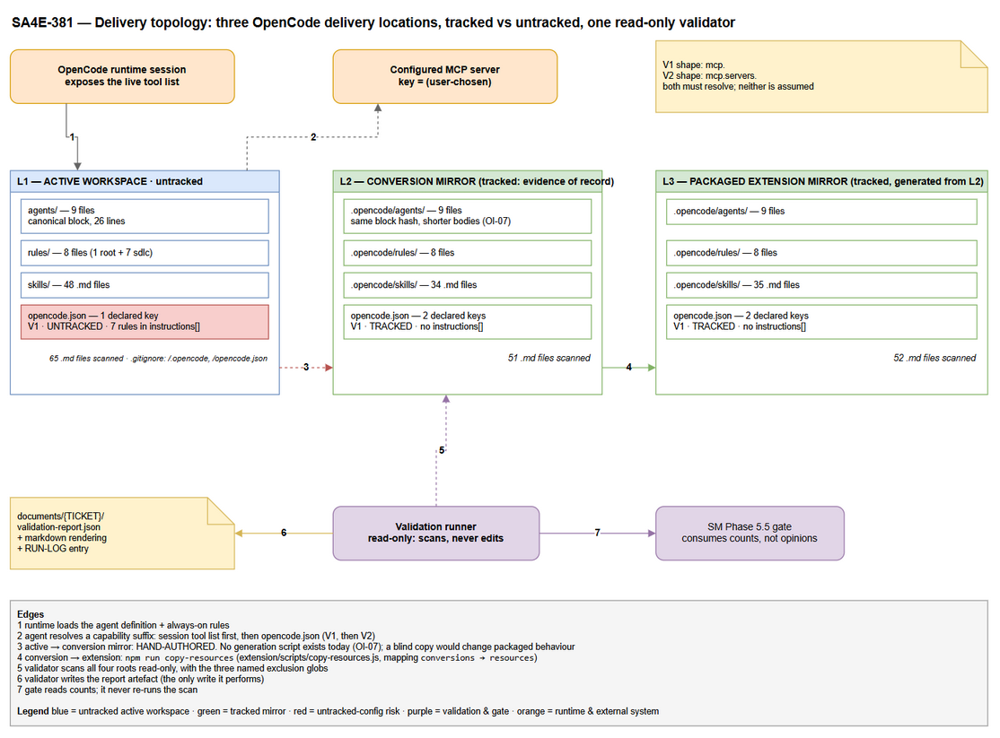
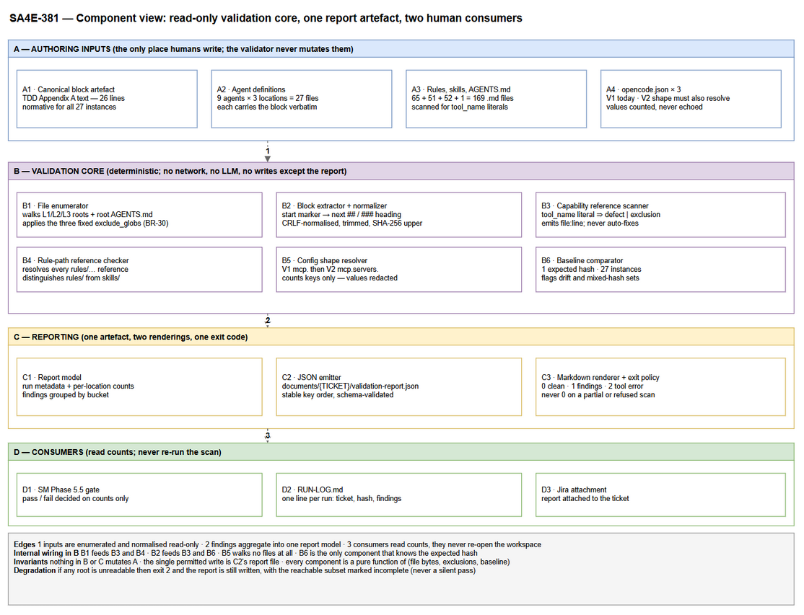
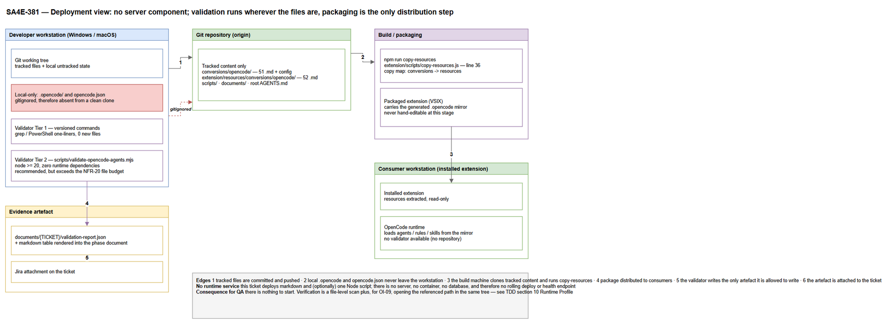
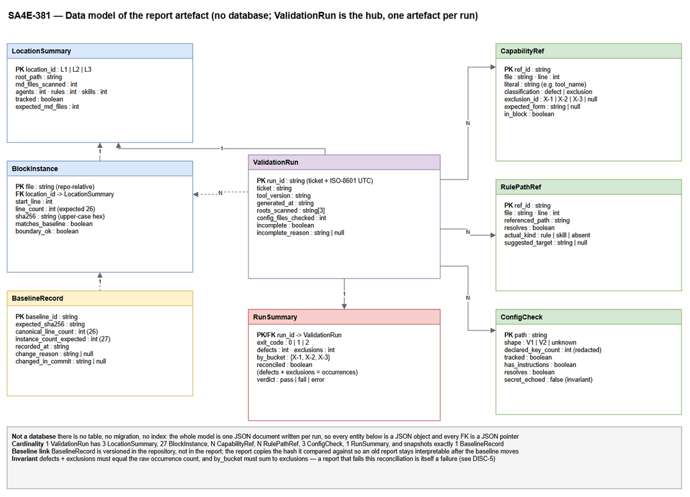
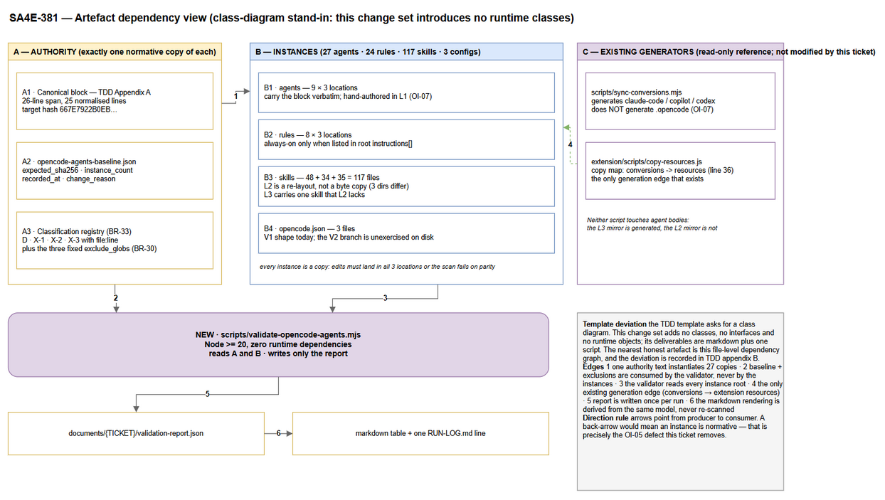
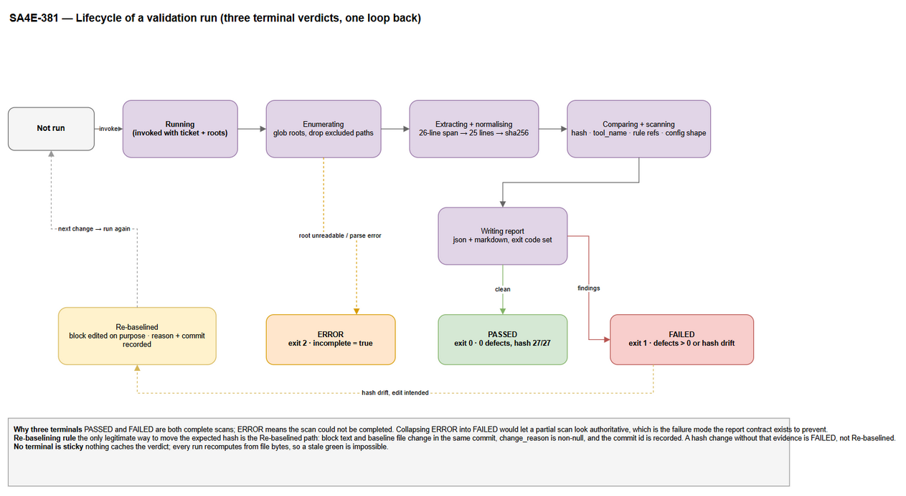

# Technical Design Document (TDD)

## SDLC Agents 4 Enterprise — SA4E-381: Normalize OpenCode MCP Tool References to User-Defined Server Names

---

## Document Information

| Field | Value |
|-------|-------|
| Jira Ticket | SA4E-381 |
| Title | Normalize OpenCode MCP Tool References to User-Defined Server Names |
| Author | SA Agent |
| Version | 1.1 |
| Date | 2026-10-24 |
| Status | Revised after feedback loop 1 — all DISC-1..DISC-10 resolved (see §5.6.11); BRD v1.2 + FSD v1.2 adopted; for DEV and QA implementation |
| Related BRD | BRD-v1.2-SA4E-381.docx (`documents/SA4E-381/BRD.md`, v1.2) |
| Related FSD | FSD-v1.2-SA4E-381.docx (`documents/SA4E-381/FSD.md`, v1.2) |
| Supersedes | TDD v1.0 (`TDD-v1.0-SA4E-381.docx`) — all v1.0 section numbers retained so existing references stay valid |
| Resolved Discrepancies | DISC-1 (mirrors hand-maintained, no generator); DISC-2 (NFR-20 ≤45, min 41); DISC-3 (always-on = installed .opencode/ tree only); DISC-4 (config paths: 3 real, 4th prohibited); DISC-5 (by_bucket {X-1:5, X-2:2, X-3:3}, excluded 10, sum invariant); DISC-6 (config_files_checked derived; local 3, clean clone 2); DISC-7 (BRD §1.2 item 8 = structural parity); DISC-8 (pre-change AB85A19BC13B… vs post AFD53DF661BF… hash roles); DISC-9 (V2 fixture under tests/fixtures/opencode-v2.json, QA-owned); DISC-10 (OI-06 = redundant prose removal, hash-neutral) |

---

## Author Tracking

| Role | Name - Position | Responsibility |
|------|-----------------|----------------|
| Author | SA Agent – Solution Architect | Create document |
| Peer Reviewer | TA Agent – Technical Architect | Review technical completeness |
| Consumer | DEV Agent – Developer | Implement W-01..W-08 |
| Consumer | QA Agent – QA Engineer | Derive STP/STC from §3 and Appendix F |

---

## Revision History

| Version | Date | Author | Changes |
|---------|------|--------|---------|
| 1.0 | 2026-10-24 | SA Agent | Initiate document — derived from BRD v1.1 + FSD v1.1, verified against the working tree |
| 1.1 | 2026-10-24 | SA Agent | **Feedback loop 1** — every DISC-1..DISC-10 re-verified against the tree and adopted: NFR-20 budget ≤ 45 / minimum 41 (DISC-2, C-3, §5.1, Appendix E); mirror maintenance model — hand-maintained, no generator, blind copy prohibited, structural parity out of scope (DISC-1, §2.1, §5.6.7); `config_files_checked` derived 3 local / 2 clean clone (DISC-6, §4.3, §4.4 I-4/I-9, §6.3); hash roles separated — pre-change `AB85A19BC13B64FD…` vs expected post-change `AFD53DF661BF1120A0…`, full 64-hex compared (DISC-8, Appendix B, §10.3); OI-06 restated as a hash-neutral duplicate-prose removal, 9 × 7 lines (DISC-10, §5.6.6, I-12); V2 synthetic fixture `tests/fixtures/opencode-v2.json` owned by QA (DISC-9, Appendix F.6); OI-08 closed as a single decision (add `mem_crud`); OI-03 rename deferred (BRD §1.2 item 11); always-on narrowed to the installed `.opencode/` tree (DISC-3, C-9); config path set closed at 3 (DISC-4); BRD §1.2 item 8 = structural parity (DISC-7, §1.2); invariant numbering realigned to FSD §3.1.6.8; new DISC-11 recorded for the untracked active root; DISC-12 (FSD example prints `config_files_required: 3`) and DISC-13 (FSD §3.6.5 misdescribes `sync-conversions.mjs`) filed as documentation items; Appendix B gained the four-role hash table and `previous_sha256`; Appendix D gained the DISC→design mapping; Appendix E re-based on 40/42 files and added IT-13; Appendix F added F.6 fixture ownership and T-16..T-19; Appendix G resolved Q-1/Q-2/Q-5 and added Q-8/Q-9 |

---

## Sign-Off

| Name | Signature and date |
|------|--------------------|
| | ☐ I agree and confirm the technical design in this TDD |
| | ☐ I agree and confirm the technical design in this TDD |

---

## How to read this document

This ticket changes **prompt files and one optional validator script**. It does not add a service, a database or an API. Three consequences shape every section below:

1. **The artefact is the design.** In a normal TDD the source of truth is code that a compiler checks. Here the normative artefact is a 26-line markdown block that must be byte-identical in 27 files, so the TDD carries the block text itself (Appendix A) and a hash algorithm with reproducible values (Appendix B).
2. **Verification replaces runtime.** There is nothing to deploy and nothing to call. Every acceptance criterion is a file-level scan, so §3 specifies a scan contract rather than an HTTP contract.
3. **The tree disagreed with the documents in ten places; BA closed all ten.** Discrepancy report v1.0 recorded DISC-1..DISC-10; BRD v1.2 and FSD v1.2 resolved them, this v1.1 adopts the resolutions, and §5.6.11 maps each one to the section that implements it. The resolved report is archived as `archive/DISCREPANCY-v1.0.md`; the only items still open are the ones recorded in a new, short `DISCREPANCY.md` v1.1.
4. **Two block hashes exist and they are not interchangeable.** `AB85A19BC13B64FD…` is the **pre-change** baseline — the value a regression would restore. `AFD53DF661BF1120A0…` is the **expected post-change** value — the value acceptance compares. Appendix B fixes both roles; the 12-hex prefix is a display affordance only (DISC-8).
5. **Two of the three delivery locations are inert at runtime.** Only the installed `.opencode/` tree is loaded as instructions (its `opencode.json` declares an `instructions[]` array). The mirrors carry the same bytes as packaged documentation. Identity is the contract; liveness is not (DISC-3).

**Evidence base.** Every number in this document was produced by reading the working tree on 2026-10-24, not by copying the FSD:

| Fact | Value | How it was established |
|------|-------|------------------------|
| Markdown files in scope | 169 (65 active + 51 conversion + 52 extension + 1 root `AGENTS.md`) | recursive `*.md` count per root, excluding `node_modules` |
| Agent files | 27 (9 × 3 locations) | `agents/*.md` per location |
| Canonical block — **pre-change** | 26-line span, 25 normalised lines, `AB85A19BC13B64FD7D0D2ED4FF6E10912228D1A847C57B4C4F8FC53BF1CF4B8E`, **1 distinct hash across 27/27** | extracted and hashed per file with the Appendix B procedure |
| Canonical block — **expected post-change** | `AFD53DF661BF1120A03D3A584A4DBC67B4C90B7EB7BD5435F7E56288F9789A30` (26 lines) | Appendix A applied to a live block copy and re-hashed; intermediates reproduced independently: W-03-only `349498863747…`, W-02-only `CF4B144D45B5…` |
| `tool_name` occurrences | 24 = 14 defects + 10 classified exclusions, `by_bucket {X-1: 5, X-2: 2, X-3: 3}` | regex `\btool_name\b` per root (10 / 7 / 7) then bucket classification |
| `opencode.json` files | 5 on disk, **3 in scan scope** (2 worktree copies excluded), all parse, **all V1 shape**, `.opencode/opencode.json` nowhere | parse + key-shape probe per file |
| Broken rule-path references | 4, in 3 skill files (`fresh-context-review`, `phase-6-testing` ×2, `sm-core`) | resolve each referenced path |
| `MCP Dynamic Tools` trailing sections | 9 (one per active agent), 7 lines each = 63 lines; **0** in either mirror | marker scan + range read |
| Mirror generation path | **none** for `.opencode/` → `conversions/opencode/.opencode/` | script read: `sync-conversions.mjs` writes only `conversions/{claude-code,github-copilot,codex-openai}`; `copy-resources.js:36` copies `conversions/` → `extension/resources/conversions/` |
| Skill directories per location | 48 / 31 / 32 | directory enumeration (the FSD's drift figures) |
| V2-shaped config | **0 of 5** — the V2 branch has no fixture in the tree | shape probe per config |

Where a figure in FSD v1.2 differs from the table above, the table wins and the difference is filed as a discrepancy. As of v1.2 the FSD agrees with every row except the `config_files_required` example value (FSD's example prints `3` while its own field definition says `2` — DISC-12) and the untracked active root (DISC-11).

---

## 1. Introduction

> **Scope Boundary:** This TDD specifies HOW to implement the requirements defined in the FSD. It does NOT repeat functional requirements, business rules, use cases, or UI specifications — refer to the FSD for those.

### 1.1 Purpose

The FSD defines a policy: every OpenCode agent, rule and skill prompt must reference MCP tools by **capability suffix**, never by a hardcoded server key, and must document both callable ID forms. The policy is already mostly written. What is missing is the machinery that makes the policy **checkable**: a canonical block that cannot drift, a resolution procedure that names every configuration source, a scan that produces counts instead of opinions, and a report that a reviewer can diff.

This TDD designs that machinery. Concretely it answers four engineering questions the FSD leaves open:

| Question | Answered in |
|----------|-------------|
| What exactly is "the same block" in 27 files, and how is sameness computed? | §3.4, Appendix A, Appendix B |
| How does an agent resolve a capability when the server key is user-defined, and what happens when resolution fails? | §3.3, §6.1, §6.2 |
| How is the scan implemented so two runs produce the same numbers? | §3.2, §5, §8 |
| How do the seven correction items (W-01..W-08) land without breaking the packaged extension? | §4.6, §10, Appendix E |

### 1.2 Scope

**In scope (design only — DEV implements):**

| Item | Artefact | FSD reference |
|------|----------|---------------|
| Canonical Tool Usage block, single normative copy | 27 agent files + Appendix A of this TDD | §3.6.2, BR-11, BR-32 |
| Capability resolution procedure | the block, one statement only | §3.1.6.2, §3.6.3, BR-03, BR-37 |
| Invocation shapes (direct vs Code Mode) | the block | §3.6.4, BR-02, BR-04, BR-05 |
| `tool_name` → `toolName` correction | 14 occurrences (6 active + 4 per mirror) | §3.1.6.7, BR-33, W-01 |
| Trailing "MCP Dynamic Tools" removal | 9 active agent files | BR-35 containment, W-04 |
| Broken rule-path repointing | 4 references | BR-34, OI-09, W-05 |
| Mirror parity stance | 18 agent files, drift table | BR-15, BR-36, OI-07, W-06 |
| Validation pass + report | scan contract, JSON schema, exit codes | §3.1.6.8, BR-23, BR-24, BR-26, W-07 |

**Out of scope:** STP/STC authoring, code changes outside the eight work items, any edit to BRD or FSD content (see Appendix G), any change to the Python MCP orchestration, and any new npm dependency.

### 1.3 Technology Stack

| Layer | Technology | Version | Note |
|-------|-----------|---------|------|
| Primary artefact | Markdown + YAML front matter | CommonMark | prompt files are the product |
| Scan runtime (Tier 1) | `grep` / PowerShell 7 | present in dev image | zero new files, satisfies NFR-20 |
| Scan runtime (Tier 2, optional) | Node.js ESM (`.mjs`) | >= 20 | same shape as existing `scripts/sync-conversions.mjs`; zero runtime dependencies |
| Package manager | npm | existing lockfile | no new packages |
| Diagram toolchain | draw.io desktop CLI | 24.x | `-x -f png -b 10` |
| Document export | markdown-exporter MCP (`export_docx`) | current server | file-path based, never inline content |
| Version control | git | current | `.opencode/` and root `opencode.json` are gitignored |
| Database | none | — | no persistence beyond the report file |
| Container / orchestrator | none | — | no deployable service |

### 1.4 Design Principles

| # | Principle | Consequence in this design |
|---|-----------|---------------------------|
| P-1 | **One normative copy.** A normative statement lives in exactly one place (NFR-21, BR-11). | The resolution order and the invocation shapes exist only inside the block; every other file points at the block instead of restating it. This is why the 9 trailing "MCP Dynamic Tools" sections are removed rather than corrected. |
| P-2 | **Verify, never mutate.** The validator is read-only except for the report. | A scan that repairs what it finds cannot be used as evidence (BR-24). Tier 1 and Tier 2 both refuse to write outside the report path. |
| P-3 | **Determinism over completeness.** Same bytes, same verdict. | No timestamp enters a comparison, no LLM is in the loop, no "best effort" fallback. The report records `run_timestamp` for human use but the verdict never depends on it (BR-26). |
| P-4 | **Fail closed.** An incomplete scan can never look green. | Exit code 2 with `incomplete: true` is a distinct verdict from "0 findings" (§3.2, §5.5). |
| P-5 | **Parity is enumerated, not assumed.** Identical rules at three locations; every difference named. | The report carries per-root counts and a drift table, because the three locations are provably not byte copies (DISC-1). |
| P-6 | **Counts, not adjectives.** Every integer travels with its scope (BR-24, BR-31). | The report schema (§4.3) has no free-text verdict field. |
| P-7 | **Reversibility.** Every change is a text diff. | Rollback is `git revert`; no migration, no state to unwind (§10.3). |

### 1.5 Constraints

| # | Constraint | Source | Design impact |
|---|-----------|--------|---------------|
| C-1 | `.opencode/` and root `opencode.json` are gitignored | `.gitignore` lines 39–40 | The active workspace is not evidence; the tracked mirrors are (BR-25). Edits still happen in the active workspace first, because that is where agents run. |
| C-2 | Three delivery locations must stay consistent, but they are not copies | tree inspection (DISC-1) | A blind copy from L1 to L2 changes packaged behaviour. Parity is designed as a **declared delta table**, not as `diff -r`. |
| C-3 | **≤ 45 touched files** (NFR-20 v1.2) with a **41-file minimum** for this change set; **0 new files inside `.opencode` scope**; one synthetic V2 fixture under `tests/fixtures/` permitted (QA-owned); the OI-03 rename only if that follow-up is taken | NFR-20 (FSD v1.2 — resolves DISC-2) | Tier 1 = 40 files; Tier 2 = 42 (41 + the validator script). **Both tiers now fit the budget**, so Tier 2 is recommended without an exception (§5.1). Growth beyond 45 is a scope decision for SM, never a silent DEV decision. |
| C-4 | No new runtime dependency is permitted | NFR-15 spirit, repo convention | Tier 2 uses only `node:fs`, `node:path`, `node:crypto`. No bundler, no test framework install — tests use `node:test`. |
| C-5 | Agent files are prompts: an edit changes runtime behaviour for every consumer of the packaged extension | architecture | Any change to the block is a coordinated 27-file change with a re-baselined hash (Appendix B). |
| C-6 | Developer environment is Windows-first | env | Every documented command is provided in PowerShell form, plus a POSIX form where the repo already ships one. |
| C-7 | Line endings differ between working copies | git autocrlf | All hashing is done on normalised text (`\r` removed), so CRLF and LF trees agree (§3.4, Appendix B). |
| C-8 | The two mirrors are **hand-maintained snapshots**; no generator produces the `.opencode/` hop | FSD §3.6.5, BR-36 (FSD v1.2, DISC-1) | W-06 is "record the drift", never "regenerate". A blind copy of the active tree over a mirror is **prohibited** because it deletes the L2-only / L3-only skill directories and replaces the 405-line SM mirror with 1716 lines (§5.6.7). |
| C-9 | Only the installed `.opencode/` tree is loaded as instructions | FSD §C.2.6 (FSD v1.2, DISC-3) | Byte identity is required in all three locations; runtime liveness is required in one. "Identical" is the contract, "live" is not — which removes the false argument for copying the active tree (§2.1). |
| C-10 | A clean clone lacks the **active root**, not just the root config: `.gitignore` lines 39–40 ignore `/.opencode` **and** `/opencode.json` | `.gitignore` + `git ls-files` probe (0 tracked files under `.opencode`) | Roots and configs are classified `required` vs `local-only`. On a clean clone `files_checked.active = 0` and `config_files_checked = 2` are **expected**, reported as `absent_local` — not `E_ROOT_UNREADABLE` (§6.3, I-9, DISC-11). |

### 1.6 References

| Document | Location |
|----------|----------|
| BRD v1.2 | `documents/SA4E-381/BRD-v1.2-SA4E-381.docx` / `BRD.md` (v1.2 — resolves DISC-7, item 8 = structural parity) |
| FSD v1.2 | `documents/SA4E-381/FSD-v1.2-SA4E-381.docx` / `FSD.md` (v1.2 — invariant set I-1..I-5, hash roles, mirror maintenance model §3.6.5) |
| Discrepancy report v1.0 (resolved) | `documents/SA4E-381/archive/DISCREPANCY-v1.0.md` |
| Discrepancy report v1.1 (open items) | `documents/SA4E-381/DISCREPANCY.md` — DISC-11, DISC-12, DISC-13 |
| Canonical block (normative) | Appendix A of this document |
| Hash + baseline procedure + hash roles | Appendix B of this document |
| Validation report schema | §4.3 of this document; field semantics fixed by FSD §3.1.6.8 |
| Scan patterns `SC-1`..`SC-6` | FSD §3.1.6.6 (used verbatim) |
| Occurrence classification `D`/`X-1`/`X-2`/`X-3` | FSD §3.1.6.7 (used verbatim) |
| Existing conversion scripts | `scripts/sync-conversions.mjs` (writes `conversions/{claude-code,github-copilot,codex-openai}` only), `extension/scripts/copy-resources.js:36` (`conversions/` → `extension/resources/conversions/`) |

---

## 2. System Architecture

### 2.1 Architecture Overview

The system under design has no runtime process. It is a **three-location document delivery topology** plus a **read-only verifier**. What makes it architectural rather than editorial is that the three locations are consumed by three different populations, and the policy only holds if all three carry the same block.



*[Edit in draw.io](diagrams/architecture.drawio)*

| Location | Path | Tracked | Consumers | Markdown files |
|----------|------|---------|-----------|----------------|
| **L1 — active workspace** | `.opencode/` + root `opencode.json` | **no** (`.gitignore` lines 39–40) | whoever runs OpenCode in this repository | 65 |
| **L2 — conversion mirror** | `conversions/opencode/.opencode/` + `conversions/opencode/opencode.json` | yes | the published conversion artefact of record | 51 |
| **L3 — packaged extension mirror** | `extension/resources/conversions/opencode/.opencode/` + `.../opencode.json` | yes | end users who install the extension | 52 |
| root guidance | `AGENTS.md` | yes | every OpenCode session, before any agent loads | 1 |

**Why L1 cannot be treated as the master copy.** FSD v1.1 assumed the mirrors were regenerable from the active workspace; FSD v1.2 (BR-36, §3.6.5, DISC-1) records that they are **hand-maintained snapshots** and that no generator performs the `.opencode/` hop. The tree supports that correction, and the difference is structural rather than cosmetic:

| Observation | Evidence | Consequence |
|-------------|----------|-------------|
| L2 carries three skill directories that L1 does not have at all | `agent-self-learning`, `pega-kb-search`, `role-boundaries` exist under `conversions/opencode/.opencode/skills/` but under L1 they live as **rules** (`rules/sdlc/*.md`) | L2 is a **re-organisation** (rule → skill), not a copy. A file-level copy from L1 would delete three packaged skills. |
| L3 carries one skill that L2 does not | `extension/resources/.../skills/kotlin-code-standards` absent from L2 | L3 is claimed to be generated from L2, yet it is a superset. Either generation is manual or the extra file is an unrecorded addition. |
| L1 has 20 skill directories absent from L2 | e.g. `agent-browser`, `sm-core`, `patterns-*`, `shared-quality-gates` | L2 is a **curated subset** for the published conversion, not a mirror. |
| Agent bodies differ | SM agent: **1716 lines active vs 405 lines in each mirror** (−1311); the other 8 differ by 13–20 lines | The agent prose is re-authored per location. Only the block is common. |

The architectural conclusion is stated once, here, because it drives §4.6 and W-06: **the invariant is the block, not the file.** Parity is designed as "27 blocks, one hash, plus a declared per-location file-count baseline", never as "copy the tree". FSD v1.2 §3.6.5 and BR-36 now state the same conclusion, so DISC-1 is closed by agreement rather than by the TDD overriding the FSD.

**What is common across all three locations**, and therefore what the design can rely on:

- 9 agent files per location, each carrying the block between the start marker and the next `##`/`###` heading.
- 8 rule files per location (1 root rule + 7 `sdlc/` rules).
- One `opencode.json` per location, all currently in **V1 shape**, all parseable.
- The same block hash across all 27 agent files (`AB85A19BC13B…` pre-change, `AFD53DF661BF…` expected after W-02+W-03).

**What is *not* common — and must not be assumed:**

| Fact | Consequence |
|------|-------------|
| Only L1's `opencode.json` declares an `instructions[]` array (7 entries: the root rule + 6 `sdlc/` rules). Neither mirror does, and nothing else references the mirror `.md` files | The block and its rules are **always-on in the installed tree only**; the mirrors are packaged documentation, inert at runtime (DISC-3, C-9). Identity is still required — a packaged user receives a mirror **as** their installed tree |
| 48 / 31 / 32 skill directories; the conversion mirror has three directories that exist nowhere else (`agent-self-learning`, `pega-kb-search`, `role-boundaries`), the packaged mirror those plus `kotlin-code-standards` | Structural parity is **out of scope** (BRD v1.2 §1.2 item 8). A copy would delete packaged skills — **prohibited** (C-8, §5.6.7) |
| `.opencode/` and root `opencode.json` are gitignored; `git ls-files .opencode` returns 0 | A clean clone has **2** roots and **2** configs, not 3. That is a complete run, not a failed one (C-10, DISC-11) |

The second architectural fact the diagram shows is the **resolution edge** (edge 2): an agent does not read configuration at build time, it resolves a capability at run time, from the live session first and from `opencode.json` second. That ordering is what makes a hardcoded key both wrong and unnecessary — the runtime already knows the key. §3.3 specifies it; §6.2 specifies the file shapes.

### 2.2 Component Diagram

The verifier is decomposed into six analysis components that share one input contract (bytes + exclusions + baseline) and one output (the report model). Only the report writer touches the filesystem for writing.



*[Edit in draw.io](diagrams/component.drawio)*

| Component | Responsibility | Technology | FSD source |
|-----------|---------------|-----------|------------|
| **A1** Canonical block artefact | Holds the single normative text of the block; the only thing a human edits when the policy changes | markdown, Appendix A | §3.6.2, BR-11 |
| **A2** Agent definitions | 27 instances carrying the block verbatim | markdown + YAML front matter | BR-11, BR-12 |
| **A3** Rules, skills, `AGENTS.md` | 142 files scanned for capability references and rule-path references | markdown | §1.2, BR-27, BR-30 |
| **A4** `opencode.json` × 3 | Configuration sources for resolution; read to count keys, never to echo values | JSON | §5.2, §5.8.2, BR-03, BR-04 |
| **B1** File enumerator | Expands the four roots, applies the three fixed `exclude_globs` | glob | BR-30 |
| **B2** Block extractor + normaliser | Start marker → next heading; CRLF→LF, per-line right-trim; SHA-256 upper-case | `node:crypto` | §3.6.2 TA note, BR-32 |
| **B3** Capability reference scanner | Applies `SC-1`..`SC-5` verbatim; classifies `SC-4` hits into `D`/`X-1`/`X-2`/`X-3` | regex | §3.1.6.6, §3.1.6.7 |
| **B4** Rule-path checker | Resolves every `rules/…` reference and every skill id; flags kind mismatches (BR-34) | path resolution | BR-34, OI-09 |
| **B5** Config shape resolver | Detects V1 `mcp.<name>` and V2 `mcp.servers.<name>`; counts declared keys; redacts values | JSON | §5.2, BR-04 |
| **B6** Baseline comparator | Compares 27 hashes to one expected value and to each other | `node:crypto` | BR-32, Appendix B |
| **C1** Report model | Assembles run metadata, per-location counts and findings | in-memory | §3.1.6.8 |
| **C2** JSON emitter | Writes `documents/{TICKET}/validation-report.json`; stable key order | `node:fs` | BR-24, NFR-19 |
| **C3** Markdown renderer + exit policy | Renders the table a reviewer reads; maps findings to exit code | in-memory | BR-24, BR-26 |
| **D1** SM phase 5.5 gate | Reads counts; decides pass/fail | human process | BR-23 |
| **D2** `RUN-LOG.md` | One line per run: ticket, hash prefix, counts | markdown | pipeline convention |
| **D3** Jira attachment | Carries the report to the ticket | MCP nested tool | §5.8.3 |

**Deliberate simplifications.** There is no DI container, no repository layer and no abstraction over the filesystem. Those layers exist to make code testable against substitutes; here the subject of the test *is* the file tree, and a substitute would test nothing. Testability is achieved by keeping every function pure over its inputs (§5.3) and by running the suite against a fixture tree.

### 2.3 Deployment Architecture

Nothing is deployed. The only distribution step in the whole system is packaging the extension, and that step already exists.



*[Edit in draw.io](diagrams/deployment.drawio)*

| Node | What runs there | What is absent |
|------|-----------------|----------------|
| Developer workstation | the validator (Tier 1 commands or Tier 2 script), the editor, git | no daemon, no watcher, no port |
| Git origin | tracked mirrors, `scripts/`, `documents/` | `.opencode/`, root `opencode.json` |
| Build / packaging | `npm run copy-resources` (L2 → L3), VSIX packaging | no validation gate today (recommended, not required — see §10.2) |
| Consumer workstation | the installed extension, the OpenCode runtime reading L3 | the validator: consumers have no repository to scan |
| Evidence store | `documents/{TICKET}/validation-report.json`, Jira attachment, `RUN-LOG.md` | — |

The deployment asymmetry matters for QA: **the verifier can only run where the repository exists.** A consumer cannot self-check, so the packaged mirror must be correct at build time. That is the reason BR-25 makes the tracked mirrors the evidence of record and the reason §10.6 verifies L3 explicitly rather than inferring it from L1.

### 2.4 Communication Patterns

| From | To | Protocol | Pattern | Timeout / retry | Description |
|------|----|----------|---------|-----------------|-------------|
| SM | validator | process execution (`node …` or PowerShell) | synchronous, one-shot | 120 s / no retry (idempotent, re-run manually) | Phase 5.5 invokes the scan and reads the exit code |
| validator | filesystem | `node:fs` / `grep` | synchronous read | OS default | 169 `.md` + 3 configs, read-only |
| validator | report file | `node:fs` write | synchronous write, single file | fail → exit 2 | The only write the design permits |
| agent | configured MCP server | MCP JSON-RPC (stdio or HTTP, per user config) | synchronous request/response | server-defined; 30 s documented default | `find_tools` then `execute_dynamic_tool` |
| agent | `opencode.json` | read (by the agent, via `read`) | synchronous | — | Second resolution source; values are not echoed into prompts |
| SM | Jira | MCP nested tool (`execute_dynamic_tool`) | synchronous | 30 s / 1 retry | Attach report, transition status |
| SM | knowledge base | `mem_ingest_file` / `mem_search` | synchronous | 30 s / no retry | Cross-agent handoff without re-reading files |

There is **no asynchronous messaging, no queue and no event bus** in this design. Any proposal to add one (for example "notify on drift") is out of scope: the gate is a human/agent step that reads a file, and adding a notification path would create a second source of truth about the verdict.

---

## 3. Interface Design

> **Template deviation (recorded).** The TDD template specifies an HTTP API section. This change set introduces no HTTP endpoint: the deliverables are markdown files and one optional local script. Rather than leave the section as "N/A", it is used for the four interfaces that actually exist and that DEV and QA must agree on: the **validator command contract**, the **capability-resolution contract**, the **canonical block contract**, and the **MCP invocation contract**. Appendix C lists all template deviations.

### 3.1 Interface Overview

| # | Interface | Kind | Producer → Consumer | Specified in |
|---|-----------|------|---------------------|--------------|
| I-1 | Validator command | CLI process (args, stdout, exit code) | DEV/QA/SM → filesystem | §3.2 |
| I-2 | Capability resolution | normative prompt text | agent → runtime + `opencode.json` | §3.3 |
| I-3 | Canonical Tool Usage block | markdown contract + SHA-256 | author → 27 agent files | §3.4, Appendix A |
| I-4 | MCP invocation | JSON-RPC via the configured server | agent → MCP server | §3.5 |
| I-5 | Validation report | JSON file (+ markdown rendering) | validator → gate / Jira | §4.3 |

**Authentication, authorisation, rate limiting:** none of the five interfaces crosses a trust boundary that has credentials. I-1 runs as the local user; I-2/I-4 run inside a session the user already authenticated to OpenCode; I-5 is a local file. Saying "no auth" is a design decision, not an omission: adding a token to a local scan would create a secret to leak for no benefit. The security-relevant property is the reverse — **the scan must never amplify a secret it reads** (§7.2).

### 3.2 I-1 — Validator Command Contract

**Implements:** BR-23 (repeatable pass), BR-24 (counts with scope), BR-26 (idempotent), BR-30 (scope and exclusions), W-07.

| Attribute | Value |
|-----------|-------|
| Entry point (Tier 2) | `node scripts/validate-opencode-agents.mjs` |
| Entry point (Tier 1) | documented PowerShell/grep command set (Appendix E, IT-11) |
| Transport | stdin/stdout/stderr, process exit code |
| Auth | none (local process) |
| Concurrency | single run at a time; a second concurrent run is harmless but the report file is last-writer-wins |

**Arguments:**

| Flag | Type | Required | Default | Description |
|------|------|----------|---------|-------------|
| `--ticket` | string `[A-Z]+-\d+` | yes | — | Names the output folder and the report scope |
| `--root` | path, repeatable | no | the 4 scope roots of BR-30 | Overrides the scan roots; used by tests against a fixture tree |
| `--baseline` | path | no | `scripts/opencode-agents-baseline.json` | Expected hash + expected per-location counts |
| `--json` | path | no | `documents/{ticket}/validation-report.json` | Report destination; must stay under `documents/` |
| `--markdown` | path | no | — | Also write the rendered table to this file |
| `--strict-parity` | flag | no | off | Treat any per-location count deviation from the baseline as a failure (not just advisory) |
| `--self-test` | flag | no | off | Validate baseline shape and root reachability, then exit without scanning or writing |
| `--quiet` | flag | no | off | Suppress stdout summary; the report and exit code remain authoritative |
| `--version` | flag | no | — | Print `validator_version`, the value copied into the report |

**Exit codes:**

| Code | Meaning | Report written | Gate action |
|------|---------|----------------|-------------|
| `0` | Scan complete, 0 defects, all 27 blocks match the baseline, `diff_check_result = clean` | yes, `result: PASS` | pass |
| `1` | Scan complete, at least one finding (defect, hash drift, unresolved reference, parity break under `--strict-parity`) | yes, `result: FAIL` | fail, list items |
| `2` | Scan could not be completed (usage error, unreadable root, unparseable config, missing baseline, report not writable) | yes if the failure happened after metadata was collected, with `incomplete: true` + `incomplete_reason` | **fail** — never treat as pass |

**Error responses** (the process-level equivalent of an HTTP error body; every one of these exits `2`):

| Code | Message pattern | When |
|------|-----------------|------|
| `E_USAGE` | `E_USAGE: missing --ticket` | bad or missing arguments |
| `E_ROOT_UNREADABLE` | `E_ROOT_UNREADABLE: <path>` | a scope root does not exist or cannot be read |
| `E_CONFIG_PARSE` | `E_CONFIG_PARSE: <path>: <parser message>` | an `opencode.json` in scope is not valid JSON |
| `E_BASELINE_MISSING` | `E_BASELINE_MISSING: <path>` | baseline file absent |
| `E_BASELINE_INVALID` | `E_BASELINE_INVALID: <field>` | baseline present but `expected_sha256` is not 64 hex chars, or counts are missing |
| `E_BLOCK_MISSING` | `E_BLOCK_MISSING: <file>` | an agent file has no start marker |
| `E_PATH_ESCAPE` | `E_PATH_ESCAPE: <path>` | `--json`/`--markdown` resolve outside the workspace or outside `documents/` |
| `E_REPORT_WRITE` | `E_REPORT_WRITE: <path>` | the report path is not writable |

**Example — clean run (stdout, `--quiet` off):**

```
sa4e-381 validator 1.0.0  scope_definition_version=1
roots: .opencode | conversions/opencode/.opencode | extension/resources/conversions/opencode/.opencode | AGENTS.md
files_checked: active=65 conversion=51 extension=52 root_agents_md=1 total=169
agents: expected=27 block_ok=27 frontmatter_ok=27
configs: checked=3 parse_ok=3 shapes=3xV1
block: sha256_prefix=AB85A19BC13B identical_across=27 baseline_match=27/27
scan: SC-1=0 SC-2=0 SC-3=0 SC-4_total=24 defects=14 excluded=10 SC-5=0
result: FAIL (14 defects)  exit=1
```

> **Three field-level corrections in v1.1** (the example above is the *pre-fix local* run, kept because it is the run that proves a defect exists):
> 1. `configs: checked=` is **derived**, not asserted: 3 on the local workspace, **2 on a clean clone** (`.gitignore` lines 39–40 ignore the root config *and* the active root). The same command on a clean clone prints `checked=2 parse_ok=2 required=2 absent=1` and is still a complete run (DISC-6, DISC-11).
> 2. The `block:` line shows the **pre-change baseline**. After W-02/W-03 the same run prints `sha256_prefix=AFD53DF661BF`. A report still printing `AB85A19BC13B` after the fix is a regression, not a pass (DISC-8).
> 3. `scan:` numbers are the pre-fix state by design — this example is the "before" evidence for TC-25/TC-26. The post-fix state is §4.3.

**Example — failure run (stderr):**

```
E_ROOT_UNREADABLE: extension/resources/conversions/opencode/.opencode
report: documents/SA4E-381/validation-report.json written with incomplete=true
exit=2
```

**Idempotency (BR-26).** Two runs on an unchanged tree must produce byte-identical JSON except `run_timestamp` and `duration_ms`. The implementation therefore fixes key order, sorts `items[]` by `(file, line)`, and never includes absolute paths, host names or the current user in the report.

**Path convention.** All paths inside the report are repository-relative and forward-slash separated, so a Windows run and a POSIX run produce identical reports. Absolute paths appear only in stderr diagnostics.

### 3.3 I-2 — Capability Resolution Contract (normative)

**Implements:** BR-02, BR-03, BR-04, BR-05, BR-07, BR-08, BR-37; FSD §3.1.6.2, §3.6.3.

The resolution order is stated **once**, inside the canonical block (Appendix A). It is repeated here for the implementer, with the failure behaviour the block implies but does not enumerate:

| Step | Source | What is read | If it fails |
|------|--------|--------------|-------------|
| 1 | live session tool list | the actual tool IDs exposed to this session | continue to step 2 |
| 2 | `opencode.json` of the **install root** | declared server keys under `mcp.*` (V1) or `mcp.servers.*` (V2) | continue to step 3 |
| 3 | `opencode.json` of the **conversion mirror** | same | continue to step 4 |
| 4 | `opencode.json` of the **packaged-extension mirror** | same | **stop** with `UNRESOLVED_CAPABILITY` |

Step ordering is fixed by BR-37, which requires all three configuration locations to be named in delivery order. The earlier wording named two paths, one of which (`.opencode/opencode.json`) exists in no delivery location at all (DISC-4).

**Failure taxonomy.** The block says "never invent one"; the implementation must say *what* to report:

| Condition | Reported as | Forbidden behaviour |
|-----------|-------------|---------------------|
| Capability suffix absent from the session list and no config resolves it | `UNRESOLVED_CAPABILITY: <suffix> — searched: session list, 3 config locations` | substituting a remembered or example key; silently skipping the step |
| Configuration unreadable or unparseable | `CONFIG_UNREADABLE: <path>` then continue with the remaining sources | treating a parse failure as "no servers configured" |
| Two or more keys declare the same capability | `AMBIGUOUS_CAPABILITY: <suffix> — candidates: 2` (count only, never the values) | picking the first one |
| Session exposes the tool under a different prefix than the config suggests | trust the **session** ID; the session is authoritative | reconciling by editing the prompt |

The result is **session-scoped**. It is not cached to disk, not written into a prompt, and not reused across sessions: that is exactly how a hardcoded key is born.


*[Edit in draw.io](diagrams/sequence-tool-resolution.drawio)* — carried over from FSD §3.1; unchanged by this design.

### 3.4 I-3 — Canonical Block Contract

**Implements:** BR-11 (byte identity), BR-12 (block vs front matter reported separately), BR-32 (acceptance by hash), NFR-21 (single statement).

| Attribute | Normative value |
|-----------|-----------------|
| Start marker | the literal line `### MCP tools — server name is user-defined` |
| End condition | the first following line matching `^#{2,3} ` — exclusive; content is never included |
| Span | 26 physical lines (25 content lines + the blank line before the next heading) |
| Normalisation | remove `\r`; right-trim every line; join with `\n`; no trailing newline added |
| Digest | SHA-256 of the normalised UTF-8 bytes, **upper-case hex** |
| Report value | first 12 hex characters (`sha256_prefix`), per FSD §3.1.6.8 |
| Instances | 27 (9 agents × 3 locations); `identical_across` must equal 27 |
| Placement | not normative; observed immediately after the native Tool Usage table and before `### Skill Loading` |

**What the normalisation deliberately forgives** — because these differences are tooling artefacts, not policy drift: CRLF vs LF, trailing spaces, a final blank line. **What it does not forgive:** any change to a word, bullet, code span, list order or the trailing prohibition line. A single character change moves the hash and turns 27 files red at once — which is the intended behaviour, because the block is a contract.

**Edit procedure** (the only sanctioned way to change the block):

1. Change the text in `Appendix A` of this TDD first (reviewable diff).
2. Apply the identical text to the 27 agent files.
3. Recompute the hash with the Appendix B procedure.
4. Update `scripts/opencode-agents-baseline.json` in the **same commit**, with a non-null `change_reason` and the commit id.
5. Run the validator; require `identical_across = 27` and `baseline_match = 27/27`.

Step 4 is what makes a hash change auditable instead of suspicious. A hash change without a baseline change is a failure by design (§5.5).

**What must not be inside the block.** Anything that would make the block location-specific: a repo path that exists in only one location, a ticket number, a date, a concrete server key. The block is shipped to consumers, so it must be true in every tree that contains it.

### 3.5 I-4 — MCP Invocation Contract

**Implements:** BR-02 (both ID forms), BR-04 (both config shapes), BR-05 (nested 2-step), FSD §3.1.6.3–§3.1.6.5.

| Shape | Form | When | Example (with the placeholder, never a real key) |
|-------|------|------|--------------------------------------------------|
| Direct tool mode | `<server>_<tool>` | the runtime exposes tools as `<key>_<tool>` | `<server-name>_find_tools` |
| Code Mode | `tools.<server>.<tool>` | Code Mode is the default in current OpenCode | `tools.<server-name>.find_tools` |
| Nested capability | 2 steps: `find_tools(query)` → `execute_dynamic_tool(toolName, arguments)` | Jira, DOCX/XLSX export, draw.io CLI, database, browser | see below |

**Correct nested invocation:**

```
execute_dynamic_tool(
  toolName = "export_docx",
  arguments = { file_path: "documents/SA4E-381/TDD.md", file_name: "TDD-v1.0-SA4E-381" }
)
```

**Defect forms** (bucket `D`, blocking — these are the 14 occurrences W-01 removes):

```
execute_dynamic_tool(tool_name = "export_docx", arguments = { ... })     # wrong key
{ "tool_name": "export_docx", "arguments": { ... } }                     # wrong key
{ "toolName": "export_docx", "arguments": "{ \"file_path\": \"x\" }" }   # SC-5: string instead of object
```

**Rules the validator enforces mechanically:**

| Rule | Pattern | Pass condition |
|------|---------|----------------|
| No concrete key in a direct-form reference | `SC-1` | 0 hits |
| No concrete key in a Code Mode reference | `SC-2` | 0 hits |
| No retired Kiro-only tool name | `SC-3` | 0 hits outside prohibition mentions |
| Argument key is `toolName` | `SC-4` | 0 `D`-bucket hits |
| `arguments` is an object literal | `SC-5` | 0 hits |

Patterns are taken **verbatim** from FSD §3.1.6.6. Re-deriving them locally would let two runs disagree, which BR-26 forbids.

### 3.6 I-5 — Report Artefact

Specified in §4.3 (schema, field semantics, invariants) because the report is data rather than an interface. Field names and semantics are fixed by FSD §3.1.6.8 and must not be renamed by this implementation.

---

## 4. Data Design

> **Template deviation (recorded).** There is no database in this system: no DDL, no migration, no index, no connection pool. The template's §4 is therefore used for the only persistent structure in scope — the **validation report** — plus the **expected-count baseline** that makes the report comparable between runs. Appendix C records the deviation.

### 4.1 Data Model



*[Edit in draw.io](diagrams/data-model.drawio)*

Every box is a JSON object, not a table. `ValidationRun` is the root; the six children are properties of it. Mapping to the logical entities the FSD already defines:

| FSD §4.5 entity | TDD object | Relationship |
|-----------------|-----------|--------------|
| `SCAN_SCOPE` | `ValidationRun.scope` | 1:1 — roots, `exclude_globs`, `scope_definition_version` |
| `CANONICAL_BLOCK` | `BlockInstance[]` + `BaselineRecord` | 27 instances compared to 1 expected value |
| `TOOL_NAME_OCCURRENCE` | `CapabilityRef[]` | 1:N — classified `D`/`X-1`/`X-2`/`X-3` |
| `CROSS_REFERENCE` | `RulePathRef[]` | 1:N — rule paths and skill ids |
| `DELIVERY_CONFIG` | `ConfigCheck[]` | 1:3 — one per delivery location |
| `NESTED_TOOL_INVOCATION` | *no object* | Verified by `SC-4`/`SC-5` patterns, not modelled separately |
| `EVIDENCE_RECORD`, `PLATFORM_COVERAGE` | outside this ticket | Evidence policy is specified in FSD §3.3 and not re-designed here |

`NESTED_TOOL_INVOCATION` deliberately has no object of its own: the two-step pattern is verified syntactically (`SC-4`, `SC-5`) and semantically (the resolver in §3.3). Modelling it would produce a fourth representation of the same fact, which P-1 forbids.

### 4.2 Object Attributes

#### ValidationRun (root)

| Field | Type | Constraint | Source |
|-------|------|-----------|--------|
| `schema` | string | const `sa4e.validation-report/1` | FSD §3.1.6.8 |
| `run_id` | string | `<ticket>-<ISO-8601 UTC>` | design |
| `ticket` | string | `^[A-Z]+-\d+$` | design |
| `validator_version` | string | semver | §3.2 `--version` |
| `run_timestamp` | string | ISO-8601 UTC; excluded from equality checks | BR-26 |
| `duration_ms` | integer | `>= 0`; excluded from equality checks | NFR-17 |
| `scope` | object | see FSD §3.1.6.8 | BR-30 |
| `counts`, `hits`, `canonical_block`, `cross_references` | objects | see below | FSD §3.1.6.8 |
| `diff_check_result` | enum | `clean` \| `dirty` | BR-24 |
| `incomplete` | boolean | `true` ⇒ `result` must not be `PASS` | P-4 |
| `incomplete_reason` | string \| null | non-null iff `incomplete` | design |
| `result` | enum | `PASS` \| `FAIL` \| `ERROR` | §3.2 exit codes |

#### LocationSummary (×4: three roots + root `AGENTS.md`)

| Field | Type | Constraint |
|-------|------|-----------|
| `location_id` | enum | `active` \| `conversion` \| `extension` \| `root_agents_md` |
| `root_path` | string | repo-relative, forward slashes |
| `tracked` | boolean | `false` for `active` (`.gitignore` lines 39–40) |
| `md_files` | integer | `>= 0`; expected 65 / 51 / 52 / 1 |
| `agents`, `rules`, `skills` | integer | `agents = 9` for each of the three roots |
| `expected_md_files` | integer | from the baseline (§4.6) |

#### BlockInstance (×27)

| Field | Type | Constraint |
|-------|------|-----------|
| `file` | string | repo-relative; unique |
| `location_id` | enum | FK → LocationSummary |
| `start_line` | integer | 1-based line of the start marker |
| `line_count` | integer | 26 for the current span |
| `sha256` | string | 64 upper-case hex chars |
| `matches_baseline` | boolean | `sha256 == baseline.expected_sha256` |
| `boundary_ok` | boolean | end condition found before EOF |

#### BaselineRecord (1, versioned in the repository)

| Field | Type | Constraint |
|-------|------|-----------|
| `baseline_id` | string | `opencode-agents/v1` |
| `expected_sha256` | string | 64 hex; the comparison target |
| `baseline_role` | enum | `pre-change` \| `expected-post-change` — fixes how the value may be used; a `pre-change` value must never be asserted as expected (DISC-8) |
| `previous_sha256` | string \| null | the value this record replaced; recorded for review, never compared |
| `canonical_line_count` | integer | 26 (span) |
| `instance_count_expected` | integer | 27 |
| `expected_counts` | object | `{active: 65, conversion: 51, extension: 52, root_agents_md: 1}` |
| `recorded_at` | string | ISO-8601 |
| `change_reason` | string \| null | **required** when the hash differs from the previous record |
| `changed_in_commit` | string \| null | git commit id of the coordinated change |

#### CapabilityRef (1:N), RulePathRef (1:N), ConfigCheck (1:3), RunSummary (1:1)

Attributes as drawn in the diagram. Two constraints are worth stating outside the table: `CapabilityRef.exclusion_id` is non-null **iff** `classification != D`, and `ConfigCheck.declared_key_count` is the only numeric fact the report may carry about a config file — the values themselves never enter the report (§7.2).

### 4.3 Report Example (expected post-implementation state)

This is the shape W-07 must produce **after** W-01..W-05 land. It is also the fixture QA compares against (TC-26, TC-29).

```json
{
  "schema": "sa4e.validation-report/1",
  "run_id": "SA4E-381-2026-10-24T09:15:00Z",
  "ticket": "SA4E-381",
  "validator_version": "1.0.0",
  "run_timestamp": "2026-10-24T09:15:00Z",
  "duration_ms": 1420,
  "scope": {
    "roots": [".opencode", "conversions/opencode/.opencode",
              "extension/resources/conversions/opencode/.opencode", "AGENTS.md"],
    "exclude_globs": ["**/node_modules/**", ".kilo/worktrees/**", "**/.git/**"],
    "scope_definition_version": "1"
  },
  "counts": {
    "files_checked": { "active": 65, "conversion": 51, "extension": 52, "root_agents_md": 1, "total": 169 },
    "root_status": { "active": "present", "conversion": "present", "extension": "present", "root_agents_md": "present" },
    "agents_expected": 27, "agents_valid": 27,
    "agents_block_ok": 27, "agents_frontmatter_ok": 27,
    "config_files_checked": 3, "config_files_parse_ok": 3,
    "config_files_required": 2, "config_files_absent": [], "incomplete": false,
    "config_files_excluded": ["…/.kilo/worktrees/…/opencode.json", "…/.kilo/worktrees/…/opencode.json"]
  },
  "hits": {
    "forbidden_prefix": { "SC-1": 0, "SC-2": 0, "items": [] },
    "retired_tool": { "SC-3": 0, "mentions": [] },
    "argument_key": { "SC-4_total": 10, "defects": 0, "excluded": 10,
                      "by_bucket": { "X-1": 5, "X-2": 2, "X-3": 3 }, "items": [] },
    "arguments_as_string": { "SC-5": 0 }
  },
  "canonical_block": { "sha256": "AFD53DF661BF1120A03D3A584A4DBC67B4C90B7EB7BD5435F7E56288F9789A30",
                       "sha256_prefix": "AFD53DF661BF",
                       "baseline_sha256": "AB85A19BC13B64FD7D0D2ED4FF6E10912228D1A847C57B4C4F8FC53BF1CF4B8E",
                       "start_marker": "### MCP tools — server name is user-defined",
                       "end_condition": "next heading matching ^#{2,3} ",
                       "identical_across": 27 },
  "cross_references": { "rule_paths_checked": 8, "unresolved": [],
                        "skill_ids_checked": 51, "unresolved_ids": [] },
  "diff_check_result": "clean",
  "incomplete": false,
  "incomplete_reason": null,
  "result": "PASS"
}
```

**How to read this example (v1.1).** It is the **post-fix** state of a run on the **local workspace**, where all three `opencode.json` files and all four roots exist. It is illustrative, not a golden file: every number is produced by the procedure, never copied from this document. Two variants are legitimate and must not be reported as failures:

| Tree | What changes | Why it is still a pass |
|------|--------------|------------------------|
| **Clean clone** | `files_checked.active = 0`, `root_status.active = "absent_local"`, `config_files_checked = 2`, `config_files_absent = ["opencode.json"]` (`required: false`), `canonical_block.identical_across = 18` (mirrors only) | `.opencode/` and root `opencode.json` are gitignored. The tracked mirrors are the evidence of record (BR-25), and `agents_block_ok` is compared against the mirror subset — `incomplete` stays `false` because no *required* source is missing (DISC-6, DISC-11) |
| **Pre-fix tree** | `SC-4_total = 24`, `defects = 14`, `canonical_block.sha256` = `AB85A19BC13B…`, `cross_references.unresolved` = 4, `result = FAIL` | That is the "before" evidence for TC-25/TC-26; it proves a change rather than asserting one |

`canonical_block.sha256` (full 64-hex) is the **comparison** value; `sha256_prefix` duplicates its first 12 characters for human scanning only. `baseline_sha256` is carried so a reviewer can see *what was replaced* without consulting git — it is never compared against (DISC-8).

**Before/after counts** — the delta QA should expect, and the reason `SC-4_total` drops from 24 to 10:

| Metric | Before W-01 | After W-01 | Note |
|--------|-------------|------------|------|
| `SC-4_total` | 24 | 10 | 14 `D` hits are corrected |
| `argument_key.defects` | 14 (6 active + 4 + 4) | 0 | blocking count |
| `argument_key.excluded` | 10 | 10 | the classified hits survive the fix by design |
| `by_bucket` | `{5, 2, 3}` | `{5, 2, 3}` | unchanged by W-01; `sum == excluded == 10` (I-1) |
| `canonical_block.sha256` | `AB85A19BC13B64FD7D0D2ED4FF6E10912228D1A847C57B4C4F8FC53BF1CF4B8E` | `AFD53DF661BF1120A03D3A584A4DBC67B4C90B7EB7BD5435F7E56288F9789A30` | changes in W-02/W-03 only, re-baselined in the same commit |
| `cross_references.unresolved` | 4 | 0 | W-05 |

### 4.4 Invariants

| # | Invariant | Enforced by | On violation |
|---|-----------|-------------|--------------|
| **I-1** (FSD) | `sum(by_bucket.values) == excluded` — every excluded hit lands in exactly one bucket | validator self-check before write | exit 2 (`E_REPORT_ARITHMETIC`) |
| **I-2** (FSD) | `defects + excluded == SC-4_total` | same | exit 2 |
| **I-3** (FSD) | post-fix: `defects == 0` ∧ `SC-4_total == excluded` | same | exit 2 |
| **I-4** (FSD) | `config_files_parse_ok <= config_files_checked <= 3` ∧ `config_files_checked == 3 − count(config_files_absent)` | same | exit 2 |
| **I-5** (FSD) | `agents_block_ok <= agents_expected` ∧ exactly **1** distinct `sha256` across the `agents_block_ok` set | same | exit 2 |
| **I-6** | `agents_block_ok <= agents_valid <= agents_expected` | same | exit 2 |
| **I-7** | `result == PASS` ⇒ `defects == 0` ∧ `incomplete == false` ∧ `diff_check_result == clean` ∧ `identical_across == agents_block_ok` | gate + self-check | exit 1 |
| **I-8** | `incomplete == true` ⇒ `result != PASS` | self-check | exit 2 |
| **I-9** | `incomplete == true` ⇔ at least one **required** source is absent. A missing `local-only` root/config (`.opencode`, root `opencode.json`) never sets `incomplete` | `resolveConfigs` + `enumerate` | exit 2 |
| **I-10** | No value from `mcp.*` appears anywhere in the report | deny-list scan of the serialised report (§7.2) | exit 2 (defect in the validator) |
| **I-11** | Two runs on an unchanged tree differ only in `run_timestamp` and `duration_ms` | `--self-test` diff (BR-26) | exit 1 |
| **I-12** | A **body-only** edit (W-01, W-04, W-05) leaves `canonical_block.sha256` unchanged. Only W-02/W-03 may move it | baseline comparison before/after the edit | exit 1 — a moved hash means the edit entered the block (DISC-10) |

**Why the numbering changed in v1.1.** FSD v1.2 §3.1.6.8 fixes **I-1..I-5** as normative arithmetic invariants. TDD v1.0 numbered a different set I-1..I-7, so the same label meant different things in the two documents — a QA reading "I-2" could check the wrong sum. The shared five are now **verbatim the FSD's**, and TDD-only invariants continue from I-6. Cite "FSD I-4" or "TDD I-9" and the other document agrees.

I-1 and I-2 exist because the FSD's own v1.1 example violated them (DISC-5: `3 + 6 + 3 = 12 ≠ 10`). A report that cannot add up is not evidence, so the validator refuses to emit one. I-9 and I-12 were added in v1.1 to close DISC-6 (derived count, clean clone) and DISC-10 (hash-neutral body edit).

### 4.5 Retention, Locality and Sensitivity

| Aspect | Decision | Rationale |
|--------|----------|-----------|
| Where the report lives | `documents/{TICKET}/validation-report.json` | travels with the ticket, survives the branch |
| Committed? | yes | it is the phase evidence attached to Jira |
| Retention | life of the ticket folder | no rotation, no cleanup job |
| PII | none | paths and counts only |
| Secrets | structurally excluded (I-6) | key names may appear; values never |
| Cross-machine comparability | guaranteed by repo-relative paths | Windows and POSIX produce the same bytes |
| Baseline location | `scripts/opencode-agents-baseline.json` (Tier 2) or Appendix B of this TDD (Tier 1) | must be reviewable in a diff, so it lives in git |

### 4.6 Expected-Count Baseline (the parity policy)

The three locations do **not** carry the same number of files, and they never will (DISC-1, §2.1). Parity is therefore defined as *"counts equal the baseline"*, not *"counts equal each other"*:

| Location | Agents | Rules | Skills (`.md` files) | `.md` total | Tracked |
|----------|--------|-------|----------------------|-------------|---------|
| active (L1) | 9 | 8 | 48 (48 dirs) | 65 | no |
| conversion (L2) | 9 | 8 | 34 (31 dirs + 3 loose `sm-autonomy-L*.md`) | 51 | yes |
| extension (L3) | 9 | 8 | 35 (32 dirs + the same 3) | 52 | yes |
| root `AGENTS.md` | — | — | — | 1 | yes |
| **total** | **27** | **24** | **117** | **169** | |

The **Skills** column counts `.md` files, which is why it reads 48 / 34 / 35. The **directory** counts that FSD §3.6.5 uses for the drift table are **48 / 31 / 32** (L2 and L3 each carry three loose `sm-autonomy-L*.md` files that are not skill directories). Both numbers are correct; quoting one as the other is not.

Rules for using this table:

1. The baseline is **data**, not a formula. `L3 = L2 + 1` today is a coincidence of one extra skill directory (`kotlin-code-standards`), not a rule.
2. A change to any number is a baseline change and must be recorded with a reason, exactly like a hash change.
3. `--strict-parity` turns a mismatch into `exit 1`. Without it the mismatch is reported as `diff_check_result: dirty` and left to the reviewer — because during W-01..W-05 the counts legitimately change (e.g. removing 7 lines per agent does not change file counts; a mirror regeneration never happens in this change set at all).
4. Agent counts are the one number that must be **absolutely** stable: `agents_expected = 27`. A dropped agent file is never a parity nuance.
5. **Roots are classified, not assumed.** `required` = the two tracked mirrors + root `AGENTS.md`; `local-only` = `.opencode` and root `opencode.json` (both gitignored, `git ls-files .opencode` = 0). A clean clone legitimately reports `files_checked.active = 0` and `config_files_checked = 2`; that is a complete run (I-9, DISC-11). A missing **required** root is exit 2.
6. **Structural parity is out of scope** (BRD v1.2 §1.2 item 8). This table is a *count baseline*, never a target to converge on (§5.6.7).

### 4.7 Why there is no DDL and no migration

| Template artefact | Status | Reason |
|-------------------|--------|--------|
| `CREATE TABLE` scripts | not applicable | no database; the report is a JSON document |
| Index strategy | not applicable | no query engine; lookups are array scans over ≤ 169 items |
| Migration plan | replaced by **edit plan** | the "schema" migration is the coordinated 27-file block change (Appendix B, Appendix E) |
| Query patterns / `EXPLAIN` | replaced by **scan patterns** | `SC-1`..`SC-6` in FSD §3.1.6.6 play the role of the fixed query set; performance targets in §8.3 |

The one thing this design does inherit from database practice is the idea of a **versioned schema with an identity column**: `schema: "sa4e.validation-report/1"` plus `scope_definition_version: "1"`. If the report shape ever changes, the version changes and old reports stay interpretable — the same guarantee a migration gives, achieved with a string.

---

## 5. Module Design

> **Template deviation (recorded).** The template specifies a class/package design with interfaces and DI. This change set contains **no classes**: it adds markdown and (optionally) one ESM script. §5.1 states the file layout, §5.2 shows the dependency graph that stands in for a class diagram, §5.3 gives the function contracts that stand in for interfaces, and §5.6 designs the corrections themselves. Appendix C records the deviation.

### 5.1 File Layout and the Tier Decision

Two implementation tiers are designed. They produce the **same report**; they differ only in how much new code is allowed.

| | **Tier 1 — documented commands (baseline)** | **Tier 2 — script (recommended)** |
|---|---|---|
| New files | 0 | 2: `scripts/validate-opencode-agents.mjs`, `scripts/opencode-agents-baseline.json` |
| Files touched (NFR-20) | **40** (27 agents + 10 rule/skill + 3 skill) | **42** (40 + baseline + validator) |
| How it runs | a versioned block of PowerShell/grep commands stored in Appendix E | one command |
| Consistency | depends on the operator copy-pasting correctly | invariant |
| Counting | `grep -c` per pattern per root, assembled by hand | computed |
| Block hashing | PowerShell one-liner (Appendix B) | `node:crypto` |
| Report | markdown table only | JSON + markdown |
| NFR-20 status | **compliant** (40 ≤ 45) | **compliant** (42 ≤ 45) |
| NFR-26 status (idempotent) | at risk: two operators can assemble differently | satisfied by design |

**Decision (revised in v1.1).** FSD v1.2 raised NFR-20 to **≤ 45 touched files with a 41-file minimum** (DISC-2), which removes the exception v1.0 had to request: Tier 1 touches 40 files and Tier 2 touches 42, both inside the budget. **Tier 2 is therefore the recommended deliverable** — BR-23 asks for a *repeatable* validation pass and BR-26 for an *idempotent* one, and hand-assembled counts can guarantee neither. Tier 1 stays as the fallback if no script is permitted at all; it emits the same report shape, so QA's expectations do not change. What the budget still forbids is growth: 45 − 42 = **3 spare files**, and any fourth is an SM scope decision, not a DEV convenience.

Proposed layout (Tier 2):

```
scripts/
├── validate-opencode-agents.mjs        # single-file CLI, ~400 lines, zero deps
└── opencode-agents-baseline.json       # expected hash + counts + change history
documents/{TICKET}/
├── validation-report.json              # output (per run, overwritten)
└── validation-report.md                # optional rendering
```

Single file rather than a module tree, deliberately: 8 small modules would multiply the file budget by four, and the code has one entry point and no reuse surface. Internal structure is enforced by section order and pure functions (§5.3), not by the filesystem.

### 5.2 Module / Artefact Dependencies



*[Edit in draw.io](diagrams/module-dependency.drawio)*

Edges point from producer to consumer. The important property: **no arrow points back into the authority layer**. If an instance could influence the canonical text, the 27 copies would become 27 sources of truth — the exact defect class this ticket removes.

Two existing generators are shown because they bound what W-06 can do:

| Script | What it generates | What it does **not** generate |
|--------|-------------------|-------------------------------|
| `scripts/sync-conversions.mjs` | skill files for claude-code, copilot, codex | anything under `conversions/opencode/` |
| `extension/scripts/copy-resources.js` | `conversions/**` → `extension/resources/conversions/**` (line 36) | agent bodies; it is a file copy, not a transformation |

So L3 can be regenerated from L2 in one command, but **L2 cannot be regenerated from L1 at all**. This is the technical core of DISC-1 and the reason W-06 is designed as "declare drift", not "regenerate".

### 5.3 Function Contracts

The signatures that DEV must implement in Tier 2. Every function is pure over its inputs except `writeReport`; every one is independently testable against a fixture tree.

```ts
type LocationId = 'active' | 'conversion' | 'extension' | 'root_agents_md';

interface CliOptions {
  ticket: string; roots: string[]; baselinePath: string;
  jsonPath: string; markdownPath?: string;
  strictParity: boolean; selfTest: boolean; quiet: boolean;
}

interface BlockExtraction {
  file: string; locationId: LocationId;
  startLine: number; lineCount: number;
  normalized: string; sha256: string;      // 64 upper-case hex
  boundaryOk: boolean;
}

interface Occurrence {
  file: string; line: number; bucket: 'D' | 'X-1' | 'X-2' | 'X-3';
  text: string;                            // the trimmed line, length-capped at 200
}

// --- parsing and discovery -------------------------------------------------
parseArgs(argv: string[]): CliOptions;                        // throws E_USAGE
enumerate(options: CliOptions): { files: FileRef[]; counts: Counts };
resolveConfigs(roots: string[]): ConfigCheck[];               // never returns values

// --- block identity --------------------------------------------------------
extractBlock(text: string, file: string): BlockExtraction;     // throws E_BLOCK_MISSING
normalizeBlock(lines: string[]): string;                      // \r removed, per-line right-trim, \n join
sha256Upper(text: string): string;
compareToBaseline(blocks: BlockExtraction[], b: BaselineRecord): BlockComparison;

// --- scans -----------------------------------------------------------------
scanCapabilityRefs(files: FileRef[]): Occurrence[];            // SC-1..SC-5 then bucket D/X-1/X-2/X-3
scanRuleRefs(files: FileRef[], roots: string[]): RulePathRef[]; // BR-34 kind check
checkArithmetic(report: Report): void;                         // invariants I-1..I-12, throws E_REPORT_ARITHMETIC

// --- output ----------------------------------------------------------------
buildReport(input: ReportInput): Report;
renderMarkdown(report: Report): string;
writeReport(report: Report, options: CliOptions): void;         // the only side effect
exitCodeFor(report: Report): 0 | 1 | 2;
```

**Ordering constraints** (they matter for determinism, BR-26):

| Constraint | Why |
|-----------|-----|
| `files[]` sorted by `(locationId, file)` | stable report across filesystems |
| `occurrences[]` sorted by `(file, line, bucket)` | stable diff between runs |
| Configs read before scanning | a parse error must abort before any partial result is published |
| `checkArithmetic` runs before `writeReport` | the report on disk is never internally inconsistent |
| `run_timestamp` captured once, at start | two runs differ in exactly one field (plus duration) |

### 5.4 Design Patterns

| Pattern | Where | Rationale (and why not something heavier) |
|---------|-------|-------------------------------------------|
| **Pipes and filters** | `enumerate → extract → hash/scan → build → render` | each stage is a pure function over an array; adds no framework and makes `--self-test` trivial |
| **Table-driven rules** | `SC-1`..`SC-5` and the `D`/`X-1`/`X-2`/`X-3` classifiers are data, not code branches | the FSD fixes the patterns verbatim; encoding them as data keeps the code identical to the document |
| **Fail-closed policy object** | exit-code mapping | one place decides `PASS`/`FAIL`/`ERROR`; no `try/catch` scattered through the scan |
| **Snapshot comparison** | baseline vs instances | the expected hash is data in git, so a change is a reviewable diff rather than a code edit |
| **Guard clause on write path** | `writeReport` validates the destination | prevents the only side effect from escaping `documents/` (§7.4) |

Explicitly **not** used: DI container (nothing to inject), ORM/repository (no persistence), event bus (no asynchronous consumers), plugin registry (the capability suffix list is closed by FSD §3.6.1).

### 5.5 Error Handling

| Condition | Detection | Report field | Exit | User-visible message |
|-----------|-----------|--------------|------|----------------------|
| Usage error | `parseArgs` | none written | 2 | `E_USAGE: <detail>` |
| Root missing/unreadable | `enumerate` | `incomplete=true`, `incomplete_reason="root unreadable: <path>"` | 2 | `E_ROOT_UNREADABLE: <path>` |
| Config unparseable | `resolveConfigs` | `incomplete=true`, reason names the file | 2 | `E_CONFIG_PARSE: <path>` |
| Baseline missing/invalid | startup | none written | 2 | `E_BASELINE_MISSING` / `E_BASELINE_INVALID` |
| Start marker absent | `extractBlock` | `BlockInstance` with `boundary_ok=false` | 1 | `E_BLOCK_MISSING: <file>` (collected, not thrown — one bad file must not hide the other 26) |
| Hash mismatch | `compareToBaseline` | `matches_baseline=false` on the instance + `diff_check_result="dirty"` | 1 | summary line lists the files |
| Unresolved rule reference | `scanRuleRefs` | `RulePathRef.resolves=false` | 1 | one line per reference |
| Arithmetic violation | `checkArithmetic` | none written | 2 | `E_REPORT_ARITHMETIC: <which invariant>` |
| Report not writable | `writeReport` | — | 2 | `E_REPORT_WRITE: <path>` |
| Destination outside workspace | `writeReport` guard | — | 2 | `E_PATH_ESCAPE: <path>` |

**One deliberate asymmetry:** a missing block is *collected* (exit 1, one entry per file) while an unreadable root is *fatal* (exit 2). Rationale: a missing block is a finding about one artefact and the other 26 are still meaningful; an unreadable root means the denominator is unknown, so any count would be a lie.



*[Edit in draw.io](diagrams/state-validation-run.drawio)*

The state model makes the three outcomes mutually exclusive and shows the only legitimate path that moves a baseline: `FAILED → Re-baselined` requires a recorded reason and commit id. A hash change without that evidence stays `FAILED`, which is what stops "just update the expected value" from becoming the fix for a genuine drift.

### 5.6 Remediation Design — the open-issue register

Each open issue gets a decision, the exact change, and the check that closes it. The decisions are binding for DEV: where the FSD offered alternatives, one is chosen here.

#### 5.6.1 OI-01 — "160 files checked" vs 168 vs 65

| | |
|---|---|
| **Evidence** | `.opencode/` alone: 65 `.md`. Three delivery locations: 65 + 51 + 52 = 168. Plus root `AGENTS.md` = 169. The ticket's 160 matches none of them. |
| **Decision** | Adopt a **named scope definition** and never publish a bare number. `scope_definition_version = "1"` means: the three `.opencode` roots, plus the root `AGENTS.md`, after the three `exclude_globs`. |
| **Change** | No file edit. The report carries `scope.roots`, `scope.exclude_globs`, `scope_definition_version` and per-root counts (§4.3). |
| **Closes when** | Every published count can be re-derived from the report's own `scope` block. QA check: recompute 65/51/52/1 from the field values. |
| **Residual** | The ticket text stays wrong; SM should note the corrected figure in the phase report (not a code change). |

#### 5.6.2 OI-02 — "184 policy files" vs 216

| | |
|---|---|
| **Evidence** | 216 files match `UG Evidence` / `ug-evidence` / `SCREENSHOT REQUIRED`; BR-31 requires stating whether the count is policy-*carrying* or policy-*referencing*. |
| **Decision** | **Out of scope for this change set.** Applying BR-31 to the evidence policy would add a second scan definition and a second counting rule, which is a separate reviewable change. |
| **Change** | None. The validator does **not** report this count, and the TDD does not pretend it does. |
| **Closes when** | A follow-up ticket defines `policy_carrying` (canonical section heading present) and `policy_referencing` (any marker) and reports both. |
| **Why it matters here** | It is the same defect class as OI-01 and the same rule closes it. Recording it prevents a future reader from assuming this ticket's scan covered the policy files. |

#### 5.6.3 OI-03 — server key embedded in a rule **filename**

| | |
|---|---|
| **Evidence** | `.opencode/rules/code-intel-dynamic-tools.md` exists in all three locations; 9 active agent files reference the path (one line each); 0 references in either mirror. |
| **Options** | (a) rename to `dynamic-tools.md` + update references; (b) accept the coupling with a recorded rationale. |
| **Decision** | **(b) accept, and record the rationale; rename deferred.** BR-35 explicitly allows this ("the coupling is either removed or explicitly accepted with a recorded rationale"). Renaming inside the same change set as the block re-baseline would mix two independently reviewable changes, and would touch the rules registry in three locations for no acceptance-criteria gain (`SC-1`/`SC-2` do not match filenames; `SC-6` is advisory by FSD design). **BRD v1.2 §1.2 item 11 states the deferral normatively**, so the decision is no longer a TDD-only preference. |
| **Rationale text (for the report / Jira comment)** | "`.opencode/rules/code-intel-dynamic-tools.md` embeds the configured server key in its filename. The coupling is accepted for SA4E-381 because (i) it is a path, not a tool reference, so `SC-1`/`SC-2` do not apply; (ii) the file exists in all three delivery locations, so the coupling is uniform, not a per-location drift; (iii) renaming would mix an independent refactor into the block re-baseline commit. Follow-up ticket SA4E-XXX-rename covers the rename." |
| **Follow-up procedure (when the ticket is opened)** | 1) `git mv` the file in all three locations (3 renames). 2) Update the 9 active agent references (1 line each). 3) `SC-6` advisory count must drop to 0. 4) No block edit, so the block hash must be unchanged. |
| **Closes when** | The rationale is present in the validation report's notes or the Jira comment. |

#### 5.6.4 OI-04 — two config files vs three

| | |
|---|---|
| **Evidence** | 5 `opencode.json` on disk; 2 are under `.kilo/worktrees/pickled-hook/` and fall under the `**/.git/**`-class exclusion set only because BR-30 excludes worktree content; 3 remain in scope. |
| **Decision** | Enumerate **3** in delivery order (install root → conversion mirror → packaged-extension mirror), and report the 2 excluded paths explicitly in `counts.config_files_excluded`. This matches BR-37 exactly. |
| **Change** | The block's resolution step names all three locations in one line (§3.4, Appendix A line 13). `resolveConfigs` walks the same closed set and reports `config_files_checked` as a **derived** count: 3 on the local workspace, **2 on a clean clone** (`config_files_absent: ["opencode.json"]` with `required: false`). `config_files_required = 2` — the two tracked mirror configs only. |
| **Closes when** | `config_files_parse_ok == config_files_checked`, `config_files_checked == 3 − count(config_files_absent)`, `config_files_excluded` lists exactly the 2 worktree copies, and a clean clone reports `checked = 2` with `incomplete: false` (TC-28, DISC-6, I-4/I-9). A run that reports `3` on a clean clone, or `MISSING` for the gitignored root config, **fails**. |
| **Note** | Excluding worktrees is not cosmetic: a worktree holds a second copy of the same config with a *different* key set, and including it would make the declared-key count non-deterministic. |
| **Superseded reading** | The v1.0 wording "reports `config_files_checked = 3`" was an assertion, not a derivation. It is retained here only as the change description; the derived rule above is normative (DISC-6). |

#### 5.6.5 OI-05 — `tool_name` residue (blocking, 14 defects)

| | |
|---|---|
| **Evidence** | 24 occurrences total: 14 classified `D` (blocking) and 10 classified `X-1`/`X-2`/`X-3` (non-blocking, listed). Active scope: 6 defects + 4 classified. Each mirror: 4 defects + 3 classified. |
| **Decision** | Fix only the `D` bucket. **Do not touch** the classified hits: two of them (`pega-kb-search.md:72`, and the `NOT tool_name` notes) are the prohibitions that teach the correct form, and the others quote the server's own Python source or a JSON-RPC parameter value. |
| **Change** | Replace the argument key `tool_name` with `toolName` on these lines, in these exact locations: |

| Location | File | Line | Current text | Replacement |
|----------|------|------|--------------|-------------|
| active | `.opencode/rules/sdlc/agent-self-learning.md` | 20 | `3. Gọi `execute_dynamic_tool(tool_name, arguments)` theo schema` | `…execute_dynamic_tool(toolName, arguments)…` |
| active | `.opencode/rules/sdlc/drawio.md` | 261 | `tool_name = "export_drawio",` | `toolName = "export_drawio",` |
| active | `.opencode/rules/sdlc/drawio.md` | 279 | `"tool_name": "export_drawio",` | `"toolName": "export_drawio",` |
| active | `.opencode/skills/drawio/SKILL.md` | 267 | `tool_name = "export_drawio",` | `toolName = "export_drawio",` |
| active | `.opencode/skills/drawio/SKILL.md` | 285 | `"tool_name": "export_drawio",` | `"toolName": "export_drawio",` |
| active | `.opencode/skills/orchestration/SKILL.md` | 162 | `execute_dynamic_tool(tool_name="jira_search", …)` | `…(toolName="jira_search", …)` |
| conversion | `conversions/opencode/.opencode/rules/sdlc/agent-self-learning.md` | 20 | as above | as above |
| conversion | `conversions/opencode/.opencode/rules/sdlc/drawio.md` | 261, 279 | as above | as above |
| conversion | `conversions/opencode/.opencode/skills/agent-self-learning/SKILL.md` | 21 | `3. Call `execute_dynamic_tool(tool_name, arguments)` per schema` | `…(toolName, arguments)…` |
| extension | `extension/resources/conversions/opencode/.opencode/rules/sdlc/agent-self-learning.md` | 20 | as above | as above |
| extension | `extension/resources/conversions/opencode/.opencode/rules/sdlc/drawio.md` | 261, 279 | as above | as above |
| extension | `extension/resources/conversions/opencode/.opencode/skills/agent-self-learning/SKILL.md` | 21 | as above | as above |

**Closes when** `hits.argument_key.defects = 0` **and** `hits.argument_key.excluded = 10` **and** `by_bucket = {X-1: 5, X-2: 2, X-3: 3}`. Note the asymmetry that must survive: L1 keeps the `orchestration` and `mcp-fallback-http` classified hits that the mirrors do not have; L2/L3 keep their second `pega-kb-search` prohibition note. Any attempt to make the three locations "equal" here would delete legitimate text.

#### 5.6.6 OI-06 — the trailing "MCP Dynamic Tools" sections (blocking for NFR-21, **not** a block defect)

| | |
|---|---|
| **Evidence (corrected in v1.1 per DISC-10)** | The block hash is **already identical in 27/27 files** (`AB85A19BC13B64FD…`, re-computed on disk). What differs is a **redundant second copy** of tool-usage guidance: `## 🔌 MCP Dynamic Tools`, a blank line, 4 content lines, `---` — 7 lines present in all 9 active agents and in neither mirror. Under BR-32 (FSD v1.2) "divergence outside the boundary is not a block divergence", so this is **not** a block defect; it is duplicated guidance, which NFR-21 forbids. |
| **Decision** | Strip the section from the 9 active agents (W-04). Do **not** propagate it into the 18 mirror files: it restates the resolution order, and P-1 puts that statement in the block only. |
| **Exact ranges (verified on disk 2026-10-24, pre-edit line numbers)** | `ba-agent.md` 542 · `dev-agent.md` 409 · `devops-agent.md` 508 · `qa-agent.md` 738 · `sa-agent.md` 507 · `security-agent.md` 559 · `sm-agent.md` 1662 · `ta-agent.md` 339 · `ui-agent.md` 454. Each range is exactly 7 lines starting with the `## 🔌 MCP Dynamic Tools` heading and ending with `---`. |
| **Size** | 9 files × 7 lines = **63 deleted lines, 0 added**. Mirrors carry 0 matches, so nothing is propagated. |
| **Hash neutrality (proved, v1.1)** | The deleted range sits far below the 26-line block region in every file (block starts at the `### MCP tools — server name is user-defined` marker in the first ~40 lines). Recomputing the block hash before and after a simulated strip returns `AB85A19BC13B64FD…` unchanged — the edit *cannot* move the hash. A hash change after a body-only deletion is therefore the defect signal, not an expected side effect (**I-12**, BR-32). |
| **Order** | Apply W-01 first (it changes no line counts), then strip. Strip from the highest line number downward inside each file. |
| **Closes when** | `grep -c "MCP Dynamic Tools" .opencode/agents/*.md` = 0; `grep -c "code-intel-dynamic-tools" .opencode/agents/*.md` = 0; block hash **unchanged** (`AB85A19BC13B…` if W-02/W-03 have not landed yet, `AFD53DF661BF…` if they have); `identical_across = 27`. |
| **Risk** | The section is the only place the active agents reference `code-intel-dynamic-tools.md`. Removing it drops the 9 references counted in OI-03 — which is why OI-03's rationale must be recorded *before* this strip, or the coupling becomes invisible. |

#### 5.6.7 OI-07 — the mirrors are hand-maintained, an older generation (DISC-1: declare, do not regenerate)

| | |
|---|---|
| **Evidence — bodies** | Per-agent line counts (active / conversion / extension): ba 644/626/626 · dev 517/504/504 · devops 556/538/538 · qa 828/808/808 · sa 555/535/535 · security 607/589/589 · **sm 1716/405/405** · ta 432/414/414 · ui 518/501/501. The SM agent alone is missing ~1300 lines (delegation matrix, Jira transition rules, per-phase sections). |
| **Evidence — structure** | Skill directories: active **48**, conversion **31**, extension **32**. L2-only: `agent-self-learning`, `pega-kb-search`, `role-boundaries`; L3 carries those **plus** `kotlin-code-standards`; both mirrors omit **20** active directories. |
| **Evidence — there is no generator (discriminating test)** | Read, not assumed: `scripts/sync-conversions.mjs` reads `.opencode/skills` and **writes only** `conversions/{claude-code,github-copilot,codex-openai}`; `extension/scripts/copy-resources.js:36` copies `conversions/` → `extension/resources/conversions/`. **No script writes `conversions/opencode/.opencode/`**, and `conversions/opencode/` contains no `extension/` subdirectory. The drift itself is the proof: a generator would have produced identical trees. |
| **Maintenance model (FSD v1.2 §3.6.5 / BR-36 — resolves DISC-1)** | The mirrors are **hand-maintained snapshots**. Two hops exist, and only one is mechanical: *manual edit* (L1 → L2, the hop under repair) and *automated copy* (L2 → L3, `copy-resources.js`). |
| **Decision** | **Do not regenerate in this change set.** W-06 is executed as *"record the drift and raise the follow-up"*, not as *"copy L1 over L2"*. Three independent reasons: (i) no generation path exists for L2 (above); (ii) L2 is a re-layout (rule→skill), so a copy would delete packaged skills; (iii) a copy changes the packaged product by ~1300 lines, which is a release decision, not a defect fix. |
| **Prohibited (normative)** | ⛔ **Blind copy is destructive.** "Copy the active tree over the mirrors" or "regenerate the mirrors" would (a) delete the L2-only and L3-only skill directories named above, (b) silently change packaged-package contents beyond this CR, (c) replace the 405-line SM mirror with a 1716-line file. A DEV agent that finds the mirrors structurally different has found **expected drift**, not a task. |
| **In scope here** | Only three classes: (1) the 27 canonical-block instances, (2) the 14 enumerated `tool_name` lines, (3) the 4 dead rule-path references. |
| **Out of scope (BRD v1.2 §1.2 item 8)** | Structural parity — which skill directories exist in which mirror — and body regeneration belong in a dedicated ticket. Parity is claimed **for the block region only**. |
| **Change** | The report gains a **drift table**: per agent, `file_line_count` for each of the three locations plus `delta_vs_active`; per location, `skill_dir_count`. Both are additive optional fields, so `schema = sa4e.validation-report/1` is unchanged. The markdown rendering prints the table; `diff_check_result = dirty` while any delta is non-zero. |
| **Closes when** | The drift table is present with all 9 agent rows and the 48/31/32 directory counts, `git status` shows **no mirror file edited for parity**, and the phase report states in one sentence that **parity is claimed for the block only**. |
| **Follow-up ticket must decide** | whether the packaged agent set should track the active workspace at all; if yes, the generation script has to be written first (a 100+ file refactor with its own review surface — the reason this is a follow-up and not a work item). |

#### 5.6.8 OI-08 — `mem_crud` missing from the block (**decided in v1.1: add it**)

| | |
|---|---|
| **Evidence** | The capability register (FSD §3.6.1) declares 15 suffixes; the block's "Core capabilities" line names 14 in all 27 files. `mem_crud` is register entry #7 and is a real, callable tool on the server (`find_tools` returns it alongside the ingest/read/list family). |
| **Decision (single, closed)** | **Add `mem_crud` to the block.** The register keeps 15 suffixes; the block names 15. This is the only branch left in this TDD. |
| **Rationale (why not the alternative)** | The alternative — "mark it in the register as available, not advertised by the block" — is rejected on three grounds: (i) `SC-1`'s alternation in FSD §3.1.6.6 **already contains `mem_crud`**, so the scan would check a suffix the normative text does not name; (ii) it requires a per-suffix exception list inside the validator, i.e. a second source of truth about the capability set, which P-1 forbids; (iii) it leaves a future agent unable to discover a capability that exists, which is the same failure class (silent understatement) this ticket removes for server keys. |
| **Change** | Insert `` `mem_crud` `` immediately after `` `mem_ingest_file` `` in Appendix A line 16. One line changes text; the line count stays 26. |
| **Closes when** | `suffixes_declared = 15`, block hash equals the baseline recorded in the same commit (`AFD53DF661BF…`), `identical_across = 27`. |
| **Interaction** | Same 27 files as OI-04's line 13, so the two land together as **one** re-baseline (`AFD53DF661BF…`, Appendix B). Applying only one of them produces a diagnosable intermediate hash (`CF4B144D45B5…` or `349498863747…`). |
| **Closed question** | FSD v1.2 §11.F P-3 ("confirm the OI-08 decision with the maintainer before W-02") is **discharged by this row**. DEV does not re-decide it, and the FSD's "both outcomes specified" wording is superseded for implementation by this single decision (the FSD may keep both as *analysis*; the build has one). |

#### 5.6.9 OI-09 — four rule-path references that do not resolve (blocking)

| | |
|---|---|
| **Evidence** | Four references point at `rules/sdlc/*.md` files that do not exist; the content exists as skills. Targets verified present in all three locations. |
| **Decision** | Repoint to the **skill id** (W-05), never create stub rule files. BR-34 requires the reference to name the kind of artefact that actually holds the content. |
| **Change** | |

| File | Line | Current reference | Replacement |
|------|------|-------------------|-------------|
| `.opencode/skills/fresh-context-review/SKILL.md` | 32 | `.opencode/rules/sdlc/code-standards.md` | skill id `code-standards` |
| `.opencode/skills/phase-6-testing/SKILL.md` | 39 | `.opencode/rules/sdlc/code-standards.md` | skill id `code-standards` |
| `.opencode/skills/phase-6-testing/SKILL.md` | 142 | `.opencode/rules/sdlc/fresh-context-review.md` | skill id `fresh-context-review` |
| `.opencode/skills/sm-core/SKILL.md` | 472 | `.opencode/rules/sdlc/loop-constraints.md` | skill id `loop-constraints` |

| | |
|---|---|
| **Closes when** | `cross_references.unresolved = []` and `unresolved_ids = []` across all three roots. If a mirror copy carries the same broken pattern, the validator reports it per root — fix it there too rather than suppressing it. |
| **Trap** | `sm-core` currently instructs the agent to *continue if the file is missing*, which hides the breakage. Removing that escape hatch is part of the fix: a reference that is allowed to fail silently is not a reference. |

#### 5.6.10 Decision summary

| OI | Decision | Blocking this ticket? | Where implemented |
|----|----------|----------------------|-------------------|
| OI-01 | Named scope definition, no bare counts | no | §4.3, §4.6 |
| OI-02 | Out of scope, follow-up | no | §5.6.2 |
| OI-03 | Accept with recorded rationale; **rename deferred** (BRD v1.2 §1.2 item 11) | no | §5.6.3, IT-12 |
| OI-04 | Enumerate the closed 3-config set, delivery order, **derived** count | **yes** | Appendix A line 13, §5.6.4 |
| OI-05 | Fix the 14 `D`-bucket hits | **yes** | §5.6.5 |
| OI-06 | Strip 9 trailing duplicate sections (63 lines), block hash unchanged | **yes** (for NFR-21) | §5.6.6, I-12 |
| OI-07 | Declare the drift, do not regenerate; structural parity out of scope | no (blocks a full-parity claim only) | §5.6.7, C-8 |
| OI-08 | **Add `mem_crud` to the block — decided, single branch** | **yes** | Appendix A line 16, §5.6.8 |
| OI-09 | Repoint 4 references to skill ids | **yes** | §5.6.9 |

#### 5.6.11 Feedback loop 1 — how DISC-1..DISC-10 land in this design

Every item below was re-verified against the working tree on 2026-10-24 (not merely read from the FSD), then adopted here. Column 4 is the evidence, so a reviewer can re-run it.

| DISC | Resolution in BRD v1.2 / FSD v1.2 | Implemented in this TDD | Evidence used to verify it |
|------|-----------------------------------|-------------------------|-----------------------------|
| **DISC-1** | Mirrors are hand-maintained; no generator; blind copy prohibited; structural parity out of scope (§3.6.5, BR-36) | §2.1, §5.6.7, C-8 | No script writes `conversions/opencode/.opencode/`; `copy-resources.js:36` is a transport only; skill dirs 48/31/32 |
| **DISC-2** | NFR-20 raised to **≤ 45**, minimum **41** | C-3, §5.1, Appendix E | 27 + 10 + 3 + 1 = 41; Tier 1 = 40, Tier 2 = 42 |
| **DISC-3** | "Always-on" narrowed to the installed `.opencode/` tree; mirrors are packaged documentation | §2.1, §6.2, C-9 | Root config declares 7 `instructions[]` entries; both mirrors declare none |
| **DISC-4** | Closed 3-path set; `.opencode/opencode.json` exists nowhere; a fourth path must never be invented | §3.3, §6.2, Appendix A line 13 | Path probe: 3 real paths (+2 worktree copies); `.opencode/opencode.json` absent |
| **DISC-5** | Example corrected to `excluded 10`, `by_bucket {5,2,3}`, `defects 0`; `sum(by_bucket) == excluded` | §4.3, §4.4 I-1, §5.6.5 | 24 hits re-counted: 10/7/7 per root → 14 `D` + 10 `X`; buckets 1+2+2 = 5, 2+0+0 = 2, 1+1+1 = 3 |
| **DISC-6** | `config_files_checked` is **derived** (3 local / 2 clean clone); `config_files_required = 2` | §4.3, §4.4 I-4/I-9, §5.6.4, §10.1 | `.gitignore` 39–40; `git ls-files "*opencode.json"` returns only the two mirrors |
| **DISC-7** | BRD §1.2 item 8 = structural parity of mirrors; `tool_name` cleanup explicitly in scope | §1.2 of this TDD (out of scope list), §5.6.7 | BRD v1.2 item 8/9/10/11 read directly |
| **DISC-8** | Pre-change baseline vs expected post-change separated; full 64-hex compared; prefix is display only | Appendix B, §4.2 (`baseline_role`), §10.3, §10.6 FV-3 | Both hashes re-derived on disk with the Appendix B procedure; intermediates reproduced |
| **DISC-9** | Option (a): QA authors `tests/fixtures/opencode-v2.json`; a labelled waiver is the only acceptable alternative | Appendix F.6, T-6, §10.5 A-10 | 0 of 5 configs are V2; `tests/fixtures/` does not exist yet (QA deliverable) |
| **DISC-10** | OI-06 = duplicate-prose removal, body edit, hash-neutral; block-region hash is the only acceptance test | §5.6.6, I-12, §3.4 | 9 ranges re-read at 542/409/508/738/507/559/1662/339/454, 7 lines each; hash unchanged under a simulated strip |

**Two further items were found while verifying the above** (recorded in `DISCREPANCY.md` v1.1, not in the archived report):

| # | Finding | TDD handling |
|---|---------|--------------|
| **DISC-11** | A clean clone lacks the **active root** (`.opencode`, gitignored, 0 tracked files), not just the root config. Taken literally, v1.0's rule "missing root ⇒ `E_ROOT_UNREADABLE`, exit 2" makes TC-28's clean-clone expectation unreachable | Roots are classified `required` vs `local-only`; `absent_local` is a reported state, not an error (C-10, §4.4 I-9, §6.3, T-18) |
| **DISC-12** | FSD v1.2's report example prints `config_files_required: 3` while its own field definition says `2` | TDD pins **2** in §4.3 and I-4; the FSD example line is illustrative only |

A third, documentation-only item (**DISC-13**: FSD §3.6.5 describes `scripts/sync-conversions.mjs` as copying `extension/` → `conversions/opencode/extension/`, which the script does not do) does not change any decision — the conclusion "no generator exists for the `.opencode/` hop" is what the decision rests on, and that holds (§5.6.7). It is filed so the statement can be corrected without re-opening DISC-1.

---

## 6. Integration Design

> **Prerequisite:** Business integration requirements are defined in FSD §5. This section specifies the technical implementation for the five systems this change set touches, plus the failure behaviour of each.

### 6.1 External System: Configured MCP Server (`<server-name>`)

| Attribute | Value |
|-----------|-------|
| Protocol | MCP JSON-RPC 2.0 (stdio or HTTP, whichever the user configured) |
| Endpoint | **discovered at run time**, never written down: session tool list, then `opencode.json` (3 locations, in order) |
| Authentication | whatever the user configured; the design never reads, stores or prints it |
| Timeout | 30 s per call (documented default; the server may impose its own) |
| Retry | 1 retry on transport error for idempotent calls (`find_tools`, `mem_search`); **0 retries** for `execute_dynamic_tool` unless the nested tool is known idempotent |
| Circuit breaker | not applicable — a single agent session issues a handful of calls; a breaker would add state without a failure mode to absorb |
| Fallback | none for resolution (§3.3 failure taxonomy); for a *nested capability* the fallback is an explicit failure naming the capability and the sources searched (BR-08) |

**Data mapping (agent → server):**

| Source | Target field | Transformation |
|--------|--------------|----------------|
| capability suffix (e.g. `find_tools`) | session tool id `<key>_find_tools` or `tools.<key>.find_tools` | prefix from the resolved key; form from the invocation mode |
| `query` (semantic) | `find_tools.query` | none |
| `toolName` | `execute_dynamic_tool.toolName` | exactly the string returned by `find_tools`; no normalization, no guessing |
| `arguments` | `execute_dynamic_tool.arguments` | **object**, never a JSON string (BR-05, `SC-5`) |

### 6.2 External System: `opencode.json` (V1 / V2)

| Attribute | Value |
|-----------|-------|
| Protocol | local file read, UTF-8, JSON |
| Locations | install root; `conversions/opencode/`; `extension/resources/conversions/opencode/` — in that order (BR-37) |
| In scope | 3 files; 2 more exist under `.kilo/worktrees/` and are excluded and reported |
| Shapes | V1: `{ "mcp": { "<key>": { … } } }` · V2: `{ "mcp": { "servers": { "<key>": { … } } } }` |
| Authentication | not applicable (a local file) |
| Timeout | OS read |
| Retry | none — a parse error is a finding, not a transient failure |
| Fallback | V2 detection must not treat `servers` as a server key named "servers" |
| Verified today | 5 files parse; 3 in scope; **all V1 (0 V2)**; root has 1 declared key and 7 entries in `instructions[]`; both mirrors have 2 declared keys and **no** `instructions[]` |

**Shape detection algorithm** (must be implemented exactly; the ambiguity is real):

```
if (typeof cfg.mcp !== 'object' || cfg.mcp === null)  -> shape = "unknown", resolves = false
else if (cfg.mcp.servers && typeof cfg.mcp.servers === 'object'
         && Object.keys(cfg.mcp.servers).length > 0)  -> shape = "V2", keys = keys(cfg.mcp.servers)
else                                                   -> shape = "V1", keys = keys(cfg.mcp)
```

Order matters: check V2 **before** V1, otherwise `servers` is counted as a server key and `declared_key_count` is wrong by one. Neither shape is assumed to be present; both must resolve (§3.3, BR-04).

**Data mapping (config → report):**

| Source field | Report field | Transformation |
|--------------|--------------|----------------|
| file path | `ConfigCheck.path` | repo-relative, forward slashes |
| shape | `ConfigCheck.shape` | `V1` \| `V2` \| `unknown` |
| `Object.keys(...)` | `ConfigCheck.declared_key_count` | **count only** |
| git index state | `ConfigCheck.tracked` | `git ls-files --error-unmatch` |
| presence of `instructions` | `ConfigCheck.has_instructions` | boolean |
| **everything else** | **never read into the report** | values, headers, tokens, commands are dropped at parse time (§7.2) |

### 6.3 External System: Filesystem (the scan subject)

| Attribute | Value |
|-----------|-------|
| Protocol | `node:fs` recursive read / `grep -R` |
| Roots | `.opencode`, `conversions/opencode/.opencode`, `extension/resources/conversions/opencode/.opencode`, `AGENTS.md` |
| Root classes | `required` = the two **tracked** mirrors + root `AGENTS.md`. `local-only` = `.opencode` (gitignored; `git ls-files .opencode` = **0**). A clean clone therefore reports `files_checked.active = 0` and `root_status.active = "absent_local"` — a **complete** run, **not** `E_ROOT_UNREADABLE`. A missing *required* root is exit 2 (DISC-11, I-9). |
| Exclusions | `**/node_modules/**`, `.kilo/worktrees/**`, `**/.git/**` — fixed by BR-30, named in every report |
| Encoding | UTF-8; a BOM is stripped before hashing so a BOM difference cannot masquerade as drift |
| Line endings | normalised for hashing (`\r` removed); never rewritten on disk |
| Timeout | none (local); the whole scan is bounded by §8.3 |
| Retry | none; a filesystem error is a finding |

### 6.4 External System: Knowledge Base (local memory)

| Attribute | Value |
|-----------|-------|
| Protocol | MCP capability (`mem_ingest_file`, `mem_search`, `mem_get`) |
| Endpoint | resolved per §3.3 — never a literal prefix |
| Timeout / retry | 30 s / no retry |
| Use in this ticket | hand the TDD, FSD and report to the next agent without re-reading files; `mem_ingest_file` is preferred over `mem_ingest` so the file is read server-side |
| Fallback | if memory is unavailable, the pipeline continues from files — memory is an optimisation, never the record |

### 6.5 External System: Jira

| Attribute | Value |
|-----------|-------|
| Protocol | MCP nested capability: `find_tools("jira …")` → `execute_dynamic_tool(toolName, arguments)` |
| Timeout / retry | 30 s / 1 retry on transport error |
| Use in this ticket | attach the report to SA4E-381; transition status at phase boundaries |
| Fallback | if Jira is unreachable, the report still exists locally and SM reports the gap — never synthesise a transition |

### 6.6 External System: draw.io and DOCX export

| Attribute | Value |
|-----------|-------|
| draw.io | desktop CLI, `-x -f png -b 10`; one process at a time (concurrent invocations fail with a transport error — observed during this authoring) |
| DOCX export | `embed_image` then `export_docx` with `file_path` (never inline content) |
| Timeout | 120 s for export; the CLI is the slowest step in the pipeline |
| Fallback | if the CLI is unavailable, the `.drawio` files remain the authoritative artefacts and the gap is reported |

### 6.7 Failure Matrix (what the agent does when a dependency is missing)

| Missing dependency | Behaviour | Never |
|--------------------|-----------|-------|
| MCP server not connected | report `UNRESOLVED_CAPABILITY` + sources searched; stop the dependent step | guess a key; fall back to a remembered prefix |
| `opencode.json` unparseable | report `CONFIG_UNREADABLE`; continue with the remaining sources | treat it as "no servers configured" |
| Knowledge base down | continue from files | claim an artefact was ingested |
| Jira down | report the gap to SM | fabricate a transition or a comment |
| draw.io CLI down | keep the `.drawio`, report the missing PNG | reference a PNG that does not exist |
| A scan root missing | exit 2 with `incomplete=true` | publish a count computed over the remaining roots |

---

## 7. Security Design

> **Prerequisite:** Business security requirements are defined in FSD §7. This section specifies the technical implementation. The headline is negative: **this change set adds no authentication, no authorisation and no network listener**, because it adds no service. The security work is therefore entirely about *not creating* a leak, and about keeping prompt files trustworthy when a user-supplied value flows into them.

### 7.1 Trust Boundaries and Assets

| Asset | Where it lives | Why it matters |
|-------|----------------|----------------|
| MCP server keys and any credentials inside `mcp.*` | the three `opencode.json` files | a report or a prompt that echoes them publishes a secret into git and into Jira |
| The canonical block | 27 agent files + Appendix A | it is executable instruction text; an unauthorised edit changes agent behaviour for every consumer of the extension |
| The report | `documents/{TICKET}/validation-report.json` | it is the gate's evidence; a forged report passes a phase that should fail |
| `.md` content under the three roots | filesystem | scanned as data, but it is also prompt content — the two roles must not mix |

| Boundary | Crossing | Trust direction |
|----------|----------|-----------------|
| B-1 | user → `opencode.json` | **untrusted input**; values are consumed as data, never as instructions |
| B-2 | validator → filesystem | trusted (same user), but read-only except for one path |
| B-3 | validator → report → git → Jira | data leaves the machine; redaction applies at B-3, not at B-2 |
| B-4 | block → agent runtime | the block *is* instruction text; only review can authorise a change |

### 7.2 Secret Handling

The design treats `opencode.json` as **secret-bearing by default**. No field of it is copied into any artefact except four derived non-secrets: `path`, `shape`, `declared_key_count`, `has_instructions`.

| Control | Implementation | Verified by |
|---------|----------------|-------------|
| Parse-and-drop | the JSON is parsed into a local object; only the four derived fields leave the function. Values are never assigned to a report field | code review + invariant I-6 |
| Deny-list scan before write | the serialised report is scanned for the key *names* that carry credentials (`apiKey`, `api_key`, `token`, `secret`, `password`, `Authorization`, `Bearer `, `env`) and for any 20+ character high-entropy string inside a `mcp`-shaped object | `E_SECRET_ECHO` → exit 2 (the validator refuses to write a leaking report) |
| Ambiguity reports carry counts | `AMBIGUOUS_CAPABILITY` prints `candidates: 2`, never the two keys | §3.3 taxonomy |
| No absolute paths in the report | path normalisation to repo-relative | §3.2 idempotency rule |
| stderr is for humans only | diagnostics may name a *file*, never a *value* | review |

**Why redaction sits at the parser and not at the writer.** A writer-side filter can be bypassed by a new report field; a parser that never sees the value cannot leak it. The deny-list is therefore a *second* line of defence, not the control.

### 7.3 Prompt Integrity and Prompt Injection

| Threat | Vector | Control |
|--------|--------|---------|
| A config value becomes an instruction | an agent reads `opencode.json` and follows text found in a value (e.g. a `command` or `instructions` entry) | The block says to read the file to *find the server key*; §3.3 constrains what may be read (keys only). Values are data. A value that reads like an instruction is ignored, and the validator never feeds file content to an LLM |
| A nested tool name is smuggled into `toolName` | an agent passes text from a document as the tool name | `toolName` must be exactly a string returned by `find_tools` in the same session (§6.1) |
| A prompt file is edited to weaken the policy | direct edit of an agent file | the block hash + re-baseline procedure (§3.4, Appendix B); a weakening edit is visible as a hash change with no baseline reason |
| A skill instructs the agent to ignore the block | instruction conflict inside the scanned tree | the block is placed in the agent definition, which is loaded before skills; NFR-21 removes restatements so there is no second version to conflict with |
| Contributing content is treated as instructions | scanned `.md` is also prompt content | the validator treats files as **bytes**; it never executes, evaluates or renders them |

The last row is the important one for this ticket: the same bytes are simultaneously *subject* (scanned) and *instruction* (loaded by an agent). The design keeps the two roles apart by never letting the scanner interpret content and never letting an agent resolve a key by reading the scanner's logic.

### 7.4 Path Safety and the Read-Only Guarantee

| Rule | Implementation | Failure mode prevented |
|------|----------------|------------------------|
| The only write is the report | `writeReport` is the sole `fs.write*` call site | a "helpful" auto-fix silently changing 27 files |
| Destination must stay under `documents/` | resolve + prefix check before write | `--json ../../../.ssh/authorized_keys` style abuse |
| Symlinks are not followed out of a root | `fs.realpathSync` compared against the root prefix | a symlinked skill directory leaking an unrelated tree into the scan |
| Root list is not user-controlled in the default path | defaults come from BR-30; `--root` exists for tests | a scan of `/` reported as a clean bill of health |
| The validator never writes into `.opencode/` or `conversions/` | hard-coded refusal, not a flag | the evidence tool becoming the mutator |

Note the deliberate omission: the validator does **not** `git checkout` or `git stash` to obtain a pristine tree. A tool that mutates the working copy to measure it cannot be trusted with evidence, and BR-25 already solves the problem by making the tracked mirrors the record.

### 7.5 Audit Trail

| Event | Recorded where | Retained |
|-------|----------------|----------|
| Each validation run | `validation-report.json` (`run_id`, `run_timestamp`, `validator_version`, counts) | life of the ticket |
| Each run, one line | `RUN-LOG.md` (actor, ticket, hash prefix, verdict) | pipeline lifetime |
| A baseline change | `opencode-agents-baseline.json` (`change_reason`, `changed_in_commit`) + the git diff of 27 files | forever (git) |
| An accepted coupling (OI-03) | rationale text in the report notes / Jira comment | life of the ticket |
| A gate decision | phase report + Jira status transition | forever (Jira) |

The audit story is deliberately file-based: every claim in the chain is a diff someone can read. There is no separate audit service to trust.

### 7.6 Data Classification

| Data | At rest | In transit | In logs / report |
|------|---------|------------|------------------|
| MCP keys, tokens, headers | plaintext in the user's `opencode.json` (**outside this ticket's control**) | as configured by the user | **excluded** — count only |
| `.md` prompt content | plaintext in git | git protocol | quoted lines only where a finding requires it, capped at 200 chars |
| Report (counts, paths) | plaintext in `documents/` | git / Jira attachment | is the log |
| Baseline hash | plaintext in git | git | published by design |
| Absolute host paths, user names | never written | — | **excluded** (idempotency rule doubles as a privacy rule) |

Encryption is not designed here because there is no new store: the report inherits the protection of the repository and the Jira attachment. Recording that explicitly is the point — a TDD that silently omits encryption for a new artefact usually means nobody checked.

---

## 8. Performance & Scalability

> **Prerequisite:** NFR targets are defined in FSD §8 (NFR-17 timing, NFR-18 repeatability, NFR-19 report size). This section specifies how the targets are met and how they are measured.

### 8.1 Caching Strategy

| Cache | What | TTL | Eviction | Technology |
|-------|------|-----|----------|------------|
| none | — | — | — | — |

Caching is deliberately absent. The subject of the scan is the file tree, and a cached result would answer a question about a tree that may no longer exist. BR-26 (idempotence) requires two runs on an *unchanged* tree to agree — which is a property of determinism, not of caching. The only persisted value is the expected baseline, and that is configuration, not a cache.

### 8.2 Connection Pooling

| Resource | Min | Max | Timeout | Idle Timeout |
|----------|-----|-----|---------|--------------|
| filesystem | — | OS handle limit | OS | — |
| MCP server | — | 1 session | 30 s | session lifetime |

Not applicable in the template's sense: there is no database and no HTTP client pool. The one connection that matters (the MCP session) is owned by OpenCode, not by this change set.

### 8.3 Performance Targets

| Operation | Target | Measurement |
|-----------|--------|-------------|
| Full scan, 169 files / ~2.5 MB | **≤ 5 s** wall clock | `Measure-Command { node scripts/validate-opencode-agents.mjs --ticket SA4E-381 --quiet }`, run twice (NFR-17/18) |
| Block extraction + hash, 27 files | ≤ 200 ms | same command, `duration_ms` field |
| Report write | ≤ 50 ms | `duration_ms` delta |
| Peak memory | ≤ 100 MB | `Get-Process -Id $pid` after run, or `/usr/bin/time -v` on POSIX |
| Report size | ≤ 32 KB JSON, ≤ 120 lines markdown | NFR-19; `Get-Item` + `(Get-Content).Count` |
| Two-run equality | identical except `run_timestamp`, `duration_ms` | `Compare-Object` on the two JSON files (BR-26) |

**Why these numbers are achievable:** the work is one pass over ~2.5 MB of text plus 27 SHA-256 computations. The dominant cost is process startup (~200 ms for Node), not the scan. A regex alternation over 169 files is linear and the patterns are anchored by word boundaries.

### 8.4 Scalability

| Dimension | Current | Growth behaviour | Limit |
|-----------|---------|------------------|-------|
| Files scanned | 169 | linear | 1000 files ≈ 15 s — still inside a gate step |
| Agent instances | 27 | linear in hashes | no limit; identity is a loop |
| Delivery locations | 3 | +1 root per location | the roots list is data, not code |
| Report size | ~6 KB | linear in findings | NFR-19's 32 KB holds up to ~400 findings; beyond that the report must page items — out of scope until it happens |

Horizontal scaling has no meaning here: the validator runs where the tree is. The scaling question that *does* matter is **how many trees** must be verified (dev workstation, CI, consumer), and the answer is designed in §2.3: only the first two have a repository.

---

## 9. Monitoring & Observability

### 9.1 Logging

| Log event | Level | Fields | Destination |
|-----------|-------|--------|-------------|
| Run started | INFO | `ticket`, `validator_version`, `roots` | stdout |
| Enumeration complete | INFO | per-root counts, total | stdout |
| Block comparison | INFO | `sha256_prefix`, `identical_across`, `baseline_match` | stdout |
| Scan summary | INFO | `SC-1..SC-5` counts, `defects`, `excluded` | stdout |
| Classified hit | WARN | `file`, `line`, `bucket` | stdout (suppressed by `--quiet`, always in the report) |
| Finding (defect / drift / unresolved) | WARN | `file`, `line`, kind | stdout + report `items[]` |
| Tool error | ERROR | error code, path, reason | stderr |
| Incomplete scan | ERROR | `incomplete_reason` | stderr + report |

Logging rules: one line per fact, no prose, no absolute paths, never a config value. The report is the structured record; stdout is the operator's view. If the two ever disagree, the report wins (BR-24).

### 9.2 Metrics

The "metrics" of this system are the report integers. They are deliberately not exported to a metrics backend: a phase gate is read by an agent, not scraped.

| Metric | Type | Description | Alert threshold |
|--------|------|-------------|-----------------|
| `agents_block_ok` | gauge | agents whose block matches the baseline | `< 27` → phase gate fails |
| `argument_key.defects` | gauge | blocking `SC-4` hits | `> 0` → gate fails |
| `canonical_block.identical_across` | gauge | files sharing one hash | `< 27` → gate fails |
| `cross_references.unresolved` | gauge | unresolved rule paths / skill ids | `> 0` → gate fails |
| `diff_check_result` | enum | `clean` / `dirty` | `dirty` → review required, gate fails |
| `duration_ms` | histogram | wall clock per run | `> 5000` → investigate before trusting counts |
| `incomplete` | boolean | scan could not complete | `true` → gate fails (P-4) |

### 9.3 Health Checks

There is no health endpoint. The equivalent is a self-check that must pass before the gate trusts a run:

| Check | Command | Expected |
|-------|---------|----------|
| Toolchain and baseline present, roots reachable, baseline schema valid | `node scripts/validate-opencode-agents.mjs --ticket SA4E-381 --self-test` | exit 0, no file written |
| Tier 1 only | the Appendix E command block, first two sections (paths + hash) | 169 files counted, one hash printed |
| Report destination writable | `--self-test` also resolves and tests the output path | exit 0 |
| Determinism | run twice, `Compare-Object` the JSON | no differences except the two excluded fields |

`--self-test` exists precisely so that QA can distinguish "the tree is broken" from "the tool cannot run" — a distinction that exit code 2 alone does not make.

---

## 10. Deployment Considerations

### 10.1 Environment Configuration

| Property | DEV (workstation) | CI / build | Consumer install |
|----------|-------------------|-----------|------------------|
| Scan roots present | 4 of 4 (active + 2 mirrors + `AGENTS.md`) | **3 of 4** — `.opencode` is gitignored and absent on a clean clone (`local-only`) | none — no repository |
| Root `opencode.json` present | yes (untracked, local) | **no** (gitignored) | n/a |
| Mirror configs present | yes (tracked) | yes | yes (from the package) |
| `files_checked.active` | 65 | **0**, reported as `absent_local` | n/a |
| `config_files_checked` | 3 | **2** | n/a |
| `VALIDATOR_TIER` | `1` or `2` | `2` (preferred; 42 ≤ 45) | n/a |
| Node runtime | >= 20 (present) | >= 20 | >= 20 (OpenCode requirement) |
| `BASELINE_MODE` | `observe` | `enforce` | n/a |
| Report destination | `documents/{TICKET}/` | artefact upload | n/a |

**The root-config and active-root asymmetry is designed, not accidental.** `.gitignore` lines 39–40 ignore **both** `/opencode.json` and `/.opencode`, so a clean clone has **2** config files and **2** scan roots, not 3 and 4 (DISC-6, DISC-11). Therefore:

- `config_files_checked = 3` is only true on a machine where the untracked root config exists.
- In a clean clone the same command must report `config_files_checked = 2`, `config_files_absent = ["opencode.json"]` (`required: false`), `files_checked.active = 0`, `root_status.active = "absent_local"` and `incomplete = false` — a missing *untracked* source is expected; a missing *tracked* one is not.
- The report distinguishes the two via `ConfigCheck.tracked` / `root_status`, so a reader can never mistake "absent because gitignored" for "absent because deleted".

### 10.2 Feature Flags

| Flag | Default | Values | What it controls |
|------|---------|--------|------------------|
| `VALIDATOR_TIER` | `1` | `1` (documented commands) · `2` (script) | which implementation the phase gate invokes |
| `STRICT_PARITY` | `false` | `false` · `true` | whether a per-root count deviation is a failure or an advisory `diff_check_result` |
| `BASELINE_MODE` | `observe` | `observe` (report only) · `enforce` (gate blocks) | rollout lever: report first, enforce once the numbers are trusted |
| `BLOCK_VERSION` | `v2` | `v1` · `v2` | which Appendix A text is expected; exists only during rollout, removed in the same release as the baseline update |

`BLOCK_VERSION` is a temporary rollout flag and must be deleted once all three locations carry v2. Keeping it would create a second source of truth about which block is expected — the thing P-1 forbids.

### 10.3 Rollback Strategy

Rollback is a text revert, in this order:

1. `git revert <commit>` on the commit that changed the 27 blocks and the baseline together. Reverting one without the other leaves a guaranteed red gate, which is why they are one commit (§3.4).
2. If the block change shipped in the extension, re-publish the previous VSIX. Consumers are unaffected by a TDD/document revert.
3. Delete `documents/{TICKET}/validation-report.json` from the reverted state, or keep it as historical evidence — either is acceptable, but the phase report must say which.
4. Never hand-edit the baseline to "make it green". The only legitimate baseline move is the Re-baselined path in §5.5.
5. **Hash roles survive the revert.** The baseline artefact records `expected_sha256` (`AFD53DF661BF…`, role `expected-post-change`), `previous_sha256` (`AB85A19BC13B…`, role `pre-change`), plus `recorded_at`, `change_reason` and `changed_in_commit`. A revert restores the *pre-change* value as the new expectation — it never overwrites the historical record: a re-baseline is an event with a reason, not an edit (DISC-8, FSD §10.3).

**What breaks if rolled back:** the packaged extension returns to the previous block (`AB85A19BC13B64FD…` — the pre-change baseline, a *reference* value, not an acceptance target), the 14 `tool_name` defects return, and US-1 AC-4 fails again. That is the correct behaviour of a revert — it restores the verified-bad state rather than a half-fixed one.

### 10.4 Runtime Profile (for UG evidence)

This deliverable has **no server, no port and no health endpoint**. Stating that explicitly is required so that QA does not hunt for a process to start.

| Item | Value |
|------|-------|
| Start command | **none** (no daemon). Tier 2 run: `node scripts/validate-opencode-agents.mjs --ticket SA4E-381` |
| Tier 1 equivalent | the PowerShell block in Appendix E, section "IT-11" |
| Ports | **none** |
| Health endpoint | **none**; substitute: `--self-test` (exit 0, writes nothing) |
| Config file | `opencode.json` (3 locations, in delivery order) — read-only |
| Logs | stdout summary + `documents/SA4E-381/validation-report.json` |
| Already-running detection | **not applicable**: the process is short-lived and idempotent. If a run is in progress, a second run is harmless (last writer wins). No PID file, no lock, no reuse decision |
| Reuse rule (UG policy §2) | the policy's reuse requirement is satisfied trivially — there is no instance to duplicate. The *freshness* requirement is not trivial and is covered in §10.6 |
| Cold-start cost | ~200 ms Node startup + scan (§8.3) |

### 10.5 Screen / Artefact Inventory (for UG evidence)

There is no UI. The UG policy's "screen inventory" is therefore an **artefact inventory**: the concrete, inspectable outputs that prove the feature exists in the delivered build.

| # | Artefact | Path / command | Evidence type |
|---|----------|----------------|---------------|
| A-1 | Canonical block text (normative) | `documents/SA4E-381/TDD.md` Appendix A | document excerpt |
| A-2 | 27 agent files carrying the block | `.opencode/agents/*.md`, `conversions/opencode/.opencode/agents/*.md`, `extension/resources/conversions/opencode/.opencode/agents/*.md` | `grep -c` transcript |
| A-3 | Block hash per file | Appendix B PowerShell snippet | terminal transcript |
| A-4 | Validator CLI | `node scripts/validate-opencode-agents.mjs --ticket SA4E-381` | terminal transcript (if Tier 2) |
| A-5 | Validation report | `documents/SA4E-381/validation-report.json` (+ `.md`) | JSON excerpt + markdown table |
| A-6 | Baseline file | `scripts/opencode-agents-baseline.json` (carries both hash roles) | file excerpt |
| A-7 | Discrepancy trail | `documents/SA4E-381/archive/DISCREPANCY-v1.0.md` (resolved) + `documents/SA4E-381/DISCREPANCY.md` (open) | document |
| A-8 | Agent files after the strip | `.opencode/agents/*.md` | `grep -c "MCP Dynamic Tools"` = 0 transcript |
| A-9 | Repointed references | 3 skill files (4 references) | `grep` transcript showing 0 unresolved |
| A-10 | V2 fixture (QA-owned) | `tests/fixtures/opencode-v2.json` | file excerpt + the TC-03 run that reads it — or the recorded waiver `waived — no V2 fixture` |
| A-11 | Drift table (W-06) | report section / rendered markdown | 9 agent rows + 48/31/32 skill-directory counts, plus `git status` showing no mirror file edited |

### 10.6 Feature Verification Points (what proves SA4E-381 is present in the build)

Each point is a command with an expected value. Together they discharge US-1 AC-4, US-2 AC-2/AC-3, US-4 AC-2 and BR-24.

| # | Verifies | Command (PowerShell, from the repo root) | Expected |
|---|----------|------------------------------------------|----------|
| FV-1 | The ticket's artefact exists in the build | `Test-Path documents/SA4E-381/TDD.md` | `True` |
| FV-2 | Block identity | Appendix B snippet over `agents/*.md` × 3 roots | exactly **1** distinct hash, `count = 27` (18 on a clean clone) |
| FV-3 | Block is the v2 text | same snippet | **full 64-hex** `AFD53DF661BF1120A03D3A584A4DBC67B4C90B7EB7BD5435F7E56288F9789A30` (prefix `AFD53DF661BF` for display). `AB85A19BC13B…` is the **pre-change** baseline and must not appear as an expectation (DISC-8) |
| FV-4 | `tool_name` defects gone | `Get-ChildItem .opencode -Recurse -Filter *.md \| Select-String '\btool_name\b'` | **10** hits, all classified (`X-1` 5 / `X-2` 2 / `X-3` 3), **0** `D` |
| FV-5 | Trailing sections gone | `Select-String -Path .opencode/agents/*.md -Pattern 'MCP Dynamic Tools'` | **0** matches |
| FV-6 | `code-intel-dynamic-tools` references gone from agents | `Select-String -Path .opencode/agents/*.md -Pattern 'code-intel-dynamic-tools'` | **0** matches |
| FV-7 | References repointed | `Select-String -Path .opencode -Recurse -Filter *.md -Pattern 'rules/sdlc/(code-standards\|fresh-context-review\|loop-constraints)\.md'` | **0** matches |
| FV-8 | Config scope correct | `Get-ChildItem -Recurse -Filter opencode.json` (excluding `.kilo`) | **3** files on the local workspace, all parse; **2** on a clean clone |
| FV-9 | Report exists and is consistent | `Get-Content documents/SA4E-381/validation-report.json \| ConvertFrom-Json` then check `hits.argument_key.defects -eq 0` and `defects + excluded -eq SC-4_total` and `sum(by_bucket) -eq excluded` | `True`, `True`, `True` |
| FV-10 | Idempotence | run FV-4 twice, diff | identical |
| FV-11 | Derived config count on a clean clone (DISC-6) | in a fresh clone: same command | `config_files_checked = 2`, `config_files_absent = ["opencode.json"]`, `incomplete = false`, `files_checked.active = 0`, `root_status.active = "absent_local"` |
| FV-12 | Body edits are hash-neutral (DISC-10, I-12) | run the Appendix B hash before and after the OI-06 strip | the 64-hex value is **identical**; a change proves the deletion entered the block |
| FV-13 | Mirrors were not "regenerated" (DISC-1) | `git status --porcelain conversions/ extension/` | only the enumerated `tool_name` lines appear; **no** added/deleted skill directory, no copied agent body |

**Freshness rule for this deliverable.** Before capturing FV-2..FV-13 as evidence, re-run them: a block hash printed earlier in the session is stale if any agent file was edited since. The report's `run_timestamp` is the freshness marker, and `duration_ms` + `run_id` make an old run identifiable. Recovery: re-run the command (there is no instance to restart) and use the newer `run_id`.

### 10.7 Execution Order (migration plan for the change set)

The edits interact. This order keeps every intermediate state reviewable and avoids re-baselining twice.

| Step | Action | Why here | Checkpoint |
|------|--------|----------|------------|
| 1 | W-01: 14 `tool_name` → `toolName` (no line-count change) | touches no block, so it cannot move the hash | `defects = 0`, `SC-4_total = 10` |
| 2 | W-05: repoint 4 references | independent of the block | `unresolved = 0` |
| 3 | W-04: strip 9 trailing sections, highest line first per file | line numbers from §5.6.6 are still valid because steps 1–2 changed no line counts | `MCP Dynamic Tools` = 0, hash unchanged |
| 4 | W-02 + W-03: edit Appendix A, then the 27 blocks | the only hash-moving step | 1 distinct hash across 27 |
| 5 | Recompute hash (Appendix B), update baseline **in the same commit** | makes step 4 auditable | `baseline_match = 27/27` |
| 6 | W-07: run the validator, produce the report, attach to Jira + RUN-LOG | evidence | `result = PASS`, `incomplete = false` |
| 7 | W-06: emit the drift table and raise the follow-up (DISC-1) | depends on the report existing | drift table has 9 agent rows + 48/31/32 directory counts |
| 8 | W-08: BRD corrections | BA owns the BRD | **closed in feedback loop 1** — BA issued BRD v1.2 / FSD v1.2 resolving DISC-1..DISC-10; no document edit remains for DEV (§5.6.11) |

Steps 1–3 must not be folded into step 4: if they are, a reviewer cannot tell a policy change from a residue cleanup, and the hash delta becomes unattributable.

---

## 11. Appendix

### Appendix A — Canonical Tool Usage Block (normative, v2)

This is the **single normative copy** of the block. The 27 agent files are instances of it. If this text and any agent file disagree, this text is right and the agent file is wrong.

Scope: 26 physical lines — the 25 content lines below plus the blank line that separates the last content line from the next heading. The end condition is the first following line matching `^#{2,3} ` (exclusive).

```markdown
### MCP tools — server name is user-defined

The code-intelligence MCP server is configured by the user in `opencode.json` (V1: `mcp.<name>`, V2: `mcp.servers.<name>`). **Never assume the server is named `code-intel`.**

OpenCode exposes an MCP tool under the configured server name:

- Direct tool mode: `<server>_<tool>` — e.g. `<server>_find_tools`
- Code Mode (default): `tools.<server>.<tool>` — e.g. `tools.<server>.find_tools`

Use the exact tool ID shown in your current session. To resolve it:

1. Inspect the tool list for the code-intelligence capabilities (`find_tools`, `execute_dynamic_tool`, `mem_search`, ...).
2. Or read the `opencode.json` of each delivery location — install root, then conversion mirror, then packaged-extension mirror — and find the server that exposes those tools.
3. Use that server's actual prefix/group; never invent one.

Core capabilities (tool suffix names): `mem_search`, `mem_ingest`, `mem_ingest_file`, `mem_crud`, `mem_get`, `code_search`, `get_curated_context`, `stream_write_file`, `embed_image`, `drawio_auto_layout`, `drawio_export_png`, `orchestration_status`, `agent_log`, `find_tools`, `execute_dynamic_tool`.

Nested tools (Jira, DOCX/XLSX export, draw.io CLI, database, browser) use the 2-step pattern:

1. Call the server's `find_tools` capability with a semantic query.
2. Call the server's `execute_dynamic_tool` capability with `toolName` and an `arguments` object.

`arguments` MUST be an object, not a JSON string.

⛔ Do NOT use Kiro-only filesystem, shell, or subagent tool names, and do NOT hardcode an MCP server prefix in instructions.
```

**Delta from v1 (the text currently in 27 files).** Exactly two lines change; the other 23 are byte-identical:

| Block line | v1 | v2 | Work item |
|-----------|----|----|-----------|
| 13 | `2. Or read `opencode.json` / `.opencode/opencode.json` and find the server that exposes those tools.` | `2. Or read the `opencode.json` of each delivery location — install root, then conversion mirror, then packaged-extension mirror — and find the server that exposes those tools.` | W-03 / BR-37 / OI-04 |
| 16 | core list without `mem_crud` (14 suffixes) | core list with `` `mem_crud` `` after `` `mem_ingest_file` `` (15 suffixes) | W-02 / OI-08 |

Why line 13 is written this way, and not as three repo-relative paths:

1. **BR-37** requires all three configuration sources, in delivery order. The v1 line names one real path and one path that **exists in no delivery location** (DISC-4), so it understates the set and points at a dead file.
2. **The block ships to consumers.** A repo-relative path like `conversions/opencode/opencode.json` is meaningless in an installed extension; "install root, then conversion mirror, then packaged-extension mirror" is true in every tree that contains the block.
3. **BR-07** forbids a literal key. The line names locations, never a server.

Why line 16 is written this way: the register (FSD §3.6.1) declares 15 suffixes and `SC-1`'s alternation already includes `mem_crud`. A block that advertises 14 makes the register and the scan disagree, which is the definition of OI-08. **The decision is closed in v1.1 (§5.6.8): add it.** The alternative ("mark it available, not advertised") is rejected because it would leave the scan checking a suffix the normative text does not name and would require a per-suffix exception list inside the validator.

**What must never change in this block without a re-baseline:** every line. The block is a contract; a stylistic edit is a hash change and therefore a policy event.

---

### Appendix B — Hash Computation and Baseline

The hash is defined by FSD §3.1.6.8: *"first 12 hex characters of SHA-256 over the normalised block (trailing whitespace stripped per line, `\r` removed, `\n` joins)"*. The full value is stored in the baseline; the report carries the 12-character prefix.

**Procedure (PowerShell 7, no external tools).** This is the exact script used to establish the numbers below:

```powershell
function Get-BlockText([string]$path) {
  $raw = [System.IO.File]::ReadAllText($path)
  $raw = $raw -replace "`r`n", "`n" -replace "`r", "`n"
  $lines = $raw -split "`n"
  $start = -1
  for ($i = 0; $i -lt $lines.Count; $i++) {
    if ($lines[$i] -match '^### MCP tools . server name is user-defined') { $start = $i; break }
  }
  if ($start -lt 0) { return $null }                     # E_BLOCK_MISSING
  $end = $lines.Count
  for ($i = $start + 1; $i -lt $lines.Count; $i++) {
    if ($lines[$i] -match '^#{2,3} ') { $end = $i; break } # end condition, exclusive
  }
  return ($lines[$start..($end - 1)] -join "`n")
}
function Get-Sha([string]$text) {
  $norm = ($text -split "`n" | ForEach-Object { $_.TrimEnd() }) -join "`n"
  $sha = [System.Security.Cryptography.SHA256]::Create()
  $bytes = [System.Text.Encoding]::UTF8.GetBytes($norm)
  return ([System.BitConverter]::ToString($sha.ComputeHash($bytes)) -replace '-', '')
}
foreach ($r in @(".opencode/agents",
                 "conversions/opencode/.opencode/agents",
                 "extension/resources/conversions/opencode/.opencode/agents")) {
  Get-ChildItem $r -Filter *.md | ForEach-Object { "{0}  {1}" -f (Get-Sha (Get-BlockText $_.FullName)), $_.FullName }
}
```

**Verified values** (computed 2026-10-24 on the working tree):

| State | SHA-256 | Prefix | When it applies |
|-------|---------|--------|-----------------|
| **v1 — current, 27/27 identical** | `AB85A19BC13B64FD7D0D2ED4FF6E10912228D1A847C57B4C4F8FC53BF1CF4B8E` | `AB85A19BC13B` | today; matches the FSD's observed baseline |
| **v2 — Appendix A (W-02 + W-03)** | `AFD53DF661BF1120A03D3A584A4DBC67B4C90B7EB7BD5435F7E56288F9789A30` | `AFD53DF661BF` | **the expected value after this change set** |
| v2 minus W-02 (only line 13 changed) | `34949886374740585025233888AA43D845A6A31620AD4C7CC14C9E81F4736659` | `349498863747` | diagnostic — identifies a partial application |
| v2 minus W-03 (only line 16 changed) | `CF4B144D45B54B05C9B5559FCEBF4D9D5240D375BB72D0022AFABC1EDAE3256D` | `CF4B144D45B5` | diagnostic — identifies a partial application |

The two diagnostic rows exist so a reviewer can tell **which half** of the v2 change landed when a hash is neither v1 nor v2. This is the cheapest possible root-cause tool for the most likely implementation mistake.

**Hash roles (normative — resolves DISC-8).** DISC-8 reported that BRD/FSD used one hash literal for three different jobs, so a reader could not tell whether `AB85A19BC13B` was a value to preserve or a value to expect. The four values above now carry explicit, non-interchangeable roles:

| Role | Value | Consumer | Rule |
|------|-------|----------|------|
| **Pre-change observation** | `AB85A19BC13B64FD7D0D2ED4FF6E10912228D1A847C57B4C4F8FC53BF1CF4B8E` | Reviewer / audit trail | Recorded before W-02/W-03. **Never** an expected result after the change set. Must not appear in the baseline file. |
| **Expected post-change** | `AFD53DF661BF1120A03D3A584A4DBC67B4C90B7EB7BD5435F7E56288F9789A30` | `baseline.expected_sha256`; validator exit 0 | The only value that may live in the baseline. A run returning this on all 27 instances is PASS. |
| **Diagnostic: W-02 only** | `34949886374740585025233888AA43D845A6A31620AD4C7CC14C9E81F4736659` | Validator error message | Identifies "line 16 applied, line 13 missing". |
| **Diagnostic: W-03 only** | `CF4B144D45B54B05C9B5559FCEBF4D9D5240D375BB72D0022AFABC1EDAE3256D` | Validator error message | Identifies "line 13 applied, line 16 missing". |

Two consequences of this table are worth stating because they are the DISC-8 fix:

1. **A 12-character prefix is a display artefact, never a comparison input.** The validator compares full 64-hex values. The prefix exists only for the human-readable report field, and the report is shown with the derived `baseline_match` boolean so no reader has to compare prefixes by eye (§4.3).
2. **The baseline file may contain exactly one hash** (`expected_sha256`), plus the informational `previous_sha256`. Any other 64-hex literal in the baseline is a defect. The pre-change value lives in `previous_sha256` for *provenance only* and is never a pass condition (I-7 in §4.4).

**Why a computed hash and not a hand-written one.** The FSD v1.1 report example hard-coded `AB85A19BC13B` as both the observed baseline and the example output; after W-02/W-03 that literal is stale (DISC-8, closed in FSD v1.2 by splitting the roles). The design therefore treats the baseline as **data with provenance** (`recorded_at`, `change_reason`, `changed_in_commit`, `previous_sha256`) and treats any hard-coded literal in a document as illustrative only. The authoritative value is whatever the procedure above prints on the tree being scanned.

**Recomputation record.** The four values above were not transcribed; they were reproduced from disk twice — once by the SA while writing v1.0, and again while resolving DISC-8 for v1.1, using the script above unmodified. The reproduction ran over all 27 instances (9 active + 9 conversion mirror + 9 extension mirror), produced 27/27 identical values in each state, and matched the values published in FSD v1.2 §3.1.6.8. A third independent run is part of the QA acceptance path (T-16, Appendix F), so the numbers are checkable without trusting this document.

**Baseline file (Tier 2).**

```json
{
  "baseline_id": "opencode-agents/v2",
  "baseline_role": "expected_sha256 is the pass condition; previous_sha256 is provenance only and MUST NOT be used for comparison",
  "expected_sha256": "AFD53DF661BF1120A03D3A584A4DBC67B4C90B7EB7BD5435F7E56288F9789A30",
  "previous_sha256": "AB85A19BC13B64FD7D0D2ED4FF6E10912228D1A847C57B4C4F8FC53BF1CF4B8E",
  "canonical_line_count": 26,
  "instance_count_expected": 27,
  "expected_counts": { "active": 65, "conversion": 51, "extension": 52, "root_agents_md": 1 },
  "sha256_prefix": "AFD53DF661BF",
  "recorded_at": "2026-10-24T00:00:00Z",
  "change_reason": "W-02 add mem_crud to the core capability list (closes OI-08); W-03 enumerate all three opencode.json delivery locations (BR-37, OI-04)",
  "changed_in_commit": "<filled by the implementing commit>"
}
```

`changed_in_commit` is intentionally a placeholder in this TDD — inventing a commit id would be worse than leaving the field for the implementation to fill.

`sha256_prefix` duplicates the first 12 characters of `expected_sha256` and is **derived at load time**, not authored (§5.3). Its presence in the file is a convenience for reviewers reading the JSON without running code; `checkArithmetic` recomputes it and fails on mismatch, so the duplicate cannot drift.

---

### Appendix C — Template Deviations (recorded)

The template prescribes artefacts that do not exist in this change set. Each deviation is stated with the substitute, so a reviewer can judge the substitution rather than wonder at the omission.

| # | Template requirement | Deviation | Substitute given | Why this is correct, not a gap |
|---|----------------------|-----------|------------------|-------------------------------|
| C-1 | §3 "API Design" with HTTP endpoints, headers, status codes | No HTTP API exists | §3 specifies four real interfaces: CLI command, resolution contract, block contract, MCP invocation | Inventing an endpoint would misrepresent the deliverable. The interfaces that DEV/QA must agree on are specified at the same level of detail |
| C-2 | §4 "Database Design" with DDL, indexes, migration, `EXPLAIN` | No database exists | §4 specifies the report schema, its invariants, the count baseline, and an "edit plan" replacing the migration | The one persistence artefact (the report) is designed to the same standard: typed fields, constraints, invariants, retention |
| C-3 | §5 "Class / Module Design" with classes, interfaces, DI | No classes exist | §5 gives file layout, function contracts, dependency graph (`module-dependency.png`), patterns, error handling | The template's intent is "what is the code made of"; a pure-function pipeline with named contracts answers that |
| C-4 | Mandatory **Mermaid** diagrams inline plus draw.io | No Mermaid used | 7 draw.io diagrams, each embedded with a PNG and an edit link | The project rule is **draw.io only** (`rules/sdlc/drawio.md`), and the FSD applied the same deviation (its §E deviation #1). Two diagram toolchains in one ticket would double maintenance for zero reader benefit |
| C-5 | Diagram file names `api-sequence-*`, `db-schema`, `class-diagram` | Named `sequence-validation-run`, `data-model`, `module-dependency` | see Appendix I | Names follow content. `db-schema.png` with no database would be actively misleading in a repository index |
| C-6 | §10 "Deployment" with containers, environments, feature flags per env | No container, no environment matrix | §10.4 Runtime Profile states "no start command, no port, no health endpoint" explicitly; §10.1 gives the four real environment differences | The UG-evidence policy requires a runtime profile; stating its absence *is* the profile for a document deliverable |

These deviations were reviewed against the template's own purpose statement ("how to implement"), not against its section numbering. Any reviewer who prefers a literal `N/A` in §3/§4/§5 may treat each section's opening blockquote as that marker.

---

### Appendix D — Traceability Matrix

Every requirement that this design must satisfy, and where it is satisfied. Rows without a TDD section are requirements the design deliberately does **not** implement (with the reason).

| Requirement | Source | TDD section | Status |
|-------------|--------|-------------|--------|
| US-1 AC-4 — zero blocking `tool_name` defects | BRD | §5.6.5, FV-4 | designed |
| US-2 AC-2 — 27/27 carry the canonical block | BRD | §3.4, Appendix A, Appendix B | designed (already true by hash; DISC-10 corrects the OI-06 premise) |
| US-2 AC-3 — no broken cross-references | BRD | §5.6.9, FV-7 | designed |
| US-4 AC-2 — all delivery configs parse | BRD | §3.2, §6.2, FV-8 | designed |
| US-4 AC-6 — report produced and attached | BRD | §4.3, §10.7 step 6 | designed |
| US-5 AC-3 — applied-file count recorded | BRD | §5.6.2 (deferred with rationale) | **not implemented** — OI-02 is a separate scope |
| F-01 — server-key resolution and tool binding | FSD §3.1 | §3.3, §3.5, §6.1, §6.2 | designed |
| F-02 — native OpenCode tool vocabulary | FSD §3.2 | §3.5 (`SC-3` retired names) | designed |
| F-03 — evidence provenance and review gate | FSD §3.3 | §10.4–§10.6 (applied to this deliverable) | designed |
| F-04 — canonical, machine-checkable agent state | FSD §3.4 | §3.4, §4.2, §4.6 | designed |
| F-05 — cross-platform and documentation parity | FSD §3.5 | §2.1, §4.6, §5.6.7 | designed (parity scoped to the block) |
| BR-03 / BR-04 — fixed resolution order, both shapes | FSD | §3.3, §6.2 | designed |
| BR-05 / `SC-5` — `toolName` + object arguments | FSD | §3.5 | designed |
| BR-06 — each delivery location independently | FSD | §4.6, §10.1 | designed |
| BR-07 — placeholder, never a literal key | FSD | §5.6.3, Appendix A | designed |
| BR-08 — explicit failure on unresolvable key | FSD | §3.3 failure taxonomy | designed |
| BR-11 / BR-32 — byte identity by hash | FSD | §3.4, Appendix B | designed |
| BR-12 — block vs front matter reported separately | FSD | §4.2 (`agents_block_ok`, `agents_frontmatter_ok`) | designed |
| BR-15 / BR-36 — mirror drift handling | FSD | §5.6.7, DISC-1 | designed as *declare*, not regenerate |
| BR-23 / BR-24 / BR-26 — repeatable, counted, idempotent | FSD | §3.2, §4.4 (I-7), §8.3 | designed |
| BR-25 — the tracked mirrors are the evidence of record | FSD | §2.1, §2.3, §10.1 | designed |
| BR-27 — root `AGENTS.md` is in scope | FSD | §4.6 (root_agents_md) | designed |
| BR-30 — fixed scope + named exclusions | FSD | §3.2, §6.3 | designed |
| BR-31 — per-root counts with definitions | FSD | §4.3, §4.6 | designed |
| BR-33 — one bucket per occurrence | FSD | §4.2 (`CapabilityRef`), §5.6.5 | designed |
| BR-34 — reference must name the right kind | FSD | §5.6.9 | designed |
| BR-35 — no key in a filename (accept or remove) | FSD | §5.6.3 | accepted with rationale |
| BR-37 — enumerate all three config locations | FSD | Appendix A line 13, §6.2 | designed |
| NFR-17 / NFR-18 — timing, two runs | FSD | §8.3 | designed |
| NFR-19 — report size limits | FSD | §8.3 | designed |
| NFR-20 — ≤ 45 touched files, 0 new files | FSD v1.2 | §5.1, Appendix E | designed — measured budget 41 (Tier 1) / 42 (Tier 2), both inside the cap (DISC-2 closed) |
| NFR-21 — no duplicated normative statement | FSD | §1.4 P-1, §5.6.6 | designed |
| OI-01..OI-09 | FSD §C.3 | §5.6 | 7 designed, 1 accepted with rationale (OI-03, rename deferred), 1 out of scope (OI-02) |
| W-01..W-08 | FSD §11.F | Appendix E | mapped 1:1 |

**Discrepancy resolutions carried into this version.** Each row is the TDD-side change that closes a v1.0 finding; the verification evidence is in the discrepancy archive.

| ID | Was | Now designed as | Where | Status |
|----|-----|-----------------|-------|--------|
| DISC-1 | FSD described mirrors as regenerable copies | Hand-maintained mirrors with **no generator**; blind copy prohibited; drift is *declared*, never auto-repaired | §2.1, §5.6.7, IT-10 | designed |
| DISC-2 | NFR-20 said ≤ 30 files, arithmetic said 41 | NFR-20 re-based at ≤ 45 with a published minimum of 41; both tiers compliant | §5.1, §5.2, Appendix E | designed |
| DISC-3 | Always-on scope implied all three roots | Always-on obligations bind the **installed** tree only; mirrors are evidence, not runtime | §2.1, §10.1 | designed |
| DISC-4 | Config count described loosely | Exactly **3 live `opencode.json`**; `.opencode/opencode.json` does not exist and is not to be created | §3.2, §6.2 | designed |
| DISC-5 | Capability counts inconsistent | `by_bucket = {5,2,3}`, `excluded = 10`, sum invariant `applied + excluded = total` | §4.2, §4.4 (I-5), IT-01 | designed |
| DISC-6 | Config file count stated as a constant | Derived count: **3 local / 2 in a clean clone**; asymmetry explained | §5.6.4, §10.1 | designed |
| DISC-7 | BRD §1.2 item 8 claimed a generator exists | BRD v1.2 item 8 reworded to a maintenance obligation | tracked in BRD; TDD §1.6 | closed in BRD |
| DISC-8 | One hash literal served three roles | Four hash roles separated (pre-change / expected / 2 diagnostics); prefix is display-only | Appendix B | designed |
| DISC-9 | No V2 fixture for the parser | Fixture `tests/fixtures/opencode-v2.json` owned by QA if V2 parsing is implemented | §6.2, F.6, IT-13 | designed |
| DISC-10 | OI-06 premise (duplicate prose) unverified | OI-06 is **hash-neutral**: 9 files × 7 lines removed, block hash unchanged; premise restated as a size/duplication cleanup | §5.6.6, IT-03 | designed |

Three further findings raised by this review (not part of the v1.0 set) are carried as DISC-11..DISC-13 in `DISCREPANCY.md`; they do not block this design but they must reach BA/QA before the implementation gate.

---

### Appendix E — DEV Implementation Checklist

Order matters (§10.7). Each row is one commit-sized unit with its own acceptance check.

| # | Work item | Files | Action | Acceptance check | Risk |
|---|-----------|-------|--------|------------------|------|
| **IT-01** | W-01 · `tool_name` → `toolName` | **10 files, 14 lines**: active — `rules/sdlc/agent-self-learning.md:20`, `rules/sdlc/drawio.md:261,279`, `skills/drawio/SKILL.md:267,285`, `skills/orchestration/SKILL.md:162`; each mirror — `rules/sdlc/agent-self-learning.md:20`, `rules/sdlc/drawio.md:261,279`, `skills/agent-self-learning/SKILL.md:21` | replace the argument key only (§5.6.5 table) | `SC-4` defects `= 0`; `excluded = 10`; `by_bucket = {5,2,3}`; no other text changed | low — no line-count change, so later line references stay valid |
| **IT-02** | W-05 · repoint 4 references | **3 files**: `skills/fresh-context-review/SKILL.md:32`, `skills/phase-6-testing/SKILL.md:39,142`, `skills/sm-core/SKILL.md:472` (+ the same pattern in any mirror that carries it) | replace the rule path with the skill id (§5.6.9 table) | `unresolved = 0` across all three roots; no stub rule file created | low |
| **IT-03** | W-04 · strip the trailing section | **9 files, 7 lines each** = 63 lines: `ba 542 · dev 409 · devops 508 · qa 738 · sa 507 · security 559 · sm 1662 · ta 339 · ui 454` | delete `## 🔌 MCP Dynamic Tools` … through the following `---`; highest line number first per file | `MCP Dynamic Tools` `= 0`; `code-intel-dynamic-tools` in agents `= 0`; **block hash unchanged (I-12)**; `identical_across = 27` | medium — confirm each range starts with the heading before deleting; a wrong offset removes prose |
| **IT-04** | W-02 + W-03 · block v2 | **27 files, 2 lines each** + Appendix A of any downstream doc | write Appendix A verbatim over the existing span | 1 distinct hash across 27; prefix `AFD53DF661BF`; 26-line span | **high** — the only hash-moving step; do it in one commit and nothing else |
| **IT-05** | re-baseline | **1 file** `scripts/opencode-agents-baseline.json` (or Appendix B of the phase doc for Tier 1) | update `expected_sha256`, `previous_sha256`, `baseline_role`, `sha256_prefix`, `change_reason`, `changed_in_commit` | `baseline_match = 27/27`; baseline and block in the **same** commit; `expected_sha256` is the only pass condition | medium — splitting them guarantees a red gate |
| **IT-06** | Tier 1 command set | **0 new files** — the block below, stored in the phase document | paste as the documented procedure | every expected value in §10.6 reproduced twice | low |
| **IT-07** | *(optional, Tier 2)* validator | **1 new file** `scripts/validate-opencode-agents.mjs` | implement §5.3 contracts | `--self-test` exits 0; full run matches §4.3 shape | medium — consumes the last file of the ≤ 45 budget (41 → 42); still compliant |
| **IT-08** | *(optional, Tier 2)* baseline | **1 new file** `scripts/opencode-agents-baseline.json` | Appendix B content | parses; `expected_sha256` is 64 hex; `previous_sha256` is provenance only | low |
| **IT-09** | W-07 · report | 1 output file + Jira attachment + `RUN-LOG.md` line | run the gate, attach, log | §4.3 shape; invariants I-1..I-12 hold; `result = PASS` | low |
| **IT-10** | W-06 · drift table + follow-up | report section + a new ticket | emit the 9-row per-agent drift table; state "parity claimed for the block only"; raise the regeneration ticket | all 9 rows present; `diff_check_result = dirty` until regeneration happens (expected) | low — but do not silently "fix" by copying |
| **IT-11** | W-08 · BRD corrections | **0 files edited here** | hand the BRD correction list to BA (7 rows of FSD §C.3.1 + OI-01/OI-05 evidence rows) | BA issues a corrected BRD; DEV does not edit `BRD.md` | low |
| **IT-12** | *(deferred)* OI-03 rename | 3 renames + 9 references | `git mv` to `dynamic-tools.md`, update 9 agent references | `SC-6` advisory count `= 0`; block hash unchanged | low, but out of this change set (§5.6.3) |
| **IT-13** | *(conditional)* V2 config fixture | **1 new file** `tests/fixtures/opencode-v2.json` (QA-owned) | add the fixture **only if** V2 parsing is implemented; otherwise record the labelled waiver in the test plan | fixture parses as V2; the two V2 tests (T-17/T-18) are either green or explicitly waived | low — no production code depends on it |

**File-budget arithmetic (NFR-20, as amended to ≤ 45).** Unique files touched by IT-01..IT-05 + IT-09 (+ IT-07/IT-08 when Tier 2 is chosen):

| Group | Tier 1 | Tier 2 |
|-------|--------|--------|
| agent files (IT-04; 9 of them also in IT-03) | 27 | 27 |
| rules/skills with `tool_name` fixes (IT-01) | 10 | 10 |
| skills with repointed references (IT-02) | 3 | 3 |
| baseline (IT-05) | — | 1 |
| validator (IT-07) | — | 1 |
| **total** | **40** | **42** |
| NFR-20 cap | 45 | 45 |
| headroom | 5 | 3 |

Both tiers are inside the cap with margin, so **the "no new files" clause is satisfied by Tier 1 and the "one new tool file" clause by Tier 2** (see §5.1). The arithmetic is published rather than asserted: 27 + 10 + 3 = 40, and the two Tier-2 artefacts bring it to 42. IT-13 is conditional and deliberately excluded from both totals — if QA adds the fixture, the Tier-2 count becomes 43, still ≤ 45.

The earlier v1.0 note in this appendix recommended reading NFR-20 "per work item" and flagged the budget as exceeded. **That recommendation is withdrawn**: NFR-20 v1.2 raises the cap to 45, and no reinterpretation is needed. Nothing in this change set can silently exceed the budget — the largest single work item (IT-04) touches 27 files and the whole set touches 40 (or 42).

**IT-06 — Tier 1 command set (copy-paste, PowerShell 7, from the repository root):**

```powershell
$roots = @(".opencode","conversions/opencode/.opencode","extension/resources/conversions/opencode/.opencode")
$excl  = 'node_modules|\.kilo[\\/]worktrees|\.git'

# 1 · scope definition v1 — file counts per root (expect 65 / 51 / 52, plus AGENTS.md)
foreach ($r in $roots) {
  $n = (Get-ChildItem $r -Recurse -Filter *.md | Where-Object { $_.FullName -notmatch $excl }).Count
  "{0} md = {1}" -f $r, $n
}
"AGENTS.md = " + (Test-Path AGENTS.md)

# 2 · agents — expect 9 per root, 27 total
foreach ($r in $roots) { "{0}/agents = {1}" -f $r, (Get-ChildItem "$r/agents" -Filter *.md).Count }

# 3 · block identity — run the Appendix B snippet; expect ONE distinct hash, count 27
# 4 · block is v2 — expect prefix AFD53DF661BF
# 5 · tool_name — expect 10 (active) / 7 / 7, and 0 after IT-01 in the D bucket
foreach ($r in $roots) {
  $n = (Get-ChildItem $r -Recurse -Filter *.md | Select-String '\btool_name\b' | Measure-Object).Count
  "{0} tool_name = {1}" -f $r, $n
}

# 6 · SC-1 / SC-2 — hardcoded key in a tool reference, expect 0
$sfx = 'find_tools|execute_dynamic_tool|mem_search|mem_ingest_file|mem_ingest|mem_crud|mem_get|code_search|get_curated_context|stream_write_file|embed_image|drawio_auto_layout|drawio_export_png|orchestration_status|agent_log'
foreach ($r in $roots) {
  $n = (Get-ChildItem $r -Recurse -Filter *.md | Select-String "\b[A-Za-z0-9][A-Za-z0-9._-]*_($sfx)\b" | Measure-Object).Count
  "SC-1 {0} = {1}" -f $r, $n
}

# 7 · SC-5 — arguments shown as a string, expect 0
Get-ChildItem $roots[0] -Recurse -Filter *.md | Select-String '"arguments"\s*:\s*"|arguments\s*=\s*"'

# 8 · trailing sections, expect 0
(Get-ChildItem .opencode/agents -Filter *.md | Select-String 'MCP Dynamic Tools' | Measure-Object).Count

# 9 · configs, expect 3 (excluding worktrees)
Get-ChildItem . -Recurse -Filter opencode.json -Depth 6 | Where-Object { $_.FullName -notmatch $excl } | ForEach-Object {
  try { $c = Get-Content $_.FullName -Raw | ConvertFrom-Json; "OK  $($_.FullName)" } catch { "BAD $($_.FullName)" }
}
```

Two notes on the Tier 1 set: `mem_ingest_file` precedes `mem_ingest` in the alternation (otherwise the shorter suffix matches first and inflates the count), and every count must be reported **with its root name** — a bare total violates BR-31.

---

### Appendix F — Verification and Test Architecture

> **Why this appendix exists.** QA must be able to derive STP/STC without re-analysing the repository, and DEV must know what the tests will look like before writing code. This is the E2E-equivalent architecture for a deliverable with no application runtime.

#### F.1 Framework and Language

| Layer | Choice | Rationale |
|-------|--------|-----------|
| Primary verification (all tiers) | **Static scan command set** (Appendix E, IT-06) | the deliverable *is* files; a scan is the end-to-end test |
| Unit tests (Tier 2 only) | `node:test` + `node:assert/strict`, plain ESM `.mjs` | zero install; the repo's script layer is already plain ESM |
| E2E-UI (Playwright) | **not used** | there is no UI; the UG policy's "no mockup as evidence" rule is satisfied by terminal transcripts |
| TypeScript | **not used for tests** | `scripts/` has no TypeScript build; adding `tsc`/`vitest` would introduce a toolchain and violate C-4. Test code mirrors the script it tests |

#### F.2 Structure

```
scripts/
├── validate-opencode-agents.mjs          # must export its pure functions for testing
└── tests/
    ├── validate-opencode-agents.test.mjs # node:test, ~18 cases
    └── fixtures/
        ├── v1/                            # 3 agent files with the v1 block, 1 config V1
        ├── v2/                            # 3 agent files with the v2 block, 1 config V2
        ├── broken/                        # missing marker, mixed hashes, unparseable config
        └── expected/report-min.json        # the golden report for the fixture tree

tests/
└── fixtures/
    └── opencode-v2.json                   # repo-level shared V2 config fixture (QA-owned, DISC-9)
```

Two fixture roots exist on purpose. `scripts/tests/fixtures/` is private to the Tier 2 unit suite (it is created only when IT-07 is implemented). `tests/fixtures/` is the repo-level, tool-agnostic location, so QA can reference the same V2 sample from STP/STC **without** depending on Tier 2 being built. `tests/fixtures/opencode-v2.json` is therefore the canonical V2 sample (T-17, T-18) and is duplicated — not symlinked — under `scripts/tests/fixtures/v2/` if Tier 2 exists; a mismatch between the two is caught by T-16.

#### F.3 Reusable Components

| Component | Reuse | Notes |
|-----------|-------|-------|
| `extractBlock` / `normalizeBlock` / `sha256Upper` | exported from the CLI module | the scanner and the tests must use the *same* implementation, otherwise a test can pass while the tool is wrong |
| Fixture builder | one helper that copies `fixtures/v2` into a temp directory | every test gets a pristine tree; no test touches the repository |
| Golden report | `fixtures/expected/report-min.json` | compared field-by-field excluding `run_timestamp` and `duration_ms` |
| Command runner | `spawnSync(process.execPath, [cli, ...args])` | tests the real CLI and the real exit code, not just the functions |
| Appendix B hash snippet | independent implementation | cross-checks the JS hash against PowerShell — two implementations agreeing is the strongest available evidence that the normalisation is right |

#### F.4 Test Cases (map to the FSD's TC ids)

| Test | Covers | Fixture | Expected |
|------|--------|---------|----------|
| T-1 | `SC-4` classification `D` vs `X-1`/`X-2`/`X-3` (TC-05/TC-06) | `v1` + one defect line | 1 defect, 0 exclusions; the classification matches FSD §3.1.6.7 |
| T-2 | `SC-1`/`SC-2` must not match `<server-name>` (TC-10) | `v2` | 0 hits; and 1 hit for a synthetic `some-key_find_tools` line |
| T-3 | Block identity across instances (TC-11) | `v2` (3 files) | `identical_across = 3` |
| T-4 | Mixed-hash detection | `broken/mixed` | `identical_across < n`, `diff_check_result = dirty`, exit 1 |
| T-5 | Missing start marker | `broken/nomarker` | one `E_BLOCK_MISSING` item, exit 1 (not 2) |
| T-6 | V2 config shape detection (TC-03) | `v2` config with `mcp.servers` | `shape = "V2"`, `declared_key_count` = number of server keys, **not** counting `servers` |
| T-7 | V1 config shape | `v1` config | `shape = "V1"`, keys exclude any nested object treated as a server |
| T-8 | Redaction (I-6) | config with an `apiKey` value | the serialised report does not contain the value or the key name |
| T-9 | Unresolved rule reference (TC-12) | `broken/badref` | 1 unresolved, exit 1 |
| T-10 | Arithmetic invariant (I-1/I-2) | injected counter mismatch | exit 2 `E_REPORT_ARITHMETIC`, no report written |
| T-11 | Idempotence (TC-29/TC-30) | `v2`, run twice | JSON identical except `run_timestamp`, `duration_ms` |
| T-12 | Path escape guard | `--json ../../etc/x` | exit 2 `E_PATH_ESCAPE` |
| T-13 | Missing root | `--root does/not/exist` | exit 2 `E_ROOT_UNREADABLE`, `incomplete = true` |
| T-14 | `--self-test` writes nothing | `v2` | exit 0, directory mtime unchanged |
| T-15 | Drift table (TC-32) | agents with different body lengths | 9-row table, deltas as measured |
| T-16 | **Hash-role separation (DISC-8)** | `tests/fixtures/opencode-v2.json` + the four Appendix B values | `expected_sha256` passes; `previous_sha256` never passes; each diagnostic hash produces its own named error; the 12-char prefix is never used as a comparison input |
| T-17 | **V2 shape from the shared fixture (DISC-9)** | `tests/fixtures/opencode-v2.json` | `shape = "V2"`, `declared_key_count` counts server keys only (not the `servers` container), `config_files_checked` unaffected |
| T-18 | **Absent local-only root (DISC-11)** | `v2` tree with `.opencode/` removed, mirrors present | `root_status.active = "absent_local"`, `incomplete = false`, exit **0** when the mirrors pass — i.e. a clean clone is a valid run, not an error |
| T-19 | Absent required root | all three roots removed | `root_status.* = "absent_required"`, `incomplete = true`, exit 2 `E_ROOT_UNREADABLE` |

#### F.5 Test Data and Isolation

| Rule | Implementation |
|------|----------------|
| Never test against the repository | fixtures are copied to a temp directory per test |
| Never mutate fixtures in place | each test gets a fresh copy |
| Assert the tool is read-only | capture mtimes of the fixture tree before/after; T-14 asserts no change |
| No network, no MCP | every test runs offline; the capability resolver is tested as pure logic over a fixture config |
| Deterministic | no sleeps, no clocks; `run_timestamp` is compared as "both parse as ISO-8601" |

#### F.6 Fixture Ownership and Waivers (DISC-9)

The V2 config sample is the only fixture whose absence would silently reduce coverage, so its ownership is assigned explicitly rather than left to "whoever writes the tests".

| Fixture | Path | Owner | When it must exist | If it does not exist |
|---------|------|-------|--------------------|----------------------|
| V2 config sample | `tests/fixtures/opencode-v2.json` | **QA** | before the first execution of T-17/T-18 | a **labelled waiver** in STP: `waived — no V2 fixture` (DISC-9 option b), recorded against TC-03; the V2 path is then untested and the report says so |
| V1 config sample | inside `scripts/tests/fixtures/v1/` | DEV | with IT-07 (Tier 2) | Tier 1 has no unit suite, so no fixture is required |
| Broken trees | `scripts/tests/fixtures/broken/` | DEV | with IT-07 | as above |
| Golden report | `scripts/tests/fixtures/expected/report-min.json` | DEV | with IT-07/T-11 | as above |

**Why QA owns the V2 fixture and not DEV.** The fixture is *evidence*, not production code: its content has to be a realistic V2 `opencode.json` (`mcp.servers.<key>`), which is a QA judgement about what real users have. DEV owns the private unit fixtures because they exercise implementation details (broken markers, mixed hashes) that only the implementation knows about. Splitting ownership this way also means the V2 path cannot be "tested" by the same person who wrote the parser and then quietly declared green.

**No fixture is committed with a real server key.** A fixture containing a realistic key name would recreate the hardcoding problem the whole ticket removes. The sample uses `<server-name>`-style placeholders and obviously synthetic keys (`example-server`, `second-server`). T-2 asserts the resolver never leaks them into a report.

---

### Appendix G — Open Questions and Follow-Ups

| # | Question | Status | Answer / owner |
|---|----------|--------|----------------|
| Q-1 | Tier 1 or Tier 2 for the phase gate? | **Resolved** | **Tier 2 (recommended), with Tier 1 as the accepted fallback.** Both are inside NFR-20 (42 vs 40 of 45), so the earlier "Tier 2 needs an exception" condition no longer exists (§5.1). SM may choose Tier 1 without further approval; choosing Tier 2 requires no approval either, only the two extra files (IT-07, IT-08) |
| Q-2 | Is NFR-20 (≤ 30 files) per change set or per work item? | **Resolved — BA** | NFR-20 v1.2 raised the cap to **≤ 45** and published the 41-file minimum, so the question is moot: the change set is measured as a whole and fits (§5.1, C-3, Appendix E) |
| Q-3 | Who owns the mirror-regeneration ticket (W-06 follow-up)? | **Open — SM** | Requires a design decision first: should the packaged agent set track the active workspace at all? (§5.6.7) |
| Q-4 | Take the OI-03 rename now or later? | **Resolved** | Later, with the rationale in §5.6.3 (BR-35 allows explicit acceptance) |
| Q-5 | Does the V2 config branch need a runtime test? | **Resolved — QA** | The fixture route is now owned and dated: `tests/fixtures/opencode-v2.json` (F.6, T-17/T-18). A real migrated config remains desirable but is not a gate; if the fixture is not delivered, the waiver is recorded rather than the test silently skipped |
| Q-6 | Should the report be committed or attached only? | **Resolved** | Both: committed for diffability, attached for reviewers who do not clone (§4.5) |
| Q-7 | What closes OI-02 (184 vs 216)? | **Open — BA** | Separate ticket applying BR-31's two-count rule to the evidence policy (§5.6.2) |
| Q-8 | Does `mem_crud` belong in the block, or only in a note? | **Resolved — SA** | **In the block** (W-02). §5.6.8 records the single decisive reason: SC-1's alternation already contains `mem_crud`, so a note-only treatment would create a second source of truth for the same capability list |
| Q-9 | How is a clean clone (no `.opencode/`) reported? | **Resolved — SA** | `absent_local`, not an error (DISC-11, C-10, I-9, T-18). Roots are classified `required` (the two mirrors) vs `local-only` (`.opencode/`, gitignored) |

---

### Appendix H — Glossary

| Term | Definition |
|------|------------|
| **Capability suffix** | The stable part of an MCP tool name (`find_tools`, `mem_search`), independent of the user-configured server key |
| **Server key** | The user-chosen name under `mcp.<key>` (V1) or `mcp.servers.<key>` (V2); never written into a prompt |
| **Canonical block** | The 26-line Tool Usage section that must be identical in all 27 agent files |
| **L1 / L2 / L3** | Active workspace / conversion mirror / packaged-extension mirror |
| **Drift** | A difference between two locations that is not confined to the block |
| **Baseline** | The expected block hash and per-location counts, versioned in git |
| **Re-baseline** | An intentional, recorded change of that expected value, in the same commit as the block edit |
| **Bucket `D`** | A blocking `tool_name` occurrence (prompt example showing the wrong key) |
| **Buckets `X-1`/`X-2`/`X-3`** | Non-blocking `tool_name` occurrences: prohibition statement / internal identifier / JSON-RPC value placeholder |
| **Scope definition v1** | The three `.opencode` roots + root `AGENTS.md`, after the three exclusions |
| **Required root** | A root that must exist for a run to be complete — the two tracked mirrors. Absent ⇒ `absent_required`, exit 2 |
| **Local-only root** | `.opencode/` — gitignored by design; absent in a clean clone. Absent ⇒ `absent_local`, reported but **not** an error (DISC-11) |
| **Hand-maintained mirror** | A copy that is edited by hand and verified by hash; **no generator exists** and blind copying is prohibited (§5.6.7, DISC-1) |
| **Derived count** | A number the tool computes (e.g. `config_files_checked` = 3 locally, 2 in a clean clone) rather than a constant written into the report (DISC-6) |
| **Hash role** | Which of the four values in Appendix B a field may hold: pre-change observation, expected post-change, or one of the two diagnostics. Roles are not interchangeable (DISC-8) |
| **Fail closed** | An incomplete scan reports a failure, never a pass |
| **UG evidence** | Proof of behaviour captured from an actual running build; for this ticket, terminal transcripts |

---

### Appendix I — Diagram and Document Index

| # | Diagram | Files | Section | Purpose |
|---|---------|-------|---------|---------|
| 1 | Delivery topology | `diagrams/architecture.drawio` / `.png` | §2.1 | three locations, tracked vs untracked, one verifier |
| 2 | Component view | `diagrams/component.drawio` / `.png` | §2.2 | A/B/C/D components and their responsibilities |
| 3 | Deployment view | `diagrams/deployment.drawio` / `.png` | §2.3 | workstation → git → build → consumer → evidence |
| 4 | Data model (report artefact) | `diagrams/data-model.drawio` / `.png` | §4.1 | 8 objects, cardinalities, invariants |
| 5 | Artefact dependency (class-diagram stand-in) | `diagrams/module-dependency.drawio` / `.png` | §5.2 | authority → instances → tools → outputs |
| 6 | Sequence — one validation run | `diagrams/sequence-validation-run.drawio` / `.png` | §5.3 / §3.2 | SM → validator → baseline → report → gate |
| 7 | State — lifecycle of a run | `diagrams/state-validation-run.drawio` / `.png` | §5.5 | three terminal verdicts + the re-baseline path |
| — | Capability resolution sequence (from FSD §3.1) | `diagrams/sequence-tool-resolution.drawio` / `.png` | §3.3 | reused by reference; unchanged by this design |

All diagrams are draw.io XML with `<mxGraphModel>` roots (no `<mxfile>` wrapper) and exported to PNG with `-b 10`. No Mermaid is used — Appendix C, C-4.

**Document index for this ticket:**

| Document | Path | Owner |
|----------|------|-------|
| TDD (this document) | `documents/SA4E-381/TDD.md` | SA |
| Discrepancy report (v1.1 — DISC-11..DISC-13) | `documents/SA4E-381/DISCREPANCY.md` | SA |
| Discrepancy report (v1.0 — archived; DISC-1..DISC-10, all resolved) | `documents/SA4E-381/archive/DISCREPANCY-v1.0.md` | SA |
| BRD v1.2 | `documents/SA4E-381/BRD.md` | BA |
| FSD v1.2 | `documents/SA4E-381/FSD.md` | BA + TA |
| Validation report (generated) | `documents/SA4E-381/validation-report.json` | DEV/QA |
| Baseline (generated, Tier 2) | `scripts/opencode-agents-baseline.json` | DEV |
| V2 config fixture (conditional) | `tests/fixtures/opencode-v2.json` | QA |

**Version chain.** TDD v1.0 (2026-10-24) → feedback loop 1 → TDD v1.1 (2026-10-24), which is the first version written against BRD v1.2 / FSD v1.2. A reader holding v1.0 should discard its §5.1 (file budget), §5.6.6 (OI-06 premise), §5.6.8 (OI-08 dual branch) and Appendix B (single hash literal); all four are superseded, not merely extended.

---

**End of document.**
