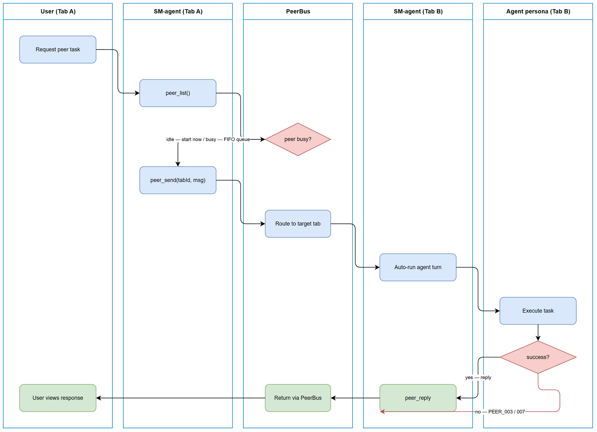
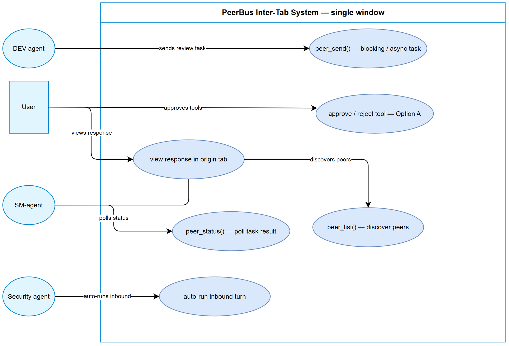

# Business Requirements Document (BRD)

## SA4E — SA4E-385: PeerBus inter-tab agent communication guidance and documentation

---

## Document Information

| Field | Value |
|-------|-------|
| Jira Ticket | SA4E-385 |
| Title | PeerBus inter-tab agent communication guidance and documentation |
| Author | BA Agent |
| Version | 1.0 |
| Date | 2026-10-25 |
| Status | Draft |
| Related Tickets | SA4E-369 (PeerBus implementation), SA4E-381-chat-ux (chat transcript redesign) |

---

## Author Tracking

| Role | Name - Position | Responsibility |
|------|-----------------|----------------|
| Author | BA Agent – Business Analyst | Create document |
| Peer Reviewer | SM Agent – Scrum Master | Review document |

---

## Revision History

| Version | Date | Author | Changes |
|---------|------|--------|---------|
| 1.0 | 2026-10-25 | BA Agent | Initiate document — auto-generated from Jira ticket SA4E-385 and linked tickets |

---

## Sign-Off

| Name | Signature and date |
|------|--------------------|
| | ☐ I agree and confirm all criteria on this BRD as expected requirements |
| | ☐ I agree and confirm all criteria on this BRD as expected requirements |

---

## 1. Introduction

### 1.1 Scope

This BRD defines the business requirements for **SA4E-385: PeerBus inter-tab agent communication guidance and documentation**. The feature is built on top of PeerBus (SA4E-369), an in-process, zero-configuration agent-to-agent messaging backbone between chatbox tabs within a single Kiro/VS Code window (documents/SA4E-369/UG.md:§1.1 lines 34-48).

**In scope:**
- Guidance for all 8 agent personas (BA, TA, SA, QA, DEV, DevOps, Security, UI) and the SM-agent on how to use PeerBus inter-tab communication.
- Business rules for discovering available peers via `peer_list`, sending blocking/async tasks via `peer_send`, routing responses back to the originating tab, handling errors PEER_001–010, and selecting the appropriate agent persona in the target tab.
- Documentation that fills the gap identified in SA4E-369 UG v1.0, which covers tool references but lacks detailed business guidance "when and how to call peer between tabs" (SA4E-385 ticket context).

**Out of scope:**
- Cross-window or cross-machine messaging (out of scope per SA4E-369 UG §9 lines 657-665).
- Persistence of peer state (all peer state is in-memory, dies with tab/window per SA4E-369 UG §3 lines 180-198).
- Replacement of pi-subagents or acp_delegate delegation features (SA4E-369 UG §9 line 664).
- Configuration of any kind (feature is zero-config by design, SA4E-369 UG §3 lines 180-198).

### 1.2 Out of Scope

- Messaging across VS Code windows or machines (future direction: pi-a2a, SA4E-369 UG §1.5 line 85, §9 lines 657-665).
- Any network transport (no sockets, ports, tokens, gateways; verified absent, SA4E-369 UG §1.5 line 86, §9 line 661).
- Persistent storage of peer messages or task history (in-memory only, SA4E-369 UG §1.5 line 87, BR-12).
- Human inbox for task delivery (auto-run is the delivery model, SA4E-369 UG §6.1 lines 468-480).

### 1.3 Preliminary Requirement

- SA4E-369 PeerBus implementation must be landed and functional (documents/SA4E-369/UG.md:§1.3 lines 58-68).
- Per-tab session support (parent epic SA4E-370 S3) must be available (documents/SA4E-369/UG.md:§1.3 line 63).
- At least two chat tabs open in the same window for inter-tab messaging to be meaningful (documents/SA4E-369/UG.md:§1.3 lines 64-65).

---

## 2. Business Requirements

### 2.1 High Level Process Map

The end-to-end inter-tab agent communication flow:

**Step 1:** Caller agent (in tab A) invokes `peer_list()` to discover available peers in the same window, including each peer's tabId, agent name, role, capabilities, and idle/busy status (documents/SA4E-369/UG.md:§4.1 lines 215-234).

**Step 2:** Caller agent reviews peer status; `busy` means the task will queue FIFO and run after the current turn, `idle` means it starts immediately (documents/SA4E-369/UG.md:§2.3 lines 161-166).

**Step 3:** Caller agent selects the target tab and the appropriate agent persona (e.g., Security agent for security review) based on role and capabilities from `peer_list`.

**Step 4:** Caller agent invokes `peer_send(tabId, message, async)` with blocking mode (async=false) or async mode (async=true) (documents/SA4E-369/UG.md:§4.2 lines 236-258).

**Step 5:** Validation runs synchronously before any task is created (target exists, not self, message ≤ 16,000 chars, anti-loop guards, queue capacity). A rejected send leaves zero residue (documents/SA4E-369/UG.md:§4.2 lines 251-257).

**Step 6:** Target tab's agent auto-runs the inbound task as a normal agent turn (no human approval for delivery). If target is busy, task queues FIFO (documents/SA4E-369/UG.md:§6.1 lines 468-480).

**Step 7:** Response is routed back to the originating tab with `fromTabId` and `toTabId` — never mixed with other tabs (documents/SA4E-369/UG.md:§4.3 lines 314-340).

**Step 8:** Caller agent receives the reply (blocking: directly in tool result; async: poll via `peer_status(taskId)`) (documents/SA4E-369/UG.md:§4.2.1 lines 271-284, §4.3 lines 314-355).

The diagram below visualizes this flow as a cross-tab business swimlane (caller tab → PeerBus → target tab):

*[Edit in draw.io](diagrams/peerbus-business-flow.drawio)*

---

### 2.2 List of User Stories / Use Cases

| # | User Story | Priority | Source Ticket |
|---|------------|----------|---------------|
| 1 | As a DEV agent, I want to send a security review task to the tab running the Security agent so that I can get expert review without leaving my current tab context. | MUST HAVE | SA4E-385 |
| 2 | As a QA agent, I want to receive review responses back to my own tab so that I can act on findings without tab switching. | MUST HAVE | SA4E-385 |
| 3 | As an agent, I want to list available peers and select the appropriate persona before sending so that I route tasks to the right specialist. | MUST HAVE | SA4E-385 |

---

### 2.3 Details of User Stories

---

#### Business Flow

The business flow for cross-tab agent collaboration follows the High Level Process Map in §2.1. Each user story instantiates this flow with a specific caller/target persona pair.

> **Note:** All peer communication occurs within a single Kiro/VS Code window. Cross-window or cross-machine messaging is out of scope (SA4E-369 UG §9 lines 657-665).

The use case diagram below shows the actors and the business-level use cases (discover peers, send task, receive response):

*[Edit in draw.io](diagrams/peerbus-use-case.drawio)*

---

#### STORY 1: DEV agent requests Security review via PeerBus

> As a DEV agent, I want to send a security review task to the tab running the Security agent so that I can get expert review without leaving my current tab context.

**Requirement Details:**

1. Caller agent must discover the target tab running a Security-agent persona via `peer_list()` before sending (documents/SA4E-369/UG.md:§4.1 lines 215-234).
2. The target tab's peer entry must show `status: idle` or `status: busy` (documents/SA4E-369/UG.md:§2.3 lines 161-166).
3. The caller agent selects the target tabId and sends a blocking task via `peer_send(tabId, "Security review of src/auth.ts", async: false)` (documents/SA4E-369/UG.md:§4.2 lines 236-258).
4. The response is routed back to the DEV agent's tab with `fromTabId`/`toTabId` and is not mixed with any other tab's traffic (documents/SA4E-369/UG.md:§4.3 lines 314-340).

**Data Fields (if applicable):**

| Field | Type | Required | Description | Example |
|-------|------|----------|-------------|---------|
| tabId | string | Yes | Target tab identifier from peer_list | "3f8a1c2e-…" |
| message | string | Yes | Task instruction/prompt, ≤ 16,000 chars | "Security review of src/auth.ts" |
| async | boolean | No | false = blocking (default), true = fire-and-poll | false |
| fromTabId | string | Yes (response) | Originating tab ID | "9b2d4f01-…" |
| toTabId | string | Yes (response) | Target tab ID | "3f8a1c2e-…" |
| taskId | string | Yes (response) | Unique task identifier | "t-7c31e9…" |
| state | string | Yes (response) | queued / running / completed / failed / cancelled | "completed" |
| reply | string | No (response) | The peer agent's output | "Findings: …" |
| error.code | string | No (response) | PEER error code if failed | "PEER_003" |

**Acceptance Criteria:**

1. AC-1.1: `peer_list()` returns all open tabs with agent name, role, capabilities, model, status (idle/busy), and self flag (documents/SA4E-369/UG.md:§4.1 lines 215-234).
2. AC-1.2: DEV agent can identify the Security-agent tab from role/capabilities fields in peer_list output.
3. AC-1.3: Blocking `peer_send(async: false)` returns `{ taskId, state, reply }` when the target completes within 300 s (documents/SA4E-369/UG.md:§4.2.1 lines 271-284).
4. AC-1.4: Response contains `fromTabId` and `toTabId` matching the call direction (documents/SA4E-369/UG.md:§4.3 lines 330-340).
5. AC-1.5: Response is delivered only to the originating tab, never mixed with other tabs.
6. AC-1.6: If the Security-agent tab is busy, the task queues FIFO and runs after the current turn (documents/SA4E-369/UG.md:§6.1 lines 474-476).

---

#### STORY 2: QA agent receives peer response back to own tab

> As a QA agent, I want to receive review responses back to my own tab so that I can act on findings without tab switching.

**Requirement Details:**

1. The QA agent's tab must be registered as a peer and visible to other tabs via `peer_list()` (documents/SA4E-369/UG.md:§2.2 lines 122-128).
2. When another tab sends a peer task to the QA tab, the QA tab's agent auto-runs the task (no human delivery approval) (documents/SA4E-369/UG.md:§6.1 lines 468-480).
3. If the QA peer turn requires a tool call, the user in the QA tab receives an explicit approval prompt (Option A security gate) (documents/SA4E-369/UG.md:§6.4 lines 510-523).
4. The completed response is returned to the originating tab, and the QA tab shows the inbound badge and `[Peer inbound] from <tab>` transcript prefix (documents/SA4E-369/UG.md:§5.2-5.3 lines 381-419).

**Acceptance Criteria:**

1. AC-2.1: QA tab appears in `peer_list()` results of other tabs with correct role and capabilities.
2. AC-2.2: Inbound peer task auto-runs in QA tab without requiring the QA user to "accept" delivery (documents/SA4E-369/UG.md:§6.1 lines 468-480).
3. AC-2.3: Tool calls within a peer turn require explicit user approval in the receiving tab (Option A) (documents/SA4E-369/UG.md:§6.4 lines 510-523).
4. AC-2.4: QA tab transcript shows `[Peer inbound] from <tab>` prefix and badge increments (documents/SA4E-369/UG.md:§5.2-5.3 lines 381-419).
5. AC-2.5: Originating tab receives the QA agent's reply with `fromTabId`/`toTabId` correctly set.

---

#### STORY 3: Agent lists peers and selects persona before sending

> As an agent, I want to list available peers and select the appropriate persona so that I route tasks to the right specialist.

**Requirement Details:**

1. Agent invokes `peer_list()` to get a snapshot of all registered peers (documents/SA4E-369/UG.md:§4.1 lines 215-234).
2. Each peer entry includes tabId, agentName, role, capabilities, model, status (idle/busy), and self flag (documents/SA4E-369/UG.md:§2.3 lines 136-158).
3. Agent excludes its own tab (`self: true`) from candidate targets (documents/SA4E-369/UG.md:§2.3 lines 165-167).
4. Agent selects target based on role/capabilities matching the task need (e.g., Security role for security review, QA role for test review).
5. Agent checks `status` before sending: `idle` = immediate start, `busy` = FIFO queue (documents/SA4E-369/UG.md:§2.3 lines 161-166).

**Acceptance Criteria:**

1. AC-3.1: `peer_list()` returns at minimum the caller's own tab (`self: true`) when no other tabs are open (documents/SA4E-369/UG.md:§4.1 line 233).
2. AC-3.2: Each peer entry includes tabId, agentName, role, capabilities, status, model, and self flag.
3. AC-3.3: Agent cannot `peer_send` to its own tab (PEER_002) (documents/SA4E-369/UG.md:§4.2 line 254).
4. AC-3.4: Agent can read busy/idle status from peer_list before deciding to send or to use async mode.
5. AC-3.5: Agent can copy tabId from peer_list output for use in peer_send.

---

### 2.4 Functional Requirements Summary

| ID | Requirement | Source | Priority |
|----|-------------|--------|----------|
| FR-01 | Agent can list available peers via `peer_list` before sending a task (status idle/busy, role, capabilities) | SA4E-369 UG §4.1 lines 215-234 | MUST HAVE |
| FR-02 | Agent can send a blocking task via `peer_send(tabId, message, async)` to a target tab | SA4E-369 UG §4.2 lines 236-258 | MUST HAVE |
| FR-03 | Response renders back to the originating tab (not mixed with other tabs), with `fromTabId`/`toTabId` | SA4E-369 UG §4.3 lines 314-340 | MUST HAVE |
| FR-04 | Display busy/idle status of peer before sending | SA4E-369 UG §2.3 lines 161-166 | MUST HAVE |
| FR-05 | Handle common errors (PEER_001–010) with clear, actionable messages | SA4E-369 UG §7.2 lines 549-562 | MUST HAVE |
| FR-06 | Select appropriate agent persona in target tab (e.g., Security agent for security review) | SA4E-369 UG §1.4 line 81 | MUST HAVE |

---

## 3. Dependencies

| Dependency | Type | Related Ticket | Description |
|------------|------|----------------|-------------|
| PeerBus implementation | System | SA4E-369 | In-process agent-to-agent messaging backbone between chatbox tabs (documents/SA4E-369/UG.md:§1.1 lines 34-48) |
| Per-tab session support | Infrastructure | SA4E-370 S3 | Isolated per-tab agent session with own history, token budget, compaction (documents/SA4E-369/UG.md:§1.3 line 63) |
| Chat transcript redesign | System | SA4E-381-chat-ux | Transcript rendering for peer inbound prefix `[Peer inbound] from <tab>` (documents/SA4E-369/UG.md:§5.3 lines 401-419) |
| Security approval gate | Compliance | SA4E-369 | Option A tool approval gate for peer turns (documents/SA4E-369/UG.md:§6.4 lines 510-523) |

---

## 4. Stakeholders

| Role | Name / Team | Responsibility | Source |
|------|-------------|----------------|--------|
| BA Agent | BA Agent | Author BRD, define business requirements | SA4E-385 ticket |
| SM Agent | SM Agent per tab | Coordinates cross-tab collaboration, invokes peer tools | SA4E-385 ticket context (9 agents per tab) |
| DEV Agent | Agent persona | Implements code, requests security review via peer | SA4E-385 ticket (8 personas) |
| QA Agent | Agent persona | Receives review responses, acts on findings | SA4E-385 ticket (8 personas) |
| Security Agent | Agent persona | Performs security review tasks received via peer | SA4E-385 ticket (8 personas) |
| TA / SA / DevOps / UI Agents | Agent personas | May initiate or receive peer tasks per their specialty | SA4E-385 ticket (8 personas) |
| End-User / Navigator | User | Initiates cross-tab collaboration requests in chat | SA4E-385 ticket context |

---

## 5. Risks and Assumptions

### 5.1 Risks

| Risk | Impact | Likelihood | Mitigation |
|------|--------|------------|------------|
| Ping-pong loop — two agents bouncing work back and forth indefinitely | High | Medium | Per-pair ping-pong cap of 5 consecutive agent→agent turns; rejected beyond cap with PEER_004; chain resets on any user message in either tab (documents/SA4E-369/UG.md:§6.5 lines 525-532, §7.1 line 541) |
| Injection — peer content impersonating user instructions to steer receiving tab's tools | High | Low | Provenance envelope marks peer content as untrusted data; every tool call in a peer turn requires explicit user approval (Option A, fail-closed) (documents/SA4E-369/UG.md:§6.2 lines 482-495, §6.4 lines 510-523) |
| Queue overflow — target inbound queue (20 tasks) full, new sends refused | Medium | Medium | PEER_005 on full queue; sender waits for drain or reduces burst; per-tab rate limit 10 tasks/60s (documents/SA4E-369/UG.md:§7.1 lines 542-543, §7.2 line 557) |
| Task lost when target tab closes while task is queued | Medium | Medium | Task ends as `cancelled` (PEER_009); sending tab notified and can retry after target reopened (documents/SA4E-369/UG.md:§4.2.2 line 312, §7.2 line 561) |
| Wrong tab response — response mixed with another tab's traffic | Medium | Low | Response routed with `fromTabId`/`toTabId`; delivery only to originating tab (documents/SA4E-369/UG.md:§4.3 lines 330-340) |
| Blocking timeout — caller waits > 300 s and gives up (task continues running) | Low | Medium | PEER_006; caller can poll `peer_status(taskId)` to retrieve result later; task retention 60 s after terminal (documents/SA4E-369/UG.md:§7.1 line 545, §7.2 line 558) |
| Unknown taskId — poll with stale/typo taskId after 60 s cleanup | Low | Medium | PEER_008; sender should persist taskId and poll within 60 s retention window (documents/SA4E-369/UG.md:§4.3 line 355, §7.1 line 547) |

### 5.2 Assumptions

- SA4E-369 PeerBus implementation is landed, tested, and functional in the current build.
- Per-tab session support (SA4E-370 S3) is available and provides isolated agent sessions per tab.
- Two or more chat tabs are open in the same Kiro/VS Code window for inter-tab messaging.
- The end-user/navigator initiates cross-tab collaboration requests through natural language to their tab's agent.
- No configuration is required; the feature is zero-config and always active when ≥2 tabs exist (documents/SA4E-369/UG.md:§3 lines 180-198).
- All peer state is in-memory and does not survive tab close, window close, or Kiro restart (documents/SA4E-369/UG.md:§1.5 line 87, §7.1 line 546, BR-12).

---

## 6. Non-Functional Requirements

| Category | Requirement | Details |
|----------|-------------|---------|
| Performance | Blocking `peer_send` timeout ≤ 300 s | If no terminal state after 300 s, caller fails with PEER_006; task itself keeps running and remains pollable (documents/SA4E-369/UG.md:§7.1 line 545, §4.2.1 line 283) |
| Performance | Async `peer_send` returns `taskId` immediately | Fire-and-continue; caller polls `peer_status` at its own pace (documents/SA4E-369/UG.md:§4.2.2 lines 288-313) |
| Security | Peer content treated as untrusted data | Provenance envelope marks every peer message as untrusted agent-to-agent content, not a user instruction (documents/SA4E-369/UG.md:§6.2 lines 482-495) |
| Security | Tool approval gate on peer turns | Every tool call inside a peer turn requires explicit user approval (Option A, fail-closed); no approval for user-initiated turns (documents/SA4E-369/UG.md:§6.4 lines 510-523) |
| Security | Anti-spoofing | `from tab` header stamped by receiving side from its own registry; sender cannot forge identity (documents/SA4E-369/UG.md:§6.2 lines 497-499) |
| Scalability | Per-tab inbound rate limit 10 tasks / 60 s | Exceeding rejects the send with PEER_005; auto-recovers as the 60-second window rolls off (documents/SA4E-369/UG.md:§7.1 line 542, §7.2 line 557) |
| Scalability | Target inbound queue capacity 20 tasks FIFO | Beyond capacity, send refused with PEER_005 while queue drains (documents/SA4E-369/UG.md:§7.1 line 543, §4.2 line 257) |
| Scalability | Per-pair ping-pong cap 5 turns | 6th consecutive agent↔agent turn in a pair refused with PEER_004; chain resets on user message in either tab (documents/SA4E-369/UG.md:§7.1 line 541, §6.5 line 529) |
| Availability | Same window only | Peers = tabs of this extension host only; no cross-window oracle (documents/SA4E-369/UG.md:§9 line 660) |
| Availability | Zero-configuration | No settings, keys, env vars, feature flags; always active when ≥2 tabs open (documents/SA4E-369/UG.md:§3 lines 180-198) |
| Usability | Busy/idle status displayed before sending | `peer_list()` shows status per peer so caller can choose blocking vs async (documents/SA4E-369/UG.md:§2.3 lines 161-166) |
| Usability | Clear error messages PEER_001–010 | Each error code has a friendly meaning and prescribed action (documents/SA4E-369/UG.md:§7.2 lines 549-562) |
| Reliability | Zero-state rejection | Send-time errors (PEER_001/002/004/005/010) create no task, counter, trace, or residue (documents/SA4E-369/UG.md:§4.2 line 251, §7.3 line 567) |
| Reliability | Failure isolation | One failed task never affects other tasks on the bus; both tabs stay functional after any guard trip (documents/SA4E-369/UG.md:§7.3 lines 566-568) |
| Reliability | Task retention 60 s after terminal | `peer_status` pollable for 60 s after completed/failed/cancelled; then cleaned up (PEER_008 afterwards) (documents/SA4E-369/UG.md:§7.1 line 547) |
| Reliability | Auto-cancel on tab close | Target tab close cancels queued tasks (PEER_009); single cleanup point, no orphan state (documents/SA4E-369/UG.md:§2.2 line 128) |

---

## 7. Related Tickets

| Ticket Key | Summary | Status | Type | Relationship |
|------------|---------|--------|------|--------------|
| SA4E-385 | PeerBus inter-tab agent communication guidance and documentation | Draft | Story | Main ticket |
| SA4E-369 | Intra-instance agent-to-agent messaging between chatbox tabs (local PeerBus, zero-config) | Implemented | Story | Provides PeerBus implementation this BRD documents |
| SA4E-381-chat-ux | Chat transcript redesign | Related | Story | Transcript rendering for peer inbound prefix |
| SA4E-370 | Per-tab session support (parent epic S3 landed) | Related | Epic | Enables isolated per-tab agent sessions |

---

## 8. Appendix

### Glossary

| Term | Definition |
|------|------------|
| PeerBus | In-process event backbone routing peer tasks between chat tabs of the same window (documents/SA4E-369/UG.md:§10.1 line 671) |
| Peer | A chatbox tab registered as an agent messaging endpoint |
| tabId | Unique identifier of a chat tab within the window; copied from peer_list for use in peer_send |
| PeerTask | One send unit; has taskId, state, optional reply or error |
| Blocking mode | peer_send(async=false) — waits for the receiving turn (<= 300 s) |
| Async mode | peer_send(async=true) — returns taskId immediately; poll peer_status |
| Terminal state | completed, failed, or cancelled |
| Auto-run | Inbound peer task triggers the target tab's agent turn without human approval (delivery) |
| Ping-pong chain | Consecutive agent->agent turns in one pair without user interaction; cap 5 |
| Provenance envelope | Standard header marking peer content as untrusted data (not user instruction) |
| turnOrigin | Internal tag — user or peer — on every turn; only peer turns route through the approval gate |
| Zero-state rejection | A rejected send that creates no task/counter/trace |
| Per-tab session | Every tab's private agent session (own history, own token budget, own compaction) |

### Reference Documents

| Document | Link / Location |
|----------|-----------------|
| PeerBus User Guide (SA4E-369 UG v1.0) | documents/SA4E-369/UG.md |
| PeerBus BRD (SA4E-369 BRD v1.0) | documents/SA4E-369/BRD.md |
| PeerBus FSD (SA4E-369 FSD v1.2) | documents/SA4E-369/FSD.md |
| PeerBus TDD (SA4E-369 TDD v1.1) | documents/SA4E-369/TDD.md |
| PeerBus UI Spec (SA4E-369 UI-SPEC v1.0) | documents/SA4E-369/UI-SPEC.md |
| PeerBus STP (SA4E-369 STP v1.0) | documents/SA4E-369/STP.md |
| PeerBus STC (SA4E-369 STC) | documents/SA4E-369/STC.md |
| PeerBus Security Review (SA4E-369) | documents/SA4E-369/SECURITY-REVIEW.md |

### Diagram Index

| # | Diagram | Image | Source (editable) |
|---|---------|-------|-------------------|
| 1 | PeerBus Business Flow — cross-tab send/receive swimlane (embedded in §2.1) | [peerbus-business-flow.png](diagrams/peerbus-business-flow.png) | [peerbus-business-flow.drawio](diagrams/peerbus-business-flow.drawio) |
| 2 | PeerBus Use Case — actors and business-level use cases (embedded in §2.3) | [peerbus-use-case.png](diagrams/peerbus-use-case.png) | [peerbus-use-case.drawio](diagrams/peerbus-use-case.drawio) |

---

*End of BRD — SA4E-385 v1.0 (2026-10-25) — Draft*