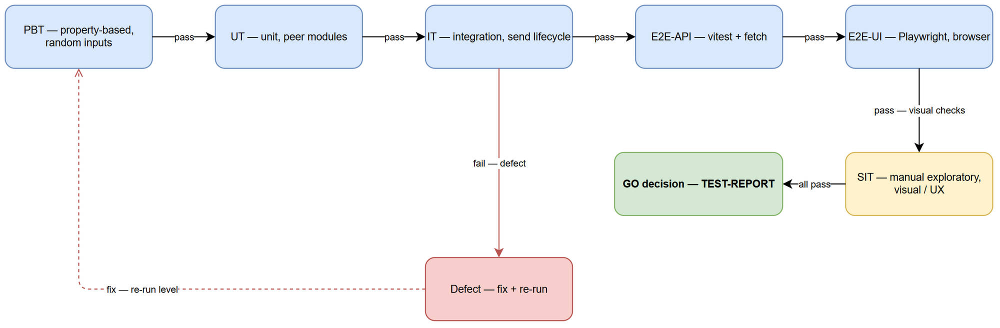
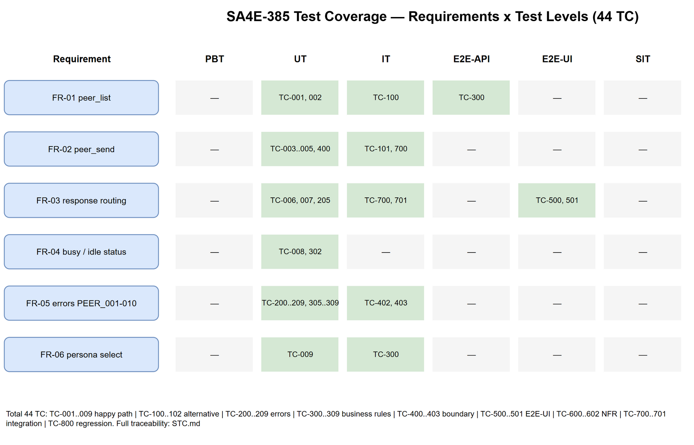

# Software Test Plan (STP)

## SA4E-385: PeerBus inter-tab agent communication guidance and documentation

---

## Document Information

| Field | Value |
|-------|-------|
| Jira Ticket | SA4E-385 |
| Title | PeerBus inter-tab agent communication guidance and documentation |
| Author | QA Agent – QA Engineer |
| Version | 1.0 |
| Date | 2026-10-26 |
| Status | Draft |
| Related BRD | documents/SA4E-385/BRD.md (v1.0) |
| Related FSD | documents/SA4E-385/FSD.md (v1.0) |
| Related TDD | documents/SA4E-385/TDD.md (v1.0) |
| Baseline Implementation | SA4E-369 PeerBus (extension/src/pi-workflow/peer/) |

---

## Author Tracking

| Role | Name - Position | Responsibility |
|------|-----------------|----------------|
| Author | QA Agent – QA Engineer | Create STP + STC |
| Peer Reviewer | SM Agent – Scrum Master | Review test plan |

---

## Revision History

| Version | Date | Author | Changes |
|---------|------|--------|---------|
| 1.0 | 2026-10-26 | QA Agent | Initiate document — auto-generated from BRD v1.0, FSD v1.0, TDD v1.0 |

---

## Sign-Off

| Name | Signature and date |
|------|--------------------|
| | ☐ I agree and confirm the test plan in this STP |
| | ☐ I agree and confirm the test plan in this STP |

---

## 1. Introduction

### 1.1 Purpose

This Test Plan (STP) defines the testing approach, scope, strategy, resources, schedule, and risks for **SA4E-385: PeerBus inter-tab agent communication guidance and documentation**. SA4E-385 is a guidance-and-documentation feature layered on top of the landed PeerBus runtime (SA4E-369). Per FSD.md:§1.2 lines 37-38, SA4E-385 does NOT introduce new transport, configuration, or runtime services — it adds agent-facing guidance surfaces (`.code-intel/agents/*.md` instruction files, tool help payload, UG section, KB entries) and verifies the reused PeerBus runtime behavior end-to-end.

The STP is the authoritative baseline for QA test case design (STC.md), test execution, and defect reporting for this ticket.

### 1.2 Test Objectives

1. Verify every Functional Requirement FR-01..FR-06 (BRD.md:§2.4 lines 206-213) is satisfied by the PeerBus runtime and by the guidance surfaces.
2. Verify all 10 error codes PEER_001–PEER_010 (FSD.md:§9.1 lines 885-896) produce correct codes, messages, and zero-state rejection where applicable.
3. Verify business rules BR-01..BR-12 (FSD.md §3.1.3–§3.3.3) are enforced by the runtime.
4. Verify response routing to the originating tab with `fromTabId`/`toTabId` (FR-03, FSD.md:§3.3) is never mixed with other tabs.
5. Verify security controls: provenance envelope (untrusted data framing), Option A approval gate (fail-closed), ping-pong cap (5 turns), rate limit (10/60s), queue cap (20), message size cap (16,000 chars).
6. Verify guidance content is present in all agent instruction files (`.code-intel/agents/*.md`) and tool `promptGuidelines`.
7. Confirm no regressions in existing PeerBus test suites (SA4E-369 TDD §10).

### 1.3 References

| Document | Location |
|----------|----------|
| BRD v1.0 | documents/SA4E-385/BRD.md |
| FSD v1.0 | documents/SA4E-385/FSD.md |
| TDD v1.0 | documents/SA4E-385/TDD.md |
| PeerBus UG v1.0 | documents/SA4E-369/UG.md |
| PeerBus TDD v1.1 | documents/SA4E-369/TDD.md |
| PeerBus Security Review | documents/SA4E-369/SECURITY-REVIEW.md |

### 1.4 Key Codebase Files Under Test

| File | Role | Key Lines |
|------|------|-----------|
| extension/src/pi-workflow/peer/tools.ts | peer_list/peer_send/peer_status tool definitions | :37-46, :49-81, :84-108 |
| extension/src/pi-workflow/peer/bus.ts | PeerBus backbone: list/send/status/beginSend | :51-54, :57-65, :68-73, :108-143, :146-165 |
| extension/src/pi-workflow/peer/errors.ts | PEER_MESSAGES error templates | :17-43 |
| extension/src/pi-workflow/peer/guards.ts | AntiLoopGuards (ping-pong cap, rate limit) | :24-51 |
| extension/src/pi-workflow/peer/constants.ts | Numeric constants (cap 5, 10/60s, queue 20, 16000, 300s, 60s) | :8-33 |
| extension/src/pi-workflow/peer/registry.ts | PeerRegistry snapshot with self flag | :84-94 |
| extension/src/pi-workflow/peer/types.ts | PeerInfo, PeerTask, PeerStatusResult, error codes | :40-48, :73-87, :121-132, :50-60 |
| extension/src/pi-workflow/peer/dispatch.ts | dispatchPeerTurn, failTask (PEER_003/007) | :17-55, :84-99 |
| extension/src/pi-workflow/peer/approval.ts | Fail-closed approval gate (Option A) | :40-69 |
| extension/src/pi-workflow/peer/envelope.ts | Provenance envelope, marker forgery check | :28-30, :59-66 |
| extension/src/pi-workflow/session-host/peer-approval.ts | wirePeerSession, peerToolDefs | :61-78 |
| extension/src/pi-workflow/session-host/create-host.ts | peer tools in customTools | :175-177 |
| extension/src/pi-workflow/session-host/loadout.ts | PEER_TOOL_NAMES in allowlist | :34-38 |
| extension/webview-assets/chat/chat-peer-ui.js | Badge + "[Peer inbound] from …" prefix | :44-58 |
| extension/src/chat-panel/peer-inbound-bridge.ts | Bus → webview event forwarding | :29-52 |
| extension/src/chat-panel/ChatHtmlBuilder.ts | SCRIPTS array includes chat-peer-ui.js | :35 |

---

## 2. Test Strategy

### 2.1 Test Levels

SA4E-385 is a guidance-and-documentation feature. The PeerBus runtime it documents is already landed and tested (SA4E-369). Testing therefore focuses on:

- **Verification of reused runtime behavior** via integration-level tests against the real PeerBus modules (in-process, no network).
- **Verification of guidance surfaces** (agent instruction files, tool help payload, UG content) via content review and unit checks.
- **No UI automation via Playwright** — the webview is VS Code-based; UI verification is via message-handler unit tests + manual verification (TDD §10 line 671).

| Level | Scope | Automation | Tools |
|-------|-------|------------|-------|
| Unit (UT) | Individual peer modules (guards, registry, bus, errors, envelope, types) | ✅ Automated | vitest |
| Integration (IT) | end-to-end peer_send → dispatch → response routing → peer_status polling against real bus | ✅ Automated | vitest (in-process, no HTTP) |
| Guidance Content Verification | `.code-intel/agents/*.md`, tool `promptGuidelines`, UG section | ✅ Automated (file content checks) | vitest / Node fs |
| SIT (Manual) | Visual/UX verification of badge, "[Peer inbound]" prefix, approval dialog — only what cannot be automated | ❌ Manual | VS Code extension host |

### 2.2 Test Types

| Type | Description | Applicable | Coverage Source |
|------|-------------|------------|-----------------|
| Functional | Verify FR-01..FR-06 per FSD use cases | Yes | STC TC-001..TC-099 |
| Alternative Flows | AF-1 (no other tabs), AF-2 (busy target), AF-3 (async mode) | Yes | STC TC-100..TC-199 |
| Exception/Error | PEER_001–010 each mapped to ≥1 test case | Yes | STC TC-200..TC-299 |
| Business Rule Validation | BR-01..BR-12 enforcement | Yes | STC TC-300..TC-399 |
| Boundary & Negative | Empty message, 16,001 chars, non-owner peer_status, tab close mid-task | Yes | STC TC-400..TC-499 |
| UI/UX | Badge increment, "[Peer inbound]" prefix, reply row | Yes (partial) | STC TC-500..TC-599 |
| Non-Functional | Performance (300s blocking timeout), Security (approval gate, provenance envelope) | Yes | STC TC-600..TC-699 |
| Integration | Tab-to-tab via PeerBus, response isolation, origin-only delivery | Yes | STC TC-700..TC-799 |
| Regression | Existing PeerBus suites stay green | Yes | Existing SA4E-369 suites |

### 2.3 Test Approach

- **Risk-based prioritization:** High-priority tests cover FR-01..FR-06 happy paths, all PEER_001–010 error codes, security controls (approval gate, provenance envelope, ping-pong cap), and response isolation.
- **Automation first:** All runtime behavior tests are automated via vitest against the real PeerBus modules. Manual SIT is limited to visual/UX verification that cannot be automated (badge rendering, approval dialog interaction).
- **Zero-state verification:** For PEER_001/002/004/005/010 rejections, tests assert no task, counter, trace, or residue is created (BRD.md:§6 NFR line 283).
- **No new runtime code:** QA does not modify production code; tests only verify existing behavior.

### 2.4 Entry Criteria

| Level | Entry Criteria |
|-------|---------------|
| UT / IT | PeerBus source compiled; vitest configured; `.code-intel/agents/` directory exists (or is created as part of SA4E-385); ≥2 tab simulation possible in test harness |
| SIT (Manual) | Extension built and loaded in VS Code; ≥2 chat tabs open in same window; admin/navigator user available |
| Guidance Content | `.code-intel/agents/{persona}.md` files created for all 8 personas + SM-agent |

### 2.5 Exit Criteria

| Level | Exit Criteria |
|-------|--------------|
| UT / IT | 100% of automated test cases executed; 0 Critical defects; ≤2 Major defects open; all PEER_001–010 codes verified |
| Guidance Content | All 9 agent instruction files contain required PeerBus guidance; tool `promptGuidelines` verified present |
| SIT (Manual) | All manual SIT cases executed; visual evidence captured; no Critical defects open |
| Overall | RTM shows 100% coverage of FR-01..FR-06, all PEER_001–010, all AC-1.x..AC-3.x; SM sign-off obtained |



---

## 3. Test Scope

### 3.1 Features In Scope

| # | Feature / Story | Priority | Source Reference | Test Type |
|---|----------------|----------|------------------|-----------|
| 1 | FR-01: `peer_list()` returns all peers with tabId, agentName, role, capabilities, model, status, self flag | High | BRD.md:§2.4 line 208; FSD §3.1 | Functional / Integration |
| 2 | FR-02: `peer_send(tabId, message, async)` blocking + async delivery | High | BRD.md:§2.4 line 209; FSD §3.2 | Functional / Integration |
| 3 | FR-03: Response routed to originating tab only, `fromTabId`/`toTabId` verified | High | BRD.md:§2.4 line 210; FSD §3.3 | Functional / Integration |
| 4 | FR-04: Busy/idle status displayed before sending | High | BRD.md:§2.4 line 211; FSD §3.4 | Functional |
| 5 | FR-05: All PEER_001–010 errors handled with clear messages | High | BRD.md:§2.4 line 212; FSD §3.5, §9.1 | Functional / Security |
| 6 | FR-06: Select appropriate agent persona in target tab | High | BRD.md:§2.4 line 213; FSD §3.6 | Functional |
| 7 | Security: provenance envelope, Option A approval gate (fail-closed), anti-spoofing | High | FSD §7; TDD §8 | Security |
| 8 | Boundary: message ≤16,000 chars, empty message, 16,001 chars | Medium | FSD §3.2.4; TDD constants.ts:29 | Boundary / Negative |
| 9 | Performance: blocking timeout ≤300s, async returns taskId immediately | Medium | BRD.md:§6 NFR line 271; TDD constants.ts:20 | Performance |
| 10 | Guidance content present in agent instruction files + tool help payload | Medium | TDD §2.1, §9 | Content Verification |

### 3.2 Features Out of Scope

| # | Feature | Reason |
|---|---------|--------|
| 1 | Cross-window or cross-machine messaging | Out of scope per BRD.md:§1.2 lines 58-59; SA4E-369 UG §9 lines 657-665 |
| 2 | Persistence of peer state / task history | In-memory only, dies with tab/window per BRD.md:§1.2 lines 60-61; BR-12 |
| 3 | Replacement of pi-subagents or acp_delegate | Out of scope per BRD.md:§1.2 line 61 |
| 4 | Any configuration (settings, keys, env vars, feature flags) | Zero-config by design per BRD.md:§1.2 line 62; BRD.md:§5.2 line 262 |
| 5 | Network transport (sockets, ports, tokens, gateways) | Out of scope per BRD.md:§1.2 lines 66-68 |
| 6 | New runtime services or PeerBus modules | SA4E-385 is guidance-layer only per FSD.md:§1.2 lines 37-38 |



---

## 4. Test Environment

### 4.1 Environment Requirements

| Environment | Purpose | Details |
|-------------|---------|---------|
| Dev / Local | Unit + Integration test execution | Node.js runtime, vitest, TypeScript, extension source compiled |
| VS Code Extension Host | Manual SIT | VS Code with extension loaded, ≥2 chat tabs open in same window |
| KB / mem | Guidance content verification | Knowledge base entries ingested per TDD §10 Step 6.5 |

### 4.2 Browser / Device Requirements

| Browser | Version | OS | Required |
|---------|---------|-----|----------|
| VS Code (Chromium-based webview) | Latest stable | Windows / Mac / Linux | Yes (for manual SIT only) |

### 4.3 Test Data Requirements

| Data Type | Description | Source | Preparation |
|-----------|-------------|--------|-------------|
| Peer tab identities | tabId, agentName, role, capabilities, model, status | Test harness creates mock PeerRegistryEntry objects | Programmatic registration in test setup |
| Peer tasks | taskId, fromTabId, toTabId, message, mode, state | Generated by bus.send() during tests | Auto-created by test invocations |
| Error scenarios | Invalid tabId, self-send, empty/oversized message, forged markers | Hard-coded test data per CSV | See testdata/ directory |
| Rate limit / queue overflow | 10 tasks/60s, 20-task queue | Rapid successive peer_send calls | Programmatic burst in test |

### 4.4 External Dependencies

| System | Dependency | Mock/Stub Available |
|--------|-----------|---------------------|
| PeerBus runtime | Real in-process modules (no network) | N/A — real modules used |
| Session host | `ensureSessionHost` / `promptTurn` via gateway | Mocked in unit tests where needed |
| Approval gate | `PeerToolApprovalHandler` | Mocked (fail-closed vs fail-open scenarios) |
| VS Code API | `vscode.Webview`, `extensionUri` | Not needed for unit/integration tests |

---

## 5. Test Schedule

| Phase | Start | End | Duration | Milestone |
|-------|-------|-----|----------|-----------|
| Test Planning | 2026-10-26 | 2026-10-26 | 1 day | STP + STC drafted |
| STC Review (BA gate) | 2026-10-26 | 2026-10-27 | 1 day | BA approval of test coverage |
| Test Data Preparation | 2026-10-27 | 2026-10-27 | 0.5 day | CSV test data files created |
| UT / IT Execution | 2026-10-27 | 2026-10-28 | 1 day | Automated tests pass |
| Guidance Content Verification | 2026-10-28 | 2026-10-28 | 0.5 day | Agent instruction files + UG verified |
| Manual SIT (visual/UX) | 2026-10-28 | 2026-10-29 | 1 day | Badge, prefix, approval dialog verified |
| Defect Fix & Retest | 2026-10-29 | 2026-10-30 | 1 day | All Critical/Major fixed |
| Test Completion Report | 2026-10-30 | 2026-10-30 | 0.5 day | STP/STC sign-off |

---

## 6. Resources & Responsibilities

| Role | Name | Responsibility |
|------|------|---------------|
| Test Lead | QA Agent | Test planning, coordination, reporting, RTM maintenance |
| QA Engineer | QA Agent | Test case design (STC), test execution, defect reporting |
| BA | BA Agent | Acceptance criteria clarification, RTM review, DISC-01 resolution |
| Developer | dev-agent | Bug fixing, unit test coverage (does not write STP/STC) |
| SM | SM Agent | Orchestration, BA review gate, Jira status updates |
| DevOps | DevOps Agent | Environment setup if needed (not required — in-process tests) |

---

## 7. Risk & Mitigation

| # | Risk | Impact | Likelihood | Mitigation |
|---|------|--------|------------|------------|
| 1 | DISC-01: PEER_003 vs PEER_010 attribution mismatch between FSD and code | High | Medium | QA tests assert code behavior (PEER_010 for message validation); BA/TA to correct FSD before STC sign-off |
| 2 | Two-tab simulation not available in test harness | Medium | Low | Use mock registry with ≥2 entries; verify self-flag filtering |
| 3 | Blocking 300s timeout makes tests slow | Medium | Low | Use fake timers (vitest) to accelerate timeout path; test PEER_006 separately |
| 4 | Approval gate requires user interaction (manual SIT) | Medium | Medium | Unit-test gate fail-closed logic; manual SIT covers UI dialog only |
| 5 | Guidance files not created before testing | Low | Medium | Verify `.code-intel/agents/` exists; content checks are file-read based |
| 6 | Tab close mid-task (PEER_009) hard to reproduce deterministically | Medium | Low | Mock `handleTabClosed` and assert PEER_009 on queued tasks |

---

## 8. Defect Management

### 8.1 Severity Levels

| Severity | Definition | Example |
|----------|-----------|---------|
| Critical | Security bypass, wrong-tab response mixing, data corruption | Response delivered to wrong tab; approval gate not fail-closed |
| Major | FR not working, error code wrong, zero-state violated | PEER_001 not returned for missing tab; task created on rejected send |
| Minor | UI cosmetic, guidance text missing/wrong | Badge not incrementing; agent instruction file missing guidance |
| Trivial | Typo, minor formatting | Spelling in error message (non-code) |

### 8.2 Priority Levels

| Priority | Definition | SLA (Fix Time) |
|----------|-----------|----------------|
| P1 | Must fix immediately — blocks test execution | 4 hours |
| P2 | Must fix before release — blocks sign-off | 1 business day |
| P3 | Should fix if time permits | 3 business days |
| P4 | Nice to fix, can defer | Next release |

### 8.3 Defect Lifecycle

```
New → Open → In Progress → Fixed → Ready for Retest → Verified → Closed
                                                       → Reopened → In Progress
```

### 8.4 DISC-01 Handling

The PEER_003 vs PEER_010 discrepancy (TDD §13 DISC-01) is tracked as an open item. QA test cases assert the **implementation behavior** (message validation → PEER_010; target turn failure → PEER_003). BA/TA must correct FSD §3.2.5 and §9.1 before STC sign-off.

---

## 9. Test Metrics & Reporting

### 9.1 Metrics

| Metric | Formula | Target |
|--------|---------|--------|
| Test Execution Rate | Executed / Total × 100% | 100% |
| Pass Rate | Passed / Executed × 100% | ≥ 95% |
| Defect Density | Defects / Test Cases | ≤ 0.1 |
| Critical Defect Count | Count of Critical severity | 0 |
| PEER Code Coverage | PEER_001–010 each mapped to ≥1 TC | 100% |
| FR Coverage | FR-01..FR-06 each mapped to ≥1 TC | 100% |
| AC Coverage | AC-1.1..AC-3.5 each mapped to ≥1 TC | 100% |

### 9.2 Reporting Schedule

| Report | Frequency | Audience |
|--------|-----------|----------|
| Daily Test Status | Daily during execution | Project team |
| Defect Summary | Daily | Dev team + PM |
| Test Completion Report | End of execution | All stakeholders |

### 9.3 Traceability Matrix (FR / AC → Test ID)

| Requirement | Source | Covered By (TC IDs) | Status |
|-------------|--------|---------------------|--------|
| FR-01 | BRD.md:§2.4 line 208 | TC-001, TC-002, TC-100, TC-301 | Covered |
| FR-02 | BRD.md:§2.4 line 209 | TC-003, TC-004, TC-005, TC-101, TC-401 | Covered |
| FR-03 | BRD.md:§2.4 line 210 | TC-006, TC-007, TC-205, TC-701 | Covered |
| FR-04 | BRD.md:§2.4 line 211 | TC-008, TC-304 | Covered |
| FR-05 | BRD.md:§2.4 line 212 | TC-200..TC-209, TC-305..TC-309 | Covered |
| FR-06 | BRD.md:§2.4 line 213 | TC-009, TC-306 | Covered |
| AC-1.1 | BRD.md:STORY 1 line 152 | TC-001 | Covered |
| AC-1.2 | BRD.md:STORY 1 line 153 | TC-009 | Covered |
| AC-1.3 | BRD.md:STORY 1 line 154 | TC-003, TC-600 | Covered |
| AC-1.4 | BRD.md:STORY 1 line 155 | TC-006 | Covered |
| AC-1.5 | BRD.md:STORY 1 line 156 | TC-007, TC-701 | Covered |
| AC-1.6 | BRD.md:STORY 1 line 157 | TC-101 | Covered |
| AC-2.1 | BRD.md:STORY 2 line 174 | TC-001 | Covered |
| AC-2.2 | BRD.md:STORY 2 line 175 | TC-102 | Covered |
| AC-2.3 | BRD.md:STORY 2 line 176 | TC-601 | Covered |
| AC-2.4 | BRD.md:STORY 2 line 177 | TC-500 | Covered |
| AC-2.5 | BRD.md:STORY 2 line 178 | TC-006 | Covered |
| AC-3.1 | BRD.md:STORY 3 line 196 | TC-100 | Covered |
| AC-3.2 | BRD.md:STORY 3 line 197 | TC-001 | Covered |
| AC-3.3 | BRD.md:STORY 3 line 198 | TC-201 | Covered |
| AC-3.4 | BRD.md:STORY 3 line 199 | TC-008 | Covered |
| AC-3.5 | BRD.md:STORY 3 line 200 | TC-002 | Covered |
| PEER_001 | FSD.md:§9.1 line 887 | TC-200 | Covered |
| PEER_002 | FSD.md:§9.1 line 888 | TC-201 | Covered |
| PEER_003 | FSD.md:§9.1 line 889 | TC-202 | Covered |
| PEER_004 | FSD.md:§9.1 line 890 | TC-203 | Covered |
| PEER_005 | FSD.md:§9.1 line 891 | TC-204 | Covered |
| PEER_006 | FSD.md:§9.1 line 892 | TC-205 | Covered |
| PEER_007 | FSD.md:§9.1 line 893 | TC-206 | Covered |
| PEER_008 | FSD.md:§9.1 line 894 | TC-207 | Covered |
| PEER_009 | FSD.md:§9.1 line 895 | TC-208 | Covered |
| PEER_010 | FSD.md:§9.1 line 896 | TC-209 | Covered |

---

## 10. Appendix

### 10.1 Glossary

| Term | Definition |
|------|-----------|
| PeerBus | In-process event backbone routing peer tasks between chat tabs of the same window |
| tabId | Unique identifier of a chat tab within the window |
| fromTabId / toTabId | Origin / target tab IDs on a peer task (runtime `fromTabId` ≡ FSD `originTabId`) |
| Zero-state rejection | Rejected send creates no task/counter/trace/residue |
| Ping-pong chain | Consecutive agent→agent turns in one pair; cap 5 |
| Provenance envelope | Header marking peer content as untrusted data |
| DISC | Discrepancy between FSD and implementation (TDD §13) |

### 10.2 Assumptions

- SA4E-369 PeerBus runtime is landed, tested, and functional (BRD.md:§1.3 line 73).
- Per-tab session support (SA4E-370 S3) is available.
- ≥2 chat tabs can be simulated in the test harness for inter-tab tests.
- No network or database is required — all state is in-memory.

### 10.3 Test Data CSV Files

Located at `documents/SA4E-385/testdata/`:
- `pre-seeded-peers.csv` — baseline peer tab identities
- `create-peer-task-testdata.csv` — valid + invalid peer_send inputs
- `peer-status-poll-testdata.csv` — async polling scenarios
- `error-code-testdata.csv` — one row per PEER_001–010
- `boundary-testdata.csv` — message length boundaries (0, 1, 16000, 16001)

---

*End of STP — SA4E-385 v1.0 (2026-10-26)*

