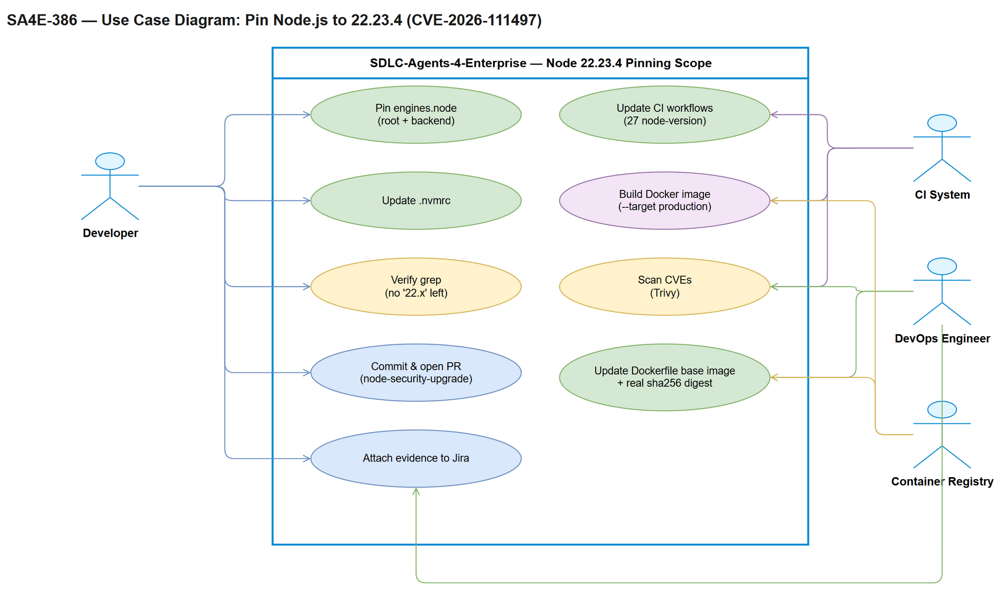
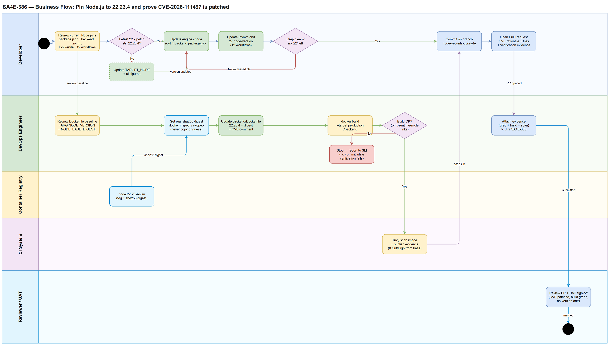
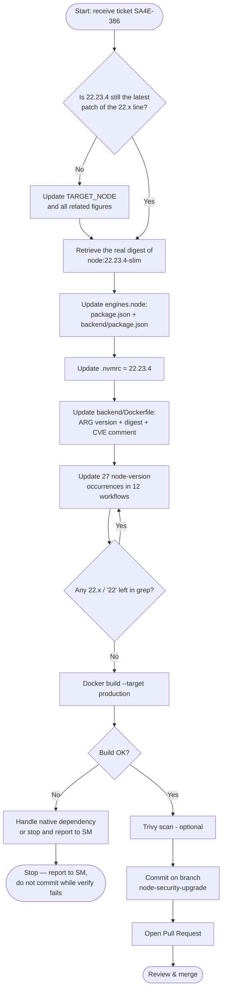

# Business Requirements Document (BRD)

## SDLC-Agents-4-Enterprise — SA4E-386: Pin Node.js to 22.23.4 to Patch CVE-2026-111497 (Brotli RCE) and Related Highs

---

## Document Information

| Field | Value |
|-------|-------|
| Jira Ticket | SA4E-386 |
| Title | [Security] Pin Node.js to 22.23.4 to patch CVE-2026-111497 (Brotli RCE) and related highs |
| Author | BA Agent |
| Version | 1.0 |
| Date | 2026-10-27 |
| Status | Draft |

**Supplementary ticket information (from Jira):**

| Field | Value |
|-------|-------|
| Project | SA4E — SDLC Agents 4 Enterprise |
| Issue Type | Task |
| Priority | High |
| Labels | cve, node, node-upgrade, security |
| Reporter / Creator | Duc Nguyen Minh |
| Assignee | Unassigned |
| Status | To Do |
| Fix Version | None |
| Attachment | `PLAN.md` (attachment id 11805, 10,999 bytes, attached 2026-10-27) |
| Issue Links | No Jira issue links (issuelinks is empty) |
| Watchers | 1 |

---

## Author Tracking

| Role | Name - Position | Responsibility |
|------|-----------------|----------------|
| Author | BA Agent – Business Analyst | Create document |
| Peer Reviewer | Duc Nguyen Minh – Reporter (Jira SA4E-386) | Review document |

---

## Revision History

| Version | Date | Author | Changes |
|---------|------|--------|---------|
| 1.0 | 2026-10-27 | BA Agent | Initiate document — auto-generated from Jira ticket SA4E-386 and the attached `PLAN.md`; restructured to follow `documents/templates/BRD-TEMPLATE.md`. Rewritten fully in English; all technical content (FR/AC/NFR/R identifiers, CVE data, file lists, occurrence counts) preserved unchanged. |

---

## Sign-Off

| Name | Signature and date |
|------|--------------------|
| | ☐ I agree and confirm all criteria on this BRD as expected requirements |
| | ☐ I agree and confirm all criteria on this BRD as expected requirements |

---

## 1. Introduction

### 1.1 Scope

The **SDLC-Agents-4-Enterprise** repo currently **pins only the Node.js major line**, not the patch version. Because these constraints are loose, developer machines, CI runners and Docker containers may run any older `22.x` build, including builds that are still exposed to High-severity CVEs. The scope of this change request is to **pin Node.js to the safe patch version 22.23.4** across the entire repo (local, CI, Docker) in order to patch CVE-2026-111497 (Brotli RCE) and the related High-severity issues, and to eliminate version drift between environments.

**Current Node version declarations (verified against the repo):**

| # | File | Current declaration |
|---|------|---------------------|
| 1 | `package.json` (root, line 21) | `"engines": { "node": "22.x" }` |
| 2 | `backend/package.json` (line 50) | `"engines": { "node": "22.x" }` |
| 3 | `.nvmrc` | `22` |
| 4 | `backend/Dockerfile` (lines 32, 35) | `ARG NODE_VERSION=22` + `NODE_BASE_DIGEST=sha256:43ac6c60…` (node:22-slim) |
| 5 | `.github/workflows/*.yml` | 27 occurrences of `node-version: '22'` / `"22"` across 12 files (details in Appendix B) |

`extension/package.json` does not declare a Node runtime (it only has `engines.vscode`) → out of scope.

**Security issues to be addressed:**

| CVE | Severity | Description | Source |
|-----|----------|-------------|--------|
| CVE-2026-111497 | High | Out-of-bounds write in the Brotli decoder → RCE risk ("Node2Shell") | Node.js advisory 10/2026 |
| (2 TLS issues) | High | TLS hostname verification bypass | Node.js advisory 10/2026 |
| CVE-2026-56846 | High | HTTP/2 retained headers exceed `maxSessionMemory` | Node.js advisory 07/2026 |

> All CVE identifiers, severities and the target version are taken verbatim from SA4E-386 and `PLAN.md`. The BA cannot independently verify these advisories — the DEV is responsible for re-verifying them before applying the change (see section 5.1, R-04 and R-07).

**Objectives of this change request:**

1. **Primary objective:** Pin Node.js to the safe patch version **22.23.4** across the entire repo (local, CI, Docker) to patch CVE-2026-111497 and the related High-severity issues.
2. **Technical objective:** Replace every loose `22.x` / `22` constraint with a hard pin — `>=22.23.4 <23` (engines) and `22.23.4` (.nvmrc, CI, Dockerfile).
3. **Supply-chain objective:** The Docker base image is pinned by the real digest of `node:22.23.4-slim`, ensuring reproducible builds.
4. **Consistency objective:** No remaining version drift between developer machines, CI runners and production containers.

**Scope of changes:**

| # | Item | Change |
|---|------|--------|
| 1 | `package.json` (root) | `engines.node` → `>=22.23.4 <23` |
| 2 | `backend/package.json` | `engines.node` → `>=22.23.4 <23` |
| 3 | `.nvmrc` | `22` → `22.23.4` |
| 4 | `backend/Dockerfile` | `NODE_VERSION=22.23.4` + new `NODE_BASE_DIGEST` + CVE comment |
| 5 | `.github/workflows/` (12 files) | `node-version` 22 → 22.23.4 |
| 6 | Git | Branch `node-security-upgrade`, commit + PR |

**Constants applied throughout:**

- `TARGET_NODE = 22.23.4`
- `TARGET_ENGINES_RANGE = ">=22.23.4 <23"`
- `TARGET_DOCKER_DIGEST` = the digest of `node:22.23.4-slim`, retrieved for real at implementation time

### 1.2 Out of Scope

- **No** major upgrade to Node 24.x — that requires regression testing of native deps (`onnxruntime-node`, rolldown binding) and must be raised as a separate ticket.
- **No** changes to `extension/package.json` — that file does not pin the Node runtime.
- **No** rewriting of historical document content under `documents/` (SA4E-189, SA4E-225, SA4E-242, SA4E-125 reference Node 18/20). Only adding a note is allowed — and is optional (PLAN Task 6, optional).
- **No** upgrade or change of any other npm dependency.
- **No** changes to business code; no changes to application logic.

### 1.3 Preliminary Requirement

1. **Local runtime:** the implementing machine must have Node `22.23.4` installed (`nvm install 22.23.4 && nvm use`) so that `npm ci` does not report `EBADENGINE`.
2. **Docker daemon or skopeo:** one of the two is mandatory in order to retrieve the **real** digest of `node:22.23.4-slim` and (if a daemon is available) to test-build the production image.
3. **Verify the target version:** before committing, confirm that `22.23.4` is still the latest safe patch on the 22.x line (PLAN §1.4); if a higher build exists, use that build and update every figure consistently.
4. **Repo/Git permissions:** permission to create the `node-security-upgrade` branch, push, and open a Pull Request; **no** permission to push directly to `main`/`master`.
5. **CI read access:** read/write access to `.github/workflows/` in order to update the 27 `node-version` occurrences.
6. **Source document:** `documents/node-security-upgrade/PLAN.md` (attached to Jira SA4E-386) must be available for task/verify cross-checking.

---

## 2. Business Requirements

### 2.1 High Level Process Map

The high-level business process consists of 6 sequential phases: **verify the target version → retrieve the base image digest → update the version declarations (engines, .nvmrc, Dockerfile, CI) → verify via grep/build/scan → commit per convention → open a Pull Request for review**. Every step has a checkpoint (grep, build, diff) before moving to the next step; if a check fails, the flow returns to the corresponding edit step. Step details are in the Business Flow and the Stories in section 2.3.

**Use Case Diagram — actors and use cases in scope (SA4E-386):**

*[Edit in draw.io](diagrams/use-case.drawio)*

**Business Flow — cross-functional swimlane (Developer → DevOps Engineer → Container Registry → CI System → Reviewer/UAT):**

*[Edit in draw.io](diagrams/business-flow.drawio)*

### 2.2 List of User Stories / Use Cases

| # | Story / Use Case / Epic | Priority | Source Ticket |
|---|-------------------------|----------|---------------|
| 1 | As a Developer/CI Engineer, I want the `engines.node` of the root and backend packages pinned to `>=22.23.4 <23`, so that npm blocks any older Node 22.x runtime that is still affected by the CVE. | MUST HAVE | SA4E-386 |
| 2 | As a Developer, I want `.nvmrc` to contain exactly `22.23.4`, so that `nvm use` selects the patched local runtime. | MUST HAVE | SA4E-386 |
| 3 | As a DevOps/Release Engineer, I want the Docker base image pinned by both the `22.23.4` version and the real digest, so that the production image is reproducible and no longer pulls a floating base image that is still affected by the CVE. | MUST HAVE | SA4E-386 + PLAN Task 4 |
| 4 | As a CI Maintainer, I want every `actions/setup-node` in the 12 workflows to use `22.23.4`, so that no pipeline runs on an older Node. | MUST HAVE | SA4E-386 + PLAN Task 5 |
| 5 | As a Reviewer/Security Engineer, I want the verification results (grep, docker build, scan) to be evidenced, so that there is proof the change actually patches the CVE and does not break the build. | MUST HAVE | SA4E-386 + PLAN Task 7 |
| 6 | As a Team Lead, I want the change committed on a dedicated branch and opened as a Pull Request that describes the CVE, so that the change is reviewed before reaching `main`. | MUST HAVE | SA4E-386 AC + PLAN Task 8 |

---

### 2.3 Details of User Stories

---

#### Business Flow

**Step 1:** Re-verify the target version — confirm that Node `22.23.4` is still the latest safe patch on the 22.x line (Active LTS). If a higher 22.x build exists, update `TARGET_NODE`, `TARGET_ENGINES_RANGE` and every figure in the document/PR for consistency.

**Step 2:** Retrieve the real digest of `node:22.23.4-slim` using `docker pull` + `docker inspect --format='{{index .RepoDigests 0}}'` or `skopeo inspect docker://node:22.23.4-slim --format '{{.Digest}}'`. Copying or guessing the digest is strictly forbidden.

**Step 3:** Update `engines.node` in `package.json` (root, line 21) and `backend/package.json` (line 50) from `"22.x"` to `">=22.23.4 <23"`.

**Step 4:** Update `.nvmrc` from `22` to `22.23.4`; if the worktree `.kilo/worktrees/pickled-hook/.nvmrc` is still active, update it the same way — if it is a stale artifact, skip it (check `git status` first).

**Step 5:** Update `backend/Dockerfile`: `ARG NODE_VERSION=22.23.4`, `ARG NODE_BASE_DIGEST=<real digest>`, and add a comment stating that the purpose is to patch CVE-2026-111497 (+ TLS/HTTP2 highs). The two `FROM node:${NODE_VERSION}-slim@${NODE_BASE_DIGEST}` lines (stage `base` at line 40 and stage `production` at line 178) automatically consume the new ARGs — no further edit is needed.

**Step 6:** Update the 27 occurrences of `node-version: '22'` / `"22"` across the 12 workflow files to `22.23.4`, preserving each file's quoting style.

**Step 7:** Explicitly review the workflows that use a matrix and the workflows that may hardcode the Node version in another form: `build-native.yml`, `build-onnxruntime.yml` (matrix), `build-push-backend.yml`, `scheduled-prebuild-scan.yml`.

**Step 8:** Verify via grep (`"node": "22.x"`, `node-version: '22'`), `cat .nvmrc`, reading the `ARG` values in the Dockerfile, a test build `docker build --target production ./backend` (if a daemon is available), and (optionally) a Trivy scan as done in `build-push-backend.yml`.

**Step 9:** Commit on the `node-security-upgrade` branch with the message `chore(security): pin Node to 22.23.4 to patch CVE-2026-111497 and related highs`, staging each file explicitly (no `git add -A`).

**Step 10:** Open a Pull Request (no direct push to `main`/`master`) whose description covers: the CVE rationale, the list of changed files, and the verification results (build + scan).

> **Note:** The entire flow only affects version/digest declarations and CI configuration — it does **not** modify business code and does **not** bump npm dependencies (see 1.2 and AC-07). If any verification step fails, return to the corresponding edit step (Step 3–7) instead of skipping the check.

---

#### STORY 1: Pin `engines.node` for the root and backend packages

> As a Developer/CI Engineer, I want the `engines.node` of the root and backend packages pinned to `>=22.23.4 <23`, so that npm blocks any older Node 22.x runtime that is still affected by the CVE.

**Requirement Details:**

1. **FR-01** — `package.json` (root) must declare `engines.node = ">=22.23.4 <23"` (replacing `"22.x"` at line 21). *(SA4E-386, PLAN Task 1)*
2. **FR-02** — `backend/package.json` must declare `engines.node = ">=22.23.4 <23"` (replacing `"22.x"` at line 50). *(SA4E-386, PLAN Task 2)*
3. Only the `engines.node` value changes; every other field in both `package.json` files is preserved and no dependency is bumped. *(AC-07)*
4. `extension/package.json` is **out of scope** because it only declares `engines.vscode` and does not pin the Node runtime. *(1.2)*

**Data Fields (if applicable):**

| Field | Type | Required | Description | Example |
|-------|------|----------|-------------|---------|
| `engines.node` (root package.json) | string (semver range) | Yes | Node version range npm accepts for the workspace root; currently `22.x` | `">=22.23.4 <23"` |
| `engines.node` (backend/package.json) | string (semver range) | Yes | Node version range npm accepts for the backend package; currently `22.x` | `">=22.23.4 <23"` |

**Acceptance Criteria:**

1. **AC-01** — Every file that declares `engines.node` uses `">=22.23.4 <23"`. Verification: `grep -rn '"node": "22.x"' package.json backend/package.json` → empty result.
2. **NFR-SEC-06** — local = CI = container: the engines value matches `22.23.4` in `.nvmrc`, the workflows and the Dockerfile.
3. No out-of-scope changes appear in `git diff --stat` for these two files. *(AC-07)*

**UI Specifications (if applicable):**

Not applicable — SA4E-386 is a configuration/supply-chain change with no user interface (see section 1.2).

**Validation Rules (if applicable):**

- The range must be `>=22.23.4 <23` — blocking both older builds (< 22.23.4) and major 23+.
- `22.x`, `^22`, `~22` and any other loose constraint must not be used.
- The file must remain valid JSON after the edit.

**Error Handling (if applicable):**

- `npm ci` reports `EBADENGINE` because the local runtime is < 22.23.4: run `nvm install 22.23.4 && nvm use` before reinstalling (R-05).
- `npm ci` reports `EBADENGINE` on CI because a workflow still pins `22`: handle per STORY 4 (update every `node-version`).
- JSON parse error after the edit: revert the file and redo the edit; never commit a broken file.

---

#### STORY 2: Pin `.nvmrc` to 22.23.4

> As a Developer, I want `.nvmrc` to contain exactly `22.23.4`, so that `nvm use` selects the patched local runtime.

**Requirement Details:**

1. **FR-03** — `.nvmrc` must contain exactly `22.23.4` (currently `22`) so that `nvm use` selects the correct local runtime. *(SA4E-386, PLAN Task 3)*
2. `.kilo/worktrees/pickled-hook/.nvmrc` still exists: if that worktree is still active, update it the same way; if it is a stale artifact, skip it (check `git status` first). *(PLAN Task 3)*

**Data Fields (if applicable):**

| Field | Type | Required | Description | Example |
|-------|------|----------|-------------|---------|
| `.nvmrc` content (root) | string (version pin) | Yes | Version that `nvm use` will activate; currently `22` | `22.23.4` |
| `.kilo/worktrees/pickled-hook/.nvmrc` | string (version pin) | No | Update only if the worktree is still active | `22.23.4` |

**Acceptance Criteria:**

1. **AC-02** — `.nvmrc` = `22.23.4`. Verification: `cat .nvmrc` returns exactly `22.23.4`.
2. `nvm use` at the root activates Node 22.23.4 and no longer selects the default 22.x build.

**UI Specifications (if applicable):**

Not applicable — no user interface is involved.

**Validation Rules (if applicable):**

- The file content contains only the version — no `v` prefix and no trailing whitespace.
- The major-only value `22` must not be reused.

**Error Handling (if applicable):**

- `nvm use` reports the version is not installed: run `nvm install 22.23.4` then `nvm use`.
- The `.kilo/worktrees/pickled-hook` worktree is no longer used: skip it and note this in the PR so the reviewer is aware.

---

#### STORY 3: Pin the Docker base image by version and real digest

> As a DevOps/Release Engineer, I want the Docker base image pinned by both the `22.23.4` version and the real digest, so that the production image is reproducible and no longer pulls a floating base image that is still affected by the CVE.

**Requirement Details:**

1. **FR-04** — `backend/Dockerfile` must set `ARG NODE_VERSION=22.23.4` and `ARG NODE_BASE_DIGEST` = the **real** digest of `node:22.23.4-slim`, retrieved via `docker inspect` or `skopeo inspect`. Copying or guessing the digest is **strictly forbidden**. *(PLAN Task 4a/4b)*
2. **FR-05** — The Dockerfile comment must state that the purpose is to patch CVE-2026-111497 (+ TLS/HTTP2 highs) for traceability. The comment also retains the note "Tag kept for readability; the digest is the authoritative pin". *(PLAN Task 4b, NFR-SEC-05)*
3. The two `FROM node:${NODE_VERSION}-slim@${NODE_BASE_DIGEST}` lines (stage `base` at line 40, stage `production` at line 178) automatically consume the new ARGs — these two lines must **not** be edited. *(PLAN Task 4b)*
4. **NFR-SEC-02** — Reproducible supply chain: the base image is pinned by SHA256 digest, never by a floating tag.

**Data Fields (if applicable):**

| Field | Type | Required | Description | Example |
|-------|------|----------|-------------|---------|
| `ARG NODE_VERSION` | string (version) | Yes | Node version of the base image; currently `22` | `22.23.4` |
| `ARG NODE_BASE_DIGEST` | string (sha256 digest) | Yes | Digest of `node:${NODE_VERSION}-slim`; currently `sha256:43ac6c60…` (node:22-slim) | `sha256:<TARGET_DOCKER_DIGEST>` |
| `FROM` (stage base, line 40) | Dockerfile instruction | Yes | `FROM node:${NODE_VERSION}-slim@${NODE_BASE_DIGEST} AS base` — inherits the ARGs, do not edit | — |
| `FROM` (stage production, line 178) | Dockerfile instruction | Yes | `FROM node:${NODE_VERSION}-slim@${NODE_BASE_DIGEST} AS production` — inherits the ARGs, do not edit | — |

**Acceptance Criteria:**

1. **AC-03** — The Dockerfile pins the correct version + digest of `node:22.23.4-slim`. Verification: read `ARG NODE_VERSION` / `ARG NODE_BASE_DIGEST` and compare against the digest retrieved from `docker inspect`.
2. The digest in the file matches exactly the digest returned by `docker inspect --format='{{index .RepoDigests 0}}' node:22.23.4-slim` (or `skopeo inspect`).
3. A comment describing the CVE is present in the Dockerfile and references CVE-2026-111497 correctly. *(NFR-SEC-05)*
4. The `backend/Dockerfile` diff contains only version/digest/comment changes — no `--insecure` added, no privilege relaxation. *(NFR-SEC-03)*

**UI Specifications (if applicable):**

Not applicable — no user interface is involved.

**Validation Rules (if applicable):**

- The digest must follow the `sha256:` + 64 hex characters format.
- The digest must be retrieved at implementation time, not taken from a document or from PLAN.md.
- `NODE_VERSION` must match `TARGET_NODE = 22.23.4` and match `.nvmrc`/engines/CI.
- The base image tag type must not change (alpine, full) within this ticket.

**Error Handling (if applicable):**

- `docker build` reports `manifest unknown` / the digest does not exist: the digest is wrong or no longer on the registry → retrieve the digest again via `docker inspect`/`skopeo`, never guess (R-01).
- No Docker daemon available: use `skopeo inspect` to retrieve the digest; note in the PR that the docker build step could not be run (R-01/FR-10).
- Build fails while linking the native dep (`onnxruntime-node`): handle per STORY 5 + R-03; do not downgrade the Node version "to make the build pass".
- The CVE comment is missing after the edit: add it back before committing (NFR-SEC-05).

---

#### STORY 4: Synchronize the Node version across all CI workflows

> As a CI Maintainer, I want every `actions/setup-node` in the 12 workflows to use `22.23.4`, so that no pipeline runs on an older Node.

**Requirement Details:**

1. **FR-06** — Every `actions/setup-node` in `.github/workflows/*.yml` must use `node-version: '22.23.4'` (preserving each file's quoting style). *(SA4E-386, PLAN Task 5)*
2. **FR-07** — For workflows that use a matrix (`build-native.yml`, `build-onnxruntime.yml`): if the matrix lists `22`, change it to `22.23.4`; if the matrix intentionally builds multiple major versions, leave it unchanged and document the reason in the PR. *(PLAN Task 5)*
3. **FR-08** — `build-push-backend.yml` and `scheduled-prebuild-scan.yml` must be reviewed manually to confirm they do not hardcode the Node version in another form. *(PLAN Task 5)*
4. **27 occurrences** of the literal `node-version` must be edited across **12 files** (detailed table in Appendix B); in addition there are 2 matrix-form occurrences, `node-version: ${{ matrix.node_version }}` in `build-native.yml` (line 83) and `build-onnxruntime.yml` (line 84) — these are not edited directly but handled per FR-07.

**Data Fields (if applicable):**

| Field | Type | Required | Description | Example |
|-------|------|----------|-------------|---------|
| `node-version` (`ci.yml`, `publish.yml`, `auto-release.yml`) | string (single quotes) | Yes | 7 occurrences (4 + 2 + 1) | `node-version: '22.23.4'` |
| `node-version` (8 `ci-sa4e-*.yml` files + `e2e-tests.yml`) | string (double quotes) | Yes | 20 occurrences: 191=1, 223=2, 241=6, 332=1, 336=2, 356=3, 358=2, 369=1, e2e-tests=2 | `node-version: "22.23.4"` |
| `node-version` (matrix) | expression | Conditional | `build-native.yml`, `build-onnxruntime.yml` — change only if the matrix lists `22` | `node-version: ${{ matrix.node_version }}` |

**Acceptance Criteria:**

1. **AC-04** — Every CI workflow uses `22.23.4`; no `'22'` remains. Verification: `grep -rn "node-version" .github/workflows/` returns only `22.23.4` or a valid matrix variable.
2. **FR-09** — After the edit, grep finds no remaining `"node": "22.x"` and no `node-version: '22'` / `"22"` in the workflows.
3. **NFR-SEC-07** — No old version slips through due to a missed file: the grep output contains no standalone `22` literal.
4. Each file's quoting style is preserved (files using `'` keep `'`, files using `"` keep `"`).

**UI Specifications (if applicable):**

Not applicable — no user interface is involved.

**Validation Rules (if applicable):**

- Only the version value changes; the YAML structure is untouched and `uses:`/action versions are unchanged.
- Jobs unrelated to Node (e.g. jobs that only run shell/Python) must not be modified.
- For matrices: any decision to keep a major range must be justified in the PR description.

**Error Handling (if applicable):**

- A missed occurrence means CI still runs on an older Node (R-02): re-run `grep -rn "node-version" .github/workflows/` and reconcile against the 12-file list in Appendix B.
- A wrong edit to the `build-native.yml`/`build-onnxruntime.yml` matrix removes multi-version build capability (R-06): revert the matrix portion, keep the major range, and document it in the PR.
- YAML becomes invalid after the edit: check with a diff review + YAML lint before committing.

---

#### STORY 5: Verify all changes before committing

> As a Reviewer/Security Engineer, I want the verification results (grep, docker build, scan) to be evidenced, so that there is proof the change actually patches the CVE and does not break the build.

**Requirement Details:**

1. **FR-09** — After the edit, `grep` must find no remaining `"node": "22.x"` and no `node-version: '22'` / `"22"` in the workflows.
2. **FR-10** — A test build `docker build --target production ./backend` must succeed (if a Docker daemon is available) to confirm the native dep `onnxruntime-node` still links correctly.
3. **FR-11** — (Optional) Run a Trivy scan as in `build-push-backend.yml` to confirm no Critical/High CVE remains from the Node base image.
4. **AC-07** — No out-of-scope changes are introduced (no business code edits, no dependency bumps); verified with `git diff --stat`.
5. **NFR-SEC-01** — CVE-2026-111497 (Brotli RCE) and the 3 related High issues are removed from the Node runtime; measurement criterion: the production image scan reports 0 Critical/High CVEs originating from the Node base.
6. **NFR-SEC-04** — Patching within major 22.x keeps the ABI stable and does not break native modules; measurement criterion: `onnxruntime-node` loads and the production build succeeds.

**Data Fields (if applicable):**

| Field | Type | Required | Description | Example |
|-------|------|----------|-------------|---------|
| Grep engines | shell command | Yes | Confirm no loose constraint remains | `grep -rn '"node": "22.x"' package.json backend/package.json` → empty |
| Grep workflows | shell command | Yes | Confirm no `node-version: '22'`/`"22"` remains | `grep -rn "node-version" .github/workflows/` → only `22.23.4`/matrix |
| `.nvmrc` check | shell command | Yes | Confirm the local version | `cat .nvmrc` → `22.23.4` |
| Docker build | shell command | Conditional (daemon required) | Build the production stage | `docker build --target production -t sa4e-backend:node-upgrade ./backend` |
| Trivy scan | shell command | No (optional) | Scan the image for CVEs | Run as in `build-push-backend.yml` |
| `git diff --stat` | shell command | Yes | Confirm the change scope | Only the files listed in 1.1 |

**Acceptance Criteria:**

1. **AC-05** — The build succeeds and no High CVE remains from the base image. Verification: `docker build --target production` + Trivy scan (if available).
2. `npm ci` (root) and `npm ci --prefix backend` run successfully on the 22.23.4 runtime with no `EBADENGINE` error.
3. `npm run build` / `npm run build --prefix backend` (where the script exists) succeeds.
4. `git diff --stat` contains only files within the scope defined in 1.1; there are no business-code or dependency changes. *(AC-07)*

**UI Specifications (if applicable):**

Not applicable — no user interface is involved.

**Validation Rules (if applicable):**

- Every verification command must run against the **edited** code (after Step 3–7), never against the previous state.
- Grep output must be empty / match expectations — a result that still contains a `22` literal must not be "accepted".
- If no Docker daemon is available, the build step is marked "not executed" in the PR and must never be reported as "passed".

**Error Handling (if applicable):**

- `npm ci` reports `EBADENGINE`: the local runtime is not 22.23.4 → `nvm install 22.23.4 && nvm use` then re-run (R-05).
- `docker build` fails at the native dep install step: re-check the base image/digest and confirm the patch is within the same major; if it still fails → stop, report to SM and record R-03.
- Docker daemon unavailable: document it clearly in the PR and move the build step to CI for confirmation.
- Trivy unavailable: skip the optional step (FR-11) and note it in the PR; never claim "0 CVE" without a scan.
- Grep still shows the old version: return to STORY 1–4 and fix the missed files; do not commit while an old literal remains.

---

#### STORY 6: Commit per convention and open a Pull Request

> As a Team Lead, I want the change committed on a dedicated branch and opened as a Pull Request that describes the CVE, so that the change is reviewed before reaching `main`.

**Requirement Details:**

1. **FR-12** — The change must be committed on the `node-security-upgrade` branch with the message `chore(security): pin Node to 22.23.4 to patch CVE-2026-111497 and related highs`, staging each file explicitly (no `git add -A`). *(SA4E-386, PLAN Task 8)*
2. **FR-13** — A Pull Request must be opened (no direct push to `main`/`master`) whose description covers: the CVE rationale, the list of changed files, and the verification results. *(SA4E-386 AC, PLAN Task 8)*
3. **NFR-SEC-05** — Auditability: the commit message, the Dockerfile comment and the PR description all reference the CVE ID; PR review confirms all 3 references are present.

**Data Fields (if applicable):**

| Field | Type | Required | Description | Example |
|-------|------|----------|-------------|---------|
| Branch name | string | Yes | Branch holding the change | `node-security-upgrade` |
| Commit message | string (conventional commit) | Yes | Standardized message containing the CVE ID | `chore(security): pin Node to 22.23.4 to patch CVE-2026-111497 and related highs` |
| Staged files | list of paths | Yes | Stage each file explicitly, no `git add -A` | `package.json backend/package.json .nvmrc backend/Dockerfile .github/workflows/` |
| PR description | text | Yes | Contains CVE rationale, file scope, verification results | 3 mandatory sections |
| Base branch | string | Yes | Target branch of the PR | `main` (via PR, never a direct push) |

**Acceptance Criteria:**

1. **AC-06** — The PR is opened; nothing is pushed directly to `main`. Verification: check the branch + PR on GitHub.
2. The commit message matches the convention string in FR-12 exactly.
3. The PR description contains all 3 sections: CVE rationale (CVE-2026-111497 + TLS/HTTP2 highs), list of changed files, verification results. *(NFR-SEC-05)*
4. No commit is made directly on `main`/`master`.

**UI Specifications (if applicable):**

Not applicable — no user interface is involved.

**Validation Rules (if applicable):**

- `git add -A` / `git add .` must not be used — only stage paths within scope.
- No force-push to `main`/`master`.
- The branch name must be exactly `node-security-upgrade` (or the ticket key when repo convention requires it — in that case state it explicitly in the PR).

**Error Handling (if applicable):**

- Push blocked by branch protection on `main`: create/push the `node-security-upgrade` branch and open the PR through the proper process.
- Pre-commit hook fails: fix the root cause (do not use `--no-verify` to bypass the hook).
- Reviewer requests more verification evidence: add the grep/build/scan results to the PR description and respond to the review.

---

## 3. Dependencies

| Dependency | Type | Related Ticket | Description |
|------------|------|----------------|-------------|
| `node:22.23.4-slim` base image (Docker Hub) | External | SA4E-386 | Source image for the `base` and `production` stages of `backend/Dockerfile`; the real digest must be retrieved at implementation time (FR-04). |
| Docker daemon or `skopeo` | Infrastructure | SA4E-386 | Mandatory tooling to retrieve the exact digest and (if a daemon is available) to test-build the production image (FR-10). |
| `nvm` + Node 22.23.4 on the dev machine/runner | Infrastructure | SA4E-386 | Required so that `nvm use` and `npm ci` do not report `EBADENGINE` (R-05). |
| Native deps `onnxruntime-node`, rolldown binding | System | SA4E-386 | Binary dependencies that must build/link against Node 22.23.4; a prerequisite of NFR-SEC-04 and AC-05. |
| GitHub Actions (`.github/workflows/`) | System | SA4E-386 | 12 workflows using `actions/setup-node`; 27 `node-version` occurrences must be updated (FR-06). |
| GitHub Pull Request + branch protection | External | SA4E-386 | Mandatory review channel; direct pushes to `main`/`master` are not allowed (FR-13, AC-06). |
| `documents/node-security-upgrade/PLAN.md` | External | SA4E-386 | Source planning document (Jira attachment 11805) used for task/verify cross-checking. |
| Trivy (optional) | External | SA4E-386 | Used to scan the image for CVEs the same way as `build-push-backend.yml`; not mandatory (FR-11). |
| Worktree `.kilo/worktrees/pickled-hook` | Infrastructure | SA4E-386 | Has its own `.nvmrc`; update only if the worktree is still active (PLAN Task 3). |

---

## 4. Stakeholders

| Role | Name / Team | Responsibility | Source |
|------|-------------|----------------|--------|
| Reporter / Ticket Owner | Duc Nguyen Minh | Raised the CVE-patching request, confirms scope and acceptance criteria; peer reviewer of this BRD | Jira reporter/creator SA4E-386 |
| Assignee / Developer (DEV Agent) | Unassigned | Applies the version/digest changes, runs verification, commits and opens the PR | Jira assignee (empty) |
| BA Agent | BA Agent | Analyses requirements, writes the BRD/FSD, ensures traceability | Pipeline role |
| DevOps / CI Maintainer | DevOps Agent | Updates the 12 workflows and the base image digest, keeps the pipeline green | Pipeline role + CI scope |
| Security Reviewer | Security Agent | Verifies the CVE is patched, reviews the supply-chain change, confirms CI privileges are not relaxed | Pipeline role + `security` label |
| Reviewer / Approver | Team Lead / Peer Reviewer | Reviews the PR and blocks merge if verification evidence is missing | FR-13, NFR-SEC-05 |
| Scrum Master | SM Agent | Coordinates the pipeline, tracks gates and ticket status | Pipeline role |

---

## 5. Risks and Assumptions

### 5.1 Risks

| Risk | Impact | Likelihood | Mitigation |
|------|--------|------------|------------|
| **R-01** — Wrong Docker digest (copied from a document or mistyped) → the build uses an unintended base image | High | High | Mandatory retrieval of the real digest via `docker inspect`/`skopeo` at implementation time (FR-04); cross-review the digest in the PR. |
| **R-02** — A `node-version` occurrence is missed among the 27 occurrences / 12 workflows → CI keeps running an older build | Medium | Medium | Grep confirmation in FR-09/AC-04; reconcile against the file list in Appendix B. |
| **R-03** — Native deps (`onnxruntime-node`, rolldown) are incompatible with the new patch | Low | Low | Same major 22.x → stable ABI; verify with `docker build` + loading `onnxruntime-node` (FR-10). |
| **R-04** — `22.23.4` is already outdated or a higher safe 22.x build exists at apply time | Medium | Medium | Re-verify the latest 22.x build before committing (PLAN §1.4); if a higher build exists, use it and update all figures consistently. |
| **R-05** — The dev machine/runner does not have 22.23.4 → `npm ci` reports `EBADENGINE` and verification fails | Low | Low | Run `nvm install 22.23.4 && nvm use` before verifying. |
| **R-06** — The matrix in `build-native.yml` / `build-onnxruntime.yml` is edited incorrectly, removing multi-version build capability | Low | Low | Read the matrix carefully before editing (FR-07); if the major range is kept, document the reason in the PR. |
| **R-07** — The CVE identifiers / severities in the ticket do not match the official advisory | Medium | Medium | DEV cross-checks the nodejs.org security advisories before applying; if they differ, update the BRD and report to SM. |

### 5.2 Assumptions

- `22.23.4` is the latest patch on the 22.x line at implementation time (released 2026-10-21, patching 10 CVEs including the Brotli RCE); if a higher build exists, use it and update the figures consistently (R-04).
- The CVE identifiers, severities and descriptions in SA4E-386/`PLAN.md` are correct per the official advisories; the BA does not verify them independently and the DEV is responsible for cross-checking (R-07).
- The whole repo currently uses only Node 22.x; no active configuration runs below Node 22 — the Node 18/20 references only exist in historical documents under `documents/`.
- `extension/package.json` does not pin the Node runtime (only `engines.vscode`), therefore it must not be edited.
- Patching within major 22.x keeps the ABI stable and native modules do not need rebuilding against a new API (NFR-SEC-04).
- The implementation environment has access to a Docker daemon or `skopeo`; otherwise the build step is recorded as not executed and deferred to CI.
- Repo write permission is sufficient to create the `node-security-upgrade` branch and open a PR; `main`/`master` is protected.
- The 27 occurrences / 12 workflows listed in this document are correct as of writing; if the repo changes afterwards, the `grep` result at implementation time is authoritative.

---

## 6. Non-Functional Requirements

| Category | Requirement | Details |
|----------|-------------|---------|
| Performance | No runtime performance degradation after the patch upgrade | Patch within major 22.x, only a security patch changes; no runtime configuration or dependency changes. |
| Security | Remove CVE-2026-111497 (Brotli RCE) + 3 High issues (2 TLS hostname bypass, CVE-2026-56846 HTTP/2) from the Node runtime; reproducible supply chain via SHA256 digest; no security regression caused by misconfiguration | Quantified details in the NFR-SEC table below (NFR-SEC-01 … NFR-SEC-07). |
| Scalability | No architecture or scaling model change; applied uniformly to every environment (local, CI, container) | 12 workflows + 1 Dockerfile use the same `22.23.4` version, so no per-environment configuration is introduced. |
| Availability | Builds/CI and the production image keep working after the change; the change goes through a PR and does not disrupt `main` | Simple rollback: revert the commit/PR (it only affects version declarations, not data). |

**Quantified security NFRs:**

| ID | Requirement | Measurement criterion |
|----|-------------|-----------------------|
| **NFR-SEC-01** | Remove CVE-2026-111497 (Brotli RCE) and the 3 related High issues from the Node runtime. | Production image scan: 0 Critical/High CVEs originating from the Node base. |
| **NFR-SEC-02** | Reproducible supply chain — the Docker base image must be pinned by SHA256 digest, never by a floating tag. | `FROM node:${NODE_VERSION}-slim@${NODE_BASE_DIGEST}`; the digest matches `node:22.23.4-slim`. |
| **NFR-SEC-03** | No security regression from misconfiguration: TLS verification must not be disabled, no `--insecure`, no CI privilege relaxation. | The diff contains only version/digest changes. |
| **NFR-SEC-04** | Patch within major 22.x → stable ABI, native modules not broken. | `onnxruntime-node` loads; the production build succeeds. |
| **NFR-SEC-05** | Auditability: the commit message, the Dockerfile comment and the PR description all reference the CVE ID. | PR review confirms all 3 references are present. |
| **NFR-SEC-06** | Version consistency: local = CI = container. | `.nvmrc`, engines, workflows and Dockerfile all at `22.23.4`. |
| **NFR-SEC-07** | No old version may slip through due to a missed file. | `grep -rn "node-version" .github/workflows/` returns only `22.23.4` or a valid matrix variable. |

---

## 7. Related Tickets

| Ticket Key | Summary | Status | Type | Relationship |
|------------|---------|--------|------|--------------|
| SA4E-386 | [Security] Pin Node.js to 22.23.4 to patch CVE-2026-111497 (Brotli RCE) and related highs | To Do | Task | Main ticket |
| SA4E-189 | Hot-Reload System — FileSystemWatcher reactive prompt rebuild | Done | Story | Relates to — historical documentation in `documents/SA4E-189/` still references `node:18-alpine` and `node-version: '18'` (not modified in this scope) |
| SA4E-225 | Incomplete language support: Scala, C/C++, C#, Ruby, PHP, Swift, Bash, PowerShell lack parser/regex patterns for symbol extraction | Done | Bug | Relates to — `documents/SA4E-225/DPG.md` references `node-version: '18.14.1'` (historical document, not modified) |
| SA4E-242 | Tech-debt: unify extension-computed checksum (git-blob + bulk-check) for non-Pega code + documents (Source C/D) | To Do | Task | Relates to — `documents/SA4E-242/ci-cd-extension.yml` references `node-version: '18'` (historical document, not modified) |
| SA4E-125 | [Context] Strategic Context Compaction and Model Tiering | Done | Story | Relates to — `documents/SA4E-125/DPG.md` references `node-version: 20` (historical document, not modified) |
| SA4E-335 | Review backend Dockerfile/docker-compose and create CI to build Docker image | In Progress | Task | Relates to — `documents/SA4E-335/SECURITY-ASSESSMENT.md` (SEC-02) records the old base image digest; may optionally be updated to keep docs in sync |

> Note: Jira SA4E-386 has **no issue links** (issuelinks is empty) and no subtasks. The tickets above are listed because their documents/workflows fall inside this ticket's review scope. The list of 12 `ci-sa4e-*.yml` workflows (191, 223, 241, 332, 336, 356, 358, 369) refers to per-ticket configuration files, catalogued in Appendix B.

---

## 8. Appendix

### Appendix A — Requirement → Story → Acceptance Criteria traceability

| Requirement ID | Summary | Story | Acceptance Criteria |
|----------------|---------|-------|---------------------|
| FR-01 | Root `package.json`: `engines.node = ">=22.23.4 <23"` | STORY 1 | AC-01 |
| FR-02 | `backend/package.json`: `engines.node = ">=22.23.4 <23"` | STORY 1 | AC-01 |
| FR-03 | `.nvmrc = 22.23.4` | STORY 2 | AC-02 |
| FR-04 | Dockerfile: `NODE_VERSION=22.23.4` + real digest | STORY 3 | AC-03 |
| FR-05 | Dockerfile comment stating CVE-2026-111497 (+ TLS/HTTP2 highs) | STORY 3 | AC-03, NFR-SEC-05 |
| FR-06 | Every `actions/setup-node` uses `22.23.4` | STORY 4 | AC-04 |
| FR-07 | Matrix handling in `build-native.yml`/`build-onnxruntime.yml` | STORY 4 | AC-04, R-06 |
| FR-08 | Review of `build-push-backend.yml`, `scheduled-prebuild-scan.yml` | STORY 4 | AC-04 |
| FR-09 | Grep is clean of `22.x` / `'22'` | STORY 4, STORY 5 | AC-01, AC-04 |
| FR-10 | `docker build --target production ./backend` succeeds | STORY 5 | AC-05 |
| FR-11 | (Optional) Trivy scan | STORY 5 | AC-05 |
| FR-12 | Commit on `node-security-upgrade`, staging each file | STORY 6 | AC-06 |
| FR-13 | Open a PR (no direct push to `main`) | STORY 6 | AC-06 |

### Appendix B — Catalogue of the 12 workflows requiring `node-version` updates

| # | File | Occurrences | Quote style |
|---|------|-------------|-------------|
| 1 | `ci.yml` | 4 | `'22'` |
| 2 | `publish.yml` | 2 | `'22'` |
| 3 | `auto-release.yml` | 1 | `'22'` |
| 4 | `e2e-tests.yml` | 2 | `"22"` |
| 5 | `ci-sa4e-191.yml` | 1 | `"22"` |
| 6 | `ci-sa4e-223.yml` | 2 | `"22"` |
| 7 | `ci-sa4e-241.yml` | 6 | `"22"` |
| 8 | `ci-sa4e-332.yml` | 1 | `"22"` |
| 9 | `ci-sa4e-336.yml` | 2 | `"22"` |
| 10 | `ci-sa4e-356.yml` | 3 | `"22"` |
| 11 | `ci-sa4e-358.yml` | 2 | `"22"` |
| 12 | `ci-sa4e-369.yml` | 1 | `"22"` |
| | **Total** | **27** | |

**Outside the list above (not edited directly):**

| File | Content | Handling |
|------|---------|----------|
| `build-native.yml` (line 83) | `node-version: ${{ matrix.node_version }}` | Change the `matrix` value if it lists `22`; if multi-major builds are required, leave it unchanged + note in the PR (FR-07) |
| `build-onnxruntime.yml` (line 84) | `node-version: ${{ matrix.node_version }}` | As above (FR-07) |
| `build-push-backend.yml` | No `node-version` found | Manual review to confirm the Node version is not hardcoded in another form (FR-08) |
| `scheduled-prebuild-scan.yml` | No `node-version` found | Manual review (FR-08) |

### Glossary

| Term | Definition |
|------|------------|
| `engines.node` | The `package.json` field that defines the Node version range npm accepts |
| `.nvmrc` | The file that declares the Node version used by `nvm use` |
| Digest pin | Pinning a Docker image by SHA256 hash instead of a tag to guarantee reproducibility |
| `EBADENGINE` | npm warning/error raised when the Node runtime falls outside `engines` |
| Active LTS | The Node line under long-term support (22.x at the time of this ticket) |
| Node2Shell | The name given to the RCE exploit leveraging the Brotli decoder flaw (CVE-2026-111497) |
| Reproducible supply chain | A build that yields the same artifact on every run because all inputs (base image) are pinned by digest |
| Occurrence | One instance of the `node-version` string inside a workflow file |

### Reference Documents

| Document | Link / Location |
|----------|-----------------|
| Node.js upgrade plan (PLAN.md) | `documents/node-security-upgrade/PLAN.md` (attached to Jira SA4E-386, attachment 11805) |
| Jira ticket | SA4E-386 |
| Node.js Oct 2026 Security Releases | https://nodejs.org/en/blog/vulnerability/october-2026-security-releases |
| Node.js Jul 2026 Security Releases | https://nodejs.org/en/blog/vulnerability/july-2026-security-releases |
| Node.js Brotli RCE patch guide | https://blog.ogwilliam.com/post/nodejs-brotli-rce-cve-2026-111497 |
| BRD template | `documents/templates/BRD-TEMPLATE.md` |
