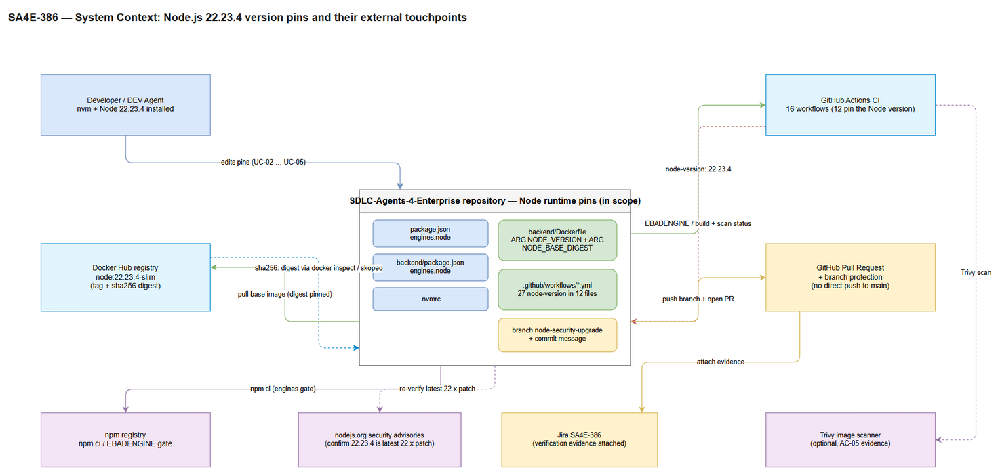
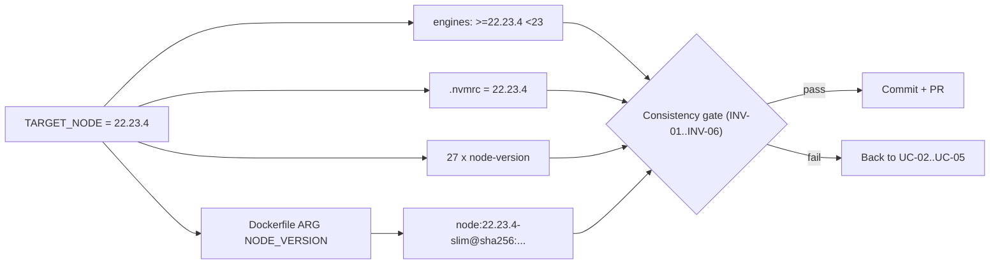
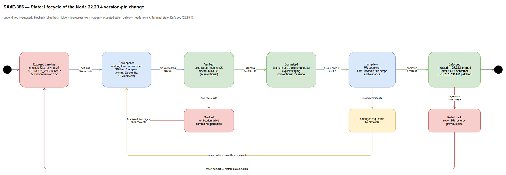
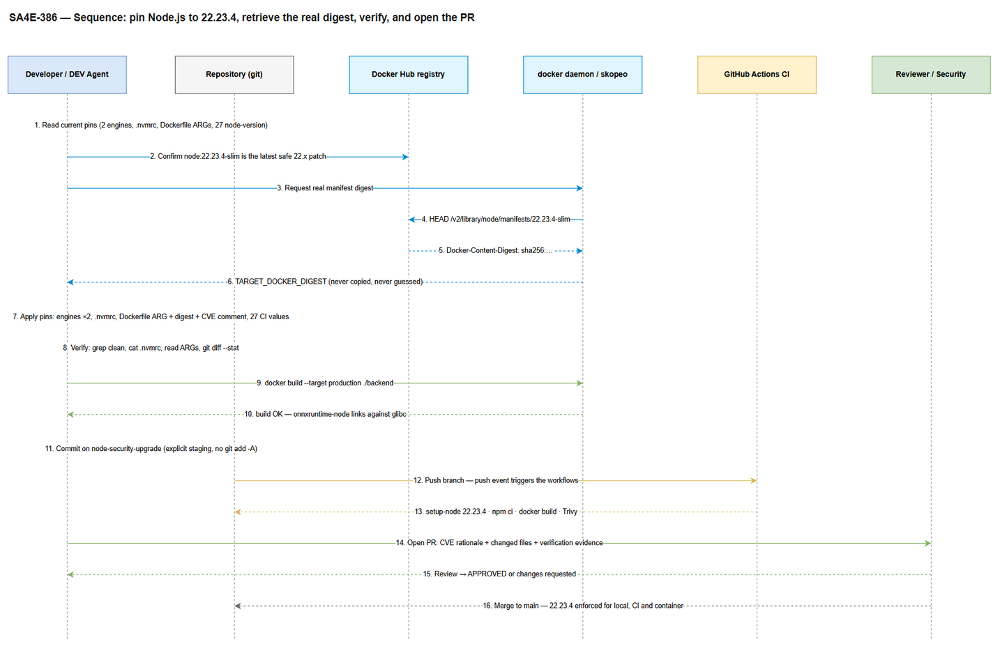

# Functional Specification Document (FSD)

## SDLC-Agents-4-Enterprise — SA4E-386: Pin Node.js to 22.23.4 to Patch CVE-2026-111497 (Brotli RCE) and Related Highs

***

> **Revision Note (v1.2):** FSD updated based on the SA discrepancy report `documents/SA4E-386/DISCREPANCY.md` v1.0 (2026-10-28). Fixed: **DISC-1** (TC-22 in §10.1 and the scope check in §3.6.2 now assert **17 artifacts**, with an explicit supersession notice so QA does not test the old 16-file list), **DISC-2** (`backend/Dockerfile` editable region **L32–L35**, CVE comment block **L33–L34**), **DISC-3** (`.nvmrc` content contract = exactly `22.23.4\n`, **8 bytes** including the LF), **DISC-4** (`build-native.yml` builds prebuilds for a package set that is disjoint from this repository's dependency set). No requirement was added, removed or weakened.

> **Revision Note (v1.3 — approved scope amendment CR-01):** FSD updated for scope amendment **CR-01 — retire the legacy `better-sqlite3` build workflow** (approved 2026-10-28). Added: **§1.2.1** (amendment record, evidence, supersession list), **FR-14 / FR-15 / FR-16** and **AC-08** inside new feature **F-08 / UC-08 (§3.9)**, **BR-29 / BR-30** (§3.8), **TC-43 … TC-46** (§10.1), and updated traceability (§12.2), change manifest (§12.3) and change log (§12.5). Rationale in one line: `build-native.yml` is a **dead/legacy distribution pipeline** for a package this repository does not depend on — `better-sqlite3` is declared by no `package.json`, is absent from `node_modules`, and has **0 resolved occurrences** in `package-lock.json` — so the workflow, its `workflow_run` trigger and its scheduled dispatch are removed. Consequences recorded: the workflow census drops from **16 to 15 files / 28 keys (27 literals + 1 matrix expression)**, and the expected diff grows from **17 to 18 entries** (17 modified + 1 deleted). The superseded statements are listed in §1.2.1.5. The Node pin itself, every existing acceptance criterion and every security requirement are unchanged.

***

## Document Information

| Field | Value |
|-------|-------|
| Jira Ticket | SA4E-386 |
| Title | [Security] Pin Node.js to 22.23.4 to patch CVE-2026-111497 (Brotli RCE) and related highs |
| Author | BA Agent (v1.0 draft) · TA Agent (v1.1 technical enrichment) · BA Agent (v1.2 discrepancy fixes, v1.3 scope amendment CR-01) |
| Version | 1.3 |
| Date | 2026-10-28 |
| Status | Draft — discrepancy fixes applied (SA review v1.0) and **scope amendment CR-01 applied**; implementation-ready |
| Related BRD | documents/SA4E-386/BRD.md |
| Related plan | documents/node-security-upgrade/PLAN.md (Jira attachment 11805) |
| Document type | FSD (functional specification of a configuration / supply-chain change) |
| Scope amendments | **CR-01** — retire the legacy `better-sqlite3` build workflow (§1.2.1, FR-14 … FR-16, AC-08, BR-29/BR-30, §3.9) |
| Technical enrichment | §13 — command contracts, Docker digest resolution, CI matrix model, nvm/engines interaction, verification gates, rollback/fallback, audit evidence, FR/AC coverage audit, technical open issues |

***

## Revision History

| Version | Date | Author | Changes |
|---------|------|--------|---------|
| 1.0 | 2026-10-28 | BA Agent | Initiate document — derived from BRD v1.0 (SA4E-386) and PLAN.md. Functionalises the six BRD stories into seven use cases (UC-01 … UC-07), a business-rule catalogue (BR-01 … BR-26), a configuration data model, integration/processing specifications, error handling, NFR targets, test scenarios and open issues. Scope of the change itself is unchanged from the BRD. |
| 1.1 | 2026-10-28 | TA Agent | **Technical enrichment (no BA content removed).** Added §13 with: re-verified repository baseline and 11 findings where the BRD/FSD text diverges from the actual tree; 18 executable command contracts (CC-01 … CC-18) with exit-code taxonomy and bash/PowerShell variants; a Docker digest resolution specification for multi-arch images (index vs platform manifest, normalisation, tag↔digest binding proof); the CI execution model including the dynamically generated matrices and the prebuild filename namespace (FR-07 resolved as "preserve ABI-major"); the nvm/engines/npm enforcement model (`engine-strict=false` verified — the pin warns, it does not block); a deterministic gate sequence G0 … G8; a rollback/fallback specification with security time-boxing; an evidence catalogue EV-01 … EV-16; an FR-01 … FR-13 / AC-01 … AC-07 coverage audit; 19 alternative/exception flows; 13 technical open issues; 14 additional test scenarios. Inserted cross-referencing TA notes in §1.2, §2.2, §3.2, §3.4, §3.5, §4.3, §11, §12.6. |
| 1.2 | 2026-10-28 | BA Agent | **Discrepancy fixes from SA review (DISCREPANCY.md v1.0), no requirement changed.** DISC-1: TC-22 (§10.1) and the scope check in §3.6.2 step 10 now assert **17 artifacts** per the §1.2 scope list / §13.6.3 allow-list, and the §1.2 supersession note was extended with an explicit QA instruction that the "16 files" expectation is void; the remaining 16-file figures (§2.2, §3.1 step 5, §3.7.6, §6.3, §12.3, §12.5) were reconciled. DISC-2: Dockerfile line references corrected to the editable region **L32–L35** and the CVE comment block **L33–L34**, with a line-number-convention note (anchor by key, TDD AD-10). DISC-3: `.nvmrc` validation tightened from `^22\.23\.4\n?$` to `^22\.23\.4\n$` with the explicit **8-byte** contract (`32 32 2E 32 33 2E 34 0A`) in §3.3 and §4.1. DISC-4: clarified that `build-native.yml` builds `better-sqlite3` prebuilds for distribution only and that this package set is disjoint from the repository's dependency set, so it is never probed in the image. |
| 1.3 | 2026-10-28 | BA Agent | **Approved scope amendment CR-01 — retire the legacy `better-sqlite3` build workflow. No existing requirement was weakened.** Added §1.2.1 (amendment record with evidence, operational scope, non-goals and the supersession list), §3.9 (F-08 / UC-08 with main, alternative and exception flows), FR-14 (delete `build-native.yml`), FR-15 (remove the `"Build Native Addons (better-sqlite3)"` entry from `auto-release.yml` → `workflow_run.workflows`), FR-16 (simplify `scheduled-prebuild-scan.yml`: remove `BETTER_SQLITE3_VERSION`, the better-sqlite3 asset scan and the `Trigger build-native` step, keeping the onnxruntime scan and trigger intact), AC-08 (no remaining reference to `build-native.yml` or `better-sqlite3` under `.github/workflows/`), BR-29 (`better-sqlite3` stays out of scope and must never become a dependency) and BR-30 (onnxruntime capability preserved); TC-43 … TC-46 in §10.1; traceability §12.2, change manifest §12.3, change log §12.5 and quality checklist §12.6 reconciled (18 diff entries, 15 workflow files). Superseded statements are flagged inline in §1.2 row 8, §2.2, §3.5, §10.1 TC-15, §13.4.4, §13.6.3 and §13.14. |

***

## 1. Introduction

### 1.1 Purpose

This FSD specifies — at functional, rule and data level — how the **SDLC-Agents-4-Enterprise** repository is moved from loose Node.js version declarations (`22.x` / `22`) to a **hard pin on the safe patch release 22.23.4**, so that CVE-2026-111497 (Brotli decoder out-of-bounds write, "Node2Shell") and the three related High-severity issues (2 × TLS hostname-verification bypass, CVE-2026-56846 HTTP/2 memory growth) are removed from every runtime the project uses: developer machine, CI runner and production container.

The document answers four questions for the implementer (DEV / DevOps agent) and the verifier (QA, Security, Reviewer):

1. **What** must change in each configuration artifact and in which exact form.
2. **How** the change is executed end-to-end, including the one value that cannot be derived from the ticket (the Docker base-image digest).
3. **How** the change is proven (verification suite and required evidence).
4. **What** is explicitly forbidden, so the change stays a version pin and does not become a behavioural or security regression.

There is **no user interface and no business-logic change** in this ticket: the "product" of this feature is a reproducible, CVE-patched runtime configuration plus verifiable evidence (BRD §1.2, §6).

### 1.2 Scope

The functional scope is the BRD scope, restated as artifacts to be modified:

| # | Artifact | Current (verified) | Target | Source |
|---|----------|--------------------|--------|--------|
| 1 | `package.json` (root, `engines.node`, line 21) | `"22.x"` | `">=22.23.4 <23"` | BRD FR-01 / PLAN Task 1 |
| 2 | `backend/package.json` (`engines.node`, line 50) | `"22.x"` | `">=22.23.4 <23"` | BRD FR-02 / PLAN Task 2 |
| 3 | `.nvmrc` (root) | `22` | `22.23.4` | BRD FR-03 / PLAN Task 3 |
| 4 | `backend/Dockerfile` (`ARG NODE_VERSION`, line 32) | `22` | `22.23.4` | BRD FR-04 / PLAN Task 4 |
| 5 | `backend/Dockerfile` (`ARG NODE_BASE_DIGEST`, line 35) | `sha256:43ac6c60…` (digest of `node:22-slim`) | digest of `node:22.23.4-slim`, resolved at implementation time | BRD FR-04 / PLAN Task 4a |
| 6 | `backend/Dockerfile` (comment block, lines 33–34) | reproducibility note only | reproducibility note **plus** CVE-2026-111497 / TLS / HTTP2 statement | BRD FR-05 / NFR-SEC-05 |
| 7 | `.github/workflows/*.yml` — 27 `node-version` literals in 12 files | `'22'` / `"22"` | `22.23.4` (quote style preserved) | BRD FR-06 / PLAN Task 5 |
| 8 | `build-native.yml` matrix, `build-onnxruntime.yml` matrix | `node-version: ${{ matrix.node_version }}` | matrix value changed **only if** it lists a major-only `22` — **superseded by CR-01:** `build-native.yml` is **deleted** (FR-14), so the matrix decision now applies to `build-onnxruntime.yml` only | BRD FR-07 / PLAN Task 5; §1.2.1 |
| 9 | `build-push-backend.yml`, `scheduled-prebuild-scan.yml` | no `node-version` found | reviewed only; modified only if a hardcoded Node version is discovered | BRD FR-08 |
| 10 | Git: branch, commit, PR | — | branch `node-security-upgrade`, conventional commit, PR with 3 mandatory sections | BRD FR-12, FR-13 |
| 11 | Optional: `.kilo/worktrees/pickled-hook/.nvmrc` | `22` | `22.23.4` only while the worktree is active | BRD §2.3 Step 4 |

<!-- TA enrichment: scope clarification derived from repository verification -->
> **TA Note (scope clarification, not scope expansion):** `package-lock.json` also stores a **copy** of the workspace `engines` metadata — `packages[""].engines.node` and `packages["backend"].engines.node` both currently read `"22.x"` (lines 16 and 67, lockfileVersion 3). Whoever runs `npm install` (as opposed to `npm ci`) will have those entries rewritten automatically, so the lockfile becomes a 17th changed artifact whether it was planned or not. §13.1.3 (finding F-01), §13.5.5 and §13.13 define the decision: **sync the lockfile metadata explicitly** (`npm install --package-lock-only --ignore-scripts`) and declare it as an in-scope artifact of 2 lines. It carries no dependency-version change, so AC-07 ("no dependency bump") still holds.
>
> This note supersedes the unqualified "16 files" figure wherever it appears (**§2.2**, **§3.1 main-flow step 5**, **§3.6.2 step 10**, **§3.7.6** PR section 2, **§6.3**, **§10.1 TC-22**, **§12.3**, **§12.5** row 6). Correct reading: **16 mandatory artifacts + `package-lock.json` (metadata-only) = 17**, plus the two conditional artifacts (matrix decision — resolved as *not edited* in §13.4.4 — and the worktree `.nvmrc`, which is gitignored and therefore never appears in `git diff`).
>
> **Supersession notice for QA (DISC-1 — normative).** TC-22 (§10.1) and the scope check in §3.6.2 step 10 previously said "16 files". Both now assert **17 artifacts**, and the authoritative enumeration is **§13.6.3**. Test cases, oracles or checklists derived from the old "16 files" expectation are **void and must not be executed**: a correct implementation produces exactly the 17 artefacts listed in §13.6.3 — `package.json`, `backend/package.json`, `package-lock.json` (2 metadata lines), `.nvmrc`, `backend/Dockerfile`, and the 12 class-A workflows. The two class-B matrices are **not** edited (§13.4.4), so a matrix file in the diff is a defect, not an expected 17th/18th entry. A QA run that passes only 16 artifacts is a **failure of TC-22**, because `package-lock.json` would then disagree with the manifests (F-01).
>
> **Amendment CR-01 (v1.3) — applies on top of the notice above.** The pin set is still **17 modified artifacts**, but the branch now also carries **one deletion** — `.github/workflows/build-native.yml` (FR-14) — and two in-set workflow edits (`auto-release.yml`, `scheduled-prebuild-scan.yml`; FR-15/FR-16). The correct TC-22 oracle is therefore **18 diff entries = 17 modified + 1 deleted** (§12.3 rows 19–21). The clause "the two class-B matrices are not edited" is narrowed to **`build-onnxruntime.yml` only**, because `build-native.yml` no longer exists. See §1.2.1 and §3.9.

**Out of scope** (unchanged from BRD §1.2, restated for the implementer):

| Out-of-scope item | Reason |
|-------------------|--------|
| Major upgrade to Node 23.x / 24.x | Requires regression testing of native dependencies (`onnxruntime-node`, rolldown binding); separate ticket. |
| `extension/package.json` | Declares only `engines.vscode`; does not pin the Node runtime. |
| Any npm dependency upgrade | Not required to patch the runtime CVE; would widen the review surface. |
| Rewriting historical documents under `documents/` (SA4E-189, SA4E-225, SA4E-242, SA4E-125) | They record the state at their own point in time; at most a note may be added (optional, BRD PLAN Task 6). |
| Business/application code | No behavioural change is needed; only version declarations. |
| Container base-image flavour change (slim → alpine/full) | Would change the ABI/libc contract and the native-build story. |

### 1.2.1 Scope Amendment CR-01 — Retire the legacy `better-sqlite3` build workflow

| Field | Value |
|-------|-------|
| Amendment ID | **CR-01** |
| Status | **Approved** — accepted into SA4E-386 on 2026-10-28 |
| Type | Scope amendment: removal of a dead CI capability. **No runtime, security or dependency change.** |
| Source | Change request raised during implementation review of `build-native.yml`; approved by the ticket owner |
| Requirements added | **FR-14, FR-15, FR-16** (§3.9.2), **AC-08** (§3.9.6), **BR-29, BR-30** (catalogue §3.8; specified in §3.9.4) |
| Requirements removed or weakened | **None.** The Node pin, all seven existing features (F-01 … F-07), AC-01 … AC-07 and NFR-SEC-01 … 07 are untouched |
| Artifacts touched | `.github/workflows/build-native.yml` (deleted), `.github/workflows/auto-release.yml`, `.github/workflows/scheduled-prebuild-scan.yml` |

#### 1.2.1.1 Problem

`.github/workflows/build-native.yml` compiles `better-sqlite3` native binaries and publishes them as GitHub release assets. **`better-sqlite3` is not a dependency of this repository**: the workflow installs the package into a throwaway `build-temp/` directory (`npm install "better-sqlite3@<input>"`, L110) purely to produce distributable prebuilt binaries for external consumers. The repository itself never declares, installs, imports or ships it.

The workflow is therefore **dead weight with respect to this product**: it consumes CI minutes, publishes release artifacts nothing here consumes, and — as a `workflow_run` trigger of `auto-release.yml` — can start an extension release on a build that has no relationship to this codebase. Keeping it also keeps a large, unreviewed YAML surface (a shell-generated matrix, a release-upload step, a tag-namespace scheme) inside the attack and maintenance surface of a *security* ticket whose declared scope is a pure version pin.

#### 1.2.1.2 Evidence (verified against the working tree)

| # | Probe | Result | Conclusion |
|---|-------|--------|------------|
| E-1 | `better-sqlite3` in any `package.json` (`dependencies`, `devDependencies`, `optionalDependencies`, `peerDependencies`) | Absent from `package.json`, `backend/package.json`, `extension/package.json` | Not a declared dependency |
| E-2 | Resolved packages in `package-lock.json` (`"node_modules/better-sqlite3"` entry) | **0 resolved occurrences** | Never installed by `npm ci` / `npm install` |
| E-3 | Textual mentions in `package-lock.json` | **1**, at L11620: `peerDependenciesMeta → "better-sqlite3": { "optional": true }` of `knex@^3.3.0` (root `package.json` L69). Optional-peer **metadata only** — an unresolvable optional peer is not installed and produces no error | Not a runtime dependency (this is the precise reading of the "0 occurrences" figure quoted in §13.4.2, §13.6.2 and §13.13) |
| E-4 | `node_modules/better-sqlite3` on disk | Does not exist (root and `backend/`) | Nothing to compile or link in this repository |
| E-5 | Consumers of `build-native.yml` | Exactly two: `auto-release.yml` L6 (`on.workflow_run.workflows`) and `scheduled-prebuild-scan.yml` L76–L87 (dispatch step) | Both references must be removed together, otherwise the release trigger and the weekly dispatcher point at a non-existent workflow |

> **Framing for the PR.** `build-native.yml` is a **dead/legacy workflow, not a runtime dependency**. The amendment does not remove a capability this repository uses; it removes a pipeline that builds a package this repository does not consume. Nothing in `backend/`, the production image, the extension bundle or the dependency graph changes.

#### 1.2.1.3 Amendment scope (normative)

| # | Artifact | Action | Exact edit points | Requirement |
|---|----------|--------|-------------------|-------------|
| 1 | `.github/workflows/build-native.yml` | **Delete the file** (whole file, no replacement) | the file is currently 1 of the 16 workflow files under `.github/workflows/`; the directory holds **15** after the deletion | FR-14 |
| 2 | `.github/workflows/auto-release.yml` | Remove the list item `- "Build Native Addons (better-sqlite3)"` from `on.workflow_run.workflows` | L5–L7 block becomes one item: `- "Build ONNX Runtime Native (onnxruntime-node)"`; keep `types: [completed]` and `workflow_dispatch` unchanged | FR-15 |
| 3 | `.github/workflows/scheduled-prebuild-scan.yml` | Remove **all** better-sqlite3 material and keep the onnxruntime material intact | remove `BETTER_SQLITE3_VERSION` (L10); remove the better-sqlite3 asset-scan block (L33, L37–L46) together with its accumulation and output plumbing (`NEEDS_BUILD_NATIVE` L29/L46/L65, and the `needs_native` / `native_versions` outputs L69–L73); remove the `Trigger build-native` step (L76–L87). **Keep**: `SUPPORTED_NODE_VERSIONS` (L9), `ONNXRUNTIME_VERSION` (L11), `PLATFORMS` (L12), `permissions` (L14–L16), the loop over majors (L32–L63) — which now carries only the onnxruntime block guarded by `if [ "$MAJOR" = "22" ]` (L49–L62) — the `needs_ort` output (L70/L73) and the `Trigger build-onnxruntime` step (L89–L96) | FR-16 |

**Semantics that must survive the edit of row 3.** The simplified scan job keeps one behaviour: "if an expected `onnxruntime-node` asset is missing from its release, dispatch `build-onnxruntime.yml`; otherwise report that all binaries are up to date". The `if:` guard of the trigger step stays `steps.check_versions.outputs.needs_ort == 'true'`, and the job still ends successfully when there is nothing to build (no `exit 1`, no exception).

#### 1.2.1.4 Non-goals (explicitly preserved)

| Preserved | Why it must not change under CR-01 |
|-----------|-------------------------------------|
| `.github/workflows/build-onnxruntime.yml` | `onnxruntime-node` **is** a real (transitive) dependency of the backend and remains the build's most sensitive native consumer (NFR-SEC-04). Its matrix, choice inputs, artifact naming and `workflow_call` contract stay byte-identical (BR-16, §13.4.4). |
| The onnxruntime scan (`scheduled-prebuild-scan.yml` L48–L62) and the `Trigger build-onnxruntime` step (L89–L96) | Removing them would silently stop prebuilt binary refreshes for the one native module this repository actually loads. |
| `.github/workflows/build-push-backend.yml` | Unrelated production path; unchanged by CR-01. |
| Any `package.json` / `package-lock.json` dependency entry | CR-01 removes CI capability only; no dependency is added, upgraded or removed (BR-29). |
| The 27 `node-version` literals and the `build-onnxruntime.yml` matrix expression (F-05, BR-15/BR-16) | The Node pin is a separate feature; CR-01 neither adds nor removes a version literal. |

#### 1.2.1.5 Superseded statements (inline markers added)

| Where | Statement that is now void | Correct reading under CR-01 |
|-------|----------------------------|------------------------------|
| §1.2 row 8 | "`build-native.yml` matrix, `build-onnxruntime.yml` matrix … matrix value changed only if major-only" | Only `build-onnxruntime.yml` carries a matrix after CR-01; the class-B decision applies to it alone |
| §2.2 fact table, §13.1, §13.6.3 | "16 workflow files"; "29 `node-version` keys = 27 literals + 2 matrix expressions" | **15 workflow files**, **28 keys** = 27 literals + 1 matrix expression |
| §3.5 main flow steps 5–6, §13.4.4 | "both matrices untouched"; the decision record names two class-B workflows | One class-B workflow remains; the decision itself is unchanged |
| §10.1 TC-15 | "Inspect `build-native.yml`, `build-onnxruntime.yml`" | `build-native.yml` no longer exists; the oracle inspects `build-onnxruntime.yml` only |
| §12.3, §13.6.3, §13.6.7, TC-22, §3.7.6 | "the expected diff is 17 artifacts" | **18 diff entries** = 17 modified artifacts + 1 deletion (`build-native.yml`), enumerated in §12.3 rows 19–21 |
| §13.6.3 "Must not change", §13.14 checklist | "Do not edit … `build-native.yml` … `scheduled-prebuild-scan.yml` (FR-07, FR-08)" | `build-native.yml` is deleted (FR-14) and `scheduled-prebuild-scan.yml` is edited **only** to remove better-sqlite3 material (FR-16); every other prohibition stands |

#### 1.2.1.6 Definition of done for CR-01

1. `.github/workflows/build-native.yml` no longer exists in the branch.
2. `auto-release.yml` triggers on exactly one upstream workflow (`Build ONNX Runtime Native (onnxruntime-node)`) and still on `workflow_dispatch`.
3. `scheduled-prebuild-scan.yml` contains no better-sqlite3 identifier and still dispatches `build-onnxruntime.yml` when its asset is missing.
4. `grep -rn "build-native\|better-sqlite3\|BETTER_SQLITE3" .github/workflows/` returns nothing (AC-08).
5. Both edited workflows still parse as YAML and their job/step structure is otherwise unchanged.
6. The PR states that this is a **dead/legacy workflow removal, not a dependency change**, and that `better-sqlite3` remains out of scope (BR-29).

### 1.3 Definitions & Acronyms

| Term | Definition |
|------|------------|
| `engines.node` | `package.json` field declaring the Node.js range that npm accepts; npm emits `EBADENGINE` (error with `engine-strict`, otherwise a warning) when the running Node falls outside this range. |
| `.nvmrc` | File read by `nvm use` to activate a Node version in the shell (or by CI `nvm` steps). |
| Pin | A declaration that fixes an exact version (or an exact image digest) instead of a floating range/tag. |
| Digest pin | Referencing a container image by its `sha256:` digest in addition to (or instead of) its tag, guaranteeing identical bytes on every pull. |
| `NODE_BASE_DIGEST` | Dockerfile build argument holding the `sha256:` digest of the Node base image used by the `base` and `production` stages. |
| `TARGET_NODE` | The single target version of this ticket: `22.23.4`. |
| `TARGET_ENGINES_RANGE` | The semver range derived from `TARGET_NODE`: `>=22.23.4 <23`. |
| `TARGET_DOCKER_DIGEST` | The real digest of `node:22.23.4-slim`, resolved at implementation time (never copied from a document). |
| Active LTS | Node.js release line under long-term support — 22.x at the time of this ticket. |
| ABI | Binary interface of Node native modules; a patch-level change inside the same major keeps it stable. |
| `onnxruntime-node` | Native dependency of the backend that links prebuilt binaries against the Node ABI — the build's most sensitive consumer of the runtime version. |
| Node2Shell | Name used for the RCE exploit chain built on CVE-2026-111497 (Brotli decoder out-of-bounds write). |
| EBADENGINE | npm diagnostic emitted when the active Node runtime does not satisfy `engines.node`. |
| Evidence | Captured command output (grep, `cat .nvmrc`, `docker inspect`, build log, scan report, `git diff --stat`) proving the acceptance criteria. |
| Conventional commit | Commit message format `type(scope): subject` used by this repository. |
| `better-sqlite3` | Synchronous SQLite driver for Node.js. **Not a dependency of this repository** (E-1/E-2 in §1.2.1.2). Only relevant here because `build-native.yml` used to publish prebuilt binaries of it. |
| Dead / legacy workflow | A CI workflow whose output is consumed by nothing in this repository. `build-native.yml` is one: it builds a package the project does not depend on and publishes release assets for external consumers. |
| CR-01 | The approved scope amendment that retires the `better-sqlite3` build workflow (§1.2.1). |

### 1.4 References

| Document | Location |
|----------|----------|
| BRD (primary source) | `documents/SA4E-386/BRD.md` |
| Node.js upgrade plan | `documents/node-security-upgrade/PLAN.md` (Jira SA4E-386 attachment 11805) |
| FSD template | `documents/templates/FSD-TEMPLATE.md` |
| Jira ticket | SA4E-386 |
| Node.js October 2026 security releases | https://nodejs.org/en/blog/vulnerability/october-2026-security-releases |
| Node.js July 2026 security releases | https://nodejs.org/en/blog/vulnerability/july-2026-security-releases |
| Brotli RCE patch guide | https://blog.ogwilliam.com/post/nodejs-brotli-rce-cve-2026-111497 |
| Project structure (code intelligence) | `.analysis/code-intelligence/project-structure.md` |

***

## 2. System Overview

### 2.1 System Context Diagram


*[Edit in draw.io](diagrams/system-context.drawio)*

The subject of this specification is **the repository's Node runtime pin set** — not an application service. The diagram therefore shows the repository (centre) as the system in scope and the six external touchpoints that either supply a value, consume a value, or gate the change:

| Interface | Direction | What crosses the boundary | Governed by |
|-----------|-----------|---------------------------|-------------|
| Developer workstation (`nvm`, Node 22.23.4) | Bidirectional | Version pins are written; `nvm use` / `npm ci` prove the pins are usable | UC-02, UC-03, UC-06 |
| Docker Hub registry (`node:22.23.4-slim`) | Inbound | Tag existence + authoritative `sha256:` digest | UC-01, UC-04 |
| `docker` daemon / `skopeo` | Bidirectional | Digest query; optional production-stage build | UC-04, UC-06 |
| GitHub Actions CI (16 workflows before CR-01, **15 after**; 12 pin Node) | Bidirectional | `node-version: 22.23.4` in; `npm ci` / build / scan results out | UC-05, UC-06, UC-08 |
| GitHub Pull Request + branch protection | Outbound / gate | Branch, commit, PR description, review verdict | UC-07 |
| npm registry | Inbound | Dependency install under the new engines constraint | UC-06 |
| nodejs.org security advisories | Inbound | Confirmation that 22.23.4 is still the latest safe 22.x patch | UC-01 |
| Trivy scanner (optional) | Bidirectional | Image scan result used as CVE evidence | UC-06 |
| Jira SA4E-386 | Outbound | Verification evidence attached to the ticket | UC-06, UC-07 |

### 2.2 System Architecture

The change touches three configuration layers that must end up holding the **same** version value. Nothing else in the architecture moves.

```
Layer                Artifact(s)                                  Consumer
-------------------  -------------------------------------------  ----------------------------
Local developer      package.json (engines)                       npm (EBADENGINE gate)
                     backend/package.json (engines)               npm
                     .nvmrc                                       nvm use
CI                   .github/workflows/*.yml (node-version ×27)   actions/setup-node
Container            backend/Dockerfile (ARG NODE_VERSION)        docker build (base/production)
                     backend/Dockerfile (ARG NODE_BASE_DIGEST)    registry pull (immutable bytes)
```

**Repository facts used by this specification** (verified at the time of writing):

| Fact | Value | Verification command |
|------|-------|----------------------|
| Workflow files present | 16 `.yml` files under `.github/workflows/` (**15 after CR-01**, §1.2.1) | directory listing |
| Workflows that pin Node | 12 | BRD Appendix B |
| Literal `node-version` occurrences to change | 27 | `grep -rn "node-version" .github/workflows/` |
| Matrix (indirect) occurrences | 2 (`build-native.yml` line 83, `build-onnxruntime.yml` line 84) | same |
| Dockerfile stages consuming the ARGs | 2 (`base` line 40, `production` line 178) | `grep -n "FROM node" backend/Dockerfile` |
| Files expected in `git diff --stat` | **17** (2 engines + `package-lock.json` metadata + `.nvmrc` + Dockerfile + 12 workflows); the two class-B matrices are **not** edited (§13.4.4); the worktree `.nvmrc` is gitignored and never appears in the diff | `git diff --stat` |

> **CR-01 note (v1.3) — counts after the amendment.** Amendment CR-01 (§1.2.1) deletes `.github/workflows/build-native.yml`, so the tree contains **15** workflow files (not 16) and the `node-version` census becomes **28 keys = 27 literals + 1 matrix expression** (only `build-onnxruntime.yml` keeps a matrix). The set of **files changed by the Node pin is unaffected** (12 class-A workflows, 27 literals); the deletion is an additional, separate entry in the change manifest (§12.3 rows 19–21), which brings the total diff to **18 entries = 17 modified + 1 deleted**. Row "Matrix (indirect) occurrences" and "Files expected in `git diff --stat`" above are to be read with this note.

<!-- TA enrichment: re-verified facts, see 13.1 and 13.4 -->
> **TA Note (2026-10-28 re-verification, *pre-CR-01 baseline*):** The counts above were re-checked against the working tree and hold **as of v1.1 — i.e. before scope amendment CR-01** (16 workflow files, 29 `node-version` keys = 27 literals + 2 matrix expressions, 29 `actions/setup-node` steps, Dockerfile `FROM node:…` only at lines 40 and 178). Read them with the CR-01 note above: after the amendment the census is 15 files / 28 keys / 28 setup-node steps. Three statements need qualification:
> 1. **"up to +2 if a matrix is edited" is withdrawn.** Both matrices are generated at run time from a *version-major selector* (`inputs.node_version`, options `20 | 22 | 24 | all`) and `build-native.yml` embeds that selector in the published artifact filename (`…-node-v${matrix.node_version}-…`). Editing the matrix would rename prebuilt artifacts, not patch a runtime. TA decision: **the matrices are not edited** (FR-07 resolved through its "multi-major → preserve + justify" branch). See §13.4.4.
> 2. **`package-lock.json` must be added** when `npm install` is used (2 metadata lines), making the realistic diff **17 files**. See §1.2 TA note and §13.5.5.
> 3. `.kilo/worktrees/pickled-hook` **is currently a registered worktree** (`git worktree list`, commit `d713ae3`), so its `.nvmrc` falls inside BR-09 rather than being a stale artifact. See §13.1.3 (F-06).

### 2.3 Actors

| Actor | Type | Responsibility in this feature | BRD source |
|-------|------|-------------------------------|------------|
| **Developer / DEV Agent** | Primary (human or pipeline agent) | Applies the pins, resolves the digest, runs the local verification, commits and opens the PR. | BRD §2.2 stories 1–6; §4 |
| **DevOps / Release Engineer (DevOps Agent)** | Primary | Owns the Docker base image and the 12 CI workflows; confirms the pipeline stays green after the pin. | BRD §4 |
| **Security Reviewer (Security Agent)** | Approver | Confirms CVE-2026-111497 and the three High issues are gone, that no security control was relaxed, and that the digest is genuine. | BRD §4, NFR-SEC-01/03 |
| **Reviewer / Team Lead** | Approver | Reviews the PR; blocks merge while evidence is missing or scope is exceeded. | BRD FR-13, NFR-SEC-05 |
| **CI System (GitHub Actions)** | System actor | Reproduces the build on `22.23.4`, executes `npm ci`, Docker build and optional Trivy scan. | BRD FR-06, AC-04, AC-05 |
| **Container Registry (Docker Hub)** | System actor | Supplies `node:22.23.4-slim` and its authoritative digest. | BRD §3 |
| **npm registry** | System actor | Resolves dependencies; surfaces `EBADENGINE` if the runtime is out of range. | BRD §2.3 STORY 1 |
| **Scrum Master (SM Agent)** | Process actor | Receives the stop signals (verification failure, digest unavailable), tracks gates and status. | BRD §4 |
| **Reporter / Ticket Owner** | Informational | Confirms scope and acceptance criteria (Duc Nguyen Minh). | Jira SA4E-386 |

***

## 3. Functional Requirements

This section converts the six BRD stories into seven use cases. **UC-01 is an added pre-flight gate** (BRD §2.3 Business Flow Step 1 / risk R-04) that must be executed before any artifact is edited; the remaining six map 1:1 to the BRD stories.

| FSD feature | Use case | BRD story | BRD FR | BRD AC |
|-------------|----------|-----------|--------|--------|
| F-01 Pre-flight target-version verification | UC-01 | Business Flow Step 1 (risk R-04) | — (plan §1.4, BRD §5.2) | — |
| F-02 Package engines pin | UC-02 | STORY 1 | FR-01, FR-02 | AC-01 |
| F-03 `.nvmrc` pin | UC-03 | STORY 2 | FR-03 | AC-02 |
| F-04 Docker base-image pin (version + digest + CVE note) | UC-04 | STORY 3 | FR-04, FR-05 | AC-03 |
| F-05 CI workflow synchronisation | UC-05 | STORY 4 | FR-06, FR-07, FR-08 | AC-04 |
| F-06 Verification suite and evidence | UC-06 | STORY 5 | FR-09, FR-10, FR-11 | AC-05, AC-07 |
| F-07 Branch, commit and Pull Request | UC-07 | STORY 6 | FR-12, FR-13 | AC-06 |
| F-08 Retire the legacy `better-sqlite3` build workflow | UC-08 | CR-01 (§1.2.1) | FR-14, FR-15, FR-16 | AC-08 |

> **CR-01 (v1.3) — eighth use case.** Amendment CR-01 adds use case **UC-08 (F-08, §3.9)** on top of the seven use cases derived from the six BRD stories. UC-08 is orthogonal to the pin: it deletes a dead workflow and its two referrers, and it changes no version literal. Requirement IDs **FR-14 … FR-16** and **AC-08** were allocated by the amendment (the BRD's FR-01 … FR-13 / AC-01 … AC-07 remain fully in force), and the business rules **BR-29 / BR-30** extend the catalogue in §3.8.

> **Interaction surface.** Every feature is exercised through files, CLI commands and CI/PR output. This ticket has **no screen and no HTTP API**; where the template asks for "UI Specifications" or "API Contract", this FSD specifies the **command/output contract** instead (BRD §2.3 "UI Specifications: Not applicable" in all six stories).

### 3.1 Feature: F-01 — Pre-flight target-version verification

**Source:** BRD §2.3 Business Flow Step 1; BRD §5.1 risk R-04; BRD §5.2 assumption 1; PLAN §1.4.

#### 3.1.1 Description

Before touching any file, the implementer confirms that **`22.23.4` is still the latest safe patch on the Node 22.x line**. The security value of this ticket is entirely tied to the version number, so a stale target silently converts a "patched" delivery into an "almost patched" one. If a newer safe 22.x patch exists at implementation time, that newer patch becomes `TARGET_NODE` and **every** artifact, evidence item and document figure must be recomputed — partial adoption is forbidden (BR-02).

#### 3.1.2 Use Case

**Use Case ID:** UC-01
**Actor:** Developer / DEV Agent (consulting the Security Reviewer on ambiguity)
**Preconditions:** Ticket SA4E-386 is in progress; read access to nodejs.org advisories and to the Docker Hub tag list.
**Postconditions:** `TARGET_NODE` and `TARGET_ENGINES_RANGE` are confirmed and recorded; all downstream use cases can use them as constants.

**Main Flow:**

| Step | Actor | System | Description |
|------|-------|--------|-------------|
| 1 | Opens the Node.js security release notes for the 22.x line (October 2026 and July 2026 advisories) | | Confirms the CVE set the ticket refers to. |
| 2 | | Lists 22.x releases with their CVE coverage | Identifies the newest release that contains the Brotli fix plus the TLS/HTTP2 fixes. |
| 3 | Compares the newest 22.x release with `22.23.4` | | If `22.23.4` is the newest published 22.x release, keep it; if a newer safe release exists, go to AF-1. |
| 4 | Records `TARGET_NODE = 22.23.4` and `TARGET_ENGINES_RANGE = ">=22.23.4 <23"` in the working notes / PR draft | | The two constants become the single source of truth for UC-02 … UC-07. |
| 5 | | Confirms the corresponding base image tag `node:22.23.4-slim` exists on Docker Hub | Prevents discovering an unavailable image after 17 artifacts were edited. |

**Alternative Flows:**

| ID | Condition | Steps |
|----|-----------|-------|
| AF-1 | A newer safe 22.x patch exists (e.g. `22.23.5`) | Adopt the newer patch; recompute `TARGET_ENGINES_RANGE = ">=<new> <23"`; use `node:<new>-slim` in UC-04; update every figure, evidence line and document reference; keep the CVE references unchanged. |
| AF-2 | `22.23.4` exists but its base image tag is not yet published | Wait for the tag or choose the closest higher published patch (AF-1 path). Never fall back to a lower build. |

**Exception Flows:**

| ID | Condition | Steps |
|----|-----------|-------|
| EF-1 | Advisory pages unreachable | Use the vendor advisory mirror or ask the Security Reviewer to confirm the version; if still unverifiable, record the assumption explicitly in the PR and raise OI-01. Do not silently proceed as if verified. |
| EF-2 | The newest 22.x build is *lower* than 22.23.4 (ticket figure wrong) | Stop; report to SM with the observed release list; do not guess a version. |

#### 3.1.3 Business Rules

| Rule ID | Rule | Source |
|---------|------|--------|
| BR-01 | `TARGET_NODE` is the single source of truth for this change; every artifact must carry exactly the same version value. | BRD §1.1 constants; NFR-SEC-06 |
| BR-02 | If a newer safe 22.x patch is adopted, **all** artifacts, evidence and document figures are updated together — no partial adoption, no mixed versions. | BRD §5.1 R-04; PLAN §1.4 |
| BR-03 | Only 22.x patch-level changes are permitted; a major upgrade (23.x/24.x) is out of scope for this ticket. | BRD §1.2 |

#### 3.1.4 Data Specifications

**Input Data:**

| Field | Type | Required | Validation | Description |
|-------|------|----------|------------|-------------|
| `advisory_release_list` | list of releases (external) | Yes | Must be a current Node.js 22.x release list | Source of the version decision |
| `ticket_target_version` | string (semver) | Yes | Matches `^22\.\d+\.\d+$` | `22.23.4` as stated in SA4E-386 / PLAN §1.4 |
| `registry_tag_exists` | boolean | Yes | `true` for the chosen version | Docker Hub `node:<version>-slim` presence |

**Output Data:**

| Field | Type | Description |
|-------|------|-------------|
| `TARGET_NODE` | string (semver) | Confirmed target version, normally `22.23.4` |
| `TARGET_ENGINES_RANGE` | string (semver range) | `">=TARGET_NODE <23"` |
| `preflight_evidence` | text block | Release list excerpt + chosen version, pasted into the PR description |

#### 3.1.5 UI Specifications

Not applicable — no screen is involved. The observable output is the recorded constants in the PR description (see 3.7.6).

#### 3.1.6 Interface Contract (Functional View)

**Command:** `node -v`, plus the advisory page read (browser) / `docker manifest inspect node:22.23.4-slim`
**Purpose:** establish the authoritative target version and confirm its image exists.

**Input Parameters:**

| Parameter | Type | Required | Business Rule | Description |
|-----------|------|----------|---------------|-------------|
| `node:22.23.4-slim` tag | string | Yes | BR-01 | Image reference whose existence is confirmed |
| advisory URL (Oct 2026 / Jul 2026) | URL | Yes | BR-02 | CVE coverage source |

**Output Data:**

| Field | Type | Description |
|-------|------|-------------|
| Exit code | integer | `0` when the manifest is resolved |
| Manifest/version line | text | Confirms the tag exists and its digest is resolvable (feeds UC-04) |

**Business Error Scenarios:**

| Scenario | Message shown to the implementer | Trigger condition |
|----------|----------------------------------|-------------------|
| Version older than the newest safe 22.x | `TARGET_NODE is superseded by <version> — adopt the newest safe 22.x patch (BR-02)` | AF-1 condition detected |
| Tag not published | `manifest unknown: node:<version>-slim` | AF-2 condition |

***

### 3.2 Feature: F-02 — Pin `engines.node` in the root and backend manifests

**Source:** BRD STORY 1 (FR-01, FR-02); PLAN Tasks 1–2.

#### 3.2.1 Description

Both `package.json` files (repository root and `backend/`) declare `engines.node = "22.x"`. A major-only range lets npm accept **any** 22.x build, including builds that still contain CVE-2026-111497. The functional requirement is to replace the range with `">=22.23.4 <23"`, which (a) rejects every build below the patched patch level and (b) still blocks 23.x and above, protecting the build from an unintended major jump.

Only the `engines.node` value changes: no dependency, script, workspace or metadata field may be touched in either file (BR-06), and `extension/package.json` must not be touched at all (BR-07).

<!-- TA enrichment: enforcement semantics verified empirically, see 13.5 -->
> **TA Note — what "blocks" actually means (verified).** `engines.node` is **advisory** in this repository as configured today: `npm config get engine-strict` returns `false` and there is no `.npmrc` at the root or in `backend/`. With that setting npm emits `npm warn EBADENGINE` and **continues**; it does not fail the install. Verified on this tree: with `engines.node = ">=22.23.4 <23"` and the active runtime `v24.8.0`, `npm ci` completed with exit code 0 and only the warning block:
> ```
> npm warn EBADENGINE Unsupported engine {
> npm warn EBADENGINE   package: 'sdlc-agents-4-enterprise-monorepo@1.55.8',
> npm warn EBADENGINE   required: { node: '>=22.23.4 <23' },
> npm warn EBADENGINE   current: { node: 'v24.8.0', npm: '11.6.0' }
> npm warn EBADENGINE }
> ```
> Consequence: the BRD story wording "npm blocks any older Node 22.x runtime" describes the **intent**, not the current behaviour. Actual enforcement of FR-01/FR-02 comes from three places, in this order: (1) the CI literal gate (§13.2, CC-04/CC-05), (2) `actions/setup-node` provisioning exactly `22.23.4`, (3) human review of `git diff`. Turning the warning into a hard error requires `engine-strict=true`, which is **out of scope** (it would immediately break every developer still on Node 24) and is tracked as OI-T-01. See §13.5.2 for the enforcement matrix and §13.5.3 for the runtime behaviour table.

#### 3.2.2 Use Case

**Use Case ID:** UC-02
**Actor:** Developer / DEV Agent
**Preconditions:** UC-01 completed (`TARGET_NODE`, `TARGET_ENGINES_RANGE` known); local Node runtime is 22.23.4 (so the file can be validated against `npm`).
**Postconditions:** Both manifests declare `engines.node = ">=22.23.4 <23"`; both files remain valid JSON; no other field changed.

**Main Flow:**

| Step | Actor | System | Description |
|------|-------|--------|-------------|
| 1 | Opens `package.json` (root) | | Locates the `engines` block (line 21 in the current revision). |
| 2 | Replaces `"22.x"` with `">=22.23.4 <23"` | | Single-value edit; JSON formatting and key order untouched. |
| 3 | Saves the file | | |
| 4 | | `node -e "JSON.parse(require('fs').readFileSync('package.json'))"` succeeds | Proves the file is still parseable (BR-04 check). |
| 5 | | `npm pkg get engines.node` (root) returns `">=22.23.4 <23"` | Proves npm reads the intended value. |
| 6 | Repeats steps 1–5 on `backend/package.json` (line 50) | | Same value, same edit shape. |
| 7 | | `git diff --stat package.json backend/package.json` shows 1 insertion + 1 deletion each | Confirms the change is minimal (BR-06). |

**Alternative Flows:**

| ID | Condition | Steps |
|----|-----------|-------|
| AF-1 | An `engines` block or the `node` key is missing in one manifest | Add `"engines": { "node": ">=22.23.4 <23" }` in the correct position; record the deviation in the PR ("engines block added, was absent") so the reviewer sees a non-default edit. |
| AF-2 | The manifest already declares a stricter but compatible range (e.g. `">=22.23.4 <22.24"`) | Do not widen it; confirm it still admits `TARGET_NODE` and leave the file unchanged, documenting the decision. |

**Exception Flows:**

| ID | Condition | Steps |
|----|-----------|-------|
| EF-1 | JSON parse error after the edit | Revert the file (`git checkout -- <file>`) and redo the edit; never commit an unparseable manifest. |
| EF-2 | Line numbers differ from the BRD (file evolved) | Locate the value by key (`engines.node`), never by absolute line number; note the drift in the PR. |
| EF-3 | `npm ci` reports `EBADENGINE` because the local runtime is older | Run `nvm install 22.23.4 && nvm use` and retry (see UC-06 EF-01). |

#### 3.2.3 Business Rules

| Rule ID | Rule | Source |
|---------|------|--------|
| BR-04 | Every file declaring `engines.node` for the project must declare exactly `">=22.23.4 <23"`. | BRD FR-01/FR-02, AC-01 |
| BR-05 | Loose constraints (`22.x`, `^22`, `~22`, `>=22`, `*`) are prohibited in any declaration edited by this ticket. | BRD §2.3 STORY 1 Validation Rules |
| BR-06 | Only `engines.node` may change in the two manifests; dependencies, scripts, workspaces, overrides and metadata stay byte-identical. | BRD AC-07 |
| BR-07 | `extension/package.json` must not be modified (it pins `engines.vscode`, not Node). | BRD §1.2 |

#### 3.2.4 Data Specifications

**Input Data:**

| Field | Type | Required | Validation | Description |
|-------|------|----------|------------|-------------|
| `engines.node` (root) | string (semver range) | Yes | Must equal `>=22.23.4 <23`; must be valid semver range syntax | Range npm enforces for the workspace root |
| `engines.node` (backend) | string (semver range) | Yes | Same as above | Range npm enforces for the backend package |

**Output Data:**

| Field | Type | Description |
|-------|------|-------------|
| `package.json` (root, edited) | JSON file | Manifest with the pinned range |
| `backend/package.json` (edited) | JSON file | Manifest with the pinned range |
| `npm pkg get engines.node` output | text | Evidence of the effective value |

#### 3.2.5 UI Specifications

Not applicable — manifests have no user interface.

#### 3.2.6 Interface Contract (Functional View)

**Command:** `node -e "JSON.parse(...)"`, `npm pkg get engines.node`, `npm ci`
**Purpose:** validate and exercise the engines declaration.

**Input Parameters:**

| Parameter | Type | Required | Business Rule | Description |
|-----------|------|----------|---------------|-------------|
| Active Node runtime | semver | Yes | BR-04 | Must satisfy the declared range for `npm ci` to pass |
| `engine-strict` setting | boolean | No | BR-04 | When enabled, npm treats an out-of-range runtime as an error |

**Output Data:**

| Field | Type | Description |
|-------|------|-------------|
| `npm pkg get engines.node` | string | The effective declared range |
| `npm ci` exit code | integer | `0` = runtime satisfies the range; non-zero + `EBADENGINE` = mismatch |

**Business Error Scenarios:**

| Scenario | Message shown to the implementer | Trigger condition |
|----------|----------------------------------|-------------------|
| Runtime older than the range | `npm ERR! code EBADENGINE … Required: node >=22.23.4 <23` | Local Node < 22.23.4 (EF-3) |
| Malformed JSON | `SyntaxError: Unexpected token …` | EF-1 |

***

### 3.3 Feature: F-03 — Pin the local runtime through `.nvmrc`

**Source:** BRD STORY 2 (FR-03); PLAN Task 3.

#### 3.3.1 Description

`.nvmrc` currently contains the major only (`22`), so `nvm use` may activate any installed 22.x build — including an unpatched one. The file must contain exactly `22.23.4`, with no `v` prefix, no range and no stray whitespace, so that `nvm use` resolves deterministically to the patched runtime that UC-02/UC-06 rely on.

**Content contract (DISC-3 — normative):** the file is **exactly `22.23.4\n` — 8 bytes**, byte sequence `32 32 2E 32 33 2E 34 0A`, i.e. seven printable ASCII characters followed by a **single LF**. A 7-byte file (final newline omitted) and a 9-byte file (CRLF) are both **non-conforming**; a BOM or trailing spaces is non-conforming. The mandatory trailing newline is not cosmetic: some POSIX consumers mis-read a final value that is not newline-terminated, and CRLF is a known `nvm-windows` failure mode. This matches TDD FV-04 and CC-06 (byte count `8`).

A second copy exists in the worktree `.kilo/worktrees/pickled-hook/.nvmrc`. It is updated **only if that worktree is still registered**; a stale worktree artifact is skipped and the decision is recorded in the PR (BR-09).

#### 3.3.2 Use Case

**Use Case ID:** UC-03
**Actor:** Developer / DEV Agent
**Preconditions:** UC-01 completed; `nvm` available in the shell; Node 22.23.4 installable/installed.
**Postconditions:** `.nvmrc` contains `22.23.4`; `nvm use` activates 22.23.4; any active worktree copy is aligned or explicitly skipped.

**Main Flow:**

| Step | Actor | System | Description |
|------|-------|--------|-------------|
| 1 | | `git status --porcelain` and `git worktree list` | Establishes the working-tree state and whether the `.kilo/worktrees/pickled-hook` worktree is still registered. |
| 2 | Writes `22.23.4` as the only line of `.nvmrc` | | No `v` prefix, no range, single trailing newline. |
| 3 | | `cat .nvmrc` returns exactly `22.23.4` | AC-02 evidence. |
| 4 | | `nvm install 22.23.4` (if not present) then `nvm use` | Activates the patched runtime. |
| 5 | | `node -v` returns `v22.23.4` | Proves the activated runtime matches the pin. |
| 6 | If the worktree is registered, repeats steps 2–3 on `.kilo/worktrees/pickled-hook/.nvmrc` | | Keeps parallel worktrees on the patched runtime (BR-09). |

**Alternative Flows:**

| ID | Condition | Steps |
|----|-----------|-------|
| AF-1 | The `.kilo/worktrees/pickled-hook` worktree is no longer registered (stale artifact) | Skip the file; add one PR line: "worktree copy not updated — worktree inactive", so the reviewer knows the omission is deliberate. |
| AF-2 | Repository convention requires the branch and files to be handled from inside a worktree | Perform the whole change inside that worktree; the root `.nvmrc` is still the authoritative copy. |

**Exception Flows:**

| ID | Condition | Steps |
|----|-----------|-------|
| EF-1 | `nvm use` fails with "version not installed" | `nvm install 22.23.4` then `nvm use`; retry. |
| EF-2 | The file ends up with `v22.23.4`, CRLF or trailing spaces | Normalise the file to a single `22.23.4` line; re-run the `cat` check. |
| EF-3 | `nvm` is not installed on the machine | Install/activate the runtime by other means (official installer, container shell) and record how `node -v` was proven. |

#### 3.3.3 Business Rules

| Rule ID | Rule | Source |
|---------|------|--------|
| BR-08 | `.nvmrc` must contain exactly `22.23.4` followed by a single LF — **8 bytes** (`22.23.4\n`, bytes `32 32 2E 32 33 2E 34 0A`) — with no `v` prefix, no range, no BOM, no CRLF and no trailing spaces. A 7-byte (no final newline) or 9-byte (CRLF) file is non-conforming. | BRD AC-02, §2.3 STORY 2 Validation Rules; TDD FV-04 |
| BR-09 | The worktree copy `.kilo/worktrees/pickled-hook/.nvmrc` is updated only while the worktree is active; skipping it requires a recorded note in the PR. | BRD §2.3 STORY 2 item 2; PLAN Task 3 |

#### 3.3.4 Data Specifications

**Input Data:**

| Field | Type | Required | Validation | Description |
|-------|------|----------|------------|-------------|
| `.nvmrc` content (root) | string (8 bytes) | Yes | Exactly `22.23.4\n`; regex `^22\.23\.4\n$`; byte sequence `32 32 2E 32 33 2E 34 0A`; byte count `8`; no BOM, no CRLF | Version activated by `nvm use` |
| `git worktree list` output | text | Yes | Determines whether the worktree copy is in scope | Worktree activity check |
| `.kilo/worktrees/pickled-hook/.nvmrc` | string | No | Same as root when updated | Parallel worktree runtime |

**Output Data:**

| Field | Type | Description |
|-------|------|-------------|
| `.nvmrc` (edited) | text file | `22.23.4` |
| `nvm use` message | text | `Now using node v22.23.4` |
| `node -v` output | text | `v22.23.4` |

#### 3.3.5 UI Specifications

Not applicable — no screen is involved.

#### 3.3.6 Interface Contract (Functional View)

**Command:** `nvm install 22.23.4`, `nvm use`, `node -v`, `cat .nvmrc`
**Purpose:** activate and prove the local runtime.

**Input Parameters:**

| Parameter | Type | Required | Business Rule | Description |
|-----------|------|----------|---------------|-------------|
| `.nvmrc` value | string | Yes | BR-08 | Input to `nvm use` |
| Installed runtimes | list | Yes | BR-08 | Must include 22.23.4 |

**Output Data:**

| Field | Type | Description |
|-------|------|-------------|
| Active runtime | string | `v22.23.4` |
| `cat .nvmrc` | string | `22.23.4` |

**Business Error Scenarios:**

| Scenario | Message shown to the implementer | Trigger condition |
|----------|----------------------------------|-------------------|
| Version absent | `N/A: version "22.23.4" is not yet installed` | EF-1 |
| Pin unusable | `v22.23.4` selected but `node -v` shows another version | Another version manager shadows `nvm`; resolve before verification |

***

### 3.4 Feature: F-04 — Pin the Docker base image by version **and** real digest

**Source:** BRD STORY 3 (FR-04, FR-05); PLAN Tasks 4a–4b; NFR-SEC-02, NFR-SEC-05.

#### 3.4.1 Description

`backend/Dockerfile` builds its `base` and `production` stages from `node:${NODE_VERSION}-slim@${NODE_BASE_DIGEST}`. Today `NODE_VERSION=22` and the digest is the digest of `node:22-slim` — i.e. a floating major line pinned to one specific, already-superseded image. The feature replaces the version with `22.23.4` and the digest with the **real** digest of `node:22.23.4-slim`, resolved at implementation time, and adds a comment that records why the image is pinned (CVE traceability).

Two details make this feature the highest-risk one:

1. **The digest cannot be authored.** It must be read from the registry at implementation time; copying it from a document, from PLAN.md, or "reconstructing" it is forbidden (BR-10, BR-11).
2. **The `FROM` lines must not be edited.** Both stages consume the ARGs; editing them would create two sources of truth (BR-12).

#### 3.4.2 Use Case

**Use Case ID:** UC-04
**Actor:** DevOps / Release Engineer (DevOps Agent), supported by the Developer
**Preconditions:** UC-01 completed (target version confirmed); either a Docker daemon or `skopeo` available; network access to Docker Hub.
**Postconditions:** `backend/Dockerfile` pins `NODE_VERSION=22.23.4` and the genuine digest of `node:22.23.4-slim`; the CVE comment is present; both `FROM` lines are unchanged.

**Main Flow:**

| Step | Actor | System | Description |
|------|-------|--------|-------------|
| 1 | Runs `docker info` | | Records whether a daemon is available (drives AF-1 / BR-20). |
| 2 | Runs `docker pull node:22.23.4-slim` | | Fetches the image so the local metadata carries the RepoDigest. |
| 3 | Runs `docker inspect --format='{{index .RepoDigests 0}}' node:22.23.4-slim` | | Returns e.g. `node@sha256:<64 hex>`; the `sha256:…` part becomes `TARGET_DOCKER_DIGEST`. |
| 4 | Opens `backend/Dockerfile` lines 32–35 | | Locates `ARG NODE_VERSION`, the two comment lines and `ARG NODE_BASE_DIGEST`. |
| 5 | Sets `ARG NODE_VERSION=22.23.4` | | Matches `TARGET_NODE` (BR-01). |
| 6 | Sets `ARG NODE_BASE_DIGEST=<TARGET_DOCKER_DIGEST>` | | Verbatim copy of the resolved digest (BR-11). |
| 7 | Rewrites the comment block to state the CVE purpose and keep the reproducibility note | | Required for auditability (BR-13 / NFR-SEC-05). |
| 8 | | Verifies lines 40 and 178 still read `FROM node:${NODE_VERSION}-slim@${NODE_BASE_DIGEST} AS <stage>` | `FROM` lines must be unchanged (BR-12). |
| 9 | Runs `docker build --target production -t sa4e-backend:node-upgrade ./backend` (when a daemon exists) | | Proves the native dependency still links (feeds UC-06 AC-05). |

<!-- TA enrichment: digest semantics for multi-arch images, see 13.3 -->
> **TA Note — which digest step 3 actually returns.** `node:22.23.4-slim` is a **multi-arch manifest list (OCI index)**. A plain `docker pull` followed by `docker inspect --format='{{index .RepoDigests 0}}'` returns the **index digest** (`sha256:` + 64 hex) — which is exactly the form `FROM name:tag@sha256:…` expects, because the builder resolves the index to the platform manifest at build time. Three operational consequences must be respected:
> 1. **Never resolve with a platform override.** `skopeo inspect --override-arch …` or `docker buildx imagetools inspect --raw` on a single platform yields a **platform manifest digest**, and a Dockerfile pinned to it fails on any other architecture with `no matching manifest for linux/arm64/v8 in the manifest list entries`. Pin the index digest.
> 2. **`RepoDigests[0]` is not guaranteed to be the docker.io entry.** The element is the first of a set; images pulled through a mirror or retagged locally can carry several, and a locally built or `docker load`-ed image carries **none** (`index out of range`). Select the entry matching `docker.io/library/node@sha256:` explicitly, then strip everything before `sha256:`.
> 3. **The tag in a digest-pinned `FROM` is decorative.** Docker pulls by digest and does not verify that the digest ever belonged to `22.23.4-slim`; a wrong-but-valid digest for a *different* Node version would build silently. The tag↔digest binding must therefore be proven separately (`docker buildx imagetools inspect node:22.23.4-slim`) and again end-to-end (`docker run --rm --entrypoint node <image> -v` → `v22.23.4`). Both proofs are defined in §13.3.4 and are mandatory evidence items EV-05/EV-06.
>
> Additional detail: only **two** stages reference the base by `FROM node:…` (lines 40, 178), but five more stages inherit from `base` (`deps` 53, `build` 61, `mcp-python` 98, `development` 279, `test` 308). Changing the ARG therefore invalidates the cache of the whole stage graph that `--target production` needs (base → deps → build → mcp-python → production).

**Alternative Flows:**

| ID | Condition | Steps |
|----|-----------|-------|
| AF-1 | No Docker daemon (e.g. restricted runner) | Resolve the digest with `skopeo inspect docker://node:22.23.4-slim --format '{{.Digest}}'`; write the Dockerfile normally; mark the build step `NOT EXECUTED` and state that CI will prove it (BR-20). |
| AF-2 | `docker inspect` returns a repository-qualified digest (`node:22.23.4-slim@sha256:…` or `docker.io/library/node@sha256:…`) | Keep only the `sha256:` + 64-hex portion for `NODE_BASE_DIGEST`; the tag stays in `NODE_VERSION`. |
| AF-3 | The `.kilo` worktree performs the change | Apply the same edit there; the root Dockerfile remains the authoritative artifact merged to `main`. |

**Exception Flows:**

| ID | Condition | Steps |
|----|-----------|-------|
| EF-1 | `manifest unknown` / digest does not resolve | The digest is wrong or the image is not published: re-resolve from the registry; never guess or "repair" the digest by hand. |
| EF-2 | Digest in the file differs from `docker inspect` output | Block the commit; correct the value (BR-11, AC-03). |
| EF-3 | `docker build` fails while installing/linking `onnxruntime-node` | Confirm the patch is inside major 22; re-check the base image/digest; if it still fails, stop, report to SM and record risk R-03. Do **not** downgrade Node "to make the build pass" (BR-03). |
| EF-4 | Registry rate-limited / pull throttled | Retry after the documented back-off or use `skopeo copy`/mirror; record the detour. |
| EF-5 | The CVE comment is missing after the edit | Re-add it before committing (BR-13). |
| EF-6 | Image variant silently changed (slim → alpine/full) | Revert: the variant must not change inside this ticket. |

#### 3.4.3 Business Rules

| Rule ID | Rule | Source |
|---------|------|--------|
| BR-10 | The base-image digest must be retrieved from the registry at implementation time; copying it from documentation or guessing is forbidden. | BRD FR-04; PLAN Task 4a |
| BR-11 | `NODE_BASE_DIGEST` must be the digest of `node:22.23.4-slim` (same version as `NODE_VERSION`) and must match `sha256:` + 64 lowercase hex characters. | BRD AC-03, §2.3 STORY 3 Validation Rules |
| BR-12 | The two `FROM node:${NODE_VERSION}-slim@${NODE_BASE_DIGEST}` lines must not be edited; they inherit the ARGs. | BRD FR-04 item 3; PLAN Task 4b |
| BR-13 | The Dockerfile comment must name CVE-2026-111497 (+ TLS/HTTP2 Highs) and keep the note that the digest is the authoritative pin. | BRD FR-05; NFR-SEC-05 |
| BR-14 | No security relaxation: no `--insecure`, no disabled TLS verification, no added privileges or user changes in the Dockerfile diff. | NFR-SEC-03 |

#### 3.4.4 Data Specifications

**Input Data:**

| Field | Type | Required | Validation | Description |
|-------|------|----------|------------|-------------|
| `TARGET_DOCKER_DIGEST` | string | Yes | `^sha256:[0-9a-f]{64}$`; must equal registry value | Digest of `node:22.23.4-slim` |
| `NODE_VERSION` | string (semver) | Yes | `22.23.4` (equals `TARGET_NODE`) | Base image tag component |
| Daemon/skopeo availability | boolean | Yes | If false → AF-1 path | Determines whether the build can run |

**Output Data:**

| Field | Type | Description |
|-------|------|-------------|
| `ARG NODE_VERSION` | Dockerfile line | `NODE_VERSION=22.23.4` |
| `ARG NODE_BASE_DIGEST` | Dockerfile line | `NODE_BASE_DIGEST=sha256:…` |
| Comment block | Dockerfile lines | Reproducibility + CVE statement |
| Unchanged `FROM` lines | Dockerfile lines 40, 178 | Consume the ARGs |
| Build log (conditional) | text | `docker build --target production` result |

#### 3.4.5 UI Specifications

Not applicable — no screen is involved.

#### 3.4.6 Interface Contract (Functional View)

**Command:** `docker pull` / `docker inspect` / `skopeo inspect` / `docker build`
**Purpose:** resolve the immutable base-image reference and prove the image still builds.

**Input Parameters:**

| Parameter | Type | Required | Business Rule | Description |
|-----------|------|----------|---------------|-------------|
| `node:22.23.4-slim` | image reference | Yes | BR-10, BR-11 | Image to resolve |
| `--target production` | build target | Conditional | BR-20 | Production stage build |
| `-t sa4e-backend:node-upgrade` | tag | No | — | Convenience tag for the local build |

**Output Data:**

| Field | Type | Description |
|-------|------|-------------|
| RepoDigest | string | `node@sha256:…` or `node:22.23.4-slim@sha256:…` |
| `sha256:…` value | string | The 64-hex digest written into the Dockerfile |
| Build exit code | integer | `0` = success; non-zero = failure to be handled by EF-3 |

**Business Error Scenarios:**

| Scenario | Message shown to the implementer | Trigger condition |
|----------|----------------------------------|-------------------|
| Unknown manifest | `manifest for node:22.23.4-slim not found` / `manifest unknown` | EF-1 |
| Digest mismatch | Diff between file value and `docker inspect` output | EF-2 |
| Native link failure | `node-gyp` / `onnxruntime-node` build error during `docker build` | EF-3 |
| Daemon missing | `Cannot connect to the Docker daemon` | AF-1 |

***

### 3.5 Feature: F-05 — Synchronise the Node version across all CI workflows

**Source:** BRD STORY 4 (FR-06, FR-07, FR-08); PLAN Task 5.

#### 3.5.1 Description

Twelve workflows under `.github/workflows/` call `actions/setup-node` with `node-version: '22'` or `"22"` — 27 literal occurrences in total. Each must become `22.23.4`, preserving the file's own quote style, so that no pipeline silently runs an older (CVE-affected) build. Two workflows use a matrix expression and are handled by rule (BR-16); two further workflows have no `node-version` at all and are reviewed for hidden hardcoding (BR-17).

#### 3.5.2 Use Case

**Use Case ID:** UC-05
**Actor:** DevOps / CI Maintainer (DevOps Agent), supported by the Developer
**Preconditions:** UC-01 completed; write access to `.github/workflows/`; the BRD Appendix B catalogue available for reconciliation.
**Postconditions:** All 27 literal occurrences read `22.23.4`; quote style preserved; matrix and no-pin workflows reviewed and documented; YAML still valid.

**Main Flow:**

| Step | Actor | System | Description |
|------|-------|--------|-------------|
| 1 | | `grep -rn "node-version" .github/workflows/` | Produces the baseline: 29 lines = 27 literals + 2 matrix expressions. |
| 2 | | Reconciles the file/count list against BRD Appendix B (12 files: 4+2+1+2+1+2+6+1+2+3+2+1) | Detects drift before editing. |
| 3 | Per file, replaces `node-version: '22'` with `node-version: '22.23.4'` (single-quote files) | | `ci.yml` (4), `publish.yml` (2), `auto-release.yml` (1). |
| 4 | Per file, replaces `node-version: "22"` with `node-version: "22.23.4"` (double-quote files) | | `e2e-tests.yml` (2) and the eight `ci-sa4e-*.yml` files (18). |
| 5 | Opens `build-native.yml` and `build-onnxruntime.yml` and reads the `matrix.node_version` list | | Decides whether the matrix is major-only or intentionally multi-major. |
| 6 | | Applies BR-16 | If the matrix lists only `22`, set `22.23.4`; if it lists several majors, leave it and justify in the PR. |
| 7 | Opens `build-push-backend.yml` and `scheduled-prebuild-scan.yml` | | Confirms no Node version is hardcoded in another form (e.g. `NODE_VERSION` env, `nvm install`). |
| 8 | | YAML validation (`npx yaml-lint` or a YAML parser) + `git diff` review | Proves structural integrity and reviewability. |
| 9 | | `grep -rn "node-version" .github/workflows/` again | Post-check: only `22.23.4` and the matrix expressions remain. |

<!-- TA enrichment: matrix model corrected against repository evidence, see 13.4 -->
> **TA Note — step 5/6 and BR-16 are technically unsafe as written.** Reading the two matrix workflows in the current tree shows that there is **no static matrix list containing `22`**:
> - `build-native.yml` and `build-onnxruntime.yml` build the matrix **in a shell step from an input**, not from a literal:
>   `NODE_INPUT="${{ inputs.node_version || '22' }}"` … `if [ "$NODE_INPUT" = "all" ]; then NODES="20 22 24"; else NODES="$NODE_INPUT"; fi`, then `"node_version":"${NV}"` is injected into `matrix=…`.
> - The input is a **choice list of release majors**: `options: ['20', '22', '24', 'all']`.
> - `build-native.yml` puts that value into the **published artifact name**: `better-sqlite3-v${VERSION}-node-v${matrix.node_version}-${platform}-${arch}.node` (lines 94, 117, and the upload name at 127).
> - `scheduled-prebuild-scan.yml` **calls** these workflows with `-f node_version="22"` (line 96) and enumerates `SUPPORTED_NODE_VERSIONS: "20 22 24"` (line 9).
>
> Therefore the value `22` in these files is an **ABI/prebuild namespace key**, not the runtime pin. Replacing it with `22.23.4` would (a) rename every `better-sqlite3` prebuilt binary to `node-v22.23.4-…`, (b) make the scan workflow look for artifacts that no longer exist, and (c) invalidate the `workflow_call` choice contract used by the dispatcher. **TA decision (normative for this ticket): leave both matrices untouched and take BRD FR-07's second branch — "multi-major matrix preserved and justified in the PR".** The runtime pin for these jobs is supplied by `actions/setup-node`, and a major-only `22` there resolves to the newest 22.x in the runner tool cache (≥ 22.23.4 after this security release). See §13.4.2–§13.4.5 for the evidence and the exact PR wording to use.

> **CR-01 note (v1.3) — step 5/6 now applies to one file.** Amendment CR-01 (§1.2.1, FR-14) **deletes `build-native.yml`**, so the matrix judgement in steps 5–6 is performed on `build-onnxruntime.yml` only, and the class-B decision record (§13.4.4) survives for that single workflow. Step 7 is likewise narrowed: `scheduled-prebuild-scan.yml` **is** edited, but exclusively to delete better-sqlite3 material (FR-16) — its node-version review conclusion (no runtime pin, nothing to pin) still stands. Neither change touches the 27 literals of steps 1–4.

**Alternative Flows:**

| ID | Condition | Steps |
|----|-----------|-------|
| AF-1 | An occurrence is found outside the 27 catalogue entries (repository evolved) | Update it with the same rule, add the file to the changed-file list in the PR, and note the catalogue deviation. |
| AF-2 | A matrix intentionally builds multiple majors (e.g. `[20, 22]`) | Leave the matrix unchanged, keep the expression, add a PR justification ("multi-major native build matrix kept; 22 leg resolves to 22.23.4 through …") and raise OI-03. |
| AF-3 | A workflow installs Node through a visible workaround (e.g. `nvm install 22`) | Treat it as a literal occurrence; pin it to `22.23.4` following the same rules. |

**Exception Flows:**

| ID | Condition | Steps |
|----|-----------|-------|
| EF-1 | YAML becomes invalid after the edit (indentation, quoting) | Fix the YAML, re-run the validator, re-diff; never commit invalid YAML. |
| EF-2 | A file is missed | Re-run the grep, reconcile with Appendix B / the 12-file list, edit the remainder. |
| EF-3 | A job unrelated to Node is modified | Revert the hunk; only `node-version` values may change. |
| EF-4 | Quote style changed by the edit (e.g. `"` → `'`) | Restore the original style; the diff must show a value-only change. |

#### 3.5.3 Business Rules

| Rule ID | Rule | Source |
|---------|------|--------|
| BR-15 | Every `actions/setup-node` `node-version` value must be `22.23.4`, preserving each file's original quote style. | BRD FR-06, AC-04 |
| BR-16 | A matrix is edited only when it lists a major-only `22`; multi-major matrices are preserved and justified in the PR. | BRD FR-07; risk R-06 |
| BR-17 | Workflows without a `node-version` (`build-push-backend.yml`, `scheduled-prebuild-scan.yml`) are reviewed, and modified only if a hardcoded Node version is found. | BRD FR-08 |
| BR-18 | No non-Node job and no `uses:` action version may change. | BRD §2.3 STORY 4 Validation Rules |

#### 3.5.4 Data Specifications

**Input Data:**

| Field | Type | Required | Validation | Description |
|-------|------|----------|------------|-------------|
| `node-version` (single-quote files) | string | Yes | `'22.23.4'` | `ci.yml` ×4, `publish.yml` ×2, `auto-release.yml` ×1 |
| `node-version` (double-quote files) | string | Yes | `"22.23.4"` | `ci-sa4e-191` ×1, `223` ×2, `241` ×6, `332` ×1, `336` ×2, `356` ×3, `358` ×2, `369` ×1, `e2e-tests` ×2 |
| `matrix.node_version` | array/string | Conditional | Change only if major-only | `build-native.yml`, `build-onnxruntime.yml` |

**Output Data:**

| Field | Type | Description |
|-------|------|-------------|
| 27 edited `node-version` lines | YAML | All `22.23.4` |
| Matrix decision note | text | "changed" or "kept — reason" |
| YAML validation result | text | Parser exit code `0` |
| Post-edit grep output | text | Only `22.23.4` + matrix expressions |

#### 3.5.5 UI Specifications

Not applicable — no screen is involved. The observable surface is the workflow YAML diff and the CI run summary.

#### 3.5.6 Interface Contract (Functional View)

**Command:** `grep -rn "node-version" .github/workflows/`, YAML linter, `git diff`
**Purpose:** locate, edit, and prove the workflow pins.

**Input Parameters:**

| Parameter | Type | Required | Business Rule | Description |
|-----------|------|----------|---------------|-------------|
| Workflow directory | path | Yes | BR-15 | `.github/workflows/` |
| Target version | string | Yes | BR-15 | `22.23.4` |
| Matrix intent | enum {major-only, multi-major} | Conditional | BR-16 | Governs matrix handling |

**Output Data:**

| Field | Type | Description |
|-------|------|-------------|
| Edited files | list (12) | Files whose `node-version` changed |
| Remaining matches | text | Post-edit grep output |
| Lint result | text | YAML validity |

**Business Error Scenarios:**

| Scenario | Message shown to the implementer | Trigger condition |
|----------|----------------------------------|-------------------|
| Missed occurrence | Post-edit grep still shows `node-version: '22'` | EF-2 |
| Invalid YAML | Linter: `mapping values are not allowed here` (etc.) | EF-1 |
| Matrix capability lost | Multi-major matrix replaced by a single version | AF-2 / BR-16 |

***

### 3.6 Feature: F-06 — Verification suite and evidence capture

**Source:** BRD STORY 5 (FR-09, FR-10, FR-11); AC-05, AC-07; NFR-SEC-01, NFR-SEC-04, NFR-SEC-07.

#### 3.6.1 Description

The change is only acceptable if it is **proven**: no forbidden literal may remain, the runtime must install and build on 22.23.4, the production image must build (when a daemon exists), and the diff must contain nothing outside scope. Every check must run against the **edited** working tree, and the resulting output becomes the evidence block of the PR. A check that cannot run is recorded as `NOT EXECUTED`, never as "passed" (BR-20).

#### 3.6.2 Use Case

**Use Case ID:** UC-06
**Actor:** Developer / DEV Agent (evidence consumer: Security Reviewer, QA)
**Preconditions:** UC-02 … UC-05 executed; local runtime on 22.23.4 (UC-03); optional Docker daemon / `skopeo`.
**Postconditions:** All mandatory checks pass (or are explicitly recorded as not executable); the evidence block is ready for the PR; no commit has been made while a check failed.

**Main Flow:**

| Step | Actor | System | Description |
|------|-------|--------|-------------|
| 1 | | `grep -rn '"node": "22.x"' package.json backend/package.json` → empty | AC-01 / FR-09 engines check. |
| 2 | | `grep -rn "node-version: '22'" .github/workflows/` and `grep -rn 'node-version: "22"' .github/workflows/` → both empty | AC-04 / FR-09 workflow check. |
| 3 | | `cat .nvmrc` → `22.23.4` | AC-02. |
| 4 | | Reads `ARG NODE_VERSION` / `ARG NODE_BASE_DIGEST` and compares the digest with `docker inspect`/`skopeo` output | AC-03. |
| 5 | | `node -v` → `v22.23.4` | Proves the active runtime (UC-03). |
| 6 | | `npm ci` (root) then `npm ci --prefix backend` | AC-05 item 2; must complete without `EBADENGINE`. |
| 7 | | `npm run build`, `npm run build --prefix backend` (where the script exists) | AC-05 item 3. |
| 8 | | `docker build --target production -t sa4e-backend:node-upgrade ./backend` | AC-05 item 1 / FR-10; proves `onnxruntime-node` links (NFR-SEC-04). |
| 9 | | (Optional) Trivy scan of the built image, as used in `build-push-backend.yml` | FR-11; NFR-SEC-01 evidence. |
| 10 | | `git diff --stat` | AC-07; the file list must be **exactly the 17 artifacts enumerated in §13.6.3** — 16 mandatory artifacts + `package-lock.json` (metadata-only) — **plus the CR-01 deletion** (`build-native.yml`, FR-14), i.e. **18 entries**. The "16 files" reading is superseded (§1.2 supersession notice, DISC-1). No matrix edit (§13.4.4, now `build-onnxruntime.yml` only); the worktree `.nvmrc` is gitignored and cannot appear here (F-06). |
| 11 | | Assembles the evidence block (command + output pairs) for the PR | FR-13 evidence section. |

**Alternative Flows:**

| ID | Condition | Steps |
|----|-----------|-------|
| AF-1 | No Docker daemon available | Digest checks still run via `skopeo`; step 8 is recorded as `NOT EXECUTED — no daemon; deferred to CI`; the PR states it explicitly (BR-20). |
| AF-2 | Trivy not installed | Skip step 9, record `NOT EXECUTED — scanner unavailable`; never claim "0 CVE" without a scan (BR-21). |
| AF-3 | A build script referenced in the BRD does not exist in a package | Skip that script, list which ones exist, and note the omission. |

**Exception Flows:**

| ID | Condition | Steps |
|----|-----------|-------|
| EF-1 | `npm ci` fails with `EBADENGINE` (local runtime older than the pin) | `nvm install 22.23.4 && nvm use`, re-run. |
| EF-2 | A grep still shows a forbidden literal | Return to UC-02 … UC-05, fix the missed file, re-run all checks. |
| EF-3 | `docker build` fails at the native-dependency step | Verify the patch is within major 22; re-check image/digest; if unresolved, stop and report to SM (risk R-03). |
| EF-4 | `git diff --stat` contains out-of-scope files | Revert those hunks before committing (AC-07). |
| EF-5 | Digest read from the file does not match the registry | Block; correct (EF-2 of UC-04). |
| EF-6 | Checks were run on a stale tree (before edits) | Re-run the whole suite; results from a pre-edit state are invalid (BR-18). |

#### 3.6.3 Business Rules

| Rule ID | Rule | Source |
|---------|------|--------|
| BR-19 | Any non-empty result for a forbidden literal blocks the commit; a residual `22` literal must never be "accepted". | BRD FR-09, AC-01, AC-04 |
| BR-20 | If a check cannot run (no daemon), it is recorded as `NOT EXECUTED` with the reason and deferred to CI — never reported as passed. | BRD §2.3 STORY 5 Validation Rules |
| BR-21 | The Trivy scan is optional; if unavailable it is skipped and noted, and no "0 CVE" claim may be made. | BRD FR-11 |
| BR-22 | All verification commands run against the edited working tree, and no commit is made while a mandatory check fails. | BRD §2.3 STORY 5; AC-05 |
| BR-23 | `git diff --stat` must contain only in-scope files (configuration artifacts), with no business-code or dependency change. | BRD AC-07 |

#### 3.6.4 Data Specifications

**Input Data:**

| Field | Type | Required | Validation | Description |
|-------|------|----------|------------|-------------|
| Working tree | git state | Yes | Contains the UC-02 … UC-05 edits | Subject of verification |
| `docker` daemon | boolean | Conditional | If false → AF-1 | Enables the production build |
| `trivy` binary | boolean | No | If false → AF-2 | Optional scanner |
| Registry digest (reference) | string | Yes | `^sha256:[0-9a-f]{64}$` | Compared with the Dockerfile value |

**Output Data:**

| Field | Type | Description |
|-------|------|-------------|
| `grep_engines_result` | text (empty expected) | Engines evidence |
| `grep_workflows_result` | text (22.23.4/matrix only) | CI evidence |
| `nvmrc_value` | string | `22.23.4` |
| `digest_match` | boolean | File value equals registry value |
| `npm_ci_result` | text | Install logs (root + backend) |
| `build_result` | text | `npm run build` output |
| `docker_build_result` | text / `NOT EXECUTED` | Production-stage build |
| `scan_result` | text / `NOT EXECUTED` | Trivy summary |
| `diff_stat` | text | Changed-file list |

#### 3.6.5 UI Specifications

Not applicable — the "screen" is the CI log / terminal output; the consolidated human-readable view is the PR evidence block (3.7.6).

#### 3.6.6 Interface Contract (Functional View)

**Command:** the verification suite listed in the main flow (steps 1–10).
**Purpose:** produce objective proof for AC-01 … AC-05, AC-07 and NFR-SEC-01/04/07.

**Input Parameters:**

| Parameter | Type | Required | Business Rule | Description |
|-----------|------|----------|---------------|-------------|
| `package.json`, `backend/package.json` | files | Yes | BR-19 | Engines check targets |
| `.github/workflows/` | directory | Yes | BR-19 | Workflow check target |
| `backend/Dockerfile` | file | Yes | BR-11 | Digest check target |
| Build target `production` | string | Conditional | BR-20 | Docker build scope |

**Output Data:**

| Field | Type | Description |
|-------|------|-------------|
| Exit codes | integer (per command) | `0` = success |
| Evidence block | markdown/text | Command + output pairs for the PR |
| Verdict | enum {PASS, FAIL, PARTIAL} | `PARTIAL` only when an optional/unavailable check is `NOT EXECUTED` |

**Business Error Scenarios:**

| Scenario | Message shown to the implementer | Trigger condition |
|----------|----------------------------------|-------------------|
| Residual loose pin | `"node": "22.x"` still present in grep output | EF-2 |
| Engine mismatch | `npm ERR! code EBADENGINE` | EF-1 |
| Build failure | `docker build` non-zero exit at native-dep step | EF-3 |
| Scope breach | Out-of-scope path in `git diff --stat` | EF-4 |

***

### 3.7 Feature: F-07 — Branch, conventional commit and Pull Request

**Source:** BRD STORY 6 (FR-12, FR-13); AC-06; NFR-SEC-05.

#### 3.7.1 Description

The change reaches `main` only through review. It is committed on the dedicated branch `node-security-upgrade` with a fixed conventional message, staging each path explicitly (never `git add -A`), and published as a Pull Request whose description carries three mandatory sections: **CVE rationale**, **changed files**, **verification results**. Together with the Dockerfile comment, this satisfies the auditability requirement (three independent CVE references: commit message, Dockerfile comment, PR description).

#### 3.7.2 Use Case

**Use Case ID:** UC-07
**Actor:** Developer / DEV Agent (approver: Reviewer / Team Lead; consumer: Security Reviewer)
**Preconditions:** UC-06 passed (or explicitly recorded as partially not executable); no forbidden literal remains; the evidence block is assembled.
**Postconditions:** Branch pushed; commit created with the exact message; PR opened against `main` with the three sections; review requested; `main` untouched by direct pushes.

**Main Flow:**

| Step | Actor | System | Description |
|------|-------|--------|-------------|
| 1 | | `git checkout -b node-security-upgrade` | Creates the dedicated branch (or reuses an existing one per AF-1). |
| 2 | Stages each file explicitly: `git add package.json backend/package.json .nvmrc backend/Dockerfile .github/workflows/` (plus matrix/worktree files if edited) | | No `git add -A` / `git add .` (BR-24). |
| 3 | | `git status` / `git diff --cached --stat` | Confirms only in-scope files are staged. |
| 4 | Commits with the exact message `chore(security): pin Node to 22.23.4 to patch CVE-2026-111497 and related highs` | | Message is a contract (BR-25). |
| 5 | Pushes the branch (never to `main`/`master`) | | |
| 6 | Opens a Pull Request against `main` and fills the three sections | | CVE rationale, changed files, verification results (BR-26). |
| 7 | Requests review from the Security Reviewer / Team Lead | | Gate for merge (AC-06). |
| 8 | Responds to review comments and updates the PR evidence when asked | | Keeps evidence and code in sync. |
| 9 | | Reviewer approves and merges | Terminal state of the change (see 4.4). |

**Alternative Flows:**

| ID | Condition | Steps |
|----|-----------|-------|
| AF-1 | Branch `node-security-upgrade` already exists from an earlier attempt | Reuse it if it is based on the current `main`; otherwise rebase onto `main` and re-run UC-06 before pushing. |
| AF-2 | Repository convention requires the ticket key in the branch name | Use `SA4E-386`-based naming for the branch **and** state the deviation in the PR ("branch name follows ticket-key convention instead of node-security-upgrade"). |
| AF-3 | The PR needs to be split (e.g. Docker digest change reviewed separately) | Keep the pin change atomic in one PR where possible; if split, each PR must state which AC it satisfies and cross-link to SA4E-386. |

**Exception Flows:**

| ID | Condition | Steps |
|----|-----------|-------|
| EF-1 | Push to `main` rejected by branch protection | Expected behaviour: push the feature branch and open the PR through the normal process. |
| EF-2 | Pre-commit hook fails | Fix the root cause; never use `--no-verify` (BR-27). |
| EF-3 | Reviewer requests additional evidence | Append the raw grep/build/scan output to the PR description and reply to the comment. |
| EF-4 | Reviewer requests scope reduction | Remove the optional items (worktree file, docs note) from the commit, keep the mandatory artifacts, and re-run UC-06. |
| EF-5 | Merge conflict with `main` | Rebase, resolve, re-run UC-06, force-push only to the feature branch (never to `main`). |

#### 3.7.3 Business Rules

| Rule ID | Rule | Source |
|---------|------|--------|
| BR-24 | Stage paths explicitly; `git add -A` and `git add .` are prohibited. | BRD FR-12; PLAN Task 8 |
| BR-25 | The commit message must be exactly `chore(security): pin Node to 22.23.4 to patch CVE-2026-111497 and related highs`. | BRD FR-12, AC-06 |
| BR-26 | A Pull Request against `main` is mandatory and must contain the three sections (CVE rationale, changed files, verification results); direct pushes to `main`/`master` are prohibited. | BRD FR-13, AC-06; NFR-SEC-05 |
| BR-27 | Hooks and branch protection must not be bypassed (`--no-verify`, force-push to protected branches). | BRD §2.3 STORY 6 Validation Rules |

#### 3.7.4 Data Specifications

**Input Data:**

| Field | Type | Required | Validation | Description |
|-------|------|----------|------------|-------------|
| Branch name | string | Yes | `node-security-upgrade` (or ticketed equivalent, declared) | Holds the change |
| Staged paths | list | Yes | Only §1.2 artifacts | Explicit staging |
| Commit message | string | Yes | Exact conventional string (BR-25) | Audit anchor |
| PR description | markdown | Yes | 3 non-empty sections | Review contract |
| Base branch | string | Yes | `main` | Merge target |

**Output Data:**

| Field | Type | Description |
|-------|------|-------------|
| Commit SHA | string | Immutable reference of the change |
| Pull Request | object | URL, description, reviewers, checks |
| Review verdict | enum {APPROVED, CHANGES_REQUESTED} | Merge gate |

#### 3.7.5 UI Specifications

Not applicable — the "screen" is the GitHub PR form. Its mandatory fields are specified as data in 3.7.4 and as the three-section contract in 3.7.6.

#### 3.7.6 Interface Contract (Functional View)

**Command:** `git add <paths>`, `git commit -m "<message>"`, `git push -u origin node-security-upgrade`, PR creation.
**Purpose:** publish the change for review with complete audit metadata.

**PR description contract (mandatory structure):**

| Section | Required content | Business rule |
|---------|------------------|---------------|
| **1. CVE rationale** | CVE-2026-111497 (Brotli RCE) + 2 TLS hostname-verification bypasses + CVE-2026-56846 (HTTP/2); the chosen target version and why it is the latest safe 22.x patch | BR-26, NFR-SEC-05 |
| **2. Changed files** | The **17 artifacts** of §13.6.3 (2 engines + `package-lock.json` metadata + `.nvmrc` + Dockerfile + 12 workflows), each with its before → after value; no matrix file (not edited, §13.4.4) — **plus the CR-01 deletion** `.github/workflows/build-native.yml` (FR-14) and the two amendment edits to `auto-release.yml` / `scheduled-prebuild-scan.yml` (FR-15/FR-16), i.e. **18 diff entries**, with the wording "dead/legacy workflow removed — `better-sqlite3` is not a dependency of this repository" | BR-26, BR-29 |
| **3. Verification results** | grep engines, grep workflows, `cat .nvmrc`, digest comparison, `node -v`, `npm ci` (root/backend), build, docker build (`PASS` / `NOT EXECUTED` + reason), scan (optional), `git diff --stat` | BR-20, BR-26 |

**Output Data:**

| Field | Type | Description |
|-------|------|-------------|
| PR number/URL | string | Reference for Jira/evidence |
| CI checks | list | Workflow results on the branch |
| Merge result | text | `MERGED` when approved and checks are green |

**Business Error Scenarios:**

| Scenario | Message shown to the implementer | Trigger condition |
|----------|----------------------------------|-------------------|
| Protected branch rejection | `remote: error: GH006: Protected branch update failed` | EF-1 |
| Hook failure | `husky > pre-commit hook failed` | EF-2 |
| Incomplete PR | Review comment: "missing verification evidence" | EF-3 |

***

### 3.8 Business Rules Catalogue

All rules are normative. Source column refers to the BRD section that generates the rule.

| Rule ID | Rule (short form) | Feature | Source |
|---------|-------------------|---------|--------|
| BR-01 | `TARGET_NODE` is the single source of truth; every artefact carries the same value. | F-01 | BRD §1.1, NFR-SEC-06 |
| BR-02 | If a newer safe 22.x patch is adopted, all artefacts and figures are updated together. | F-01 | BRD R-04, PLAN §1.4 |
| BR-03 | Only 22.x patch changes; no major upgrade. | F-01 | BRD §1.2 |
| BR-04 | `engines.node` must be exactly `">=22.23.4 <23"` in both manifests. | F-02 | BRD FR-01/FR-02 |
| BR-05 | Loose constraints (`22.x`, `^22`, `~22`, `*`) are prohibited. | F-02 | BRD STORY 1 |
| BR-06 | Only `engines.node` changes inside the two manifests. | F-02 | BRD AC-07 |
| BR-07 | `extension/package.json` is not modified. | F-02 | BRD §1.2 |
| BR-08 | `.nvmrc` contains only `22.23.4` + one LF (`22.23.4\n`, 8 bytes; no prefix/range/BOM/CRLF/whitespace). | F-03 | BRD AC-02 |
| BR-09 | Worktree `.nvmrc` updated only while the worktree is active; skipping is recorded. | F-03 | BRD STORY 2, PLAN Task 3 |
| BR-10 | Digest is resolved at implementation time; copying/guessing forbidden. | F-04 | BRD FR-04 |
| BR-11 | Digest must be `node:22.23.4-slim`'s and match `sha256:` + 64 hex. | F-04 | BRD AC-03 |
| BR-12 | The two `FROM` lines are not edited. | F-04 | BRD FR-04 |
| BR-13 | Dockerfile comment must state the CVE purpose and keep the digest-authority note. | F-04 | BRD FR-05, NFR-SEC-05 |
| BR-14 | No security relaxation in the Dockerfile diff. | F-04 | NFR-SEC-03 |
| BR-15 | All `node-version` values become `22.23.4` with the original quote style. | F-05 | BRD FR-06, AC-04 |
| BR-16 | Matrix edited only if major-only; multi-major preserved and justified. | F-05 | BRD FR-07, R-06 |
| BR-17 | No-pin workflows are reviewed, modified only if a hardcoded version is found. | F-05 | BRD FR-08 |
| BR-18 | No non-Node job and no action version changes. | F-05 | BRD STORY 4 |
| BR-19 | A non-empty forbidden-literal grep blocks the commit. | F-06 | BRD FR-09, AC-01/AC-04 |
| BR-20 | Un-runnable checks are `NOT EXECUTED`, never "passed". | F-06 | BRD STORY 5 |
| BR-21 | Trivy is optional; no "0 CVE" claim without a scan. | F-06 | BRD FR-11 |
| BR-22 | Verification runs against the edited tree; no commit while a mandatory check fails. | F-06 | BRD AC-05 |
| BR-23 | The diff contains only in-scope configuration artefacts. | F-06 | BRD AC-07 |
| BR-24 | Explicit path staging; no `git add -A` / `git add .`. | F-07 | BRD FR-12 |
| BR-25 | Commit message is the exact conventional string. | F-07 | BRD FR-12, AC-06 |
| BR-26 | PR is mandatory, targets `main`, and contains the 3 sections; no direct push. | F-07 | BRD FR-13, AC-06 |
| BR-27 | Hooks and branch protection are never bypassed. | F-07 | BRD STORY 6 |
| BR-28 | Historical documents under `documents/` are not rewritten; only an optional note is allowed. | All | BRD §1.2, PLAN Task 6 |
| BR-29 | **`better-sqlite3` is out of scope for this repository and must never be added as a dependency** — not as `dependencies`, `devDependencies`, `optionalDependencies` or `peerDependencies`, in any manifest, and not installed by any workflow step. Its removal from CI (FR-14 … FR-16) is the removal of a legacy build capability, **not** a dependency change. | F-08 | CR-01 §1.2.1; amendment BRD FR-14 … FR-16, AC-08 |
| BR-30 | The `onnxruntime-node` capability must survive CR-01 untouched: the asset scan, its `needs_ort` output and the `Trigger build-onnxruntime` dispatch in `scheduled-prebuild-scan.yml`, plus `build-onnxruntime.yml` as a whole, may not be removed, weakened or re-named. | F-08 | CR-01 §1.2.1.4; BRD FR-07, NFR-SEC-04 |

> **BR-29 / BR-30 origin.** These two rules were added by scope amendment **CR-01** (v1.3) and are specified with their feature in **§3.9**. BR-29 prevents the amendment from being misread as "we removed the workflow, therefore we may add the package" — the opposite is true: the package is out of scope precisely because the repository never used it. BR-30 is the counterweight that keeps the amendment from becoming a "delete all native tooling" change.

***

### 3.9 Feature: F-08 — Retire the legacy `better-sqlite3` build workflow (CR-01)

**Source:** Scope amendment **CR-01** (§1.2.1), approved 2026-10-28. Not derived from a BRD story; it is the functionalisation of the approved amendment.

#### 3.9.1 Description

The repository carries a workflow, `build-native.yml`, whose only output is a set of `better-sqlite3` prebuilt binaries published as GitHub release assets. The repository **does not depend on `better-sqlite3`** (§1.2.1.2, E-1 … E-4): the package is declared by no manifest, is absent from `node_modules`, and has 0 resolved occurrences in `package-lock.json`. The workflow is therefore a **dead/legacy pipeline**: it builds a package this product never loads, and — through `auto-release.yml` — it can trigger an extension release on a build that has no relationship to this codebase.

F-08 removes that capability in three coordinated edits: the workflow file is deleted, its entry in the `auto-release.yml` `workflow_run` trigger list is removed, and the weekly dispatcher is simplified to the one native module the repository actually uses (`onnxruntime-node`). Nothing else changes: no version literal, no dependency, no other workflow, no runtime behaviour.

> **UI Specifications:** not applicable — this feature has no screen. The observable surface is the workflow directory listing, two YAML diffs and the CI trigger graph.

#### 3.9.2 Requirements (normative)

| ID | Requirement | Verification |
|----|-------------|--------------|
| **FR-14** | **Delete `.github/workflows/build-native.yml`.** The file must not exist after the change: no rename, no `.disabled`/`.bak` copy, no replacement workflow carrying the same job. | `test ! -e .github/workflows/build-native.yml` (exit 0) |
| **FR-15** | **Remove the `"Build Native Addons (better-sqlite3)"` entry from `.github/workflows/auto-release.yml` → `on.workflow_run.workflows`.** The `workflow_run` trigger must retain exactly one upstream workflow (`"Build ONNX Runtime Native (onnxruntime-node)"`) and must keep `types: [completed]` and the existing `workflow_dispatch`. No other key of the file changes. | `grep -c "better-sqlite3" .github/workflows/auto-release.yml` → `0`; `grep -c "onnxruntime-node" …` → `1` |
| **FR-16** | **Simplify `.github/workflows/scheduled-prebuild-scan.yml`:** remove (a) `BETTER_SQLITE3_VERSION` from `env`, (b) the better-sqlite3 asset-scan block, (c) the `Trigger build-native` step, together with their now-unused plumbing (`NEEDS_BUILD_NATIVE`, the `needs_native` and `native_versions` step outputs). **Keep intact:** `onnxruntime-node` asset scanning, the `needs_ort` output, and the `Trigger build-onnxruntime` step (BR-30). The remaining scan-and-dispatch behaviour for `onnxruntime-node` must be identical to today's. | `grep -in "better-sqlite3\|BETTER_SQLITE3\|build-native" …` → `0`; `grep -c "build-onnxruntime.yml" …` → `1`; YAML parses |

**Exact edit points** (line numbers refer to the current tree; anchor by content, not by line — TDD AD-10):

| File | Remove | Keep |
|------|--------|------|
| `auto-release.yml` | L6 `- "Build Native Addons (better-sqlite3)"` (the `workflows:` list keeps one item) | L7 onnxruntime item, L8 `types: [completed]`, L9 `workflow_dispatch` |
| `scheduled-prebuild-scan.yml` | L10 `BETTER_SQLITE3_VERSION: "11.10.0"`; L29 `NEEDS_BUILD_NATIVE=""`; L33 `NATIVE_MISSING=false`; L37–L44 the `better-sqlite3` tag/filename/grep block; L46 the `NEEDS_BUILD_NATIVE` accumulation; L65 its normalisation; L69/L72 the `needs_native` + `native_versions` outputs; L76–L87 the whole `Trigger build-native` step | L9 `SUPPORTED_NODE_VERSIONS`, L11 `ONNXRUNTIME_VERSION`, L12 `PLATFORMS`, L14–L16 `permissions` (incl. `actions: write`, required to dispatch), L32/L63 the major loop, L48–L62 the onnxruntime scan, L70/L73 `needs_ort`, L89–L96 `Trigger build-onnxruntime` |

**Resulting structure of the simplified scan job** (behaviour contract, not literal code):

```
for MAJOR in $SUPPORTED_NODE_VERSIONS          # kept: 20 22 24
  if MAJOR == 22                                # kept: onnxruntime is N-API, checked once
    for each PLATFORM asset: if missing → NEEDS_BUILD_ORT=true
emit needs_ort = true|false                     # replaces the needs_native/needs_ort pair
if needs_ort != true → "✅ All binaries up to date"
trigger step: gh workflow run build-onnxruntime.yml  (only when needs_ort == 'true')
```

The job must still succeed when there is nothing to build (`exit 0`, no error).

#### 3.9.3 Use Case

**Use Case ID:** UC-08
**Actor:** Developer / DEV Agent (reviewer: DevOps / CI Maintainer; consumer: Security Reviewer, Release Engineer)
**Preconditions:** UC-01 completed; the repository is on the change branch (`node-security-upgrade`) or a dedicated branch; write access to `.github/workflows/`; the two consumer references are known (E-5).
**Postconditions:** `build-native.yml` deleted; `auto-release.yml` triggers on one upstream workflow only; `scheduled-prebuild-scan.yml` scans and dispatches `onnxruntime-node` only; AC-08 grep returns nothing; both edited files parse as YAML; the PR records the removal as a dead/legacy workflow removal.

**Main Flow:**

| Step | Actor | System | Description |
|------|-------|--------|-------------|
| 1 | | `grep -rn "build-native\|better-sqlite3\|BETTER_SQLITE3" .github/workflows/` | Records the baseline: the file itself plus exactly two consumer references (E-5). Any *additional* reference is treated per EF-5. |
| 2 | | `git rm .github/workflows/build-native.yml` | FR-14. Deletion is staged explicitly (BR-24); no `.bak`, no rename. |
| 3 | Removes the `- "Build Native Addons (better-sqlite3)"` list item from `auto-release.yml` | | FR-15. The `workflows:` list keeps only the onnxruntime entry; `types` and `workflow_dispatch` untouched. |
| 4 | Removes `BETTER_SQLITE3_VERSION` (env), the better-sqlite3 scan block and the `Trigger build-native` step from `scheduled-prebuild-scan.yml`, including the now-unused `NEEDS_BUILD_NATIVE` / `needs_native` / `native_versions` plumbing | | FR-16. The onnxruntime scan, `needs_ort` output and `Trigger build-onnxruntime` step are left byte-identical. |
| 5 | | YAML parse of both edited files (`npx yaml-lint`, or a YAML parser) | Proves the list/step structure survived the deletions (EF-2). |
| 6 | | `grep -rn "build-native\|better-sqlite3\|BETTER_SQLITE3" .github/workflows/` again | AC-08 oracle: empty result (exit 1 from grep = pass). |
| 7 | | `grep -n "build-onnxruntime" .github/workflows/scheduled-prebuild-scan.yml` and `grep -n "onnxruntime-node" .github/workflows/auto-release.yml` | BR-30 oracle: the onnxruntime capability is still wired in both files. |
| 8 | | `git diff --stat` / `git status` | The diff contains one deletion and two modifications; **no** `package.json` / `package-lock.json` dependency change (BR-29). |
| 9 | Adds the removal to PR section 2 ("Changed files") with the wording "dead/legacy workflow removed — `better-sqlite3` is not a dependency of this repository" | | Records the rationale for the reviewer and the audit trail (BR-26). |
| 10 | | Reviewer confirms the release trigger graph | `auto-release` is no longer reachable from a `build-native` run because no such workflow exists. |

**Alternative Flows:**

| ID | Condition | Steps |
|----|-----------|-------|
| AF-1 | `build-native.yml` is already absent (someone deleted it on the branch or upstream) | Verify absence, skip step 2, and still execute FR-15 and FR-16 — the two consumer references must never be left behind. |
| AF-2 | The organisation still wants to publish `better-sqlite3` prebuilds somewhere | Deletion here remains correct: this repository is not the producer. Note in the PR that publishing, if still wanted, belongs to an external repository/pipeline and is **out of scope** for SA4E-386 (BR-29). |
| AF-3 | Branch protection lists `Build Native Addons (better-sqlite3)` as a **required status check** | A required check that can never run blocks every merge. Remove that required check in repository settings and state it in the PR. This is a settings action, not a file change; it is recorded, not silently done. |
| AF-4 | A reviewer asks to keep the file for "future use" | Point to E-1 … E-4 and BR-29: the package is out of scope, so the file has no consumer. Keeping it re-introduces the release trigger FR-15 removes. Record the decision in the PR. |

**Exception Flows:**

| ID | Condition | Steps |
|----|-----------|-------|
| EF-1 | Residual textual references exist outside `.github/workflows/` (e.g. `extension/CHANGELOG.md`, historical documents) | Leave historical records untouched (BR-28). AC-08 is scoped to `.github/workflows/`; do **not** rewrite a changelog or a past document to satisfy a grep. |
| EF-2 | YAML invalid after removing a list item or a step (indentation, empty `workflows:` list) | Fix the YAML; if the `workflows:` list would become empty, the edit is wrong — the onnxruntime item must remain. Re-run the parse, never commit invalid YAML. |
| EF-3 | The onnxruntime scan/trigger was removed or altered by mistake | Restore it from `git checkout -- ` and re-apply only the better-sqlite3 removals. A diff that touches L48–L62 or L89–L96 of the scan workflow is a defect against BR-30. |
| EF-4 | AC-08 grep still matches because of a leftover comment (`# better-sqlite3 …`) | Delete or reword the comment. AC-08 is a zero-match requirement, not a "no code" requirement. |
| EF-5 | A third consumer of `build-native.yml` is discovered (workflow, script, badge) | Remove that reference in the same change, list it in the PR as a catalogue deviation (AF-1 pattern of §3.5), and re-run step 6. Never leave a dangling dispatch. |
| EF-6 | A dependency accidentally appears in the diff (e.g. `better-sqlite3` added "to make the build work") | Revert it immediately; this is the exact failure BR-29 exists to prevent, and it breaks AC-07 (no dependency change). |

#### 3.9.4 Business Rules

| Rule ID | Rule | Source |
|---------|------|--------|
| BR-29 | `better-sqlite3` is out of scope and must not be added as a dependency (any manifest, any kind) or installed by any workflow step; CR-01 removes a legacy build capability, it does not adopt the package. | CR-01 §1.2.1; AC-08 |
| BR-30 | The `onnxruntime-node` capability must remain intact: asset scan, `needs_ort` output and `Trigger build-onnxruntime` in the scan workflow, and `build-onnxruntime.yml` as a whole, are not removed, weakened or renamed. | CR-01 §1.2.1.4; NFR-SEC-04 |
| BR-24 | (re-affirmed) Stage paths explicitly — the deletion is staged as `git rm .github/workflows/build-native.yml`, never with `git add -A`. | BRD FR-12 |
| BR-28 | (re-affirmed) Historical documents and changelogs are not rewritten to remove a textual mention. | BRD §1.2 |

#### 3.9.5 Data & Configuration Specifications

**Removed configuration items (input side of the change):**

| Item | File | Current value | Action | Rule |
|------|------|---------------|--------|------|
| Whole workflow definition | `.github/workflows/build-native.yml` | 167 lines: `workflow_call`/`workflow_dispatch` inputs (`better_sqlite3_version`, `node_version`), generated matrix, compile step, release-upload step | Deleted | FR-14 |
| `workflow_run.workflows` item | `.github/workflows/auto-release.yml` | `- "Build Native Addons (better-sqlite3)"` | Removed | FR-15 |
| `env.BETTER_SQLITE3_VERSION` | `.github/workflows/scheduled-prebuild-scan.yml` | `"11.10.0"` | Removed | FR-16 |
| better-sqlite3 asset scan | same file | `TAG="better-sqlite3-v${BETTER_SQLITE3_VERSION}"`, `FILENAME="better-sqlite3-v…-node-v${MAJOR}-${PLAT}-${ARCH}.node"`, `NATIVE_MISSING`/`NEEDS_BUILD_NATIVE` accumulator | Removed | FR-16 |
| `Trigger build-native` step | same file | `gh workflow run build-native.yml -f better_sqlite3_version=… -f node_version=…` | Removed | FR-16 |

**Preserved configuration items (output side, must be byte-identical):**

| Item | File | Value | Rule |
|------|------|-------|------|
| `env.SUPPORTED_NODE_VERSIONS` | `scheduled-prebuild-scan.yml` | `"20 22 24"` | BR-30 (kept: ABI-major enumeration) |
| `env.ONNXRUNTIME_VERSION`, `env.PLATFORMS` | same | `"1.18.0"`, `"win32-x64 linux-x64 darwin-x64 darwin-arm64"` | BR-30 |
| onnxruntime scan block | same | `TAG="onnxruntime-node-v${ONNXRUNTIME_VERSION}"`, `FILENAME="onnxruntime-node-v…-${PLAT}-${ARCH}.tar.gz"`, `NEEDS_BUILD_ORT` | BR-30 |
| `needs_ort` step output + `Trigger build-onnxruntime` step | same | `if: steps.check_versions.outputs.needs_ort == 'true'` → `gh workflow run build-onnxruntime.yml -f onnxruntime_version=… -f node_version="22"` | BR-30 |
| `on.workflow_run.workflows` onnxruntime item | `auto-release.yml` | `- "Build ONNX Runtime Native (onnxruntime-node)"` | BR-30 |
| `permissions` block | `scheduled-prebuild-scan.yml` | `contents: read`, `actions: write` | Required to dispatch any workflow |

**Validation rules:**

| Field | Validation | Error behaviour |
|-------|------------|----------------|
| `build-native.yml` presence | Must not exist | A surviving file (any extension) fails FR-14 |
| `auto-release.yml` `workflows:` list | Exactly 1 item, equal to the onnxruntime workflow name | Empty list or extra item fails FR-15 |
| `scheduled-prebuild-scan.yml` identifiers | 0 matches for `better-sqlite3`, `BETTER_SQLITE3`, `build-native` | Any match fails FR-16/AC-08 (EF-4) |
| `scheduled-prebuild-scan.yml` job outputs | `needs_ort` emitted on both branches; no `needs_native`/`native_versions` | A missing `needs_ort` disables the onnxruntime trigger (BR-30) |
| Any manifest | No `better-sqlite3` key in any dependency block | Fails BR-29 and AC-07 |

#### 3.9.6 Acceptance Criteria

| ID | Criterion | Oracle (must be executable as written) | Pass condition |
|----|-----------|----------------------------------------|----------------|
| **AC-08** | **No remaining references to `build-native.yml` or `better-sqlite3` anywhere under `.github/workflows/`** | `grep -rn "build-native\|better-sqlite3\|BETTER_SQLITE3" .github/workflows/` | Empty output (grep exit code 1). Additionally: `test ! -e .github/workflows/build-native.yml` → exit 0; both edited files parse as YAML; `grep -n "build-onnxruntime" .github/workflows/scheduled-prebuild-scan.yml` still matches (BR-30). |

AC-08 is a **zero-match** criterion: like CC-03/CC-04 it passes *because* the grep finds nothing, and a `grep` exit code of `1` must be read as PASS (§13.6.5 anti-pattern #1).

#### 3.9.7 Interface Contract (Functional View)

**Commands:** `git rm`, `grep`, YAML parse, `gh workflow list`.

| Command | Purpose | Expected result |
|---------|---------|-----------------|
| `git rm .github/workflows/build-native.yml` | FR-14 | `rm '.github/workflows/build-native.yml'`; file gone from index and worktree |
| `grep -rn "build-native\|better-sqlite3\|BETTER_SQLITE3" .github/workflows/` | AC-08 | no output, exit 1 |
| `npx yaml-lint .github/workflows/auto-release.yml .github/workflows/scheduled-prebuild-scan.yml` (or any YAML parser) | EF-2 guard | exit 0 |
| `grep -n "build-onnxruntime" .github/workflows/scheduled-prebuild-scan.yml` | BR-30 | 1 match (the dispatch step) |
| `gh workflow list` (after merge) | Trigger-graph confirmation | `Build Native Addons (better-sqlite3)` is **absent**; `Build ONNX Runtime Native (onnxruntime-node)` and `Auto-release Extension` are present |

**Business Error Scenarios:**

| Scenario | Message / signal | Trigger |
|----------|------------------|---------|
| Dangling dispatch | `could not find any workflows named build-native.yml` on the next scheduled run | FR-16 not applied (step removed but dispatch kept, or vice versa) |
| Empty trigger list | `auto-release.yml` no longer fires, or YAML invalid `workflows: []` | FR-15 applied incorrectly (EF-2) |
| Required check never reports | PR permanently "waiting for status check" | AF-3 not handled |
| Scope leak | `git diff` shows a dependency or an unrelated workflow | BR-29 / AC-07 violation (EF-6) |

#### 3.9.8 Traceability hook

F-08 is traceable end-to-end as: **CR-01 (§1.2.1) → FR-14 / FR-15 / FR-16 (§3.9.2) → BR-29 / BR-30 (§3.9.4) → TC-43 … TC-46 (§10.1) → AC-08 (§3.9.6) → change manifest rows 19–21 (§12.3)**. No BRD FR or AC is retired by this feature; the matrix in §12.2 carries the amendment rows explicitly.

***

## 4. Data & Configuration Specifications

> **Note:** This change has no database. The "data model" of this feature is the set of **configuration artifacts** that carry the Node version, their attributes, and the invariants that keep them consistent. Physical implementation details (file layout, Docker layer caching, CI runner images) belong to the TDD.

### 4.1 Configuration Artifact Catalogue

| Artifact | Physical location | Attribute | Logical type | Required | Current | Target | Validation |
|----------|-------------------|-----------|--------------|----------|---------|--------|------------|
| Root manifest | `package.json` | `engines.node` | semver range | Yes | `22.x` | `>=22.23.4 <23` | `^>=\d+\.\d+\.\d+ <\d+$`; JSON valid |
| Backend manifest | `backend/package.json` | `engines.node` | semver range | Yes | `22.x` | `>=22.23.4 <23` | same as above |
| Local runtime pin | `.nvmrc` | file content | version string | Yes | `22` | `22.23.4` + one LF (**8 bytes**) | `^22\.23\.4\n$`; byte count `8`; bytes `32 32 2E 32 33 2E 34 0A`; no BOM, no CRLF |
| Worktree runtime pin (optional) | `.kilo/worktrees/pickled-hook/.nvmrc` | file content | version string | Conditional | `22` | `22.23.4` | same as above; only while worktree active |
| Base image version | `backend/Dockerfile` (line 32) | `ARG NODE_VERSION` | version string | Yes | `22` | `22.23.4` | equals `TARGET_NODE` |
| Base image digest | `backend/Dockerfile` (line 35) | `ARG NODE_BASE_DIGEST` | sha256 digest | Yes | `sha256:43ac6c60…` (`node:22-slim`) | `sha256:<64 hex>` of `node:22.23.4-slim` | `^sha256:[0-9a-f]{64}$`; equals registry value |
| Reproducibility/CVE comment | `backend/Dockerfile` (**L33–L34** after edit — the two comment lines inside the editable region **L32–L35**) | comment block | text | Yes | reproducibility note only | reproducibility note + CVE statement | contains `CVE-2026-111497`; contains "digest is the authoritative pin" |
| Build stage reference | `backend/Dockerfile` (line 40) | `FROM … AS base` | Dockerfile instruction | Yes | `FROM node:${NODE_VERSION}-slim@${NODE_BASE_DIGEST} AS base` | *unchanged* | must not be edited |
| Production stage reference | `backend/Dockerfile` (line 178) | `FROM … AS production` | Dockerfile instruction | Yes | `FROM node:${NODE_VERSION}-slim@${NODE_BASE_DIGEST} AS production` | *unchanged* | must not be edited |
| CI Node version (single-quote files) | `ci.yml`, `publish.yml`, `auto-release.yml` | `node-version` | version string | Yes | `'22'` | `'22.23.4'` | quote style preserved; 7 occurrences |
| CI Node version (double-quote files) | `ci-sa4e-191/223/241/332/336/356/358/369.yml`, `e2e-tests.yml` | `node-version` | version string | Yes | `"22"` | `"22.23.4"` | quote style preserved; 20 occurrences |
| CI matrix Node version | `build-onnxruntime.yml` (line 84) — **`build-native.yml` (line 83) is deleted by CR-01, FR-14** | `matrix.node_version` | array/string | Conditional | `22` (via expression) | `22.23.4` **or** unchanged (multi-major) | decision justified in PR |
| No-pin workflows | `build-push-backend.yml`; `scheduled-prebuild-scan.yml` (modified by CR-01 only to remove better-sqlite3 material — FR-16; its `node_version="22"` dispatch input stays) | — (no `node-version`) | — | No | none found | reviewed / unchanged in Node terms | no hidden runtime Node version |
| Branch | git | branch name | string | Yes | — | `node-security-upgrade` | exact name or declared ticket-key equivalent |
| Commit message | git | message | conventional commit | Yes | — | `chore(security): pin Node to 22.23.4 to patch CVE-2026-111497 and related highs` | exact string |
| Pull Request | GitHub | description | markdown | Yes | — | 3 mandatory sections | non-empty sections |

> **Dockerfile line-number convention (DISC-2).** The `backend/Dockerfile` positions above were verified on `main@1666945`: **L31** = section-header comment (`# --- Build-time arguments …`), **L32** = `ARG NODE_VERSION`, **L33–L34** = the two-line base-image comment (reproducibility note + tag/digest note), **L35** = `ARG NODE_BASE_DIGEST`, **L36** = blank line. The **editable region is therefore L32–L35**, and the **CVE comment block is L33–L34** — L36 must stay blank, and nothing may be appended below L35. The earlier reference to "lines 33–36" was off by one on both ends and is corrected here. Because every future edit shifts these numbers, locate the three edits by **key** (`ARG NODE_VERSION`, `ARG NODE_BASE_DIGEST`, the comment block) and never by absolute line number (TDD **AD-10**).

### 4.2 Logical Entities

#### Entity: NODE_VERSION_PIN

| Attribute | Type | Required | Business Rule | Description |
|-----------|------|----------|---------------|-------------|
| `target_version` | semver | Yes | BR-01 | `22.23.4` — the value every artifact must carry |
| `engines_range` | semver range | Yes | BR-04 | `>=22.23.4 <23` derived from `target_version` |
| `nvmrc_value` | string (8 bytes) | Yes | BR-08 | Exact `22.23.4\n` — 7 characters + one LF, no BOM/CRLF |
| `docker_arg_version` | semver | Yes | BR-01, BR-11 | `ARG NODE_VERSION` value |
| `ci_values[]` | list of strings | Yes | BR-15 | 27 `node-version` values + matrix decision |
| `source_ticket` | string | Yes | — | `SA4E-386` |

**Relationships:**

| From Entity | To Entity | Cardinality | Description |
|-------------|-----------|-------------|-------------|
| NODE_VERSION_PIN | BASE_IMAGE_PIN | 1:1 | Each target version resolves to exactly one base image (tag + digest) at a point in time |
| NODE_VERSION_PIN | WORKFLOW_NODE_PIN | 1:N | One target version applies to 27 workflow occurrences across 12 files |
| NODE_VERSION_PIN | VERIFICATION_EVIDENCE | 1:N | One target version produces one evidence set per verification run |
| PULL_REQUEST_RECORD | NODE_VERSION_PIN | 1:1 | A PR publishes exactly one pin change (atomic change) |
| VERIFICATION_EVIDENCE | PULL_REQUEST_RECORD | N:1 | Evidence is attached to a single PR |

#### Entity: BASE_IMAGE_PIN

| Attribute | Type | Required | Business Rule | Description |
|-----------|------|----------|---------------|-------------|
| `image_repository` | string | Yes | BR-11 | `node` (Docker Hub library) |
| `image_tag` | semver + variant | Yes | BR-11 | `22.23.4-slim` |
| `image_digest` | sha256 | Yes | BR-10, BR-11 | Resolved at implementation time from the registry |
| `digest_source` | enum {docker inspect, skopeo} | Yes | BR-10 | Provenance of the digest |
| `resolved_at` | timestamp | Yes | BR-10 | When the digest was resolved (must be inside the implementation window) |
| `build_stages_consuming` | list | Yes | BR-12 | `base`, `production` |

#### Entity: WORKFLOW_NODE_PIN

| Attribute | Type | Required | Business Rule | Description |
|-----------|------|----------|---------------|-------------|
| `file_path` | path | Yes | BR-15 | One of the 12 workflow files |
| `occurrences` | integer | Yes | BR-15 | Count per file (1–6) |
| `quote_style` | enum {single, double} | Yes | BR-15 | Preserved from the original file |
| `value` | string | Yes | BR-15 | `22.23.4` |
| `is_matrix` | boolean | Yes | BR-16 | True for `build-native.yml`, `build-onnxruntime.yml` |
| `matrix_decision` | enum {changed, kept, n/a} | Conditional | BR-16 | Justification required when `kept` |

#### Entity: VERIFICATION_EVIDENCE

| Attribute | Type | Required | Business Rule | Description |
|-----------|------|----------|---------------|-------------|
| `check_id` | string | Yes | BR-22 | e.g. `grep-engines`, `docker-build` |
| `command` | string | Yes | BR-22 | Exact command executed |
| `result` | enum {PASS, FAIL, NOT_EXECUTED} | Yes | BR-20 | `NOT_EXECUTED` requires a reason |
| `output_excerpt` | text | Yes | BR-26 | Raw output pasted into the PR |
| `executed_at` | timestamp | Yes | BR-22 | Must be after the edits (not on a stale tree) |

#### Entity: PULL_REQUEST_RECORD

| Attribute | Type | Required | Business Rule | Description |
|-----------|------|----------|---------------|-------------|
| `branch` | string | Yes | BR-24 | `node-security-upgrade` |
| `commit_message` | string | Yes | BR-25 | Exact conventional message |
| `base_branch` | string | Yes | BR-26 | `main` |
| `cve_rationale` | text | Yes | BR-26 | Section 1 of the description |
| `changed_files` | list | Yes | BR-26 | Section 2 of the description |
| `verification_results` | list of VERIFICATION_EVIDENCE | Yes | BR-26 | Section 3 of the description |
| `review_verdict` | enum {APPROVED, CHANGES_REQUESTED, PENDING} | Yes | BR-26 | Merge gate |

### 4.3 Consistency Invariants

| ID | Invariant | Detection | Consequence if violated |
|----|-----------|-----------|-------------------------|
| INV-01 | `TARGET_NODE` = `engines` floor = `.nvmrc` = `NODE_VERSION` = every `node-version` = `22.23.4` | Cross-read of the five declaration families + grep | Version drift (local/CI/container mismatch) — NFR-SEC-06 fails |
| INV-02 | The `engines` range admits `TARGET_NODE` and excludes 23.x | Semver check of `>=22.23.4 <23` against `22.23.4` | Local/CI install fails or an unpinned major sneaks in |
| INV-03 | `NODE_BASE_DIGEST` = digest of `node:${NODE_VERSION}-slim` | Compare file value with `docker inspect`/`skopeo` | The build uses an unintended (possibly vulnerable) image — R-01 |
| INV-04 | Both `FROM` lines still consume the ARGs and were not edited | `git diff backend/Dockerfile` contains no `FROM` hunk | Two sources of truth for the base image |
| INV-05 | Every workflow `node-version` is either `22.23.4` or a matrix expression with a recorded decision | Post-edit grep | A pipeline keeps running an affected build — R-02 |
| INV-06 | The diff contains only in-scope artifacts | `git diff --stat` vs §1.2 | Unreviewed behavioural change — AC-07 fails |



> **TA Note — diagram format.** This Mermaid block is retained because it was authored by the BA and this enrichment does not delete content. The project standard is draw.io, and the DOCX export pipeline does not render Mermaid. The invariant content is already carried by the enforcement table above and by the gates in §13.6; the block should be replaced by a draw.io diagram in a documentation-only commit, because adding a new diagram file inside this ticket would put an out-of-scope path into the diff and fail AC-07. Tracked as OI-T-12.

### 4.4 Deployment / Pin Lifecycle State Model


*[Edit in draw.io](diagrams/state-deployment.drawio)*

| State | Meaning | Exit conditions |
|-------|---------|-----------------|
| Exposed baseline | Loose pins (`22.x` / `22`) still in place | UC-02 … UC-05 executed |
| Edits applied | Working tree modified, uncommitted | UC-06 executed |
| Verified | All mandatory checks pass (or are `NOT EXECUTED` with reason) | `git add` + `git commit` (UC-07) |
| Committed | Branch `node-security-upgrade` holds the change | push + PR opened |
| In review | PR open with CVE rationale, file scope and evidence | approve + merge, or changes requested |
| Enforced | Merged; `22.23.4` holds in local, CI and container | Revert (rollback path) |
| Blocked | A verification check failed | Fix the artifact and re-verify |
| Changes requested | Reviewer asked for changes | Amend, re-verify, recommit |
| Rolled back | Revert PR restores previous pins | Re-open the change if still required |

***

## 5. Integration Specifications

> **Note:** These integrations are not runtime service calls; they are supply-chain touchpoints. Their data exchange is specified at business level; transport/retry details belong to the TDD.

### 5.1 External System: Docker Hub registry

| Attribute | Value |
|-----------|-------|
| Purpose | Supply the patched Node base image and its authoritative digest |
| Direction | Inbound |
| Data Format | OCI manifest / `sha256:` digest string |
| Frequency | On demand (implementation time, and on every image build afterwards) |

**Data Exchange:**

| Our Data | External Data | Direction | Business Rule |
|----------|--------------|-----------|---------------|
| `node:22.23.4-slim` reference | Manifest + RepoDigest | Receive | BR-11: tag and digest must describe the same image |
| `NODE_BASE_DIGEST` (Dockerfile) | `sha256:…` | Send (as reference) | BR-10: value must originate from the registry |
| CVE status of the base | Image layers / metadata | Receive | NFR-SEC-01: scan must show 0 Critical/High originating from the Node base |

### 5.2 External System: npm registry

| Attribute | Value |
|-----------|-------|
| Purpose | Install dependencies under the new `engines` constraint |
| Direction | Inbound |
| Data Format | npm package tarballs / metadata |
| Frequency | Per install (local and CI) |

**Data Exchange:**

| Our Data | External Data | Direction | Business Rule |
|----------|--------------|-----------|---------------|
| `engines.node` range | — | Send (as constraint) | BR-04: npm evaluates the range against the active runtime |
| — | Dependency tree | Receive | BR-06: no dependency version changes in this ticket |
| `EBADENGINE` diagnostic | — | Receive | BR-19: a mismatch blocks verification |

### 5.3 External System: GitHub Actions CI

| Attribute | Value |
|-----------|-------|
| Purpose | Reproduce install/build/tests on 22.23.4 and produce build + scan evidence |
| Direction | Bidirectional |
| Data Format | YAML workflow definitions; job logs |
| Frequency | Per push / per schedule |

**Data Exchange:**

| Our Data | External Data | Direction | Business Rule |
|----------|--------------|-----------|---------------|
| `node-version: 22.23.4` (27 occurrences) | Provisioned Node runtime | Send | BR-15, BR-16 |
| Workflow definitions | Job results (pass/fail) | Receive | BR-20: CI is the fallback proof when the local build cannot run |
| Branch push | Triggered workflow runs | Send | BR-26: PR checks gate the merge |

### 5.4 External System: GitHub Pull Request + branch protection

| Attribute | Value |
|-----------|-------|
| Purpose | Mandatory review channel and audit record |
| Direction | Bidirectional |
| Data Format | Git refs, PR description (markdown), review comments |
| Frequency | Once per change |

**Data Exchange:**

| Our Data | External Data | Direction | Business Rule |
|----------|--------------|-----------|---------------|
| Branch `node-security-upgrade` | PR object | Send | BR-24, BR-26 |
| PR description (3 sections) | Review verdict | Send / Receive | BR-26, NFR-SEC-05 |
| — | Branch-protection rejection on `main` | Receive | BR-26: direct push is prohibited |

### 5.5 External System: nvm (local runtime manager)

| Attribute | Value |
|-----------|-------|
| Purpose | Activate the patched local runtime |
| Direction | Inbound |
| Data Format | `.nvmrc` (plain text) |
| Frequency | Per shell session |

**Data Exchange:**

| Our Data | External Data | Direction | Business Rule |
|----------|--------------|-----------|---------------|
| `.nvmrc = 22.23.4` | Activated Node binary | Send | BR-08 |
| — | `nvm use` error when the version is absent | Receive | BR-08 (install then retry) |

### 5.6 External System: nodejs.org security advisories

| Attribute | Value |
|-----------|-------|
| Purpose | Confirm the target version is the latest safe 22.x patch |
| Direction | Inbound |
| Data Format | HTML release notes |
| Frequency | Once per implementation (pre-flight) |

**Data Exchange:**

| Our Data | External Data | Direction | Business Rule |
|----------|--------------|-----------|---------------|
| Query by release line 22.x | Release list + CVE coverage | Receive | BR-02 |
| Chosen `TARGET_NODE` | — | Send (into the PR rationale) | BR-26 |

### 5.7 External System: Trivy image scanner (optional)

| Attribute | Value |
|-----------|-------|
| Purpose | Provide CVE evidence for the built image |
| Direction | Outbound request / report inbound |
| Data Format | Scan report (table/JSON) |
| Frequency | Once per implementation; also executed in `build-push-backend.yml` |

**Data Exchange:**

| Our Data | External Data | Direction | Business Rule |
|----------|--------------|-----------|---------------|
| Built image `sa4e-backend:node-upgrade` | Vulnerability report | Send | NFR-SEC-01 |
| — | Critical/High counts | Receive | BR-21: absence of a scan is not evidence of zero CVEs |

***

## 6. Processing Logic

The end-to-end interaction across actors and systems is shown below; it is the authoritative sequence for the whole feature (UC-01 … UC-07).


*[Edit in draw.io](diagrams/sequence-upgrade.drawio)*

### 6.1 Process A — Pre-flight version verification (UC-01)

**Trigger:** Ticket SA4E-386 picked up for implementation.
**Schedule:** Once, before any file edit.
**Input:** Advisory release list, ticket target version (22.23.4), Docker Hub tag availability.
**Output:** Confirmed `TARGET_NODE`, `TARGET_ENGINES_RANGE`, and a pre-flight note for the PR.

**Processing Steps:**

| Step | Description | Error Handling |
|------|-------------|----------------|
| 1 | Read the Node.js Oct-2026 / Jul-2026 advisories and list the 22.x releases with CVE coverage | EF-1: unreachable source → use mirror / Security Reviewer; record assumption |
| 2 | Compare `22.23.4` with the newest safe 22.x release | EF-2: newest release lower than 22.23.4 → stop and report to SM |
| 3 | If a newer release exists, adopt it and recompute `TARGET_ENGINES_RANGE` (AF-1) | Recompute all figures; no partial adoption (BR-02) |
| 4 | Confirm `node:<version>-slim` exists on Docker Hub | AF-2: tag absent → wait or adopt the next higher published patch |
| 5 | Record the confirmed constants | Missing record → do not proceed to UC-02 |

### 6.2 Process B — Base-image digest resolution (UC-04)

**Trigger:** `TARGET_NODE` confirmed (Process A complete).
**Schedule:** Once, per implementation.
**Input:** `node:22.23.4-slim`, Docker daemon or `skopeo`.
**Output:** `TARGET_DOCKER_DIGEST` (64-hex sha256) plus its provenance.

**Processing Steps:**

| Step | Description | Error Handling |
|------|-------------|----------------|
| 1 | Detect tooling: `docker info` (daemon present?) | No daemon → `skopeo` path (AF-1), build marked `NOT EXECUTED` |
| 2 | `docker pull node:22.23.4-slim` | Rate limit → back off / mirror (EF-4); manifest unknown → EF-1 |
| 3 | `docker inspect --format='{{index .RepoDigests 0}}'` | Empty/qualifier-prefixed output → normalise to `sha256:…` (AF-2) |
| 4 | Validate the digest format (`sha256:` + 64 hex) | Invalid → re-resolve; never patch by hand (BR-10) |
| 5 | Sanity-check that the digest belongs to tag `22.23.4-slim` | Mismatch → EF-2; block |

### 6.3 Process C — Pin application (UC-02, UC-03, UC-05)

**Trigger:** Process A and Process B complete.
**Schedule:** Once, in one working session (atomic change).
**Input:** `TARGET_NODE`, `TARGET_ENGINES_RANGE`, `TARGET_DOCKER_DIGEST`, current artifacts.
**Output:** Working tree with the **17 in-scope artifacts** of §13.6.3 edited (16 mandatory artifacts + `package-lock.json` metadata-only), plus the gitignored worktree `.nvmrc` when that worktree is active — and, under **CR-01**, one **deleted** workflow (`.github/workflows/build-native.yml`, FR-14) with the two referencing workflows modified (FR-15/FR-16).

**Processing Steps:**

| Step | Description | Error Handling |
|------|-------------|----------------|
| 1 | Edit `package.json` `engines.node` → `>=22.23.4 <23` | JSON invalid → revert and redo (EF-1, UC-02) |
| 2 | Edit `backend/package.json` `engines.node` → `>=22.23.4 <23` | Same |
| 3 | Write `.nvmrc` → `22.23.4` | Whitespace/prefix issues → normalise (EF-2, UC-03) |
| 4 | Edit `backend/Dockerfile`: `NODE_VERSION`, `NODE_BASE_DIGEST`, CVE comment | `FROM` lines must stay untouched (BR-12); comment missing → EF-5 |
| 5 | Replace 27 `node-version` literals, preserving quote style | Invalid YAML → fix and re-lint (EF-1, UC-05) |
| 6 | Evaluate the matrix workflow(s) and record the decision — **CR-01 leaves only `build-onnxruntime.yml`** | Multi-major → keep + justify (AF-2, BR-16) |
| 7 | Review the 2 no-pin workflows for hidden hardcoding — under CR-01, `scheduled-prebuild-scan.yml` is also already edited for FR-16 | Found → treat as an occurrence (AF-3) |
| 8 | Reconcile the edited file list against §2.2 and apply CR-01 (delete `build-native.yml`, FR-14 … FR-16) | Drift → record the deviation in the PR |

### 6.4 Process D — Verification suite (UC-06)

**Trigger:** Process C complete.
**Schedule:** Before the commit; re-run after any fix.
**Input:** Edited working tree, Docker daemon (optional), Trivy (optional).
**Output:** Evidence block with `PASS` / `FAIL` / `NOT_EXECUTED` per check.

**Processing Steps:**

| Step | Description | Error Handling |
|------|-------------|----------------|
| 1 | grep engines (expect empty) | Non-empty → back to Process C |
| 2 | grep workflows (expect only 22.23.4/matrix) | Non-empty → back to Process C |
| 3 | `cat .nvmrc` (expect 22.23.4) | Wrong → back to Process C |
| 4 | Compare Dockerfile digest with registry | Mismatch → back to Process B |
| 5 | `node -v` + `npm ci` (root/backend) | `EBADENGINE` → upgrade local runtime (EF-1) |
| 6 | `npm run build` (root/backend where defined) | Failure → diagnose; block commit |
| 7 | `docker build --target production` | No daemon → `NOT EXECUTED` (BR-20); failure → EF-3 |
| 8 | Optional Trivy scan | Unavailable → `NOT EXECUTED` (BR-21) |
| 9 | `git diff --stat` scope check | Out-of-scope file → revert (EF-4) |
| 10 | Assemble the evidence block | Missing step → verification incomplete |

### 6.5 Process E — Commit and Pull Request (UC-07)

**Trigger:** Process D verdict `PASS` (or `PARTIAL` caused only by documented `NOT EXECUTED` items).
**Schedule:** Once per change.
**Input:** Verified working tree, evidence block.
**Output:** Branch pushed, commit created, PR open with the three sections.

**Processing Steps:**

| Step | Description | Error Handling |
|------|-------------|----------------|
| 1 | Create/reuse branch `node-security-upgrade` | Existing stale branch → rebase and re-verify (AF-1) |
| 2 | Stage in-scope paths explicitly | Never `git add -A` (BR-24) |
| 3 | Verify the staged set with `git diff --cached --stat` | Out-of-scope path → unstage |
| 4 | Commit with the exact conventional message | Hook failure → fix root cause (EF-2) |
| 5 | Push the branch | Protected-branch rejection → expected (EF-1) |
| 6 | Open the PR against `main` with the 3 sections | Missing section → complete before requesting review (BR-26) |
| 7 | Request review; iterate on comments | Evidence requested → append output (EF-3) |

***

## 7. Security Requirements

> **Note:** This section states the business-level security requirements of the change. Cryptographic configuration, SIEM integration and secret-management implementation belong to the TDD.

### 7.1 Authentication & Authorization

The "roles" below are repository roles (GitHub permissions), not application roles. No application authentication changes in this ticket.

| Role | Permissions | Artifacts / actions |
|------|-------------|---------------------|
| Developer (write) | Write to feature branches, open PRs | `package.json`, `backend/package.json`, `.nvmrc`, `backend/Dockerfile`, `.github/workflows/` on the feature branch |
| DevOps / CI Maintainer (write + actions) | Write to workflows, run pipelines | The 12 workflows and the Docker build |
| Security Reviewer (triage/read + review) | Review, request changes, block merge | All changed artifacts + scan evidence |
| Team Lead / Reviewer (maintain) | Approve and merge PRs | Merge to `main` |
| Anyone | No direct push to `main`/`master` | Branch protection enforces PR-only flow (BR-26) |
| CI service identity | Read repository, write checks/logs | Executes workflows; no pull-request approval rights |

### 7.2 Data Sensitivity Classification

| Data Type | Classification | Business Requirement |
|-----------|---------------|---------------------|
| Node base-image digest (`NODE_BASE_DIGEST`) | Internal | Integrity-critical: a wrong or stale digest silently reintroduces the CVE; must be reproducible and reviewable (BR-10, BR-11) |
| CVE identifiers and severities (CVE-2026-111497, TLS ×2, CVE-2026-56846) | Internal | Traceability: must appear in the commit message, Dockerfile comment and PR description (NFR-SEC-05) |
| Workflow definitions (`.github/workflows/`) | Internal | Supply-chain control: changing them affects every build; requires review |
| `package.json` metadata (repository URL, overrides) | Public | Unchanged by this ticket; must not be disclosed/modified inadvertently (BR-06) |
| Verification evidence (build logs, scan reports) | Internal | May reveal internal image layers/dependency versions; attach to Jira/PR rather than public channels |
| Credentials / tokens | Restricted | Out of scope: no secret is added, read or modified by this change (BR-14) |

### 7.3 Audit Trail

| Event | Logged Fields | Retention | Business Reason |
|-------|--------------|-----------|-----------------|
| Pin change committed | Commit SHA, author, timestamp, exact message (with CVE ID), file list | Repository lifetime | Prove when and by whom the CVE was patched (NFR-SEC-05) |
| Base image pinned | Dockerfile comment with CVE ID + digest, PR reference | Repository lifetime | Trace the running base image back to a CVE decision |
| PR review | Reviewer, verdict, comments, evidence block | Repository lifetime | Show the change was reviewed before reaching `main` (AC-06) |
| CI runs on the branch | Workflow name, commit SHA, `node-version` used, result | Per repository CI retention policy | Prove the pipeline ran on 22.23.4, not an older build (AC-04) |
| Optional image scan | Scanner version, image digest, Critical/High counts | Attached to the PR/Jira | Evidence for NFR-SEC-01 |
| Verification commands | Command, output excerpt, timestamp | Attached to the PR | Prove checks ran against the edited tree (BR-22) |

***

## 8. Non-Functional Requirements

> **Note:** Business-level targets only; monitoring/caching/connection details are specified in the TDD.

| Category | Business Requirement | Acceptance Criteria |
|----------|---------------------|---------------------|
| Security (CVE removal) | CVE-2026-111497 (Brotli RCE) and the three related High issues (2 × TLS hostname bypass, CVE-2026-56846 HTTP/2) must no longer be present in the runtime used by the project | NFR-SEC-01: image scan reports 0 Critical/High CVEs originating from the Node base; all four CVE references documented in the PR |
| Security (supply chain) | The base image must be immutable — tag **and** digest | NFR-SEC-02: `FROM node:${NODE_VERSION}-slim@${NODE_BASE_DIGEST}` present in both stages; digest equals registry value; INV-03/INV-04 hold |
| Security (no regression) | No relaxation of TLS verification, no `--insecure`, no privilege escalation, no CI permission widening | NFR-SEC-03: the diff contains only version/digest/comment changes; reviewer confirms |
| Compatibility | A patch-level upgrade inside major 22 keeps the ABI stable; native modules keep working | NFR-SEC-04 / AC-05: `onnxruntime-node` links and the production build succeeds |
| Auditability | The CVE must be traceable from three independent places | NFR-SEC-05: commit message + Dockerfile comment + PR description all reference CVE-2026-111497 |
| Consistency | Local, CI and container must run exactly the same version | NFR-SEC-06 / INV-01: `.nvmrc`, both `engines`, 27 `node-version`, `ARG NODE_VERSION` all `22.23.4` |
| Completeness | No old version may slip through because a file was missed | NFR-SEC-07: post-edit `grep -rn "node-version" .github/workflows/` returns only `22.23.4` or matrix expressions |
| Performance | No runtime performance degradation | Patch-level change only; no runtime flags, no dependency changes — no benchmark regression expected |
| Availability | CI and the production image keep working; the change must not disrupt `main` | PR-only merge; rollback is a single revert (no data migration) |
| Scalability | The pin applies uniformly to every environment | No per-environment configuration introduced; 12 workflows + 1 Dockerfile share one value |
| Maintainability | The next security patch must be a small, repeatable edit | Single source of truth (BR-01) + invariants INV-01 … INV-06 documented and greppable |
| Retention | Audit evidence must survive as long as the repository | Commit, PR and Dockerfile comment are versioned artifacts |

***

## 9. Error Handling

> **Note:** This section defines the observable error scenarios, their severity and the expected recovery. Log levels and log destinations are specified in the TDD §9.

### 9.1 Error Scenarios

| ID | Scenario | Severity | Message shown to the implementer | Expected behaviour / recovery |
|----|----------|----------|----------------------------------|-------------------------------|
| E-01 | Target version superseded by a newer safe 22.x patch | Warning | `TARGET_NODE 22.23.4 is superseded by <version>` | Adopt the newer patch and update every artifact/figure (BR-02); re-run UC-06 |
| E-02 | Base image tag not published | Critical | `manifest unknown: node:<version>-slim` | Do not fall back to a lower build; wait for publication or adopt a higher published patch; report to SM |
| E-03 | Digest wrong / not resolvable | Critical | `manifest unknown` / `invalid reference format` | Re-resolve the digest from the registry; never guess (BR-10) |
| E-04 | Digest in the Dockerfile differs from registry | Critical | `digest mismatch: file=sha256:… registry=sha256:…` | Block the commit; correct the value (BR-11) |
| E-05 | Docker daemon unavailable | Warning | `Cannot connect to the Docker daemon` | Use `skopeo` for the digest; mark the build `NOT EXECUTED` and defer to CI (BR-20) |
| E-06 | Docker build fails at the native-dependency step | Critical | `gyp ERR! build error` / `onnxruntime-node install failed` | Verify same-major patch; re-check image/digest; if unresolved stop and report (risk R-03); never downgrade Node |
| E-07 | Manifests become invalid JSON | High | `SyntaxError: Unexpected token …` | Revert the file and redo the edit; never commit invalid JSON |
| E-08 | `npm ci` reports `EBADENGINE` | High | `npm ERR! code EBADENGINE … Required: node >=22.23.4 <23` | `nvm install 22.23.4 && nvm use`; if it persists, a workflow still pins `22` → go to UC-05 |
| E-09 | A forbidden literal still present after edits | High | grep output containing `"node": "22.x"` or `node-version: '22'` | Return to UC-02 … UC-05, fix, re-run the whole suite (BR-19) |
| E-10 | Workflow YAML invalid after edit | High | `yaml: mapping values are not allowed in this context` | Fix indentation/quoting and re-lint; do not commit |
| E-11 | Matrix capability lost by the edit | Medium | Review note: "multi-major matrix replaced" | Revert the matrix hunk; keep the major range and justify in the PR (BR-16, risk R-06) |
| E-12 | Out-of-scope file in the diff | High | `git diff --stat` lists an unexpected path | Revert that hunk before committing (BR-23 / AC-07) |
| E-13 | Trivy unavailable | Info | `exec: "trivy": executable file not found` | Skip the optional step and say so; never claim "0 CVE" (BR-21) |
| E-14 | Pre-commit hook fails | Medium | `pre-commit hook failed` | Fix the root cause; `--no-verify` is prohibited (BR-27) |
| E-15 | Push to protected branch rejected | Info (expected) | `GH006: Protected branch update failed` | Push the feature branch and open the PR (BR-26) |
| E-16 | Reviewer rejects because evidence is missing | Medium | Review comment: "verification results missing" | Append the raw command outputs and reply (EF-3 of UC-07) |

### 9.2 Notification Requirements

| Event | Who is notified | Channel | Timing |
|-------|-----------------|---------|--------|
| Verification fails / blocked commit | Developer (author) + SM Agent | Terminal / pipeline log | Immediate |
| Docker build or scan failure | DevOps / CI Maintainer | PR checks + PR comment | Immediate |
| Target version superseded | Developer + Security Reviewer | PR comment / ticket comment | Immediate (pre-flight) |
| CVE evidence ready | Security Reviewer + Reviewer | PR description / Jira SA4E-386 attachment | On PR creation |
| PR approved and merged | Reporter (ticket owner), SM Agent | Jira status transition | On merge |
| Rollback executed | Security Reviewer, Team Lead | PR comment + Jira note | Immediate |

***

## 10. Testing Considerations

### 10.1 Test Scenarios

The scenarios below are written so QA can turn them into executable test cases (STC) without re-deriving the requirement. "Priority" follows business risk: **High** = CVE or build-breaking, **Medium** = scope/audit, **Low** = convenience.

| ID | Scenario | Input / action | Expected output | Priority | Traces to |
|----|----------|----------------|-----------------|----------|-----------|
| TC-01 | Target version is still the latest safe 22.x patch | Read advisories, compare with 22.23.4 | `TARGET_NODE` confirmed (or upgraded per AF-1) and recorded | High | UC-01 / BR-02 |
| TC-02 | Root manifest engines value | `npm pkg get engines.node` (root) | `">=22.23.4 <23"` | High | AC-01 / FR-01 |
| TC-03 | Backend manifest engines value | `npm pkg get engines.node` in `backend/` | `">=22.23.4 <23"` | High | AC-01 / FR-02 |
| TC-04 | No loose engines constraint remains | `grep -rn '"node": "22.x"' package.json backend/package.json` | Empty output | High | AC-01 / FR-09 |
| TC-05 | Manifests remain valid JSON | `node -e "JSON.parse(...)"` on both files | Exit code 0 | High | BR-04 |
| TC-06 | `.nvmrc` content | `cat .nvmrc`; byte count and bytes (`Format-Hex .nvmrc` / `od -c .nvmrc`) | Exactly `22.23.4\n` — **8 bytes**, bytes `32 32 2E 32 33 2E 34 0A`; no `v`, no range, no BOM, no CRLF, no trailing spaces | High | AC-02 / FR-03 / BR-08 |
| TC-07 | Local runtime activation | `nvm use` then `node -v` | `Now using node v22.23.4` / `v22.23.4` | High | AC-02 |
| TC-08 | Dockerfile version argument | Read `ARG NODE_VERSION` | `22.23.4` | High | AC-03 / FR-04 |
| TC-09 | Dockerfile digest equals registry | Compare `ARG NODE_BASE_DIGEST` with `docker inspect`/`skopeo` | Identical `sha256:…` (64 hex) | High | AC-03 / BR-11 |
| TC-10 | Digest format valid | Regex `^sha256:[0-9a-f]{64}$` on the value | Match | Medium | BR-11 |
| TC-11 | CVE comment present | Read Dockerfile comment block | Contains `CVE-2026-111497` and the digest-authority note | Medium | NFR-SEC-05 / BR-13 |
| TC-12 | `FROM` lines untouched | `git diff backend/Dockerfile` | No change to lines 40 / 178 | High | BR-12 |
| TC-13 | All CI literals updated | `grep -rn "node-version" .github/workflows/` | Only `22.23.4` values and the 2 matrix expressions | High | AC-04 / FR-06 |
| TC-14 | Quote style preserved | Inspect each diff hunk | Single-quote files keep `'`; double-quote files keep `"` | Medium | AC-04 / BR-15 |
| TC-15 | Matrix workflow handled correctly | Inspect `build-onnxruntime.yml` (only remaining class-B workflow — `build-native.yml` is deleted by CR-01/FR-14) | Matrix changed only if major-only; otherwise a PR justification exists | Medium | FR-07 / BR-16 |
| TC-16 | No-pin workflows reviewed | Inspect `build-push-backend.yml`, `scheduled-prebuild-scan.yml` | No hidden Node version, or it was pinned consistently | Medium | FR-08 / BR-17 |
| TC-17 | Workflow YAML still valid | YAML parser / linter on the 12 files | All parse successfully | High | AC-04 |
| TC-18 | Root install works on the pinned runtime | `npm ci` (root) | Completes without `EBADENGINE` | High | AC-05 |
| TC-19 | Backend install works | `npm ci --prefix backend` | Completes without `EBADENGINE` | High | AC-05 |
| TC-20 | Builds succeed | `npm run build` (root/backend where defined) | Exit code 0 for every existing build script | High | AC-05 |
| TC-21 | Production image builds with native deps | `docker build --target production ./backend` | Build succeeds; `onnxruntime-node` links | High | AC-05 / NFR-SEC-04 |
| TC-22 | Change scope is minimal | `git diff --stat` (and `git diff --name-only` for the exact set) | **Exactly the 17 artifacts listed in §13.6.3** — `package.json`, `backend/package.json`, `package-lock.json`, `.nvmrc`, `backend/Dockerfile`, and the 12 class-A workflows; no matrix edit; no dependency or business code. **Supersedes the former "16 files" oracle (§1.2, DISC-1): a 16-artifact diff is a FAIL** because `package-lock.json` would be missing (F-01). **CR-01 (v1.3):** the set also contains one **deletion** (`.github/workflows/build-native.yml`, FR-14) — so the oracle is **18 entries = 17 modified + 1 deleted** (§12.3 rows 19–21); `auto-release.yml` and `scheduled-prebuild-scan.yml` are modified in-set. | High | AC-07, AC-08 |
| TC-23 | Commit message and staging discipline | `git log -1`, `git show --stat` | Exact conventional message; only in-scope paths | High | AC-06 / FR-12 |
| TC-24 | PR completeness and no direct push | Inspect PR vs `main` | 3 mandatory sections present; no commit pushed directly to `main` | High | AC-06 / FR-13 |
| TC-25 | Optional CVE scan | Trivy scan of the built image | 0 Critical/High from the Node base, or `NOT EXECUTED` with reason | Medium | NFR-SEC-01 / FR-11 |
| TC-26 | Cross-environment consistency | Compare engines, `.nvmrc`, Dockerfile ARG, all workflows | All equal `22.23.4` | High | NFR-SEC-06 / INV-01 |
| TC-27 | Verify-on-stale-tree is rejected | Attempt to reuse pre-edit grep/build output | Evidence must be re-generated after the edits | Medium | BR-22 |
| TC-28 | Rollback path | Revert the commit/PR | Previous pins restored; CI returns to the previous state | Low | §4.4 |
| TC-43 | Legacy `better-sqlite3` workflow is gone | `test -e .github/workflows/build-native.yml`; `ls .github/workflows/` | File absent — no rename, no `.bak`/`.disabled` copy, no replacement job; the directory holds **15** workflow files | High | FR-14 / CR-01 |
| TC-44 | Release trigger no longer references the removed workflow | Inspect `on.workflow_run` in `.github/workflows/auto-release.yml` | `workflows:` holds exactly one item — `"Build ONNX Runtime Native (onnxruntime-node)"`; `types: [completed]` and `workflow_dispatch` unchanged; no `better-sqlite3` string in the file | High | FR-15 / CR-01 |
| TC-45 | Scheduled scan simplified, onnxruntime preserved | Read `.github/workflows/scheduled-prebuild-scan.yml`; parse it; compare the onnxruntime steps with `git show HEAD:` | No `BETTER_SQLITE3_VERSION`, no better-sqlite3 asset scan, no `Trigger build-native` step, no `needs_native`/`native_versions` outputs; `SUPPORTED_NODE_VERSIONS`, onnxruntime scan, `needs_ort` output and `Trigger build-onnxruntime` present and unchanged; YAML parses; job succeeds with "all binaries up to date" when nothing is missing | High | FR-16 / BR-30 |
| TC-46 | AC-08 zero-match and no dependency added | `grep -rn "build-native\|better-sqlite3\|BETTER_SQLITE3" .github/workflows/`; `git diff --stat`; `npm ls better-sqlite3` | grep returns **no output** (exit 1 = PASS); diff shows 1 deletion + 2 modifications and no dependency line; `npm ls better-sqlite3` reports an empty tree (package not installed) | High | AC-08 / BR-29 |

**Test data / environment requirements:**

| Item | Requirement |
|------|-------------|
| Local runtime | Node 22.23.4 installed via `nvm` |
| Container tooling | Docker daemon (preferred) or `skopeo` |
| Network | Access to Docker Hub, npm registry, nodejs.org |
| Git | Write access to feature branches; `main` protected |
| Optional | Trivy installed |

***

## 11. Open Issues & Assumptions

| ID | Type | Description | Impact if unresolved | Owner | Proposed resolution |
|----|------|-------------|----------------------|-------|---------------------|
| OI-01 | Open issue | `22.23.4` may be superseded between specification and implementation | The delivered pin would be "almost patched" | DEV + Security | Re-verify at pre-flight (UC-01); if superseded adopt the newer patch and update all figures (BR-02) |
| OI-02 | Open issue | Docker daemon may be unavailable in the implementation environment | AC-05 build evidence cannot be produced locally | DevOps | Use `skopeo` for the digest and let CI produce the build evidence; record `NOT EXECUTED` (BR-20) |
| OI-03 | Open issue | The intent of the `build-native.yml` / `build-onnxruntime.yml` matrix (single version vs multi-major) is not stated in the ticket | A wrong edit could remove multi-version build capability (R-06) | CI Maintainer | Read the matrix before editing; if multi-major, keep it and justify in the PR (BR-16) |
| OI-04 | Open issue | Status of the `.kilo/worktrees/pickled-hook` worktree (active or stale) | Either a missed worktree pin or an unnecessary edit | DEV | `git worktree list`; update only if active, otherwise skip and note (BR-09) |
| OI-05 | Open issue | CVE identifiers/severities were taken from the ticket and PLAN.md and were not independently verified by the BA | If the advisory differs, the rationale text would be inaccurate (R-07) | Security Reviewer | Cross-check nodejs.org advisories; correct the BRD/FSD/PR text if needed |
| OI-06 | Open issue | `documents/SA4E-335/SECURITY-ASSESSMENT.md` (SEC-02) still records the old base-image digest | Documentation drift (no runtime impact) | DevOps | Optional update inside this PR or a follow-up ticket |
| OI-07 | Open issue | Availability of Trivy in the implementation environment | NFR-SEC-01 evidence would rely on CI only | DevOps | Run the scan in CI (as `build-push-backend.yml` does) and link the run |
| OI-08 | Open issue | Branch naming convention (free choice vs ticket key) is repo-dependent | Reviewer confusion / process rejection | Team Lead | Use `node-security-upgrade`; if the repo requires the ticket key, declare the deviation in the PR (AF-2 of UC-07) |
| OI-09 | Open issue | Historical documents reference Node 18/20 (SA4E-189, SA4E-225, SA4E-242, SA4E-125) | Repeated "which version is canonical?" questions | BA | Do not rewrite history; at most add a note (optional, BR-28) |
| OI-10 | Assumption | The whole repository runs on Node 22.x; no active configuration is below 22 | If false, the `engines` pin could break an untracked environment | DEV | Confirmed by PLAN §1.2 and the current declarations; re-check with a repo-wide grep during UC-06 |
| OI-11 | Assumption | A patch-level change inside major 22 does not break native modules (`onnxruntime-node`, rolldown) | Build failure would block delivery | DEV | Verified by `docker build --target production` (TC-21); if it fails, stop and report R-03 |
| OI-12 | Assumption | `22.23.4` base image is published as `slim` and remains available (tags are mutable, digest is not) | Digest resolution impossible | DevOps | Confirmed at pre-flight; the digest pin protects reproducibility afterwards |

<!-- TA enrichment: technical open issues added in 13.11 -->
> **TA Note:** OI-01 … OI-12 are preserved unchanged. Technical enrichment adds **OI-T-01 … OI-T-13** in §13.11 for issues that only became visible by inspecting the tree rather than the BRD: the advisory-only nature of `engines` (`engine-strict=false`), lockfile metadata drift, `nvm-windows` ignoring `.nvmrc`, the ABI-keyed prebuild matrices, hidden hardcoding in `scheduled-prebuild-scan.yml`, the three sibling worktrees, multi-arch digest selection, and the fact that NFR-SEC-01's "0 Critical/High" criterion is not measurable as written. Four of them (OI-T-01, OI-T-02, OI-T-04, OI-T-09) change what the implementer must do on the day, so they should be read before starting UC-02.

***

## 12. Appendix

### 12.1 Diagram Index

| Diagram | Purpose | File | Embedded in |
|---------|---------|------|-------------|
| System Context | Repository pin set vs external touchpoints | [system-context.png](diagrams/system-context.png) · [source](diagrams/system-context.drawio) | §2.1 |
| Sequence — upgrade | End-to-end implementation and verification flow across 6 participants | [sequence-upgrade.png](diagrams/sequence-upgrade.png) · [source](diagrams/sequence-upgrade.drawio) | §6 |
| State — deployment | Lifecycle of the pin change, including blocked / changes-requested / rollback paths | [state-deployment.png](diagrams/state-deployment.png) · [source](diagrams/state-deployment.drawio) | §4.4 |
| Use case (from BRD) | Actors and use cases in scope | [use-case.png](diagrams/use-case.png) · [source](diagrams/use-case.drawio) | BRD §2.1 |
| Business flow (from BRD) | Cross-functional swimlane of the change | [business-flow.png](diagrams/business-flow.png) · [source](diagrams/business-flow.drawio) | BRD §2.1 |

### 12.2 Traceability Matrix (BRD → FSD → Rules → Tests)

| BRD FR | BRD AC | FSD feature / UC | Business rules | Test cases |
|--------|--------|------------------|----------------|------------|
| — (Step 1 / R-04) | — | F-01 / UC-01 | BR-01, BR-02, BR-03 | TC-01 |
| FR-01 | AC-01 | F-02 / UC-02 | BR-04, BR-05, BR-06 | TC-02, TC-04, TC-05 |
| FR-02 | AC-01 | F-02 / UC-02 | BR-04, BR-05, BR-06, BR-07 | TC-03, TC-04, TC-05 |
| FR-03 | AC-02 | F-03 / UC-03 | BR-08, BR-09 | TC-06, TC-07 |
| FR-04 | AC-03 | F-04 / UC-04 | BR-10, BR-11, BR-12, BR-14 | TC-08, TC-09, TC-10, TC-12 |
| FR-05 | AC-03, NFR-SEC-05 | F-04 / UC-04 | BR-13 | TC-11 |
| FR-06 | AC-04 | F-05 / UC-05 | BR-15, BR-18 | TC-13, TC-14, TC-17 |
| FR-07 | AC-04, R-06 | F-05 / UC-05 | BR-16 | TC-15 |
| FR-08 | AC-04 | F-05 / UC-05 | BR-17 | TC-16 |
| FR-09 | AC-01, AC-04 | F-06 / UC-06 | BR-19 | TC-04, TC-13 |
| FR-10 | AC-05 | F-06 / UC-06 | BR-20, BR-22 | TC-21 |
| FR-11 | AC-05 | F-06 / UC-06 | BR-21 | TC-25 |
| FR-12 | AC-06 | F-07 / UC-07 | BR-24, BR-25 | TC-23 |
| FR-13 | AC-06, NFR-SEC-05 | F-07 / UC-07 | BR-26, BR-27 | TC-24 |
| AC-07 | AC-07 | F-06 / UC-06, F-07 | BR-06, BR-23 | TC-22 |
| NFR-SEC-01 | AC-05 | F-06 / UC-06 | BR-21 | TC-25 |
| NFR-SEC-02 | AC-03 | F-04 / UC-04 | BR-10, BR-11, BR-12 | TC-09, TC-12 |
| NFR-SEC-03 | AC-03 | F-04 / UC-04 | BR-14 | TC-12 |
| NFR-SEC-04 | AC-05 | F-06 / UC-06 | BR-22 | TC-21 |
| NFR-SEC-05 | AC-06 | F-04, F-07 | BR-13, BR-25, BR-26 | TC-11, TC-23, TC-24 |
| NFR-SEC-06 | AC-01, AC-02, AC-04 | F-02, F-03, F-05 | BR-01, BR-04, BR-08, BR-15 | TC-26 |
| NFR-SEC-07 | AC-04 | F-05, F-06 | BR-15, BR-19 | TC-13 |
| **FR-14** (CR-01) | AC-08 | F-08 / UC-08 | BR-24, BR-29 | TC-43, TC-46 |
| **FR-15** (CR-01) | AC-08 | F-08 / UC-08 | BR-30 | TC-44, TC-46 |
| **FR-16** (CR-01) | AC-08 | F-08 / UC-08 | BR-30 | TC-45, TC-46 |
| **AC-08** (CR-01) | AC-08 | F-08 / UC-08 | BR-29, BR-30 | TC-43, TC-44, TC-45, TC-46 |

> **CR-01 rows (v1.3).** The four rows above are the amendment's traceability. They are **additive**: no row for FR-01 … FR-13 / AC-01 … AC-07 / NFR-SEC-01 … 07 was deleted or relaxed. FR-14 … FR-16 and AC-08 originate from amendment CR-01 (§1.2.1), not from the BRD; the BRD remains current for every pre-existing requirement. BR-29 is the guard rail for the whole amendment (no `better-sqlite3` dependency, ever) and BR-30 the preservation clause for `onnxruntime-node`.

### 12.3 Change Manifest (expected diff)

| # | File | Change | Lines (current) |
|---|------|--------|-----------------|
| 1 | `package.json` | `engines.node`: `22.x` → `>=22.23.4 <23` | 21 |
| 2 | `backend/package.json` | `engines.node`: `22.x` → `>=22.23.4 <23` | 50 |
| 3 | `.nvmrc` | `22` → `22.23.4` | 1 |
| 4 | `backend/Dockerfile` | `NODE_VERSION`, `NODE_BASE_DIGEST`, CVE comment | 32–35 |
| 5 | `.github/workflows/ci.yml` | 4 × `node-version` → `'22.23.4'` | — |
| 6 | `.github/workflows/publish.yml` | 2 × `node-version` → `'22.23.4'` | — |
| 7 | `.github/workflows/auto-release.yml` | 1 × `node-version` → `'22.23.4'` | — |
| 8 | `.github/workflows/e2e-tests.yml` | 2 × `node-version` → `"22.23.4"` | — |
| 9 | `.github/workflows/ci-sa4e-191.yml` | 1 × `node-version` → `"22.23.4"` | — |
| 10 | `.github/workflows/ci-sa4e-223.yml` | 2 × `node-version` → `"22.23.4"` | — |
| 11 | `.github/workflows/ci-sa4e-241.yml` | 6 × `node-version` → `"22.23.4"` | — |
| 12 | `.github/workflows/ci-sa4e-332.yml` | 1 × `node-version` → `"22.23.4"` | — |
| 13 | `.github/workflows/ci-sa4e-336.yml` | 2 × `node-version` → `"22.23.4"` | — |
| 14 | `.github/workflows/ci-sa4e-356.yml` | 3 × `node-version` → `"22.23.4"` | — |
| 15 | `.github/workflows/ci-sa4e-358.yml` | 2 × `node-version` → `"22.23.4"` | — |
| 16 | `.github/workflows/ci-sa4e-369.yml` | 1 × `node-version` → `"22.23.4"` | — |
| 17 | `build-native.yml`, `build-onnxruntime.yml` | *Conditional*: matrix value only if major-only (BR-16) | 83 / 84 |
| 18 | `.kilo/worktrees/pickled-hook/.nvmrc` | *Conditional*: only while the worktree is active (BR-09) | 1 |
| 19 | `.github/workflows/build-native.yml` | **Deleted** — whole file (167 lines), no replacement: the `better-sqlite3` prebuild pipeline leaves the repository (**FR-14**, CR-01) | — |
| 20 | `.github/workflows/auto-release.yml` | Remove `- "Build Native Addons (better-sqlite3)"` from `on.workflow_run.workflows` (**FR-15**, CR-01). *Same file as row 7* — it carries both the `node-version` pin and this trigger-list edit | 6 |
| 21 | `.github/workflows/scheduled-prebuild-scan.yml` | Remove `BETTER_SQLITE3_VERSION` (L10); the better-sqlite3 asset scan and its `NATIVE_MISSING` / `NEEDS_BUILD_NATIVE` plumbing (L29, L33, L37–L46, L65) and the now-unused `needs_native` / `native_versions` step outputs (L69–L73); the `Trigger build-native` step (L76–L87). **onnxruntime scan (L48–L62), `needs_ort` output and `Trigger build-onnxruntime` (L89–L96) stay untouched** (**FR-16**, BR-30) | 10, 29, 33, 37–46, 65, 69–73, 76–87 |

> **Count reconciliation (DISC-1).** Rows 1–16 are the **16 mandatory artifacts**; `package-lock.json` is the **17th** and is enumerated as item 3 in §13.6.3 (2 metadata lines, produced by `npm install --package-lock-only --ignore-scripts`). The expected diff is therefore **17 artifacts, not 16**. Row 17 (matrix) is **not edited** — the FR-07 decision record (§13.4.4) preserves both class-B matrices — and row 18 is gitignored (F-06) and can never appear in `git diff`.

> **Count reconciliation (CR-01, v1.3).** Rows 19–21 are the amendment. The diff is therefore **18 entries = 17 modified artifacts (rows 1–17 as reconciled above) + 1 deletion (row 19)**; rows 20–21 modify files that are *already* in the modified set, so they add no new entry. Consequences: (a) TC-22's oracle and PR section 2 (§3.7.6) must state **18 diff entries**, not 17; (b) `git diff --stat` shows `build-native.yml | 167 ---------` and the workflow count drops to **15**; (c) row 17 loses its `build-native.yml` half — the matrix decision now refers to `build-onnxruntime.yml` only (§13.4.4). No dependency, lockfile integrity hash or business-code file appears in the manifest (BR-29, AC-07).

### 12.4 Glossary

See §1.3. Additional terms used only in the FSD:

| Term | Definition |
|------|------------|
| Consistency invariant (INV) | A cross-artifact rule that must hold after the change; used as a verification checklist. |
| Evidence block | The PR section pairing each verification command with its observed output. |
| Atomic change | All artifacts are changed in one commit/PR; no intermediate state with mixed versions. |
| `NOT EXECUTED` | Verification verdict for a check that could not run; explicitly not equivalent to "passed". |

### 12.5 Change Log from BRD

| # | Change | Rationale |
|---|--------|-----------|
| 1 | Added **UC-01 (pre-flight version verification)** as a formal use case. | The BRD describes it as Business Flow Step 1 and risk R-04, but it was not a story; making it a use case with its own AF/EF prevents the most likely delivery failure (stale target version). |
| 2 | Added **BR-18 … BR-28** business rules. | The BRD states these constraints inside story narratives ("Validation Rules", "Error Handling"); they are promoted to uniquely identified rules so QA can trace and test each one. |
| 3 | Section 4 specifies **configuration artifacts and consistency invariants** instead of a database data model. | This ticket has no database. The substitution preserves the template's intent (logical data model + relationships) while staying truthful to the change. |
| 4 | "UI Specifications" and "API Contract" sections are replaced by **command/output contracts**. | No screen and no HTTP API exist in scope (BRD states "Not applicable" in all six stories). |
| 5 | Added **Section 11 Open Issues** with 12 items. | The BRD lists risks (R-01 … R-07) and assumptions; the FSD must hand actionable open questions to the implementation phase, including environment-dependent ones. |
| 6 | Quantified the expected diff as **17 artifacts** (16 mandatory artifacts + `package-lock.json` metadata-only; the worktree `.nvmrc` lives outside version control). | Derived from the current repository state (2 engines + `package-lock.json` + `.nvmrc` + Dockerfile + 12 workflows); the BRD described the artifacts but not the file count. The earlier "16 files (up to 18)" figure is superseded by the §1.2 supersession notice and §13.6.3. |
| 7 | Scope, target version, CVE identifiers and all acceptance criteria are **unchanged** from the BRD. | No requirement was added, removed or weakened. |
| 8 | Added **F-08 / UC-08** with **FR-14, FR-15, FR-16**, **AC-08** and **BR-29 / BR-30** under approved **scope amendment CR-01**: delete `.github/workflows/build-native.yml`, drop its `auto-release.yml` `workflow_run` entry, and simplify `scheduled-prebuild-scan.yml` to the `onnxruntime-node` scan/trigger. | The workflow built `better-sqlite3` prebuilds for a package this repository does not depend on (declared by no manifest, absent from `node_modules`, 0 resolved occurrences in `package-lock.json`). It was a dead/legacy pipeline that could still trigger an extension release. Removing it is approved scope, not silent scope creep — hence the explicit amendment record in §1.2.1. |

> **Note on row 7 (v1.3).** Row 7 describes the v1.0 … v1.2 baseline and remains true for the Node pin: no version, CVE identifier or acceptance criterion was weakened. **CR-01 is the single approved exception**: it *removes* a legacy CI capability (rows 8 above, §1.2.1), and it adds requirements (FR-14 … FR-16) rather than relaxing any. Within CR-01, `onnxruntime-node` capability is explicitly preserved (BR-30), so no BRD requirement — in particular NFR-SEC-04 — changes meaning.

### 12.6 Document Quality Checklist

| Check | Status |
|-------|--------|
| Every BRD FR (FR-01 … FR-13) mapped to a use case | ✅ §3, §12.2 |
| Every BRD AC (AC-01 … AC-07) and NFR-SEC-01 … 07 mapped to rules and tests | ✅ §12.2 |
| Every use case has Main + Alternative + Exception flows | ✅ §3.1 … §3.7, §3.9 |
| Every business rule has a unique ID | ✅ BR-01 … BR-30 |
| Every data field has a validation rule | ✅ §3.x.4, §3.9.5, §4.1 |
| Error handling covers all failure modes named in the BRD | ✅ §9.1 (E-01 … E-16), §3.9.7 (CR-01) |
| No screen/API invented | ✅ explicit "not applicable" statements |
| Diagrams embedded and sourced | ✅ §2.1, §4.4, §6, §12.1 |
| Scope amendment CR-01 (FR-14 … FR-16, AC-08, BR-29/BR-30) specified, traced and tested | ✅ §1.2.1, §3.9, §12.2, §12.3 rows 19–21, TC-43 … TC-46 |

***

<!-- ==================== TA ENRICHMENT v1.1 ==================== -->

### 12.6-A Quality Checklist Addendum (TA)

| Check | Status |
|-------|--------|
| Every command in the verification suite is executable as written, on both bash and PowerShell, with an expected exit code | ✅ §13.2 (CC-01 … CC-18) |
| Every acceptance criterion has at least one *machine-checkable* proof, not only a narrative one | ✅ §13.9.2 |
| The one value that cannot be authored (the image digest) has a resolution procedure, a normalisation rule and a binding proof | ✅ §13.3 |
| The CI matrix behaviour is specified from the actual workflow source, not from the ticket text | ✅ §13.4 |
| The interaction between `.nvmrc`, `.engines.node`, `.engine-strict` and the installed npm is stated with observed behaviour | ✅ §13.5 |
| Rollback exists as a procedure with triggers, verification and a security time-box — not only as a state name | ✅ §13.7 |
| Evidence has an identifier, a format, a storage location and an integrity rule | ✅ §13.8 |
| Where the BRD/FSD text contradicts the tree, the contradiction is recorded with evidence and a decision | ✅ §13.1.3, §13.13 |
| No BA statement was deleted; corrections are additive `(TA Note)`) blocks | ✅ this revision |

***

## 13. Technical Enrichment (TA)

> **Purpose of this section.** §1 – §12 specify *what* must be true. This section specifies *how it is executed and proven*, at the level a developer or pipeline agent can implement without asking questions: exact commands and exit codes, the digest-resolution semantics of a multi-arch image, how the CI matrices actually behave, how `nvm`/`npm`/`engines` interact in this repository, a gated verification sequence, rollback/fallback procedures, the evidence catalogue, and a requirement-by-requirement coverage audit.
>
> **Method.** Every factual claim below was verified against the working tree on 2026-10-28 (branch `main`, commit `1666945`) using the commands quoted in §13.1. Where the BRD or the BA draft states something the tree does not support, it is recorded as a finding (F-xx) with evidence and a decision, and the affected place in the document is cross-referenced. No BRD requirement is added, removed or weakened.

### 13.0 Map of this section to the review scope

| Requested gap | Where it is closed |
|---------------|--------------------|
| Command contracts | §13.2 (CC-01 … CC-18, exit-code taxonomy, harness contract) |
| Docker digest resolution | §13.3 (index vs platform manifest, three resolvers, normalisation, binding proof, failure modes) |
| CI matrix behaviour | §13.4 (workflow classes, dynamic matrices, prebuild namespace, FR-07/FR-08 records, CI-side evidence) |
| nvm / engines interaction | §13.5 (consumer matrix, enforcement strength, runtime behaviour table, lockfile coupling, workspace install) |
| Verification sequence | §13.6 (gates G0 … G8, ordering, re-entry rules, post-merge confirmation) |
| Rollback / fallback | §13.7 (triggers, classes, procedure, verification, security time-box, prerequisite fallbacks) |
| Observability / audit evidence | §13.8 (EV-01 … EV-16, integrity rules, audit chain) |
| BRD FR/AC coverage | §13.9 (FR-01 … FR-13, AC-01 … AC-07, NFR measurability) |
| Missing alternative/exception flows | §13.10 (AF-TA-01 … AF-TA-07, EF-TA-01 … EF-TA-12, flow-to-gate map) |
| Technical open issues | §13.11 (OI-T-01 … OI-T-13) |
| Additional test coverage | §13.12 (TC-29 … TC-42) |
| Divergences from the BA draft | §13.13 (14 errata items with the verified value) |
| Executable sequence | §13.14 (phases 0–9, definition of done) |

***

### 13.1 Re-verified repository baseline

#### 13.1.1 Verification environment

| Item | Observed value | Command |
|------|----------------|---------|
| OS / shell | Windows (win32), PowerShell 7; Git Bash assumed available for the POSIX command forms | — |
| Branch / commit at verification | `main` @ `1666945` | `git rev-parse --abbrev-ref HEAD` · `git log -1 --format=%h` |
| Active Node runtime | **`v24.8.0`** | `node -v` |
| npm | `11.6.0` | `npm -v` |
| Docker engine | `29.6.1` (daemon reachable, BuildKit available) | `docker version --format '{{.Server.Version}}'` |
| `engine-strict` | `false` | `npm config get engine-strict` |
| `.npmrc` (root, backend) | absent | file probe |
| `packageManager` field | absent (npm is the only package manager; no corepack pin) | `grep packageManager package.json backend/package.json` |
| Registered worktrees | 4 — `SDLC-Agents-4-Enterprise` (main), `.kilo/worktrees/pickled-hook` (`d713ae3`, detached), `wt-rel-1555` (locked), `wt-sa4e-364-server` | `git worktree list` |

> The active runtime being **Node 24.8.0** is not an incidental detail. It is the state most developer machines will be in, it violates the target `engines` range, and it changes what "verification passed" means unless `node -v` is captured as evidence. See F-03 and OI-T-09.

#### 13.1.2 Declaration census (the five families)

| Family | Artifact(s) | Occurrences | Observed value | Verification command |
|--------|-------------|-------------|----------------|----------------------|
| Engines — root | `package.json` L20–22 | 1 | `"node": "22.x"` | `npm pkg get engines.node` |
| Engines — backend | `backend/package.json` L49–51 | 1 | `"node": "22.x"` | `cd backend && npm pkg get engines.node` |
| Engines — lockfile mirror | `package-lock.json` L16, L67 | 2 | `"node": "22.x"` | `grep -n '"node": "22' package-lock.json` |
| Local runtime | `.nvmrc` | 1 | `22` | `cat .nvmrc` |
| Container base — version | `backend/Dockerfile` L32 | 1 | `ARG NODE_VERSION=22` | `grep -n "ARG NODE_VERSION" backend/Dockerfile` |
| Container base — digest | `backend/Dockerfile` L35 | 1 | `sha256:43ac6c60…772c` (digest of `node:22-slim`) | `grep -n "ARG NODE_BASE_DIGEST" backend/Dockerfile` |
| CI — literal (single quote) | `ci.yml` (4), `publish.yml` (2), `auto-release.yml` (1) | 7 | `node-version: '22'` | `grep -rn "node-version: '22'" .github/workflows/` |
| CI — literal (double quote) | `e2e-tests.yml` (2), `ci-sa4e-191` (1), `-223` (2), `-241` (6), `-332` (1), `-336` (2), `-356` (3), `-358` (2), `-369` (1) | 20 | `node-version: "22"` | `grep -rn 'node-version: "22"' .github/workflows/` |
| CI — matrix expression | `build-native.yml` L83, `build-onnxruntime.yml` L84 | 2 (**1 after CR-01 deletes `build-native.yml`**) | `${{ matrix.node_version }}` | `grep -rn "matrix.node_version" .github/workflows/` |
| CI — no Node key | `build-push-backend.yml`, `scheduled-prebuild-scan.yml` | 0 keys / 1 hidden hardcode | see F-05 | `grep -rn "node-version" .github/workflows/` |
| **Totals** | 16 workflow files (**15 after CR-01**) | **29 `node-version` keys in 29 `actions/setup-node` steps** = 27 literals + 2 matrix (**28 keys = 27 + 1 after CR-01**) | | |

Census reconciliation: 7 + 20 = 27 literals — identical to BRD Appendix B and to the BA draft. The 29-key total equals the number of `actions/setup-node` steps, i.e. no `node-version` exists outside a setup-node step and no setup-node step is missing one.

> **CR-01 (v1.3) reconciliation.** Deleting `build-native.yml` (FR-14) removes exactly **one** `actions/setup-node` step carrying a matrix expression, so the post-amendment census is **28 keys in 28 setup-node steps (27 literals + 1 matrix) across 15 workflow files**. No literal count changes, and the 27-literal reconciliation above therefore still holds against BRD Appendix B.

#### 13.1.3 Findings where the tree contradicts or sharpens the specification

| ID | Finding | Evidence (observed) | Consequence for the implementer | Resolution |
|----|---------|---------------------|---------------------------------|------------|
| **F-01** | `package-lock.json` mirrors `engines.node` and will drift | L16 / L67 read `"node": "22.x"`; after editing the root manifest and running `npm install --package-lock-only --ignore-scripts`, L16 became `"node": ">=22.23.4 <23"` | `npm install` silently produces a 17th changed file; `npm ci` leaves the lock stale | §1.2 TA note, §13.5.5 — sync explicitly, declare 17 artifacts |
| **F-02** | `engines.node` does not *block* anything today | `npm config get engine-strict` → `false`; no `.npmrc`; `npm ci` on Node 24.8.0 exit code **0** with `npm warn EBADENGINE` | The pin is enforced only by CI, the container and review | §3.2 TA note, §13.5.2, OI-T-01 |
| **F-03** | The verification host runs Node **24.8.0** | `node -v` → `v24.8.0`; semver check: `24.8.0` does **not** satisfy `>=22.23.4 <23` | Without capturing `node -v`, a "green" run may have been produced on a runtime outside the pin; every gate must assert the runtime | §13.2 CC-01, gate G4 precondition, OI-T-09 |
| **F-04** | The two matrices have no static `22` literal to edit; they are generated from an ABI-major selector | `NODE_INPUT="${{ inputs.node_version \|\| '22' }}"` … `NODES="20 22 24"` … `"node_version":"${NV}"`; options `20 \| 22 \| 24 \| all` | Editing the matrix would rename published native artifacts | §3.5 TA note, §13.4.4 — preserve, justify in PR |
| **F-05** | `scheduled-prebuild-scan.yml` **does** hardcode Node versions in another form — contrary to BRD FR-08's "no `node-version` found" | L9 `SUPPORTED_NODE_VERSIONS: "20 22 24"`; L96 `-f node_version="22"` | FR-08's "review only" was right to require a review; the review has a *positive* finding | §13.4.5 — record, leave unchanged (ABI key), document |
| **F-06** | `.kilo/worktrees/pickled-hook` is a **live** registered worktree, and its `.nvmrc` is untracked (`.kilo/` is gitignored) | `git worktree list` shows it at `d713ae3`; file exists; `git ls-files` returns nothing | BR-09's conditional branch applies: update it, but it will never appear in `git diff` | §13.13 — evidence must be a file read, not a diff line |
| **F-07** | Artifact naming differs between the two native workflows | `better-sqlite3-v…-node-v${matrix.node_version}-…node` vs `onnxruntime-node-v${VERSION}-${platform}-${arch}.tar.gz` | Only the better-sqlite3 build is version-namespaced; changing the matrix would break the scan/dedupe logic asymmetrically | §13.4.2 |
| **F-08** | 29 `setup-node` steps, not 27 | `grep -c setup-node` per file sums to 29 | The "*27 occurrences*" figure counts literals only; a reviewer must not expect 29 edits | §13.1.2 |
| **F-09** | Docker is available on the verification host | `docker version` → 29.6.1 | Gate G5 is executable locally; `NOT EXECUTED` is *not* an acceptable default in this environment | §13.6 — G5 is mandatory when a daemon is reachable |
| **F-10** | The CI Trivy gate has a precise, reproducible configuration | `build-push-backend.yml` L126–134: `severity: CRITICAL,HIGH`, `ignore-unfixed: true`, `exit-code: "1"`, digest-pinned action `aquasecurity/trivy-action@ed142fd…` | The optional local scan must use the *same* flags, otherwise its result is not comparable evidence | §13.2 CC-17 |
| **F-11** | The "native dependency" premise is imprecise: `onnxruntime-node` is **transitive**, and `better-sqlite3` is **not a dependency at all** | Neither name appears in `package.json` or `backend/package.json`; `npm ls onnxruntime-node` → `sdlc-agent-4-enterprise-server → @huggingface/transformers@4.3.1 → onnxruntime-node@1.30.0`; `node_modules/better-sqlite3` absent | NFR-SEC-04 cannot be measured by "onnxruntime-node loads" as if it were a direct dependency; probe the transitive module **inside the built image** (SCC-01), and do not claim that the image build validates `better-sqlite3` | §13.6.2 SCC-01, §13.9.3, TC-36 |

***

### 13.2 Command contracts

Each contract is a decision-grade check: it has a command, a success signal that a machine can evaluate, an exit code, and a defined recovery. All commands run **from the repository root** unless stated. `grep` returning **1** means "no match" and is a **PASS** for the forbidden-literal contracts — this inversion is the most common way such a gate is mis-wired, so it is stated explicitly per contract.

#### 13.2.1 Contract catalogue

| ID | Purpose | Command (bash) | PowerShell equivalent | Success signal | Exit code (success) | On failure | Evidence |
|----|---------|----------------|-----------------------|----------------|---------------------|------------|----------|
| **CC-01** | Prove the active runtime is the pin | `node -v && npm -v` | same | stdout starts with `v22.23.4` | `0` | Stop. `nvm install 22.23.4 && nvm use 22.23.4` (UC-03 EF-1); re-run from the top | EV-01 |
| **CC-02** | Read the effective engines value | `npm pkg get engines.node` and `(cd backend && npm pkg get engines.node)` | same | both print `">=22.23.4 <23"` | `0` | Return to UC-02 | EV-02 |
| **CC-03** | Forbidden engines literal is gone | `grep -rn '"node": "22.x"' package.json backend/package.json` | `Select-String -Path package.json,backend/package.json -Pattern '"node": "22.x"'` | **no output** | `1` (**inverted** — no match = pass) | Return to UC-02 (BR-19) | EV-03 |
| **CC-04** | Forbidden workflow literals are gone (both quote styles) | `grep -rnE "node-version:[[:space:]]*['\"]22['\"]" .github/workflows/` | `Select-String -Path .github\workflows\*.yml -Pattern "node-version:\s*['""]22['""]"` | **no output** | `1` (**inverted**) | Return to UC-05 (BR-19) | EV-04 |
| **CC-05** | Workflow census matches the specification | `grep -rn "node-version" .github/workflows/ \| wc -l` → `29`; `grep -rn "matrix.node_version" .github/workflows/ \| wc -l` → `2` | `(Select-String -Path .github\workflows\*.yml -Pattern "node-version").Count` | `29` keys, of which `2` matrix | `0` | Drift: reconcile against §13.1.2, record the deviation in the PR (UC-05 AF-1) | EV-04 |
| **CC-06** | `.nvmrc` is byte-exact | `cat .nvmrc` and `od -c .nvmrc \| tail -2` | `[IO.File]::ReadAllBytes(".nvmrc")` / `Format-Hex .nvmrc` | `22.23.4` + a single line feed (byte count 8); no `v`, no CRLF, no spaces | `0` | Normalise to one line, single LF (UC-03 EF-2) | EV-07 |
| **CC-07** | Manifests parse as JSON | `node -e "for (const f of ['package.json','backend/package.json']) JSON.parse(require('fs').readFileSync(f,'utf8'));console.log('JSON OK')"` | same | prints `JSON OK` | `0` | Revert the file and redo the edit (UC-02 EF-1) | EV-02 |
| **CC-08** | Workflows parse as YAML | `for f in .github/workflows/*.yml; do npx --yes js-yaml "$f" >/dev/null \|\| echo "BAD $f"; done` | same | no `BAD` line | `0` | Fix indentation/quoting, re-lint (UC-05 EF-1) | EV-08 |
| **CC-09** | Dockerfile carries the right version **and** a syntactically valid digest | `grep -nE "^ARG NODE_VERSION=22\.23\.4$" backend/Dockerfile` and `grep -oE "^ARG NODE_BASE_DIGEST=sha256:[0-9a-f]{64}$" backend/Dockerfile` | same | both match exactly once | `0` | Re-resolve (CC-11); never hand-edit a digest (BR-10) | EV-05 |
| **CC-10** | The two `FROM` lines were not touched | `git diff -U0 backend/Dockerfile \| grep -E "^[+-]FROM"` | `git diff -U0 backend/Dockerfile \| Select-String "^[+-]FROM"` | **no output** | `1` (**inverted**) | Revert the hunk (BR-12) | EV-09 |
| **CC-11** | Resolve the digest of `node:22.23.4-slim` | A: `docker pull node:22.23.4-slim && docker inspect --format='{{range .RepoDigests}}{{println .}}{{end}}' node:22.23.4-slim`<br>B (no pull): `docker buildx imagetools inspect node:22.23.4-slim --format '{{json .Manifest.Digest}}'`<br>C: `skopeo inspect docker://node:22.23.4-slim --format '{{.Digest}}'` | same | exactly one `sha256:` + 64 lowercase hex, selected from the `docker.io/library/node` entry | `0` | EF-1 / EF-4 of UC-04; retry with back-off, `docker login` on rate limit, mirror on registry outage | EV-05 |
| **CC-12** | Prove tag and digest describe the same image | `docker buildx imagetools inspect node:22.23.4-slim --format '{{json .Manifest.Digest}}'` and compare with the Dockerfile value | same | the two strings are **identical** | `0` | Block the commit (BR-11, E-04) | EV-06 |
| **CC-13** | Dependency install under the pin | `npm ci && npm ci --prefix backend` | same | exit `0`, **no** `EBADENGINE` block | `0` | CC-01 then retry; if it persists, a workflow still pins `22` (E-08) | EV-10 |
| **CC-14** | Application builds | `npm run build` (root, workspace fan-out) and `npm run build --prefix backend` **if the script exists** | same | exit `0` | `0` | Diagnose; a build failure blocks the commit (BR-22) | EV-11 |
| **CC-15** | Production image builds with the pinned base | `docker build --target production -t sa4e-backend:node-upgrade ./backend 2>&1 \| tee build.log` | same | exit `0` **and** `build.log` contains `node:22.23.4-slim@sha256:<digest>` | `0` | EF-3 / E-06; never downgrade Node | EV-12 |
| **CC-16** | Prove the runtime **inside** the built image | `docker run --rm --entrypoint node sa4e-backend:node-upgrade -v` | same | `v22.23.4` | `0` | The digest or the tag is not the intended image — back to CC-11/CC-12 | EV-13 |
| **CC-17** | Optional CVE scan with the CI-equivalent configuration | `trivy image --severity CRITICAL,HIGH --ignore-unfixed --exit-code 1 sa4e-backend:node-upgrade` | same | exit `0`; otherwise the finding list is attached verbatim | `0` | Do not claim "0 CVE" (BR-21); record findings and escalate per §13.9.3 | EV-14 |
| **CC-18** | Scope, staging and commit-message conformance | `git status --porcelain` · `git diff --stat` · `git diff --cached --name-only` · `git log -1 --format=%s` | same | changed set is a subset of the allow-list (§13.6.3); staged set = changed set; subject matches the exact conventional string | `0` | Unstage/revert out-of-scope paths (AC-07, BR-23) | EV-15, EV-16 |

#### 13.2.2 Harness contract (single entry point, deterministic verdict)

The 18 contracts may be run individually, but the evidence block is only trustworthy if it is produced by **one ordered run against one tree state**. The harness is therefore specified as a contract, not as a mandatory artifact (no new repository file is created — that would itself violate AC-07):

| Property | Requirement |
|----------|-------------|
| Entry point | One command per gate (`G0` … `G7`, §13.6), executed in order, from the repository root |
| Tree binding | The harness prints `git rev-parse HEAD` and `git status --porcelain` **first**; a non-empty porcelain output marks the run `UNCOMMITTED-WORKTREE` (allowed before the commit only, and then the commit must be created from that exact tree) |
| Runtime binding | CC-01 is the first real check; if it fails, the run aborts instead of producing misleading `PASS` lines |
| Inverted checks | CC-03, CC-04 and CC-10 pass on exit code `1`; the harness whitelists exactly these three and never propagates their code |
| Verdict vocabulary | `PASS` (exit 0 and expected output), `FAIL` (wrong output or non-whitelisted non-zero exit), `NOT_EXECUTED` (prerequisite absent — allowed only for CC-15/CC-16/CC-17 with a written reason, BR-20) |
| Overall verdict | `PASS` only if every check is `PASS`; `PARTIAL` if the only non-`PASS` items are `NOT_EXECUTED` on CC-15/16/17; `FAIL` otherwise |
| Exit codes | `0` = PASS, `1` = FAIL (any mandatory check), `2` = PARTIAL (documented `NOT_EXECUTED` only), `3` = harness error / usage |
| Idempotency | Every gate is read-only except CC-11 (`docker pull`) and CC-13/CC-14/CC-15 (build outputs). Re-running a gate must not change tracked files; the harness asserts an unchanged `git status --porcelain` after the static gates |
| Output format | `CHECK_ID <TAB> VERDICT <TAB> EXIT <TAB> command <TAB> first_line_of_output` — tab-separated so the block can be pasted into the PR verbatim (§13.8.1) |
| Platform parity | On Windows, run under Git Bash for the `grep`/`od` forms, or use the PowerShell column; a mixed run is acceptable only if every line records which shell produced it |

#### 13.2.3 Gate-level pseudocode

```text
// Contract for the verification harness (language-agnostic; implement with bash or a Node script)
function runVerificationSuite(repoRoot) {
  const results = [];

  // 0. Bind the run to a tree state
  const sha   = exec("git rev-parse HEAD");
  const dirty = exec("git status --porcelain");
  results.push(record("TREE", sha, dirty.length === 0 ? "CLEAN" : "UNCOMMITTED-WORKTREE"));

  // 1. Runtime binding — abort before producing any other verdict
  const runtime = exec("node -v");
  if (!runtime.startsWith("v22.23.4")) {
    return { verdict: "FAIL", reason: "CC-01 runtime is " + runtime, checks: results };
  }

  // 2. Static gates (G3) — no filesystem writes
  results.push(evaluate("CC-02", () => bothManifestsEqual(">=22.23.4 <23")));
  results.push(evaluateInverted("CC-03", () => grepCount('"node": "22.x"') === 0));
  results.push(evaluateInverted("CC-04", () => grepCountWorkflows(/node-version:\s*['"]22['"]/) === 0));
  results.push(evaluate("CC-05", () => countNodeVersionKeys() === 29 && countMatrixKeys() === 2));
  results.push(evaluate("CC-06", () => readBytes(".nvmrc") === "22.23.4\n"));
  results.push(evaluate("CC-07", () => parseJson(["package.json", "backend/package.json"])));
  results.push(evaluate("CC-08", () => parseYaml(".github/workflows/*.yml")));
  results.push(evaluate("CC-09", () => /^ARG NODE_VERSION=22\.23\.4$/m.test(dockerfile)
                                && /^ARG NODE_BASE_DIGEST=sha256:[0-9a-f]{64}$/m.test(dockerfile)));
  results.push(evaluateInverted("CC-10", () => diffLines(/^[+-]FROM/).length === 0));
  results.push(evaluate("CC-12", () => fileDigest === registryIndexDigest));

  // 3. Runtime gates (G4)
  results.push(evaluate("CC-13", () => execOk("npm ci && npm ci --prefix backend")));
  results.push(evaluate("CC-14", () => buildScriptsOk()));

  // 4. Container gates (G5) — NOT_EXECUTED allowed only with a reason
  if (!dockerDaemonReachable()) {
    results.push(notExecuted("CC-15", "no docker daemon"));
    results.push(notExecuted("CC-16", "no docker daemon"));
  } else {
    results.push(evaluate("CC-15", () => buildLogContains("node:22.23.4-slim@" + fileDigest)));
    results.push(evaluate("CC-16", () => imageRuntime === "v22.23.4"));
  }
  results.push(trivyAvailable() ? evaluate("CC-17", () => trivyOk())
                                : notExecuted("CC-17", "scanner unavailable"));

  // 5. Scope gates (G6)
  results.push(evaluate("CC-18", () => changedSetIsSubsetOf(allowList) && stagedEqualsChanged()));

  return summarise(results); // PASS | PARTIAL | FAIL + tab-separated evidence block
}
```

> ⛔ Two anti-patterns the harness must make impossible: (1) treating exit code `1` from CC-03/CC-04/CC-10 as a failure — that is the *success* condition; (2) emitting `PASS` for a gate whose prerequisite was missing. `NOT_EXECUTED` is a verdict, never a synonym for success (BR-20).

***

### 13.3 Docker digest resolution specification

#### 13.3.1 The object model — why the digest is the only value that cannot be authored

A container reference can denote four different immutable objects. Confusing them is the mechanism behind risk R-01, because a *valid-looking* digest always resolves — it just may resolve to the wrong thing.

| Reference form | Identifies | Mutable? | Correct for this Dockerfile? |
|----------------|-----------|----------|------------------------------|
| `node:22.23.4-slim` | A tag pointing at the current index | **Yes** — the publisher can retag | No: that is exactly the floating reference the ticket removes |
| `node@sha256:<index>` | The **manifest list** (multi-arch index) | No | **Yes** — this is the value `NODE_BASE_DIGEST` must hold |
| `node@sha256:<platform-manifest>` | One platform's manifest (e.g. linux/amd64 only) | No | **Only for a single-platform build** — breaks any other platform |
| `node@sha256:<config>` | The image config blob | No | No: Docker rejects it as a manifest reference |

The Dockerfile keeps **both** the human-readable tag (`NODE_VERSION`) and the digest (`NODE_BASE_DIGEST`), joined as `node:@D@{NODE_VERSION}-slim${NODE_BASE_DIGEST}`. That form is intentional: the tag documents intent, the digest guarantees bytes. It is also why the tag is *not* enforcement — Docker pulls by digest and never checks that the digest was ever published under that tag. That check must be performed separately (§13.3.4).

#### 13.3.2 Resolution procedures

| ID | Precondition | Command | Output shape | When to use | Caveats |
|----|--------------|---------|--------------|-------------|---------|
| **P1** | Docker daemon + network | `docker pull node:22.23.4-slim`<br>`docker inspect --format='{{range .RepoDigests}}{{println .}}{{end}}' node:22.23.4-slim` | One or more lines: `node@sha256:<64hex>` | Default on a developer machine (UC-04 step 2–3) | Populates the whole image; on a slow link this is the expensive path. `RepoDigests` is **empty** for locally built/loaded images and may contain mirror entries |
| **P2** | Docker CLI with the buildx plugin (no pull) | `docker buildx imagetools inspect node:22.23.4-slim --format '{{json .Manifest.Digest}}'` | `"sha256:<64hex>"` (index digest) | Preferred when the daemon exists but a full pull is undesirable | Requires buildx; the JSON wrapper must be stripped of quotes |
| **P3** | `skopeo` installed, no daemon | `skopeo inspect docker://node:22.23.4-slim --format '{{.Digest}}'` | `sha256:<64hex>` | Restricted runners (UC-04 AF-1) | **Never** add `--override-arch`/`--override-os`: that returns a platform manifest digest and breaks multi-platform builds |
| **P4** | Only HTTP egress | `curl -sI -H "Accept: application/vnd.oci.image.index.v1+json, application/vnd.docker.distribution.manifest.list.v2+json" https://registry-1.docker.io/v2/library/node/manifests/22.23.4-slim` then read `Docker-Content-Digest` | Header value `sha256:<64hex>` | Last resort; mirrors the registry API | Needs an anonymous token on Docker Hub; rate-limited; do not hand-copy the header — capture it programmatically |

> **Why P2 is the recommended primary.** It answers the exact question the Dockerfile asks ("what is the index digest of this tag?") without materialising layers, and it can be re-run in seconds during review to confirm the value in the file. P1 remains the default for teams that must also run CC-16, which needs the image locally anyway.

#### 13.3.3 Normalisation algorithm

```text
// Convert any resolver output into the exact 64-hex value the Dockerfile accepts
function normaliseDigest(rawOutput, expectedRegistry = "docker.io/library/node"):
    candidates = rawOutput.split(/\r?\n/)                     // P1 emits several lines
                       .map(trim)
                       .filter(line => line.includes("sha256:"))
    if candidates.length == 0: fail("E-03 no digest in resolver output — image not pulled?")

    // Prefer the docker.io entry; mirrors and retags sort first otherwise
    preferred = candidates.find(c => c.startsWith(expectedRegistry + "@sha256:"))
             ?? (candidates.length == 1 ? candidates[0] : fail("E-03 ambiguous RepoDigests: " + candidates))

    digest = preferred.substring(preferred.indexOf("sha256:"))  // strip "node@" / "node:tag@" / registry prefix
    if !/^sha256:[0-9a-f]{64}$/.test(digest): fail("E-03 malformed digest: " + digest)
    return digest                                               // exactly what goes after "NODE_BASE_DIGEST="
```

Normalisation rules, stated as invariants:

| Rule | Requirement | Why |
|------|-------------|-----|
| N-1 | The stored value starts with `sha256:` and contains nothing before it | `ARG NODE_BASE_DIGEST=node@sha256:…` produces an invalid `FROM` reference |
| N-2 | Exactly 64 lowercase hex characters follow the prefix | Uppercase or a truncated paste yields `invalid reference format` at build time |
| N-3 | No trailing whitespace, newline or quote characters | Shell-quoting artefacts are invisible in review and fatal in `FROM` |
| N-4 | The value is the **index** digest, not a platform manifest digest | Otherwise non-amd64 builds fail with `no matching manifest for linux/arm64/v8` |
| N-5 | The value is the digest of the **slim** variant | A digest of `node:22.23.4` (full) is a different, much larger image; `node -v` still says `v22.23.4`, so only the tag↔digest binding check detects the substitution |

#### 13.3.4 Tag↔digest binding proof (mandatory, three independent equalities)

| Equality | What it proves | Command | Recorded as |
|----------|----------------|---------|-------------|
| **E-1** registry index digest = `ARG NODE_BASE_DIGEST` | The pinned bytes really are what the publisher currently serves for `22.23.4-slim` | `docker buildx imagetools inspect node:22.23.4-slim --format '{{json .Manifest.Digest}}'` vs `grep -oE "sha256:[0-9a-f]{64}" backend/Dockerfile` | EV-06 |
| **E-2** build log used that digest | The build did not silently substitute a cached or local image | `grep -F "node:22.23.4-slim@<digest>" build.log` | EV-12 |
| **E-3** runtime inside the produced image = `v22.23.4` | Version, variant and digest agree end-to-end | `docker run --rm --entrypoint node sa4e-backend:node-upgrade -v` | EV-13 |

E-3 is the only check that catches every substitution class at once (wrong version, wrong variant, wrong digest) because it observes the artefact rather than the declaration. It is therefore non-optional whenever a daemon is available (F-09).

#### 13.3.5 Failure modes and detection

| Symptom | Root cause | Detection | Action |
|---------|-----------|-----------|--------|
| `index out of range` from `docker inspect` | Image built locally or loaded from a tar; `RepoDigests` empty | P1 output empty | Re-pull by tag (P1) or switch to P2/P3 |
| Two or more `RepoDigests` | Pulled through a mirror plus docker.io, or retagged | Normalisation sees multiple candidates | Select the `docker.io/library/node` entry (N-4 / §13.3.3) |
| Build fails on `linux/arm64` only | A platform manifest digest was pinned | CI matrix shows amd64 green, arm64 `no matching manifest` | Re-resolve with P2/P3 **without** `--override-arch` |
| `node -v` inside the image is correct but the image is far larger than before | Digest of `node:22.23.4` (full) pasted into the *slim* argument | E-1 mismatch; image size delta | Re-resolve the **slim** tag |
| `manifest unknown` | Digest not published, truncated, or from a private mirror | Resolver error | Re-resolve; never "repair" by hand (BR-10) |
| `toomanyrequests` / HTTP 429 | Docker Hub anonymous pull limit | Resolver error text | `docker login`, wait out the window, or use P2 (no layer pull) |
| Digest in file ≠ digest in the PR evidence | The file was edited after the evidence was captured | E-1 recomputed at review time | Block merge (E-04); re-run CC-12 against the merged tree |
| Upstream re-tags `22.23.4-slim` after merge | Publisher error or malicious registry action | Digest pin keeps the old bytes — the build stays reproducible | No action for reproducibility; if the registry digest changed, raise a supply-chain incident and review the manifest diff |

#### 13.3.6 Provenance record (paste into the PR, section 3)

| Field | Example | Required |
|-------|---------|----------|
| Registry + repository | `docker.io/library/node` | Yes |
| Tag resolved | `22.23.4-slim` | Yes |
| Resolver used | `P2 docker buildx imagetools inspect` | Yes |
| Resolved digest | `sha256:<64hex>` | Yes |
| Resolution timestamp (UTC) | `2026-10-28T08:14:00Z` | Yes |
| Raw resolver output (1–3 lines) | `{"digest":"sha256:…","mediaType":"application/vnd.oci.image.index.v1+json"}` | Yes |
| E-1 / E-2 / E-3 results | `PASS / PASS / PASS` | Yes |
| Platform coverage of the build | `linux/amd64` (local) + CI platforms | If multi-platform |

#### 13.3.7 Behaviour after the pin is in place

1. **Tag re-resolution stops.** `docker build --pull` is overridden by the digest: the flag cannot move the base image. Moving it is a deliberate, reviewable edit to `NODE_BASE_DIGEST`.
2. **Cache keying.** BuildKit keys the base layer on the digest, so changing it invalidates every stage downstream — expected, and the reason a full rebuild (CC-15) is part of the evidence, not a formality.
3. **Platform resolution.** The index digest resolves per target platform, so the same Dockerfile builds amd64 and arm64 correctly. This is why every multi-platform CI build is evidence for N-4.
4. **Variant immutability.** `node:22.23.4-slim` is Debian/glibc. The pin must never be replaced by `alpine` or a full image inside this ticket (BR-14 / EF-6), because `onnxruntime-node` links against glibc — the Dockerfile header documents this as decision AD-1.
5. **Supersede path.** When a newer patch ships, the *only* correct move is: resolve the new index digest → update both ARGs → re-run CC-09/CC-12/CC-15/CC-16 → new PR. Editing the digest without the version, or the version without the digest, produces a file whose declarations disagree and whose E-1 fails.

***

### 13.4 CI execution model: workflows, matrices and prebuild namespaces

#### 13.4.1 Four classes of workflow (16 files; **15 after CR-01**)

| Class | Files | Count | Node version mechanism | Ticket action |
|-------|-------|-------|------------------------|---------------|
| **A — literal pin required** | `ci.yml` (4), `publish.yml` (2), `auto-release.yml` (1), `e2e-tests.yml` (2), `ci-sa4e-191` (1), `-223` (2), `-241` (6), `-332` (1), `-336` (2), `-356` (3), `-358` (2), `-369` (1) | 12 | Quoted literal `'22'` / `"22"` | Replace 27 literals (BR-15) |
| **B — ABI-major matrix** | `build-onnxruntime.yml` — `build-native.yml` is **deleted** by CR-01 (FR-14) | 2 → **1** | Generated from `inputs.node_version` | **Preserve**; justify in the PR (BR-16 branch 2) |
| **C — Docker-only** | `build-push-backend.yml` | 1 | No Node setup at all; builds the image | Review only — no change |
| **D — dispatcher with hidden version list** | `scheduled-prebuild-scan.yml` | 1 | `SUPPORTED_NODE_VERSIONS` env + dispatch input | Record the finding; no Node change. **CR-01 edits it for a different reason** — removal of the better-sqlite3 scan/trigger (FR-16) |

12 + 2 + 1 + 1 = 16, matching the repository census. **After CR-01:** 12 + 1 + 1 + 1 = **15**, and class B keeps a single member whose behaviour is unchanged (BR-30).

#### 13.4.2 How the class-B matrices actually work (observed)

```text
on:
  workflow_dispatch:
    inputs:
      node_version:
        description: 'Node.js major version to build for'
        default: '22'
        type: choice
        options: ['20', '22', '24', 'all']      # <-- release-major selector, not a patch pin
  workflow_call:
    inputs:
      node_version: { required: true, type: string }

jobs:
  prepare:
    steps:
      - run: |
          NODE_INPUT="${{ inputs.node_version || '22' }}"     # "all" -> "20 22 24"
          ...
          MATRIX="${MATRIX}{\"os\":\"${OS}\",...,\"node_version\":\"${NV}\"}"
          echo "matrix=${MATRIX}" >> "$GITHUB_OUTPUT"
  build:
    strategy:
      matrix: ${{ fromJson(needs.prepare.outputs.matrix) }}
    steps:
      - uses: actions/setup-node@v7
        with:
          node-version: ${{ matrix.node_version }}           # <-- fed from the generated matrix
```

Three consequences follow directly from the source, and they are the reason BR-16 must be applied through its second branch:

| Consequence | Evidence | Effect of "just replace 22 with 22.23.4" |
|-------------|----------|------------------------------------------|
| The selector is a **release-major namespace**, and for `build-native.yml` it becomes part of the published file name | `better-sqlite3-v${VERSION}-node-v${matrix.node_version}-${platform}-${arch}.node` (lines 94, 117) and the upload artefact name (line 127) | Every prebuilt binary is renamed; existing releases under `node-v22` become unreachable to the dedupe step, so the job rebuilds and republishes everything under a new namespace |
| The same value is **passed in by another workflow** | `scheduled-prebuild-scan.yml` L96: `-f node_version="22"` | A `choice` input that no longer contains `22` rejects the dispatch (`Unexpected value '22'`) — the scheduled scan breaks |
| `onnxruntime` artefacts are **not** version-namespaced | `onnxruntime-node-v${VERSION}-${platform}-${arch}.tar.gz` (lines 95, 121, 170) | Its matrix value only selects which Node runs the packaging step; changing it silently changes *which* runtime validates the artefact while the artefact name stays identical — harder to notice, and it collides with the caller's expectation |

Conversely, leaving the selector at `22` does **not** re-expose the CVE in the shipped product: these two workflows compile/package native binaries, they do not ship a runtime. The runtime that reaches users is the container image (pinned by digest) and the developer/CI runtime (pinned by engines and the 27 literals).

> **Scope note (DISC-4) — what the class-B workflow actually builds.** `build-native.yml` consumes no workspace package: it runs `npm install "better-sqlite3@<input>"` into a throwaway `build-temp/` directory (L110) and uploads the compiled `.node` binaries as release assets (L93–L94, L117, L127, L157–L162) for **external** consumers of `better-sqlite3`. This repository does not depend on `better-sqlite3` (0 occurrences in `package-lock.json`; declared by no `package.json`), so the prebuild set it produces is **disjoint** from the repository's dependency set and supplies nothing to `backend/` or to the production image. It is therefore irrelevant to NFR-SEC-04 and to SCC-01: only `onnxruntime-node` is installed in the image and probed there. The earlier implication that the image contains `better-sqlite3` is withdrawn.
>
> **CR-01 (v1.3) — this legacy pipeline is now retired in-ticket.** Scope amendment CR-01 (§1.2.1, FR-14 … FR-16) deletes `build-native.yml`, removes its `auto-release.yml` trigger and strips the better-sqlite3 branch from `scheduled-prebuild-scan.yml`. Precision on the E-2 figure used here: `better-sqlite3` has **0 resolved occurrences** in `package-lock.json`; the single textual mention is an *optional peer* metadata entry of `knex` (`peerDependenciesMeta`, `optional: true`), which installs nothing — so "not a dependency" is correct and "0 occurrences" should be read as "0 resolved packages". `build-onnxruntime.yml` remains untouched (BR-30).

#### 13.4.3 What `actions/setup-node: 22` resolves to — and the residual risk

| Spec form | Resolution behaviour | Determinism | Residual exposure |
|-----------|----------------------|-------------|-------------------|
| `22.23.4` (class A) | Exact version; downloaded or taken from the tool cache if that exact version is present | **Exact** | None within this ticket |
| `22` (class B, preserved) | Latest **matching** version, preferring the runner's tool cache. With the default `check-latest: false`, a cached 22.x is used even if a newer patch exists | **Not exact** | A prebuild job may compile against a 22.x older than 22.23.4 until the runner image refreshes |

Accepted, with reasoning: (a) the artefact produced is a native binary whose ABI is major-scoped, not a shipped Node runtime; (b) BR-18 forbids changing anything in a workflow other than the version value, so adding `check-latest: true` is out of scope; (c) when the runner cache refreshes, the jobs move to a patched 22.x automatically. If the team later wants full determinism here, it is a follow-up change that must also decouple the artefact namespace from the version — tracked as OI-T-04.

#### 13.4.4 FR-07 decision record (normative)

| Field | Value |
|-------|-------|
| Decision | **Both matrices are left unchanged.** No edit to `build-native.yml` or `build-onnxruntime.yml`. |
| BRD basis | FR-07 second branch: "if the matrix intentionally builds multiple major versions, leave it unchanged and document the reason in the PR". The observed selector (`20 \| 22 \| 24 \| all`) is explicitly multi-major. |
| Technical basis | §13.4.2 — the value is an ABI/prebuild namespace key that is also an inter-workflow contract. |
| AC-04 interpretation | AC-04 is satisfied when **no quoted literal** `'22'` / `"22"` remains in any `actions/setup-node` `node-version` **and** the two matrix expressions are preserved with a recorded decision. A matrix expression is not a literal pin and cannot be "updated to 22.23.4" without breaking the namespace. |
| Required PR text (verbatim, section 2) | "`build-native.yml` and `build-onnxruntime.yml` kept their matrix selector (`20 \| 22 \| 24 \| all`). That value is the ABI/prebuild artefact namespace (`better-sqlite3-…-node-v22-…`), not the runtime pin, and it is the contract used by `scheduled-prebuild-scan.yml` (`node_version="22"`). The runtime pin for these jobs comes from `actions/setup-node`. Changing the selector would rename published artefacts and break the scheduled scan. See FSD §13.4.2." |
| Re-opened if | A future ticket decouples the artefact namespace from the version — then and only then may the selector carry a patch version. |
| **Superseded in part by CR-01 (v1.3)** | This record now governs **`build-onnxruntime.yml` only**. `build-native.yml` is **deleted** by FR-14 (§3.9.2) and its `workflow_run` entry removed from `auto-release.yml` by FR-15, so the "both matrices are left unchanged" half of the Decision row is historical. The reasoning itself is unchanged and still binding for the surviving class-B workflow: its selector is an ABI/prebuild namespace key, not the runtime pin, and it must not be replaced by `22.23.4`. |

#### 13.4.5 FR-08 review record (both files reviewed, as required)

**`build-push-backend.yml` — review result: no Node version anywhere.**

| Probe | Result |
|-------|--------|
| `grep -in "node\|NODE_VERSION\|setup-node" .github/workflows/build-push-backend.yml` | no matches |
| Mechanism observed | `docker/setup-buildx-action`, `docker/build-push-action` (production target), `docker/metadata-action`, Trivy scan, digest-verification step |
| Conclusion | The Node version is supplied **only** by the Dockerfile base image. Once FR-04 lands, this workflow automatically inherits the pin. No edit, no risk of drift. |

**`scheduled-prebuild-scan.yml` — review result: hidden hardcoding found (F-05).**

| Probe | Result | Assessment |
|-------|--------|------------|
| `grep -n "SUPPORTED_NODE_VERSIONS"` | L9: `SUPPORTED_NODE_VERSIONS: "20 22 24"` | ABI-major enumeration used to check that a prebuilt binary exists for each supported major — must stay major-only |
| `grep -n "node_version="` | L85: `-f node_version="${VER}"` (loop), L96: `-f node_version="22"` (single dispatch) | Dispatch input matching the class-B choice list — must stay `22` |
| Conclusion | FR-08's "review and modify only if a hardcoded Node version is found" applies: a version **is** found, and the correct action is still **no change**, because both occurrences are ABI-major selectors, not runtime pins. This is recorded rather than silently ignored. | |

Evidence for the FR-08 review (paste both probes into the PR):

```bash
grep -in "node\|NODE_VERSION\|setup-node" .github/workflows/build-push-backend.yml || echo "no Node reference"
grep -n "SUPPORTED_NODE_VERSIONS\|node_version=" .github/workflows/scheduled-prebuild-scan.yml
```

#### 13.4.6 Evidence that the pin took effect in CI (without editing any workflow)

BR-18 forbids adding steps, so CI-side proof is *observed*, not instrumented:

| Proof | Where to look | What it must say |
|-------|---------------|------------------|
| Resolved runtime per job | The `Set up Node.js` step log | `Found in cache @ /opt/hostedtoolcache/node/22.23.4/x64` **or** `Attempting to download 22.23.4…` + `Acquiring 22.23.4` |
| Runtime actually used | Any step that prints `node -v` (several workflows do) | `v22.23.4` |
| Matrix legs kept intact | `build-native` / `build-onnxruntime` run logs | Four platform legs per selector value; artefact names still `node-v22` |
| Image built from the pinned base | `build-push-backend` build log | `FROM node:22.23.4-slim@sha256:<digest>` |
| Scan gate | `Scan image for vulnerabilities (Trivy)` step | exit 0 with `severity CRITICAL,HIGH`, `ignore-unfixed: true` |

> **Coverage caveat for AC-04.** Only a subset of the 12 class-A workflows triggers on this PR (the `ci-sa4e-*` files are per-ticket pipelines; several run on schedule or `workflow_dispatch`). "All pipelines green" is therefore **not** achievable evidence for AC-04 inside this PR. The evidence is: (1) the static census CC-05 (29 keys, 2 matrix) and CC-04 (no literals), plus (2) the runs that do trigger, plus (3) a manual dispatch of at least one previously-untriggered workflow, quoted by run URL. This is a deliberate, documented limitation, not a gap in the change.

***

### 13.5 nvm / engines / npm interaction model

#### 13.5.1 Who consumes which declaration

| Declaration | Consumed by | When | Enforced for |
|-------------|-------------|------|--------------|
| `engines.node` (root, backend) | npm during install | `npm ci`, `npm install` | The invoking runtime only |
| `package-lock.json` → `packages[""].engines` | npm as recorded metadata | lockfile validation; `npm install` rewrites | Nothing directly; must not disagree with the manifests |
| `.nvmrc` | `nvm`/`fnm` in an interactive shell; **not** npm, **not** CI (CI has no `node-version-file`) | Developer shell | Whoever runs `nvm use` |
| `node-version` (CI) | `actions/setup-node` | Each job | Every CI job — this is the hard gate |
| `ARG NODE_VERSION` + `NODE_BASE_DIGEST` | Docker build | Image build | Every produced image — the hardest gate |
| `engines.vscode` (extension) | VS Code | Extension activation | Unrelated to Node — out of scope (BR-07) |

#### 13.5.2 Enforcement strength (observed, not assumed)

| Mechanism | Strength | Evidence | Consequence |
|-----------|----------|----------|-------------|
| `engines.node` | **Soft — warning only** | `engine-strict=false`; no `.npmrc`; `npm ci` exit 0 on Node 24.8.0 | A developer on the wrong runtime can still install and build |
| `.nvmrc` | **Soft — opt-in** | `nvm` only acts when invoked; Windows `nvm` distributions generally do not read it at all | Local machines can drift silently |
| `actions/setup-node: 22.23.4` | **Hard** | The runner provisions exactly that version or the job fails | CI cannot run another version |
| Docker digest + tag | **Hard** | `FROM …@sha256` | The image cannot contain another runtime |
| Grep gate (CC-03/CC-04) | **Hard, in-pipeline** | Exit-code contract | A missed literal fails the gate if the gate is wired into CI/review |
| Human review | **Soft** | PR checklist | Backstop only |

> This table is the authoritative answer to "does the pin work?". The pin is **enforced** at the two places that produce artefacts (CI runner provisioning and the container base) and **advisory** at the developer's machine. Any claim that the change "blocks any older Node 22.x" is true for CI/containers and false for a local shell.

#### 13.5.3 Runtime behaviour matrix

| Active runtime | Meets `>=22.23.4 <23` | `npm ci` | `npm install` | Message |
|----------------|--------------------------|-----------|-----------------|---------|
| `22.23.4` | Yes | Succeeds | Succeeds | none |
| `22.22.x` (or any 22.x below the floor) | No | **Succeeds** with warning | **Succeeds** with warning | `npm warn EBADENGINE … required: { node: '>=22.23.4 <23' } … current: { node: 'v22.22.x' }` |
| `24.8.0` (current verification host) | No | **Succeeds** with warning (verified, exit 0) | **Succeeds** with warning | same block, `current: { node: 'v24.8.0' }` |
| Any runtime with `engine-strict=true` | — | Fails | Fails | `npm ERR! code EBADENGINE` (not the configuration of this repository — see OI-T-01) |

Semver behaviour confirmed against the repository's own `semver` dependency: `22.23.4` satisfies the range; `22.23.3` and `24.8.0` do not.

#### 13.5.4 `.nvmrc` consumer support (why local enforcement is documentation-grade)

| Tool | Reads `.nvmrc` | Notes |
|------|------------------|-------|
| `nvm` (POSIX, including Git Bash/WSL) | Yes | `nvm use` locates the file by walking up from the working directory; `nvm install` with no argument reads it too |
| nvm-windows (the common native Windows distribution) | **No / partial** | `nvm use` expects an explicit version; the file is not a reliable contract there |
| `fnm` | Yes | Also supports `--use-on-cd` |
| `asdf` / `mise` | No (uses `.tool-versions`) | A second declaration file would be needed for parity |
| Volta | No | Uses `volta.node` in `package.json` |
| `actions/setup-node` | Only with `node-version-file: .nvmrc` | Not used in this repository — CI uses the literal |

Consequences to state in the PR: on Windows the developer must run `nvm use 22.23.4` explicitly, and the only proof that it happened is the captured `node -v` (CC-01). Adding a `node-version-file` reference or a `.node-version` file would touch workflow keys and is out of scope (BR-18) — tracked as OI-T-03.

#### 13.5.5 `package-lock.json` coupling — the sync procedure

```bash
npm install --package-lock-only --ignore-scripts
```

| Question | Answer |
|----------|--------|
| What changes | Exactly two metadata lines: `packages[""].engines.node` and `packages["backend"].engines.node`, each `22.x` → `>=22.23.4 <23` |
| What does **not** change | Every `dependencies`/`devDependencies` version, every resolved URL, every integrity hash — so AC-07 ("no dependency bump") is unaffected |
| Why `--ignore-scripts` | The root `postinstall` (`node scripts/patch-vendored-deps.mjs`) rewrites vendored dependencies; it must not run as a side effect of a metadata-only operation |
| Why `--package-lock-only` | Prevents a full `node_modules` rewrite during what is meant to be a two-line edit |
| If it is skipped | `npm ci` still works (verified: exit 0, no sync error), but the next `npm install` by anyone will dirty the worktree with an unrelated two-line diff. If the implementer skips it, the PR must say so in one line |
| Verification | `git diff package-lock.json` shows only the two `engines` lines |
| Ordering | Run it **after** both `package.json` edits, otherwise the backend entry stays stale |

#### 13.5.6 Workspace install semantics (both commands are required)

| Command | Scope | Why it matters here |
|---------|-------|---------------------|
| `npm ci` (root) | All workspaces (`backend`, `extension`) via the root lockfile; runs the root `postinstall` | Proves the aggregate dependency graph installs on the pinned runtime |
| `npm ci --prefix backend` | The backend package in isolation | Proves the backend is independently installable — the same way the Dockerfile's `deps` stage consumes `package-lock.json` |
| `npm run build` (root) | Fans out to `npm run build --workspaces` | Aggregate build proof |
| `npm run build --prefix backend` | Backend only | Isolated build proof (the script exists; CC-14 must run it) |

> A green root install does **not** imply a green isolated backend install (different lockfiles, different optional/native resolution). Both are part of CC-13/CC-14 for that reason.

#### 13.5.7 Hardening that is deliberately out of scope (recorded, not applied)

| Hardening | Effect | Why it is not in this ticket | Tracked as |
|-----------|--------|------------------------------|------------|
| `engine-strict=true` in a root `.npmrc` | Turns `EBADENGINE` into a hard failure for every npm command | It would immediately break every developer and agent still on Node 24 — it is a separate, coordinated change | OI-T-01 |
| `actions/setup-node` `node-version-file: .nvmrc` | Removes 27 literals in favour of one file | Touches workflow structure, not just values (BR-18) | OI-T-04 |
| A CI drift job asserting INV-01 (five families agree) | Makes future drift impossible | New workflow, out of scope | OI-T-11 |
| `.node-version` / `volta.node` for cross-tool parity | Extends the pin to fnm/asdf/Volta users | Second declaration to keep in sync; needs a decision | OI-T-03 |

***

### 13.6 Verification gate model (G0–G8)

> **TA Note:** §13.2 defines 18 atomic contracts. A contract catalogue is not a procedure: running the right checks in the wrong order produces evidence that looks complete but is not attributable to one tree state, one runtime and one base image at the same time. This section fixes the order, the entry and exit criteria, the allow-list and the time budget.

#### 13.6.1 Gate sequence

| Gate | Name | When | Contracts | Question it answers | Blocking |
|------|------|------|-----------|---------------------|----------|
| **G0** | Preconditions | Local, first | tree binding (§13.2.2) | Is this run attributable to a commit *and* executable on this host? | Yes |
| **G1** | Freshness | Local, network | advisory re-check (R-04, R-07), CC-11 | Is `22.23.4` still the newest safe 22.x, and does the advisory still list the ticket CVEs? | Yes |
| **G2** | Edit completeness | Local, static | allow-list census (§13.6.3) | Did every declaration family move, and only those? | Yes |
| **G3** | Static conformance | Local, static | CC-02…CC-10, CC-12, SCC-02, SCC-03, SCC-07 | Do the files say the right thing, in the right syntax, with no residual literal? | Yes |
| **G4** | Runtime conformance | Local | CC-01, CC-13, CC-14 | Does the tree install and build **on the pinned runtime**? | Yes |
| **G5** | Container conformance | Local, Docker | CC-15, CC-16, CC-17, SCC-01, SCC-04 | Does the **shipped artefact** contain the pinned runtime? | Yes (see 13.6.4) |
| **G6** | Scope and commit hygiene | Local, pre-commit | CC-18, SCC-05, SCC-06 | Is the change exactly the reviewed change, under the exact subject? | Yes |
| **G7** | CI observation | Post-push | §13.4.6 probes | Did the pin take effect in the pipelines that actually ran? | Yes, for merge |
| **G8** | PR attestation | Human | PR body review | Can a third party audit this without asking a question? | Yes, for merge |

> The harness in §13.2.3 implements **G0–G7**. G8 is attestation only: it has no exit code and cannot be automated, because it asserts that a human read the evidence.

#### 13.6.2 Supplementary contracts (SCC-01…SCC-07)

Seven requirements are not expressible through CC-01…CC-18: FR-05 (the CVE comment), NFR-SEC-03 (no security relaxation), NFR-SEC-04 (native module loads), FR-12 (exact subject), FR-13 (PR opened) and the unquoted `node-version: 22` form that CC-04 does not match. They are added as **SCC** identifiers rather than by renumbering, so that the 18 published contracts stay stable for the PR text.

| ID | Purpose | Command | PASS | FAIL when | Gate |
|----|---------|---------|------|-----------|------|
| **SCC-01** | Native module loads **inside the built image** | `docker run --rm --entrypoint node sa4e-backend:node-upgrade -e "console.log(require('onnxruntime-node/package.json').version)"` | prints a semver, e.g. `1.30.0` | `MODULE_NOT_FOUND`, non-zero exit, or no output | G5 |
| **SCC-02** | CVE auditability is present in the Dockerfile | `grep -c "CVE-2026-111497" backend/Dockerfile` and `grep -c "Tag kept for readability" backend/Dockerfile` | both counts `>= 1` | either count is `0` | G3 |
| **SCC-03** | Extended forbidden-literal sweep (quoted **and** unquoted) | `grep -rnE "node-version[[:space:]]*:[[:space:]]*['\"]?22(['\"]\|[[:space:]]\|$)" .github/workflows/` | **no output** | any output line that is not `22.23.4` | G3 |
| **SCC-04** | The log shows the pinned base and no unpinned one | `grep -cE "FROM (docker[.]io/library/)?node:22[.]23[.]4-slim@sha256:" build.log` and `grep -c "node:22-slim" build.log` | first `>= 1`, second `0` | first `0`, or second `> 0` | G5 |
| **SCC-05** | Staged set equals changed set, no mode change | `git diff --cached --name-only` vs `git diff --name-only` vs the allow-list; `git diff --summary` | identical sets, subset of §13.6.3, empty summary | any superset, any mode line | G6 |
| **SCC-06** | Commit subject is byte-exact | `git log -1 --format=%s` and `git log -1 --format=%B` | subject equals the FR-12 string; body contains `CVE-2026-111497` | any difference, including case or punctuation | G6 |
| **SCC-07** | No security relaxation slipped into the Dockerfile | `git diff -U0 backend/Dockerfile \| grep -E "^[+].*(--insecure\|allow-unauthenticated\|USER[[:space:]]+root\|chmod[[:space:]]+777)"` | **no output** | any matching added line | G3 |

> **SCC-01 scope note (F-11, DISC-4).** `onnxruntime-node` is a **transitive** dependency (`backend → @huggingface/transformers@4.3.1 → onnxruntime-node@1.30.0`), not a declared one. The probe therefore resolves it through the backend install tree and must run with the image working directory, not with a hand-written path. `rolldown` is likewise a build-time bundler binding, not a live in-image runtime module for this gate.
>
> **`better-sqlite3` is outside this repository's dependency set, and `build-native.yml` does not change that.** The class-B workflow `build-native.yml` is a **distribution** pipeline: it runs `npm install "better-sqlite3@<input>"` into a throwaway `build-temp/` directory and publishes `better-sqlite3-v<ver>-node-v<major>-<platform>-<arch>.node` binaries as release assets (L93–L94, L110, L117, L127, L157–L162). The package set it builds prebuilds for therefore **does not intersect** the set of native modules this repository installs: `better-sqlite3` appears **0 times** in `package-lock.json` and is declared by no `package.json`, so it is absent from `backend/` and from the production image. The workflow contributes **no** module to the image and neither satisfies nor invalidates NFR-SEC-04.
>
> **Consequences for QA and reviewers (normative):** (1) the only native-module probe in this ticket is `onnxruntime-node` (SCC-01 / TC-36); (2) a `require('better-sqlite3')` failure inside the image is **expected and is not a regression** — it must not be raised against SA4E-386; (3) no verification step, evidence item or PR claim may state that `build-native.yml` produces a module consumed by this repository. Renaming, retargeting or retiring the legacy pipeline is **out of scope** here (BR-18, TDD AD-5) and is tracked as a DevOps follow-up ticket.
>
> **Superseded by CR-01 (v1.3) — retirement is now IN scope.** The approved scope amendment CR-01 (§1.2.1) deletes `build-native.yml` and its two consumer references (FR-14 … FR-16, AC-08). Points (1)–(3) above remain valid **for the dependency analysis**: `better-sqlite3` is still not a dependency, still must not be probed in the image, and still must not be added to any manifest (BR-29). What changes is only the "out of scope / follow-up ticket" clause: the pipeline is retired **inside SA4E-386**. `build-onnxruntime.yml` and its scan/trigger stay untouched (BR-30).
>
> **SCC-04 parsing note.** Do not anchor the pattern to the start of the line. BuildKit emits `#8 [base 1/2] FROM docker.io/library/node:22.23.4-slim@sha256:…`, while the legacy builder emits `Step 1/12 : FROM node:22.23.4-slim@sha256:…`. The unanchored pattern matches both; `^FROM node:` matches neither.

#### 13.6.3 The commit allow-list (17 artifacts)

| # | Path | Family | Expected diff shape | Verified by |
|---|------|--------|---------------------|-------------|
| 1 | `package.json` | engines (root) | one line: `"node": "22.x"` → `"node": ">=22.23.4 <23"` | CC-02, CC-03 |
| 2 | `backend/package.json` | engines (backend) | one line, same substitution | CC-02, CC-03 |
| 3 | `package-lock.json` | engines metadata | two lines: `packages[""].engines.node` and `packages["backend"].engines.node` | §13.5.5, TC-30 |
| 4 | `.nvmrc` | local runtime | whole file: `22` → `22.23.4` (+ single LF) | CC-06 |
| 5 | `backend/Dockerfile` | container base | `ARG NODE_VERSION`, `ARG NODE_BASE_DIGEST`, the CVE comment block — no `FROM` hunk | CC-09, CC-10, SCC-02 |
| 6–17 | 12 class-A workflows: `ci.yml`, `publish.yml`, `auto-release.yml`, `e2e-tests.yml`, `ci-sa4e-191`, `-223`, `-241`, `-332`, `-336`, `-356`, `-358`, `-369` | CI | 27 literal replacements, each file keeping its own quoting style | CC-04, CC-05, SCC-03 |

5 + 12 = **17**. This supersedes the "16 artifacts" figure in the BA draft (F-01).

> **CR-01 adjustment (v1.3).** The allow-list stays at **17 modified artifacts** for the pin work, but the overall diff gains **one deletion** — `.github/workflows/build-native.yml` (FR-14) — plus two in-set modifications (`auto-release.yml` trigger list, `scheduled-prebuild-scan.yml` simplification; FR-15/FR-16). Correct total for TC-22 and PR section 2: **18 diff entries = 17 modified + 1 deleted**, per §12.3 rows 19–21 and §1.2.1.5.

**Operational scope, outside the commit.** `.kilo/worktrees/pickled-hook/.nvmrc` is a registered worktree at `d713ae3`, and `.kilo/` is gitignored (F-06). BR-09 requires the file to be updated when the worktree is active; it can never appear in `git diff`, so its evidence is a **file read** (EV-07) and it must not be force-added.

**Must not change.** `build-onnxruntime.yml` (decision record §13.4.4), `build-push-backend.yml`, any other workflow not named by CR-01, any source file, any dependency version, any lockfile integrity hash.

> **CR-01 exception (v1.3) to the paragraph above.** Two files that previously appeared in this "must not change" list are now in scope by approved amendment: **`build-native.yml` is deleted** (FR-14) and **`scheduled-prebuild-scan.yml` is edited** (FR-16) — and only to remove `BETTER_SQLITE3_VERSION`, the better-sqlite3 asset scan and the `Trigger build-native` step. `build-onnxruntime.yml` remains protected without exception (BR-30), and so does every other workflow.

#### 13.6.4 Time budget and the "not enough time" objection

| Gate | Warm cache | Cold cache | Dominant cost | Skipoable? |
|------|-----------|-----------|----------------|------------|
| G0 | < 10 s | < 10 s | four `git` and tool probes | No |
| G1 | 10–60 s | 10–60 s | registry and advisory HTTP calls | No |
| G2 | < 10 s | < 10 s | `git diff --name-only` | No |
| G3 | < 60 s | < 60 s | 27-file grep and YAML lint | No |
| G4 | 2–6 min | 4–12 min | `npm ci` twice + full build | No |
| G5 | 3–10 min | 8–20 min | base pull + production build + Trivy DB | Only when no daemon; not on this host (F-09) |
| G6 | < 10 s | < 10 s | index and diff inspection | No |
| G7 | 5–20 min | 5–40 min | CI queue and runner provisioning | No (merge gate) |

Local G0–G6 therefore costs **6–22 minutes warm** and **14–43 minutes cold**. That is the number to quote when a reviewer proposes to "skip the build to save time": skipping G4 removes the only evidence that the pinned runtime can install the dependency graph, and skipping G5 removes the only evidence about the shipped artefact.

#### 13.6.5 Five ways this gate is mis-wired

| # | Anti-pattern | Why it produces a false PASS | Correct behaviour |
|---|--------------|------------------------------|-------------------|
| 1 | Treating grep exit code `1` as failure | CC-03, CC-04, CC-10, SCC-03 and SCC-07 pass **because** they match nothing | Whitelist these five as inverted (`CC-03`, `CC-04`, `CC-10`, `SCC-03`, `SCC-07`) |
| 2 | Proving the runtime with `docker run node:22.23.4-slim node -v` | This proves the **registry tag**, not the artefact that was built | Run against `sa4e-backend:node-upgrade` (CC-16) |
| 3 | Recording CC-13 as PASS because exit code was `0` | On Node 24 the install also exits `0`, with `npm warn EBADENGINE` (verified) | CC-01 must gate the run **before** CC-13 |
| 4 | Recording CC-17 as PASS when Trivy is absent | "No findings" and "not scanned" are different claims (BR-21) | Verdict `NOT_EXECUTED`, never `PASS` |
| 5 | Taking `RepoDigests[0]` as the answer | A host with a mirror or a containerd image store can list a mirror entry first, or list nothing | Select the `docker.io/library/node` entry, or use `imagetools inspect` (§13.3.2) |

#### 13.6.6 Re-entry rules after a failure

| Failed check | Re-enter at | Must not |
|--------------|-------------|----------|
| CC-01 | G0 (runtime binding) | Continue and let later checks report PASS on a foreign runtime |
| CC-02, CC-03, CC-07 | G2 | Re-run the suite before both manifests parse |
| CC-04, CC-05, CC-08 | G2 | Re-run G4 before the workflow files parse |
| CC-06 | G2 | "Fix" the file with an editor default line ending |
| CC-09, CC-10, CC-11, CC-12, SCC-02, SCC-07 | G1 if the digest is in doubt, otherwise G3 | Hand-edit a digest to satisfy the check |
| CC-13, CC-14 | G4 | Lower the `engines` range until the install passes |
| CC-15, CC-16, CC-17, SCC-01, SCC-04 | G5 | Re-tag an image so that the probe passes |
| CC-18, SCC-05, SCC-06 | G6 | `git add -A` |
| G7 | G7, after a new push | Re-run the static gates against a different tree and present them as the same run |

> A gate is re-entered **upstream of the failure**, and every `PASS` recorded before the tree changed becomes void. This is the rule that keeps a multi-hour verification run honest when one file is edited at the end.

#### 13.6.7 Post-merge confirmation

| Check | When | Why it is not redundant |
|-------|------|--------------------------|
| The merge commit on `main` contains the 17 artifacts **plus the CR-01 deletion** (= 18 entries) | Immediately after merge | Confirms that conflict resolution did not drop a hunk — including the `build-native.yml` deletion |
| `build-push-backend` on `main` built and scanned the image | Within one pipeline run | Confirms the production path, not only the PR path |
| The deployed image digest equals the merged value | At the next deployment | Confirms the artefact, not the file |
| A manual INV-01 drift check | Monthly, until OI-T-11 is delivered | Compensates for the absence of an automated drift job |

***

### 13.7 Rollback and fallback

#### 13.7.1 Why rollback is mechanically simple here (and still needs a policy)

| Property of this change | Consequence for rollback |
|---------------------------|--------------------------|
| No schema change, no migration, no data written | There is no state to reconcile; reverting the files restores the previous behaviour exactly |
| No API or protocol change | No client compatibility window; no versioned hand-off |
| The only behavioural delta is the Node runtime | Reverting the pin reinstates the vulnerable runtime — rollback is a **security regression**, not a neutral operation |
| The change is five declaration families plus 12 workflow files | Partial rollback is meaningful: a CI-only mistake does not require reverting the container pin |
| Published artefacts (images, prebuilds) outlive the commit | A `git revert` does not un-publish an image; the deployment must be repointed explicitly |

> The last two rows are the reason this section exists. "Rollback" in a supply-chain change is not one action; it is four committed-state actions (RB-1 … RB-4) plus an abort path (RB-0), each with a different blast radius.

#### 13.7.2 Rollback levels

| Level | Scope | Trigger | Action | Verification after | Residual risk |
|-------|-------|---------|--------|--------------------|---------------|
| **RB-0** | Nothing committed | Any gate G0–G6 fails | `git restore --staged .` then `git restore .` (never `git checkout -- .` on a shared worktree) | `git status --porcelain` is empty | None |
| **RB-1** | One family | Only the Docker pin is wrong, or only the workflows are wrong | Revert that family to `HEAD`; keep the rest | Re-run the gates that touch that family + G6 | The reverted family is back on the vulnerable value |
| **RB-2** | The commit, branch not merged | G7 fails, or a reviewer blocks | `git revert --no-edit <sha>` on the branch; push | G3, G4, G6 on the reverted tree; CI green | Branch history now contains the mistake and its revert |
| **RB-3** | The merge, production affected | Runtime regression traced to 22.23.4 | Revert the merge commit on `main`, rebuild from the previous base, redeploy by **digest** | CC-16 against the previous image; smoke test | CVE-2026-111497 is exploitable again until the forward fix lands |
| **RB-4** | Deployed image only | The new image is bad but the repository is fine | Repoint the deployment to the previous image **digest**; do not retag `latest` | `docker inspect` shows the previous digest; `node -v` on the running container | Two sources of truth (repo says new, deployment runs old) until reconciled |

#### 13.7.3 Decision table (symptom → level → owner → deadline)

| Symptom | Level | Owner | Decide within | Forward fix exists? |
|---------|-------|-------|---------------|---------------------|
| JSON or YAML syntax error after an edit | RB-0 | Implementer | Immediately | Yes — redo the edit |
| Residual `22` literal found by CC-04/SCC-03 | RB-0 | Implementer | Immediately | Yes — edit the missed line |
| Digest mismatch between file and registry (CC-12) | RB-0 | Implementer | Immediately | Yes — re-resolve, never hand-edit |
| `npm ci` fails on the pinned runtime | RB-1 (manifests) | Implementer | Same day | Usually — a lockfile or workspace issue, not the runtime |
| Production image builds but `node -v` shows the wrong version | RB-1 (Dockerfile) | Implementer | Same day | Yes — wrong digest or wrong ARG |
| `onnxruntime-node` fails to load **inside the image** | RB-1 (Dockerfile) or RB-3 | Implementer + Team Lead | Same day | Yes — next 22.x patch, if the failure is patch-specific |
| CI job fails only in a class-A workflow | RB-1 (that workflow) | Implementer | Same day | Yes |
| Class-B prebuild job fails after the change | **No rollback** — those files were not edited | Implementer | Same day | Investigate as an unrelated failure; do not "fix" by editing the matrix |
| Runtime regression in a deployed environment | RB-3 + RB-4 | Team Lead + DevOps | 1 hour | Depends — see 13.7.6 |
| Base image withdrawn from the registry | RB-4 | DevOps + Security | 1 hour | Yes — re-resolve to a rebuilt digest (§13.7.8) |

#### 13.7.4 Procedures

**RB-0 — abort before commit.**

```bash
git restore --staged .            # unstage everything that was staged
git restore .                     # discard working-tree edits
git status --porcelain            # must print nothing
```

**RB-1 — revert one family.**

```bash
# example: the Docker pin only
git restore --source=HEAD --staged --worktree backend/Dockerfile
# example: one workflow only
git restore --source=HEAD --staged --worktree .github/workflows/ci.yml
```

**RB-2 — revert the commit on the branch.**

```bash
git log --oneline -3                        # identify the commit
git revert --no-edit <sha>                  # creates a revert commit, keeps history
git push origin node-security-upgrade
```

**RB-3 — revert the merge on `main`.**

```bash
git switch main && git pull --ff-only
git revert -m 1 --no-edit <merge-sha>       # -m 1 keeps the mainline parent
git push origin main                         # only with branch-protection bypass, approved by the Team Lead
```

**RB-4 — repoint the deployment to the previous digest.**

```bash
docker inspect --format='{{index .RepoDigests 0}}' registry.example.com/sa4e-backend:<previous-tag>
# update the deployment manifest to that digest, then:
docker inspect --format='${{.Image}}' $(docker ps -q --filter name=sa4e-backend)
docker exec <container> node -v              # must print the previous version
```

#### 13.7.5 The security constraint on RB-3 and RB-4

Reverting the pin **reinstates CVE-2026-111497 and the three related High findings**. A rollback is therefore allowed only under all four conditions:

1. **Named approval.** The Team Lead and the Security owner approve in writing (PR comment or incident channel). A rollback executed silently is a security incident in itself.
2. **Compensating control.** At least one control is active for the exposure window: Brotli compression disabled at the edge, request-size and concurrency limits tightened, or the affected endpoint behind the WAF rule for the advisory.
3. **Time box.** A dated forward-fix ticket exists before the rollback is executed. An open-ended rollback is not accepted.
4. **Recorded rationale.** The PR or incident record states which gate failed, what was observed, and why a forward fix was not possible within the window.

#### 13.7.6 Forward fix takes precedence over rollback

| Situation | Preferred action | Why |
|-----------|------------------|-----|
| A **later** 22.x patch exists and fixes the regression | Move the pin forward (`22.23.5`, `22.23.6`, …) and update all five families again | Keeps the security fix and the major line |
| The regression is caused by a **transitive dependency** that is incompatible with 22.23.4 | Pin or patch the dependency, not the runtime | The runtime is the security boundary of this ticket |
| The regression is a **toolchain** problem (node-gyp, prebuild cache) | Fix the toolchain; do not move the runtime | A toolchain defect does not justify re-exposing a CVE |
| The regression is **inside major 22** and cannot be fixed forward within the window | RB-3 with §13.7.5 conditions | The only case where the vulnerable runtime may return |
| The regression requires moving to **Node 24** | Out of scope (BR-03); open a separate ticket | A major upgrade needs full native regression testing |

#### 13.7.7 Post-rollback verification

| Check | Command | Expected after a correct rollback |
|-------|---------|----------------------------------|
| Tree is clean | `git status --porcelain` | empty |
| Manifests are back | `npm pkg get engines.node` | `"22.x"` (the pre-change value) |
| Dockerfile is back | `grep -n "ARG NODE_VERSION" backend/Dockerfile` | `ARG NODE_VERSION=22` |
| Workflows are back | `grep -rn "node-version" .github/workflows/` | `22` literals restored, 29 keys |
| Image matches the declaration | `docker run --rm --entrypoint node <previous-image> -v` | the previous runtime version |
| No orphan deployment | deployment manifest digest equals the inspected previous digest | equal |
| Exposure is tracked | an open ticket with a date exists | present |

#### 13.7.8 Emergency: the base image disappears

If `node:22.23.4-slim` is withdrawn from the registry, or the recorded digest no longer resolves:

| Step | Action | Failure mode to avoid |
|------|--------|-----------------------|
| 1 | Stop the build. Do not fall back to a floating tag | A floating tag silently substitutes an unreviewed image |
| 2 | Re-resolve the digest of the same version from an authoritative mirror, or from a rebuilt official image | Copying a digest from a blog, a ticket or a previous document (R-01) |
| 3 | If the digest changes for the same tag, treat it as a **supply-chain event**: compare layer digests and image config before accepting | Assuming a rebuild is benign |
| 4 | Record the event in the PR and open a security ticket | Silent digest churn |
| 5 | If no authoritative source resolves, block the release and escalate to Security | Shipping an unpinned base |

***
### 13.8 Evidence register (EV-01…EV-16)

#### 13.8.1 Five rules that make evidence auditable

| # | Rule | Why it matters here |
|---|------|---------------------|
| 1 | **One run, one tree.** The block starts with `git rev-parse HEAD` and `git status --porcelain`. | A green check from a different tree is not evidence about this commit |
| 2 | **Command echoed, exit code captured, first output line quoted.** | "It worked" is not reproducible; a pasted command lets a reviewer re-run it |
| 3 | **Text, not screenshots, for anything textual.** | Screenshots cannot be diffed, searched or copied into an incident review |
| 4 | **Absence is a result.** An empty grep is recorded as `(no output) exit 1`, never as a blank cell. | The four inverted contracts pass precisely because nothing was printed |
| 5 | **No secrets, no tokens, no registry credentials.** | The block is pasted into a public or wide-audience PR |

#### 13.8.2 Pasteable block format

```text
# SA4E-386 verification evidence
# produced: <UTC ISO-8601>   host: <os>   shell: <bash|powershell>   operator: <name>
TREE      <sha>                    git rev-parse HEAD
STATE     CLEAN | UNCOMMITTED-WORKTREE   git status --porcelain

CHECK_ID  VERDICT  EXIT  COMMAND                              FIRST_LINE_OF_OUTPUT
CC-01     PASS     0     node -v                              v22.23.4
CC-02     PASS     0     npm pkg get engines.node             ">=22.23.4 <23"
CC-03     PASS     1     grep -rn "node": "22.x" ...          (no output)
SCC-07    PASS     1     git diff backend/Dockerfile ...      (no output)
...
OVERALL   PASS | PARTIAL | FAIL
```

Delimiter: one tab between columns. A run that cannot produce this shape is not a completed gate, regardless of how many checks reported success.

#### 13.8.3 Register

| ID | Evidence | Produced at | Pass criterion | Stored in |
|----|----------|-------------|----------------|-----------|
| **EV-01** | Runtime identity: `node -v`, `npm -v`, `nvm ls` (or the Windows equivalent) | G4 precondition | `v22.23.4`; anything else aborts the run | evidence block + PR comment |
| **EV-02** | Manifest values and diff: `npm pkg get engines.node` for both packages; `git diff -U0 package.json backend/package.json` | G2, G3 | both `">=22.23.4 <23"`; diff is exactly one line per file | evidence block |
| **EV-03** | Engines sweep: CC-03 command with exit code | G3 | no output, exit `1` | evidence block |
| **EV-04** | Workflow sweep and census: CC-04, SCC-03, CC-05 | G3 | no literals; 29 keys, 2 matrix; FR-08 probes quoted | evidence block |
| **EV-05** | Digest resolution transcript: the command used (A, B or C in CC-11) and its full output | G1 | exactly one `sha256:` + 64 hex from the `docker.io/library/node` entry | PR comment (long output) |
| **EV-06** | Tag and digest identity: `imagetools inspect` output next to the Dockerfile line | G3 | the two digests are identical strings | PR comment |
| **EV-07** | `.nvmrc` bytes: `od -c` or `Format-Hex`, **plus** a read of `.kilo/worktrees/pickled-hook/.nvmrc` | G3 | `22.23.4` + one LF, byte count 8; worktree file either updated or declared inactive | evidence block + file read |
| **EV-08** | YAML lint of all 16 workflow files (**15 after CR-01's deletion**) | G3 | no `BAD` line | evidence block |
| **EV-09** | Dockerfile diff: `git diff -U0 backend/Dockerfile`, the two `ARG` lines, the CVE comment | G3 | no `FROM` hunk; both ARGs exact; comment present; no added relaxation line (SCC-07) | evidence block |
| **EV-10** | Install logs: `npm ci` and `npm ci --prefix backend`, tail + exit codes | G4 | exit `0`, no `EBADENGINE` block | PR comment (truncated tail) |
| **EV-11** | Build logs: `npm run build` and `npm run build --prefix backend` | G4 | exit `0` | PR comment (truncated tail) |
| **EV-12** | Image build log: the resolved `FROM` line(s) and the final image id | G5 | at least one resolved `FROM` line for `node:22.23.4-slim@sha256:<digest>`; zero `node:22-slim` | PR comment |
| **EV-13** | Image runtime probes: `node -v` **and** SCC-01 native module version | G5 | `v22.23.4` and a semver for `onnxruntime-node` | evidence block |
| **EV-14** | Trivy report (JSON and table) | G5 | exit `0` under the CI-equivalent flags, or a triaged list | PR comment + attachment |
| **EV-15** | Scope: `git status --porcelain`, `git diff --stat`, `git diff --cached --name-only` | G6 | 17 paths, subset of §13.6.3, staged = changed | evidence block |
| **EV-16** | Commit and PR: `git log -1 --format=%H%n%s%n%b`, PR URL, CI run URLs | G7, G8 | subject matches FR-12; PR has the 3 required sections | PR description |

#### 13.8.4 Where evidence lives (and where it must not)

| Location | Allowed content | Constraint |
|----------|-----------------|------------|
| PR description | Evidence block, digest transcript, file list, verification summary | The three sections required by FR-13 are not optional |
| PR comment | Long logs (install, build, Trivy), CI run links | Truncate to the meaningful tail; keep the exit code visible |
| CI run logs | Runner-provisioned Node version, build and scan output | Native artefacts of G7; link, do not copy |
| Local filesystem | Raw logs while working | **Never committed** — a log file would be an 18th artifact and would fail AC-07 |
| Repository | Nothing new | AC-07 and §13.6.3 |

> Do not attach `build.log` or `trivy.json` to the repository to "make the evidence durable". The durable record is the PR conversation plus the CI run, both of which are immutable enough for audit and both of which stay outside the diff.

#### 13.8.5 Sufficiency test

A reviewer who was not present must be able to answer all six questions from EV-01…EV-16 alone:

| # | Question | Answered by |
|---|----------|-------------|
| 1 | Which commit was verified? | EV-15, EV-16, TREE line |
| 2 | On which runtime? | EV-01 |
| 3 | With which base image? | EV-05, EV-06, EV-12 |
| 4 | Did the whole dependency graph install? | EV-10 |
| 5 | Does the shipped image contain the pinned runtime? | EV-13 |
| 6 | Is the diff exactly the reviewed change? | EV-15 |

If any answer requires asking the implementer, the evidence set is incomplete — not the reviewer.

***

### 13.9 Requirement coverage audit

#### 13.9.1 Functional requirements

| FR | Requirement (abridged) | Specified in | Verified by | Evidence | Verdict |
|----|------------------------|--------------|-------------|----------|---------|
| **FR-01** | Root `engines.node = ">=22.23.4 <23"` | §3.1, §3.2 TA note | CC-02, CC-03, CC-07 | EV-02, EV-03 | Covered |
| **FR-02** | `backend/package.json` same value | §3.1, §3.2 TA note | CC-02, CC-03, CC-07 | EV-02, EV-03 | Covered |
| **FR-03** | `.nvmrc` equals `22.23.4` | §3.3 | CC-06 | EV-07 | Covered (worktree caveat: F-06) |
| **FR-04** | Dockerfile version **and** real digest | §3.4, §13.3 | CC-09, CC-11, CC-12 | EV-05, EV-06, EV-09 | Covered |
| **FR-05** | Dockerfile comment names the CVE and keeps the tag note | §3.4 | SCC-02 | EV-09 | Covered |
| **FR-06** | 27 `node-version` literals become `22.23.4`, quoting preserved | §3.5 | CC-04, CC-05, SCC-03 | EV-04 | Covered |
| **FR-07** | Matrix handling in the class-B workflow(s) — **one after CR-01** (`build-onnxruntime.yml`) | §3.5 TA note, §13.4.4 | Decision record + PR text | EV-04 + PR | **Covered with condition** — intentional no-change, justified |
| **FR-08** | Review `build-push-backend.yml` and `scheduled-prebuild-scan.yml` | §13.4.5 | The two probes quoted in the PR | EV-04 | Covered (positive finding F-05) |
| **FR-09** | Grep is clean of `22.x` and the quoted `22` form | §3.6 | CC-03, CC-04, SCC-03 | EV-03, EV-04 | Covered |
| **FR-10** | Production image builds | §3.6, §6 | CC-15 | EV-12 | Covered when a daemon exists (it does: F-09) |
| **FR-11** | Optional Trivy scan | §3.6 | CC-17 | EV-14 | Covered with condition — optional by requirement |
| **FR-12** | Commit on the branch, exact subject, explicit staging | §3.7 | SCC-05, SCC-06 | EV-15, EV-16 | Covered at commit time |
| **FR-13** | PR opened, no direct push, 3-section description | §3.7 | G8 attestation | EV-16 | **Not verifiable locally** — attested at G8 |
| **FR-14** | `build-native.yml` deleted | §3.9.2 | `test ! -e …`, TC-43 | EV-15 (diff) | Covered — CR-01 |
| **FR-15** | `auto-release.yml` `workflow_run` entry removed | §3.9.2 | `grep -c`, TC-44 | EV-15 | Covered — CR-01 |
| **FR-16** | `scheduled-prebuild-scan.yml` simplified; onnxruntime preserved | §3.9.2 | `grep`, YAML parse, TC-45 | EV-08, EV-15 | Covered — CR-01 (BR-30 guard) |

#### 13.9.2 Acceptance criteria

| AC | Criterion (abridged) | Verified by | Evidence | Note |
|----|----------------------|-------------|----------|------|
| **AC-01** | Every `engines.node` declaration uses the range; no `22.x` remains | CC-02, CC-03 | EV-02, EV-03 | Textual criterion, met exactly as written |
| **AC-02** | `.nvmrc` is exactly `22.23.4` | CC-06 | EV-07 | Byte-level check, not just content |
| **AC-03** | Dockerfile pins the correct version + digest, comment present | CC-09, CC-11, CC-12, SCC-02 | EV-05, EV-06, EV-09 | The digest is resolved, never authored |
| **AC-04** | Every workflow uses `22.23.4`; no quoted `22` literal remains | CC-04, CC-05, SCC-03, G7 | EV-04, EV-16 | **Partial observability** — see §13.4.6; the static census is the complete proof, the run logs are corroboration |
| **AC-05** | Build succeeds; no High CVE from the base image | CC-15, CC-17 | EV-12, EV-14 | Depends on the NFR-SEC-01 restatement in §13.9.3 |
| **AC-06** | PR opened, nothing pushed to `main` | G8 | EV-16 | Outside the local gate by construction |
| **AC-07** | No out-of-scope change | CC-18, SCC-05 | EV-15 | The 17-artifact allow-list **plus the CR-01 deletion (18 entries)** is the operational definition |
| **AC-08** | No `build-native.yml` / `better-sqlite3` reference left under `.github/workflows/` | `grep -rn`, TC-46, BR-30 counter-check | EV-15 (diff) | **Zero-match** criterion — grep exit 1 is PASS |

#### 13.9.3 Two NFR criteria that cannot be measured as written

**(a) NFR-SEC-01 — "0 Critical/High CVEs originating from the Node base".**

| Problem | Consequence | Correction |
|---------|-------------|------------|
| Trivy reports **OS-package** findings from the Debian layer, which are inherited from the base image but are not Node CVEs | A non-zero count does not mean the Node patch failed | Attribute every finding to `PkgName` and `Target` before judging |
| The CI gate uses `--ignore-unfixed: true` | "0 findings" is only true **under that flag**; an unfixed Critical is suppressed, not absent | State the flag in the claim, or scan once without it for the record |
| No default field distinguishes "originates from Node" | The criterion is not machine-checkable as phrased | Restate it as M1–M3 below |

Restated, measurable version (proposed for BA and Security acceptance):

| ID | Criterion | Command |
|----|-----------|---------|
| **M1** | The four named CVEs (`CVE-2026-111497` + the 3 High findings in the advisory) are absent from the new image | `trivy image -f json -o trivy.json sa4e-backend:node-upgrade` then filter on `VulnerabilityID` |
| **M2** | The count of CRITICAL+HIGH findings **with a fix available** is not greater than the previous image; every increase is triaged in the PR | Compare the two JSON reports by `VulnerabilityID` |
| **M3** | Every remaining CRITICAL+HIGH finding is attributed to a package and an owner in the PR | Manual, recorded in EV-14 |

```bash
trivy image -f json -o trivy.json --severity CRITICAL,HIGH sa4e-backend:node-upgrade
jq -r '.Results[] | .Vulnerabilities[]? | select(.Severity=="CRITICAL" or .Severity=="HIGH") | [.VulnerabilityID,.PkgName,.InstalledVersion,.FixedVersion] | @tsv' trivy.json
```

**(b) NFR-SEC-04 — "onnxruntime-node loads".**

| Problem | Consequence | Correction |
|---------|-------------|------------|
| `onnxruntime-node` is not declared in either manifest; it arrives through `@huggingface/transformers` (F-11) | A probe that assumes a direct dependency fails for the wrong reason | Probe the resolved module inside the image (SCC-01) and quote the resolution chain in the PR |
| `better-sqlite3` is not a dependency at all, and `build-native.yml` builds prebuilds for it only for distribution | An image-level probe for it can never pass, its absence says nothing about the runtime, and the prebuild set is disjoint from this repository's dependency set | Do not probe it here; see the DISC-4 scope notes in §13.4.2 and §13.6.2 |
| "Loads" does not say which version | A stale or wrong-ABI binary could load and still be wrong | Record the printed version in EV-13 |

#### 13.9.4 Residual coverage gaps

| # | Gap | Nature | Disposition |
|---|-----|--------|-------------|
| 1 | AC-04 cannot be evidenced by "all pipelines green" in one PR | Structural: 12 class-A files, several on schedule or dispatch | Static census + triggered runs + one manual dispatch (§13.4.6); accepted |
| 2 | NFR-SEC-01 as written is not machine-checkable | Specification defect | Restated as M1–M3; needs BA and Security acceptance (OI-T-07) |
| 3 | NFR-SEC-04 named a non-dependency | Factual error inherited from the BRD | Corrected probe (SCC-01) and corrected claim (F-11) |
| 4 | FR-07 "change the matrix if it lists 22" conflicts with the artefact namespace | Ambiguity resolved by the second BRD branch | Decision record §13.4.4; PR text is normative |
| 5 | FR-13 and AC-06 are post-commit properties | Cannot be verified by a local gate | G8 attestation; EV-16 |
| 6 | R-07 (CVE identifiers match the advisory) needs network access | Environmental | G1 advisory re-check; if unavailable, record `NOT_EXECUTED` and say so |

#### 13.9.5 TA position

> The design is implementable from this document without further clarification. Two items are **not** implementation gaps but **specification** items that must be closed before the PR is merged: the NFR-SEC-01 restatement (OI-T-07) and the FR-07 decision record acknowledgement in the PR text (§13.4.4). Everything else is a testable, ordered procedure with a named evidence artifact.

***
### 13.10 Alternative and exception flows (TA)

> **TA Note:** The BA draft documents the happy path and a small number of exceptions. The flows below are the ones that actually occur during a supply-chain pin: an unavailable tool, a moved target version, a registry that answers with the wrong object, and a gate that passes for the wrong reason. Each flow names the gate that detects it, so the handling is not left to judgement at the moment of failure.

#### 13.10.1 Alternative flows (acceptable deviation, same outcome)

| ID | Trigger | Deviation from the main flow | Handling | Gate |
|----|---------|------------------------------|----------|------|
| **AF-TA-01** | No Docker daemon on the implementation host | Image build and image runtime probes cannot run | Resolve the digest with `skopeo inspect` or `buildx imagetools`; record CC-15/CC-16 as `NOT_EXECUTED` with the reason; the PR must state that the artefact was not built locally. On **this** host the daemon is reachable (F-09), so this branch is not available as a default | G1, G5 |
| **AF-TA-02** | A newer 22.x patch exists at apply time (R-04) | The target version is not `22.23.4` | Adopt the newer patch, update **all five families** and every figure in this document; do not mix versions. The BRD requires the newer safe build to be used | G1 |
| **AF-TA-03** | Trivy is not installed, or the vulnerability database cannot be downloaded | The scan cannot run | Verdict `PARTIAL`; the PR states "scan not executed"; the phrase "0 CVE" must not appear anywhere (BR-21) | G5 |
| **AF-TA-04** | A class-B prebuild job compiles on a cached 22.x older than the floor | The build toolchain is slightly older than the pin | Accepted: the artefact is a native binary, not a shipped runtime (§13.4.3). Record the observed version from the job log | G7 |
| **AF-TA-05** | The implementer chooses not to run the lockfile metadata sync | `package-lock.json` keeps `22.x` metadata | Allowed **only** if the PR says so in one line and the next `npm install` is expected to produce a two-line diff. `npm ci` does not fail either way (verified) | G6 |
| **AF-TA-06** | The registered `.kilo/worktrees/pickled-hook` worktree is stale | Its `.nvmrc` is not updated | Declare the worktree inactive in the PR, with the `git worktree list` line as evidence. Do not delete the worktree as part of this ticket | G3 |
| **AF-TA-07** | The developer works on Windows with nvm-windows | `.nvmrc` is not read automatically | Run `nvm use 22.23.4` explicitly and capture `node -v` (CC-01). A green install without EV-01 is not evidence | G4 |

#### 13.10.2 Exception flows (must stop, must not be worked around)

**EF-TA-01 — Tag and digest disagree.**

| Step | Detail |
|------|--------|
| Detection | CC-12: the Dockerfile digest differs from `imagetools inspect node:22.23.4-slim` |
| Immediate action | Stop. Do not edit the digest by hand, do not rebuild "to see if it works" |
| Correct handling | Re-resolve with CC-11; if the tag now points at a different digest than the one recorded an hour earlier, treat it as a supply-chain event (§13.7.8) |
| Evidence | EV-05, EV-06, and a note in the PR |
| Gate | G3, blocking |

**EF-TA-02 — Registry refuses or rate-limits the resolution.**

| Step | Detail |
|------|--------|
| Detection | HTTP 401/403/429 from the registry; `toomanyrequests` |
| Immediate action | Wait and retry with back-off; authenticate if the organisation has a Docker Hub account |
| Correct handling | Prefer `buildx imagetools inspect`, which uses the same credentials but fewer requests; if the mirror is the only reachable endpoint, verify that the returned digest belongs to the official repository before using it |
| Never | Copy a digest from a ticket, a blog or a previous PR (R-01) |
| Gate | G1, blocking until resolved or explicitly escalated |

**EF-TA-03 — The resolved digest is a platform manifest, not the index.**

| Step | Detail |
|------|--------|
| Detection | `--override-arch` was used, or the tool printed a per-platform digest; the build fails on a different architecture with `no matching manifest` |
| Immediate action | Discard the value |
| Correct handling | Re-resolve **without** `--override-arch` (§13.3.2) and confirm the object is a manifest list (§13.3.1) |
| Why it matters | A single-platform digest makes the Dockerfile buildable on exactly one architecture, which is invisible on the developer machine and fatal in a multi-arch pipeline |
| Gate | G3 |

**EF-TA-04 — The tag is withdrawn or the digest no longer resolves.**

| Step | Detail |
|------|--------|
| Detection | `manifest unknown`; the digest returns 404 |
| Immediate action | Stop the build; do not substitute a floating tag |
| Correct handling | §13.7.8, steps 1–5 |
| Escalation | Security owner, same day |
| Gate | G5 |

**EF-TA-05 — `npm ci` still reports EBADENGINE in CI.**

| Step | Detail |
|------|--------|
| Detection | The install step log contains `npm warn EBADENGINE` with a version below the floor |
| Immediate action | Identify the workflow from the job name; do not lower the `engines` range |
| Correct handling | A `node-version` was missed (CC-05 catches it statically). Fix the workflow; if the census is 29/2 and the failure persists, the runner is not honouring `setup-node` — inspect the step order (a later `setup-node` or a container job can override it) |
| Gate | G4 locally, G7 in CI |

**EF-TA-06 — `onnxruntime-node` fails to load inside the image.**

| Step | Detail |
|------|--------|
| Detection | SCC-01 prints `MODULE_NOT_FOUND`, or a dlopen/ABI error |
| Immediate action | Stop. Do not downgrade Node (BR-03), do not add `--ignore-scripts` to hide the failure |
| Correct handling | Distinguish three causes: (a) the module is not installed in the production tree — check the install flags; (b) ABI mismatch — the binary was built for a different major; (c) glibc mismatch — the base is `slim`, so a prebuilt binary that expects a fuller image will fail. For (a) and (b) fix the install or the package; for (c) choose a compatible base variant, which is a scope change and needs approval |
| Gate | G5 |

**EF-TA-07 — The build log shows the old base image.**

| Step | Detail |
|------|--------|
| Detection | SCC-04 finds `node:22-slim` in `build.log`, or the resolved `FROM` line does not carry the new digest |
| Immediate action | Rebuild with `--no-cache --pull` before concluding anything |
| Correct handling | If the old base persists after a clean build, the ARG is not reaching the `FROM` line (a stage that hardcodes the tag). Read every `FROM` in the file, not only the two that use the ARG |
| Gate | G5 |

**EF-TA-08 — A workflow file no longer parses.**

| Step | Detail |
|------|--------|
| Detection | CC-08 prints `BAD <file>` |
| Immediate action | Revert that file to `HEAD`, redo the edit |
| Correct handling | The usual cause is a quoting change: `node-version: "22.23.4"` inside a `run:` block, or a missing quote in a YAML flow sequence. Preserve the original style per file (§13.1.2) |
| Gate | G3 |

**EF-TA-09 — The grep gate passes, but a literal remains.**

| Step | Detail |
|------|--------|
| Detection | A reviewer finds a `node-version` line that CC-04 did not match |
| Immediate action | Treat the gate as failed and fix the contract, not only the file |
| Correct handling | CC-04 matches only quoted `22`. SCC-03 adds the unquoted form. Two residual shapes are still possible and must be reviewed by eye: a **comment** that mentions the old value, and a `node-version` inside a `with:` block expressed as an expression that resolves to `22`. The census (CC-05) is the backstop: 29 keys, 2 matrix, by file |
| Gate | G3 |

**EF-TA-10 — An out-of-scope file is staged.**

| Step | Detail |
|------|--------|
| Detection | SCC-05: the staged set is not a subset of §13.6.3 |
| Immediate action | `git restore --staged <path>`; decide whether the file is in scope before touching it |
| Correct handling | The three realistic offenders are `package-lock.json` (legitimate, see F-01), a regenerated `dist/` artefact, and an editor-created file. Only the first belongs in the commit |
| Gate | G6 |

**EF-TA-11 — `.nvmrc` acquires CRLF or a BOM on Windows.**

| Step | Detail |
|------|--------|
| Detection | CC-06: byte count is 9 or 10 instead of 8, or the hex dump starts with `EF BB BF` |
| Immediate action | Rewrite the file with a single LF and no BOM |
| Correct handling | `printf %s 22.23.4 > .nvmrc` in Git Bash, or `[IO.File]::WriteAllText(path, "22.23.4" + [char]10)` in PowerShell. Do not rely on an editor default |
| Why it matters | `nvm` on POSIX reads the file literally; a trailing CR produces a version string that does not resolve |
| Gate | G3 |

**EF-TA-12 — CI cannot run the workflows for this PR.**

| Step | Detail |
|------|--------|
| Detection | Jobs are skipped for missing secrets, or branch protection blocks a required workflow on a fork |
| Immediate action | Do not claim CI evidence that does not exist |
| Correct handling | Use the static census as the primary AC-04 evidence and a manual `workflow_dispatch` on a branch in the main repository as corroboration (§13.4.6). Record the skipped runs by URL |
| Gate | G7, declared partial |

#### 13.10.3 Flow-to-gate map

| Gate | Alternative flows | Exception flows |
|------|-------------------|-----------------|
| G1 | AF-TA-02 | EF-TA-02 |
| G3 | AF-TA-06 | EF-TA-01, EF-TA-03, EF-TA-08, EF-TA-09, EF-TA-11 |
| G4 | AF-TA-07 | EF-TA-05 |
| G5 | AF-TA-01, AF-TA-03, AF-TA-04 | EF-TA-04, EF-TA-06, EF-TA-07 |
| G6 | AF-TA-05 | EF-TA-10 |
| G7 | — | EF-TA-12 |

***

### 13.11 Technical open issues (OI-T-01…OI-T-13)

These are the items that a reviewer of this FSD would otherwise raise as questions. Each has an owner and a date; none of them blocks the implementation of FR-01…FR-13, but OI-T-07 and OI-T-09 must be closed before the PR is **merged**, not before it is opened.

| ID | Issue | Impact if left open | Owner | Target | Disposition |
|----|-------|---------------------|-------|--------|-------------|
| **OI-T-01** | `engine-strict` is `false`; `engines.node` is advisory | A developer on an older or newer runtime can install and build without an error; the pin is enforced only by CI, Docker and review | DevOps | 2026-11-25 | Coordinate with all worktrees and agents before enabling; see §13.5.7 |
| **OI-T-02** | No `packageManager` field and no npm version pin | npm 11.6.0 locally, a different npm on the runner; lockfile format and `--package-lock-only` behaviour can drift | DevOps | 2026-12-09 | Add `packageManager` only after the Node pin is stable |
| **OI-T-03** | No `.node-version` or `volta.node` | fnm, asdf, mise and Volta users do not see the pin | Team Lead | 2026-12-09 | A second declaration file increases sync surface; decide once, then enforce with OI-T-11 |
| **OI-T-04** | `actions/setup-node` uses a literal in 27 places instead of `node-version-file` | Every future Node change repeats this ticket 27 times | DevOps | 2026-11-25 | Structural workflow change (BR-18 forbids it here); also covers `check-latest` for class B |
| **OI-T-05** | Class-B prebuild jobs may compile against a cached 22.x below the floor | Native artefacts are produced by a slightly older toolchain; no runtime exposure in the shipped product | DevOps | 2026-11-11 | Accepted residual risk (§13.4.3); revisit with OI-T-04 |
| **OI-T-06** | 8 per-ticket `ci-sa4e-*` workflows (12 class-A files in total) duplicate the Node pin | The census grows with every ticket; a missed literal is a matter of time | SM + DevOps | 2026-12-31 | Consolidation backlog; CC-05 is the interim control |
| **OI-T-07** | NFR-SEC-01 is not measurable as written | AC-05 cannot be objectively closed; a reviewer may accept a meaningless "0 CVE" claim | Security + BA | 2026-11-11 | Replace with M1–M3 (§13.9.3); **merge blocker** |
| **OI-T-08** | No base-image rotation policy and no provenance attestation | The digest is pinned, but nothing defines when or by whom it is refreshed; no SBOM or signature is produced | Security + DevOps | 2026-12-09 | Define a quarterly review plus an SBOM step in `build-push-backend.yml` |
| **OI-T-09** | The implementation host runs Node 24.8.0, outside the declared range | Evidence produced without `node -v` may come from a runtime the pin does not support | Each developer + Team Lead | 2026-11-11 | `nvm install 22.23.4`; CC-01 is the interim control; **merge blocker** if EV-01 is missing |
| **OI-T-10** | Four registered worktrees, one of them gitignored (`.kilo/worktrees/pickled-hook`) | `.nvmrc` drift outside version control; a stale worktree can build with the wrong runtime | DEV | 2026-11-04 | Update or declare inactive (AF-TA-06); prune the stale ones separately |
| **OI-T-11** | No CI job asserts INV-01 (five families agree) | The next drift is detected by a human or not at all | DevOps | 2026-11-25 | Add a drift job after OI-T-04, so it checks one declaration instead of 29 |
| **OI-T-12** | The FSD still contains one Mermaid block (§4.3) while the project standard is draw.io | Inconsistent documentation tooling; the block will not render in the DOCX export pipeline | TA | 2026-11-11 | Replace with a draw.io diagram in a documentation-only commit; not part of the code PR (AC-07) |
| **OI-T-13** | Node 22 reaches end of life on 2027-04-30 | The pin becomes a dead end; security patches stop | Team Lead | 2027-01-31 | Plan the Node 24 migration (BR-03 excludes it from this ticket) |

#### 13.11.1 Merge-blocking subset

| Issue | Why it blocks the merge, not the implementation |
|-------|---------------------------------------------|
| OI-T-07 | AC-05 is part of the definition of done; an unmeasurable criterion cannot be signed off |
| OI-T-09 | Without EV-01, no gate result in the PR can be attributed to the pinned runtime |

> All other open issues are tracked debt with an owner and a date. They are recorded here so that the PR reviewer sees that the gap was known, sized and assigned — not missed.

***

### 13.12 Additional test cases (TC-29…TC-42)

> These extend the functional test set in §10. The numbering continues from the BA cases; each case is written so that its result is a fact, not an opinion. Type: S = static, R = runtime, C = container, I = CI.

| ID | Objective | Type | Procedure (abridged) | Expected result | Traces to |
|----|-----------|------|----------------------|-----------------|-----------|
| **TC-29** | Characterise the soft enforcement of `engines` | R | On a runtime outside the range (e.g. 24.8.0), run `npm ci` and capture the exit code | exit `0`; one `npm warn EBADENGINE` block naming the range and the current version | §13.5.2, F-02 |
| **TC-30** | Lockfile metadata sync is correct and idempotent | S | After both manifest edits, run `npm install --package-lock-only --ignore-scripts` twice; `git diff package-lock.json` | first run changes exactly 2 lines; second run changes nothing; no dependency, URL or integrity change | §13.5.5, F-01 |
| **TC-31** | `.nvmrc` is byte-exact on Windows | S | Write the file, then `Format-Hex .nvmrc` | 8 bytes, no BOM, no `0D`, single trailing `0A` | CC-06 |
| **TC-32** | The digest denotes a multi-arch index | S | `docker buildx imagetools inspect --raw node:22.23.4-slim` and read `mediaType` | `application/vnd.oci.image.index.v1+json` or `…manifest.list.v2+json`; never a single-platform manifest | §13.3.1, EF-TA-03 |
| **TC-33** | Tag and digest describe the same object | S | Compare the Dockerfile value with `imagetools inspect` output | identical 64-hex strings | CC-12, E-2 |
| **TC-34** | The build does not rely on a stale base layer | C | `docker build --no-cache --pull --target production -t sa4e-backend:node-upgrade ./backend` | build succeeds; log shows the pinned `FROM` line; no `node:22-slim` | EF-TA-07, SCC-04 |
| **TC-35** | The image runs the pinned runtime | C | `docker run --rm --entrypoint node sa4e-backend:node-upgrade -v` | `v22.23.4` | CC-16 |
| **TC-36** | The transitive native module loads in the image | C | SCC-01 probe | a semver such as `1.30.0`, printed from inside the image | NFR-SEC-04, F-11 |
| **TC-37** | Class-B matrices are functionally unchanged | S + I | Compare the `on.workflow_dispatch.inputs.node_version.options` list and the artefact-name expression before and after; inspect one run per selector | options remain `20 / 22 / 24 / all`; artefact names still contain `node-v22` | FR-07, §13.4.4 |
| **TC-38** | The scheduled dispatcher still matches the class-B input contract | S | Read `scheduled-prebuild-scan.yml` L9 and L96 and compare with the choice list in both class-B workflows | `22` is present in every list that is used to dispatch | F-05, §13.4.5 |
| **TC-39** | The extended literal regex has no false pass and no false failure | S | Run SCC-03 against a fixture containing `node-version: 22`, `node-version: "22"`, `node-version: '22'`, `node-version: 22.23.4`, `node-version: ${{ matrix.node_version }}` | the first three match; the last two do not | SCC-03 |
| **TC-40** | The scope gate rejects an out-of-scope file | S | Create a throwaway file, `git add` it, run SCC-05, then unstage | gate reports FAIL and names the file; after unstaging it passes | CC-18, AC-07 |
| **TC-41** | The gitignored worktree is handled, not forgotten | S | Read `.kilo/worktrees/pickled-hook/.nvmrc` with `git worktree list` output alongside | file shows `22.23.4`, or the PR declares the worktree inactive with the `git worktree list` line as evidence | BR-09, F-06 |
| **TC-42** | The CVE comparison is meaningful, not a bare zero | C | Scan the new and the previous image with the CI flags, then once more without `--ignore-unfixed`; diff the CRITICAL+HIGH sets by `VulnerabilityID` | M1 holds (the four named CVEs absent); M2 holds (no increase in fixable findings); the unfixed set is listed and attributed | NFR-SEC-01, §13.9.3 |

#### 13.12.1 Coverage of the new cases

| Requirement | Cases |
|-------------|-------|
| Soft enforcement and its limits (F-02) | TC-29 |
| Lockfile coupling (F-01) | TC-30 |
| Byte-level local runtime | TC-31 |
| Digest object model (§13.3) | TC-32, TC-33 |
| Reproducible container build | TC-34, TC-35 |
| Native module compatibility (NFR-SEC-04) | TC-36 |
| Class-B preservation (FR-07, FR-08) | TC-37, TC-38 |
| Gate correctness (meta-tests) | TC-39, TC-40 |
| Worktree scope (BR-09) | TC-41 |
| Measurable security claim (NFR-SEC-01) | TC-42 |

***

### 13.13 Corrected quantities and errata against the BA draft

| # | Statement in the draft | Verified reality | Action |
|---|------------------------|------------------|--------|
| 1 | "16 files change" | 17, because `package-lock.json` mirrors `engines.node` and must be kept in sync (F-01) | §1.2 note; allow-list §13.6.3 |
| 2 | "27 occurrences" | 27 **literals** across 12 files, but **29** `node-version` keys across 29 `setup-node` steps (the other 2 are matrix expressions) (F-08) | Census in §13.1.2; CC-05 expects 29/2 |
| 3 | "12 workflow files" | Correct for the files that are edited; the repository has **16** workflow files, 4 of which must not change | §13.4.1 classification |
| 4 | "`.nvmrc` currently `22`" | Confirmed, **plus** a second `.nvmrc` in a gitignored registered worktree (F-06) | AF-TA-06; EV-07 |
| 5 | "`NODE_BASE_DIGEST` is `sha256:43ac6c60…772c`" | That value belongs to `node:22-slim`. It **must not** be reused for `22.23.4-slim` | Re-resolve (CC-11); R-01 |
| 6 | "The Dockerfile has `FROM` at lines 40 and 178; the other stages inherit `base`" | Confirmed: stages at 53, 61, 98, 279, 308 inherit, so only two `FROM` lines consume the ARG | CC-10; SCC-04 requires at least one resolved pinned line |
| 7 | "`scheduled-prebuild-scan.yml` has no `node-version`" | True for the key, **false** for the value: L9 `SUPPORTED_NODE_VERSIONS: "20 22 24"`, L96 `-f node_version="22"` (F-05) | §13.4.5; TC-38 |
| 8 | "`engines.node` blocks older versions" | It warns; `engine-strict` is `false` (F-02) | §13.5.2; OI-T-01 |
| 9 | "`onnxruntime-node` is a native dependency of the backend" | It is **transitive** through `@huggingface/transformers@4.3.1` (F-11) | SCC-01 scope note; §13.9.3(b) |
| 10 | "`better-sqlite3` is a native dependency" | It is declared nowhere and appears **0 times** in `package-lock.json`; `build-native.yml` compiles it in a throwaway `build-temp/` directory and publishes release binaries for external consumers, so its prebuild set is **disjoint** from this repository's dependency set and reaches neither `backend/` nor the image (DISC-4) | Stale reference removed: do not probe it in the image; §13.4.2 and §13.6.2 DISC-4 scope notes |
| 11 | "Verification runs on the project runtime" | The host runs Node **24.8.0**, outside the declared range (F-03) | CC-01; OI-T-09; EV-01 is mandatory |
| 12 | "Trivy is optional" | The local scan is optional (FR-11); the **CI gate is mandatory** in `build-push-backend.yml` with `exit-code: 1` (F-10) | CC-17 mirrors the CI flags |
| 13 | "Change the matrix value if it lists `22`" | Both matrices are generated from a `choice` that is also an ABI/prebuild namespace and an inter-workflow contract (§13.4.2) | FR-07 second branch; decision record §13.4.4 |
| 14 | "Grep for `node-version` returns only `22.23.4` or a matrix variable" | Also matches comments and possibly unquoted forms; CC-04 alone is not sufficient | SCC-03; TC-39 |

> Items 1, 5, 7, 8, 9 and 11 change what an implementer must **do**, not merely what the document says. They are the reason this annex exists; the BA draft was accurate on intent and approximate on mechanics.

> **CR-01 (v1.3) re-reads of this table.** Item **1** becomes **18 diff entries** (17 modified + 1 deleted `build-native.yml`); item **3** becomes "the repository has **15** workflow files after CR-01, 4 of which must not change (of the remaining 15)"; item **10** is sharpened to "**0 resolved occurrences** in `package-lock.json`; the only textual mention is an *optional peer* metadata entry of `knex` that installs nothing" (§1.2.1.2, E-3); item **13** becomes "the single remaining matrix (`build-onnxruntime.yml`) is preserved". The retirement of the legacy pipeline itself — described here as a DevOps follow-up — is **now executed in-ticket** by FR-14 … FR-16.

***

### 13.14 Consolidated implementation checklist

One ordered path. Every step names its gate and its evidence; nothing here is optional unless marked.

#### Phase 0 — Prepare

- [ ] Confirm the branch: `git rev-parse --abbrev-ref HEAD` → `node-security-upgrade` (create from `main` if absent).
- [ ] Record the tree: `git rev-parse HEAD`, `git status --porcelain` (G0).
- [ ] Install the pin locally: `nvm install 22.23.4 && nvm use 22.23.4`; **capture `node -v`** → `v22.23.4` (CC-01, EV-01).
- [ ] Re-read the advisory and confirm the four CVE identifiers (R-07, G1). If a newer safe 22.x exists, switch target now (AF-TA-02) and update every figure.

#### Phase 1 — Manifests

- [ ] `package.json`: `"node": "22.x"` → `">=22.23.4 <23"` (FR-01).
- [ ] `backend/package.json`: same (FR-02).
- [ ] `npm install --package-lock-only --ignore-scripts` (F-01, TC-30).
- [ ] `npm pkg get engines.node` in both directories (CC-02); `grep -rn '"node": "22.x"' package.json backend/package.json` returns nothing (CC-03).

#### Phase 2 — Local runtime file

- [ ] `.nvmrc` = `22.23.4`, single LF, no BOM (CC-06, TC-31).
- [ ] If the `.kilo` worktree is active, update its `.nvmrc` too and record the read (F-06, TC-41).

#### Phase 3 — Container base

- [ ] Resolve the **index** digest of `node:22.23.4-slim` with CC-11 method A, B or C (EV-05).
- [ ] Set `ARG NODE_VERSION=22.23.4` and `ARG NODE_BASE_DIGEST=sha256:<resolved>` (FR-04).
- [ ] Keep or update the CVE comment, including the tag-note sentence (FR-05, SCC-02).
- [ ] Do **not** touch either `FROM` line (CC-10).
- [ ] Confirm tag and digest identity (CC-12, EV-06).

#### Phase 4 — CI literals

- [ ] Replace the 27 quoted literals in the 12 class-A files, preserving each file quoting style (FR-06).
- [ ] Do **not** edit `build-onnxruntime.yml`, `build-push-backend.yml` (FR-07, FR-08). **CR-01 exception (v1.3):** `build-native.yml` is **deleted** (FR-14) and `scheduled-prebuild-scan.yml` **is** edited, but only to remove better-sqlite3 material (FR-16, BR-30) — see §1.2.1.3. The two original prohibitions stand for every other file.
- [ ] `grep -rn "node-version" .github/workflows/` → **28** keys, 1 of them matrix (CC-05; 29/2 before CR-01).
- [ ] Run CC-04 **and** SCC-03 (EV-04).

#### Phase 4b — CR-01: retire the legacy `better-sqlite3` workflow (v1.3)

- [ ] `git rm .github/workflows/build-native.yml` — FR-14; staged explicitly, no `.bak`/rename (§3.9.2).
- [ ] `auto-release.yml`: remove the `- "Build Native Addons (better-sqlite3)"` item; leave the onnxruntime item, `types: [completed]` and `workflow_dispatch` — FR-15.
- [ ] `scheduled-prebuild-scan.yml`: remove `BETTER_SQLITE3_VERSION`, the better-sqlite3 asset scan with its `NATIVE_MISSING` / `NEEDS_BUILD_NATIVE` / `needs_native` / `native_versions` plumbing, and the `Trigger build-native` step — FR-16.
- [ ] Leave the onnxruntime scan, the `needs_ort` output and the `Trigger build-onnxruntime` step byte-identical — BR-30.
- [ ] AC-08: `grep -rn "build-native\|better-sqlite3\|BETTER_SQLITE3" .github/workflows/` → no output (exit 1 = PASS).
- [ ] AC-08 support: `test ! -e .github/workflows/build-native.yml`; both edited files parse as YAML; `grep -n "build-onnxruntime" scheduled-prebuild-scan.yml` still matches.
- [ ] BR-29: `git diff --stat` shows **no** manifest/lockfile dependency entry and `npm ls better-sqlite3` is empty.
- [ ] If branch protection lists the deleted workflow as a required check, remove that check and record it in the PR (AF-3).

#### Phase 5 — Static gate

- [ ] CC-07 JSON parse; CC-08 YAML lint (all **15** workflow files after CR-01's deletion; 16 before).
- [ ] CC-09 both ARGs exact; SCC-02 comment present; SCC-07 no relaxation line; CC-10 no `FROM` hunk.
- [ ] Full diff review: only the 5 non-workflow artifacts and the 12 workflows appear (CC-18 partial).

#### Phase 6 — Runtime gate

- [ ] `npm ci` (root) and `npm ci --prefix backend` (CC-13, EV-10).
- [ ] `npm run build` (root) and `npm run build --prefix backend` (CC-14, EV-11).
- [ ] Confirm no `EBADENGINE` block in either install log.

#### Phase 7 — Container gate

- [ ] `docker build --no-cache --pull --target production -t sa4e-backend:node-upgrade ./backend 2>&1 | tee build.log` (CC-15, TC-34).
- [ ] SCC-04: at least one resolved `FROM` line for the pinned reference, zero `node:22-slim`.
- [ ] CC-16: `node -v` inside the image → `v22.23.4`.
- [ ] SCC-01: `onnxruntime-node` version printed from inside the image (TC-36).
- [ ] CC-17: Trivy with the CI flags; attach the report (TC-42). If unavailable, `NOT_EXECUTED`, never "0 CVE".

#### Phase 8 — Commit

- [ ] Stage explicitly, file by file — never `git add -A` (FR-12).
- [ ] Verify the staged set equals the changed set and is a subset of the 17 **plus the CR-01 deletion** (= 18 entries); (SCC-05, TC-40).
- [ ] Commit subject, byte-exact: `chore(security): pin Node to 22.23.4 to patch CVE-2026-111497 and related highs` (SCC-06).
- [ ] Body references `CVE-2026-111497` and the three related High findings.

#### Phase 9 — Push, CI, PR

- [ ] Push the branch; watch the class-A workflows that trigger (G7).
- [ ] Manually dispatch at least one class-A workflow that does not trigger on the PR, and quote the run URL (§13.4.6).
- [ ] Confirm `build-push-backend` built and scanned the image.
- [ ] Open the PR — three sections: CVE rationale, changed files (**18 entries**: 17 modified + 1 deletion), verification results (EV block).
- [ ] Paste the FR-07 justification text verbatim (§13.4.4) and the FR-08 review probes (§13.4.5). **CR-01 note:** the FR-07 text names `build-native.yml`, which is deleted — add one sentence: "`better-sqlite3` was removed from CI under CR-01 (FSD §1.2.1); the matrix decision now applies to `build-onnxruntime.yml` only."
- [ ] Confirm EV-01 is present; without it no gate result is attributable to the pin (OI-T-09).

#### Definition of done

| # | Condition | Evidence |
|---|-----------|----------|
| 1 | All five declaration families are consistent with `22.23.4` | EV-01, EV-02, EV-03, EV-04, EV-09 |
| 2 | The lockfile metadata agrees with the manifests | EV-02, TC-30 |
| 3 | The workflow census is 29 keys / 2 matrix / zero residual literals **before CR-01, and 28 keys / 1 matrix after the deletion** | EV-04 |
| 4 | The production image contains `v22.23.4` and loads `onnxruntime-node` | EV-13 |
| 5 | The scan claim is scoped and reproducible, not a bare zero | EV-14, M1–M3 |
| 6 | The diff is exactly the 17 artifacts, **plus the CR-01 deletion** (= 18 entries) | EV-15 |
| 7 | The PR exists with the three required sections and the FR-07/FR-08 text | EV-16 |
| 8 | OI-T-07 and OI-T-09 are closed or explicitly waived by the owners | PR comment |

> **TA sign-off.** With §13.2 (contracts), §13.6 (gates), §13.8 (evidence) and §13.9 (coverage), a developer can execute this ticket without a follow-up question, and a reviewer can reject it on a named, reproducible ground. The remaining risk is not in the procedure; it is in the two specification items listed in §13.9.5, which must be closed before merge.

***

*End of technical enrichment (v1.1).*
