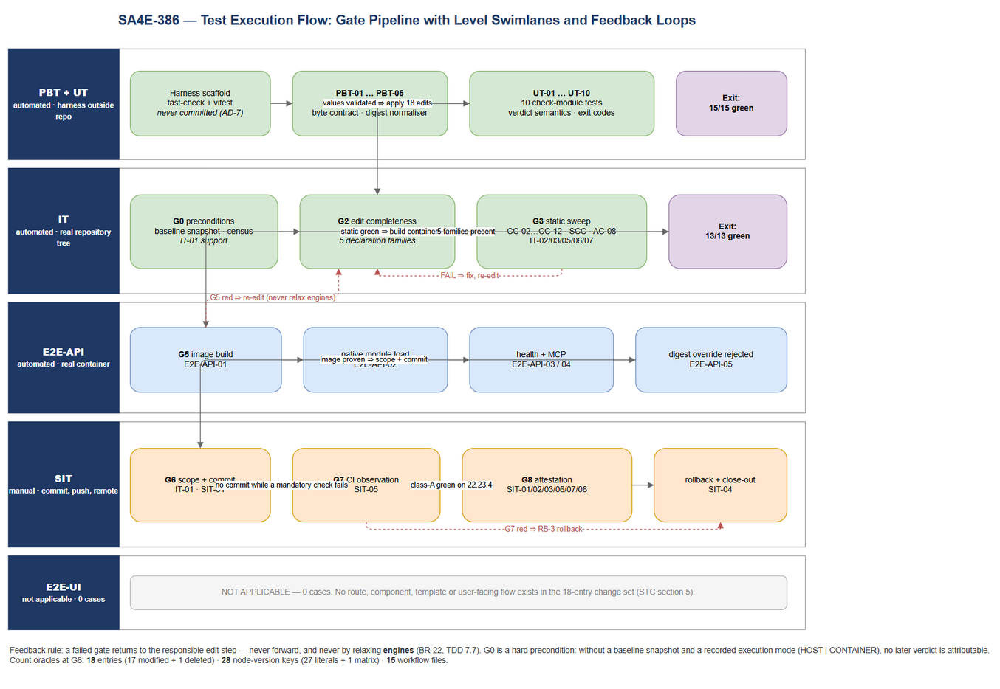
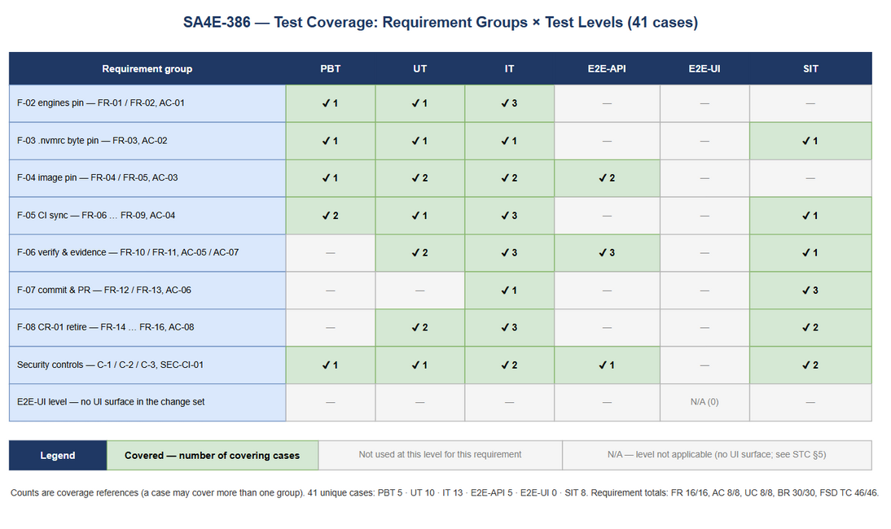

# Software Test Plan (STP)

## SDLC-Agents-4-Enterprise — SA4E-386: Pin Node.js to 22.23.4 (CVE-2026-111497) and Retire the Legacy `better-sqlite3` Build Workflow

---

## Document Information

| Field | Value |
|-------|-------|
| Jira Ticket | SA4E-386 |
| Title | Pin Node.js runtime to 22.23.4 to patch CVE-2026-111497 (Brotli RCE) and related Highs; retire the legacy `better-sqlite3` build workflow (CR-01) |
| Author | QA Agent |
| Version | 1.0 |
| Date | 2026-10-28 |
| Status | Draft — pending BA business-coverage review |
| Related BRD | BRD-v1.0-SA4E-386.docx |
| Related FSD | FSD-v1.3-SA4E-386.docx |
| Related TDD | TDD-v1.1-SA4E-386.docx |
| Related Security | SECURITY-REVIEW.md v1.0 (verdict: APPROVED WITH CONDITIONS — C-1, C-2, C-3 blocking) |
| Change type | Configuration / CI supply-chain remediation — **no business-code change, no dependency bump** |

---

## Author Tracking

| Role | Name - Position | Responsibility |
|------|-----------------|----------------|
| Author | QA Agent – QA Engineer | Create document, design test cases, own gate/evidence matrix |
| Peer Reviewer | BA Agent – Business Analyst | Business-coverage review of STP/STC against BRD + FSD (§ Review Gate) |
| Technical Reviewer | SA Agent – Solution Architect | Verify gate contracts G0–G8 match TDD §11 and §13 |
| Security Reviewer | Security Agent | Verify TC coverage of SECURITY-REVIEW blocking conditions C-1..C-3 |

---

## Revision History

| Version | Date | Author | Changes |
|---------|------|--------|---------|
| 1.0 | 2026-10-28 | QA Agent | Initiate document — auto-generated from BRD v1.0, FSD v1.3, TDD v1.1, SECURITY-REVIEW v1.0; 41 test cases across 6 levels (5 PBT, 10 UT, 13 IT, 5 E2E-API, 0 E2E-UI, 8 SIT) |

---

## Sign-Off

| Name | Signature and date |
|------|--------------------|
| | ☐ I agree and confirm the test plan in this STP |
| | ☐ I agree and confirm the test plan in this STP |

---

## 1. Introduction

### 1.1 Purpose

This test plan defines how the SA4E-386 change set is verified. The change set is **not a feature** in the conventional sense: it is a controlled edit of **18 repository entries** (17 modified + 1 deleted) that must all carry exactly one value — the Node.js runtime version `22.23.4` — plus the atomic retirement of a dead CI pipeline.

Three properties make the verification unusual, and they drive the whole strategy:

1. **The change is a value-propagation problem.** Five independent declaration families must agree on one string: `engines.node` (×2 manifests), `.nvmrc` (byte-exact), `backend/Dockerfile` (`ARG NODE_VERSION` + `ARG NODE_BASE_DIGEST`), 27 `node-version` literals across 12 workflows, and 2 `package-lock.json` metadata lines. A single missed occurrence produces a green-but-wrong pipeline — the failure is silent until a prebuild or image ships on the wrong runtime.
2. **The security claim is only as good as its weakest artefact.** The CVE is patched only if the **container** runs `v22.23.4`; every local check is advisory. `engines.node` is *not enforced* (`engine-strict=false`, no `.npmrc`), so `npm ci` on Node 24 exits `0` with a warning. The test plan therefore treats the container probe — not the manifest — as the load-bearing evidence.
3. **The scope gate is the security control.** AC-07/BR-23 forbid business-code and dependency changes; BR-29 forbids `better-sqlite3` from ever becoming a dependency. A test suite that only checks "did the new value land" would pass a change that also slipped in an out-of-scope edit.

The purpose of this STP is to specify levels, coverage, environments, data, entry/exit criteria, and defect rules so that the change can be **accepted or rejected on evidence**, not on inspection.

### 1.2 Test Objectives

| # | Objective | Success measure |
|---|-----------|-----------------|
| O-1 | Prove single-value propagation across all five declaration families | `22.23.4` observed in every declaration; INV-01 cross-artefact comparison yields one distinct value |
| O-2 | Prove the `.nvmrc` byte contract (not just its text) | exactly 8 bytes `32 32 2E 32 33 2E 34 0A` — no BOM, no CR, single trailing LF |
| O-3 | Prove the base-image digest is registry-derived and denotes the same object as the tag | resolved via P2/P1/P3, normalised, and byte-identical to the Dockerfile value; multi-arch index mediaType |
| O-4 | Prove scope discipline | exactly **18** staged entries = 17 `M` + 1 `D`; 17 entries = deletion missing; 19 entries = out-of-scope file |
| O-5 | Prove CI exhaustiveness | 15 workflow files after CR-01; 28 `node-version` keys = 27 literals `22.23.4` + 1 matrix expression; `build-onnxruntime.yml` zero diff |
| O-6 | Prove CR-01 completeness and ONNX preservation | zero `build-native`/`better-sqlite3` match under `.github/workflows/`; ONNX scan + `needs_ort` + dispatch byte-identical; `npm ls better-sqlite3` empty tree |
| O-7 | Prove the runtime outcome, not the declaration | in-container `node -v` = `v22.23.4`; `onnxruntime-node` loads; `GET /health` = `200` with `tools_loaded > 0` |
| O-8 | Prove no security regression | zero relaxation added to the diff; Trivy claim restated as M1∧M2∧M3 vs baseline; SEC-CI-01 ordering asserted; no secret material in build args or logs |

### 1.3 References

| Document | Location | Used for |
|----------|----------|----------|
| BRD | `documents/SA4E-386/BRD.md` (v1.0) | FR-01…FR-13, AC-01…AC-07, NFR-SEC-01…07, risk register R-01…R-07 |
| BRD amendment (CR-01) | FSD §1.2.1 (v1.3) | FR-14…FR-16, AC-08 — the BRD's own FR table predates the amendment |
| FSD | `documents/SA4E-386/FSD.md` (v1.3) | UC-01…UC-08, AF/EF flows, BR-01…BR-30, §10.1 TC-01…TC-46, §13 gate catalogue CC-01…CC-18 / SCC-01…SCC-07 |
| TDD | `documents/SA4E-386/TDD.md` (v1.1) | AD-1…AD-11, FV-01…FV-20, §11 test architecture (T1–T7), §11.5 E2E applicability, §13 Steps 0–14, EV-01…EV-16 |
| Security review | `documents/SA4E-386/SECURITY-REVIEW.md` (v1.0) | SEC-CI-01/02/03/05/06, SEC-SC-01/02/03, SEC-CVE-01, SEC-DR-01/02, SEC-RB-01, SEC-RM-01, SEC-DK-01, SEC-DOC-01; conditions C-1…C-7 |
| Implementation plan | `documents/node-security-upgrade/PLAN.md` (Jira attachment 11805) | Task/verify cross-reference for procedural steps |

### 1.4 Test Basis — measured "as-is" baseline

The plan is not written against assumptions; the following values were measured on the repository at `HEAD = 1666945` (branch `main`, 2026-10-28) **before** any edit. They are the baseline against which "changed" and "unchanged" are judged.

| # | Artefact | Observed (pre-change) | Target (post-change) | Defect class if unchanged |
|---|----------|----------------------|----------------------|---------------------------|
| B-01 | `package.json` → `engines.node` | `22.x` | `>=22.23.4 <23` | Loose constraint — BR-05 violation |
| B-02 | `backend/package.json` → `engines.node` | `22.x` | `>=22.23.4 <23` | Loose constraint — BR-05 violation |
| B-03 | `.nvmrc` | `22\r\n` — **4 bytes**, hex `32 32 0D 0A` | `22.23.4\n` — **8 bytes**, hex `32 32 2E 32 33 2E 34 0A` | **Two defects in one file**: major-only + CRLF |
| B-04 | `backend/Dockerfile` L32 | `ARG NODE_VERSION=22` | `ARG NODE_VERSION=22.23.4` | Major-only pin |
| B-05 | `backend/Dockerfile` L35 | `ARG NODE_BASE_DIGEST=sha256:43ac6c60…b772c` (digest for the `22` tag) | digest of `node:22.23.4-slim` | **Stale digest** — builds the unpatched base |
| B-06 | Workflow census | **16** files | **15** files (CR-01) | Dead pipeline retained |
| B-07 | `node-version:` lines | **29** = 27 literals + **2** matrix expressions (`build-native.yml` L83, `build-onnxruntime.yml` L84) | **28** = 27 literals `22.23.4` + 1 matrix expression | Missed literal → CI on old runtime |
| B-08 | Quote styles | single: `auto-release`(1), `ci`(4), `publish`(2); double: 9 files (18 literals) | preserved per file | Churn / style violation (BR-15) |
| B-09 | `.github/workflows/build-native.yml` | present — blob `3c6f761`, 5473 bytes, **167 lines** | deleted, 167 lines removed, 0 added | CR-01 not executed |
| B-10 | `auto-release.yml` L5–L7 | `workflow_run.workflows` = **2** items (better-sqlite3 + onnxruntime) | exactly **1** item | Dangling trigger that can never fire |
| B-11 | `scheduled-prebuild-scan.yml` L10 | `BETTER_SQLITE3_VERSION: "11.10.0"` | key removed | Dead dispatch path retained |
| B-12 | `better-sqlite3` dependency | absent from all 3 manifests; **0** resolved packages in `package-lock.json`; 1 metadata-only `peerDependenciesMeta` mention (L11620, `knex`) | unchanged (still absent) | BR-29 breach — the one thing that must never appear |
| B-13 | Verification host runtime | `node v24.8.0`, `npm 11.6.0` | `v22.23.4` (HOST) or CONTAINER mode | Evidence attributable to the wrong runtime (AD-9) |
| B-14 | Host tool inventory | docker `29.6.1`, buildx `v0.35.0-desktop.2` present; **nvm absent**; **trivy absent** | nvm or CONTAINER mode; Trivy via CI | Mandatory gate un-runnable → `NOT EXECUTED` (BR-20) |
| B-15 | Working-tree baseline | `git status --porcelain` = **41 entries** (35 agent-framework files under `extension/resources/` + 3 untracked `documents/` trees) | scope gate must tolerate pre-existing dirt | **False FAIL risk** for CC-18/SCC-05 |

> **B-15 is the single most important environmental finding in this plan.** AC-07's gate compares the changed set against an allow-list. On a tree that is already dirty for unrelated reasons, a naive gate reports 59 changed paths and fails a correct change — or, worse, a tester "cleans up" the diff with `git add -A`. The mitigation is mandatory and is encoded in IT-01: **capture the baseline changed-set at G0 and diff against it**, or execute the gates in a clean throw-away worktree.

---

## 2. Test Strategy

### 2.1 Test Levels

| Level | Scope | Automation | Tools |
|-------|-------|------------|-------|
| PBT | Correctness properties over version tokens, the `.nvmrc` byte contract, quote-preserving rewrites, digest normalisation, and forbidden-literal classification | Automated | fast-check + vitest |
| UT | Gate-harness check modules in isolation, driven by fixture trees and synthetic Trivy reports | Automated | vitest |
| IT | Gate harness G2/G3/G6 executed **in-process against the real repository tree** (real files, real `git`, real `npm ls`) | Automated | vitest + `fs` / `child_process` |
| E2E-API | Real container built from the pinned Dockerfile: runtime probe, in-image native-module load, `GET /health`, MCP `tools/list`, digest-override rejection | Automated | vitest + `docker` CLI + `fetch` |
| E2E-UI | **Not applicable — 0 test cases.** The 18-entry change set contains no route, component, template, asset or user-facing flow. See §2.1.1 and §3.4. | — | — |
| SIT | Manual attestation and GitHub-side observability: PR content, Actions UI, branch protection, rollback rehearsal, log hygiene, post-merge scheduled-scan observation | Manual | `gh` CLI / GitHub UI / browser |

#### 2.1.1 Level applicability decisions (and why two levels deviate from the default template)

| Decision | Rationale | Consequence for this plan |
|----------|-----------|---------------------------|
| **E2E-UI = N/A** | Zero UI surface. TDD §11.5 records the same decision. AC-07 forbids new files in the diff, so a Playwright spec **cannot** be added to this change set; a UI suite would have nothing to assert and no legal home. | No E2E-UI test cases are written. The visual/UX residual typically reserved for SIT is therefore also empty; SIT is used for GitHub-side attestation instead. |
| **IT is not "API integration"** | No server module changes. The integration surface is the **repository configuration tree**, not HTTP. The honest IT analogue is "harness ↔ real files": resolve real paths, parse real YAML, run real `git`/`npm`, assert real counts. | IT cases execute the gate harness against the actual working tree; mocking the filesystem would test the mock, not the pin. |
| **E2E-API is the load-bearing level** | The CVE is patched only if the shipped container runs `v22.23.4` (CC-16/EV-13). The manifest is advisory (TC-29 proves `npm ci` exits `0` on Node 24). | E2E-API runs against a real `docker build` + `docker run`; it is a release blocker, not a smoke test. |
| **PBT is narrow but real** | Five near-tautological-looking contracts (8 bytes, 64 hex, one quote char, one version token) are exactly where hand-written cases under-cover. Property tests generate the mutations humans forget (BOM, CRLF, `v` prefix, doubled newline, uppercase hex). | 5 PBT cases, all run pre-commit over the harness code; the properties double as the specification for the harness validators. |
| **SIT is manual by construction** | Four of the eight SIT items cannot be automated from the change set: they observe GitHub state that only exists **after** push/merge (Actions UI listing, branch protection, first scheduled run, deployed-digest probe), or they require human judgement (log hygiene, unfixed-CVE attribution, rollback rehearsal). | 8 SIT cases; each produces an attestation line in the PR or the close-out record, not a test-runner result. |

### 2.2 Test Types

| Type | Description | Applicable | Applies to |
|------|-------------|------------|------------|
| Functional (configuration) | Every declaration carries `22.23.4`; every removed reference is gone | **Yes** | PBT-01…05, UT-01…05, IT-02…06, IT-09…10 |
| Regression (pipeline behaviour) | Existing jobs still parse, still resolve a runtime, still build; ONNX capability unchanged | **Yes** | IT-03, IT-06, IT-10, E2E-API-02…04, SIT-05 |
| Security | CVE patched in the shipped artefact; Trivy claim restated; scan ordering; digest non-overridability; no secrets in args/logs | **Yes** (primary) | E2E-API-01…05, IT-11…13, SIT-06, SIT-07 |
| Scope / integrity | Diff equals the allow-list; no dependency line; no relaxation flags; commit and PR discipline | **Yes** | IT-01, SIT-01, SIT-04 |
| Performance | N/A — no runtime path changed; the only measurable is a single container start + health probe | No (informational) | E2E-API-03 (startup sanity only) |
| Usability | N/A — no UI | No | — |
| Compatibility | **Yes** (narrow) — native module ABI compatibility of `onnxruntime-node` under the new patch level | Yes | E2E-API-02, UT-10 |
| Localisation | N/A | No | — |

### 2.3 Test Approach

**Gate-oriented execution.** Testing follows the TDD's gate ladder rather than a test-case list, because the artefacts are committed by a human, not deployed by a pipeline. Each gate is a hard stop: no later evidence is valid if an earlier gate failed.

| Gate | Meaning | Mandatory | Primary cases |
|------|---------|-----------|---------------|
| G0 | Preconditions: tree binding, baseline capture, tool probe, execution-mode selection | Yes | IT-01, SIT-08 |
| G1 | Freshness: `22.23.4` is still the latest safe 22.x; digest resolvable from the registry | Yes | PBT-04, E2E-API-05 |
| G2 | Edit completeness: all five families present and internally consistent | Yes | PBT-01…03, UT-01…05, IT-04, IT-10 |
| G3 | Static: `CC-02…CC-12`, `SCC-02/03/07`, AC-08 sweep, YAML validity, ONNX zero-diff | Yes | PBT-05, UT-03…05, UT-09…10, IT-02…07 |
| G4 | Runtime: installs and builds on the pinned runtime | Yes | IT-08, IT-09, E2E-API-01 (host or container) |
| G5 | Container: built image runs the pin, native module loads, health responds, Trivy claim evaluated | Yes | E2E-API-01…05 |
| G6 | Scope: 18 entries, allow-list, no relaxation, commit discipline | Yes | IT-01, SIT-01 |
| G7 | CI observation: class-A workflows green on `22.23.4` | Yes | SIT-05 |
| G8 | Human attestation: PR sections, Actions listing, branch protection | Yes | SIT-01…03 |

**Three execution-mode rules.**

1. **Runtime attribution first (AD-9).** Every check that produces a version, an install result, or a build result must record the execution mode: `HOST` (`node -v` = `v22.23.4`) or `CONTAINER` (`node:22.23.4-slim@<digest>`). Evidence produced on the host's Node 24.8.0 (B-13) is **void** for G4 — it is attributable to the wrong runtime.
2. **`NOT EXECUTED` ≠ `PASS` (P-4, BR-20).** Because trivy and nvm are absent on the verification host (B-14), this rule is exercised in practice, not in theory: a skipped Trivy run is recorded as `NOT EXECUTED` with a reason and deferred to CI. No "0 CVE" claim may be derived from a skipped scan (BR-21).
3. **Inverted exit codes are handled explicitly.** Six ACs (CC-03, CC-04, CC-10, SCC-03, SCC-07, FV-19/AC-08) are "grep finds nothing" checks, where a shell exit code of **1 means PASS**. The single most common false verdict in this ticket is a green check reported as a failure (or a harness that treats non-zero as an error and marks the gate `NOT_EXECUTED`). UT-08 asserts the harness's exit-code semantics; every such case in the STC states `exit 1 = PASS` in the expected result.

**Count discipline.** Three numbers are oracles, and each has a characteristic off-by-one:

| Oracle | Correct | Wrong values and what they mean |
|--------|---------|-------------------------------|
| Changed entries | **18** (17 `M` + 1 `D`) | 17 → deletion not staged; 19+ → out-of-scope file staged; 16 → `package-lock.json` metadata missing |
| `node-version:` keys | **28** (27 literals + 1 matrix) | 29 → `build-native.yml` not deleted; 27 → one literal missed **or** the matrix expression was "fixed" (BR-16 violation) |
| Workflow files | **15** | 16 → CR-01 not executed; 14 → an ONNX workflow was collateral damage (BR-30) |

**Automation boundary.** All 33 automated cases run **inside the implementation window**, before the commit, from an **ephemeral harness outside the repository** (AD-7): the harness must never appear in the 18-entry diff. The harness is not committed. The 8 manual cases run at push/PR time and again after merge.

**Traceability-driven design.** Test cases are derived top-down from BR-01…BR-30 and AC-01…AC-08, then reconciled bottom-up against the FSD's own 46 scenarios (TC-01…TC-46) — see STC §8. A scenario from the FSD that has no STC case is treated as a coverage defect; an STC case with no requirement is treated as scope creep.

### 2.4 Entry Criteria

| Level | Entry Criteria |
|-------|----------------|
| PBT | Harness scaffold exists outside the repository; `fast-check` + `vitest` installed in the harness sandbox (not in the repo — a new devDependency would violate AC-07) |
| UT | Check modules implement the contract signatures from TDD §5.2; fixture trees available (4 `.nvmrc` variants, 3 synthetic Trivy report pairs) |
| IT | Edits G2-complete (all five families present); `git status` baseline captured at G0; real `git`/`npm` available; **runtime is `v22.23.4` (HOST) or CONTAINER mode selected and recorded** |
| E2E-API | `NODE_BASE_DIGEST` resolved from the registry (G1); Docker daemon reachable; `docker build --target production` exit `0` on the **pre-change** tree (baseline image built — otherwise a failure cannot be attributed) |
| SIT | Branch pushed, PR opened against `main`; `gh` authenticated with read access to Actions + branch protection; merge performed for SIT-05 |
| G8 attestation | G0–G6 all green or explicitly `NOT EXECUTED` with a reason (never silently skipped) |

> **Baseline-first rule (from TDD Step 0.4/0.5).** A pre-existing unit-test failure or a pre-existing image-build failure must be recorded **before** the edits and excluded from later regression claims. Without it, every later red is ambiguous.

### 2.5 Exit Criteria

| Level | Exit Criteria |
|-------|--------------|
| PBT | 5/5 properties pass; each property has ≥ 100 generated cases per run; zero counter-examples unaddressed |
| UT | 10/10 pass; every `NOT_EXECUTED` branch proven distinct from `PASS` |
| IT | 13/13 pass; census counts exact (18 / 28 / 15); AC-08 sweep returns exit 1 (PASS); `build-onnxruntime.yml` diff empty |
| E2E-API | 5/5 pass; in-container `node -v` = `v22.23.4`; `onnxruntime-node` semver printed with no `NODE_MODULE_VERSION` error; `/health` = `200`; digest override rejected |
| SIT | 8/8 attested; PR contains the 3 mandatory sections and the exact 18-entry statement; no required status check references the deleted workflow |
| Release gate (all levels) | **0 Critical, 0 Major open.** Any Major on BR-29 (dependency added), BR-30 (ONNX altered), BR-12 (`FROM` edited), or the digest (BR-10/BR-11) blocks the PR regardless of remaining schedule |
| Documentation gate | STP/STC ingested into KB; evidence block EV-01…EV-16 attached to SA4E-386; rollback anchor (SEC-RB-01/C-2) recorded |

### 2.6 E2E Automation Coverage — classification decisions

The default policy is to minimise manual SIT by promoting deterministic scenarios to automation. Applied to this change set:

| Scenario class | Examples in this ticket | Classified as | Why |
|----------------|------------------------|---------------|-----|
| Deterministic file/content assertions | `engines` value, 27 literals, allow-list composition | **IT** | Pure function of the tree; no browser, no network |
| Byte-level contracts | `.nvmrc` 8-byte payload; digest 64-hex | **PBT + UT** | Generated mutations find the human blind spots (BOM / CRLF) |
| Structural invariants with an inverted oracle | AC-08 zero-match; no `22` literal | **IT** | Exit-code semantics are the only failure mode; asserted in UT-08 |
| Runtime behaviour of the built artefact | `node -v` in image, native-module load, `/health` | **E2E-API** | Requires a real `docker build` + `docker run`; the only level that proves the CVE is patched in what ships |
| Supply-chain control behaviour | digest override rejected by assertion | **E2E-API** | Behavioural proof that condition C-3's assertion works, not merely that it exists |
| GitHub-side state that exists only after push | Actions workflow listing, branch protection, first scheduled run | **SIT** | Cannot be produced locally; requires an authenticated remote |
| Human judgement | log hygiene, unfixed-CVE attribution, rollback rehearsal | **SIT** | Requires reviewer sign-off; the artefact is an attestation, not an exit code |
| UI interaction / visual layout | — | **none** | No UI surface (§2.1.1) |

**Result: 33 of 41 cases automated (80.5%); 8 manual (19.5%).** The residual manual set contains no case that *could* be automated with available tooling — it is either remote-state observation (5) or judgement/attestation (3).

### 2.7 Test Case Summary

| Level | Count | Automated | Manual |
|-------|-------|-----------|--------|
| PBT | 5 | 5 | 0 |
| UT | 10 | 10 | 0 |
| IT | 13 | 13 | 0 |
| E2E-API | 5 | 5 | 0 |
| E2E-UI | 0 | 0 | 0 |
| SIT | 8 | 0 | 8 |
| **Total** | **41** | **33 (80.5%)** | **8 (19.5%)** |

Distribution by priority: **High 33**, **Medium 8**, **Low 0**. Security-bearing cases: **17** (all E2E-API, IT-11…13, PBT-04/05, SIT-06/07, plus the scope gate IT-01).

### 2.8 Test Execution Flow



The pipeline is **sequential with two loop-backs**: a failed G3–G5 returns to the responsible edit step (never forward), and a failed G7 returns to DEV for diagnosis — never to a relaxed `engines` value (TDD §7.7). G0 is a hard precondition: without tree binding and baseline capture, no later verdict is attributable.

---

## 3. Test Scope

### 3.1 Features In Scope

| # | Feature / Requirement | Priority | FSD Reference | Levels | Test Type |
|---|----------------------|----------|---------------|--------|-----------|
| 1 | FR-01 / FR-02 — `engines.node` = `>=22.23.4 <23` in root + backend manifests | High | UC-02, BR-04, BR-05, BR-06 | PBT, UT, IT | Functional, Scope |
| 2 | FR-03 — `.nvmrc` byte-exact `22.23.4\n` (8 bytes) | High | UC-03, BR-08 | PBT, UT, IT | Functional, Boundary |
| 3 | FR-04 — Dockerfile `NODE_VERSION` + registry-resolved digest | High | UC-04, BR-10, BR-11, BR-12 | PBT, UT, IT, E2E-API | Functional, Security |
| 4 | FR-05 — CVE-2026-111497 comment with digest-authority note | Medium | UC-04, BR-13, NFR-SEC-05 | UT, IT | Functional |
| 5 | FR-06 — 27 `node-version` literals across 12 workflows | High | UC-05, BR-15 | PBT, UT, IT | Functional, Regression |
| 6 | FR-07 — Matrix handling (`build-onnxruntime.yml` preserved) | High | UC-05, BR-16, AD-5 | UT, IT | Regression |
| 7 | FR-08 — Review of `build-push-backend.yml` + `scheduled-prebuild-scan.yml` for hidden versions | Medium | UC-05, BR-17 | IT | Functional |
| 8 | FR-09 — No `22.x` / `'22'` / `"22"` residue | High | UC-06, BR-19 | PBT, IT | Functional, Negative |
| 9 | FR-10 — `docker build --target production` succeeds | High | UC-06, AC-05 | E2E-API | Integration |
| 10 | FR-11 — Optional Trivy scan with a meaningful claim | Medium | UC-06, BR-21, NFR-SEC-01 | UT, E2E-API, SIT | Security |
| 11 | FR-12 — Branch + explicit-staging commit, exact subject | High | UC-07, BR-24, BR-25 | IT, SIT | Process integrity |
| 12 | FR-13 — PR against `main`, no direct push, 3 sections | High | UC-07, BR-26, BR-27 | SIT | Process integrity |
| 13 | FR-14 — Delete `.github/workflows/build-native.yml` | High | UC-08, BR-29, AD-11 | UT, IT | Functional, Regression |
| 14 | FR-15 — `auto-release.yml` trigger list = 1 item | High | UC-08, BR-30 | UT, IT | Functional |
| 15 | FR-16 — `scheduled-prebuild-scan.yml` simplified, ONNX preserved | High | UC-08, BR-30 | UT, IT, SIT | Functional, Regression |
| 16 | AC-07 / BR-23 — scope = exactly 18 entries, no dependency or business change | High | UC-06, EF-TA-10 | IT, SIT | Scope |
| 17 | NFR-SEC-04 — `onnxruntime-node` still loads on the pinned runtime | High | UC-06, BR-30 | E2E-API | Compatibility |
| 18 | SEC-CI-01 — Trivy ordering (scan before push; PRs scanned) | High | SECURITY-REVIEW | IT, SIT | Security |
| 19 | SEC-SC-01 / C-3 — digest assertion present and not overridable | High | SECURITY-REVIEW | IT, E2E-API | Security |
| 20 | NFR-SEC-03 / BR-17 — no security relaxation, no secrets in build args or logs | High | SECURITY-REVIEW (SEC-CI-05) | IT, SIT | Security |

### 3.2 Features Out of Scope

| # | Feature | Reason |
|---|---------|--------|
| 1 | Any business/application code path | AC-07: the diff contains configuration only. A passing functional suite is *not* evidence about application behaviour, and no application test is required or permitted by this ticket |
| 2 | Dependency upgrades (`npm update`, version bumps, `overrides`) | AC-07 / BR-06 / BR-23. `package-lock.json` may change **metadata only** (2 lines) |
| 3 | Major Node upgrade (23.x / 24.x) | BR-03 — explicitly out of scope; OI-T-13 schedules the Node 24 migration separately |
| 4 | Enabling `engine-strict` / hard version enforcement | OI-T-01 — accepted as advisory for this ticket; enabling it breaks every Node-24 host, including the verification host (B-13) |
| 5 | `build-onnxruntime.yml` matrix redesign (`20 / 22 / 24 / all`) | AD-5 / BR-16 — an ABI/prebuild namespace key, not a runtime pin; **must** show zero diff |
| 6 | Adding `packageManager`, `.node-version`, `volta.node`, or a `node-version-file` refactor | OI-T-02/03/04 — deferred; each adds declaration surface, and new files violate AC-07 |
| 7 | `extension/package.json` | BR-07 — pins `engines.vscode`, not Node |
| 8 | Removal of published `better-sqlite3` release assets | SEC-RM-01 — recorded as a consequence of CR-01, not remediated here |
| 9 | Historical document rewrite (removing textual mentions) | BR-28 — only an additive note is permitted |
| 10 | Base-image rotation policy, SBOM, provenance/signature | SEC-SC-02/03, OI-T-08/11 — forward tickets |
| 11 | `chmod -R 777` hardening (SEC-DK-01) and over-scoped workflow permissions (SEC-CI-02) | Pre-existing; tracked as follow-ups, not part of this change set |
| 12 | UI / E2E-UI / accessibility / cross-browser | No UI surface (§2.1.1) |

### 3.3 Test Coverage Overview



### 3.4 Coverage notes and known asymmetries

- **FR-05 and FR-13 have no automated *failure detector* by nature**: FR-05 (comment wording) is checked by containment, which cannot judge meaning; FR-13 (PR quality) is attestation. Both are covered, but they carry the highest residual risk of a "green but weak" verdict.
- **AC-08 has an inverted oracle** (zero matches = pass). Its coverage is only trustworthy because UT-08 proves the harness distinguishes exit `1` (no match = pass) from an execution error.
- **BR-29 is a negative requirement** ("must never appear"). Negative requirements cannot be proven by one passing run; they are covered by IT-07 (three independent detectors: `npm ls`, lockfile resolution count, manifest key scan) plus the scope gate IT-01.
- **E2E-UI contributes 0 cases by design.** If a reviewer expects a UI suite, the correct response is that this change set has no UI — not that coverage is missing.

---

## 4. Test Environment

### 4.1 Execution Modes

There is no "SIT server" for this ticket. The environment is a **workstation plus a Docker daemon plus a remote GitHub repository**, and the decisive variable is the runtime the checks execute on.

| Mode | Definition | When used | Evidence tag |
|------|-----------|-----------|--------------|
| **HOST** | Verification shell runs `node -v` = `v22.23.4` (nvm / fnm / system install) | Preferred. Required for G4 claims about the application build | `EV-01 mode=HOST` |
| **CONTAINER** | Verification shell runs inside `node:22.23.4-slim@<resolved-digest>` with the worktree bind-mounted | Fallback when the host runtime cannot be changed (AD-9). Used **by necessity** on this host: nvm is absent and the host is Node 24.8.0 (B-13/B-14) | `EV-01 mode=CONTAINER` |
| **CI** | GitHub-hosted runner with `actions/setup-node` at `22.23.4` | G7 observation, Trivy (host has none), scheduled-scan observation | `EV-09` / run URL |
| **POST-MERGE** | Deployed image digest probe | Close-out (TDD Step 14) | `EV-13` post-deploy row |

> **Mixed-mode rule.** Evidence from different modes may not be combined into a single claim. "Install succeeded" (CONTAINER) + "image built" (HOST, i.e. with buildx against a Docker daemon) is acceptable **only** if both records state their mode, because the acceptance claim concerns the **container**, not the host.

### 4.2 Environment Requirements

| # | Requirement | Minimum | Measured on verification host (2026-10-28) | Status |
|---|-------------|---------|---------------------------------------------|--------|
| E-01 | Git + repository clone at baseline `1666945` | any 2.40+ | present | ✅ |
| E-02 | Node runtime `22.23.4` (HOST) **or** Docker + `node:22.23.4-slim@digest` (CONTAINER) | exact | host `v24.8.0`; nvm **absent** | ⚠️ CONTAINER mode mandatory unless nvm is installed |
| E-03 | npm | 10.x+ (ships with 22.23.4) | `11.6.0` | ✅ (but bound to Node 24 — unusable for G4 claims) |
| E-04 | Docker Engine | 24+ | `29.6.1` | ✅ |
| E-05 | Docker buildx | 0.12+ | `v0.35.0-desktop.2` | ✅ |
| E-06 | Network access to `docker.io` (index + layers) | required for G1/G5 | assumed available | ⚠️ must be confirmed before G1 |
| E-07 | `gh` CLI authenticated (Actions, branch protection read) | 2.40+ | not asserted in this plan's measurements | ⚠️ required for SIT-02/03/05 |
| E-08 | Trivy | 0.50+ | **absent** | ⚠️ FR-11 recorded `NOT EXECUTED` locally; CI is the source of truth (BR-21) |
| E-09 | JVM-free — no application server required for PBT/UT/IT | — | n/a | ✅ |
| E-10 | Filesystem: case-sensitive checkout **not** required; but line-ending config must be `core.autocrlf=false` for byte checks | — | repo default | ⚠️ verified by PBT-02/IT-02; a CRLF checkout silently converts LF to CRLF |

### 4.3 Browser / Device Requirements

| Browser | Version | OS | Required |
|---------|---------|-----|----------|
| Chromium / Edge (GitHub UI) | current | Windows 11 | **Yes** — SIT-02/03/05 inspect Actions and branch-protection pages where the `gh` CLI is insufficient |
| Any modern browser | current | any | No — no product UI is under test |

### 4.4 Test Data Requirements

Test data for this ticket is **file-system and registry data**, not database rows. It is versioned under `documents/SA4E-386/testdata/` so that the same fixtures drive PBT, UT and IT, and so a reviewer can reproduce any case.

| Data type | Description | Source | Preparation | File |
|-----------|-------------|--------|-------------|------|
| Declaration census | Every file/key that must carry the pin, with observed and target values | measured (B-01…B-08) | regenerate at G0 | `declaration-census.csv` |
| `.nvmrc` byte fixtures | 7 valid/invalid payloads (7/8/9 bytes, BOM, CRLF, `v` prefix, trailing space, empty) | synthetic | write to harness fixture dir | `nvmrc-fixtures.csv` |
| Digest resolution fixtures | 6 registry responses (multi-arch index, manifest list, single-platform, duplicate, empty, mismatched tag) | synthetic | feed to normaliser N-1…N-5 | `digest-fixtures.csv` |
| Workflow literal census | 12 files × 27 literals with quote style and observed line numbers | measured | regenerate at G0 | `workflow-census.csv` |
| Removed-reference census | Every pre-change reference to `build-native` / `better-sqlite3` with expected post-change state | measured | regenerate at G0 | `cr01-reference-census.csv` |
| Trivy report pairs | Baseline and post-change JSON (filtered + unfiltered) for M1∧M2∧M3 | CI / local if available | capture at G5 | `trivy-claim-fixtures.csv` |
| Scope/allow-list oracle | The 18 permitted paths | TDD §4.2.7 | static | `scope-allowlist.csv` |

**Test-data rules.**
1. Every `node-version` literal row carries its **expected post-change line number** — a line number that shifts without a corresponding content change indicates unintended reformatting.
2. Fixture values are concrete ("`22.23.4\n` — 8 bytes", "`sha256:` + 64 lowercase hex"), never "valid digest".
3. No fixture may contain a **real** credential, token, or PAT (NFR-SEC-03); log-hygiene cases use the literal marker `[REDACTED]`.

### 4.5 External Dependencies

| System | Dependency | Mock/Stub Available |
|--------|-----------|---------------------|
| Docker Hub registry | Tag existence for `node:22.23.4-slim`; authoritative `sha256:` index digest | **No** — must be real. A stubbed digest defeats O-3 (this is exactly the R-01 failure mode: a fabricated digest passes format checks) |
| nodejs.org advisories | Confirms `22.23.4` is still the latest safe 22.x (G1) | No — human read, recorded verbatim |
| npm registry | `npm ci` resolution under the new `engines` range | No — must be real for IT-09 |
| GitHub Actions | G7 observation, Trivy execution, scheduled-scan behaviour | No — SIT only; cannot be simulated locally |
| Trivy | CVE posture evidence | **Partially** — synthetic JSON fixtures for the *evaluator* (UT-06), never for the *claim* |
| Native prebuild pipelines (ONNX) | Preservation proof for BR-30 | **Yes for structure** (static diff), **no for behaviour** (requires a real run; deferred to SIT-05 / 14.6) |

---

## 5. Test Schedule

| Phase | Start | End | Duration | Milestone / Deliverable |
|-------|-------|-----|----------|-------------------------|
| Test planning (STP + STC) | 2026-10-28 | 2026-10-28 | 1 d | STP + STC v1.0, 41 cases |
| BA business-coverage review (Review Gate) | 2026-10-28 | 2026-10-28 | 0.5 d | BA verdict APPROVED (max 2 iterations) |
| Test data preparation | 2026-10-28 | 2026-10-29 | 1 d | 7 CSV fixtures, verified row counts |
| Harness build + PBT/UT | 2026-10-29 | 2026-10-29 | 1 d | PBT 5/5, UT 10/10 green |
| Implementation window (DEV) + G0–G6 | 2026-10-29 | 2026-10-29 | 1 d | IT 13/13, E2E-API 5/5; evidence EV-01…EV-16 |
| Push, PR, G7/G8 attestation | 2026-10-29 | 2026-10-30 | 1.5 d | SIT-01, SIT-02, SIT-03, SIT-06, SIT-07, SIT-08 |
| Defect fix + retest | 2026-10-30 | 2026-10-30 | 0.5 d | 0 Critical / 0 Major open |
| Merge + post-merge observation | 2026-10-30 | 2026-11-02 | 4 d (calendar) | SIT-04 (pre-merge), SIT-05 (first class-A run + Monday scan at 2026-11-02 00:00 UTC) |
| Close-out + evidence archive | 2026-11-03 | 2026-11-03 | 0.5 d | Test report, KB ingest, forward tickets filed |

**Scheduling constraints that are not negotiable:**

- **G1 must precede every edit** (TDD §4.3). If `22.23.4` is superseded mid-window, AF-1 applies: adopt the newer patch across *all* artefacts and regenerate every figure — never a partial adoption (BR-02).
- **SIT-05 cannot finish before 2026-11-02 00:00 UTC**, because the scheduled scan is weekly (cron `0 0 * * 1`). The ticket may merge earlier; close-out may not claim FR-16 confirmation earlier.
- **The container build (G5) is a ~10–20 min step** and must not be run concurrently with `npm ci` on the same daemon if disk pressure is a known issue; SEQ ordering is enforced in the execution flow diagram.

---

## 6. Resources & Responsibilities

| Role | Name | Responsibility in this ticket |
|------|------|------------------------------|
| Test Lead | QA Agent | STP/STC authorship; gate definition; final verdict |
| QA Engineer | QA Agent | Harness verification, IT/E2E-API execution, evidence assembly |
| Developer | DEV Agent | Applies the 18-entry change; runs G0–G6; produces EV-01…EV-16 raw output |
| Solution Architect | SA Agent | Confirms gate contracts and count oracles match TDD §4.2.7 / §11 |
| Business Analyst | BA Agent | Reviews business coverage (FR/AC/BR); adjudicates ambiguity — QA must not guess |
| Security Reviewer | Security Agent | Verifies C-1…C-3 closure; owns the Trivy claim verdict (SIT-07) |
| DevOps | DevOps Agent | CI observation, Trivy in CI, post-deploy digest probe |
| Release Manager | SM Agent | Merge authorisation; branch-protection change (AF-3); close-out |

**Tooling.**

| Purpose | Tool | Notes |
|---------|------|-------|
| Property tests | fast-check 3.x | in the ephemeral harness only — never added to repo devDependencies (AC-07) |
| Unit / integration tests | vitest | harness sandbox |
| Byte inspection | `Format-Hex` (Windows) / `od -c` (POSIX) | required by BR-08; a text editor is not evidence |
| Container | `docker` 29.6.1, buildx 0.35 | pinned base image only |
| Digest resolution | `docker buildx imagetools inspect` (P2) → `docker pull`+`inspect` (P1) → `skopeo inspect --raw` (P3) | order is mandatory; conflicts → stop |
| CVE | Trivy (`--severity CRITICAL,HIGH --ignore-unfixed --exit-code 1`) + one unfiltered run | required by AD-8 |
| Git/GitHub | `git`, `gh` | explicit staging only |
| Tracking | `TEST-REPORT-SA4E-386.csv` + `documents/SA4E-386/evidence/` | one row per case |

---

## 7. Risk & Mitigation

### 7.1 Inherited product risks (BRD register, disposition at test time)

| ID | Risk | Test-time status | Mitigating cases |
|----|------|------------------|------------------|
| R-01 | Wrong digest copied from a document | **Live** — format checks cannot detect a fabricated-but-well-formed digest | PBT-04, E2E-API-05, SIT-01 (EV-05 raw output read, not skimmed) |
| R-02 | A missed `node-version` among 27 | Reduced to a counting problem | UT-03, IT-04, PBT-05 |
| R-03 | Native deps incompatible with the new patch | Same major → stable ABI, but must be proved in-image | E2E-API-02 |
| R-04 | `22.23.4` superseded before commit | Time-dependent; G1 re-check at implementation | PBT-04 (fixture), SIT-01 (attestation), schedule gate |
| R-05 | Dev machine lacks 22.23.4 | **Materialised** — nvm absent, host is 24.8.0 | CONTAINER mode (§4.1) |
| R-06 | Class-B matrix edited incorrectly | Narrowed by CR-01 to one file | IT-06 (zero diff) |
| R-07 | CVE identifiers/severities differ from the advisory | Live — premise unverified until G1 | SIT-07, SIT-01 |
| R-08 | Removing the legacy workflow breaks an unseen consumer | New in CR-01 | UT-09, SIT-02, SIT-03 |

### 7.2 Testing-specific risks

| # | Risk | Impact | Likelihood | Mitigation |
|---|------|--------|------------|------------|
| TR-01 | **Inverted grep oracle misread** — a passing AC-08 sweep (exit `1`) is reported as a hard failure, or an execution error is reported as a pass | High | **High** | UT-08 asserts the semantics; every inverted case states `exit 1 = PASS` in its expected result; harness distinguishes "no match" from "command failed" |
| TR-02 | **Dirty baseline tree** (B-15: 41 pre-existing entries) makes CC-18/SCC-05 fail a correct change, or tempts `git add -A` | High | **High** (observed) | IT-01 diffs against the G0 baseline set; use a clean throw-away worktree; BR-24 forbids `git add -A` |
| TR-03 | Evidence captured on Node 24.8.0 and attributed to the pin | High | High | Mode tag on every evidence line; G4 rejects untagged results (AD-9) |
| TR-04 | A skipped Trivy run is quietly reported as "0 High" | High | Medium | BR-20/BR-21: `NOT EXECUTED` is a distinct verdict; UT-07 enforces it; SIT-07 attests the unfixed set explicitly |
| TR-05 | Harness accidentally committed → 19-entry diff, AC-07 failure | High | Medium | Harness lives outside the repo (AD-7); IT-01 blocks; SIT-01 re-checks the count |
| TR-06 | CRLF/`autocrlf` converts `.nvmrc` to 9 bytes on commit | High | Medium | PBT-02 + UT-02 byte checks in the **working tree**; verify the blob bytes after staging (IT-02) |
| TR-07 | Line-number-anchored edits drift after the first hunk (Dockerfile L32–L35, workflow literals) | Medium | Medium | Anchor by key, never by line number (AD-10); census regenerated at G0 |
| TR-08 | CONTAINER mode hides a host-specific problem (e.g. `nvm use` broken on Windows) | Medium | Low | SIT-08 records the worktree/`nvm` disposition rather than assuming it |
| TR-09 | Weekly scheduled scan delays FR-16 confirmation past the sprint | Medium | **Certain** (calendar) | SIT-05 is scheduled, not blocked; close-out states the observation date |
| TR-10 | Reviewer reads only the pass/fail summary, not the evidence block | High | Medium | Each SIT item requires an explicit quote from the raw evidence (EV id + value), not a verdict word |

---

## 8. Defect Management

### 8.1 Severity Levels

Severity is assigned by **impact on the security claim or on the scope contract**, not by which file is wrong. A one-character error in `.nvmrc` and a one-character error in a comment are both "one character"; they are not the same severity.

| Severity | Definition | Ticket-specific examples |
|----------|-----------|--------------------------|
| **Critical** | The shipped artefact is still vulnerable, or the scope contract is broken in a way that hides it | Container runs anything other than `v22.23.4`; digest does not match the `node:22.23.4-slim` index; a dependency was added (BR-29); `better-sqlite3` present in any manifest; `FROM` lines edited (BR-12); ONNX scan/dispatch altered (BR-30); 19-entry diff containing an out-of-scope executable file |
| **Major** | A declaration diverges from the single source of truth, or CR-01 is incomplete in a way that breaks a pipeline | One of the 27 literals missed; `.nvmrc` 7 or 9 bytes; `engines` loose (`22.x`); `package-lock.json` metadata stale; `workflow_run` still lists the deleted workflow; `Trigger build-native` step retained; 17-entry diff (deletion missing) |
| **Minor** | Convention, traceability, or evidence-quality defect with no runtime effect | Quote style changed; CVE comment wording imprecise (but present); commit body missing the CVE mention; evidence line missing its mode tag |
| **Trivial** | Cosmetic | Comment phrasing; ordering of PR sections |

### 8.2 Priority Levels

| Priority | Definition | SLA (fix time) | Applies to |
|----------|-----------|----------------|------------|
| P1 | Blocks the commit; security claim invalid | Same session | All Critical |
| P2 | Blocks the PR/merge | 1 business day | All Major |
| P3 | Fix before merge if straightforward; otherwise record as a follow-up | 3 business days | Minor |
| P4 | Defer to a forward ticket | Next release | Trivial; the deferred items in §3.2 |

### 8.3 Defect Lifecycle

```
New → Open → In Progress → Fixed → Ready for Retest → Verified → Closed
                                                   → Reopened → In Progress
```

**Retest rule.** A fixed defect is retested with the **same case ID and the same evidence slot**; the evidence block keeps both runs (before/after) so the reviewer can see that the *specific* failure changed, not merely that the suite is green again. Re-test history belongs in the test-report appendix, not in the results table.

### 8.4 Defect taxonomy (routing)

| Class | Signature | Route to | Example |
|-------|-----------|----------|---------|
| D-DRIFT | One artifact disagrees with the others | DEV | `.nvmrc` says 22.23.4, Dockerfile ARG still `22` |
| D-COUNT | A census number is off | DEV | 27 instead of 28 `node-version` keys; 17 instead of 18 entries |
| D-SCOPE | Something outside the allow-list changed | DEV | Regenerated `dist/`, stray harness file, dependency bump |
| D-CR01 | Deletion incomplete or over-applied | DEV | Dangling `workflow_run` entry; ONNX block altered |
| D-SECDOC | Security claim unsupported by evidence | SECURITY + QA | "0 High" claimed from a skipped scan; unfixed set unlisted |
| D-EVIDENCE | Evidence missing, untagged, or stale | QA | `npm ci` output captured before the edits |
| D-ENV | Environment prevents a mandatory gate | DevOps | No Docker daemon; no network to `docker.io` |

---

## 9. Test Metrics & Reporting

### 9.1 Metrics

| Metric | Formula | Target | Rationale in this ticket |
|--------|---------|--------|--------------------------|
| Test execution rate | Executed / 41 × 100% | 100% | A `NOT_RUN` case is not neutral — it hides an unproven claim |
| Pass rate | Passed / Executed × 100% | 100% (automated levels) | For a security pin, a partial pass is a fail: one missed literal re-opens the CVE path |
| `NOT EXECUTED` rate | NotExecuted / Executed | 0 at exit; declared cases acceptable | BR-20 permits skipping, but the reason must be recorded and CI must cover it |
| Count-oracle accuracy | Correct census values / 3 | 3/3 | 18 entries, 28 keys, 15 files |
| Scope integrity | Out-of-scope paths in diff | 0 | AC-07 |
| Defect density | Defects / 41 cases | ≤ 0.15 | Baseline expectation for a mechanical multi-file change |
| Critical/Major open at exit | Count | 0 / 0 | Release gate |
| Evidence completeness | EV items present / 16 | 16/16 | Traceability to the PR |

### 9.2 Gate ↔ Evidence Matrix

No gate is "passed" without its evidence line. This matrix is the acceptance artefact; the PR's verification section is populated from it.

| Gate | Cases | Evidence | Minimum content of the evidence line |
|------|-------|----------|--------------------------------------|
| G0 | IT-01, SIT-08 | EV-15 (baseline) | `git rev-parse --short HEAD`, baseline `git status`, tool versions, chosen mode |
| G1 | PBT-04, E2E-API-05 | EV-05 | The exact resolver command + raw output + normalised digest + advisory read |
| G2 | PBT-01…03, UT-01…05, IT-04, IT-10 | EV-02, EV-03, EV-04, EV-06 | Per-family values (engines ×2, nvmrc bytes, Dockerfile ARGs, 27 literals, 2 lockfile lines) |
| G3 | PBT-05, UT-03…05, UT-09…10, IT-02/03/05/06/07 | EV-04, EV-08 | CC-IDs with PASS/FAIL per ID; AC-08 sweep with its exit code stated |
| G4 | IT-08, IT-09, E2E-API-01 | EV-01, EV-10, EV-11 | `node -v` + mode; `npm ci` exit codes and the absence of `EBADENGINE`; build exit codes |
| G5 | E2E-API-01…05 | EV-12, EV-13, EV-14 | Build log `FROM` line, in-image `node -v`, ONNX semver, health body, Trivy verdicts |
| G6 | IT-01, SIT-01 | EV-15, EV-16 | 18 entries with the M/D breakdown; staged list; commit subject verbatim |
| G7 | SIT-05 | EV-09 | Run URLs for the class-A workflows; setup-node line showing `22.23.4` |
| G8 | SIT-01…03 | PR link, `gh workflow list` output, branch-protection screenshot | 3 PR sections; deleted workflow absent; no stale required check |

### 9.3 Reporting Schedule

| Report | Frequency | Audience | Content |
|--------|-----------|----------|---------|
| Gate status | At each gate | DEV + SM | Gate ID, PASS/FAIL/NOT EXECUTED, blocking case IDs |
| Defect summary | Daily during the implementation window | DEV + SM | Open defects by severity/class |
| Test completion report | At exit | All stakeholders | 41-case result table, RTM status, residual risks, forward tickets |
| Post-merge observation note | After first class-A run and after the Monday scan | SM + DevOps | SIT-05 outcome, deployed-digest probe |

---

## 10. Appendix

### 10.1 Glossary

| Term | Definition |
|------|------------|
| STP / STC | Software Test Plan / Software Test Cases |
| PBT / UT / IT / E2E-API / E2E-UI / SIT | Property-based / Unit / Integration / End-to-end API / End-to-end UI / System Integration Test |
| Gate (G0…G8) | A hard-stop verification stage from TDD §11; later evidence is invalid if an earlier gate failed |
| CC-xx / SCC-xx | Static check IDs from FSD §13 (configuration checks / security-configuration checks) |
| FV-xx | Feature verification points from TDD §10.7 |
| EV-xx | Evidence items EV-01…EV-16 produced during verification |
| TARGET_NODE | `22.23.4` — the single source of truth (BR-01) |
| TARGET_ENGINES_RANGE | `">=22.23.4 <23"` |
| Allow-list | The 18-path change manifest (TDD §4.2.7) |
| Count discipline | The three numeric oracles: 18 entries, 28 keys, 15 workflow files |
| Inverted oracle | A check whose PASS condition is a non-zero (no-match) exit code |
| `NOT EXECUTED` | Verdict for a check that could not run — never equivalent to PASS (BR-20) |
| CR-01 | The scope amendment retiring the legacy `better-sqlite3` build workflow |
| C-1 / C-2 / C-3 | Blocking conditions from SECURITY-REVIEW (M1/M2/M3 vs deployed baseline; rollback anchor; digest assertion) |

### 10.2 Assumptions

1. The repository remains at a state where the 18-entry allow-list is complete — no new workflow introduces a `node-version` key during the implementation window.
2. `22.23.4` is still the latest safe 22.x at implementation time; if not, AF-1 (full re-pin) applies and this plan's figures are regenerated rather than patched.
3. Docker Hub is reachable and the `node:22.23.4-slim` tag exists with a resolvable multi-arch index digest.
4. The verification host may not carry `22.23.4` (it does not, B-13); CONTAINER mode is an accepted substitute for G4/G5, but not for G7 (CI).
5. The pre-existing dirty tree (B-15) is unrelated to SA4E-386 and will remain dirty; the scope gate therefore compares against a G0 baseline snapshot rather than against an empty tree.
6. Trivy may be unavailable locally (it is, B-14); the CVE claim then rests on the CI run, and the local verdict is `NOT EXECUTED`.
7. The GitHub-side SIT items (SIT-02/03/05) are executed by a reviewer with repository admin or read access to Actions and branch protection.

### 10.3 Constraints

1. **No new repository files** may be introduced (AC-07). The harness, fixtures and reports live outside the repository or under `documents/` (which is not part of the application diff).
2. **No new dependencies** — including test-only ones — in the repository manifests.
3. **No line-number-anchored edits** (AD-10); anchor by key so that a shifted line does not corrupt a neighbouring hunk.
4. **The `build-onnxruntime.yml` matrix is untouchable** (AD-5/BR-16), and the `node_version` (underscore) identifiers are not the pin.
5. **Byte-level evidence cannot be produced by a text editor** — `Format-Hex`/`od -c` only (BR-08).

### 10.4 Known documentation discrepancies carried into testing

| # | Discrepancy | Handling |
|---|-------------|----------|
| 1 | BRD §5.1 lists FR-01…FR-13 and AC-01…AC-07 only; FR-14…FR-16 / AC-08 exist solely in the FSD v1.3 amendment (CR-01 §1.2.1) | Both sets are tested; the RTM cites FSD §1.2.1 as the source of the amendment IDs (see STC §7) |
| 2 | TDD §4.2.7 states the deletion removes "167 lines"; a naive editor may count 149 visible lines | The authoritative figure is 167 (line-feed count of the HEAD blob, 5473 bytes). IT-01 asserts **entries and M/D shape**, not the line count |
| 3 | FSD §10.1 TC-22 text still contains the pre-CR-01 "17 artifacts" oracle with an inline correction | The operative oracle is 18 entries = 17 modified + 1 deleted; a 17-entry diff is a Major defect |
| 4 | TDD §10.9/§11.5 declare E2E-API and E2E-UI "not applicable" | E2E-UI stays N/A; E2E-API is **re-instated** here as the container-runtime level, because the security claim depends on in-image behaviour (see §2.1.1) |

### 10.5 Related documents

| Document | Purpose |
|----------|---------|
| `documents/SA4E-386/STC.md` | 41 test cases with steps, data and expected results |
| `documents/SA4E-386/TEST-REPORT-SA4E-386.csv` | Execution tracker (one row per case) |
| `documents/SA4E-386/testdata/*.csv` | Fixtures driving PBT/UT/IT |
| `documents/SA4E-386/diagrams/test-coverage.drawio` / `.png` | Requirement × level coverage matrix |
| `documents/SA4E-386/diagrams/test-execution-flow.drawio` / `.png` | Gate pipeline with loop-backs |

---

*End of document.*
