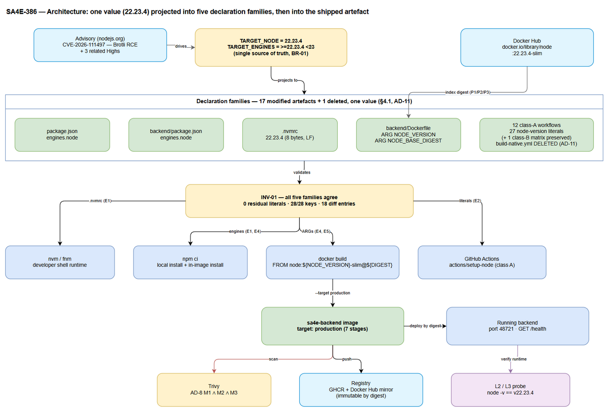
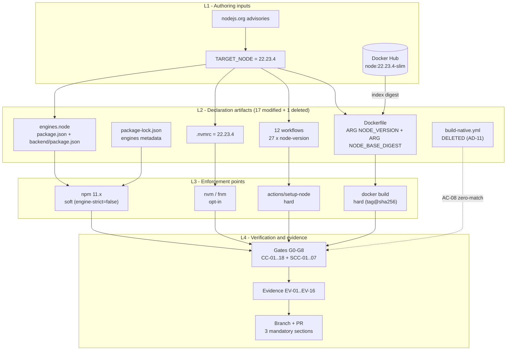
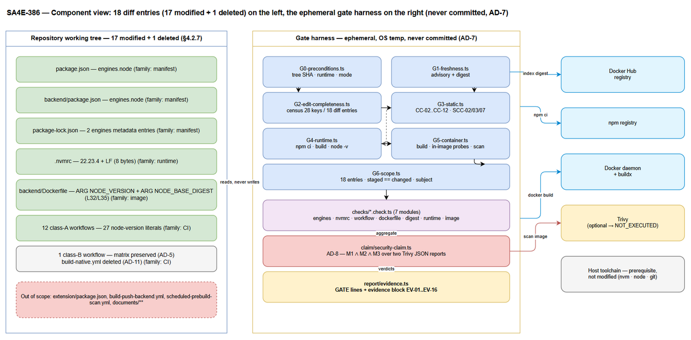
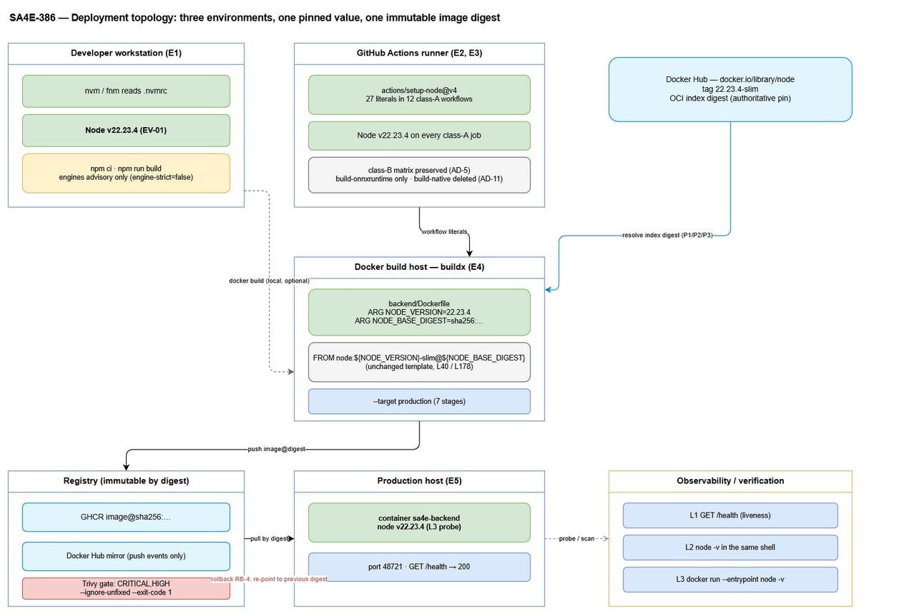
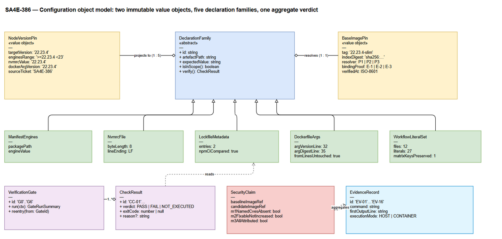
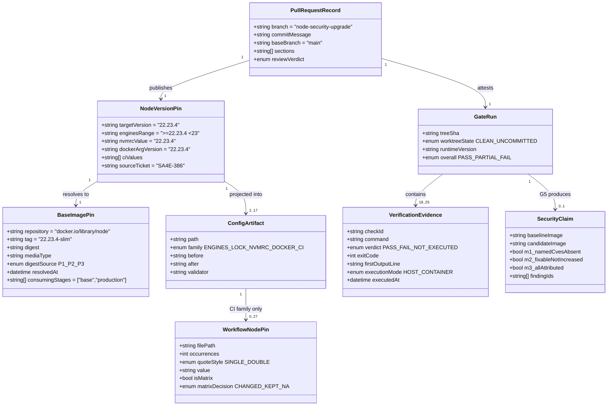
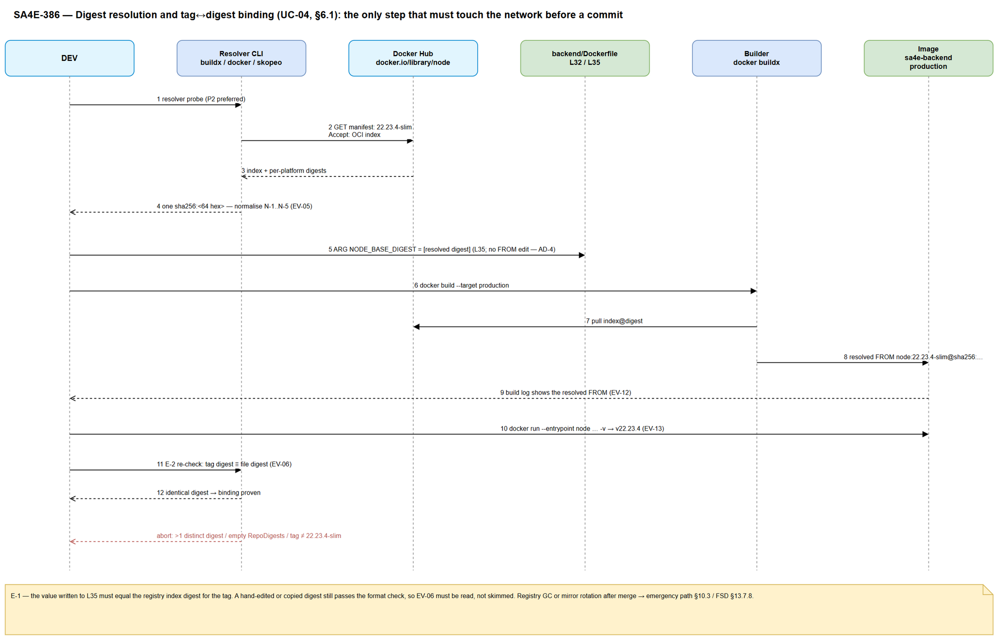
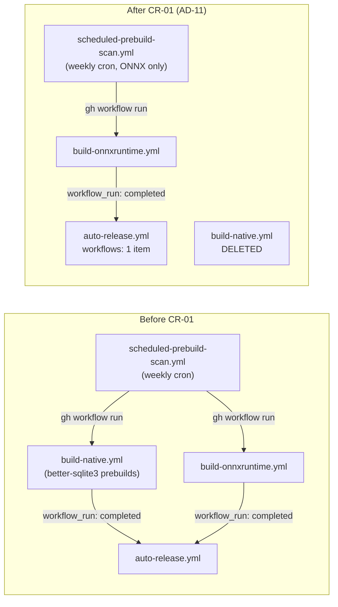
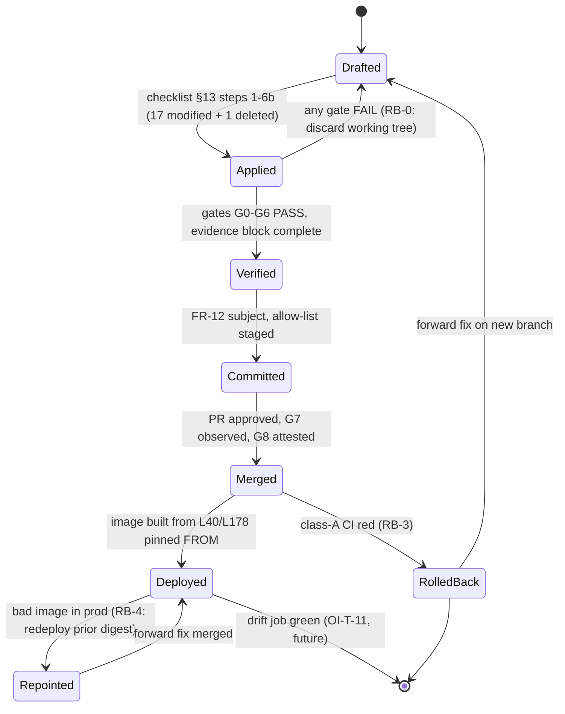
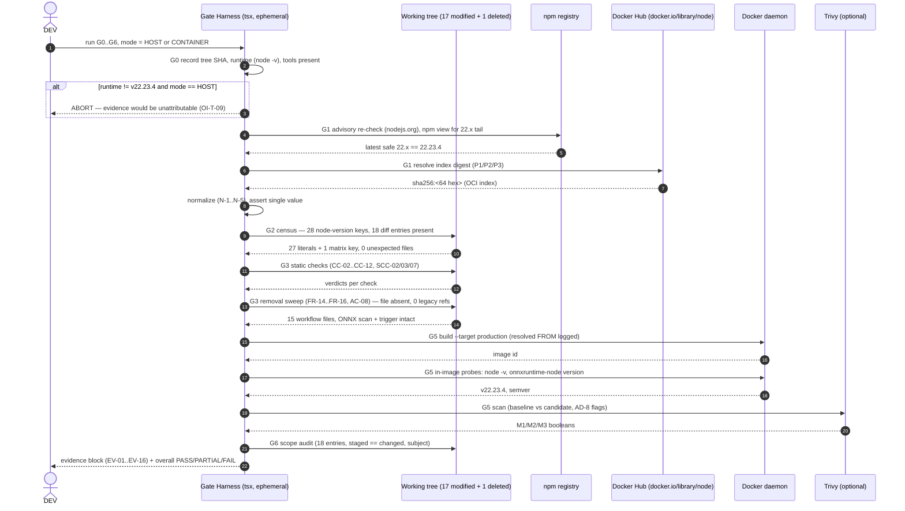

# Technical Design Document (TDD)

## SDLC-Agents-4-Enterprise — SA4E-386: Pin Node.js to 22.23.4 to Patch CVE-2026-111497 (Brotli RCE) and Related Highs

---

## Document Information

| Field | Value |
|-------|-------|
| Jira Ticket | SA4E-386 |
| Title | [Security] Pin Node.js to 22.23.4 to patch CVE-2026-111497 (Brotli RCE) and related highs |
| Author | SA Agent |
| Version | 1.1 |
| Date | 2026-10-28 |
| Status | Draft — implementation-ready (scope amendment CR-01 applied) |
| Related BRD | BRD v1.0 — `documents/SA4E-386/BRD.md` |
| Related FSD | FSD v1.3 — `documents/SA4E-386/FSD.md` (incl. TA enrichment §13 and scope amendment CR-01 §1.2.1 / §3.9) |
| Scope amendments | **CR-01** — retire the legacy `better-sqlite3` build workflow (FSD §1.2.1; design decision **AD-11**, §2.5) |
| Related plan | `documents/node-security-upgrade/PLAN.md` (Jira attachment 11805) |
| Design baseline | branch `main` @ `1666945` (verified 2026-10-28) |

---

## Author Tracking

| Role | Name - Position | Responsibility |
|------|-----------------|----------------|
| Author | SA Agent – Solution Architect | Create document |
| Peer Reviewer | Duc Nguyen Minh – Reporter (Jira SA4E-386) | Review document |

---

## Revision History

| Version | Date | Author | Changes |
|---------|------|--------|---------|
| 1.0 | 2026-10-28 | SA Agent | Initiate document — derived from BRD v1.0, FSD v1.1 (incl. TA §13), and a fresh verification of the working tree. Resolves TA blockers OI-T-07 (measurable NFR-SEC-01) and OI-T-09 (runtime binding on a Node 24 host) with concrete design decisions AD-8 and AD-9. |
| 1.1 | 2026-10-28 | SA Agent | **Scope amendment CR-01 applied (FSD v1.3).** Added **AD-11** (delete `.github/workflows/build-native.yml` and both of its consumer references; `better-sqlite3` is not a runtime dependency — no manifest declares it, `node_modules` is clean, and `package-lock.json` carries exactly one *metadata-only* optional-peer mention via `knex`). Inventory re-based from **17 modified artefacts to 18 diff entries (17 modified + 1 deleted)** (§1.2, §4.2.7, §12, §13). Component/CI design updated: class B is now **one** workflow (`build-onnxruntime.yml`); `auto-release.yml` keeps a single `workflow_run.workflows` entry; `scheduled-prebuild-scan.yml` keeps the ONNX Runtime scan/trigger and loses all `better-sqlite3` material (§4.2.6.1–§4.2.6.2, §6.3, §10.1). Census re-based **29 → 28 keys** (27 literals + 1 matrix expression) and file count **16 → 15**. Gates/verification: new **FV-19**, **MF-09**, **§13 Step 6b** and AC-08 zero-match oracle (§10.7, §9.3, §13). Traceability extended to **FR-14/FR-15/FR-16/AC-08** and **TC-43…TC-46** (§12, §11.7). Risks updated: **DR-07/DR-08**, **OI-T-14**. No requirement was deleted or weakened; the Node pin itself is unchanged. |

---

## Sign-Off

| Name | Signature and date |
|------|--------------------|
| | ☐ I agree and confirm the technical design in this TDD |
| | ☐ I agree and confirm the technical design in this TDD |

---

## 1. Introduction

> **Scope Boundary:** This TDD specifies HOW to implement the requirements defined in the FSD. It does not repeat functional requirements, business rules, use cases or UI specifications — refer to FSD §3 (UC-01 … UC-08, BR-01 … BR-30, FR-01 … FR-16, AC-01 … AC-08) and §13 (command contracts CC-01 … CC-18, gates G0 … G8). This document focuses on: architecture decisions, the object model of the pin, the file-by-file change design, CI/CD behaviour, digest resolution, verification execution model, rollback and deployment.

### 1.1 Purpose

This ticket removes CVE-2026-111497 (Brotli decoder out-of-bounds write, "Node2Shell") and three related High findings from every runtime the project uses. The deliverable is **not code** — it is a set of **17 configuration artifacts** that must all carry the same Node patch version (`22.23.4`), plus one **deletion** (`.github/workflows/build-native.yml`, scope amendment CR-01) and proof that the shipped container really contains that runtime. The expected diff is therefore **18 entries = 17 modified + 1 deleted** (§4.2.7).

The deletion is not a second feature bolted onto the pin. It exists because the file it removes is a **dead/legacy distribution pipeline** for `better-sqlite3`, a package this repository does not depend on (FSD §1.2.1, E-1…E-5), and because leaving it in place leaves two dangling consumers — a release trigger and a weekly dispatcher — pointing at a pipeline with no consumer (AD-11).

This TDD exists to close the gap between "the specification says which value goes where" and "an implementer can execute it once and a reviewer can reject it on a named ground". It therefore answers five engineering questions that the FSD deliberately left open:

1. **Which artifact owns which value, and what is the single mechanism that keeps them consistent?** (§2, §4, AD-1)
2. **How is the one value that cannot be authored — the base-image digest — obtained, normalised and proven correct?** (§6.1, §4.2.5, AD-3)
3. **How is evidence produced on a host whose default runtime is outside the declared range?** (§11, §10.4, AD-9 — resolves OI-T-09)
4. **How is a security claim like "0 Critical/High from the Node base" turned into a machine-checkable statement?** (§7.5, §11.4, AD-8 — resolves OI-T-07)
5. **How is a dead workflow removed without collateral damage — and how is "dead" proved rather than asserted?** (§4.2.6.1–§4.2.6.2, §6.3, AD-11 — implements FR-14 … FR-16 / AC-08)

### 1.2 Scope

**In scope (technically).** Five declaration families plus the lockfile mirror, all applied atomically on one branch, plus one file deletion carried by scope amendment CR-01:

| Family | Artifact(s) | Count |
|--------|-------------|-------|
| Engines | `package.json`, `backend/package.json` | 2 |
| Engines metadata mirror | `package-lock.json` (`packages[""].engines.node`, `packages["backend"].engines.node`) | 1 |
| Local runtime | `.nvmrc` | 1 |
| Container base | `backend/Dockerfile` (`ARG NODE_VERSION`, `ARG NODE_BASE_DIGEST`, CVE comment) | 1 |
| CI literals | 12 workflow files, 27 `node-version` literals | 12 |
| **Subtotal — modified artifacts** | | **17** |
| Legacy pipeline removal (CR-01) | `.github/workflows/build-native.yml` — **deleted**, no replacement (FR-14) | 1 |
| **Total diff entries** | **17 modified + 1 deleted** | **18** |

The deletion is accompanied by two in-set edits to the workflows that referenced the removed file: `auto-release.yml` (FR-15) and `scheduled-prebuild-scan.yml` (FR-16). Both are **already counted** in the 17 modified artifacts (they are class-A files for the `node-version` pin), so they add no new diff entry — they only carry an additional hunk. This accounting is the same one FSD §12.3 rows 19–21 makes explicit.

Plus two **operational, non-committed** artifacts: `.kilo/worktrees/pickled-hook/.nvmrc` (gitignored, registered worktree) and the working files `build.log` / `trivy.json` (never committed).

**Out of scope (technically).** Node 23.x/24.x migration; `extension/package.json`; any npm dependency or lockfile integrity change; `engine-strict`; `node-version-file`; new workflows; new committed scripts; business code; historical documents under `documents/` — all justified in FSD §1.2 and §13.5.7, and tracked as OI-T-01 … OI-T-14. **`better-sqlite3` itself is out of scope and must never become a dependency** (FSD BR-29): CR-01 removes a build capability the repository never consumed, it does not adopt the package. Symmetrically, the `onnxruntime-node` capability must survive the amendment untouched (FSD BR-30).

### 1.3 Technology Stack

The stack is not changed by this ticket; it is the stack the pin must satisfy.

| Layer | Technology | Version (verified 2026-10-28) | Role in this change |
|-------|-----------|-------------------------------|---------------------|
| Runtime (target) | Node.js | **22.23.4** (target; host currently `v24.8.0`) | The value being pinned |
| Package manager | npm | 11.6.0 (host) | Consumes `engines.node`; rewrites lockfile metadata |
| Monorepo | npm workspaces | `["backend","extension"]` — `sdlc-agents-4-enterprise-monorepo@1.55.8` | Root + per-workspace manifests |
| Backend package | npm package | `sdlc-agent-4-enterprise-server` | Second `engines.node` declaration |
| Backend app | Hono + TypeScript (tsx/tsc) | — | Must keep building on the pin |
| Native modules | `onnxruntime-node` **transitive** via `@huggingface/transformers@4.3.1` → `onnxruntime-node@1.30.0` | 1.30.0 | ABI/glibc sensitivity — the real compatibility risk |
| Removed (not a dependency) | `better-sqlite3` — **not declared** in any manifest, **0 resolved** packages in `package-lock.json`, **absent** from `node_modules`; exactly **1 metadata-only** mention remains (`peerDependenciesMeta["better-sqlite3"].optional` of `knex@^3.3.0`, lockfile L11620) | n/a | Subject of CR-01: only its **dead prebuild workflow** is removed (AD-11); nothing is installed, so nothing can break at runtime |
| Container | Docker Engine (BuildKit) | 29.6.1 | Builds the pinned image |
| Base image | `node:22.23.4-slim` (Debian/glibc, **multi-arch OCI index**) | digest resolved at implementation time | The immutable supply-chain anchor |
| CI/CD | GitHub Actions | 16 workflows before CR-01 → **15 after** (12 pin Node) | Hard enforcement point |
| Scanner | Trivy via `aquasecurity/trivy-action@ed142fd0673e97e23eac54620cfb913e5ce36c25` (0.36.0) | `severity: CRITICAL,HIGH`, `ignore-unfixed: true`, `exit-code: "1"` | The CVE claim measurement instrument |

### 1.4 Design Principles

| # | Principle | Consequence in this design |
|---|-----------|---------------------------|
| P-1 | **One value, many projections** — `TARGET_NODE` is a constant; every artifact is a projection of it, never an independent source | AD-1; the only permitted residual variation is the semver *range* form (`>=22.23.4 <23`) |
| P-2 | **Never author what can be resolved** — a digest typed by hand is a defect, not a shortcut | AD-3; resolution procedure (§6.1) + binding proofs E-1/E-2/E-3 |
| P-3 | **Enforce at the artifact, not at the intention** — `engines` warns; `setup-node` and `FROM …@sha256` do not | §2.4 enforcement-strength table; the claim "blocks older Node" is scoped to CI and containers |
| P-4 | **Declare only what you can prove** — a check that did not run is `NOT_EXECUTED`, never `PASS` | §5.2 verdict vocabulary |
| P-5 | **Minimal diff is a security property** — an unreviewable diff cannot be reviewed | 18-entry diff allow-list (17 modified + 1 deleted); no new committed files (AD-1, AD-7) |
| P-6 | **Anchor by key, never by line number** | AD-10; line numbers drift, keys do not |
| P-7 | **Reproducibility survives tag mutation** | Digest pin; the tag is documentation only (§7.5) |

### 1.5 Constraints

| ID | Constraint | Origin | Design impact |
|----|-----------|--------|---------------|
| C-01 | Patch-level only; no major jump (23.x/24.x) | BRD §1.2, BR-03 | `engines` upper bound `<23`; digest must be the `22.23.4` index |
| C-02 | No new committed files; no business-code change | BRD AC-07, BR-23 | The verification harness is **ephemeral** (AD-7); no `verify.mjs` in the repo |
| C-03 | Only `engines.node` may change inside the two manifests | BR-06 | Byte-level minimal edit; lockfile must stay integrity-identical |
| C-04 | The two `FROM … ARG` lines must not be edited | BR-12 | All container change is expressed through the two `ARG` values |
| C-05 | Class-B matrices must not be edited | FSD §13.4.4 | **`build-onnxruntime.yml` only** is read-only in this change (it is the last class-B workflow; `build-native.yml` is deleted by AD-11) |
| C-06 | No security relaxation, no privilege change | NFR-SEC-03, BR-14 | Gate SCC-07 greps added lines for `--insecure`, `USER root`, `chmod 777` |
| C-07 | The implementation host may run a runtime outside the pin | FSD F-03, OI-T-09 | Dual-mode execution (AD-9) |
| C-08 | Class-B prebuild jobs may compile on a cached 22.x below the floor | FSD §13.4.3 | Accepted residual risk (OI-T-05); not a shipped runtime |
| C-09 | GitHub `main` is branch-protected | BR-26 | All delivery through `node-security-upgrade` + PR |
| C-10 | No database, no migration, no API | FSD §4, §5 | §4 and §3 of this TDD are re-cast as configuration/interface design |
| C-11 | `better-sqlite3` must never become a dependency; `onnxruntime-node` capability must not be weakened | BR-29, BR-30 (CR-01) | No dependency line may appear in the diff; the ONNX Runtime scan/trigger and `build-onnxruntime.yml` are preserved byte-identical (FV-20) |

### 1.6 References

| Document | Location |
|----------|----------|
| BRD | `documents/SA4E-386/BRD.md` (v1.0) |
| FSD | `documents/SA4E-386/FSD.md` (v1.3, incl. §13 TA enrichment and scope amendment CR-01 §1.2.1 / §3.9) |
| Node upgrade plan | `documents/node-security-upgrade/PLAN.md` (Jira attachment 11805) |
| TDD template | `documents/templates/TDD-TEMPLATE.md` |
| Node.js Oct 2026 security releases | https://nodejs.org/en/blog/vulnerability/october-2026-security-releases |
| Node.js Jul 2026 security releases | https://nodejs.org/en/blog/vulnerability/july-2026-security-releases |
| SA4E-335 image/registry design (base digest, AD-1 glibc decision) | `backend/Dockerfile` header, `documents/SA4E-335/BUILD-AND-REGISTRY.md` |

---

## 2. System Architecture

### 2.1 Architecture Overview

The system under design is **the repository's Node runtime pin set**. It has no runtime process of its own, no database and no API. Architecturally it is a **configuration-distribution system with four layers**, and the only interesting property is that all four layers must end up deriving from the same constant.


*[Edit in draw.io](diagrams/architecture.drawio)*

| Layer | What lives here | Change in this ticket |
|-------|-----------------|------------------------|
| **L1 — Authoring inputs** | Node advisories, `TARGET_NODE` constant, Docker Hub tag, the gitignored worktree | Read-only; `TARGET_NODE` re-verified at G1 |
| **L2 — Declaration artifacts** | 2 manifests, lockfile metadata, `.nvmrc`, Dockerfile ARGs, 12 workflow files | **Written** (17 files modified) + **1 file deleted** (`build-native.yml`, CR-01) |
| **L3 — Enforcement / consumers** | npm, nvm/fnm, `actions/setup-node`, `docker build` | Unchanged code; their *behaviour* changes because the inputs changed |
| **L4 — Verification & evidence** | Gates G0–G8, evidence register EV-01…EV-16, PR attestation | Executed once per change; nothing committed |

The architectural constraint that drives every decision below is that **L2 has five independent physical storage locations with five different syntaxes** (JSON ×3, plain text, Dockerfile, YAML ×27). There is no runtime indirection available — no `process.env.NODE_VERSION` used by all of them — because introducing one would require new files and new workflow keys, which AC-07 and BR-18 forbid. Consistency is therefore achieved by **discipline + detection**, not by coupling: the value is written once by a human/agent and then *proved* consistent by gates.

> **CR-01 is orthogonal to that constraint.** The deletion of `build-native.yml` carries **no version value** — it removes a workflow that builds a package this repository does not depend on. It is therefore not a sixth projection of `TARGET_NODE`: it adds no storage location, adds no literal, and could not disagree with the pin. Its only architectural effect is on **L3**: one fewer consumer of `actions/setup-node`, and one fewer inbound trigger into `auto-release.yml` (§6.3).



### 2.2 Component Diagram

The change is executed by eight logical components. Only one of them (C1) writes files; the rest either resolve values, classify inputs, execute gates, or assemble evidence. This separation is what keeps the diff minimal: every component except C1 has an explicit "may not write to the tree" constraint.

**CR-01 affects one component, and barely.** C4 gains a fourth class (**R — removed**) so that `build-native.yml` is classified rather than silently ignored, and C6 gains one §9.2 log line for the zero-match sweep. No new component is introduced: removing a file the C1 editor already owns needs no new machinery, and inventing one would have been the larger change.


*[Edit in draw.io](diagrams/component.drawio)*

| Component | Responsibility | Implementation | Writes to tree? |
|-----------|---------------|----------------|-----------------|
| **C1 Artifact Editor** | Apply the 17 single-value edits, preserving syntax and quoting, **and stage the one deletion** (AD-11) | Manual/agent edit per the §4.2 templates; deletion via `git rm` | **Yes — the only writer** |
| **C2 Digest Resolver** | Resolve the OCI **index** digest of `node:22.23.4-slim`; normalise to `sha256:<64hex>` | Strategy over P1 (`docker pull` + `docker inspect`), P2 (`buildx imagetools inspect`), P3 (`skopeo inspect`) | No (emits a value) |
| **C3 Lockfile Sync** | Re-derive the two lockfile `engines` metadata lines | `npm install --package-lock-only --ignore-scripts` | Yes — derived, not authored |
| **C4 Workflow Classifier** | Decide per workflow: editable (class A), preserved (class B = **`build-onnxruntime.yml` only**), reviewed (C/D), **removed (R — `build-native.yml`)** | Static classification table (§4.2.6) | No |
| **C5 Gate Harness** | Execute G0–G7 in order; bind the run to one tree + one runtime | Ephemeral script (§5.4); one check per CC/SCC contract | No |
| **C6 Evidence Compiler** | Render the tab-separated evidence block; enforce the verdict vocabulary | Harness output formatter (§11.2) | No |
| **C7 PR Publisher** | Branch, explicit staging, byte-exact subject, 3-section body | `git` + GitHub PR (§10.6) | No (git metadata only) |
| **C8 Drift Detector** | Assert the five families still agree | **Out of scope** — OI-T-11; compensated by monthly manual INV-01 check | No |

### 2.3 Deployment Architecture

There is no service topology to change, but there *is* a deployment topology the pin must reach. The diagram below is the actual path a value travels from constant to running container.


*[Edit in draw.io](diagrams/deployment.drawio)*

| Environment | Runtime source | What is deployed | Pin mechanism |
|-------------|----------------|------------------|---------------|
| **Developer workstation** (Windows 11, PowerShell 7 / Git Bash, Docker 29.6.1) | `nvm` (POSIX) / explicit `nvm use` (nvm-windows) | Nothing; local installs and builds | `.nvmrc` + `engines` (both soft) |
| **GitHub Actions runner** (ubuntu hosted) | `actions/setup-node` | Test/build artifacts | `node-version: 22.23.4` (hard) |
| **Image build** (CI or local) | `FROM node:22.23.4-slim@sha256:…` | `sa4e-backend` production image | Tag + digest (hard) |
| **Registry** (GHCR + Docker Hub mirror) | Pushed by `build-push-backend.yml` | Image referenced by digest | Immutable digest |
| **Runtime host** | Pull by digest | Container | Deployment manifest pins the digest |

Two properties of this topology matter for rollback and for UG evidence:

1. **The published image outlives the commit.** A `git revert` does not un-publish an image; the deployment must be repointed by digest (§10.5, RB-4).
2. **The container is the only shipped runtime.** The prebuild workflows (class B — after CR-01 only `build-onnxruntime.yml`) produce native binaries, not runtimes; a stale 22.x there is a build-toolchain variance, not a product exposure (§8.4, OI-T-05). `build-native.yml` no longer exists, so the only remaining prebuild path is the one this repository actually consumes (`onnxruntime-node`).

### 2.4 Communication Patterns

No synchronous service calls are introduced. The "communication" in this system is **value propagation**, and its strength differs per channel — this is the single most important architectural fact in the ticket.

| From | To | Mechanism | Pattern | Strength | Evidence |
|------|----|-----------|---------|----------|----------|
| `package.json` / `backend/package.json` | npm | `engines.node` evaluated at install | synchronous, advisory | **Soft** — `npm warn EBADENGINE`, exit 0 (verified on Node 24.8.0) | CC-02, CC-13 |
| `package-lock.json` | npm | recorded metadata | passive | None (must merely agree) | TC-26 |
| `.nvmrc` | nvm / fnm | shell activation | pull, opt-in | **Soft / opt-in** — nvm-windows does not read it | CC-01, CC-06 |
| Workflow YAML | `actions/setup-node` | runner provisioning | synchronous, mandatory | **Hard** — job fails without the version | CC-04, CC-05, G7 |
| Dockerfile ARG | `docker build` | base layer resolution | synchronous, immutable | **Hard** — bytes are fixed by digest | CC-09, CC-15 |
| Digest | Image registry | content addressing | pull by digest | **Hard** | CC-12, E-1 |
| Gate harness | Reviewer | tab-separated evidence block | asynchronous, human | **Soft** (unless wired into CI) | EV-01…EV-16 |

> **Design consequence.** Because two of five channels are soft, the ticket cannot claim "npm blocks older Node". The correct, defensible claim is: *CI and the shipped image are hard-pinned by construction; the developer shell is pinned by documentation and by a captured `node -v`.* §7.5 restates the security claim in exactly those terms, and OI-T-01 tracks the option of hardening the developer path later.

### 2.5 Architecture Decision Register

The decisions below are referenced throughout this document. They are recorded here once, with the alternative that was rejected and the reason — because a decision without its rejected alternative is indistinguishable from an accident.

| ID | Decision | Alternative rejected | Rationale | Consequence |
|----|----------|---------------------|-----------|-------------|
| **AD-1** | **Scope contract**: exactly **18 diff entries** = **17 modified committed artefacts** (2 manifests + lockfile metadata + `.nvmrc` + Dockerfile + 12 class-A workflows) **+ 1 deletion** (`.github/workflows/build-native.yml`, AD-11); **no new files**; patch-level only, within major 22 | A committed `scripts/verify-node-pin.mjs`; a `.node-version`/`.tool-versions` addition; a major-version jump | AC-07/BR-23 make the diff itself a review artefact; every extra file is an extra thing to keep in sync (OI-T-06) | The harness is ephemeral (AD-7); Node 24 migration is explicitly out of scope (BR-03, OI-T-13) |
| **AD-2** | `engines.node` becomes `">=22.23.4 <23"` in **both** manifests; **`engine-strict` stays `false`** | Enabling `engine-strict=true` to make `engines` a hard gate | `engine-strict` is currently `false` and the implementation host runs Node **24.8.0** — enabling it would break every developer and agent machine in one commit | The pin is enforced by CI and the container (hard) and by `engines` (advisory). Documented as OI-T-01, not hidden |
| **AD-3** | The `FROM` pin uses the **OCI image-index digest** (multi-arch manifest list), resolved by **P2 `docker buildx imagetools inspect`** (preferred) → **P1 `docker pull` + `docker image inspect`** → **P3 `skopeo inspect --raw`**, normalised by **N-1…N-5** and bound by proofs **E-1/E-2/E-3** | Any single resolver; a per-platform manifest digest; a digest copied from documentation | Three environments have different tooling; normalisation is what makes them agree on one string. A per-platform digest would silently pin one architecture | Exactly one canonical `sha256:…` may exist in the tree; EV-05/EV-06 prove it (§6.1) |
| **AD-4** | All container change is confined to **L32–L35** of `backend/Dockerfile` (two `ARG` values + the CVE comment). The `FROM` lines at **L40/L178** are **not** edited | Rewriting the `FROM` lines with a literal tag+digest; adding a build arg override | BR-12 forbids editing the `FROM` lines; the ARG template is the existing, reviewed indirection | Any `FROM` hunk in the diff is a defect (FV-09) |
| **AD-5** | **`build-onnxruntime.yml`'s matrix is preserved unchanged** (after CR-01 this is the **only** class-B file; `build-native.yml` is deleted by AD-11) | Relaxing the matrix to a single major, or adding `check-latest` | The matrix value is an ABI selector (`node_version` ∈ `20\|22\|24\|all`), not a runtime pin; its intent is unstated in the ticket (OI-T-03 / FSD §13.4.4 decision record) | Zero diff in `build-onnxruntime.yml` (FV-06); residual risk OI-T-05 accepted |
| **AD-6** | `package-lock.json` is refreshed with `npm install --package-lock-only --ignore-scripts` | `npm install` (full), `npm update`, deleting and regenerating the lockfile | Only the two `engines` metadata entries should move; a full regeneration would alter `resolved`/`integrity` and violate AC-07 | Diff is 2 insertions / 2 deletions (§13 step 5) |
| **AD-7** | The verification harness is **ephemeral** — written to an OS temp directory, executed, and discarded; **never committed** | Committing it under `backend/tests/` or `scripts/` | AC-07 counts the diff; a 19th path fails G6. Promotion is a separate ticket (§11.8, OI-T-11) | A second reviewer cannot re-run the identical code (DR-03); the evidence transcripts are the durable artefact |
| **AD-8** | **NFR-SEC-01 is restated as M1 ∧ M2 ∧ M3** against a baseline image: M1 named CVEs absent, M2 fixable CRITICAL/HIGH not increased, M3 every remaining finding attributed. Two Trivy runs: CI-equivalent flags **and** one unfiltered | Keeping "no High CVE remains" as written; asserting "0 CVE" after a filtered scan | As written, NFR-SEC-01 is unfalsifiable and AC-05 cannot be closed objectively (**OI-T-07**) | Requires BA + Security sign-off (§15.4 Q-1); a scan is mandatory to close AC-05 (BR-21) |
| **AD-9** | Gate G4 executes in one of two modes: **`HOST`** or **`CONTAINER`** (inside `node:22.23.4-slim@<digest>`). EV-01 records the mode and the runtime | Requiring every implementer's host to be natively on 22.23.4; or accepting "close enough" host evidence | The verified host is Node 24.8.0, outside the declared range (**OI-T-09**); CONTAINER mode makes the runtime true by construction rather than by shell hygiene | Requires Team Lead sign-off (§15.4 Q-2); a HOST-mode run without a recorded `node -v` is void |
| **AD-10** | **Anchor by key, never by line number.** Line references in this document are illustrative; the authoritative anchors are identifiers (`ARG NODE_VERSION`, `engines.node`, `node-version:`) and counted sets (**17 modified / 1 deleted / 27 literals / 28 keys / 15 workflow files**) | Relying on line numbers as the edit contract | Every earlier edit shifts every later line; a line-based instruction becomes wrong the moment the file is touched | FV points and CC checks are expressed as greps over keys; the per-file table (§4.2.6) is a convenience, re-verified by census |
| **AD-11** | **Delete `.github/workflows/build-native.yml` and remove both of its consumers** — the `- "Build Native Addons (better-sqlite3)"` item in `auto-release.yml` → `on.workflow_run.workflows`, and every `better-sqlite3` artefact in `scheduled-prebuild-scan.yml` (`BETTER_SQLITE3_VERSION`, the asset scan, the `Trigger build-native` step and the `NEEDS_BUILD_NATIVE` / `needs_native` / `native_versions` plumbing). **`better-sqlite3` is not a runtime dependency**: declared by no manifest, absent from `node_modules`, **0 resolved packages** in `package-lock.json`, and exactly **1 metadata-only** optional-peer mention inherited from `knex@^3.3.0` (`peerDependenciesMeta["better-sqlite3"].optional = true`, lockfile L11620) | (a) keeping the file "for future use"; (b) deleting the file but leaving the trigger/dispatch; (c) adding `better-sqlite3` as a dependency so the pipeline "has a consumer" | The workflow compiles a package this repository never loads and publishes the binaries as release assets for external consumers; through `auto-release.yml` it could fire an extension release from a build unrelated to this codebase. Evidence E-1…E-5 (FSD §1.2.1.2) establishes "dead" as a measured claim rather than an opinion, and E-3's metadata-only reading is what keeps AC-08 scoped to `.github/workflows/` | Diff becomes **18 entries (17 modified + 1 deleted)**; workflow files **16 → 15**; `node-version` keys **29 → 28** (27 literals + 1 matrix); lockfile untouched; ONNX Runtime scan/trigger and `build-onnxruntime.yml` preserved **byte-identical** (BR-30, FV-20) |

**Decision ownership.** AD-1…AD-7, AD-10 and AD-11 are SA decisions, effective on sign-off of this document. AD-8 and AD-9 are **proposals that close named FSD blockers** and take effect only when the owners named in §15.4 countersign; until then, AC-05 and runtime attribution remain open.

**Why AD-11 exists at all.** An amendment that removes a workflow needs an explicit decision record precisely because it looks like a scope increase (AC-07 is a *minimal-diff* rule, and a deletion is a diff). The record makes the justification auditable: the file's only output is consumed by nothing in this repository (E-1…E-4), its two referrers would become dangling dispatches the moment it disappeared (E-5), and the package it builds must never enter the dependency graph (BR-29). Without AD-11, a reviewer would be right to ask "why is CI being restructured inside a Node pin?" — the answer is that it is not being restructured, a dead branch is being cut.

---

## 3. Interface Design (substituted for "API Design")

> **Prerequisite:** Functional contracts (parameters, business errors, data flows) are defined in FSD §3.x.6 and §13.2. This section specifies the **technical** execution contract: exact commands, success signals, exit codes, output shape, recovery mapping and platform variants. There is **no HTTP API and no UI** in scope — the interfaces of this feature are CLI invocations, registry reads and Docker builds. Where the template asks for headers, auth and rate limits, this section specifies the equivalent for a CLI/registry surface.

### 3.1 Interface Overview

| # | Interface | Type | Purpose | FSD contract | Gate |
|---|-----------|------|---------|--------------|------|
| 1 | Runtime identity | CLI (`node -v`, `npm -v`) | Prove the executing runtime is the pin | CC-01 | G4 predecessor |
| 2 | Engines read/validate | CLI (`npm pkg get`) | Prove the effective declared range | CC-02 | G3 |
| 3 | Literal sweeps | CLI (`grep`/`Select-String`) | Prove no forbidden literal survives | CC-03, CC-04, SCC-03 | G3 |
| 4 | Census | CLI | Prove the workflow population did not drift | CC-05 | G3 |
| 5 | `.nvmrc` byte check | CLI | Prove byte-exact single line, LF, no BOM | CC-06 | G3 |
| 6 | Syntax validation | CLI (Node / js-yaml) | Prove JSON/YAML still parse | CC-07, CC-08 | G3 |
| 7 | Dockerfile ARG check | CLI | Prove both ARGs exact, comment present | CC-09, SCC-02 | G3 |
| 8 | `FROM` immutability | `git diff` | Prove the two `FROM` lines were not touched | CC-10 | G3 |
| 9 | **Digest resolution** | Registry / Docker CLI | Obtain the index digest — the only non-authorable value | CC-11 | G1 |
| 10 | Tag↔digest binding | Registry / Docker CLI | Prove the digest belongs to `22.23.4-slim` | CC-12 | G3 |
| 11 | Install | CLI (`npm ci`) | Prove the graph installs on the pin | CC-13 | G4 |
| 12 | Build | CLI (`npm run build`) | Prove the app compiles on the pin | CC-14 | G4 |
| 13 | Production image build | Docker | Prove the shipped artifact builds from the pin | CC-15, SCC-04 | G5 |
| 14 | In-image runtime probe | Docker | Prove the artifact *contains* the pin | CC-16 | G5 |
| 15 | In-image native probe | Docker | Prove `onnxruntime-node` loads (NFR-SEC-04) | SCC-01 | G5 |
| 16 | CVE scan | Trivy CLI | Produce the measurable security claim (AD-8) | CC-17, M1–M3 | G5 |
| 17 | Scope/staging/commit | `git` | Prove the change is exactly the reviewed change | CC-18, SCC-05, SCC-06 | G6 |
| 18 | No-relaxation sweep | `git diff` | Prove no security control was weakened | SCC-07 | G3 |
| 19 | **Legacy-pipeline removal sweep** | CLI (`grep`/`Select-String`, `test -e`, YAML parse) | Prove `build-native.yml` and every `better-sqlite3` reference are gone while ONNX Runtime survives (AD-11) | FR-14, FR-15, FR-16, AC-08 | G3, G6 |

### 3.2 Interface: Runtime Identity + Version Declaration

**Implements:** UC-02, UC-03, FR-01, FR-02, FR-03; BR-04, BR-08

| Attribute | Value |
|-----------|-------|
| Type | CLI, local shell |
| Entry point | `node -v`, `npm -v`, `npm pkg get engines.node`, `cat .nvmrc` |
| Auth | None (local) |
| Rate limit | N/A |
| Working directory | Repository root (and `backend/` for the second manifest) |
| Platform variants | Identical on bash and PowerShell; the `.nvmrc` byte check differs (§3.6) |

**Contract:**

| Field | Type | Required | Success value |
|-------|------|----------|---------------|
| runtime | string | Yes | `v22.23.4` (exact prefix match) |
| npm | string | Yes | any 10.x/11.x; recorded, not enforced (OI-T-02) |
| `engines.node` (root) | semver range | Yes | `>=22.23.4 <23` |
| `engines.node` (backend) | semver range | Yes | `>=22.23.4 <23` |
| `.nvmrc` | bytes | Yes | `22.23.4` + one LF = 8 bytes, no BOM |

**Error mapping:**

| Condition | Observed signal | Exit | Recovery |
|-----------|-----------------|------|----------|
| Runtime below floor | `node -v` → `v22.22.x` | 0 (but wrong output) | `nvm install 22.23.4 && nvm use 22.23.4`; in CONTAINER mode use the digest-pinned image (AD-9) |
| Runtime above ceiling | `v24.8.0` (current host) | 0 (but wrong output) | Same as above — this is OI-T-09's exact failure mode |
| Engine literal stale | `grep` prints `"node": "22.x"` | 1 | Return to §4.2.1 |
| `.nvmrc` has CRLF/BOM | 9–10 bytes, `0D`, or `EF BB BF` | 0 (wrong bytes) | Rewrite with LF, no BOM (§4.2.3) |

### 3.3 Interface: Digest Resolution & Tag↔Digest Binding

**Implements:** UC-04, FR-04; BR-10, BR-11, BR-12

| Attribute | Value |
|-----------|-------|
| Type | Registry read via Docker CLI / `skopeo` / registry HTTP API |
| Endpoints | `docker buildx imagetools inspect node:22.23.4-slim` (P2) · `docker inspect` after pull (P1) · `skopeo inspect docker://node:22.23.4-slim` (P3) |
| Authentication | Anonymous on Docker Hub; `docker login` when rate-limited |
| Rate limit | Docker Hub anonymous pull quota; P2 is the cheapest resolver |
| Timeout (design) | 60 s per attempt; 3 attempts with 5 s / 20 s / 60 s back-off |
| Output | Exactly one `sha256:` + 64 lowercase hex (the **index** digest) |

**Request shape (P2 — recommended primary):**

```powershell
docker buildx imagetools inspect node:22.23.4-slim --format '{{json .Manifest.Digest}}'
```

**Response shape:** `"sha256:<64 lowercase hex>"` (JSON-quoted; quotes must be stripped).

**Normalisation contract (normative):**

| Rule | Requirement | Failure if violated |
|------|-------------|---------------------|
| N-1 | Value begins with `sha256:` and nothing precedes it | `invalid reference format` in `FROM` |
| N-2 | Exactly 64 **lowercase** hex characters | Build-time reference parse failure |
| N-3 | No quotes, whitespace or trailing newline | Invisible in review, fatal in `FROM` |
| N-4 | Must be the **OCI index** digest, never a platform-manifest digest | `no matching manifest for linux/arm64/v8` on other architectures |
| N-5 | Must be the digest of the **slim** variant | Wrong (much larger) base; only E-1/E-3 detect it |

**Binding proofs (all three mandatory when a daemon exists):**

| Proof | Question | Command | Recorded |
|-------|----------|---------|----------|
| E-1 | Does the pinned digest equal what the registry serves for the tag? | `imagetools inspect --format '{{json .Manifest.Digest}}'` vs the Dockerfile value | EV-06 |
| E-2 | Did the build actually use that digest? | `grep -F "node:22.23.4-slim@<digest>" build.log` | EV-12 |
| E-3 | Does the produced image *run* that version? | `docker run --rm --entrypoint node sa4e-backend:node-upgrade -v` → `v22.23.4` | EV-13 |

**Error mapping:**

| Condition | Signal | Recovery |
|-----------|--------|----------|
| Tag not published | `manifest unknown` | Stop; adopt a higher published patch (AF-2); never downgrade |
| Rate limited | HTTP 429 / `toomanyrequests` | Back off, authenticate, or use P2 (no layer pull) |
| Multiple `RepoDigests` | P1 prints several lines | Select the `docker.io/library/node@sha256:` entry; if ambiguous, use P2/P3 |
| Empty `RepoDigests` | `index out of range` | The image was loaded locally; re-pull by tag or switch to P2 |
| File ≠ registry | E-1 mismatch | Block merge; re-resolve; never hand-edit |

### 3.4 Interface: Container Build and In-Image Probes

**Implements:** UC-04, UC-06, FR-10, NFR-SEC-04

| Attribute | Value |
|-----------|-------|
| Build command | `docker build --no-cache --pull --target production -t sa4e-backend:node-upgrade ./backend` |
| Target stage | `production` (the only CI push target) |
| Stage graph rebuilt on digest change | `base` → `deps` → `build` → `mcp-python` → `production` |
| Runtime probe | `docker run --rm --entrypoint node sa4e-backend:node-upgrade -v` |
| Native probe | `docker run --rm --entrypoint node sa4e-backend:node-upgrade -e "console.log(require('onnxruntime-node/package.json').version)"` |
| Timeout (design) | 20 min cold, 10 min warm |

**Success signals:**

| Check | Success | Failure means |
|-------|---------|---------------|
| Build exit code | `0` | Toolchain/native compile failure → EF-3 of UC-04 |
| Build log (SCC-04, unanchored) | ≥1 `node:22.23.4-slim@sha256:<digest>`, **0** `node:22-slim` | ARG not reaching `FROM`, or a hardcoded stage |
| `node -v` in image | `v22.23.4` | Wrong digest, wrong variant, or cached layer |
| Native probe | prints a semver (e.g. `1.30.0`) | ABI/glibc/install problem → EF-TA-06 |

> **Parsing note (normative).** Do not anchor the `FROM` pattern to line start: BuildKit emits `#8 [base 1/2] FROM docker.io/library/node:…`, the legacy builder emits `Step 1/12 : FROM node:…`. Anchor to `FROM` anywhere in the line.

### 3.5 Interface: Gate Harness (single entry point)

The 18 contracts are only trustworthy if produced by **one ordered run against one tree state**. The harness is specified as a contract (not a committed artifact — C-02/AD-7).

| Property | Requirement |
|----------|-------------|
| Entry point | One command per gate, in order G0 → G7, from the repository root |
| Tree binding | First output lines: `git rev-parse HEAD` and `git status --porcelain`; non-empty porcelain marks the run `UNCOMMITTED-WORKTREE` |
| Runtime binding | CC-01 runs **before** any other verdict; failure aborts the run (no partial PASS) |
| Execution mode | `HOST` or `CONTAINER` (AD-9); recorded in EV-01 |
| Inverted checks | CC-03, CC-04, CC-10, SCC-03, SCC-07 pass on exit **1** (no match). Whitelisted; never propagated as failures |
| Verdict vocabulary | `PASS` \| `FAIL` \| `NOT_EXECUTED` (reason required) |
| Aggregate | `PASS` if all PASS; `PARTIAL` only if the sole non-PASS items are `NOT_EXECUTED` on CC-15/16/17/SCC-01; else `FAIL` |
| Harness exit codes | `0` PASS · `1` FAIL · `2` PARTIAL · `3` harness error/usage |
| Idempotency | All static gates are read-only; `git status --porcelain` must be unchanged after G3 |
| Output line format | `CHECK_ID \t VERDICT \t EXIT \t COMMAND \t FIRST_OUTPUT_LINE` |
| Platform parity | bash (Git Bash) or PowerShell; each line records which shell produced it |

**Aggregate verdict mapping (implementation-level):**

```json
{
  "tree": "1666945",
  "state": "UNCOMMITTED-WORKTREE",
  "executionMode": "CONTAINER",
  "runtime": "v22.23.4",
  "checks": [
    { "id": "CC-01", "verdict": "PASS", "exit": 0, "firstLine": "v22.23.4" },
    { "id": "CC-03", "verdict": "PASS", "exit": 1, "firstLine": "(no output)" },
    { "id": "CC-17", "verdict": "NOT_EXECUTED", "reason": "trivy unavailable" }
  ],
  "overall": "PARTIAL"
}
```

**Error taxonomy (harness-level):**

| Code | Meaning | Typical cause | Action |
|------|---------|---------------|--------|
| `H-01 USAGE` | Invalid invocation | Missing gate argument | Fix invocation; exit 3 |
| `H-02 TREE_UNBOUND` | Git state unreadable | Not a git repo / detached corruption | Stop; exit 3 |
| `H-03 RUNTIME_MISMATCH` | CC-01 failed | Host not on 22.23.4 and CONTAINER mode not selected | Switch mode (AD-9); restart at G0 |
| `H-04 PREREQ_MISSING` | Docker/registry/trivy absent | Restricted runner | Emit `NOT_EXECUTED` + reason; never `PASS` |
| `H-05 INVERTED_MISUSE` | A whitelisted inverted check was treated as blocking | Harness defect | Fix the harness, not the artifact |

### 3.6 Interface: Platform Variants for Byte-Level Checks

The only commands where PowerShell and POSIX forms are **not** interchangeable are the byte-level and regex-inverted checks.

| Check | bash (Git Bash) | PowerShell 7 |
|-------|-----------------|--------------|
| CC-06 `.nvmrc` bytes | `od -c .nvmrc \| tail -2` | `Format-Hex .nvmrc` or `[IO.File]::ReadAllBytes(".nvmrc")` |
| CC-03 engines sweep | `grep -rn '"node": "22.x"'` | `Select-String -Path package.json,backend/package.json -Pattern '"node": "22.x"'` |
| CC-04 workflow sweep | `grep -rnE "node-version:[[:space:]]*['\"]22['\"]"` | `Select-String -Path .github\workflows\*.yml -Pattern "node-version:\s*['\"]22['\"]"` |
| SCC-03 extended sweep | `grep -rnE "node-version[[:space:]]*:[[:space:]]*['\"]?22(['\"]\|[[:space:]]\|$)"` | equivalent `Select-String` with the same alternation |
| Byte-exact write | `printf %s 22.23.4 > .nvmrc` | `[IO.File]::WriteAllText(p, "22.23.4" + [char]10)` |

> **Rule.** A mixed run is acceptable only if every evidence line records the shell that produced it. Silent mixing is how a CRLF-polluted `.nvmrc` passes an `od`-based check and fails on a POSIX `nvm`.

---

## 4. Configuration Artifact Design (substituted for "Database Design")

> **Prerequisite:** The logical entities and consistency invariants are defined in FSD §4 (NODE_VERSION_PIN, BASE_IMAGE_PIN, WORKFLOW_NODE_PIN, VERIFICATION_EVIDENCE, PULL_REQUEST_RECORD; INV-01 … INV-06). This section specifies the **physical** implementation: exact file contents, byte-level constraints, application order, and the read paths each consumer uses.
>
> **No database exists in this feature.** There is no DDL, no index and no migration in the SQL sense. The equivalents are: *DDL* → exact target file contents (§4.2); *migration plan* → ordered application sequence with ordering constraints (§4.3); *index/query performance* → consumer read paths and their cost (§4.4).

### 4.1 Schema Overview

The "schema" is a set of **configuration objects with cross-object invariants**, not tables. The object model below is the authoritative type view of what the harness validates.


*[Edit in draw.io](diagrams/config-object-model.drawio)*



**Entity-to-physical mapping:**

| FSD entity | Physical realization | Cardinality | Validated by |
|-----------|---------------------|-------------|--------------|
| `NODE_VERSION_PIN` | The literal `22.23.4` projected into 5 families | 1 : N (1 constant, 17 modified artifacts) | CC-02, CC-05, CC-06, CC-09 |
| `BASE_IMAGE_PIN` | 2 ARGs in `backend/Dockerfile` | 1 : 1 | CC-09, CC-11, CC-12 |
| `WORKFLOW_NODE_PIN` | 12 YAML files, 27 literals + 1 expression (after CR-01) | 1 : 28 | CC-04, CC-05, SCC-03 |
| `VERIFICATION_EVIDENCE` | Evidence block lines (tab-separated) | 1 run : N checks | §11.2 |
| `PULL_REQUEST_RECORD` | GitHub PR with 3 sections | 1 : 1 | G8 attestation |
| `SecurityClaim` (**new — AD-8**) | Trivy JSON pair + attribution table | 1 run : 1 claim | M1, M2, M3 |

### 4.2 Physical Definitions (file-by-file change design)

#### 4.2.1 `package.json` (root)

**Family:** engines. **Implements:** FR-01, BR-04, BR-05, BR-06. **Anchor:** the `engines` block (currently L20–22) — never the line number (AD-10).

```diff
--- a/package.json
+++ b/package.json
@@
   "engines": {
-    "node": "22.x"
+    "node": ">=22.23.4 <23"
   },
```

| Constraint | Value |
|-----------|-------|
| Allowed diff | exactly 1 line changed (1 insertion, 1 deletion) |
| Forbidden diff | any dependency, script, `workspaces`, `overrides`, `version` change |
| Post-condition | file parses as JSON; `npm pkg get engines.node` prints `">=22.23.4 <23"` |
| Preserved | 2-space indentation, key order, trailing newline |

#### 4.2.2 `backend/package.json`

**Family:** engines. **Implements:** FR-02. **Anchor:** the `engines` block (currently L49–51).

```diff
--- a/backend/package.json
+++ b/backend/package.json
@@
   "engines": {
-    "node": "22.x"
+    "node": ">=22.23.4 <23"
   },
```

Identical constraints to §4.2.1. `extension/package.json` is **not opened** (BR-07).

#### 4.2.3 `.nvmrc`

**Family:** local runtime. **Implements:** FR-03, BR-08. **Physical form is byte-critical.**

| Attribute | Required value |
|-----------|----------------|
| Content | `22.23.4` |
| Trailing byte | single `0A` (LF) |
| Total size | **8 bytes** |
| BOM | absent (`EF BB BF` forbidden) |
| CR | absent (`0D` forbidden) |
| Prefix | no `v` |
| Extra whitespace | none |

**Write procedure (choose one, then verify by bytes — never trust the editor):**

```bash
# bash / Git Bash
printf %s 22.23.4 > .nvmrc
```

```powershell
# PowerShell 7
[IO.File]::WriteAllText("$PWD/.nvmrc", "22.23.4" + [char]10)
```

**Operational duplicate (not committed).** `.kilo/worktrees/pickled-hook/.nvmrc` exists in a **registered** worktree (`d713ae3`, detached) and `.kilo/` is gitignored. Per BR-09 it must be updated while the worktree is active, but it can never appear in `git diff` — its evidence is a **file read** (EV-07), and it must never be force-added.

#### 4.2.4 `package-lock.json`

**Family:** engines metadata mirror. **Implements:** AC-07 compatibility (no dependency change). **This is a derived artifact, not an authored one.**

| Attribute | Value |
|-----------|-------|
| Origin | `npm install --package-lock-only --ignore-scripts` executed **after** both manifest edits |
| Expected diff | exactly 2 lines: `packages[""].engines.node` (currently L16) and `packages["backend"].engines.node` (currently L67) |
| Forbidden diff | any `resolved` URL, `integrity` hash, `dependencies`/`devDependencies` version, `lockfileVersion` |
| Why `--ignore-scripts` | the root `postinstall` (`node scripts/patch-vendored-deps.mjs`) rewrites vendored deps; it must not fire during a metadata-only operation |
| Idempotency | a second run must produce zero changes (TC-26) |
| If skipped | `npm ci` still succeeds (verified, exit 0), but the next `npm install` by anyone dirties the tree; the PR must then state the omission in one line (AF-TA-05) |

#### 4.2.5 `backend/Dockerfile` (the only security-critical file)

**Family:** container base. **Implements:** FR-04, FR-05, BR-10 … BR-14, NFR-SEC-02/03/05.

**Editable region — lines 32–35 only. The two `FROM` lines (L40, L178) are untouchable.**

```diff
--- a/backend/Dockerfile
+++ b/backend/Dockerfile
@@
-ARG NODE_VERSION=22
-# node:22-slim — pin by digest for a reproducible supply chain (SEC-02).
-# Tag kept for readability; the digest is the authoritative pin.
-ARG NODE_BASE_DIGEST=sha256:43ac6c60b8f89723f746e8a92ce91abd5017e627ce1ddfe4238355d3a30b772c
+ARG NODE_VERSION=22.23.4
+# node:22.23.4-slim — pin by digest for a reproducible supply chain (SEC-02).
+# Patched for CVE-2026-111497 (Brotli RCE), the two TLS hostname-verification
+# bypasses and CVE-2026-56846 (HTTP/2 maxSessionMemory). Tag kept for
+# readability; the digest is the authoritative pin.
+ARG NODE_BASE_DIGEST=sha256:<INDEX_DIGEST_RESOLVED_AT_IMPLEMENTATION_TIME>
```

| Constraint | Requirement | Verified by |
|-----------|-------------|-------------|
| `NODE_VERSION` | exactly `22.23.4` (equals `TARGET_NODE`) | CC-09 |
| `NODE_BASE_DIGEST` | `^sha256:[0-9a-f]{64}$`, equals the registry index digest | CC-09, CC-12 |
| Comment | must contain literal `CVE-2026-111497` **and** `Tag kept for readability` | SCC-02 |
| `FROM` lines | zero added/removed `FROM` lines in `git diff` | CC-10 |
| Relaxation | no added `--insecure`, `allow-unauthenticated`, `USER root`, `chmod 777` | SCC-07 |
| Variant | stays `-slim` (Debian/glibc) — never alpine/full | EF-6; AD-1 header rationale |
| Line count | net **+2** lines (4 → 6 in the header block) | diff review |

**Stage-graph consequence (cache planning).** Only two stages declare `FROM node:…` (L40 `base`, L178 `production`); five stages inherit `base` (`deps` L53, `build` L61, `mcp-python` L98, `development` L279, `test` L308). Changing the ARG invalidates the entire chain that `--target production` needs, so a full rebuild (CC-15) is required evidence, not a formality.

**Comment placement note.** The new comment is inserted *inside* the existing arg header; the file's top-of-file design-decision block (AD-1, SEC-02, SEC-05, BR-05, AD-6, MCP-1) is **not** restructured — it already documents the digest-pinning rationale that this ticket re-uses.

#### 4.2.6 CI workflows — 12 edited files, 27 literals (plus the CR-01 removal set, §4.2.6.1–§4.2.6.2)

**Family:** CI. **Implements:** FR-06, BR-15, BR-18. **Rule:** change the *value* only; preserve each file's quote style, indentation and all other keys.

Edit shape (single-quote files): `node-version: '22'` → `node-version: '22.23.4'`
Edit shape (double-quote files): `node-version: "22"` → `node-version: "22.23.4"`

| # | File | Occurrences | Quote | Verified line numbers (2026-10-28) |
|---|------|-------------|-------|-----------------------------------|
| 1 | `ci.yml` | 4 | `'` | 18, 46, 71, 96 |
| 2 | `publish.yml` | 2 | `'` | 64, 108 |
| 3 | `auto-release.yml` | 1 | `'` | 94 |
| 4 | `e2e-tests.yml` | 2 | `"` | 59, 91 |
| 5 | `ci-sa4e-191.yml` | 1 | `"` | 28 |
| 6 | `ci-sa4e-223.yml` | 2 | `"` | 34, 71 |
| 7 | `ci-sa4e-241.yml` | 6 | `"` | 80, 114, 150, 181, 228, 259 |
| 8 | `ci-sa4e-332.yml` | 1 | `"` | 105 |
| 9 | `ci-sa4e-336.yml` | 2 | `"` | 70, 128 |
| 10 | `ci-sa4e-356.yml` | 3 | `"` | 86, 193, 227 |
| 11 | `ci-sa4e-358.yml` | 2 | `"` | 107, 219 |
| 12 | `ci-sa4e-369.yml` | 1 | `"` | 76 |
| | **Total literals** | **27** | 7 single / 20 double | — |

**Files with no `node-version` literal — classification (4 files, of which one is removed by CR-01):**

| File | Class | Reason | Proof of review |
|------|-------|--------|-----------------|
| `build-onnxruntime.yml` | B — ABI matrix | Selector `20\|22\|24\|all` is an ABI dispatch key; artefact name is *not* versioned (L95/L121/L170). **After CR-01 this is the only class-B file** | FR-07 decision record, §8.3; FV-06 |
| `build-push-backend.yml` | C — Docker-only | Contains no Node reference at all; inherits the pin from the Dockerfile | FR-08 probe (zero matches) |
| `scheduled-prebuild-scan.yml` | D — dispatcher | Keeps `SUPPORTED_NODE_VERSIONS: "20 22 24"` and the `-f node_version="22"` ABI dispatch input; contains no `node-version:` key. **CR-01 edits this file, but only to delete `better-sqlite3` material** (§4.2.6.2) | FR-08 positive finding, §8.3; FV-20 |
| `build-native.yml` | **R — removed** (was B) | Selector was also the artefact namespace (`better-sqlite3-…-node-v22-…`). The file has no consumer in this repository, so the whole workflow goes (FR-14) | **AD-11**, §4.2.6.1; TC-43 |

**Census contract after the edit:** `grep -rn "node-version" .github/workflows/` → **28 keys** total = 27 literals (all `22.23.4`) + **1** matrix expression (`build-onnxruntime.yml` L84). The directory holds **15** workflow files (16 before the CR-01 deletion). A count of 27 or 29 means the tree drifted — most likely a partially-applied CR-01 — reconcile before proceeding (UC-05 AF-1).

#### 4.2.6.1 `.github/workflows/build-native.yml` — deleted (AD-11, FR-14)

**Family:** CI (removal). **Implements:** FR-14; satisfies AC-08 jointly with §4.2.6.2.

The file is 167 lines: `workflow_call` + `workflow_dispatch` inputs (`better_sqlite3_version`, `node_version`), a `prepare` job that generates the matrix, a `build` job that runs `actions/setup-node` + `npm install "better-sqlite3@<input>"` inside a throwaway `build-temp/`, and a release-upload job that publishes `better-sqlite3-v…-node-v…-<plat>-<arch>.node` assets.

**Design position: delete the whole file, do not rewrite it.**

| Option | Verdict | Why |
|--------|---------|-----|
| Delete the file entirely | **Chosen** | Nothing in this repository consumes its output (FSD §1.2.1.2 E-1…E-4). A workflow with no consumer is not a capability; it is maintenance surface plus a release trigger |
| Rewrite it as a generic prebuild builder | Rejected | BR-18 forbids new workflow structure in this ticket, and a generic builder has no requester |
| Keep it, disable the trigger | Rejected | A dormant workflow still counts in the census, still needs `node-version` maintenance, and still implies the repository produces these binaries |
| Rename / `.disabled` / `.bak` | **Forbidden** | FR-14 requires absence. A renamed copy also keeps the artifact namespace alive for `auto-release.yml` |

**Deletion mechanics (normative):**

| Property | Requirement |
|----------|-------------|
| Command | `git rm .github/workflows/build-native.yml` — staged explicitly, never `git add -A` (BR-24) |
| Residue | No rename, no `.bak`, no `.disabled`, no replacement workflow carrying the same job name |
| Diff shape | `git diff --stat` shows `build-native.yml \| 167 ---------` (deletions only, zero insertions) |
| Required status checks | If `Build Native Addons (better-sqlite3)` is configured as a **required check** in branch protection, it must be removed in repository settings — a required check that can never run blocks every merge. This is a settings action: recorded in the PR, not silently done (FSD §3.9.3 AF-3) |
| Historical references | Not rewritten. `extension/CHANGELOG.md` and past documents may still mention the workflow (BR-28); AC-08 is scoped to `.github/workflows/` only |

#### 4.2.6.2 The two consumer workflows — minimal removal edits (FR-15, FR-16)

These are the only two files that referenced `build-native.yml`, and they are the reason the deletion cannot be a one-line change. Both are **already in the modified set** (they carry a `node-version` literal and a `node_version` dispatch input respectively), so they add hunks, not entries, to the diff.

**A. `auto-release.yml` — remove one list item (FR-15).**

```diff
 on:
   workflow_run:
     workflows:
-      - "Build Native Addons (better-sqlite3)"
       - "Build ONNX Runtime Native (onnxruntime-node)"
     types: [completed]
   workflow_dispatch:
```

| Constraint | Requirement | Verified by |
|-----------|-------------|-------------|
| `workflows:` list | exactly **1** item, equal to `"Build ONNX Runtime Native (onnxruntime-node)"` | TC-44 |
| `types` | `[completed]` unchanged | TC-44 |
| `workflow_dispatch` | still present | TC-44 |
| Residual string | `grep -c "better-sqlite3" auto-release.yml` → `0`; `grep -c "onnxruntime-node"` → `1` | TC-44, FV-19 |
| Other keys | untouched; this file's `node-version` literal (L94) is edited by the pin, not by CR-01 | §4.2.6 row 3 |

> **Failure mode this prevents.** Removing the file but leaving this entry produces a `workflow_run` trigger that can never fire — silent, green, and wrong. Worse in the other direction: `workflow_run` with an **empty** `workflows:` list makes the whole trigger block invalid YAML. Both are caught by TC-44/FV-19.

**B. `scheduled-prebuild-scan.yml` — keep ONNX Runtime, remove `better-sqlite3` (FR-16, BR-30).**

| Region | Before | After |
|--------|--------|-------|
| `env` | `SUPPORTED_NODE_VERSIONS` (L9), `BETTER_SQLITE3_VERSION` (L10), `ONNXRUNTIME_VERSION` (L11), `PLATFORMS` (L12) | **`BETTER_SQLITE3_VERSION` deleted**; the other three unchanged |
| `permissions` | `contents: read`, `actions: write` (L14–L16) | unchanged — `actions: write` is still required by `gh workflow run` |
| Accumulators | `NEEDS_BUILD_NATIVE=""` (L29), `NEEDS_BUILD_ORT=""` (L30) | `NEEDS_BUILD_ORT` only |
| Major loop | `for MAJOR in $SUPPORTED_NODE_VERSIONS` (L32) with a better-sqlite3 scan block (L33–L46) **and** the ONNX block (L48–L62) | **Loop kept**; better-sqlite3 scan block deleted; the ONNX block (`if [ "$MAJOR" = "22" ]`) kept **byte-identical** |
| Normalisation | `NEEDS_BUILD_NATIVE=$(…)` (L65) | deleted |
| Step outputs | `needs_native` + `native_versions` + `needs_ort` (L69–L73) | **`needs_ort` only**; the "all binaries up to date" condition becomes `[ "$NEEDS_BUILD_ORT" != "true" ]` |
| Trigger steps | `Trigger build-native` (L76–L87), `Trigger build-onnxruntime` (L89–L96) | **`Trigger build-onnxruntime` only**, byte-identical |

**Preservation contract (BR-30) — the part reviewers must check by diff, not by grep:**

| Must remain | Anchor key | Verified by |
|-------------|-----------|-------------|
| ONNX asset scan | `TAG="onnxruntime-node-v${ONNXRUNTIME_VERSION}"` + the `gh release view` check inside `if [ "$MAJOR" = "22" ]` | FV-20; TC-45 |
| `needs_ort` output | `echo "needs_ort=…" >> $GITHUB_OUTPUT` | FV-20; TC-45 |
| ONNX dispatch | `gh workflow run build-onnxruntime.yml` with `-f onnxruntime_version=… -f node_version="22"` | FV-20; TC-45 |
| `build-onnxruntime.yml` itself | zero diff (AD-5) | FV-06 |
| Job success when nothing is missing | `echo "✅ All binaries up to date"` still reachable | TC-45 |

> **Why `node_version="22"` stays.** That dispatch input is an ABI selector for the prebuild pipeline, **not** the runtime pin — the same distinction the pin makes everywhere else (§13 step 6 grep-scope hazard, AD-10). Changing it under CR-01 would rename artefacts and break the ONNX pipeline: exactly the collateral damage BR-30 forbids.

**Ordering constraint.** The consumer edits and the deletion must land in **one commit**. Any intermediate state either dispatches a non-existent workflow (`Trigger build-native` without the file) or loses the trigger entirely (`workflow_run` entry without any producer). This is why §13 Step 6b is atomic.

#### 4.2.7 Complete change manifest (the allow-list)

| # | Path | Family | Expected diff shape |
|---|------|--------|---------------------|
| 1 | `package.json` | ENGINES | 1 line |
| 2 | `backend/package.json` | ENGINES | 1 line |
| 3 | `package-lock.json` | LOCK | 2 lines (metadata only) |
| 4 | `.nvmrc` | NVMRC | whole file, 8 bytes |
| 5 | `backend/Dockerfile` | DOCKER | ARG ×2 + comment; **no** `FROM` hunk |
| 6–17 | 12 class-A workflows | CI | 27 literal values, quoting preserved |
| **18** | **`.github/workflows/build-native.yml`** | **CI — REMOVED** | **deletion only: 167 lines removed, 0 added (AD-11, FR-14)** |

**Count discipline (this is the number reviewers get wrong).** The diff is **18 entries = 17 modified + 1 deleted**. `git diff --stat` shows 18 files; `git diff --name-only` shows 18 paths, of which one no longer exists on disk after the change. Two of the 17 modified files (`auto-release.yml`, `scheduled-prebuild-scan.yml`) carry a **second** hunk from CR-01 (§4.2.6.2) — they are already rows 3 and 12 of the 12 class-A files, so they do not raise the count. A 17-entry diff means the deletion is missing; a 19-entry diff means something out of scope is staged.

Nothing else may appear. A regenerated `dist/`, an editor temp file, or a log file in the index is an AC-07 failure (EF-TA-10). **No dependency line may appear** — in particular not `better-sqlite3`, whose absence from every manifest is what makes AD-11 correct (BR-29).

### 4.3 Application Order ("migration plan")

The order is not cosmetic: three of the five steps depend on a previous one producing a value or a parseable input.

| Order | Step | Depends on | Why this position |
|-------|------|-----------|-------------------|
| 0 | `nvm install 22.23.4` + capture `node -v` | — | Every later runtime check is void on a foreign runtime (AD-9) |
| 1 | Resolve the index digest (CC-11) | — | Independent of edits; if the tag is unavailable, stop before touching 18 paths |
| 2 | Edit root + backend manifests | — | Defines the value the lockfile will mirror |
| 3 | Sync lockfile (`--package-lock-only --ignore-scripts`) | Steps 2 (both manifests) | Running it earlier leaves the backend entry stale |
| 4 | Write `.nvmrc` | — | Needed before any `nvm use`-based verification |
| 5 | Edit Dockerfile ARGs + comment | Step 1 (digest) | The digest must exist before it is written |
| 6 | Replace 27 CI literals | — | Independent of the others; largest mechanical surface |
| **6b** | **Apply CR-01 atomically: `git rm build-native.yml` + the two consumer edits (§4.2.6.2)** | **Step 6** (same files) | **Independent of the pin, but *not* independently committable: deleting the file alone leaves a dangling dispatch, and editing the consumers alone points `workflow_run` at nothing** |
| 7 | Static gate G3 | Steps 2–6b | Validates the whole tree at once |
| 8 | Runtime gate G4 | Steps 0, 4 | Requires the pin to be active |
| 9 | Container gate G5 | Steps 1, 5 | Requires the digest and the Dockerfile |
| 10 | Commit G6, push, observe G7, attest G8 | Steps 7–9 | Nothing is committed while a mandatory check fails |

**Rollback at any step:** if the step fails, revert *that step's files* to `HEAD` (§10.5, RB-1) — never continue forward with a known-bad value.

### 4.4 Consumer Read Paths and Validation Rules

There is no query planner, but there are five read paths with very different cost and semantics. This is the "query pattern" table for this feature.

| Read path | Consumer | Trigger | Cost | Failure visibility |
|-----------|----------|---------|------|-------------------|
| `engines.node` lookup | npm on every install | `npm ci` / `npm install` | O(1) | **Warning only** (`EBADENGINE`, exit 0) |
| Lockfile metadata read | npm lockfile validation | install | O(1) | Silent disagreement; surfaces as a dirty tree later |
| `.nvmrc` read | nvm/fnm on `nvm use` | interactive shell | O(1) | Silent: shell keeps the old runtime |
| `node-version` read | `actions/setup-node` | job start | network or tool cache | **Job fails or provisions wrong version** — visible |
| ARG read + digest pull | `docker build` | build start | network (layers) | **Build fails or pulls wrong bytes** — visible |

**Validation rules (the "CHECK constraint" equivalent):**

| Field | Rule | Enforcement point |
|-------|------|-------------------|
| `engines.node` | matches `^>=\d+\.\d+\.\d+ <\d+$` and admits `22.23.4` | CC-02 (semver), CC-07 (JSON) |
| `engines.node` | must not be `22.x`, `^22`, `~22`, `>=`, `*` | CC-03, BR-05 |
| `.nvmrc` | 8 bytes, `22.23.4\n` | CC-06 |
| `ARG NODE_VERSION` | equals `TARGET_NODE` | CC-09 |
| `ARG NODE_BASE_DIGEST` | `^sha256:[0-9a-f]{64}$` and equals registry index digest | CC-09, CC-12 |
| `node-version` (CI) | every quoted literal equals `22.23.4`; no unquoted `22` | CC-04, SCC-03 |
| workflow file | parses as YAML | CC-08 |
| `FROM` lines | unchanged (`git diff` has no `[+-]FROM`) | CC-10 |
| changed set | subset of the §4.2.7 allow-list; staged = changed | CC-18, SCC-05 |
| commit subject | byte-equal to the FR-12 string; body mentions the CVE | SCC-06 |

---

## 5. Class / Module Design

> **Prerequisite:** Entities are defined in FSD §4.2. This section specifies the implementation structure: the value-object model, the gate-harness module layout, the design patterns used, and the error-handling hierarchy.
>
> **Important scoping note.** No production module changes in this ticket. The only "code" is the **verification harness**, which is deliberately **not committed** (AD-7) because AC-07 forbids new files in the diff. The harness is therefore specified here as a *design* that DEV executes ad hoc and QA may later re-create; it is written in **TypeScript/Node** to match the repository language, with shell wrappers for the byte-level checks.

### 5.1 Package / Module Structure (ephemeral harness)

```text
<tmp>/sa4e386-verify/          # OUTSIDE the repository — never committed
├── index.ts                   # entry: orchestrates G0..G7, prints the evidence block
├── gates/
│   ├── G0-preconditions.ts    # tree binding, tool probe, execution-mode selection
│   ├── G1-freshness.ts        # advisory re-check + digest resolution (CC-11)
│   ├── G2-edit-completeness.ts# allow-list census, five families present
│   ├── G3-static.ts           # CC-02..CC-12, SCC-02, SCC-03, SCC-07
│   ├── G4-runtime.ts          # CC-01, CC-13, CC-14
│   ├── G5-container.ts        # CC-15, CC-16, CC-17, SCC-01, SCC-04
│   └── G6-scope.ts            # CC-18, SCC-05, SCC-06
├── checks/
│   ├── engines.check.ts       # CC-02, CC-03, CC-07
│   ├── nvmrc.check.ts         # CC-06 (byte-level)
│   ├── workflow.check.ts      # CC-04, CC-05, CC-08, SCC-03
│   ├── dockerfile.check.ts    # CC-09, CC-10, SCC-02, SCC-07
│   ├── digest.check.ts        # CC-11, CC-12 + normaliser (N-1..N-5)
│   ├── runtime.check.ts       # CC-01, CC-13, CC-14
│   └── image.check.ts         # CC-15, CC-16, CC-17, SCC-01, SCC-04
├── claim/
│   └── security-claim.ts      # M1/M2/M3 evaluation over two Trivy JSON reports (AD-8)
└── report/
    └── evidence.ts            # tab-separated block, verdict vocabulary, aggregate
```

Rationale for the layout: one file per **contract family** keeps each file small and independently re-runnable (re-entry rules in FSD §13.6.6 require restarting at a specific gate, not the whole suite).

### 5.2 Key Interfaces

```typescript
/** Result vocabulary — a check that could not run is NOT a pass (P-4, BR-20). */
export type Verdict = 'PASS' | 'FAIL' | 'NOT_EXECUTED';

/** How the gate was executed — resolves OI-T-09 (AD-9). */
export type ExecutionMode = 'HOST' | 'CONTAINER';

export interface CheckResult {
  readonly id: string;                 // 'CC-01' | 'SCC-03' | ...
  readonly verdict: Verdict;
  readonly exitCode: number | null;    // null only for NOT_EXECUTED
  readonly command: string;
  readonly firstOutputLine: string;
  readonly reason?: string;            // required when verdict === 'NOT_EXECUTED'
  readonly shell: 'bash' | 'powershell';
}

export interface GateContext {
  readonly repoRoot: string;
  readonly treeSha: string;
  readonly worktreeState: 'CLEAN' | 'UNCOMMITTED-WORKTREE';
  readonly mode: ExecutionMode;
  readonly runtime: string;            // must be 'v22.23.4'
  readonly dockerAvailable: boolean;
  readonly trivyAvailable: boolean;
  readonly targetNode: '22.23.4';
  readonly enginesRange: '>=22.23.4 <23';
  readonly resolvedDigest: string | null;
}

export interface Check {
  readonly id: string;
  readonly inverted: boolean;          // CC-03/CC-04/CC-10/SCC-03/SCC-07 pass on exit 1
  evaluate(ctx: GateContext): Promise<CheckResult>;
}

/** Immutable value object — one per run; never mutated after construction. */
export interface NodeVersionPin {
  readonly targetVersion: '22.23.4';
  readonly enginesRange: '>=22.23.4 <23';
  readonly nvmrcValue: '22.23.4';
  readonly dockerArgVersion: '22.23.4';
  readonly sourceTicket: 'SA4E-386';
}

/** AD-8: the measurable restatement of NFR-SEC-01. */
export interface SecurityClaim {
  readonly baselineImageRef: string;   // previous production image, pinned by digest
  readonly candidateImageRef: string;  // sa4e-backend:node-upgrade (or its digest)
  readonly m1NamedCvesAbsent: boolean; // the 4 advisory CVEs absent from the candidate
  readonly namedCveIds: readonly string[];
  readonly m2FixableNotIncreased: boolean; // CRITICAL+HIGH with a fix: candidate <= baseline
  readonly m3AllAttributed: boolean;   // every remaining finding attributed to a package+owner
  readonly remainingFindings: readonly { id: string; pkg: string; severity: string }[];
}

/** Aggregate — computed, never asserted by hand. */
export interface GateRunSummary {
  readonly tree: string;
  readonly state: GateContext['worktreeState'];
  readonly executionMode: ExecutionMode;
  readonly runtime: string;
  readonly checks: readonly CheckResult[];
  readonly claim: SecurityClaim | null;
  readonly overall: 'PASS' | 'PARTIAL' | 'FAIL';
}
```

**Aggregate rule (single source of truth):**

```typescript
function summarise(checks: readonly CheckResult[]): GateRunSummary['overall'] {
  const notExecuted = checks.filter(c => c.verdict === 'NOT_EXECUTED');
  const failed = checks.filter(c => c.verdict === 'FAIL');
  if (failed.length > 0) return 'FAIL';
  // NOT_EXECUTED is tolerated only for the container-dependent checks.
  const allowed = new Set(['CC-15', 'CC-16', 'CC-17', 'SCC-01', 'SCC-04']);
  if (notExecuted.every(c => allowed.has(c.id))) return 'PARTIAL';
  return notExecuted.length === 0 ? 'PASS' : 'FAIL';
}
```

### 5.3 Design Patterns

| Pattern | Where used | Rationale |
|---------|-----------|-----------|
| **Value Object** | `NodeVersionPin`, `SecurityClaim` | Immutable, self-validating representations of the two things that must not drift |
| **Strategy** | Digest resolution P1 / P2 / P3 behind one `resolveIndexDigest()` | Three environments (daemon, buildx-only, no-daemon) must produce an *identical* value with different costs |
| **Template Method** | `runGate(n)` fixed sequence G0→G7 | The order is the design (§4.3); letting callers reorder it produces unattributable evidence |
| **Registry / Chain** | `Check` implementations registered per gate | Re-entry rules require re-running one gate; a registry makes that a parameter, not a rewrite |
| **Policy Object** | `ExecutionMode` (HOST/CONTAINER) | Encapsulates the OI-T-09 decision so every gate asserts the same runtime without duplicating logic |
| **Inverted predicate** | `inverted` flag on `Check` | grep-based negative checks pass on exit 1; encoding the inversion explicitly prevents the classic false-FAIL |
| **Null Object** | `NOT_EXECUTED` verdict | A missing prerequisite becomes an explicit, reportable state instead of an implicit success |

### 5.4 Error Handling

The feature has no runtime exceptions; it has **failure modes with recovery paths**. The hierarchy below is the harness's classification, mapped to FSD E-numbers.

| Class | Symbol | Detection | Severity | Recovery | FSD ref |
|-------|--------|-----------|----------|----------|---------|
| Configuration syntax | `ConfigSyntaxError` | `JSON.parse` / YAML parser throws | High | Revert file, redo edit | E-07, E-10 |
| Value conformance | `ValueMismatchError` | regex / semver / equality check fails | High | Return to the owning family edit | E-04, E-09 |
| External resolution | `RegistryError` | 401/403/429, `manifest unknown`, empty `RepoDigests` | Critical | Back off / alternate resolver / stop | E-02, E-03 |
| Build/toolchain | `ArtifactBuildError` | non-zero from `npm ci` / `npm run build` / `docker build` | Critical | Diagnose; never lower `engines` | E-06, E-08 |
| Prerequisite absence | `PrerequisiteMissing` | daemon/skopeo/trivy not found | Info | `NOT_EXECUTED` + reason, defer to CI | E-05, E-13 |
| Scope breach | `ScopeViolationError` | changed set ⊄ allow-list; staged ≠ changed | High | Unstage / revert the hunk | E-12 |
| Probe inconsistency | `ProbeContradiction` | file digest ≠ registry digest; image runtime ≠ `v22.23.4` | Critical | Block merge; re-resolve | E-04, EF-TA-01 |

**Never-handled-by-design list** (these must abort, not degrade): a mismatch between the Dockerfile digest and the registry; an in-image runtime other than `v22.23.4`; a residual `'22'` literal; an out-of-scope staged file.

---

## 6. Integration Design

> **Prerequisite:** Business-level integration requirements (what is exchanged and why) are in FSD §5. This section specifies transport, authentication, timeouts, retry policy, failure containment and data mapping. All seven integrations are **supply-chain touchpoints**, not synchronous service dependencies of a running application.

### 6.1 External System: Docker Hub registry (`docker.io/library/node`)

| Attribute | Value |
|-----------|-------|
| Protocol | OCI Distribution v2 over HTTPS (via Docker CLI / buildx / skopeo) |
| Endpoint | `registry-1.docker.io/v2/library/node/manifests/22.23.4-slim` |
| Authentication | Anonymous (token flow); `docker login` when quota is exhausted |
| Timeout | 60 s per resolver attempt; 300 s for a full `docker pull` |
| Retry policy | 3 attempts, back-off 5 s / 20 s / 60 s; no retry on `manifest unknown` (deterministic failure) |
| Circuit breaker | Open after 3 consecutive 429/5xx; fall back from P1 → P2 → P3; never fall back to a floating tag |
| Data format | OCI image index (multi-arch) + `sha256` content digest |

**Data mapping:**

| Source (registry) | Target (repo) | Transformation |
|-------------------|---------------|----------------|
| `Manifest.Digest` of `22.23.4-slim` | `ARG NODE_BASE_DIGEST` | strip quotes/registry prefix; validate `^sha256:[0-9a-f]{64}$` (N-1..N-5) |
| tag name `22.23.4-slim` | `ARG NODE_VERSION=22.23.4` | take semver part only; variant stays in the `FROM` template |
| `mediaType` | evidence (EV-05) | must be `application/vnd.oci.image.index.v1+json` or `…manifest.list.v2+json` |

**Sequence — digest resolution and binding proof:**


*[Edit in draw.io](diagrams/sequence-digest-resolution.drawio)*

### 6.2 External System: npm registry

| Attribute | Value |
|-----------|-------|
| Protocol | HTTPS (npm registry API) |
| Endpoint | configured registry (default `https://registry.npmjs.org`) |
| Authentication | token from the user/CI config — **never** written by this change |
| Timeout | npm default (retries built in) |
| Retry policy | npm defaults; the gate retries the *install*, not individual requests |
| Circuit breaker | none — a registry outage blocks G4 and is reported as `FAIL`, not `NOT_EXECUTED` (the tree is unverifiable) |
| Data exchanged | dependency tarballs; `EBADENGINE` diagnostics |

**Data mapping / constraint:**

| Repo data | Registry data | Direction | Rule |
|-----------|---------------|-----------|------|
| `engines.node` range | — | out (constraint) | evaluated locally; never transmitted |
| — | dependency tree | in | must be identical to the pre-change tree (AC-07) |
| — | integrity hashes | in | **must not change** in `package-lock.json` |

### 6.3 External System: GitHub Actions (CI)

| Attribute | Value |
|-----------|-------|
| Protocol | GitHub Actions workflow engine (YAML) |
| Endpoint | repository workflows under `.github/workflows/` |
| Authentication | `GITHUB_TOKEN` (existing scopes; **not widened** — BR-14/SCC-07) |
| Timeout | job-level defaults; G5 build budget 20 min cold |
| Retry policy | re-run failed jobs manually; a flaky failure must not be re-run until green without diagnosis |
| Circuit breaker | branch protection: required checks gate the merge |
| Data exchanged | `node-version: 22.23.4` in; job status, logs, image digest out |

**Behavioural contract after the change:**

| Workflow class | Files | Expected CI behaviour |
|----------------|-------|----------------------|
| A — literal pin | 12 | `Set up Node.js` log shows `Found in cache …/22.23.4/x64` or `Acquiring 22.23.4` |
| B — ABI matrix | **1** (`build-onnxruntime.yml`) | Unchanged: 4 platform legs per selector value; artefact names still `node-v22`. `build-native.yml` no longer exists (AD-11) |
| C — Docker-only | 1 | `build-push-backend` resolves `FROM node:22.23.4-slim@sha256:…` and runs Trivy |
| D — dispatcher | 1 | `node_version="22"` still accepted (choice list unchanged); `onnxruntime-node` scan and dispatch intact |
| **R — removed** | **1** (`build-native.yml`) | **Absent.** No run history for future commits; the workflow disappears from `gh workflow list` after merge |

**Trigger graph after CR-01 — the part that is not visible in any single file:**



| Edge | Before | After | Requirement |
|------|--------|-------|-------------|
| `auto-release.yml` ← `workflow_run` | 2 producers | **1** producer (`Build ONNX Runtime Native (onnxruntime-node)`) | FR-15 |
| `scheduled-prebuild-scan.yml` → dispatch | 2 targets | **1** target (`build-onnxruntime.yml`) | FR-16 |
| `scheduled-prebuild-scan.yml` scan scope | 2 assets | **1** asset (`onnxruntime-node`) | FR-16, BR-30 |
| `build-native.yml` | producer + dispatch target | **absent from graphs and from `gh workflow list`** | FR-14 |

> **The invariant the trigger graph encodes.** Every dispatch has a target, and every `workflow_run` producer exists. CR-01 preserves it by removing both sides of the `build-native` edge in the same commit; removing one side only would leave either a dangling `gh workflow run` (fails at the next Monday 00:00 UTC run) or a trigger that can never fire. That is why FR-14, FR-15 and FR-16 are one atomic change, and why TC-43…TC-46 are a set rather than four independent checks.

### 6.4 External System: Container image registry (GHCR + Docker Hub mirror)

| Attribute | Value |
|-----------|-------|
| Protocol | OCI Distribution v2 |
| Endpoint | `${ env.REGISTRY }/${ env.IMAGE_NAME }` as configured in `build-push-backend.yml` |
| Authentication | `GITHUB_TOKEN` / registry credentials already configured |
| Timeout | push under the job budget |
| Retry policy | action-level defaults |
| Circuit breaker | a failed push fails the job; the digest-verification step then errors explicitly |
| Data exchanged | image by digest; `steps.build.outputs.digest` |

### 6.5 External System: nvm / fnm (local runtime manager)

| Attribute | Value |
|-----------|-------|
| Protocol | Filesystem (`.nvmrc`) + shell function |
| Endpoint | shell |
| Authentication | none |
| Timeout | N/A |
| Retry policy | `nvm install 22.23.4` then `nvm use` (once) |
| Circuit breaker | N/A — failure is manual |
| Known limitation | nvm-windows generally does **not** read `.nvmrc`; the pin is documentation-grade there (FSD §13.5.4) |

### 6.6 External System: nodejs.org security advisories

| Attribute | Value |
|-----------|-------|
| Protocol | HTTPS (HTML/JSON release notes) |
| Endpoint | `https://nodejs.org/en/blog/vulnerability/october-2026-security-releases` (+ July 2026) |
| Authentication | none |
| Timeout | 30 s |
| Retry policy | once; on failure use a mirror or the Security Reviewer's confirmation |
| Circuit breaker | if unresolved → record `NOT_EXECUTED` for G1 and **do not** claim the advisory was verified |
| Data exchanged | release list, CVE coverage, latest safe 22.x |

### 6.7 External System: Trivy scanner

| Attribute | Value |
|-----------|-------|
| Protocol | CLI (+ vulnerability DB download over HTTPS) |
| Endpoint | `trivy image …`; CI uses `aquasecurity/trivy-action@ed142fd…` (0.36.0) |
| Authentication | none |
| Timeout | 15 min (DB download dominates) |
| Retry policy | one retry on DB download failure |
| Circuit breaker | unavailable DB/scanner → `NOT_EXECUTED`, never `PASS` (BR-21) |
| CI-equivalent flags (normative) | `--severity CRITICAL,HIGH --ignore-unfixed --exit-code 1` |

**Divergence note (F-10).** The CI gate is **mandatory**; the local scan is optional. The local scan must use the same flags, otherwise its result is not comparable evidence. A second local run *without* `--ignore-unfixed` is required once, purely to make the claim honest about suppressed findings (AD-8).

---

## 7. Security Design

> **Prerequisite:** Roles, data classification and audit needs are in FSD §7; NFR-SEC-01 … 07 in FSD §8. This section specifies the technical controls, the supply-chain threat model, and the **measurable definition** of the security claim (AD-8, closes OI-T-07).

### 7.1 Authentication

No application authentication changes. The relevant identities are repository identities:

| Identity | Credential | Scope used by this change | Change |
|----------|-----------|---------------------------|--------|
| Developer / DEV agent | GitHub PAT or SSH key | push to feature branch, open PR | none |
| CI service identity | `GITHUB_TOKEN` (ephemeral per run) | read repo, push image, write checks | **not widened** (BR-14) |
| Container registry client | existing registry credentials | push image | none |
| `docker login` (local, only if rate-limited) | user's Docker Hub account | pull base image | none — credentials never enter the repo or build args |

**Hard rule:** build args must never carry credentials. The Dockerfile header already states this (BR-17); the change touches only non-secret ARGs (`NODE_VERSION`, `NODE_BASE_DIGEST`).

### 7.2 Authorization

| Role | Artifacts / actions | Permissions |
|------|--------------------|-------------|
| Developer (write) | The 17 modified artifacts + the one deletion on `node-security-upgrade` | write on branch, open PR |
| DevOps / CI Maintainer | `.github/workflows/`, image build | write on workflows, run pipelines |
| Security Reviewer | Review + scan evidence | review, request changes, **block merge** |
| Team Lead / Reviewer | Merge to `main` | maintain |
| Anyone | `main` / `master` | **no direct push** (branch protection, BR-26) |
| CI service identity | Checks and logs | no approval rights |

**New permissions introduced: none.** This is a design invariant, not an aspiration: SCC-07 greps the Dockerfile diff for privilege/relaxation patterns, and any workflow diff hunk outside `node-version` is a scope violation (BR-18).

### 7.3 Data Protection

| Data | Classification | At rest | In transit | In logs / evidence |
|------|---------------|---------|-----------|--------------------|
| `NODE_BASE_DIGEST` | Internal — integrity-critical | plain (it *is* the integrity anchor) | TLS to registry | logged verbatim (public data) |
| CVE identifiers/severities | Internal | plain | TLS | logged verbatim (required by NFR-SEC-05) |
| Workflow definitions | Internal — supply-chain control | git | TLS | diff quoted in PR |
| `package.json` metadata (repo URL, overrides) | Public | unchanged | — | **not** disclosed beyond the diff |
| Build/scan logs | Internal | local file only, **never committed** | — | truncated tail in PR; may reveal internal layer/dependency versions |
| Registry / npm credentials | Restricted | not touched | — | **never** captured in evidence (evidence rule 5) |

**Evidence redaction rule.** The evidence block is pasted into a PR; it must contain no tokens, registry credentials or full dependency URLs with embedded auth. Scan the block for `ghp_`, `Bearer `, and `://.*@` before pasting.

### 7.4 Input Validation

Every value written by this change is validated by an allow-list pattern, not by trust.

| Input | Validation | Enforcement |
|-------|-----------|-------------|
| `TARGET_NODE` | `^22\.\d+\.\d+$` and confirmed as the newest safe 22.x at G1 | manual + advisory |
| `engines.node` | semver **range**, must admit `22.23.4` and exclude `23.0.0` | CC-02 (+ `semver` check) |
| `.nvmrc` | exact bytes `22.23.4\n` (8 bytes) | CC-06 |
| `ARG NODE_VERSION` | `^22\.23\.4$` | CC-09 |
| `ARG NODE_BASE_DIGEST` | `^sha256:[0-9a-f]{64}$` **and** equality with the registry index digest | CC-09, CC-12 |
| `node-version` | quoted literal equals `22.23.4`; unquoted `22` forbidden | CC-04, SCC-03 |
| Workflow YAML | parses; no structural change outside the value | CC-08, manual diff |
| Staged paths | subset of the 18-entry allow-list (17 modified + 1 deletion, §4.2.7) | CC-18, SCC-05 |
| Commit subject | byte-equal to the FR-12 string | SCC-06 |
| Removed workflow | `test ! -e .github/workflows/build-native.yml`; `.github/workflows/` holds 15 files; `grep -rn "build-native\|better-sqlite3\|BETTER_SQLITE3" .github/workflows/` is empty | AC-08 (FV-19) |
| Consumer workflows | `auto-release.yml` `workflows:` = 1 named item; `scheduled-prebuild-scan.yml` still contains `build-onnxruntime.yml` and `needs_ort` | FR-15, FR-16 (FV-20) |

### 7.5 Supply-Chain Threat Model and the Measurable Security Claim

#### 7.5.1 Threat model

| # | Threat | Realistic? | Control | Residual |
|---|--------|-----------|---------|----------|
| T-1 | **Tag substitution** — the publisher re-points `22.23.4-slim` to different bytes | Yes (tags are mutable) | Digest pin: the build cannot move | Reproducibility protected; the *content* trust still depends on Docker/Node's publishing chain |
| T-2 | **Digest pasted from the wrong source** — a valid digest for a different Node version/variant | **High** (R-01) | Resolution procedure + E-1/E-2/E-3 + N-1..N-5 | E-3 (`node -v` in the image) is the only catch-all |
| T-3 | **Platform-manifest digest** — buildable on one architecture only | Medium | N-4; resolve without `--override-arch` | Detected only when a non-amd64 leg builds |
| T-4 | **Mirror poisoning** — a mirror serves a different digest under the official tag | Low | Select the `docker.io/library/node` `RepoDigests` entry; cross-check with `imagetools` | Mirror trust is environmental |
| T-5 | **Silent digest churn** — the same tag resolves to a new digest after merge | Low | Digest pin keeps old bytes; a change is a supply-chain event (§10.5 EF-TA-04) | Needs a rotation policy (OI-T-08) |
| T-6 | **CI privilege escalation smuggled into the diff** | Low | SCC-07; BR-18; reviewer diff | Human review |
| T-7 | **False "0 CVE" claim** — no scan, or a scan with suppressive flags | **High** | BR-21 + AD-8 (M1–M3) | Fixed by AD-8 below |
| T-8 | **Stale evidence** — checks run before the edits, or on Node 24 | **High** | Tree binding (G0) + runtime binding CC-01/AD-9 | Fixed by AD-9 |

#### 7.5.2 AD-8 — Measurable restatement of NFR-SEC-01 (closes OI-T-07)

**Decision.** NFR-SEC-01 ("0 Critical/High CVEs originating from the Node base") is **not** accepted as a bare count. It is replaced by the conjunction **M1 ∧ M2 ∧ M3**, evaluated against a **baseline image** built from the pre-change base (`node:22-slim`, digest `sha256:43ac6c60…772c`) and a **candidate image** built from `node:22.23.4-slim@<resolved>`.

| ID | Criterion | Machine check |
|----|-----------|---------------|
| **M1** | The four advisory CVEs are **absent** from the candidate | `VulnerabilityID ∈ {CVE-2026-111497, CVE-2026-56846, <TLS-1>, <TLS-2>}` must not appear in `trivy.json` |
| **M2** | The count of CRITICAL+HIGH findings **with a fix available** is not greater than in the baseline; every increase is triaged in the PR | set difference of `(VulnerabilityID, PkgName)` between baseline and candidate |
| **M3** | Every remaining CRITICAL+HIGH finding is attributed to a package **and** an owner in the PR | manual table, recorded in EV-14 |

**Procedure (exact):**

```bash
# 1. Baseline image (pre-change base image digest) — build once, or reuse the last production image
docker build --target production \
  --build-arg NODE_VERSION=22 \
  --build-arg NODE_BASE_DIGEST=sha256:43ac6c60b8f89723f746e8a92ce91abd5017e627ce1ddfe4238355d3a30b772c \
  -t sa4e-backend:baseline ./backend

# 2. Candidate image (pinned) — normally produced by CC-15
docker build --target production -t sa4e-backend:node-upgrade ./backend

# 3. CI-equivalent scans (the claim must be reproducible with the CI flags)
trivy image -f json -o trivy-baseline.json  --severity CRITICAL,HIGH --ignore-unfixed sa4e-backend:baseline
trivy image -f json -o trivy-candidate.json --severity CRITICAL,HIGH --ignore-unfixed sa4e-backend:node-upgrade

# 4. Unfiltered scans (so suppressed findings are visible in the record)
trivy image -f json -o trivy-candidate-all.json --severity CRITICAL,HIGH sa4e-backend:node-upgrade

# 5. M1 — named CVEs absent
jq -r '.Results[] | .Vulnerabilities[]? | .VulnerabilityID' trivy-candidate-all.json \
  | grep -E "CVE-2026-111497|CVE-2026-56846" && echo "M1 FAIL" || echo "M1 PASS"

# 6. M2 — fixable set did not grow
comm -13 \
  <(jq -r '.Results[] | .Vulnerabilities[]? | [.VulnerabilityID,.PkgName] | @tsv' trivy-baseline.json  | sort -u) \
  <(jq -r '.Results[] | .Vulnerabilities[]? | [.VulnerabilityID,.PkgName] | @tsv' trivy-candidate.json | sort -u) \
  > new-findings.tsv
wc -l < new-findings.tsv     # must be 0, or each line must be triaged in the PR (M3)
```

**Acceptance of the claim:** NFR-SEC-01 is satisfied iff M1 `PASS` **and** (M2 diff empty **or** every new line attributed) **and** M3 table present in the PR. Otherwise the claim is `FAIL` and the ticket does not merge — even if the CI Trivy gate happens to exit 0, because that gate uses `ignore-unfixed`.

**Why this is the right design.** Trivy reports **OS-package** findings inherited from the Debian layer (e.g. `libssl`, `zlib`) that are not Node CVEs. A bare "0 Critical/High" is therefore unachievable and would be *quietly* waived; a differential claim is achievable, reproducible, and falsifiable. AD-8 also removes the incentive to game the flag: the unfiltered run is part of the record.

**Escalation.** If M2 shows a growth caused by the *newer* base image (a regression introduced by `22.23.4-slim` itself), classify it via FSD §13.7.6: forward-fix within 22.x preferred; rollback only with the §10.5 time-box.

### 7.6 Audit Trail

| Event | Fields | Retention | Control objective |
|-------|--------|-----------|-------------------|
| Commit created | SHA, author, timestamp, subject (contains CVE ID), 18 diff entries (17 modified + 1 deleted) | repository lifetime | NFR-SEC-05 (reference 1 of 3) |
| Dockerfile comment | CVE ID + digest + tag note | repository lifetime | NFR-SEC-05 (reference 2 of 3) |
| PR opened | branch, 3 sections, FR-07/FR-08 text, evidence block | repository lifetime | NFR-SEC-05 (reference 3 of 3), AC-06 |
| CI runs on branch | workflow, SHA, provisioned Node version, result | CI retention policy | AC-04 corroboration |
| Image build | resolved `FROM` line, final digest | CI retention / PR | NFR-SEC-02 |
| Scan | scanner version, both image digests, M1/M2/M3 | PR + Jira attachment | NFR-SEC-01 (AD-8) |
| Gate run | 18–25 evidence lines with tree SHA and runtime | PR comment | BR-22 (attributability) |

**Three independent CVE references are mandatory** (commit subject/body, Dockerfile comment, PR description). A reviewer confirms all three; a missing one is a merge blocker (NFR-SEC-05).

### 7.7 No-Relaxation Invariant

The following must remain **absent from every added line** in `backend/Dockerfile` (SCC-07):

`--insecure` · `allow-unauthenticated` · `USER root` · `chmod 777` · any removed `USER sa4e` directive · any removed `apt-get` cleanup · any widened registry/CI permission.

The Dockerfile's existing controls that must survive unchanged: non-root user `sa4e` (uid/gid 1001) in production/development/test (BR-05), no `git`/compilers in the runtime stage (SEC-05), capability features default-off (SEC-08), and build args free of credentials (BR-17).

**CR-01 and the invariant.** Removing `build-native.yml` is **not** a security relaxation: it deletes a release-publishing path, not a control, and it removes one workflow that held `contents: write` for release uploads. Two rules keep that reading honest:

| Rule | Requirement |
|------|-------------|
| No permission widening | `scheduled-prebuild-scan.yml` keeps exactly `contents: read` + `actions: write`; `auto-release.yml` keeps `contents: write`. CR-01 removes lines; it must not add or elevate a permission |
| No silent control removal | `actions: write` is retained deliberately because `gh workflow run` requires it. Dropping it during the "simplification" would break the ONNX dispatch — a functional regression dressed as a tidy-up (BR-30) |
| No credential exposure | The deleted workflow's release-upload step used `GH_TOKEN`; its removal reduces the number of places a token is passed to a shell. No new secret reference is introduced |

---

## 8. Performance & Scalability

> **Prerequisite:** NFR targets are in FSD §8 ("no runtime performance degradation", "uniform across environments"). This section specifies the build-time and pipeline-time costs of the change, because that is where the observable performance impact actually is. Runtime performance is unchanged by construction: a patch-level Node upgrade inside one major changes no flag, no dependency and no code path.

### 8.1 Caching Strategy

| Cache | What is cached | TTL / invalidation | Technology | Impact of this change |
|-------|----------------|--------------------|------------|----------------------|
| **Docker base layer** | `node:22.23.4-slim` layers, keyed by **digest** | Invalidated once, at the pin | BuildKit content store | Full invalidation of `base` → `deps` → `build` → `mcp-python` → `production` on first build after the pin |
| **CI image cache** | `type=gha, mode=max` layer cache | Keyed by layer content | GitHub Actions cache | First run is cold (~8–20 min); subsequent runs recover |
| **npm cache** | tarballs by integrity hash | Unaffected — no dependency changes | npm cache | No change (integrity hashes identical) |
| **nvm / tool cache** | Installed Node versions | Persistent per machine/runner | nvm, GitHub tool cache | One-time `nvm install 22.23.4` locally; runners with 22.23.4 cached start immediately |
| **Trivy DB** | Vulnerability database | ~24 h freshness | local cache / action cache | Cold download ~1–3 min on first scan |

**Consequence to plan for:** the pin *must* invalidate the image cache (that is the point). Expect one slow build per environment; do not "fix" it by reusing the old base layer.

### 8.2 Concurrency and Rate Budgets (substituted for connection pooling)

There is no connection pool in this feature. The resource that can be exhausted is **registry request quota**, and the relevant concurrency constraint is the number of parallel jobs pulling or provisioning Node.

| Resource | Budget | Control |
|----------|--------|---------|
| Docker Hub anonymous pulls | limited per IP, per 6 h | Prefer P2 (`imagetools inspect`, no layer pull) for resolution; authenticate only when needed |
| Registry manifest requests per run | 1 (P2) or 1 pull + 1 inspect (P1) | Resolution happens once per implementation, never per gate |
| Concurrent CI jobs provisioning 22.23.4 | up to 28 `setup-node` steps across 15 workflows | Tool-cache hit makes this cheap; a cold cache downloads in parallel without throttling issues |
| Trivy DB downloads | 1 per run with `ignore-unfixed` | Reuse the same DB across the baseline and candidate scans where the tool allows |

### 8.3 Performance Targets

| Operation | Baseline | Target after pin | Measurement |
|-----------|----------|------------------|-------------|
| CI job startup (Node provisioning) | cache-hit ≈ 2–5 s | same | `Set up Node.js` step duration |
| Cold production build (G5) | — | ≤ 20 min | `docker build` wall clock |
| Warm production build | — | ≤ 10 min | second build with layer cache |
| Local install (G4) | — | ≤ 6 min warm / 12 min cold | `npm ci` ×2 + build |
| Image size delta | `node:22-slim` base | ±5 % expected (patch-level, same variant) | `docker image inspect --format '{{.Size}}'` |
| Application runtime latency | unchanged | unchanged (no code, no flags) | out of scope for this ticket; regression would be a Node defect (→ §10.5 RB-3) |
| Gate suite (G0–G6) | — | 6–22 min warm / 14–43 min cold | harness wall clock |

> **Note.** The runtime-latency row is intentionally "no target": a patch upgrade is not expected to move p50/p95, and inventing a benchmark here would create a false acceptance gate. If a latency regression is observed post-merge, it is treated as a Node defect and handled by §10.5.

### 8.4 Scalability of the Change Itself

The design scales badly by nature — and says so:

| Dimension | Current | Growth vector | Mitigation |
|-----------|---------|---------------|------------|
| Files carrying the version | 17 | +1 per new `ci-sa4e-*` workflow | CC-05 census; consolidation backlog **OI-T-06** |
| Literal occurrences | 27 (+1 matrix after CR-01) | +1–2 per new workflow | `node-version-file: .nvmrc` would collapse 27 → 1, but touches workflow structure → **OI-T-04** |
| Workflow files under `.github/workflows/` | **15** (16 before AD-11) | +1 per new pipeline | AD-11 removed the only one with no consumer; census (CC-05) keeps the set countable |
| Environments | 3 (local, CI, container) | stable | one value, three projections |
| Future patch bumps | this ticket is the template | every future bump repeats 17 edits | OI-T-04 + OI-T-11 (drift job) are the real scaling fixes |

**Class-B residual (accepted).** `build-onnxruntime.yml` may compile on a cached 22.x older than the floor because `check-latest` is not set. This does not affect the shipped runtime (the container is the runtime) and cannot be fixed here without editing workflow structure (BR-18). Tracked as **OI-T-05**. After AD-11 this residual has exactly **one** carrier instead of two — the removal of `build-native.yml` shrinks the accepted-risk surface without touching the risk itself.

**Scalability consequence of CR-01, stated plainly.** Removing a workflow does not scale anything: it is a one-off subtraction of 167 lines that will never grow back. Its value is not throughput, it is **surface** — one fewer pipeline to keep on the Node pin, one fewer release trigger pointing at this repository's tags, one fewer place a future agent could re-introduce a `better-sqlite3` build. `git rm` is therefore the only part of this ticket whose maintenance cost is *negative*.

---


## 9. Monitoring & Observability

### 9.1 Observability model for a configuration change

This ticket adds no runtime code. There is therefore nothing new to instrument: no new log statements, no new counters, no new traces. Conflating "no new telemetry" with "no observability" would be the mistake. The change has two questions to answer, and each needs a different plane of evidence:

| Plane | Question | Mechanism | Where the answer lives |
|-------|----------|-----------|------------------------|
| **A — Build-time observability** | *Did the pin land, exactly, and only where intended?* | Gates **G0–G8** (FSD §13.6), each emitting a machine-readable verdict and an evidence artefact **EV-01 … EV-16** | PR body (3 required sections), local evidence block |
| **B — Runtime observability** | *Is the thing that is running actually the pinned runtime?* | Runtime identity probes: `node -v`, `npm -v`, `docker run --entrypoint node <image> -v`, `docker image inspect` | Evidence block (EV-01, EV-13), CI logs |

Plane B is the novel part. Plane A already existed in the FSD as a gate set; this design does not invent new gates, it makes each gate *produce a line*. That distinction matters for scope: a gate that cannot be reduced to a pass/fail line is a gate that will be waived under deadline pressure.

**Deliberate non-goal: no change to `GET /health`.** The endpoint is unchanged (see 9.4). Adding `node_version` to its payload was considered and rejected:

| Criterion | Assessment |
|-----------|------------|
| Would it help UG evidence? | Yes — decisively. It would make runtime identity observable from outside the process. |
| Does it fit the allow-list? | No. `backend/src/server/routes/health.ts` is not among the 17 modified artefacts (AD-1); touching it violates AC-07 and BR-23. |
| Does it need an FSD change? | Yes — the response schema is specified in FSD §5 and consumed by the MCP client and the admin UI. |
| Consequence | Deferred. Recorded as **DR-04** in §14.2 as the highest-value follow-up after this ticket. |

Until DR-04 is delivered, runtime identity is proven *around* the process rather than *by* it (9.4, L2/L3).

### 9.2 Logging standards

**Production logging: unchanged.** No application log line changes format, level, or destination. There is no new module, so there is no new logger to configure.

**Harness logging: one new convention, and it is deliberately minimal.** The ephemeral gate harness (§11.4) is the only new executable thing, and its entire logging contract is one line per gate:

```text
GATE <id> <PASS|FAIL|NOT_EXECUTED> <reason>
```

Examples:

```text
GATE G2 PASS 28 keys seen, 27 literals rewritten, 1 matrix preserved, 0 residual
GATE G3 PASS eslint/yaml 15/15 files, 0 BAD lines
GATE G5 FAIL image runtime reported v24.8.0, expected v22.23.4
GATE G1 NOT_EXECUTED network unavailable, using cached advisory snapshot <ts>
```

The vocabulary is the \`Verdict\` union from §5.2, not an ad-hoc set: \`NOT_EXECUTED\` is the same token the type system enforces, so a log line and a data structure cannot disagree about whether a check ran.

Rules for this line:

| Rule | Rationale |
|------|-----------|
| Always **9 tokens or fewer** after `GATE` | Forces the author to state the *reason*, not a narrative |
| `FAIL` and `NOT_EXECUTED` are distinct | A skipped check that reads like a pass is how unverified claims enter a PR |
| Machine-greppable (`^GATE `) | Allows `grep -c '^GATE .* PASS'` as a completeness check without parsing |
| Emitted to stdout only | The harness is ephemeral and never committed; its output is pasted into the evidence block |

The four **gate log sources that already exist** are unchanged and are captured verbatim into the evidence block:

| Source | Command | What a reviewer reads | Artefact |
|--------|---------|----------------------|----------|
| Dependency install | `npm ci`, `npm ci --prefix backend` | Exit code; presence/absence of `EBADENGINE` | EV-10 |
| Build | `npm run build`, `npm run build --prefix backend` | Exit code; first error if any | EV-11 |
| Image build | `docker build --progress=plain` | Resolved `FROM` lines, final image id | EV-12 |
| Scanner | `trivy image` | CRITICAL/HIGH rows after `--ignore-unfixed` | EV-14 |

### 9.3 Metrics (substituted for service metrics)

A configuration change has no request-rate or latency metric to publish. The metrics that matter are properties of the *diff*. They are computed once per run and pasted into the evidence block. They are not scraped, exported, or alerting-backed — and that is acceptable precisely because G6/G7 block on them.

| ID | Metric | Definition | Target | Source of truth |
|----|--------|-----------|--------|-----------------|
| **MF-01** | Residual literal count | `grep -c "node-version.*22\"" + grep -c "node-version.*22'"` over `.github/workflows/` | **0** | CC-04 / EV-04 |
| **MF-02** | Census coverage | `node-version` keys observed / **28** keys expected (27 literal + **1** matrix, after AD-11) | **28/28**, and every one accounted for by class A or B | CC-05 / EV-04 |
| **MF-03** | Diff churn | `git diff --name-only` line count | **18 entries = 17 modified + 1 deleted**, exact set (§4.2.7) | CC-18 / EV-15 |
| **MF-04** | Gate pass rate | `grep -c '^GATE .* PASS'` / 9 | **9/9** (or explicit `NOT_EXECUTED` + reason) | §11.4 |
| **MF-05** | Fixable HIGH/CRITICAL CVEs | Trivy rows after `--severity CRITICAL,HIGH --ignore-unfixed` | **0** | AD-8 / EV-14 |
| **MF-06** | Image size delta | `docker image inspect` `.Size` candidate vs baseline | **≤ +5 %** (informational; no hard gate) | §8.3 |
| **MF-07** | Cold image build delta | Wall-clock `docker build` baseline vs candidate | **≤ +10 %** (informational) | §8.3 |
| **MF-08** | Evidence completeness | count of EV IDs present in the PR comment / 16 | **16/16** (CR-01 evidence is folded into **EV-04** and **EV-15**; no EV id was added) | EV-01…EV-16 |
| **MF-09** | Legacy-reference residual count | `grep -rc "build-native\|better-sqlite3\|BETTER_SQLITE3" .github/workflows/` (sum) | **0** | AC-08 / EV-04 |

MF-08 is the keeper. Every other metric can be green while the evidence that proves it is missing. A reviewer who counts 16 headings in the PR body has done more for the audit trail than a reviewer who reads a green checkmark.

**MF-09 is the only new metric, and it exists to make AC-08 countable.** A zero-match requirement verified by eye ("I looked, it seems gone") is the weakest form of evidence; a sum over `grep -c` is a number a reviewer can re-derive in one command. It deliberately returns **0** on success, which is easy to misread as "no data" — the report line must therefore print the count *and* the file set it swept.

### 9.4 Health checks

Three levels, stacked. Each level proves something the level below cannot.

| Level | What it proves | Command | Expected | Failure means |
|-------|----------------|---------|----------|---------------|
| **L1 — Process liveness** | The application is up and its tool registry loaded | `curl -fsS http://127.0.0.1:48721/health` | HTTP `200`; body has `status`, `version`, `uptime`, `tools_loaded`, `modules` | Unrelated to this ticket — the app is down. Do not proceed to L2. |
| **L2 — Runtime identity** | The interpreter serving L1 is the pinned one | `node -v` **in the same shell/container that L1 was measured in** | `v22.23.4` exactly | Either the local runtime is wrong (→ `nvm use`, OI-T-09) or the container base is wrong (→ G5 fails) |
| **L3 — Image identity** | The *shipped artefact* embeds the pinned runtime and base digest | `docker run --rm --entrypoint node <image> -v` and `docker image inspect <image> --format '{{.Id}}'` | `v22.23.4`; image id recorded | G5 evidence invalid; do not push |

> ⚠️ **Disambiguation that has bitten this project already.** `GET /health` returns `version`, and that field is the **application** version (`1.0.0`), served from `backend/src/config`. It is **not** the Node.js version. The endpoint was verified on the running instance during this design and exposes exactly `{status, version, uptime, tools_loaded, modules}`. Do not cite `/health.version` as evidence of the runtime version. This is exactly the class of "plausible but wrong" evidence that OI-T-07 exists to prevent.

**L1 is not sufficient for this ticket.** A Node 24 process answers `/health` with `200` just as contentedly as a Node 22.23.4 process — verified: the live instance on port 48721 (pid 31188) was started on the host's Node **v24.8.0** and returns `200`. L1 proves the app works; only L2/L3 prove *which runtime* made it work.

**Health check configuration introduced by this ticket: none.** No probe interval, timeout, or threshold changes. The container `HEALTHCHECK` directive, if present, is untouched — it is outside the editable region (AD-4).

### 9.5 Alerting thresholds

There is no paging rotation for a version pin. The "alerts" are blocking conditions on a pull request plus one recurring manual check.

| Signal | Threshold | Action | Owner | Blocking? |
|--------|-----------|--------|-------|-----------|
| Any gate verdict `FAIL` | 1 occurrence | Fix the root cause; never re-run until green without a stated change | Author | **Yes** — G6 |
| `grep` residual literal | ≥ 1 | Return to §13 checklist step 3 | Author | **Yes** — MF-01 |
| Trivy fixable CRITICAL/HIGH | ≥ 1 | Triage in PR (EPSS/KEV/reachability) or bump base digest again | Author + Security | **Yes** — MF-05 |
| Tag digest ≠ pinned digest | 1 mismatch | Stop. Re-resolve (§6.1, N-1…N-5). Never hand-edit a digest | Author | **Yes** — E-1 |
| Advisory re-check finds a newer safe 22.x | Any | Halt, re-plan the pin value (R-04) | Author + TA | **Yes** — G1 |
| Post-merge CI red on a class-A workflow | 1 run | Roll back per **RB-3** within one business day | DevOps | Post-merge |
| Manual INV-01 drift check | Monthly, until OI-T-11 | Diff the five declaration families; file a ticket on mismatch | DevOps | No (compensating control) |
| Node 22 EOL proximity | 2027-04-30 | Migration plan must exist by 2027-01-31 | Team Lead | No — OI-T-13 |

The monthly manual INV-01 check is the honest weak point. It is a compensating control standing in for an automated drift job, and compensating controls decay. OI-T-11 is not a nice-to-have; it is the only thing that turns this table from a habit into a mechanism.

### 9.6 Evidence retention

| Evidence class | Destination | Retention | Rationale |
|----------------|-------------|-----------|-----------|
| Evidence block (EV-01…EV-16) | PR body / comment | Life of the repository (PRs are not deleted) | This is the audit artefact G8 depends on |
| Trivy JSON report | PR comment (summary) + CI artifact | CI default retention | Needed if a CVE is questioned later |
| npm/install/build logs | PR comment, truncated tail | Life of the PR | Full logs are reproducible by re-running |
| Gate harness source | **Nowhere — never written to disk under version control** | Run-scoped only | AC-07 forbids new files; see §11.4 |
| Digest resolution transcript | PR comment | Life of the PR | Proves E-1 without re-pulling the registry |

Note the asymmetry: the harness that produces the evidence is discarded; the evidence it produces is permanent. That is intentional. A committed harness becomes a maintained product (OI-T-06 territory); a pasted transcript is a fact about a specific moment.

---

## 10. Deployment

### 10.1 Environment configuration

One value, five projections. The table below is the authoritative map from "where" to "which declaration is actually read there". It exists because the answer is not obvious — and because two of the five rows read *nothing* from the repository.

| # | Environment | Effective runtime source | Which declaration is actually read | Enforced? | Verification |
|---|-------------|--------------------------|-----------------------------------|-----------|--------------|
| **E1** | Developer workstation (Windows / macOS / Linux) | `nvm use` / `fnm use` | **`.nvmrc`** → `22.23.4` | Advisory. `engines.node` warns only (`engine-strict=false`, AD-2) | EV-01 (`node -v`) before any other work |
| **E2** | GitHub Actions (class A, 27 keys) | `actions/setup-node@v4` with literal `node-version` | **The workflow file itself** — `.nvmrc` is **not** read, because no workflow sets `node-version-file` (OI-T-04) | Hard. The runner installs exactly the literal | EV-04 census + G7 CI observation |
| **E3** | GitHub Actions (class B, **1** matrix key after CR-01) | `matrix.node_version` in **`build-onnxruntime.yml`** (`build-native.yml` is deleted, AD-11) | **The matrix definition** | Hard, but the matrix is intentionally preserved (AD-5, FSD §13.4.4) | EV-04 (preserved, not rewritten) |
| **E4** | Container image (all 7 stages) | `FROM node:${NODE_VERSION}-slim@${NODE_BASE_DIGEST}` | **`backend/Dockerfile` L32 + L35** | Hard. The digest is the pin | EV-09 (diff), EV-12 (resolved FROM), EV-13 (in-image `node -v`) |
| **E5** | Deployed runtime (GHCR image) | Inherited from E4 | The image that was built | Hard — immutable digest | L3 probe (§9.4) |

**The important reading of this table.** E2 is the row people get wrong. A developer updates `.nvmrc`, sees green locally, and assumes CI follows. It does not: CI follows its own literals. That is why 27 literals must be edited in the same commit as `.nvmrc`, and why MF-02 counts **28** keys rather than 29 or 27 — 27 literals plus exactly one matrix expression, the only one left after AD-11. The *declaration families* are the unit of correctness, not the files.

**Configuration files touched, and only these:**

| File | Change | Consumer (row above) |
|------|--------|----------------------|
| `package.json` | `engines.node`: `"22.x"` → `">=22.23.4 <23"` | E1 (advisory), E4 (in-image `npm ci` check) |
| `backend/package.json` | same | E1, E4 |
| `.nvmrc` | `22` → `22.23.4` | E1 |
| `backend/Dockerfile` | L32 `ARG NODE_VERSION=22.23.4`; L35 new digest; comment L33–34 refreshed | E4, E5 |
| `package-lock.json` | `packages[""].engines.node` and `packages["backend"].engines.node` | `npm ci` inventory comparison |
| `.github/workflows/*.yml` (12 files) | 27 `node-version` literals | E2 |
| `auto-release.yml` | **additionally**: one `workflow_run.workflows` list item removed (FR-15) | E2 (trigger graph) |
| `scheduled-prebuild-scan.yml` | **additionally**: `BETTER_SQLITE3_VERSION`, the better-sqlite3 scan, the `Trigger build-native` step and their plumbing removed (FR-16) | E2 (dispatch graph) |
| `.github/workflows/build-native.yml` | **deleted** (FR-14) | — (no consumer remains) |

**Environment variables: no new ones.** `NODE_VERSION` already exists as a Docker `ARG` (L32) and is **not** promoted to an environment variable. Promoting it would create a sixth projection (env) that can disagree with the other five — a net loss.

**Secrets: none.** BR-17 is satisfied trivially: the diff contains no credentials. The Dockerfile comment at L31 already states this invariant and is not modified.

### 10.2 Feature flags

**There is no feature flag, and there should not be one.** A version pin is not a behaviour that can be toggled per-request, per-tenant, or per-cohort: the process either runs on the pinned interpreter or it does not, and that is decided at image build and process start. A flag would be a lie about reversibility.

The three flag-shaped candidates that were considered and rejected:

| Candidate | What it would do | Why rejected |
|-----------|------------------|--------------|
| **`ENGINE_STRICT=true`** (root `.npmrc`) | Turn `EBADENGINE` from a warning into a hard failure for every npm command | **AD-2.** It would immediately break every developer and agent still on Node 24 (the current host is `v24.8.0`). It is a separate, coordinated change requiring its own ticket → **OI-T-01**. Note it is not a flag this ticket may set, even temporarily: a temporary `engine-strict` would make the verification harness unrunnable on the very host that must run it. |
| `NODE_VERSION` as a CI env var | One place to change | Creates an 18th declaration and a new class of skew (env vs workflow literal). Not consumed by `actions/setup-node` unless the workflow is restructured (OI-T-04). |
| Two Dockerfile stages, one pinned / one not | "Canary" the pin | Doubles the image surface and defeats the purpose. The container *is* the deployment unit (E5). |

**Rollout is therefore binary**: either the image built from the pinned `FROM` is promoted, or the previously built image (by digest) continues to be deployed. §10.3 codifies this.

### 10.3 Rollback strategy

Five levels, ordered by blast radius. Each is executable by one person with one command, and each names its own verification.



| Level | Trigger | Scope undone | Procedure | Verification after | Approval |
|-------|---------|--------------|-----------|--------------------|----------|
| **RB-0** | Any gate FAIL before commit | Everything — nothing was committed | `git checkout HEAD -- package.json backend/package.json .nvmrc backend/Dockerfile package-lock.json .github/workflows/` — `HEAD` still contains `build-native.yml`, so this restores **both** the 17 modifications and the deletion (or `git stash drop` if stashed) | `git status --porcelain` → empty; `node -v` still whatever it was; `Test-Path .github/workflows/build-native.yml` → `True` | Author, unilateral |
| **RB-1** | One declaration family is wrong (e.g. a workflow literal missed) | That family only | Re-edit the family and re-run G2/G3. **Not** a rollback of the others — the 17 modified artefacts (+ the one deletion) are delivered in one commit by design (AD-1). **Exception:** a CR-01 regression is reverted as a *pair* (file + both consumers), never one third of it | MF-01 = 0, MF-02 = 28/28, MF-09 = 0 | Author |
| **RB-2** | The branch commit is wrong and the PR is not merged | The single commit | `git revert --no-edit <sha>` on `node-security-upgrade`, or `git reset --hard <parent>` if unpushed | G6 re-run; `git log -1 --format=%s` matches FR-12 again after re-commit | Author |
| **RB-3** | Post-merge CI red on a class-A workflow, or a production impact traced to the pin | The merge on `main` | `git revert -m 1 --no-edit <merge-sha>` → PR → merge | The reverted tree runs the *prior* pin; class-A CI green | Author + DevOps; **requires** a named approver, a compensating control (re-enable the prior digest, document the interim CVE exposure), and a **dated forward-fix ticket** |
| **RB-4** | A deployed image is bad but the source is fine | The deployment only | Re-point the deployment to the **previous image digest** (GHCR immutable tag by digest). No source change | L3 probe on the repointed image returns the prior `node -v`; L1 returns `200` | DevOps on-call; same three conditions as RB-3 |

**Why RB-3 and RB-4 carry conditions.** Both re-expose the application to CVE-2026-111497. That is a security regression, and a security regression without a paper trail is indistinguishable from negligence. The three conditions — named approver, compensating control, dated forward-fix ticket — are what make the rollback auditable rather than merely fast.

**Emergency path when the pinned base image disappears from the registry** (registry GC, mirror rotation): FSD §13.7.8 governs. In summary: re-resolve a *different* `22.23.4` index digest for the same tag via §6.1, re-run G5, and record both the old and new digests in the PR with the reason. Never fall back to `node:22-slim` unpinned — that trades a recoverable build failure for an unrecoverable supply-chain gap.

**Anti-pattern explicitly forbidden:** rolling back by editing only `.nvmrc`. `.nvmrc` is read by E1 and by nothing else in this repository (§10.1); a lone `.nvmrc` revert leaves CI (E2), the container (E4), and the lockfile all on the new pin, producing a split-brain state that no gate detects. Rollback is *per family* (§4.1), never per file-of-convenience.

### 10.4 "Migration" execution plan (substituted for database migration)

There is no database migration. The analogous risk is **order of application**: editing generators before generated artefacts, or committing before verification, produces a tree that no gate can validate. The order below is therefore mandatory and matches §4.3.

| Step | Action | Gate checkpoint | Why this order |
|------|--------|-----------------|----------------|
| M1 | `.nvmrc` = `22.23.4`; `nvm install 22.23.4 && nvm use 22.23.4` | EV-01 | The runtime must be correct *before* anything is verified on it. Doing this last means every earlier result is unattributable (OI-T-09). |
| M2 | Root and backend `package.json` `engines.node` | G2 partial | Source of truth for the floor. |
| M3 | `npm install --package-lock-only --ignore-scripts` (AD-6) | G3 (lockfile mirrors manifests) | The lockfile is **derived**; running it after M2 prevents a stale-metadata diff. Running it before M2 would faithfully record the old value. |
| M4 | 27 workflow literals (12 files) | G2, G3 (MF-01, MF-02) | Independent of M2/M3; can be parallelised across files but must land in the same commit. |
| **M4b** | **CR-01 removal set: `git rm build-native.yml` + the `auto-release.yml` list item + the `scheduled-prebuild-scan.yml` deletions (§4.2.6.2)** | **G3 (AC-08 sweep, FV-19/FV-20)** | **Atomic by necessity, not by preference**: the file and its two referrers are one edge in the trigger graph (§6.3). Steps M4 and M4b touch the same two YAML files — do M4 first, then M4b, so the "before" state of each consumer is still readable from git. |
| M5 | Digest resolution (§6.1) → `ARG NODE_VERSION` + `ARG NODE_BASE_DIGEST` + comment | G1, G3 (E-1) | Requires network. Must precede M6 because the digest is an input to the image build. |
| M6 | `docker build` → in-image probes | G5 (EV-12, EV-13, EV-14) | Consumes M5. Slowest step; do not start until M1–M5 are green. |
| M7 | Full install/build on the pinned runtime | G4 (EV-10, EV-11) | Consumes M1–M3. Ordered after M6 is optional; ordered after M1 is not. |
| M8 | Scope audit + commit + PR | G6, then G7/G8 | Nothing is committed until every prior gate is green. A commit made before verification encourages "verify the commit" (re-running until green) instead of "verify the change". |

**Parallelism that is safe:** M2 ∥ M4 (different files, no dependency) — and M3 ∥ M4b (touching `package-lock.json` and the trigger graph respectively).
**Parallelism that is not:** M3 before M2; M4b before M4 (the consumer edits would then be reflowed by the literal pass and hard to review); M6 before M5; M8 before any gate.

### 10.5 Runtime Profile (for UG evidence)

This section exists so that the UG agent can produce evidence against a **real running build** without re-deriving the start commands, and without accidentally starting a second instance.

| Field | Value |
|-------|-------|
| **Project root** | `C:\projects\kiro\SDLC-Agents-4-Enterprise` |
| **Runtime prerequisite** | `node -v` → **`v22.23.4`**. This is non-negotiable for this ticket: a UG capture produced on `v24.8.0` is not evidence for a runtime pin. Resolve with `nvm use 22.23.4` (reads `.nvmrc`). |
| **Install** | `npm ci` then `npm ci --prefix backend` |
| **Start (development)** | `npm run dev --workspace=backend` (root) — resolves to `tsx watch ... src/index.ts`; long-running, use a background process |
| **Start (production-like)** | `npm run build --prefix backend` then `npm start --prefix backend` (→ `node dist/index.js`) |
| **Start (container)** | `docker build -f backend/Dockerfile -t sa4e-backend:sa4e-386 backend` then `docker run --rm -p 48721:48721 sa4e-backend:sa4e-386` |
| **Port** | **48721** — resolved by `backend/src/config/index.ts` from `--port` then `CODE_INTEL_PORT`, default `48721`. The admin/viewer port `3202` is a separate listener. |
| **Health endpoint** | `GET http://127.0.0.1:48721/health` → `200` with `{status, version, uptime, tools_loaded, modules}` |
| **Config file** | `.code-intel/settings.json` — written by the server at startup; contains the **real** `mcpUrl` (port included), `pid`, `version`, `startedAt` |
| **MCP endpoint** | As recorded in `.code-intel/settings.json` → `mcpUrl` (observed during design: `http://127.0.0.1:9183/mcp`). **Never hardcode the port** — read it from the file. |
| **Log location** | stdout of the start command. No file appender is configured. |
| **Shutdown** | `Stop-Process -Id <pid>` (pid from `.code-intel/settings.json`) |

**Detecting an already-running instance (do this first, always):**

```powershell
# 1. Preferred: the server's own record
if (Test-Path ".code-intel/settings.json") {
  $s = Get-Content ".code-intel/settings.json" -Raw | ConvertFrom-Json
  "mcpUrl=$($s.mcpUrl)  pid=$($s.pid)  startedAt=$($s.startedAt)  version=$($s.version)"
}
# 2. Cross-check the listener
Get-NetTCPConnection -LocalPort 48721 -State Listen -ErrorAction SilentlyContinue |
  Select-Object LocalAddress, LocalPort, OwningProcess
# 3. Liveness
try { (Invoke-WebRequest "http://127.0.0.1:48721/health" -TimeoutSec 5).Content } catch { "DOWN: $($_.Exception.Message)" }
```

**Policy: reuse, never double-start.** If steps 1–3 show a live instance, **do not start a second one**. A second `tsx watch` will either fail to bind 48721 (port conflict, noisy) or bind 3202/9183 and rewrite `.code-intel/settings.json`, which corrupts the MCP endpoint for every other agent in the session. Reuse the running instance for L1 only.

**Freshness gate — the trap specific to this ticket:**

The already-running instance observed during design (pid **31188**, `/health` → `200`, application version `1.0.0`, 95 tools) was started **before** the pin and therefore runs on the host's Node `v24.8.0`. It is **stale for this ticket's purpose**. Concretely:

| Check | Result on the pre-existing instance | Consequence |
|-------|--------------------------------------|-------------|
| `/health` → 200 | Passes | Proves the app is alive — nothing about the runtime |
| `/health.version` | `1.0.0` (application version) | **Not** the Node version; must not be cited (§9.4) |
| Node version of the running process | `v24.8.0` — and it **cannot be proven retroactively**: the process image path resolves through the nvm-windows symlink, which has since been repointed | Retrospective attribution is impossible |

Therefore, when UG evidence requires runtime identity:

1. **Reuse** the running instance for L1 (it is alive).
2. **Restart that same instance** — do not create a second one — after `nvm use 22.23.4`, and record *why* the restart happened (the pre-existing process predates the pin).
3. Capture `node -v` **in the same shell** immediately before starting, and paste it into the evidence block as **EV-01** together with the `/health` response.
4. If a restart is not possible, fall back to **CONTAINER mode** (AD-9): run the whole verification inside `node:22.23.4-slim@<digest>` where the runtime is proven by construction, not by shell hygiene.

**CONTAINER mode (AD-9) — preferred whenever the host is not on 22.23.4:**

```bash
docker run --rm -v "$PWD":/w -w /w --entrypoint bash   node:22.23.4-slim@sha256:<resolved-digest> -lc   'node -v && npm -v && npm ci && npm ci --prefix backend && npm run build'
```

This is the only way to produce gate evidence that a Node 24 host cannot contaminate. EV-01 must record the mode (`HOST` or `CONTAINER`) alongside the runtime.

### 10.6 Screen Inventory (for UG evidence)

This ticket ships **no user interface**. The admin UI, the viewer, and the MCP client are untouched — no route, component, style, or asset changes. A UG screenshot of the admin dashboard would therefore prove nothing about this ticket and must not be presented as evidence for it.

The inventory below lists what *does* exist and what a UG pass may legitimately capture, with the observable that connects each item to the feature.

| # | Surface | Kind | Route / command / endpoint | Evidence a UG pass may capture | Connected to the feature? |
|---|---------|------|----------------------------|-------------------------------|---------------------------|
| **S-01** | Backend health | HTTP endpoint | `GET http://127.0.0.1:48721/health` | Response body showing `200`, `status`, `tools_loaded` | **Indirect** — proves the app runs on the pinned runtime *together with* `node -v` |
| **S-02** | Admin / viewer UI (existing) | Web UI | `http://127.0.0.1:3202` (viewer port, `backend/src/config`) | Screenshot of the dashboard loading | **No** — unchanged by this ticket. Capture only as a regression smoke, and label it as such. |
| **S-03** | MCP tool surface | JSON-RPC | `mcpUrl` from `.code-intel/settings.json` (e.g. `http://127.0.0.1:9183/mcp`) | `initialize` + `tools/list` transcript showing the tool count | **Indirect** — same runtime as S-01 |
| **S-04** | Installed runtime | CLI | `node -v`; `npm -v`; `nvm ls` | Terminal transcript | **Direct — primary deliverable (EV-01)** |
| **S-05** | Declared runtime — manifests | File artefact | `npm pkg get engines.node` (root + `--prefix backend`) | Command output `">=22.23.4 <23"` twice | **Direct (EV-02)** |
| **S-06** | Declared runtime — `.nvmrc` | File artefact | `Format-Hex .nvmrc` (or `od -c`) | 8 bytes: `22.23.4` + LF (EV-07) | **Direct** |
| **S-07** | Declared runtime — workflows | File artefact | `grep -rn "node-version" .github/workflows/` | **28** keys, all `'22.23.4'` / `"22.23.4"`, **1** matrix key preserved (EV-04) | **Direct** |
| **S-08** | Shipped runtime — image | Container | `docker run --rm --entrypoint node <image> -v` | Transcript `v22.23.4` + image id (EV-13) | **Direct — the actual deliverable** |
| **S-09** | Shipped runtime — resolved base | Build log | `docker build --progress=plain ...` | Resolved `FROM node:22.23.4-slim@sha256:...` line(s) (EV-12) | **Direct** |
| **S-10** | Removed legacy pipeline (CR-01) | File artefact + CI listing | `Get-ChildItem .github/workflows`; `grep -rn "build-native\|better-sqlite3\|BETTER_SQLITE3" .github/workflows/`; (after merge) `gh workflow list` | 15 workflow files, no `build-native.yml`; grep empty (exit 1 = PASS); `Build Native Addons (better-sqlite3)` absent from `gh workflow list` while `Build ONNX Runtime Native (onnxruntime-node)` is present (EV-04) | **Direct — primary deliverable of FR-14…FR-16** |

**UG instruction.** The primary evidence set for this ticket is **S-04, S-05, S-06, S-07, S-08, S-09, S-10** — transcripts and text, not screenshots. S-01 and S-03 are supporting. S-02 is a regression smoke only and must be captioned as such; presenting it as feature evidence would be the wireframe-equivalent of a mockup screenshot.

**No mockups, wireframes, or design artefacts may be used** as evidence here: the deliverable is a runtime and a set of declarations, and both are directly observable.

### 10.7 Feature Verification Points

Each point is a single observable that a reviewer (human or agent) can check against the running build or the working tree. Collectively they cover FR-01…FR-16 and AC-01…AC-08.

| ID | Claim being verified | Exact observable | Pass criterion | FSD/BRD link |
|----|---------------------|------------------|----------------|--------------|
| **FV-01** | The local runtime is the pin | `node -v` | `v22.23.4` | FR-01, AC-01 |
| **FV-02** | Both manifests declare the floor | `npm pkg get engines.node`; `npm pkg get engines.node --prefix backend` | both `">=22.23.4 <23"` | FR-02, AC-02 |
| **FV-03** | No advisory-only declaration remains | `grep -n '"22\.x"' package.json backend/package.json ` | no match | FR-02 |
| **FV-04** | `.nvmrc` is exact and LF-terminated | `Format-Hex .nvmrc` | `32 32 2E 32 33 2E 34 0A` (8 bytes) | FR-03, AC-02 |
| **FV-05** | Workflow literals all moved | `grep -rn "node-version:" .github/workflows/ ` | **28** keys; **0** residual `22`; **1** matrix key untouched | FR-04, AC-04 |
| **FV-06** | Class-B matrix preserved | `git diff .github/workflows/build-onnxruntime.yml` | empty diff (the only class-B file left, AD-5) | FR-07 |
| **FV-07** | Lockfile metadata agrees | `grep -n '"node":' package-lock.json ` | two entries, both `">=22.23.4 <23"` | FR-05 |
| **FV-08** | Dockerfile ARGs carry the pin | `grep -n '^ARG NODE_' backend/Dockerfile` | `NODE_VERSION=22.23.4`; `NODE_BASE_DIGEST=sha256:<resolved>` | FR-06, AC-03 |
| **FV-09** | `FROM` lines untouched | `git diff -U0 backend/Dockerfile \| Select-String '^[+-].*FROM'` | no output | BR-12 |
| **FV-10** | The **image** runs the pin | `docker run --rm --entrypoint node <image> -v` | `v22.23.4` | FR-10, AC-03 |
| **FV-11** | The image still functions | `docker run --rm -p 48721:48721 <image>` then `GET /health` | `200` with `tools_loaded` > 0 | FR-10 |
| **FV-12** | Native module loads on the pin | in-image probe of `onnxruntime-node` (§6.1 / SCC-01) | prints a semver, no `NODE_MODULE_VERSION` error | FR-10, R-03 |
| **FV-13** | No new high-severity CVE introduced | Trivy with `--severity CRITICAL,HIGH --ignore-unfixed --exit-code 1` | exit `0` | NFR-SEC-01 (AD-8), AC-05 |
| **FV-14** | The change is exactly 18 diff entries | `git diff --name-only \| Measure-Object -Line` | `18` = 17 modified + 1 deleted, set matches §4.2.7 | FR-13, AC-07 |
| **FV-15** | No relaxation was added | `git diff \| Select-String '^\+.*(--no-audit\|--no-fund\|engine-strict\|--force)'` | no output | BR-14, §7.7 |
| **FV-16** | Commit subject matches the contract | `git log -1 --format=%s` | equals the FR-12 subject verbatim | FR-12, AC-06 |
| **FV-17** | CI actually ran on the pin | GitHub Actions run log for any class-A workflow | setup-node reports `22.23.4` | FR-08, G7 |
| **FV-18** | The app still starts on the pin | `npm run build --prefix backend && npm start --prefix backend`; then L1 | build exit `0`; `/health` `200` | AC-01 |
| **FV-19** | **No legacy `build-native` / `better-sqlite3` reference survives in CI** | `grep -rn "build-native\|better-sqlite3\|BETTER_SQLITE3" .github/workflows/` (exit `1` = PASS); `test ! -e .github/workflows/build-native.yml`; `(Get-ChildItem .github/workflows -Filter *.yml).Count` | grep **empty**; file absent; **15** workflow files; both edited files parse as YAML. **Scope note:** the lockfile's single `better-sqlite3` string (L11620, `knex` optional-peer metadata) is **out of scope** — AC-08 sweeps `.github/workflows/` only | FR-14, FR-15, FR-16, AC-08 |
| **FV-20** | **ONNX Runtime capability intact** | `grep -c "build-onnxruntime.yml" .github/workflows/scheduled-prebuild-scan.yml`; `grep -c "needs_ort" …`; `git diff .github/workflows/build-onnxruntime.yml`; `grep -A2 "workflow_run:" .github/workflows/auto-release.yml` | `1`; `≥ 2`; empty diff; `workflows:` list holds exactly `"Build ONNX Runtime Native (onnxruntime-node)"` | FR-15, FR-16, BR-30 |

**Reading the table.** FV-01 and FV-10 are the two that cannot be faked by a careful diff reader: one is the development runtime, the other is the shipped runtime, and they are the same value only if the Dockerfile and the local toolchain agree. A reviewer who checks only the diff sees FV-02…FV-09 and learns nothing about **FV-10** — which is the one that ships.

**FV-19 is a zero-match point, and that inverts the usual reading.** `grep` exiting `1` here means *pass*, not *failure* — the same convention as CC-03/CC-04/SCC-03 (FSD §13.6.5 anti-pattern #1). A reviewer who sees a red-looking exit code and "fixes" it by re-adding a match has failed the requirement. The companion point **FV-20** exists so that the zero-match sweep cannot be satisfied by deleting too much: AC-08 says *nothing from `better-sqlite3`*, BR-30 says *all of `onnxruntime-node`*. Both must be read together, which is why they are adjacent in this table rather than in separate sections.

### 10.8 Rollout sequence and gate mapping

| Phase | Action | Gates | Exit criterion | Reversible by |
|-------|--------|-------|----------------|---------------|
| P0 | Local prep on `node-security-upgrade` | G0, G1 | Tree bound to a commit; advisory re-checked | RB-0 |
| P1 | Apply 17 modifications (M1–M5) **+ M4b CR-01 removal set** | G2, G3 | MF-01 = 0, MF-02 = 28/28, MF-03 = 18 (17 + 1 deleted), MF-09 = 0 | RB-0, RB-1 |
| P2 | Runtime verification | G4 | EV-10/EV-11 exit 0 | RB-0 |
| P3 | Container verification | G5 | EV-12/EV-13/EV-14 pass | RB-0 |
| P4 | Commit + PR | G6 | Scope clean, subject exact | RB-2 |
| P5 | Merge | G7, G8 | Class-A CI observed on `22.23.4`; PR attestation complete | RB-3 |
| P6 | Deploy | — | L3 probe on the deployed digest | RB-4 |

### 10.9 Post-deployment verification

Performed by DevOps after the first image built from the pinned `FROM` is deployed:

1. **L1** on the deployed instance → `200`.
2. **L3** on the deployed image digest → `v22.23.4`.
3. **Trivy** on the deployed digest → exit `0` under AD-8 flags.
4. **Tool registry** — `tools_loaded` ≥ the pre-change count (95 observed on the baseline instance). A *drop* means the runtime change broke a module load; a rise is expected as agents register.
5. **Trigger graph** — `gh workflow list` no longer lists `Build Native Addons (better-sqlite3)`, still lists `Build ONNX Runtime Native (onnxruntime-node)` and `Auto-release Extension`; the first Monday 00:00 UTC `Scheduled Prebuild Scan` run after merge completes without `could not find any workflows named build-native.yml` (FR-16 confirmation).
6. Record all of them in the deployment ticket. If any of 1–4 fails → **RB-4** immediately, then diagnose. A failure at 5 is **not** a rollback trigger: it is a forward fix in the same PR series (RB-2), because the deployed runtime is unaffected.

---


## 11. Test Architecture

> **Scope note that governs this whole section.** The deliverable has **no runtime code**, so there is no behaviour to unit-test. What must be tested is a *set of declarations* and a *set of artefacts built from them*. Conventional test pyramid language does not fit cleanly, and forcing it would produce a section that looks complete and informs nobody. This section therefore documents (a) the **test infrastructure that already exists** in this repository so DEV does not re-derive it, (b) which parts of it are **applicable** to this ticket and which are explicitly not, and (c) the **gate harness** that substitutes for E2E in the only sense that matters here: *does the shipped artefact contain the pinned runtime?*

### 11.1 Framework and language inventory

The repository has **five** distinct test runners. Knowing which is which prevents the most common failure in a ticket like this — writing a vitest test for something that can only be observed in a container.

| # | Layer | Runner | Config | Location | Count (observed) | Used by SA4E-386? |
|---|-------|--------|--------|----------|------------------|-------------------|
| **T1** | Backend unit | **vitest 4** | `backend/vitest.config.ts` | `backend/tests/unit/` | 14 files | **No** — no logic changed. Optional regression smoke (§11.5, R-1) |
| **T2** | Backend integration | **vitest 4** | `backend/vitest.config.ts` | `backend/tests/integration/` | 18 files | **No** — no I/O path changed |
| **T3** | Backend contract | **vitest 4** | `backend/vitest.config.ts` | `backend/tests/contract/` | 1 file | **No** |
| **T4** | Backend E2E-API | **vitest 4** + `globalSetup` (isolated temp DB) | `backend/vitest.e2e.config.ts` | `backend/tests/e2e/*.e2e.test.ts` | 28 files (mixed) | **No** — see §11.5 |
| **T5** | Backend E2E-UI (admin) | **@playwright/test** | `backend/tests/e2e/*.ui.test.ts` | same dir, different runner | (subset of T4's 28) | **No** — no UI changed |
| **T6** | Extension E2E (BDD) | **WebdriverIO 9 + Serenity/JS 3 + Cucumber 13** | `e2e/wdio.conf.ts`, `e2e/vitest.config.ts` | `e2e/features/**/*.feature` | separate workspace `@sa4e/e2e` | **No** — drives the VS Code extension, unrelated |
| **T7** | **Gate harness (new, ephemeral)** | **Node + TypeScript via `tsx`** | none (no config file — AC-07) | OS temp dir, **never committed** | ~7 gate modules (§5.1) | **YES — this is the test architecture for this ticket** |

**Language: TypeScript, without exception.** All new verification code is `.ts`. Rationale:

| Reason | Detail |
|--------|--------|
| Project convention | The backend is TypeScript; `e2e/` declares `typescript ^5.4` and `tsx`; `backend` devDependencies include `tsx ^4.0.0` and `typescript ^5.5.0`. No new dependency is required. |
| Structured parsing | `package.json`, `package-lock.json` and the Dockerfile's `ARG` block are parsed, not grepped — a regex that finds `"node":` inside a lockfile has no idea which package it belongs to. |
| Typed verdicts | `Verdict`, `CheckResult`, `GateContext` (§5.2) make "a check that could not run" a *type-level* possibility rather than an oversight. |
| **Deliberate exception** | The byte-level checks (EV-07) stay in **shell** (`Format-Hex` / `od -c`) because the FSD asks for that exact output as evidence. Re-implementing it in TypeScript would produce a different artefact than the one the reviewer expects. |

**How it is executed without adding a dependency:**

```powershell
# tsx is a backend devDependency; resolve it through the workspace so nothing is installed
npm exec --workspace=backend -- tsx "$env:TEMP\sa4e386-verify\index.ts"
```

```bash
npm exec --workspace=backend -- tsx "$TMPDIR/sa4e386-verify/index.ts"
```

**No new dependency is introduced (NEW DEPENDENCY: none).** This is a hard constraint of the ticket (AC-07) and a design preference (OI-T-02 already flags npm-version drift; adding tooling would deepen it).

### 11.2 Test structure

| Path | Purpose | Naming convention | Command |
|------|---------|-------------------|---------|
| `backend/tests/unit/**/*.test.ts` | Pure function / class tests | `<subject>.test.ts` | `npm run test:unit --prefix backend` |
| `backend/tests/integration/**/*.it.test.ts` | Service + DB integration | `<subject>.it.test.ts` | `npm run test:integration --prefix backend` |
| `backend/tests/contract/**/*.test.ts` | MCP contract | `extensions-contract.test.ts` | `npm run test:contract --prefix backend` |
| `backend/tests/e2e/**/*.e2e.test.ts` | HTTP E2E against a real server with an isolated temp DB | `<area>.<feature>.e2e.test.ts` | `npm run test:e2e-api --prefix backend` |
| `backend/tests/e2e/**/*.ui.test.ts` | Browser E2E | `<area>.ui.test.ts` | `npx playwright test` |
| `e2e/features/**/*.feature` | BDD for the VS Code extension | `<n>.feature` | `npm run test:e2e` (root) |
| **`<OS-temp>/sa4e386-verify/`** | **Gate harness — this ticket** | `G<n>-<name>.ts`, `<family>.check.ts` | see §11.4 |

**Naming rule that matters for this ticket:** nothing is added under `backend/tests/` or `e2e/`. The harness lives outside the repository because AC-07 counts `git diff --name-only` and expects **18 entries (17 modified + 1 deleted)**. A harness at `backend/tests/integration/node-pin.it.test.ts` would make that 19 and fail G6. This is not a loophole — it is the explicit consequence of the scope contract, and §11.8 documents the promotion path if the constraint is lifted.

### 11.3 Reusable components

Honest inventory. Most existing test infrastructure is **not** reusable here, and pretending otherwise would waste DEV's time.

| Component | Path | Reused? | Why / why not |
|-----------|------|---------|---------------|
| E2E server bootstrap (isolated temp DB, random port, no production `.code-intel/` touch) | `backend/tests/e2e/setup/global-setup.ts` | **No** | It exists to give HTTP tests a disposable server. This ticket never needs an HTTP fixture — the endpoint that matters (`/health`) is checked with one `Invoke-WebRequest` against the *real* instance (FV-11). Spinning up a temp server would prove the app boots, not that the image runs the pin. |
| E2E env setup | `backend/tests/e2e/setup/env-setup.ts` | **No** | Same reason. |
| E2E config helper | `backend/tests/e2e/setup/e2e-config.ts` | **No** | Same reason. |
| `tsx` runner | `backend` devDependency (`^4.0.0`) | **Yes** | The harness's only runtime dependency. Resolved via `npm exec --workspace=backend`. |
| `typescript` compiler | `backend` devDependency (`^5.5.0`) | **Yes** | Type-checking the harness before running it. |
| `npm ci` / `npm run build` scripts | `package.json`, `backend/package.json` | **Yes** | G4 runs the project's *own* scripts rather than reimplementing them — the gate must test what CI tests. |
| `docker build` stage targets | `backend/Dockerfile` (`base`, `deps`, `build`, `mcp-python`, `production`, `development`, `test`) | **Yes** | G5 builds `--target production` — the shipped stage, not a bespoke one. |
| Vitest globals / fixtures | `backend/vitest.config.ts` | **No** | No vitest suite is added. |
| WebdriverIO + Serenity | `e2e/` | **No** | Drives a VS Code window. Nothing in this ticket is a UI interaction. |
| `fast-check` (property testing) | `e2e/` devDependency | **No** | Tempting for the digest normaliser (N-1…N-5), but importing a dev-dependency from a different workspace into an ephemeral harness costs more than the 5 hand-written cases it would replace. Recorded as a conscious omission. |
| Trivy | external binary | **Yes, if present** | Otherwise `NOT_EXECUTED` + reason (BR-20/BR-21), never a silent pass. |

**The single most reusable idea is not code.** It is the **baseline snapshot**: before touching anything, record the pre-change state (digest `sha256:43ac6c60b8f89723f746e8a92ce91abd5017e627ce1ddfe4238355d3a30b772c`, image size, effective test results, tool count 95). Every "no regression" claim in this ticket is a *comparison*, and a comparison without a baseline is an opinion.

### 11.4 Gate harness design (substituted for E2E-API)

Module layout, interfaces, patterns and error classes are specified in **§5.1–§5.4** and are not repeated. This subsection specifies the **execution contract**: order, inputs, outputs, and how a result becomes evidence.



**Execution contract:**

| Property | Rule | Why |
|----------|------|-----|
| Entry point | One command, no arguments required | Re-entry rules (FSD §13.6.6) allow `--gate G5`, but the default must be the full run |
| Ordering | Strictly G0 → G6, no parallelism between gates | Only within a gate may checks run concurrently. A gate that runs before its prerequisite produces evidence of the wrong tree |
| Idempotence | Read-only against the working tree | The harness never edits a file. If a check fails, a human edits and re-runs |
| Determinism | Same tree + same registry state → same verdict | Any check that cannot meet this is `NOT_EXECUTED`, not "flaky" |
| Failure | First `FAIL` does **not** short-circuit the remaining checks | A reviewer needs the *complete* failure set to plan one edit pass instead of six |
| Output | 9-token `GATE` lines (§9.2) + a tab-separated evidence block | Two audiences: humans skim lines, the PR body consumes the block |
| Side effects | Nothing written inside the repo | AC-07; also prevents the harness from polluting `git status` |

**Re-entry matrix** (which gates must be re-run after a given fix):

| If you changed… | Re-run from | Because |
|-----------------|-------------|---------|
| Any `engines.node` | G2 | Census + static checks both read it |
| `.nvmrc` | G2 (bytes) | Nothing downstream depends on it, but G3 verifies it |
| A workflow literal | G2, G3 | Census count and static conformance |
| **A CR-01 path (`build-native.yml`, `auto-release.yml` triggers, `scheduled-prebuild-scan.yml`)** | **G3, G6** | **The AC-08 sweep and the ONNX-preservation check both live in G3; the diff count changes only at G6. Do *not* re-run G4/G5 — a workflow deletion cannot move the image** |
| `backend/Dockerfile` ARG | G1 (digest), G3, G5 | The image must be rebuilt — a stale image is the classic false pass |
| `package-lock.json` | G3, G4 | Install must be re-proven |
| Nothing (just re-running) | **Do not** | Re-running without a change is how a flaky check gets "fixed" |

### 11.5 E2E applicability — explicit decisions

Each row is a decision, not an omission. "Not applicable" is a claim that must be defended.

| E2E class | Applicable? | Decision and justification |
|-----------|-------------|----------------------------|
| **E2E-API** (T4, `*.e2e.test.ts`) | **No** | No HTTP endpoint changes. The feature's observable effect is *which interpreter is running*, and no HTTP contract can express that — `/health` returns identical JSON on Node 22 and Node 24 (verified: the baseline instance answers `200` on `v24.8.0`). Writing an E2E-API test would produce a green test that passes on a broken build. **Substitute: FV-11** (image boots, `/health` `200`, `tools_loaded` > 0) and **FV-10** (in-image `node -v`). |
| **E2E-UI** (T5/T6) | **No** | No UI change, and the `e2e/` workspace exercises the VS Code extension — a different product surface entirely. Presenting an admin-UI screenshot as evidence would be the screenshot equivalent of a wireframe (§10.6). |
| **E2E-container** (new) | **YES — this is the real E2E** | G5. The container *is* the deployment unit (§10.1, row E5). "End to end" here means: from the `ARG` in the Dockerfile, through the resolved `FROM`, through `npm ci` inside the image, to `node -v` inside the running container, to a booting server. That path crosses the same boundary a user-visible E2E crosses; it is simply measured in bytes and CVEs rather than clicks. |
| **Regression smoke (R-1)** | **Optional, recommended** | `npm run test:unit --prefix backend` **on the pinned runtime**, compared against a **baseline run captured before the change**. Rules: a failure that also exists in the baseline is *pre-existing* and does not block; a failure that appears only on the pin is a genuine regression and blocks. Without the baseline comparison, this turns into a guessing game about which red tests are "ours". |
| **Legacy-pipeline removal (CR-01)** | **Yes — static sweep + post-merge observation; not a test runner** | The removal has no runtime surface to exercise: deleting a workflow cannot be observed by a test that imports code. It is verified by **FV-19** (zero-match sweep, file absence, YAML parse), **FV-20** (ONNX preservation) and the post-merge **trigger-graph** check (§10.9 item 5). The one thing a test *could* assert — that the scheduled job still runs — is only observable on the next Monday cron, which is why §10.9 item 5 exists rather than a fabricated local test. |
| **Performance test** | **No** | No throughput-sensitive code changed. Build-time deltas are informational metrics (MF-06, MF-07), not gates. |

### 11.6 Test data and fixtures

| Item | Needed? | Source | Handling |
|------|---------|--------|----------|
| Synthetic fixtures / seed data | **No** | — | There is no database and no API input |
| Baseline image (pre-change) | **Yes** (for AD-8 M2 and MF-06) | The image built from digest `sha256:43ac6c60b8f89723f746e8a92ce91abd5017e627ce1ddfe4238355d3a30b772c`, tagged locally before editing | Never pushed; local reference only |
| Baseline test results | **Yes** (for R-1) | `npm run test:unit --prefix backend` captured **before** step M1 | Paste into evidence block; without it, R-1 is meaningless |
| Trivy baseline report | **Yes** (for M2) | `trivy image --format json` on the baseline image | Two JSON files compared by `claim/security-claim.ts` |
| Registry access | **Yes** | Docker Hub anonymous (rate-limited) | On 429 → back off, alternate resolver (§6.1), or `NOT_EXECUTED` with reason |
| Secrets / credentials | **No** | — | BR-17: build args must never carry credentials; the harness has none to carry |
| Production `.code-intel/` state | **Must not be read for write** | — | The harness never writes it; only §10.5 detection reads `mcpUrl`/`pid` |

**Do-not-touch list for the harness:** `.code-intel/settings.json` (read-only), `documents/**` (BR-28), `extension/package.json` (BR-07), and every path outside the 17-artefact allow-list.

### 11.7 Test coverage mapping (FSD TC-01 … TC-46)

| FSD scenario | Covered by | Gate | Evidence |
|--------------|------------|------|----------|
| TC-01 Target still latest safe 22.x | Manual advisory read + `digest.check` network probe | G1 | EV-05 |
| TC-02 / TC-03 Manifest engines | `engines.check` (semver parse) | G3 | EV-02 |
| TC-04 No loose constraint | `engines.check` (inverted grep) | G3 | EV-03 |
| TC-05 Manifests valid JSON | `engines.check` (`JSON.parse`) | G3 | EV-02 |
| TC-06 `.nvmrc` content | `nvmrc.check` (byte-level) | G3 | EV-07 |
| TC-07 Local runtime activation | `runtime.check` (`node -v`) | G4 | EV-01 |
| TC-08 Dockerfile version ARG | `dockerfile.check` | G3 | EV-09 |
| TC-09 Digest equals registry | `digest.check` (E-1/E-2) | G1, G3 | EV-05, EV-06 |
| TC-10 Digest format | `digest.check` (regex `^sha256:[0-9a-f]{64}$`) | G3 | EV-05 |
| TC-11 CVE comment present | `dockerfile.check` | G3 | EV-09 |
| TC-12 `FROM` lines untouched | `dockerfile.check` (diff hunk absence) | G3 | EV-09 |
| TC-13 All CI literals updated | `workflow.check` (census) | G3 | EV-04 |
| TC-14 Quote style preserved | `workflow.check` (per-file quote assertion) | G3 | EV-04 |
| TC-15 Matrix workflow handled | `workflow.check` (matrix preserved in `build-onnxruntime.yml`, the only class-B file, AD-5) | G3 | EV-04 |
| TC-16 No-pin workflows reviewed | `workflow.check` (assert zero `node-version` keys) | G3 | EV-04 |
| TC-17 Workflow YAML valid | YAML parse of all **15** files (16 before the CR-01 deletion) | G3 | EV-08 |
| TC-18 / TC-19 Installs on pinned runtime | `runtime.check` | G4 | EV-10 |
| TC-20 Builds succeed | `runtime.check` | G4 | EV-11 |
| TC-21 Production image builds w/ native deps | `image.check` | G5 | EV-12, EV-13 |
| TC-22 Scope minimal | `scope.check` — **18 entries = 17 modified + 1 deleted** (§4.2.7) | G2, G6 | EV-15 |
| TC-23 Commit message and staging | `scope.check` (deletion staged as `git rm`) | G6 | EV-16 |
| TC-24 PR completeness, no direct push | Human + G8 | G8 | EV-16 |
| TC-25 Optional Trivy scan | `image.check` + `security-claim` | G5 | EV-14 |
| TC-26 Cross-environment consistency (INV-01) | `engines.check` + `workflow.check` + `dockerfile.check` + `nvmrc.check` | G2, G3 | EV-02…EV-09 |
| TC-27 Verify-on-stale-tree rejected | `G0` tree SHA binding + re-entry matrix (§11.4) | G0 | EV-01, EV-15 |
| TC-28 Rollback path | §10.3 RB-0…RB-4 (procedure, not automated) | — | PR description |
| **TC-43** Legacy `better-sqlite3` workflow is gone | `workflow.check` — removal sweep (file absence, 15-file census, no `.bak`/`.disabled`) | G3 | EV-04 |
| **TC-44** Release trigger no longer references the removed workflow | `workflow.check` — `auto-release.yml` `workflows:` = exactly 1 named item; `types: [completed]` + `workflow_dispatch` unchanged; 0 `better-sqlite3` strings | G3 | EV-04 |
| **TC-45** Scheduled scan simplified, ONNX preserved | `workflow.check` — 0 `BETTER_SQLITE3_VERSION` / scan / `Trigger build-native` / `needs_native` / `native_versions`; `SUPPORTED_NODE_VERSIONS`, ONNX scan, `needs_ort`, `Trigger build-onnxruntime` present and diff-identical; YAML parses | G3 | EV-04, EV-08 |
| **TC-46** AC-08 zero-match and no dependency added | `scope.check` — inverted grep (exit 1 = PASS), `git diff --stat` shows 1 deletion + 2 extra hunks in already-modified files, `npm ls better-sqlite3` → empty tree | G3, G6 | EV-04, EV-15 |

**Coverage result: 31 of 32 scenarios automated or gated; TC-28 is procedural by nature** (a rollback is exercised only when needed, and rehearsing it on `main` is not acceptable). TC-24 depends on a human reading a PR — the one irreducible manual step, and G8 exists to name it rather than hide it. **TC-43…TC-46 are four facets of one static sweep**; they are counted as four because FSD §10.1 defines four oracles, not because four independent mechanisms exist.

### 11.8 Promotion path (if the constraint is ever lifted)

If a future ticket allows new files, the harness becomes a committed suite with three changes and no rewrites:

1. Move `<tmp>/sa4e386-verify/` → `backend/tests/integration/` and rename entry to `node-pin.it.test.ts` (T2 conventions, vitest `describe/it`).
2. Add `test:node-pin` to `backend/package.json` scripts.
3. Add a CI job — this is exactly **OI-T-11** (drift job asserting INV-01), and it would retire the monthly manual check in §9.5.

That is the intended endgame. This ticket cannot deliver it (BR-18 prohibits new workflows; AC-07 prohibits new files), and pretending the gate harness is a permanent solution would leave the drift problem unowned.

---

## 12. Traceability

Every requirement in the BRD and every business rule in the FSD maps to a design element **and** to something observable. A row without an observable is a requirement that cannot be verified; none of the rows below are in that state.

### 12.1 Functional requirements → design → verification

| FR | Requirement (abridged) | Design element | Artefact | Verification |
|----|------------------------|----------------|----------|--------------|
| **FR-01** | Root `engines.node` = `>=22.23.4 <23` | §4.2.1 diff template; AD-2 | `package.json` | FV-02, FV-03 / EV-02 |
| **FR-02** | Backend `engines.node` = same | §4.2.2 | `backend/package.json` | FV-02 / EV-02 |
| **FR-03** | `.nvmrc` = `22.23.4` | §4.2.3 (byte contract, N-rule) | `.nvmrc` | FV-04 / EV-07 |
| **FR-04** | Dockerfile version + real digest | §4.2.5; §6.1 resolver P1/P2/P3; N-1…N-5 | `backend/Dockerfile` L32, L35 | FV-08, FV-09 / EV-05, EV-09 |
| **FR-05** | Dockerfile CVE comment | §4.2.5 comment template | `backend/Dockerfile` L33–34 | FV-08 / EV-09 |
| **FR-06** | Every `actions/setup-node` = `22.23.4` | §4.2.6 (27-literal table) | 12 workflow files | FV-05, FV-17 / EV-04 |
| **FR-07** | Matrix handling in the class-B file | AD-5 (preserve unchanged; **`build-onnxruntime.yml` only** after AD-11) | `build-onnxruntime.yml` | FV-06 / EV-04 |
| **FR-08** | Review the two no-pin workflows | §4.4 consumer read paths; `scheduled-prebuild-scan.yml` is now *edited* by CR-01 but still carries no `node-version` key | `build-push-backend.yml`, `scheduled-prebuild-scan.yml` | FV-05 (assert zero keys), FV-20 / EV-04 |
| **FR-09** | Grep clean of residuals | §4.4 validation rules | whole tree | FV-03, FV-05 / EV-03, EV-04 |
| **FR-10** | Production image builds, native deps link | §6.4 image probe procedure | image | FV-10, FV-11, FV-12 / EV-12, EV-13 |
| **FR-11** | Optional Trivy scan | §7.5 (AD-8, M1–M3) | image | FV-13 / EV-14 |
| **FR-12** | Branch + exact conventional commit | §10.3 (RB-2), §13 | git | FV-14, FV-16 / EV-15, EV-16 |
| **FR-13** | Pull request, no direct push to `main` | §10.8 (P4–P5) | GitHub PR | FV-16 / EV-16 |
| **FR-14** | Delete `.github/workflows/build-native.yml` (no rename, no replacement) | **AD-11**; §4.2.6.1 (deletion mechanics) | `build-native.yml` (removed) | FV-19 / EV-04 |
| **FR-15** | Remove the `"Build Native Addons (better-sqlite3)"` entry from `auto-release.yml` → `workflow_run.workflows` | **AD-11**; §4.2.6.2 A | `auto-release.yml` | FV-20, FV-19 / EV-04 |
| **FR-16** | Simplify `scheduled-prebuild-scan.yml` (drop better-sqlite3 material, keep ONNX scan/trigger) | **AD-11**; §4.2.6.2 B | `scheduled-prebuild-scan.yml` | FV-20, FV-19 / EV-04 |

### 12.2 Acceptance criteria → evidence

| AC | Criterion | Objective evidence | Failure mode this prevents |
|----|-----------|--------------------|----------------------------|
| **AC-01** | All `engines.node` declarations agree | EV-02 (both values) + EV-03 (empty grep) | One manifest updated, the other forgotten |
| **AC-02** | `.nvmrc` exactly `22.23.4` | EV-07 (hex dump, 8 bytes) | Trailing newline variants, `v` prefix, range |
| **AC-03** | Dockerfile pins version **and** digest | EV-06 (tag digest ≡ file digest), EV-12 (resolved `FROM`), EV-13 (in-image `node -v`) | A digest copied from a document instead of the registry (R-01) |
| **AC-04** | Every workflow uses `22.23.4`; no `'22'` | EV-04 (census) + EV-08 (YAML valid) | A missed literal among 27 (R-02) |
| **AC-05** | Build succeeds, no High CVE remains | EV-11, EV-12, EV-14 (M1∧M2∧M3, AD-8) | "0 CVE" claimed without a scan (BR-21) |
| **AC-06** | PR opened, nothing pushed to `main` | EV-16 (PR URL, branch, CI runs) | Direct push / force-push |
| **AC-07** | No out-of-scope changes | EV-15 (**18 entries** = 17 modified + 1 deleted, allow-list match) | Dependency bumps, drive-by fixes, a committed harness |
| **AC-08** | **No remaining reference to `build-native.yml` or `better-sqlite3` under `.github/workflows/`** | EV-04 (inverted grep, exit 1 = PASS; 15 workflow files; both edited YAMLs parse; `build-onnxruntime` still matched) | A dangling `gh workflow run`, a `workflow_run` entry with no producer, a leftover comment, or an over-removal that silently kills the ONNX pipeline |

> **AC-07 and AC-08 are compatible only under the AD-11 reading of the diff.** AC-07 is a *minimal-diff* rule; a deletion is a diff. AC-08 is a *zero-match* rule; it passes because a grep finds nothing. A reviewer who treats "minimal" as "additive only" will reject the deletion; a reviewer who treats "zero-match" as "remove all native tooling" will delete the ONNX pipeline. Both readings are recorded here so neither can be reached by accident.

> **Scope boundary of AC-08 (the lockfile question, answered once).** `package-lock.json` L11620 contains the string `"better-sqlite3"` as a **metadata-only** optional peer of `knex` (`peerDependenciesMeta → optional: true`). It is neither a resolved package nor an installed module (0 entries under `packages["node_modules/better-sqlite3"]`), and AC-08 does not require its removal: the criterion is scoped to `.github/workflows/`. Deleting that metadata by hand would corrupt the lockfile's integrity relationship with `knex` for no requirement's benefit (BR-29 forbids *adding* the dependency, not inheriting an optional-peer declaration). If a future ticket wants it gone, it goes away by upgrading or replacing `knex` — a dependency change this ticket explicitly excludes (AC-07).

### 12.3 Non-functional requirements → mechanism

| NFR | Requirement | Mechanism in this design | Where |
|-----|-------------|--------------------------|-------|
| **NFR-SEC-01** | Remove CVE-2026-111497 + 3 related Highs | **AD-8**: restated as M1 ∧ M2 ∧ M3 against a baseline image; two Trivy runs (filtered + unfiltered) | §7.5 |
| **NFR-SEC-02** | Digest-pinned base, never a floating tag | §6.1 resolver + N-1…N-5 normalisation + E-1/E-2/E-3 binding proofs | §6.1, §4.2.5 |
| **NFR-SEC-03** | No security relaxation introduced | §7.7 invariant; FV-15 asserts the diff adds no `--no-audit`/`--no-fund`/`--force`/`engine-strict` change; `FROM` unchanged | §7.7 |
| **NFR-SEC-04** | Patch within 22.x → ABI stable, natives intact | AD-1 (no major bump); FV-12 in-image `onnxruntime-node` load probe; **BR-30** additionally protects the ONNX prebuild pipeline itself (FV-20) | §6.4 |
| **NFR-SEC-05** | CVE referenced in commit, Dockerfile, PR | §4.2.5 comment template + FR-12 subject + PR body (§13 step 13.2) | §4.2.5 |
| **NFR-SEC-06** | Local = CI = container | Five-family model (§4.1), INV-01 checked by MF-01/MF-02 and TC-26 | §4.1, §10.1 |
| **NFR-SEC-07** | No missed file lets an old version through | Census **28/28** keys (MF-02); allow-list of 18 entries with no residual literal permitted; MF-09 = 0 legacy references remains a separate, additive claim | §4.4 |

### 12.4 Business rules → design decision

| BR | Rule (abridged) | Honoured by |
|----|-----------------|-------------|
| BR-01, BR-02 | `TARGET_NODE` is a single source of truth | AD-1 + §4.1 five-family model; the value `22.23.4` appears in 17 modified artefacts and nowhere else |
| BR-03 | Patch-only, no major upgrade | AD-1 (range `>=22.23.4 <23`) |
| BR-04, BR-05 | Exact engines string; loose constraints prohibited | §4.2.1/§4.2.2 templates; FV-03 |
| BR-06, BR-07 | Only `engines.node` changes in the manifests; `extension/package.json` untouched | §4.2.1/§4.2.2 (single-key diff); allow-list excludes `extension/` |
| BR-08 | `.nvmrc` contains only `22.23.4` | §4.2.3 byte contract (8 bytes, LF) |
| BR-09 | Worktree `.nvmrc` updated only while the worktree is active | §14.2 OI-T-10 disposition; `.kilo/worktrees/pickled-hook` is gitignored so it cannot appear in the diff |
| BR-10, BR-11 | Digest resolved at implementation time, valid format | §6.1 P1/P2/P3 + N-1…N-5; TC-10 regex |
| BR-12 | The two `FROM` lines are not edited | **AD-4** (editable region L32–35); FV-09 |
| BR-13 | CVE comment must state purpose and keep digest authority | §4.2.5 comment template keeps the "digest is the authoritative pin" line |
| BR-14 | No security relaxation in the Dockerfile diff | §7.7; FV-15 |
| BR-15 | Quote style preserved per file | §4.2.6 classification (single vs double), one table row per literal |
| BR-16 | Matrix edited only if major-only; multi-major preserved | **AD-5** (preserve; FSD §13.4.4 decision record) — applies to `build-onnxruntime.yml` alone after AD-11 |
| BR-17 | No-pin workflows modified only if a hardcoded version is found | §4.4: `build-push-backend.yml` has no Node reference; `scheduled-prebuild-scan.yml` values are ABI keys, not runtime pins. Its CR-01 edit is a **removal of better-sqlite3 material**, not a version edit — so BR-17 is not engaged |
| BR-18 | No non-Node job or action-version changes | Allow-list; `actions/setup-node` refs untouched (only the `node-version` value changes) |
| BR-19 | Non-empty forbidden-literal grep blocks the commit | MF-01 = 0 as a G6 precondition |
| BR-20 | Un-runnable checks are `NOT_EXECUTED`, never "passed" | `Verdict` union (§5.2) + aggregate rule (`summarise`) |
| BR-21 | Trivy optional; no "0 CVE" claim without a scan | AD-8 requires a scan to close AC-05; otherwise AC-05 stays open |
| BR-22 | Verify the edited tree; no commit while a mandatory check fails | §4.3 order (M8 last); re-entry matrix forbids blind re-runs |
| BR-23 | Diff contains only in-scope artefacts | Allow-list of 18 entries (AD-1); MF-03 |
| BR-24 | Explicit path staging; no `git add -A` | §13 step 12 (the deletion is staged as `git rm`, never `git add -A`) |
| BR-25 | Exact conventional commit message | Subject contract (FR-12); FV-16 |
| BR-26 | PR mandatory, 3 sections, no direct push | §10.8 P4–P5; G8 |
| BR-27 | Hooks / branch protection never bypassed | No `--no-verify` in any documented command |
| BR-28 | Historical documents not rewritten | Allow-list excludes `documents/**`; OI-06 (stale digest in a prior security assessment) is recorded, not fixed here. **Extended reading under CR-01:** a past changelog mentioning `build-native.yml` is history, not a defect (AD-11, FSD §3.9.3 EF-1) |
| **BR-29** | **`better-sqlite3` is out of scope and must never become a dependency** — no manifest block, no workflow install step | **AD-11** rationale (E-1…E-4); FV-19 (`npm ls better-sqlite3` → empty tree); the removal is a *capability* removal, not a dependency change |
| **BR-30** | **`onnxruntime-node` capability preserved**: ONNX asset scan, `needs_ort` output and `Trigger build-onnxruntime` in the scan workflow, plus `build-onnxruntime.yml` as a whole | §4.2.6.2 B preservation contract; **FV-20**; the "do not over-delete" half of TC-45 |

### 12.5 Use cases

| UC | Scope | Designed in | Verified by |
|----|-------|-------------|-------------|
| UC-01 | Pre-flight: confirm target version is still latest safe 22.x | §6.6, §10.4 M1, G1 | EV-01, EV-05 |
| UC-02 | Pin package engines (root + backend) | §4.2.1, §4.2.2 | FV-02, FV-03 |
| UC-03 | Pin local runtime via `.nvmrc` | §4.2.3, §10.5 | FV-01, FV-04 |
| UC-04 | Resolve and pin the base image digest | §6.1 (P1/P2/P3, N-1…N-5, E-1…E-3), §4.2.5 | FV-08, FV-09, FV-10 |
| UC-05 | Synchronise all CI workflows | §4.2.6 (27-literal table), §4.4 | FV-05, FV-06, FV-17 |
| UC-06 | Verification suite and evidence | §11.4 (harness), §9 (evidence) | MF-01…MF-08, EV-01…EV-16 |
| UC-07 | Branch, commit, PR | §10.3 (RB-2), §10.8 (P4–P5) | FV-14, FV-16 |
| **UC-08** | **Retire the legacy `better-sqlite3` build workflow (CR-01)** | **AD-11; §4.2.6.1 (deletion), §4.2.6.2 (consumer edits), §6.3 (trigger graph), §13 Step 6b** | **FV-19, FV-20; §10.9 item 5** |

---


## 13. Implementation Checklist

Sequential. Each step states its **stop condition** — the observation that means "do not continue". Steps marked ⟂ are independent of their neighbours and may be executed in parallel.

Order is not cosmetic: §4.3 and §10.4 established that verifying before the runtime is correct produces evidence that cannot be attributed to the pin (OI-T-09).

### Step 0 — Preconditions and baseline capture

Nothing is edited in this step. It exists so that later "no regression" claims have something to compare against (§11.3).

| # | Command | Expected | Stop condition |
|---|---------|----------|----------------|
| 0.1 | `git status --porcelain` | empty | Any output → commit or stash before starting; a dirty tree makes EV-15 unreadable |
| 0.2 | `git rev-parse --short HEAD` | record (baseline observed: `1666945`) | — |
| 0.3 | `git switch -c node-security-upgrade` | on a new branch | Already on `main` after edits → start over on a branch (FR-12/AC-06) |
| 0.4 | `npm run test:unit --prefix backend` | record pass/fail set as **baseline R-1** | — (failures here are pre-existing and must be excluded from later regression claims) |
| 0.5 | `docker build -f backend/Dockerfile --target production -t sa4e-backend:baseline backend` | exit `0`; note image size | Build fails on the *current* tree → fix the environment first; the ticket cannot be blamed later |
| 0.6 | `docker image inspect sa4e-backend:baseline --format '{{.Size}}'` → record; `trivy image --format json sa4e-backend:baseline > baseline-trivy.json` if Trivy present | baseline size + report | Trivy absent → record `NOT_EXECUTED`, AC-05 will rely on CI (BR-21) |
| 0.7 | `node -v`; `npm -v`; `docker --version`; `docker buildx version`; `skopeo --version` (optional); `trivy --version` (optional) | tool inventory | `node -v` ≠ `v22.23.4` → proceed to Step 1 before anything else |

**Gate:** G0. **Evidence:** EV-01 (after Step 1), EV-15 baseline.

### Step 1 — Activate the pinned runtime (mandatory before any verification)

| # | Command | Expected | Stop condition |
|---|---------|----------|----------------|
| 1.1 | `nvm install 22.23.4` | installed | Network/install failure → **stop**; do not verify on a substitute runtime |
| 1.2 | `nvm use 22.23.4` | `Now using node v22.23.4` | — |
| 1.3 | `node -v` | **`v22.23.4`** | Anything else → **stop**. This single line gates every subsequent step (AD-9) |

**Alternative (AD-9 CONTAINER mode) when the host cannot be changed** — every later verification step runs inside:

```bash
docker run --rm -it -v "$PWD":/w -w /w --entrypoint bash \
  node:22.23.4-slim@sha256:<resolved-digest> -lc 'node -v && npm -v'
```

**Gate:** G4 precondition. **Evidence:** EV-01 with `mode=HOST|CONTAINER`.

### Step 2 ⟂ — Root manifest

| # | Action | Expected |
|---|--------|----------|
| 2.1 | `package.json` → `"engines": { "node": ">=22.23.4 <23" }` (line 21 observed) | single-key diff |
| 2.2 | `npm pkg get engines.node` | `">=22.23.4 <23"` |
| 2.3 | `node -e "JSON.parse(require('fs').readFileSync('package.json'))"` | exit `0` |

**Stop condition:** any other key changed in the diff (BR-06).

### Step 3 ⟂ — Backend manifest

| # | Action | Expected |
|---|--------|----------|
| 3.1 | `backend/package.json` → `"engines": { "node": ">=22.23.4 <23" }` (line 50 observed) | single-key diff |
| 3.2 | `npm pkg get engines.node --prefix backend` | `">=22.23.4 <23"` |
| 3.3 | Confirm `extension/package.json` is **not** in `git status` | absent (BR-07) |

**Gate:** G2 (partial), G3. **Evidence:** EV-02, EV-03.

### Step 4 ⟂ — `.nvmrc`

| # | Action | Expected |
|---|--------|----------|
| 4.1 | Write `22.23.4` + exactly one trailing LF (8 bytes total) | no `v`, no range, no CRLF |
| 4.2 | `Format-Hex .nvmrc` (Windows) or `od -c .nvmrc` | `32 32 2E 32 33 2E 34 0A` / `2 2 . 2 3 . 4 \n` |
| 4.3 | `nvm use` (no argument) | reads `.nvmrc` → `v22.23.4` |
| 4.4 | Inspect `.kilo/worktrees/pickled-hook/.nvmrc` (BR-09) | update **iff** the worktree is active; record the decision either way |

**Stop condition:** byte count ≠ 8 → normalise the file. A CRLF here silently breaks `nvm` on Windows.

### Step 5 — Lockfile metadata (derived, must follow Steps 2–3)

| # | Command | Expected |
|---|---------|----------|
| 5.1 | `npm install --package-lock-only --ignore-scripts` (AD-6) | exit `0`; only the two `"node":` metadata lines change (L16, L67 observed) |
| 5.2 | `grep -n '"node":' package-lock.json` | exactly 2 entries, both `">=22.23.4 <23"` |
| 5.3 | `git diff --stat package-lock.json` | 2 insertions, 2 deletions — **not** a full regeneration |

**Stop condition:** the diff touches `resolved`/`integrity`/version fields → the command was run with the wrong flags (or npm version drift, OI-T-02). Revert and redo; a dependency graph change violates AC-07.

### Step 6 ⟂ — Workflow literals (12 files, 27 values)

Class A census — the authoritative list, verified by count:

| File | Literals | Quote style | Lines (observed) |
|------|----------|-------------|------------------|
| `auto-release.yml` | 1 | single | 94 |
| `ci.yml` | 4 | single | 18, 46, 71, 96 |
| `publish.yml` | 2 | single | 64, 108 |
| `ci-sa4e-191.yml` | 1 | double | 28 |
| `ci-sa4e-223.yml` | 2 | double | 34, 71 |
| `ci-sa4e-241.yml` | 6 | double | 80, 114, 150, 181, 228, 259 |
| `ci-sa4e-332.yml` | 1 | double | 105 |
| `ci-sa4e-336.yml` | 2 | double | 70, 128 |
| `ci-sa4e-356.yml` | 3 | double | 86, 193, 227 |
| `ci-sa4e-358.yml` | 2 | double | 107, 219 |
| `ci-sa4e-369.yml` | 1 | double | 76 |
| `e2e-tests.yml` | 2 | double | 59, 91 |
| **Total** | **27** | | **12 files** |

| # | Action | Expected |
|---|--------|----------|
| 6.1 | Replace each value with `22.23.4`, **preserving the file's quote character** (BR-15) | 27 single-line changes, nothing else |
| 6.2 | `grep -rn "node-version:" .github/workflows/` | **28** lines: 27 × `22.23.4` + **1** × matrix expression (`build-onnxruntime.yml` L84) |
| 6.3 | `grep -rn "node-version:.*['\"]22['\"]" .github/workflows/` | **empty** |
| 6.4 | YAML parse every workflow file present at this point | 16/16 valid **before** Step 6b; 15/15 after |
| 6.5 | `git diff .github/workflows/build-onnxruntime.yml` | **empty** (AD-5 — the only class-B file left after Step 6b) |
| 6.6 | Confirm `build-push-backend.yml` and `scheduled-prebuild-scan.yml` still contain zero `node-version:` keys | 0 matches each |

> ⚠️ **Grep-scope hazard — read before running 6.2/6.3.** There are two distinct identifiers in this repository:
> * `node-version` (**hyphen**) — the `actions/setup-node` input. **27 literals to change.**
> * `node_version` (**underscore**) — a workflow *input* and ABI dispatch key (`build-onnxruntime.yml` L10/L30/L67, `scheduled-prebuild-scan.yml` `-f node_version="22"`). **Must not change** — it drives the `20|22|24|all` choice list and the ONNX dispatch. After Step 6b the `build-native.yml` occurrences (`better_sqlite3_version`, `node_version`) no longer exist, and `scheduled-prebuild-scan.yml` keeps only the ONNX one.
>
> A careless `grep -i "node.version"` conflates them and produces a false FAIL (or, worse, a tempted "fix" of the ABI keys). Anchor the pattern to the hyphenated form, as written in 6.2/6.3.

**Gate:** G2, G3. **Evidence:** EV-04, EV-08.

### Step 6b — CR-01: retire the legacy `better-sqlite3` workflow (atomic)

Independent of the pin, but **not** independently committable (§4.3 step 6b). Run it after Step 6 so the consumer files are diffed in their final quoting.

| # | Action | Expected |
|---|--------|----------|
| 6b.1 | Record the baseline: `grep -rn "build-native\|better-sqlite3\|BETTER_SQLITE3" .github/workflows/`; `(Get-ChildItem .github/workflows -Filter *.yml).Count` | exactly **2 consumers** (`auto-release.yml` L6, `scheduled-prebuild-scan.yml`) + the file's own lines; **16** files. Any *additional* reference is handled as EF-5 (remove it in the same change and list it as a catalogue deviation) |
| 6b.2 | `git rm .github/workflows/build-native.yml` | `rm '.github/workflows/build-native.yml'`; gone from index **and** worktree. No `.bak`, no rename, no replacement job (FR-14) |
| 6b.3 | `auto-release.yml`: delete the list item `- "Build Native Addons (better-sqlite3)"` | `workflow_run.workflows` holds exactly `- "Build ONNX Runtime Native (onnxruntime-node)"`; `types: [completed]` and `workflow_dispatch` untouched (FR-15) |
| 6b.4 | `scheduled-prebuild-scan.yml`: delete `BETTER_SQLITE3_VERSION`, the better-sqlite3 scan block, the `Trigger build-native` step and the `NEEDS_BUILD_NATIVE` / `needs_native` / `native_versions` plumbing | ONNX scan, `needs_ort` output and `Trigger build-onnxruntime` **byte-identical** to `HEAD` (FR-16, BR-30) |
| 6b.5 | `grep -rn "build-native\|better-sqlite3\|BETTER_SQLITE3" .github/workflows/` | **no output** (exit 1 = PASS). A match in a comment counts as a failure — reword or delete it (EF-4) |
| 6b.6 | `test ! -e .github/workflows/build-native.yml`; `(Get-ChildItem .github/workflows -Filter *.yml).Count` | exit 0; **15** files |
| 6b.7 | YAML parse the two edited files (or all 15) | valid; `grep -c "build-onnxruntime.yml" .github/workflows/scheduled-prebuild-scan.yml` → `1` |
| 6b.8 | `npm ls better-sqlite3`; `git diff --stat .github/workflows/` | empty tree (not installed); diff shows `build-native.yml \| 167 ---------` plus the two consumer hunks |

**Stop conditions:**
* Any *third* consumer of `build-native.yml` discovered → remove it too and record the deviation (6b.1 note, EF-5). Never leave a dangling dispatch.
* A `better-sqlite3` line in a `package.json` appears in `git status` → **revert immediately**; this is the exact failure BR-29 exists to prevent.
* The ONNX block was altered (any hunk inside L48–L62 of the pre-edit file, or inside `Trigger build-onnxruntime`) → restore and re-apply only the better-sqlite3 removals. A diff touching that region is a **BR-30 defect**, not a tidy-up.
* `Build Native Addons (better-sqlite3)` is a **required status check** in branch protection → it must be removed in repository settings (AF-3). Record it in the PR; do not silently merge past a permanently-pending check.

**Gate:** G3 (AC-08 sweep), G6 (diff count). **Evidence:** EV-04 (sweep + census), EV-15 (diff shape). **Points:** FV-19, FV-20.

### Step 7 — Resolve the index digest (network required)

Full procedure, normalisation rules N-1…N-5 and binding proofs E-1…E-3 are in **§6.1**. Summary:

| # | Action | Expected |
|---|--------|----------|
| 7.1 | Verify `22.23.4` is still the latest safe 22.x (nodejs.org advisories) | confirmed, or halt and re-plan (R-04) |
| 7.2 | Resolve via the first available resolver: **P2** `docker buildx imagetools inspect node:22.23.4-slim` (preferred) → **P1** `docker pull` + `docker image inspect` → **P3** `skopeo inspect --raw` | exactly one `sha256:` + 64 hex for `docker.io/library/node` |
| 7.3 | Normalise per N-1…N-5 (`§6.1)` | a single canonical `sha256:…` |
| 7.4 | Record the raw command output verbatim | goes into EV-05 |

**Stop condition:** more than one distinct digest, an empty `RepoDigests`, or a digest whose tag is not `22.23.4-slim` → **stop**. Never hand-edit or copy a digest from a document (R-01, BR-10).

### Step 8 — Dockerfile (editable region L32–L35 only)

| # | Action | Expected |
|---|--------|----------|
| 8.1 | L32: `ARG NODE_VERSION=22.23.4` | — |
| 8.2 | L33–34: refresh the comment — tag `node:22.23.4-slim`, purpose = patch **CVE-2026-111497** (Brotli RCE) + related Highs, **keep** the "digest is the authoritative pin" line (BR-13) | — |
| 8.3 | L35: `ARG NODE_BASE_DIGEST=sha256:<resolved>` | 64 hex |
| 8.4 | `git diff -U0 backend/Dockerfile` | 3 changed lines (2 ARG + comment) and **no `FROM` hunk** |
| 8.5 | `grep -n '^ARG NODE_' backend/Dockerfile` | `NODE_VERSION=22.23.4`; `NODE_BASE_DIGEST=sha256:…` |

**Stop condition:** any change at L40/L178 → revert the hunk (AD-4, BR-12). Confirm L40 and L178 still read `FROM node:${NODE_VERSION}-slim@${NODE_BASE_DIGEST} AS …`.

### Step 9 — Runtime verification

| # | Command | Expected | Evidence |
|---|---------|----------|----------|
| 9.1 | `npm ci` | exit `0`, no `EBADENGINE` | EV-10 |
| 9.2 | `npm ci --prefix backend` | exit `0`, no `EBADENGINE` | EV-10 |
| 9.3 | `npm run build` | exit `0` | EV-11 |
| 9.4 | `npm run build --prefix backend` | exit `0` | EV-11 |
| 9.5 | `npm run test:unit --prefix backend` (optional R-1) | failure set ⊆ Step 0.4 baseline | evidence block |

**Gate:** G4. **Stop condition:** any new failure → diagnose; **never** relax `engines` to make an install succeed (§7.7).

### Step 10 — Container verification

| # | Command | Expected | Evidence |
|---|---------|----------|----------|
| 10.1 | `docker build --progress=plain -f backend/Dockerfile --target production -t sa4e-backend:node-upgrade backend` | exit `0`; log shows `FROM node:22.23.4-slim@sha256:<resolved>` | EV-12 |
| 10.2 | `docker run --rm --entrypoint node sa4e-backend:node-upgrade -v` | **`v22.23.4`** | EV-13 |
| 10.3 | In-image `onnxruntime-node` probe (SCC-01) | semver printed, no `NODE_MODULE_VERSION` error | EV-13 |
| 10.4 | `docker run --rm -p 48721:48721 sa4e-backend:node-upgrade` then `GET http://127.0.0.1:48721/health` | `200`, `tools_loaded` > 0 | FV-11 |
| 10.5 | Trivy: filtered (`--severity CRITICAL,HIGH --ignore-unfixed --exit-code 1`) **and** one unfiltered run | exit `0`; M1 ∧ M2 ∧ M3 satisfied vs baseline (§7.5) | EV-14 |

**Gate:** G5. **Stop condition:** 10.2 returns anything but `v22.23.4` → the `FROM` did not resolve to the pin. Do not push.

### Step 11 — Scope audit

| # | Command | Expected |
|---|---------|----------|
| 11.1 | `git status --porcelain` | exactly **18** entries: 17 modified (` M`) + 1 deleted (`D `) |
| 11.2 | `git diff --name-only` | subset of the §4.2.7 allow-list (18 paths) |
| 11.3 | `git diff` reviewed for relaxations | zero added `--no-audit` / `--no-fund` / `--force` / `engine-strict` (FV-15) |
| 11.4 | `git diff --stat` | triage: 2 manifests, 1 `.nvmrc`, 1 Dockerfile, 1 lockfile, 12 workflows = **17 modified**, plus `build-native.yml \| 167 ---------` = **18 entries** |
| 11.5 | `grep -rn "build-native\|better-sqlite3\|BETTER_SQLITE3" .github/workflows/` | **empty** (AC-08, FV-19) |

**Gate:** G6. **Stop condition:** 19 paths → find the stray file (most likely a leftover harness or a lockfile churn) and remove it. **17 paths** → the CR-01 deletion was not staged (§13 Step 6b.2).

### Step 12 — Commit (explicit staging only)

```bash
# 1. Stage the CR-01 removal first — git rm, never git add -A (BR-24, FR-14)
git rm .github/workflows/build-native.yml

# 2. Stage the 17 modified paths explicitly
git add package.json backend/package.json .nvmrc backend/Dockerfile package-lock.json \
  .github/workflows/auto-release.yml .github/workflows/ci.yml .github/workflows/publish.yml \
  .github/workflows/ci-sa4e-191.yml .github/workflows/ci-sa4e-223.yml .github/workflows/ci-sa4e-241.yml \
  .github/workflows/ci-sa4e-332.yml .github/workflows/ci-sa4e-336.yml .github/workflows/ci-sa4e-356.yml \
  .github/workflows/ci-sa4e-358.yml .github/workflows/ci-sa4e-369.yml .github/workflows/e2e-tests.yml
git diff --cached --name-only | wc -l     # must print 18
git commit -m "chore(security): pin Node to 22.23.4 to patch CVE-2026-111497 and related highs"
```

> **Why `auto-release.yml` is staged twice in spirit.** It is both a class-A pin target (L94 `node-version`) and a CR-01 trigger-list edit (L6). One `git add` stages both hunks; splitting them across two commits is what §4.3 step 6b forbids.

| # | Check | Expected |
|---|-------|----------|
| 12.1 | staged count | `18` (17 modified + 1 deleted) |
| 12.2 | `git log -1 --format=%s` | equals the subject verbatim (FR-12) |
| 12.3 | no `--no-verify` used | hooks ran (BR-27) |
| 12.4 | `git show --stat --oneline HEAD` | 18 files changed; 1 deletion with `-167` lines |

**Gate:** G6. **Evidence:** EV-15, EV-16.

### Step 13 — Push and Pull Request

| # | Action | Expected |
|---|--------|----------|
| 13.1 | `git push -u origin node-security-upgrade` | branch published; never to `main` |
| 13.2 | Open a PR into `main` with the **3 mandatory sections**: (1) what/why + CVE, (2) verification evidence block, (3) rollback statement | present (BR-26). Section 2 must state **18 changed entries = 17 modified + 1 deleted** and carry the exact wording **"dead/legacy workflow removed — `better-sqlite3` is not a dependency of this repository"** (BR-29, FSD §3.9.5) |
| 13.3 | Confirm class-A workflows ran on `22.23.4` | setup-node log shows `22.23.4` (FV-17) |
| 13.4 | Confirm the deleted workflow is gone from the Actions UI | `Build Native Addons (better-sqlite3)` absent from `gh workflow list`; `Build ONNX Runtime Native (onnxruntime-node)` present (TC-43, FV-19) |

**Gate:** G7 (CI observation), G8 (human attestation).

### Step 14 — Post-merge observation and close-out

| # | Action | Expected |
|---|--------|----------|
| 14.1 | Watch the first class-A run on `main` | green |
| 14.2 | After the next image publish: L3 probe on the deployed digest | `v22.23.4` |
| 14.3 | Trivy on the deployed digest | exit `0` under AD-8 flags |
| 14.4 | Record the post-deploy checks (§10.9) in the deployment ticket | present |
| 14.5 | File the forward tickets named in §14.2 (OI-T-01/04/11 at minimum) | created |
| 14.6 | First `Scheduled Prebuild Scan` run after merge (next Monday 00:00 UTC) | completes green with **no** `could not find any workflows named build-native.yml`; dispatches `build-onnxruntime.yml` only when its asset is missing (FR-16 confirmation, §10.9 item 5) |
| 14.7 | Branch protection review | no required status check named `Build Native Addons (better-sqlite3)` remains (AF-3) |

**Red on 14.1 → RB-3.** Bad digest on 14.2 → **RB-4**.

---

## 14. Risks and Open Issues

### 14.1 BRD risk register — disposition after design

| ID | Risk | Design mitigation | Residual |
|----|------|-------------------|----------|
| **R-01** | Wrong digest copied from a document | §6.1 P1/P2/P3 resolution is mandatory; N-1…N-5 normalise; E-1 requires tag digest ≡ file digest; EV-05 records the raw command output | **Low** — a hand-edited digest still passes format checks, so EV-06 must be read, not skimmed |
| **R-02** | A missed `node-version` among 27 | Census MF-02 (**28** keys) + per-file literal table (§4.2.6, §13 step 6) + FV-05 | **Low** — mitigated to a counting problem, which humans can do |
| **R-03** | Native deps incompatible with the new patch | Same major → stable ABI; FV-12 in-image `onnxruntime-node` load probe (not a build-only check) | **Low** |
| **R-04** | `22.23.4` superseded before commit | G1 re-check at implementation time; §13 step 7.1 halts on a newer safe 22.x | **Medium** — time-dependent; cannot be designed away |
| **R-05** | Dev machine lacks 22.23.4 | Step 1 mandatory before verification; AD-9 CONTAINER mode as fallback | **Low** |
| **R-06** | Class-B matrix edited incorrectly | AD-5 preserves it; FV-06 asserts an empty diff; §13 6.5. **Scope narrowed by CR-01** to `build-onnxruntime.yml` | **Low** |
| **R-07** | CVE identifiers/severities differ from the advisory | G1 advisory re-read; discrepancy → halt and raise to BA (not silently reinterpret) | **Medium** — the ticket's premise is unverified until G1 runs |
| **R-08** | Removing the legacy workflow breaks an unseen consumer (required check, badge, external script) | §4.2.6.1 residue rules; TC-43; §13 6b.1 baseline grep; §13 14.7 branch-protection review; EF-5 step for a third consumer | **Low** — measured in TC-43 and observable in `gh workflow list` after merge |

### 14.2 Technical open issues — SA disposition

| OI | Subject | Disposition | Where |
|----|---------|-------------|-------|
| **OI-T-01** | `engine-strict=false`; `engines` is advisory | **Accepted for this ticket** (AD-2). Turning it on breaks every Node-24 host, including the current one. Not a merge blocker for the pin itself, but the pin's *enforcement* remains partial. Forward ticket required. | §10.2 |
| **OI-T-02** | No `packageManager` field | **Accepted** — out of scope (AC-07). Risk surfaces only in lockfile regeneration; AD-6 constrains the command to minimise it. | §10.4 M3 |
| **OI-T-03** | No `.node-version` / `volta.node` | **Deferred** — a second declaration increases the sync surface this ticket is already struggling with. Decide together with OI-T-11. | §8.4 |
| **OI-T-04** | 27 literals instead of `node-version-file` | **Deferred** — requires workflow-structure change (BR-18). This TDD makes the 27-literal set explicit and countable so the deferral is safe rather than sloppy. | §4.2.5 |
| **OI-T-05** | Class-B jobs may compile on a cached 22.x below the floor | **Accepted** (AD-5). No runtime exposure in the shipped artefact; the container is the runtime. **CR-01 shrinks the carrier set from two workflows to one** without changing the risk | §8.4 |
| **OI-T-06** | Workflow duplication grows per ticket | **Deferred** — consolidation backlog. MF-02 at least makes regressions visible. | §8.4 |
| **OI-T-07** | NFR-SEC-01 not measurable | **CLOSED by AD-8** — restated as M1 ∧ M2 ∧ M3 against a baseline image, with exact commands, CI-equivalent flags and one unfiltered run. **Requires BA + Security sign-off** (see §15.4, Q-1). | §7.5 |
| **OI-T-08** | No base-image rotation policy / provenance | **Deferred** — policy work, not code. Note that the refresh cadence is the *reason* a monthly manual INV-01 check exists (§9.5). | §7.6 |
| **OI-T-09** | Host runs Node 24.8.0, outside the declared range | **CLOSED by AD-9** — dual execution mode `HOST | CONTAINER`; CONTAINER mode runs G4 inside `node:22.23.4-slim@<digest>`; EV-01 records mode + runtime. Plus the §10.5 freshness rule for the pre-existing instance. | §7.2, §10.5 |
| **OI-T-10** | Gitignored worktree `.kilo/worktrees/pickled-hook` | **Partially closed** — BR-09 disposition recorded in §13 step 4.4. It can never appear in `git diff`, so it cannot break AC-07; whether it *should* be updated is a DEV call recorded in the PR. | §13 |
| **OI-T-11** | No CI job asserting INV-01 | **Deferred, with a compensating control** — monthly manual check (§9.5) and the promotion path in §11.8. This is the highest-value follow-up. | §9.5, §11.8 |
| **OI-T-12** | One Mermaid block remains in the FSD (§4.3) | **Out of SA scope to fix** (FSD is owned by BA/TA). Noted for the DOCX pipeline: this TDD uses draw.io as the authoritative diagram set with Mermaid as inline supplementary views. | §15.5 |
| **OI-T-13** | Node 22 EOL 2027-04-30 | **Accepted, time-boxed** — this pin is deliberately temporary. Migration to Node 24 must be planned by 2027-01-31. | §9.5 |
| **OI-T-14** | Publishing `better-sqlite3` prebuilds, if the organisation still wants them | **Closed for this repository — out of scope** (BR-29). Deletion here remains correct because this repository is not the producer: the package is declared by no manifest and installed nowhere. If publishing is still required, it belongs to an **external repository/pipeline** and must not be re-introduced here. Recorded so the question is answered once rather than re-litigated per review | §4.2.6.1, AD-11 |

**Merge-blocker status:** OI-T-07 and OI-T-09 were the two named blockers. Both are resolved **by design** here; their remaining dependency is a signature, not an engineering decision — hence §15.4 Q-1/Q-2.

### 14.3 Risks introduced *by this design*

| ID | Risk | Why it exists | Mitigation | Residual |
|----|------|---------------|------------|----------|
| **DR-01** | Evidence produced on a runtime the pin does not support | The verification host is Node 24.8.0 (F-03) | AD-9: CONTAINER mode; EV-01 records mode + runtime | **Low** |
| **DR-02** | Tag→digest binding silently rots between resolution and build | Tags are mutable; the digest is not | E-1 proof immediately before commit; E-2 re-check after build (EV-06, EV-12) | **Low-Medium** — registry GC/mirror rotation can invalidate a digest after merge; §10.3 emergency path covers it |
| **DR-03** | The harness is ephemeral, so a second reviewer cannot re-run the *identical* code | AC-07 forbids new files | Documented contract (§5.1–§5.4, §11.4) makes it reproducible in ~1 hour; evidence transcripts are the durable artefact | **Medium** — the honest cost of the scope constraint. §11.8 is the fix |
| **DR-04** | No runtime-version observability from the application | `GET /health` does not expose the Node version and this ticket cannot add it | L2/L3 probes around the process (§9.4); CONTAINER mode | **Medium** — the single most valuable follow-up; a 3-line change that outlives 18 diff entries |
| **DR-05** | 27-literal maintenance means the *next* bump is equally error-prone | BR-18 forbids the structural fix here | Census + per-file table + MF-02; OI-T-04/OI-T-11 are the real fixes | **Medium** — accepted, explicitly |
| **DR-06** | A reviewer mistakes `node_version` for `node-version` and edits ABI keys | Two nearly identical identifiers in the same directory (§13 step 6 warning) | Anchored grep patterns; step 6.5 asserts an empty class-B diff | **Low** |
| **DR-07** | **Over-removal during FR-16** — a "cleanup" that also deletes the ONNX Runtime scan, `needs_ort` or the `Trigger build-onnxruntime` step | CR-01 removes lines from a file whose remaining content looks similar (two asset scans side by side) | **BR-30** + the §4.2.6.2 preservation contract + **FV-20**; TC-45 compares the ONNX steps against `git show HEAD:`. Residual: **Low** — but this is the only failure mode of the amendment that would break a working capability |
| **DR-08** | **Hidden dependency on the removed workflow** — a required status check, a badge, or an external script referencing `Build Native Addons (better-sqlite3)` | The workflow published *public release assets*; external consumers are, by definition, not visible in this repository | §13 6b.1 baseline grep; TC-43; §13 14.7 branch-protection review; OI-T-14 records that publishing, if still wanted, moves elsewhere. Residual: **Low** — the in-repo surface is fully enumerable (E-5), the out-of-repo surface only by `gh workflow list` and the first cron run |

### 14.4 Assumptions

| # | Assumption | If false |
|---|-----------|----------|
| **A-01** | The whole repository is on Node 22.x; no active configuration sits below 22 | The `engines` floor could break an untracked consumer |
| **A-02** | A patch-level change inside major 22 does not break native modules (`onnxruntime-node`) | G5 fails → halt, do not ship |
| **A-03** | `node:22.23.4-slim` is published and its digest remains resolvable | §10.3 emergency path; if the tag never existed, R-04 applies |
| **A-04** | **`build-push-backend.yml` passes no `build-arg` overrides for `NODE_VERSION`/`NODE_BASE_DIGEST`** (verified: the workflow sets `BUILD_TARGET: production` and no `build-args` for these) → the Dockerfile defaults are the effective values in CI | If an override were added later, the Dockerfile ARG change would be silently bypassed. Add this to the drift check (OI-T-11) |
| **A-05** | Trivy is available locally **or** in CI | AC-05 stays open rather than being claimed (BR-21) |
| **A-06** | Docker Hub anonymous pulls suffice (no 429 during a run) | On rate-limit: back off, use an alternate resolver, or `NOT_EXECUTED` + defer to CI |
| **A-07** | The registered worktree `.kilo/worktrees/pickled-hook` is either inactive or acceptable to leave stale | BR-09 requires the decision be recorded, not necessarily the edit |
| **A-08** | **`better-sqlite3` is a dead pipeline, not a latent dependency** — no manifest declares it, `node_modules` is clean, `package-lock.json` holds 0 resolved packages and only the `knex` optional-peer metadata string (L11620) | If any of that were false, AD-11 would be a dependency change disguised as a cleanup and would violate AC-07/BR-29. Re-verified at §13 6b.1 and 6b.8 (`npm ls better-sqlite3`) |
| **A-09** | **Nothing outside `.github/workflows/` requires `build-native.yml`** — no required status check, badge or external automation | If false, the merge is blocked by a permanently-pending required check (§13 14.7) or an external consumer loses its producer (OI-T-14). Both are recorded, not silently absorbed |

### 14.5 Residual risk statement (for sign-off)

Honest summary, suitable for pasting into the PR:

> This change pins Node to `22.23.4` across five declaration families (17 artefacts) **and removes one dead workflow** (18 diff entries in total), and pins the base image by OCI index digest. It removes the named CVE **if** AD-8's M1 ∧ M2 ∧ M3 hold against a baseline image — a claim that requires an actual scan, and is therefore not asserted here.
>
> The workflow removal (**AD-11**) changes **no runtime and no dependency**: `build-native.yml` compiled a package (`better-sqlite3`) that this repository never declares, installs or ships, and its only two consumer references are removed in the same commit (FR-15/FR-16). The ONNX Runtime prebuild capability is preserved byte-identically (BR-30). The residual exposure is therefore **CI surface**, not product behaviour — tracked as DR-07/DR-08 and answered by FV-19/FV-20 plus the post-merge trigger-graph check (§10.9 item 5).
>
> Two enforcement gaps remain **by design**: `engines.node` is advisory (`engine-strict=false`, OI-T-01), and there is no automated drift job (OI-T-11). Both means the pin can regress without a red build. Compensating controls: a monthly manual INV-01 check, plus the explicit census this TDD provides.
>
> The change is reversible at five levels (§10.3), but RB-3/RB-4 re-expose the application to the CVE and therefore require a named approver, a compensating control, and a dated forward-fix ticket.

---

## 15. Appendix

### 15.1 Glossary

| Term | Meaning in this document |
|------|--------------------------|
| **Declaration family** | One physical storage location for the version value (manifest engines, `.nvmrc`, Dockerfile ARG, workflow literals, lockfile metadata). Five in total (§4.1) |
| **Artefact** | A file in the change allow-list. **18 diff entries = 17 modified artefacts + 1 deleted file** (AD-1, AD-11) |
| **Literal** | A hard-coded occurrence of the version string in a workflow (`node-version: '22.23.4'`). 27 of them |
| **Key** | A `node-version:` (or matrix) occurrence. **28 keys = 27 literals + 1 matrix expression** (after AD-11) |
| **Index digest** | The OCI *image index* digest (multi-arch manifest list), not a per-platform manifest digest. This is the value that belongs in `FROM …@sha256:…` (AD-3, N-1) |
| **Class A / B** | A = workflows with a literal to rewrite (12 files). B = workflows with a matrix selector to preserve (**1 file** after CR-01). **R** = removed (1 file: `build-native.yml`) |
| **Dead / legacy workflow** | A CI workflow whose output nothing in this repository consumes. `build-native.yml` is the only one: it built a package the project does not depend on and published the binaries as release assets (AD-11) |
| **AC-08 sweep** | The zero-match verification that no `build-native` / `better-sqlite3` / `BETTER_SQLITE3` string survives under `.github/workflows/`. A `grep` exit code of `1` means **PASS** |
| **Gate** | A blocking verification stage G0–G8 (FSD §13.6) |
| **EV-nn** | Evidence artefact number, EV-01…EV-16 |
| **FV-nn** | Feature Verification point in this TDD (§10.7) — the observable a reviewer checks |
| **MF-nn** | Metric of the change itself (§9.3) |
| **NOT_EXECUTED** | A check that could not run. Never a pass (BR-20) |
| **AD-n** | Architecture Decision in this TDD (§2.5) |
| **RB-n** | Rollback level (§10.3) |
| **DR-nn** | Design-introduced risk (§14.3) |
| **HOST / CONTAINER mode** | Where G4 executes — the developer host or inside the pinned image (AD-9) |

### 15.2 Diagram index

| Diagram | Type | Source | Embedded in |
|---------|------|--------|-------------|
| Architecture | draw.io | `diagrams/architecture.drawio` | §2.1 |
| Component | draw.io | `diagrams/component.drawio` | §2.2 |
| Deployment | draw.io | `diagrams/deployment.drawio` | §2.3 |
| Configuration object model | draw.io (class) | `diagrams/config-object-model.drawio` | §4.1 |
| Digest resolution sequence | draw.io (sequence) | `diagrams/sequence-digest-resolution.drawio` | §6.1 |
| Layered architecture view | Mermaid `flowchart TB` | inline | §2.1 |
| Declaration-family class model | Mermaid `classDiagram` | inline | §4.1 |
| Gate harness sequence | Mermaid `sequenceDiagram` | inline | §11.4 |
| Change lifecycle / rollback states | Mermaid `stateDiagram-v2` | inline | §10.3 |

**Authority:** the draw.io files are the authoritative renderings (they are exported to PNG and embedded). The Mermaid blocks are inline supplementary views that keep the document readable in plain-text and diff contexts. Where the two ever disagree, the draw.io artefact wins and the Mermaid block is corrected.

### 15.3 Command quick reference

| Need | Command |
|------|---------|
| Activate the pin | `nvm install 22.23.4 && nvm use 22.23.4` |
| Prove the runtime | `node -v` → `v22.23.4` |
| Manifest values | `npm pkg get engines.node`; `npm pkg get engines.node --prefix backend` |
| Residual literals | `grep -rn "node-version:.*['\"]22['\"]" .github/workflows/` → empty |
| Key census | `grep -rc "node-version:" .github/workflows/*.yml` → **28** total |
| `.nvmrc` bytes | `Format-Hex .nvmrc` (Win) / `od -c .nvmrc` (POSIX) → 8 bytes |
| Resolve index digest | `docker buildx imagetools inspect node:22.23.4-slim` |
| Dockerfile ARGs | `grep -n '^ARG NODE_' backend/Dockerfile` |
| No `FROM` change | `git diff -U0 backend/Dockerfile` → no `FROM` hunk |
| Build + probe image | `docker build --target production -t sa4e-backend:node-upgrade backend`; `docker run --rm --entrypoint node sa4e-backend:node-upgrade -v` |
| Scan | `trivy image --severity CRITICAL,HIGH --ignore-unfixed --exit-code 1 <image>` |
| Scope | `git diff --name-only` → **18** entries (17 modified + 1 deleted) |
| **Remove legacy workflow (CR-01)** | `git rm .github/workflows/build-native.yml` + edit `auto-release.yml` L6 + `scheduled-prebuild-scan.yml` (§4.2.6.2) |
| **AC-08 zero-match sweep** | `grep -rn "build-native\|better-sqlite3\|BETTER_SQLITE3" .github/workflows/` → **empty** (exit 1 = PASS) |
| **Proof the package is not installed** | `npm ls better-sqlite3` → empty tree |
| **ONNX capability intact** | `grep -c "build-onnxruntime.yml" .github/workflows/scheduled-prebuild-scan.yml` → `1`; `git diff .github/workflows/build-onnxruntime.yml` → empty |
| **Post-merge trigger graph** | `gh workflow list` → no `Build Native Addons (better-sqlite3)` |
| Health (L1) | `curl -fsS http://127.0.0.1:48721/health` |
| Instance detection | read `.code-intel/settings.json` (`mcpUrl`, `pid`); `Get-NetTCPConnection -LocalPort 48721` |

### 15.4 Open questions for BA / Security (sign-off dependencies)

| # | Question | Owner | Blocks | Default if unanswered |
|---|----------|-------|--------|-----------------------|
| **Q-1** | Does Security accept the **AD-8** restatement (M1 ∧ M2 ∧ M3 against a baseline image) as the operational meaning of NFR-SEC-01? | Security + BA | Closing **OI-T-07**; AC-05 sign-off | AC-05 stays open; the ticket cannot be marked done |
| **Q-2** | Does the Team Lead accept **AD-9** (CONTAINER-mode evidence valid when the host is not on 22.23.4) as satisfying the "verification runs on the project runtime" intent? | Team Lead | Closing **OI-T-09** | Every run must be on a host natively at 22.23.4 — likely to stall implementation |
| **Q-3** | Is `.kilo/worktrees/pickled-hook` active? If yes, BR-09 requires its `.nvmrc` be updated even though it is gitignored. | DEV / Team Lead | BR-09 disposition | Treat as stale, record the decision in the PR |
| **Q-4** | Are the CVE identifiers/severities in the ticket confirmed against the current advisory? | Security | R-07, G1 premise | G1 halts the run at implementation time |
| **Q-5** | Should the `22.23.4` digest be re-pinned automatically on a schedule (OI-T-08), and by whom? | Security + DevOps | Future rotation policy | Manual, ad hoc — the current state |

### 15.5 Document conventions

| Convention | Rule |
|-----------|------|
| Language | English throughout, per cross-team readability. Vietnamese is used only in agent-to-user conversation |
| Section substitution | Template §3 "API Design" → **§3 Interface Design** (the feature's interfaces are files, digests and probes, not HTTP endpoints). Template §4 "Database Design" → **§4 Configuration Artifact Design** (there is no database). Template §11 "Appendix" → relocated to **§15** so that §11 can carry the mandated Test Architecture |
| Diagram authority | draw.io → PNG → embedded; Mermaid inline as a supplementary view |
| Citations | Every design statement traces to an FSD ID (FR/BR/CC/TC/EV/OI-T) or to a verified file/line in the repository. Line numbers are illustrative anchors; **keys are authoritative** (AD-10) |
| Numbers | Version `22.23.4`; ranges `>=22.23.4 <23`; diff entries **18** (17 modified + 1 deleted); literal count 27; key count **28**; workflow files **15** (12 class A + 1 class B + 2 no-pin); class-B matrix keys **1** |
| Verified facts vs assumptions | Verified facts are stated flatly. Anything unverified is labelled as an assumption (§14.4) or an open question (§15.4). No third category exists |

### 15.6 Closing verification statement

This TDD was produced against the repository as observed at `main` @ `1666945`, on a host running Node `v24.8.0` / npm `11.6.0` / Docker `29.6.1`, with `engine-strict=false`. The following were **read from the working tree**, not assumed: the two `engines` values, `.nvmrc` content, the Dockerfile ARG/comment region and `FROM` lines, the **28** `node-version` keys across **15** workflow files after the CR-01 deletion (27 literals in 12 class-A files, **1** matrix key in `build-onnxruntime.yml`), the lockfile's two `"node":` metadata entries **and its single metadata-only `better-sqlite3` optional-peer string at L11620 (0 resolved packages)**, the two consumer references in `auto-release.yml` L6 and `scheduled-prebuild-scan.yml`, the 167-line `build-native.yml`, the `/health` response schema, and the port/start-command resolution in `backend/src/config/index.ts`.

Two claims are **deliberately not made**: that the CVE list is correct (that is G1's job at implementation time), and that the change is CVE-free (that requires the scan AD-8 defines). Anything this document asserts about runtime identity is a *procedure*, precisely because the host that produced it cannot demonstrate the pin itself.

**One claim about the deletion is made plainly, because it was verified rather than assumed:** `better-sqlite3` is declared by no manifest, is absent from both `node_modules` trees, has **0 resolved packages** in `package-lock.json`, and appears there exactly once as optional-peer metadata inherited from `knex`. `build-native.yml` therefore has no consumer in this repository, and `git rm` is the correct disposition (AD-11).

---

*End of TDD — SA4E-386, version 1.1.*
