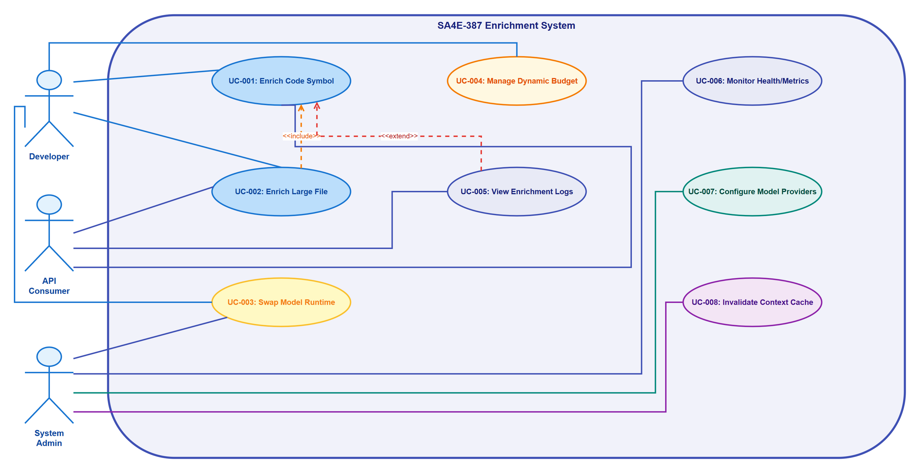
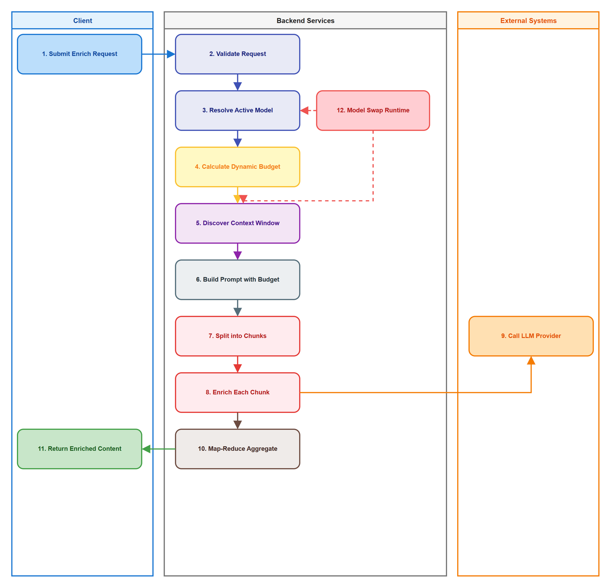
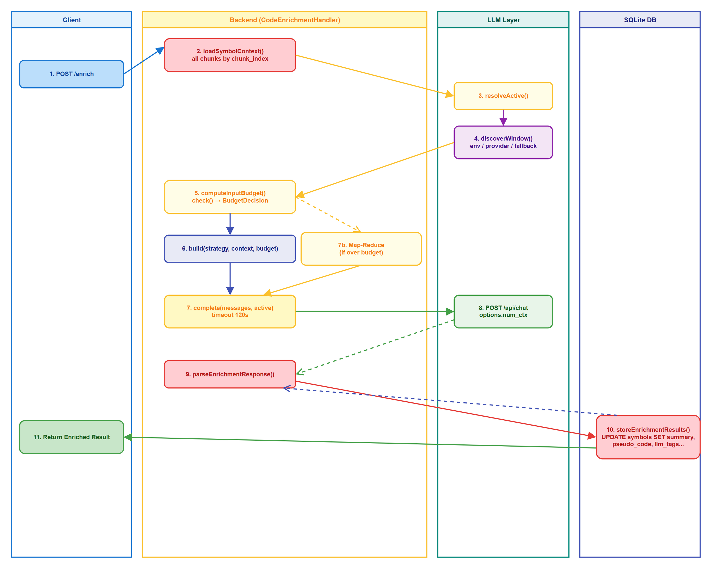

# Business Requirements Document (BRD)

## SDLC-Agents-4-Enterprise — SA4E-387: Enrichment with Dynamic Context Budget & Runtime Model Swap

---

## Document Information

| Field | Value |
|-------|-------|
| Jira Ticket | SA4E-387 |
| Title | Enrichment with Dynamic Context Budget & Runtime Model Swap |
| Author | BA Agent |
| Version | 1.0 |
| Date | 2026-10-31 |
| Status | Draft |

---

## Author Tracking

| Role | Name - Position | Responsibility |
|------|-----------------|----------------|
| Author | BA Agent – Business Analyst | Create document |
| Peer Reviewer | Duc Nguyen Minh – Reporter (Jira SA4E-387) | Review document |

---

## Revision History

| Version | Date | Author | Changes |
|---------|------|--------|---------|
| 1.0 | 2026-10-31 | BA Agent | Initiate document — based on Jira ticket SA4E-387 and referenced TDD document |

---

## Sign-Off

| Name | Signature and date |
|------|--------------------|
| | ☐ I agree and confirm all criteria on this BRD as expected requirements |
| | ☐ I agree and confirm all criteria on this BRD as expected requirements |

---

## 1. Introduction

### 1.1 Scope

The scope of SA4E-387 is to enhance the LLM enrichment capability for code symbols in the backend server to support **dynamic context budget calculation** and **runtime model swap**. The feature enables accurate reflection of model changes during enrichment, replaces static token caps with dynamic budget calculation via BudgetGuard, and supports enrichment of files larger than the model context window through proper chunking and map-reduce.

**Current problems (from ticket):**
1. Static truncation: `MAX_BODY_TOKENS=4000`, `PROMPT_TOKEN_CAP=24000` hardcoded caps
2. LLMService captures config at constructor — doesn't reflect runtime model swap
3. ContextWindowDiscovery uses global env `LLM_CONTEXT_WINDOW`, cache has no TTL
4. Ollama adapter doesn't set `num_ctx`
5. `ReductionPipeline.reduce()` is a stub — fails fast instead of real map-reduce

**Objectives:**
1. **Resolve model active per-call** — reflect runtime model swap accurately
2. **Dynamic budget via BudgetGuard** — replace static caps with per-call budget calculation
3. **Window discovery per-call + cache invalidation** — when model swaps
4. **Prompt builder receives inputBudget** — instead of static cap
5. **loadBodyText reads all chunks** — no static truncation to first chunk
6. **Real map-reduce replaces stub** — supports large symbols exceeding context window
7. **Ollama sets num_ctx per resolved window** — supports model swap

**In scope:**
- Backend server LLM enrichment for code symbols (class, function, method, Pega rules, Salesforce metadata)
- Runtime model swap reflection in LLMService
- Dynamic context budget calculation instead of static caps
- Per-call context window discovery with cache invalidation
- Prompt builder accepting inputBudget
- Full symbol body reading via loadBodyText (all chunks by chunk_index)
- Real map-reduce implementation for symbols exceeding context window
- Ollama adapter num_ctx configuration per resolved window
- Support for multiple model providers: Ollama, OpenAI, Anthropic, Gemini, LM Studio, Copilot, OpenCode

### 1.2 Out of Scope

- Model training, fine-tuning, or model deployment workflows
- User interface changes or frontend features
- Changes to model provider APIs outside the adapter layer
- Non-LLM backend services unrelated to symbol enrichment
- Tokenizer upgrade (tiktoken / model-specific) — future enhancement (§7 of TDD reference)
- Context chain between chunks — future enhancement (§7 of TDD reference)

### 1.3 Preliminary Requirement

1. **Existing infrastructure** (from TDD reference §2): `BudgetGuard` (engine/enrichment/budget-guard.ts), `chunkedReduce` (modules/memory/llm/chunked-reduce.ts), `ContextWindowDiscovery` (modules/memory/llm/context-window.ts), `TokenBudgetManager` (engine/context/token-budget-manager.ts) — all complete but not wired
2. **Existing enrichment pipeline** (SA4E-107): `CodeEnrichmentHandler`, `loadSymbolContext`, strategy selection, `CodeEnrichmentPromptBuilder`, `callLLMWithTimeout`, `parseEnrichmentResponse`, `storeEnrichmentResults` — all functional but using static caps
3. **Model providers** must be configured and accessible: Ollama, OpenAI, Anthropic, Gemini, LM Studio, Copilot, OpenCode
4. **Current static caps** `MAX_BODY_TOKENS=4000` and `PROMPT_TOKEN_CAP=24000` exist as baseline to be replaced

---

## 2. Business Requirements

### 2.1 High Level Process Map

The enrichment process starts with a `CODE_ENRICHMENT` task for a single code symbol. The backend loads the symbol context (full body text from all chunks), resolves the active model per call, discovers the context window for that model with cache invalidation, calculates a dynamic input budget via BudgetGuard, and enriches the content. For symbols exceeding the context window, the content is split into chunks, each chunk is enriched, and results are combined via map-reduce with retry/degrade semantics. Ollama adapter sets `num_ctx` according to the discovered window.

**Use Case Diagram — actors and use cases in scope (SA4E-387):**


*[Edit in draw.io](diagrams/use-case.drawio)*

**Business Flow — cross-functional swimlane (Developer → DevOps Engineer → Container Registry → CI System → Reviewer/UAT):**


*[Edit in draw.io](diagrams/business-flow.drawio)*

The step-by-step flow of this process (per-call model resolution, budget check, chunked map-reduce fallback, and `POST /model/swap`) is captured in **enrichment-flow.drawio**:


*[Edit in draw.io](diagrams/enrichment-flow.drawio)*

### 2.2 List of User Stories / Use Cases

| # | Story / Use Case / Epic | Priority | Source Ticket |
|---|-------------------------|----------|---------------|
| 1 | As a Backend System, I want to resolve the active LLM model per enrichment call so that runtime model swaps are reflected accurately | MUST HAVE | SA4E-387 |
| 2 | As a Backend System, I want to calculate dynamic context budget per model so that enrichment uses optimal token allocation instead of static caps | MUST HAVE | SA4E-387 |
| 3 | As a Backend System, I want to enrich symbols larger than context window using chunking and map-reduce so that large symbols and Pega rules can be processed completely | MUST HAVE | SA4E-387 |
| 4 | As a Developer, I want Ollama adapter to set num_ctx per resolved window so that Ollama respects model swap and context size | SHOULD HAVE | SA4E-387 |
| 5 | As a Developer, I want LLM_CONTEXT_WINDOW env to be per-model (not global) so that swapping to a smaller model doesn't cause context overflow | SHOULD HAVE | SA4E-387 |
| 6 | As a System, I want cache TTL on ContextWindowDiscovery so that same-name models with different configs get re-discovered | SHOULD HAVE | SA4E-387 |

---

### 2.3 Details of User Stories

---

#### Business Flow

**Step 1:** CODE_ENRICHMENT task received → parse payload → loadSymbolContext reads **full body text from all chunks** (ordered by chunk_index) from `body_embeddings` table

**Step 2:** selectStrategy determines enrichment strategy: CLASS_SUMMARY, FUNCTION_SUMMARY, METADATA_SUMMARY, or PEGA_SUMMARY (uses `isPegaKind` for Pega rules per SA4E-171)

**Step 3:** Resolve active model per-call via `LLMService.resolveActive()` → returns {provider, model, baseUrl, maxTokens, contextWindow?}

**Step 4:** Discover context window via `ContextWindowDiscovery.getContextWindow(active)` — priority: per-model env `LLM_CONTEXT_WINDOW__<model>` → provider metadata (Ollama `/api/show .context_length`, LM Studio `max_context_length`, vLLM `max_model_len`) → fallback 8192; cache keyed by `${provider}:${model}:${baseUrl}` with TTL check on `cachedAt`

**Step 5:** BudgetGuard.computeInputBudget(window, overhead) → inputBudget = window.contextWindow - reservedOutputTokens - overhead (systemPrompt + safety margin); BudgetGuard.check({digest, window, promptOverheadTokens: overhead}) returns `BudgetDecision` (withinBudget / mapReduceRequired / nonPositiveBudget)

**Step 6:** If withinBudget → PromptBuilder.build(strategy, context, inputBudget) → capTotalPrompt(messages, inputBudget) replaces static PROMPT_TOKEN_CAP; bodyBudget derived from inputBudget replaces MAX_BODY_TOKENS

**Step 7:** LLMService.complete(messages, active) — passes active model override so adapter uses correct provider/model/contextWindow (for Ollama: sets `num_ctx = config.contextWindow`)

**Step 8:** If over budget → Map-reduce via `chunkedReduce`: split by budget, MAP each chunk with `buildChunkPrompt`, merge partials, REDUCE rounds (max `MAX_REDUCE_ROUNDS=3`), chunk failure → degrade (skip, don't block), if still over after max rounds → log `BudgetError` with report, return best-effort

**Step 9:** parseEnrichmentResponse → storeEnrichmentResults (UPDATE symbols: summary, pseudo_code, llm_tags, enrichment_status='COMPLETED', enriched_at, enrichment_meta)

**Step 10:** Runtime model swap via POST /model/swap → setActiveModel(next) → if provider/model/baseUrl changed → rebuild adapter + onModelChanged hook → invalidateWindowCache() → subsequent calls use new model config

> **Note:** All decisions are per-call. No construct-time assumptions about model capabilities.

---

#### STORY 1: Runtime Model Active Resolution

> As a Backend System, I want to resolve the active LLM model per enrichment call so that runtime model swaps are reflected accurately

**Requirement Details:**

1. Add `contextWindow?: number` to `LLMConfig` interface in `modules/memory/llm/types.ts`
2. Add `resolveActive(): LLMConfig` to `LLMService` — returns current config (runtime override > env > defaults)
3. Add `setActiveModel(next: Partial<LLMConfig>): void` — if provider/model/baseUrl changed, rebuild adapter and fire `onModelChanged` hook
4. Modify `complete(messages, override?)` — accept optional override for per-call model; use override adapter if provider differs
4. Add `onModelChanged` callback hook to invalidate window cache

**Data Fields (if applicable):**

| Field | Type | Required | Description | Example |
|-------|------|----------|-------------|---------|
| provider | string | Yes | LLM provider | ollama, openai, anthropic |
| model | string | Yes | Model name | qwen2.5:7b-instruct-q4_K_M |
| baseUrl | string | Yes | Provider base URL | http://localhost:11434 |
| contextWindow | number | No | Optional input window hint | 8192 |

**Acceptance Criteria:**

1. `LLMService.resolveActive()` returns current effective config (not constructor snapshot)
2. `LLMService.setActiveModel({model: 'new-model'})` updates config and rebuilds adapter if provider changed
3. `LLMService.complete(messages, {provider: 'anthropic'})` uses override provider for that call only
4. `onModelChanged` fires when provider/model/baseUrl changes, enabling cache invalidation

**Validation Rules:**
- `setActiveModel` only rebuilds adapter if provider/model/baseUrl actually changed
- `complete` with override does not mutate global state

**Error Handling:**
- Invalid provider in override → error from adapter factory
- Model not available → adapter.isAvailable() check fails

---

#### STORY 2: Dynamic Context Budget Calculation

> As a Backend System, I want to calculate dynamic context budget per model so that enrichment uses optimal token allocation instead of static caps

**Requirement Details:**

1. `BudgetGuard.computeInputBudget(window, overheadTokens)` — returns `InputBudget { budget: number, windowSize: number, overheadTokens: number }`
2. `BudgetGuard.check({digest, window, promptOverheadTokens})` — returns `BudgetDecision { withinBudget: boolean, reason: string, strategy: 'single_shot' | 'map_reduce' }`
3. `BudgetGuard.BudgetError` class for budget violations with report
3. `BudgetGuard` constants: `SAFETY_MARGIN = 500`, `WARNING_THRESHOLD = 0.8` (80% budget → warn)
4. Wire into `CodeEnrichmentHandler`: resolve active → get window → compute budget → check → route to single-shot or map-reduce

**Acceptance Criteria:**

1. `computeInputBudget({contextWindow: 8192, ...}, overhead: 500)` → budget = 8192 - 800 - 500 = 6892 (reservedOutputTokens default 800)
2. `check({digest: "small", window: 8192, overhead: 500})` → `withinBudget: true, strategy: 'single_shot'`
3. `check({digest: "x".repeat(20000), window: 8192, overhead: 500})` → `withinBudget: false, strategy: 'map_reduce'`
4. Budget never exceeds model context window; reservedOutputTokens always subtracted

**Validation Rules:**
- Budget ≤ window.contextWindow - reservedOutputTokens - overhead
- Non-positive budget → `BudgetDecision { withinBudget: false, reason: 'non_positive_budget' }`

**Error Handling:**
- `BudgetError` thrown with `MapReduceReport` for logging/debugging

---

#### STORY 3: Large Symbol Enrichment via Map-Reduce

> As a Backend System, I want to enrich symbols larger than context window using chunking and map-reduce so that large symbols and Pega rules can be processed completely

**Requirement Details:**

1. `loadBodyText(adapter, symbolId)` reads **all chunks** from `body_embeddings` ordered by `chunk_index`, concatenates
2. `splitByBudget(bodyText, perChunkBudget)` — chunks respecting per-chunk budget (derived from inputBudget)
3. Map phase: `chunkedReduce({chunks, mapFn, mergeFn, maxRetriesPerChunk: 2, onChunkFailure: 'degrade'})` — from `chunked-reduce.ts`
4. Reduce phase: while joined partials > budget and rounds < `MAX_REDUCE_ROUNDS` (3) → regroup and reduce
5. If still over after max rounds → `BudgetError` with report, return best-effort from last round
6. Chunk failure → `degrade` (skip chunk, continue), log entry, don't block pipeline

**Acceptance Criteria:**

1. `loadBodyText` with 3 chunks → returns concatenated text in chunk_index order
2. `loadBodyText` with 1 chunk → same behavior as before (no regression)
3. Symbol 20k tokens, window 8192 → goes map-reduce, completes with summary
3. Chunk failure during map → degrade, other chunks processed, failure logged
4. `BudgetError` logged with `MapReduceReport` when max rounds exhausted

**Validation Rules:**
- Chunks per rule ≤ `MAX_CHUNKS_PER_RULE` (32) else `BudgetError` with `boundsHit.chunksTried`
- Reduce rounds ≤ `MAX_REDUCE_ROUNDS` (3) else `BudgetError` with `boundsHit.roundsTried`

**Error Handling:**
- `BudgetError` with full report (not caught silently — per no-workaround rule)
- Partial failures degrade gracefully, don't block entire enrichment

---

#### STORY 4: Ollama num_ctx Configuration

> As a Developer, I want Ollama adapter to set num_ctx per resolved window so that Ollama respects model swap and context size

**Requirement Details:**

1. In `ollama-adapter.ts`, add `num_ctx` to options when `config.contextWindow` is provided:
   ```ts
   options: {
     temperature: config.temperature ?? 0.3,
     num_predict: config.maxTokens ?? 200,
     ...(config.contextWindow ? { num_ctx: config.contextWindow } : {}),
   }
   ```

**Acceptance Criteria:**

1. `LLMService.complete(messages, {contextWindow: 8192})` → Ollama request includes `options.num_ctx: 8192`
2. After model swap to 8k model → `num_ctx: 8192` in subsequent calls
3. No `num_ctx` sent when `contextWindow` unknown (backward compat)

---

#### STORY 5: Per-Model LLM_CONTEXT_WINDOW Env

> As a Developer, I want LLM_CONTEXT_WINDOW env to be per-model (not global) so that swapping to a smaller model doesn't cause context overflow

**Requirement Details:**

1. In `context-window.ts`, change env override priority:
   - First: `LLM_CONTEXT_WINDOW__<model>` (per-model)
   - Fallback: `LLM_CONTEXT_WINDOW` (global) — only if per-model not set
2. Or recommended: remove global override entirely, trust provider discovery + fallback

**Acceptance Criteria:**

1. `LLM_CONTEXT_WINDOW__qwen2.5=8192` + `LLM_CONTEXT_WINDOW__claude=200000` → each model gets correct window
2. No per-model env set → provider discovery runs (not global fallback)
3. Swap 32k→8k model → discovery returns 8k, not 32k

---

#### STORY 6: Cache TTL on ContextWindowDiscovery

> As a System, I want cache TTL on ContextWindowDiscovery so that same-name models with different configs get re-discovered

**Requirement Details:**

1. Use existing `cachedAt` field in `WindowInfo` — if `now - cachedAt > WINDOW_CACHE_TTL_MS` (default 5 min), re-discover
2. TTL check in `getContextWindow()` before returning cached value

**Acceptance Criteria:**

1. Cache entry older than TTL → re-discovery triggered
2. Same model name, different config after TTL → correct window returned
3. Default TTL 5 minutes, configurable

---

## 3. Dependencies

| Dependency | Type | Related Ticket | Description |
|------------|------|----------------|-------------|
| Existing Enrichment Pipeline (SA4E-107) | System | SA4E-107 | `CodeEnrichmentHandler`, `loadSymbolContext`, strategy selection, prompt builder, response parser, result store |
| BudgetGuard | System | N/A | `engine/enrichment/budget-guard.ts` — complete, needs wiring |
| chunkedReduce | System | N/A | `modules/memory/llm/chunked-reduce.ts` — complete, needs wiring |
| ContextWindowDiscovery | System | N/A | `modules/memory/llm/context-window.ts` — complete, needs wiring + per-model env + TTL |
| TokenBudgetManager | System | N/A | `engine/context/token-budget-manager.ts` — shared estimateTokens |
| ReductionPipeline | System | N/A | `engine/enrichment/reduction-pipeline.ts` — stub, needs real implementation using chunkedReduce |
| Ollama Adapter | External | N/A | `modules/memory/llm/ollama-adapter.ts` — add num_ctx support |
| LLMService | System | N/A | `modules/memory/llm/LLMService.ts` — add resolveActive, setActiveModel, complete(override), onModelChanged |

---

## 4. Stakeholders

| Role | Name / Team | Responsibility | Source |
|------|-------------|----------------|--------|
| Reporter | Duc Nguyen Minh | Ticket author, requirements | Jira SA4E-387 |
| Assignee | Unassigned | Implementation | Jira SA4E-387 |
| BA Agent | BA Agent | BRD author | This document |

---

## 5. Risks and Assumptions

### 5.1 Risks

| Risk | Impact | Likelihood | Mitigation |
|------|--------|------------|------------|
| `loadBodyText` change to full body makes prompts longer before budget applies | High | High | Must wire BudgetGuard + map-reduce **in same PR** — if not, context overflow risk |
| Map-reduce implementation complexity (bounds, degrade paths) | High | Medium | Use existing `chunkedReduce` which handles retry/degrade; test bounds `MAX_CHUNKS_PER_RULE`, `MAX_REDUCE_ROUNDS` thoroughly |
| Model swap during in-flight enrichments | Medium | Low | `onModelChanged` hook invalidates cache; subsequent calls use new config; in-flight calls complete with old config |
| Ollama num_ctx behavior varies by version | Low | Low | Test with target Ollama version; `num_ctx` is standard Ollama API |

### 5.2 Assumptions

- All infrastructure components (`BudgetGuard`, `chunkedReduce`, `ContextWindowDiscovery`, `TokenBudgetManager`) are complete and tested per TDD reference §2
- SQLite database via `DatabaseAdapter` — no PostgreSQL/Redis in this codebase
- Enrichment unit is **1 symbol / 1 task** — not whole file (per TDD reference §1.1)
- `PROMPT_TOKEN_CAP` kept as fallback for backward compatibility during transition
- No tokenizer upgrade in this ticket — char-based `/4` estimate remains

---

## 6. Non-Functional Requirements

| Category | Requirement | Details |
|----------|-------------|---------|
| Performance | Enrichment latency | Single-shot: ≤ LLM latency; Map-reduce: ≤ 3x LLM latency + reduce rounds |
| Reliability | No silent failures | `BudgetError` logged with full `MapReduceReport`; chunk failures degrade, don't block |
| Scalability | Concurrent enrichments | Per-call stateless design; no global locks on model config |
| Compatibility | Backward compat | `PROMPT_TOKEN_CAP` fallback when caller doesn't pass budget; existing callers work unchanged |
| Observability | Budget utilization logging | Log `windowSource`, `budgetUtilization`, chunk count, reduce rounds for analytics |

---

## 7. Related Tickets

| Ticket Key | Summary | Status | Type | Relationship |
|------------|---------|--------|------|--------------|
| SA4E-387 | Enrichment with Dynamic Context Budget & Runtime Model Swap | To Do | Task | Main ticket |
| SA4E-107 | Code Enrichment Handler (existing pipeline) | Done | Task | Provides enrichment pipeline to modify |
| SA4E-171 | isPegaKind for all 16+ Pega kinds | Done | Task | Used in strategy selection |

---

## 8. Appendix

### Glossary

| Term | Definition |
|------|------------|
| CODE_ENRICHMENT | Task type for enriching a single code symbol via LLM |
| Context Budget | Maximum token budget allocated for a single enrichment request's prompt |
| Model Swap | Runtime change of active LLM model for a ticket/session |
| BudgetGuard | Module calculating dynamic budget from window + overhead |
| Map-Reduce | Pattern to split large content, enrich chunks, combine results |
| num_ctx | Ollama parameter to set context window at request time |
| WindowInfo | Object containing contextWindow, windowSource, provider, cachedAt |

### Reference Documents

| Document | Link / Location |
|----------|-----------------|
| Jira Ticket SA4E-387 | https://jiraassist.atlassian.net/browse/SA4E-387 |
| TDD Reference | documents/enrichment-runtime-model-swap/TDD-Enrichment-Dynamic-Context-Budget.md |
| Existing Enrichment Pipeline | backend/src/engine/enrichment/ (SA4E-107) |