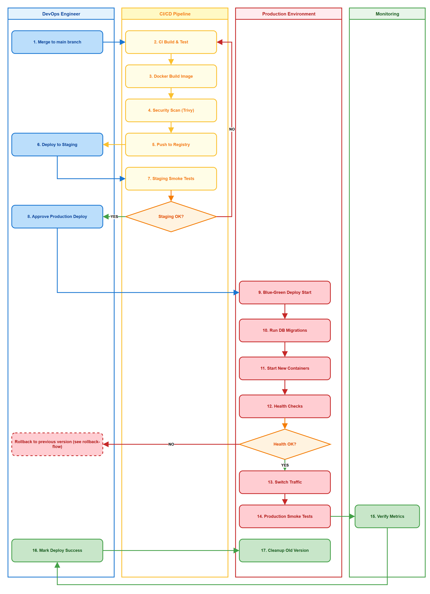
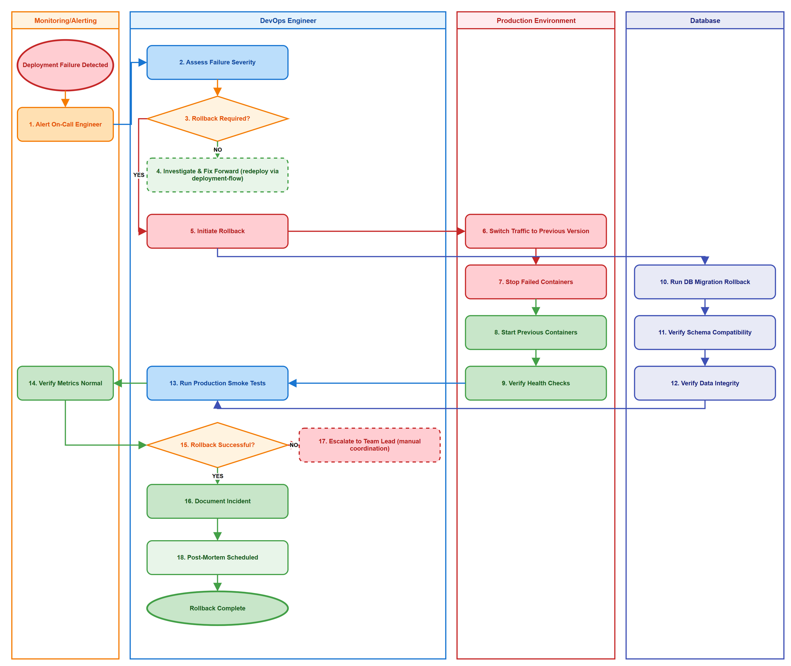

# Deployment Guide (DPG)

## SDLC-Agents-4-Enterprise — SA4E-387: Enrichment with Dynamic Context Budget & Runtime Model Swap

---

## Document Information

| Field | Value |
|-------|-------|
| Jira Ticket | SA4E-387 |
| Title | Enrichment with Dynamic Context Budget & Runtime Model Swap |
| Author | DevOps Agent |
| Version | 1.0 |
| Date | 2026-10-31 |
| Status | Draft |
| Related TDD | TDD-v1.0-SA4E-387.docx |

---

## Revision History

| Version | Date | Author | Changes |
|---------|------|--------|---------|
| 1.0 | 2026-10-31 | DevOps Agent | Initiate document — auto-generated from TDD and project context |

---

## Sign-Off

| Name | Role | Signature and date |
|------|------|--------------------|
| | Dev Lead | ☐ Approved for deployment |
| | QA Lead | ☐ Testing completed |
| | Ops Lead | ☐ Infrastructure ready |

---

## 1. Overview

### 1.1 Feature Summary

Enhance backend LLM enrichment service to support dynamic context budget calculation per model and runtime model swap without restart. Replaces static token caps MAX_BODY_TOKENS=4000 and PROMPT_TOKEN_CAP=24000 with BudgetGuard-driven dynamic budgeting, adds per-call ContextWindowDiscovery with cache invalidation, full chunk reading via loadBodyText, real Map-Reduce for large files, and Ollama adapter num_ctx configuration per resolved window. Supports Ollama, Anthropic, OpenAI, LM Studio providers.

### 1.2 Deployment Scope

| Item | Type | Description |
|------|------|-------------|
| Backend Enrichment Service | Modified | Dynamic budget, runtime model swap, context discovery, prompt builder, map-reduce |
| PostgreSQL | New Tables | model_configs, enrichment_logs, cache_invalidation_logs |
| Configuration | Modified | LLM_ENDPOINT, DB_POOL_MAX, feature flags |
| Docker Image | Modified | backend service TypeScript 5.x, Node.js 22.23.4, Hono |
| API Endpoints | New | POST /enrich, POST /model/swap |
| Monitoring | Modified | enrich_duration, model_swap_count metrics |

### 1.3 Target Environments

| Environment | URL | Deploy Order | Approval Required |
|-------------|-----|-------------|-------------------|
| DEV | https://api-dev.sdlc.local | 1st | No |
| SIT | https://api-sit.sdlc.local | 2nd | No |
| UAT | https://api-uat.sdlc.local | 3rd | QA Sign-off |
| PROD | https://api.sdlc.local | 4th | PM + Business Sign-off |

---

## 2. Prerequisites

### 2.1 Infrastructure

| Requirement | Status | Notes |
|-------------|--------|-------|
| Docker host available | Ready/Pending | For backend service |
| PostgreSQL 15+ accessible | Ready/Pending | Model configs + logs |
| API Gateway routing | Ready/Pending | /enrich, /model/swap |
| Ollama/LLM provider reachable | Ready/Pending | http://ollama-<env> |
| Network access configured | Ready/Pending | Service-to-DB, Service-to-LLM |

### 2.2 Software Dependencies

| Dependency | Version | Status |
|-----------|---------|--------|
| Node.js | 22.23.4 | Installed |
| TypeScript | 5.x | Installed |
| PostgreSQL | 15+ | Available |
| Docker | 29.x | Installed |
| npm | 11.x | Installed |

### 2.3 Access Requirements

| Access | Type | Who Needs It |
|--------|------|-------------|
| SSH to server | Key-based | DevOps team |
| Database admin | Credentials | DBA |
| CI/CD pipeline | Service account | Automated |
| LLM provider | API key / network | DevOps |

### 2.4 Backup Requirements

- [ ] Database backup completed before deployment
- [ ] Application backup (previous version artifact saved)
- [ ] Configuration backup

---

## 3. Pre-Deployment Checklist

| # | Item | Responsible | Status |
|---|------|-------------|--------|
| 1 | Code merged to release branch | Developer | ☐ |
| 2 | All unit tests passed | Developer | ☐ |
| 3 | All integration tests passed | QA | ☐ |
| 4 | SIT/UAT sign-off obtained | QA + BA | ☐ |
| 5 | Database backup completed | DBA | ☐ |
| 6 | Configuration files prepared | DevOps | ☐ |
| 7 | Feature flags configured | Developer | ☐ |
| 8 | Monitoring/alerting configured | DevOps | ☐ |
| 9 | Rollback plan reviewed | Team | ☐ |
| 10 | Deployment window confirmed | PM | ☐ |

---

## 4. Database Migration

### 4.1 Migration Scripts

| Order | Script | Description | Estimated Time |
|-------|--------|-------------|----------------|
| 1 | V1__create_model_configs.sql | Create model_configs table | <1 min |
| 2 | V1__create_enrichment_logs.sql | Create enrichment_logs table | <1 min |
| 3 | V1__create_cache_invalidation_logs.sql | Create cache_invalidation_logs table | <1 min |

### 4.2 Execution Steps

```bash
# Step 1: Backup database
pg_dump -h <db-host> -U <user> -d enrichment_db > backup_$(date +%Y%m%d_%H%M%S).sql

# Step 2: Run migration
psql -h <db-host> -U <user> -d enrichment_db -f V1__create_model_configs.sql
psql -h <db-host> -U <user> -d enrichment_db -f V1__create_enrichment_logs.sql
psql -h <db-host> -U <user> -d enrichment_db -f V1__create_cache_invalidation_logs.sql

# Step 3: Verify migration
psql -h <db-host> -U <user> -d enrichment_db -c "\dt"
```

### 4.3 Verification Queries

```sql
-- Verify tables created
SELECT table_name FROM information_schema.tables WHERE table_schema='public' AND table_name IN ('model_configs','enrichment_logs','cache_invalidation_logs');

-- Verify indexes
SELECT indexname FROM pg_indexes WHERE tablename='model_configs';
```

### 4.4 Rollback Scripts

```sql
-- Rollback migration
DROP TABLE IF EXISTS cache_invalidation_logs;
DROP TABLE IF EXISTS enrichment_logs;
DROP TABLE IF EXISTS model_configs;
```

---

## 5. Application Deployment

### 5.1 Deployment Flow



### 5.2 Deployment Steps

| Step | Action | Command | Verification |
|------|--------|---------|-------------|
| 1 | Stop existing service | `docker stop backend-enrichment` | Container stopped |
| 2 | Deploy new artifact | `docker pull registry/sdlc/backend-enrichment:sa4e-387-v1.0` | Image pulled |
| 3 | Update configuration | Apply env vars per environment | Config file updated |
| 4 | Start service | `docker run -d --name backend-enrichment ...` | Container running |
| 5 | Health check | `curl -f http://localhost:8080/health` | 200 OK |

### 5.3 Docker Deployment (if applicable)

```bash
# Pull new image
docker pull registry/sdlc/backend-enrichment:sa4e-387-v1.0

# Stop existing container
docker stop backend-enrichment
docker rm backend-enrichment

# Start new container
docker run -d --name backend-enrichment \
  -p 8080:8080 \
  -e LLM_ENDPOINT=http://ollama-<env>:11434 \
  -e DB_HOST=<db-host> \
  -e DYNAMIC_BUDGET_ENABLED=true \
  registry/sdlc/backend-enrichment:sa4e-387-v1.0

# Verify
docker logs backend-enrichment --tail 50
```

---

## 6. Configuration Changes

### 6.1 New Environment Variables

| Variable | Description | DEV | SIT | UAT | PROD |
|----------|-------------|-----|-----|-----|------|
| LLM_ENDPOINT | Ollama/LLM service URL | http://ollama-dev:11434 | http://ollama-sit:11434 | http://ollama-uat:11434 | PLACEHOLDER |
| DB_POOL_MAX | PostgreSQL pool max | 10 | 15 | 20 | 20 |
| DYNAMIC_BUDGET_ENABLED | Feature flag | true | true | true | false |
| MODEL_CACHE_TTL_MIN | Model config cache TTL | 5 | 5 | 5 | 5 |

### 6.2 Application Properties Changes

| Property | Old Value | New Value | File |
|----------|-----------|-----------|------|
| enrichment.max_body_tokens | 4000 | removed | application.yml |
| enrichment.prompt_token_cap | 24000 | removed | application.yml |
| llm.num_ctx | static | dynamic per model | application.yml |

### 6.3 Feature Flags

| Flag | DEV | SIT | UAT | PROD |
|------|-----|-----|-----|------|
| dynamic_budget | true | true | true | false — enable after verification |
| runtime_model_swap | true | true | true | false |

---

## 7. Post-Deployment Verification

### 7.1 Health Checks

| Check | Endpoint/Command | Expected Result | Timeout |
|-------|-----------------|-----------------|---------|
| Application health | `GET /health` | 200 OK, status: UP | 30s |
| Database connectivity | `SELECT 1` | 1 | 10s |
| LLM connectivity | `GET /llm/ping` | 200 OK | 30s |

### 7.2 Smoke Tests

| # | Scenario | Steps | Expected Result |
|---|----------|-------|-----------------|
| 1 | Enrich with valid model | POST /enrich with symbol, file_path, model | enriched_content success |
| 2 | Model swap | POST /model/swap with model, ticket_id | status success, cache invalidated |
| 3 | Dynamic budget calculation | Enrich large file > context | Chunked enrichment, no truncation |

### 7.3 Log Verification

| Log Entry | Level | Expected | Location |
|-----------|-------|----------|----------|
| Application started | INFO | Within 60s of start | /var/log/backend-enrichment.log |
| Feature initialized | INFO | After startup | /var/log/backend-enrichment.log |
| Model config loaded | INFO | On first request | ELK |

### 7.4 Monitoring Dashboard

- [ ] Application metrics visible in dashboard
- [ ] Error rate within normal range
- [ ] Response time p95 < 30s
- [ ] No unexpected alerts triggered

---

## 8. Rollback Plan

### 8.1 Rollback Flow



### 8.2 Rollback Decision Criteria

| Condition | Action |
|-----------|--------|
| Critical defect found in production | Immediate rollback |
| Performance degradation > 50% | Immediate rollback |
| Data integrity issue | Immediate rollback + DBA investigation |
| Minor UI issue | Hotfix — no rollback |

### 8.3 Rollback Steps

| Step | Action | Command | Verification |
|------|--------|---------|-------------|
| 1 | Stop new version | `docker stop backend-enrichment` | Container stopped |
| 2 | Rollback database | Restore from backup | Tables restored |
| 3 | Deploy previous version | `docker run ...:previous-tag` | Container running |
| 4 | Restore configuration | Apply previous env vars | Config verified |
| 5 | Verify rollback | `curl -f http://localhost:8080/health` | 200 OK |

### 8.4 Rollback Time Estimate

| Action | Estimated Time |
|--------|---------------|
| Database rollback | 10 minutes |
| Application rollback | 5 minutes |
| Verification | 5 minutes |
| **Total** | **20 minutes** |

---

## 9. Environment-Specific Notes

### 9.1 DEV

- Fast deploy, no approval required
- Feature flags enabled
- Ollama dev instance

### 9.2 SIT

- Deploy after DEV validation
- Run integration tests

### 9.3 UAT

- QA sign-off required
- Limited traffic

### 9.4 PROD

- **Deployment Window:** Saturday 22:00-02:00
- **Approval Required From:** PM + Business Sign-off
- **Communication Plan:** Notify DevOps channel before/after
- **On-Call Contact:** DevOps Lead, phone

---

## 10. Appendix

### Contacts

| Role | Name | Contact |
|------|------|---------|
| DevOps Lead | TBD | email |
| DBA | TBD | email |
| On-Call Dev | TBD | phone |

### Related Tickets

| Ticket | Summary | Relationship |
|--------|---------|-------------|
| SA4E-387 | Enrichment with Dynamic Context Budget & Runtime Model Swap | Main ticket |
| SA4E-386 | Pin Node.js to 22.23.4 | Dependency |
