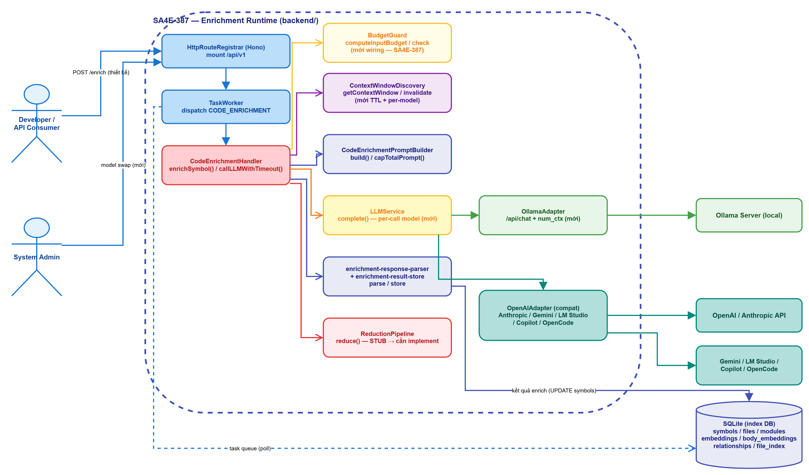
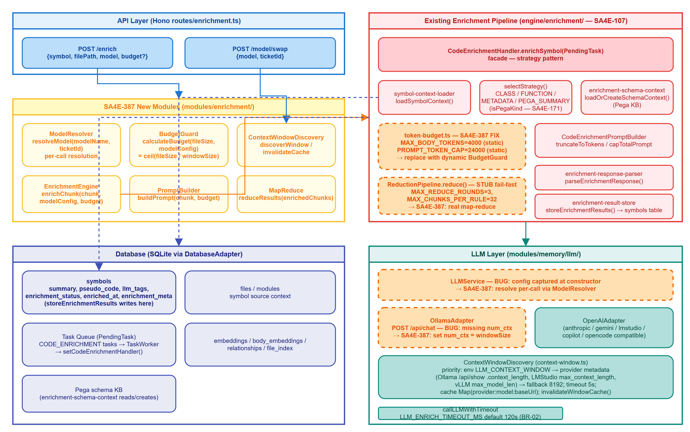
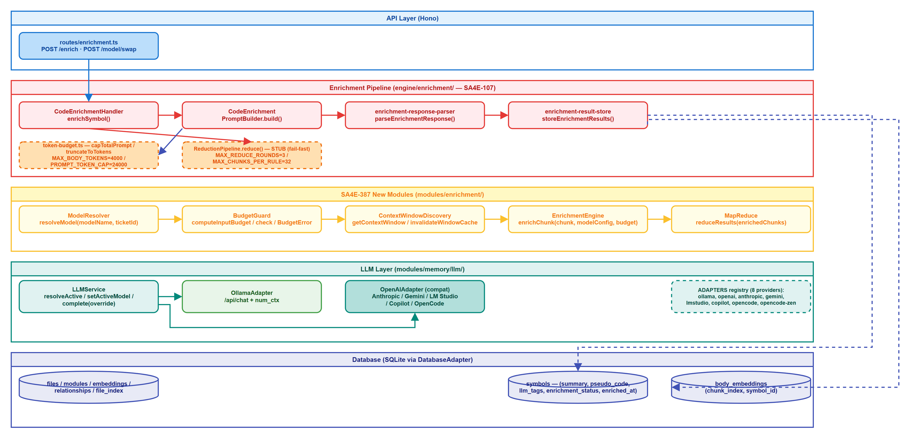

# Functional Specification Document (FSD)

## SDLC-Agents-4-Enterprise — SA4E-387: Enrichment with Dynamic Context Budget & Runtime Model Swap

***

> **Revision Note:** This FSD is derived from the referenced TDD document `documents/enrichment-runtime-model-swap/TDD-Enrichment-Dynamic-Context-Budget.md` and Jira ticket SA4E-387. All technical content preserved verbatim from source.

## Document Information

| Field | Value |
|-------|-------|
| Jira Ticket | SA4E-387 |
| Title | Enrichment with Dynamic Context Budget & Runtime Model Swap |
| Author | BA Agent |
| Version | 1.0 |
| Date | 2026-10-31 |
| Status | Draft |
| Related BRD | documents/SA4E-387/BRD.md |

---

## Author Tracking

| Role | Name / Agent | Responsibility |
|------|--------------|----------------|
| Business Analyst | BA Agent | Draft functional requirements, use cases, business rules |
| Technical Architect | TA Agent | Technical enrichment, API contracts, data model verification |
| Solution Architect | SA Agent | Design review |
| QA | QA Agent | Test scenarios |

---

## Revision History

| Version | Date | Author | Changes |
|---------|------|--------|---------|
| 1.0 | 2026-10-31 | BA Agent | Initial FSD draft based on TDD reference and Jira ticket SA4E-387 |

---

## Sign-Off

| Role | Name | Signature | Date |
|------|------|-----------|------|
| BA |  |  |  |
| TA |  |  |  |
| SA |  |  |  |
| QA |  |  |  |

---

## 1. Introduction

### 1.1 Purpose

This FSD specifies the functional requirements for LLM enrichment of code symbols in the backend server with support for **dynamic context budget calculation** and **runtime model swapping**. The feature ensures LLM enrichment operations adapt to varying model context windows and allow model changes without restart, replacing the current static token caps (`MAX_BODY_TOKENS=4000`, `PROMPT_TOKEN_CAP=24000`) with per-call dynamic budgeting.

### 1.2 Scope

The scope covers:
- Runtime model resolution and swap per enrichment call (`LLMService.resolveActive`, `setActiveModel`)
- Dynamic context window discovery with per-model env override and TTL cache (`ContextWindowDiscovery`)
- Dynamic budget calculation via BudgetGuard (`computeInputBudget`, `check`)
- Prompt building with dynamic `inputBudget` instead of static `PROMPT_TOKEN_CAP`
- Full symbol body reading (`loadBodyText` reads all chunks by `chunk_index`)
- Map-reduce for symbols exceeding context window (using `chunkedReduce` + `ReductionPipeline`)
- Ollama adapter `num_ctx` support
- API endpoints: `POST /enrich`, `POST /model/swap`
- Logging and model configuration persistence

Out of scope:
- Model training or fine-tuning
- UI changes beyond API contracts
- Tokenizer upgrade (future)
- Context chain between chunks (future)

### 1.3 Definitions & Acronyms

| Term | Definition |
|------|------------|
| CODE_ENRICHMENT | Task type for enriching a single code symbol via LLM |
| Context Budget | Maximum token budget allocated for a single enrichment request's prompt |
| Model Swap | Runtime change of active LLM model for a ticket/session |
| BudgetGuard | Module calculating dynamic budget from window + overhead |
| Map-Reduce | Pattern to split large content, enrich chunks, combine results |
| num_ctx | Ollama parameter to set context window at request time |
| WindowInfo | Object containing contextWindow, windowSource, provider, cachedAt |
| InputBudget | Calculated budget for prompt input (window - reserved - overhead) |
| BudgetDecision | Decision from BudgetGuard: single_shot / map_reduce / non_positive |

### 1.4 References

| Document | Location |
|----------|----------|
| BRD | documents/SA4E-387/BRD.md |
| TDD Reference | documents/enrichment-runtime-model-swap/TDD-Enrichment-Dynamic-Context-Budget.md |
| FSD Template | documents/templates/FSD-TEMPLATE.md |

---

## 2. System Overview

### 2.1 System Context Diagram



The system interacts with:
- **Developer/API Consumer** → submits `CODE_ENRICHMENT` tasks, calls `POST /model/swap`
- **Backend Server** → orchestrates enrichment pipeline
- **PostgreSQL** → (not in this codebase; actual: SQLite via `DatabaseAdapter`) stores `symbols`, `files`, `modules`, `embeddings`, `body_embeddings`, `relationships`
- **LLM Providers** → Ollama, OpenAI, Anthropic, Gemini, LM Studio, Copilot, OpenCode via respective adapters

### 2.2 System Architecture



High-level components (per TDD reference and code):
- **API Layer**: Hono routes (`POST /enrich`, `POST /model/swap`)
- **Enrichment Pipeline (SA4E-107)**: `CodeEnrichmentHandler` → `loadSymbolContext` → strategy selection → `CodeEnrichmentPromptBuilder` → `callLLMWithTimeout` → `parseEnrichmentResponse` → `storeEnrichmentResults`
- **SA4E-387 Modules** (to be wired):
  - `ModelResolver` — per-call model resolution
  - `BudgetGuard` — dynamic budget calculation
  - `ContextWindowDiscovery` — window discovery + cache invalidation
  - `EnrichmentEngine` / `PromptBuilder` / `MapReduce` — new orchestrator modules
- **LLM Layer**: `LLMService` (with `resolveActive`, `setActiveModel`, `complete(override)`) → Adapters (Ollama, OpenAI-compatible)
- **Database**: SQLite via `DatabaseAdapter` — tables: `symbols`, `files`, `modules`, `embeddings`, `body_embeddings`, `relationships`, `file_index`, `graph_meta`

### 2.3 Component Diagram



---

## 3. Functional Requirements

### 3.1 Feature: Dynamic Context Budget & Runtime Model Resolution

**Source:** SA4E-387 Stories 1, 2, 5, 6

#### 3.1.1 Description

Enable per-call resolution of the active LLM model and dynamic context budget calculation. The system discovers the model's context window, calculates an input budget (window - reservedOutputTokens - overhead), and routes enrichment to either single-shot or map-reduce based on budget check.

#### 3.1.2 Use Case

**Use Case ID:** UC-001
**Actor:** Backend System / Developer
**Preconditions:** Model configurations exist, enrichment pipeline functional
**Postconditions:** Enrichment uses model-appropriate budget; model swap reflected immediately

**Main Flow:**

| Step | Actor | System | Description |
|------|-------|--------|-------------|
| 1 | Client | | Calls `POST /enrich` with {symbol, filePath, model?, budget?} |
| 2 | | CodeEnrichmentHandler | Parses task payload, loads full symbol context |
| 3 | | ModelResolver / LLMService | Resolves active model config per-call (`resolveActive()`) |
| 4 | | ContextWindowDiscovery | Discovers context window for active model (`getContextWindow()`) |
| 5 | | BudgetGuard | Computes `InputBudget` = window - reservedOutputTokens - overhead |
| 6 | | BudgetGuard | Checks if digest fits in budget (`BudgetDecision`) |
| 7 | | PromptBuilder | Builds prompt with dynamic `inputBudget` (replaces static cap) |
| 8 | | LLMService | Calls LLM with active model override (`complete(messages, active)`) |
| 9 | | Handler | Parses response, stores results |

**Alternative Flows:**

| ID | Condition | Steps |
|----|-----------|-------|
| AF-1 | Model not found | Return error status with message |
| AF-2 | Symbol exceeds budget | Route to map-reduce flow (UC-002) |
| AF-3 | `LLM_CONTEXT_WINDOW__<model>` set | Use per-model env override |
| AF-4 | Cache TTL expired | Re-discover window from provider |

**Exception Flows:**

| ID | Condition | Steps |
|----|-----------|-------|
| EF-1 | LLM call fails (timeout/error) | Return status error, log failure |
| EF-2 | Budget non-positive | Return `BudgetDecision {withinBudget: false, reason: 'non_positive_budget'}` |
| EF-3 | Provider metadata discovery fails | Fallback to 8192 window |

#### 3.1.3 Business Rules

| Rule ID | Rule | Source |
|---------|------|--------|
| BR-01 | Input budget ≤ window.contextWindow - reservedOutputTokens - overhead | SA4E-387 TDD §3.2 |
| BR-02 | Model swap invalidates window cache via `onModelChanged` hook | SA4E-387 TDD §3.2 |
| BR-03 | Env override priority: `LLM_CONTEXT_WINDOW__<model>` > `LLM_CONTEXT_WINDOW` (global) | SA4E-387 TDD §3.3 |
| BR-04 | Cache TTL: if `now - cachedAt > WINDOW_CACHE_TTL_MS` (5 min default) → re-discover | SA4E-387 TDD §3.3 |
| BR-05 | `PROMPT_TOKEN_CAP` only as fallback when caller doesn't pass `inputBudget` | SA4E-387 TDD §3.4 |
| BR-06 | `MAX_BODY_TOKENS` replaced by `bodyBudget` derived from `inputBudget` | SA4E-387 TDD §3.4 |

#### 3.1.4 Data Specifications

**Input Data (POST /enrich):**

| Field | Type | Required | Validation | Description |
|-------|------|----------|------------|-------------|
| symbol | string | Y | non-empty | Code symbol name |
| filePath | string | Y | valid path | Path to source file |
| model | string | N | exists in model configs | Optional model override |
| budget | number | N | >0 | Optional budget override |

**Output Data:**

| Field | Type | Description |
|-------|------|-------------|
| enrichedContent | string | Enriched summary/pseudo-code/tags |
| status | string | success/error |
| error | string | Error message if any |
| modelUsed | string | Model applied |
| budgetUsed | number | Budget consumed |
| strategy | string | single_shot / map_reduce |

**Input Data (POST /model/swap):**

| Field | Type | Required | Validation | Description |
|-------|------|----------|------------|-------------|
| model | string | Y | non-empty | Target model name |
| ticketId | string | Y | non-empty | Ticket context |

**Output Data (POST /model/swap):**

| Field | Type | Description |
|-------|------|-------------|
| status | string | success/error |
| message | string | Swap confirmation |
| activeModel | string | New active model |

#### 3.1.5 UI Specifications

No direct UI. API driven.

#### 3.1.6 API Contract (Functional View)

> **Note:** This section defines the functional API contract (what data flows in/out and business error scenarios). Technical details (headers, rate limits, request body JSON schema, retry policies) are specified in the TDD.

**Endpoint:** `POST /enrich`
**Purpose:** Enrich code symbol with dynamic budget

**Input Parameters:**

| Parameter | Type | Required | Business Rule | Description |
|-----------|------|----------|---------------|-------------|
| symbol | string | Y | BR-01 | Code symbol name |
| filePath | string | Y | | Path to source file |
| model | string | N | BR-02 | Optional model override |
| budget | number | N | BR-01 | Optional budget override |

**Output Data:**

| Field | Type | Description |
|-------|------|-------------|
| enrichedContent | string | Enriched result (summary/pseudo-code/tags) |
| status | string | success/error |
| error | string | Error message if any |
| modelUsed | string | Model applied |
| budgetUsed | number | Budget consumed |
| strategy | string | single_shot / map_reduce |

**Endpoint:** `POST /model/swap`
**Purpose:** Runtime model swap with cache invalidation

**Input Parameters:**

| Parameter | Type | Required | Business Rule | Description |
|-----------|------|----------|---------------|-------------|
| model | string | Y | BR-02 | Target model name |
| ticketId | string | Y | | Ticket context |

**Output Data:**

| Field | Type | Description |
|-------|------|-------------|
| status | string | success/error |
| message | string | Swap confirmation |
| activeModel | string | New active model |

---

### 3.2 Feature: Map-Reduce for Large Symbols

**Source:** SA4E-387 Story 3

#### 3.2.1 Description

When `BudgetGuard.check` returns `map_reduce` strategy, the enrichment splits the symbol body into chunks, enriches each chunk, and reduces partial results into a final summary. Uses existing `chunkedReduce` infrastructure.

#### 3.2.2 Use Case

**Use Case ID:** UC-002
**Actor:** Backend System
**Preconditions:** Symbol body exceeds input budget; BudgetGuard returns `map_reduce`
**Postconditions:** Final summary produced from chunked enrichment

**Main Flow:**

| Step | Actor | System | Description |
|------|-------|--------|-------------|
| 1 | | BudgetGuard | `check()` returns `{withinBudget: false, strategy: 'map_reduce'}` |
| 2 | | EnrichmentHandler | Splits bodyText by budget (`splitByBudget`) |
| 3 | | chunkedReduce | MAP: each chunk → `buildChunkPrompt` → `complete(active)` |
| 4 | | chunkedReduce | Merge partials, REDUCE rounds (max 3) |
| 5 | | chunkedReduce | Chunk failure → `degrade` (skip, log, continue) |
| 6 | | ReductionPipeline | If still over budget after max rounds → `BudgetError`, best-effort |
| 7 | | Handler | Stores final reduced result |

**Alternative Flows:**

| ID | Condition | Steps |
|----|-----------|-------|
| AF-1 | Chunks > `MAX_CHUNKS_PER_RULE` (32) | `BudgetError` with `boundsHit.chunksTried` |
| AF-2 | Reduce rounds > `MAX_REDUCE_ROUNDS` (3) | `BudgetError` with `boundsHit.roundsTried` |

**Exception Flows:**

| ID | Condition | Steps |
|----|-----------|-------|
| EF-1 | All chunks fail | Return error, log `BudgetError` |
| EF-2 | Partial chunks succeed | Return best-effort from last round |

#### 3.2.3 Business Rules

| Rule ID | Rule | Source |
|---------|------|--------|
| BR-07 | Per-chunk budget ≤ inputBudget; total chunks ≤ `MAX_CHUNKS_PER_RULE` (32) | SA4E-387 TDD §3.6 |
| BR-08 | Reduce rounds ≤ `MAX_REDUCE_ROUNDS` (3) | SA4E-387 TDD §3.6 |
| BR-09 | Chunk failure → `degrade` (skip, don't block); log entry | SA4E-387 TDD §3.6 |
| BR-10 | Max rounds exhausted + still over budget → `BudgetError`, best-effort | SA4E-387 TDD §3.6 |

#### 3.2.3 Data Specifications

**Input Data:**

| Field | Type | Required | Description |
|-------|------|----------|-------------|
| bodyText | string | Y | Full symbol body (all chunks concatenated) |
| inputBudget | number | Y | Dynamic budget from BudgetGuard |
| strategy | EnrichmentStrategy | Y | CLASS/FUNCTION/METADATA/PEGA_SUMMARY |

**Output Data:**

| Field | Type | Description |
|-------|------|-------------|
| finalSummary | string | Combined/enriched result |
| report | MapReduceReport | Chunks, rounds, tokens freed, boundsHit |

---

### 3.3 Feature: Ollama num_ctx Support

**Source:** SA4E-387 Story 4

#### 3.3.1 Description

Ollama adapter sets `num_ctx` request option from `config.contextWindow` so that Ollama uses the correct context window after model swap.

#### 3.3.2 Use Case

**Use Case ID:** UC-003
**Actor:** LLMService / Developer
**Preconditions:** Ollama provider active, model has known contextWindow
**Postconditions:** Ollama requests include `options.num_ctx = contextWindow`

---

## 4. Data Model

### 4.1 Logical Entities

**Existing Database Tables (SQLite via DatabaseAdapter):**

| Entity | Key Fields | Description |
|--------|------------|-------------|
| `symbols` | id, name, kind, signature, bodyText, summary, pseudo_code, llm_tags, enrichment_status, enriched_at, enrichment_meta | Core symbol storage; enrichment results written here |
| `files` | id, path, language, module_id | Source file metadata |
| `modules` | id, name, path | Code modules/packages |
| `body_embeddings` | id, symbol_id, chunk_index, embedding (BLOB) | Symbol body chunks for large symbols |
| `relationships` | id, from_symbol, to_symbol, type | Symbol relationships |
| `file_index` / `graph_meta` | Various | Indexing metadata |

**Enrichment writes to `symbols`:**
- `summary` — LLM-generated summary
- `pseudo_code` — LLM-generated pseudo code (max 2000 chars)
- `llm_tags` — JSON array of tags
- `enrichment_status` — 'COMPLETED' / 'FAILED'
- `enriched_at` — ISO timestamp
- `enrichment_meta` — JSON provenance {generatedBy, enrichedAt, strategy, pseudoCodeLength}

### 4.2 Entity Relationships

```
files (1) ─────< symbols (N)
symbols (1) ─────< body_embeddings (N)  [by chunk_index]
symbols (1) ─────< relationships (N)
```

### 4.3 Data Dictionary

| Table | Column | Type | Constraints | Description |
|-------|--------|------|-------------|-------------|
| symbols | id | INTEGER | PK, AUTOINCREMENT | Symbol ID |
| symbols | name | TEXT | NOT NULL | Symbol name |
| symbols | kind | TEXT | NOT NULL | class/function/method/... |
| symbols | signature | TEXT | | Fully qualified signature |
| symbols | bodyText | TEXT | | Full body (concatenated from chunks) |
| symbols | summary | TEXT | | LLM summary |
| symbols | pseudo_code | TEXT | | LLM pseudo code (≤2000 chars) |
| symbols | llm_tags | TEXT | | JSON array |
| symbols | enrichment_status | TEXT | | 'PENDING'/'COMPLETED'/'FAILED' |
| symbols | enriched_at | TEXT | | ISO timestamp |
| symbols | enrichment_meta | TEXT | | JSON provenance |

---

## 5. Integration Specifications

### 5.1 LLM Provider Integration

| Provider | Adapter | API | Context Window Discovery |
|----------|---------|-----|-------------------------|
| Ollama | `OllamaAdapter` | `/api/chat`, `/api/show` | `/api/show .context_length` |
| OpenAI | `OpenAIAdapter` | `/v1/chat/completions` | Fallback / known limits |
| Anthropic | `OpenAIAdapter` (compat) | `/v1/messages` (compat) | Fallback |
| Gemini | `OpenAIAdapter` (compat) | `/v1beta/openai` | Fallback |
| LM Studio | `OpenAIAdapter` (compat) | `/api/v0/models` | `max_context_length` |
| Copilot | `OpenAIAdapter` (compat) | Local endpoint | Fallback |
| OpenCode | `OpenAIAdapter` (compat) | Remote endpoint | Fallback |

### 5.2 Model Registry Integration

Model registry chưa tồn tại trong code đã commit (không có `routes/enrichment.ts` trong git — file untracked, thuộc hàng đợi dọn dẹp, xem TEST-REPORT.md). Thiết kế: persist model configs trong DB hoặc config file; endpoint `POST /model/swap` là target mới của SA4E-387.

---

## 6. Processing Logic

### 6.1 Enrichment Flow


Per TDD reference §3.1 flow:
1. `enrichSymbol(task)` → parse payload
2. `loadSymbolContext(adapter, payload)` → full body from all chunks
3. `selectStrategy(kind, workspaceType)` → CLASS/FUNCTION/METADATA/PEGA_SUMMARY
4. `active = llmService.resolveActive()` → {provider, model, baseUrl, maxTokens, contextWindow?}
5. `window = windowProvider.getContextWindow(active)` → WindowInfo (cache per modelKey)
6. `budget = BudgetGuard.computeInputBudget(window, overhead)`
7. `decision = BudgetGuard.check({digest, window, promptOverheadTokens: overhead})`
8. If `withinBudget` → `promptBuilder.build(strategy, context, inputBudget)` → `llmService.complete(messages, active)`
9. Else → `mapReduceEnrich(context, strategy, budget, active)` → chunkedReduce
10. `parseEnrichmentResponse` → `storeEnrichmentResults`

### 6.2 Model Swap Flow


1. `POST /model/swap` → `LLMService.setActiveModel({model})`
2. If provider/model/baseUrl changed → rebuild adapter
3. Fire `onModelChanged` hook → `invalidateWindowCache()`
4. Return success; subsequent calls use new config

---

## 7. Security Requirements

| Req ID | Requirement | Implementation |
|--------|-------------|----------------|
| SEC-01 | No secrets in logs | Redaction at construct (`error-classifier.ts`) |
| SEC-02 | Input validation | Zod schemas on all API endpoints |
| SEC-03 | Provider error handling | `buildProviderHttpError` — never throw raw body |
| SEC-04 | API key storage | `api_key_encrypted` in model configs (future) |

---

## 8. Non-Functional Requirements

| Category | Requirement | Details |
|----------|-------------|---------|
| Performance | Single-shot latency | ≤ LLM call latency + overhead |
| Performance | Map-reduce latency | ≤ chunks × LLM latency + 3 reduce rounds |
| Reliability | No silent failures | `BudgetError` logged with full report; chunk degrade logs |
| Scalability | Concurrent enrichments | Stateless per-call; no global model locks |
| Availability | Graceful degradation | Chunk failures don't block pipeline; best-effort on budget error |

---

## 9. Error Handling

| Error Code | Scenario | HTTP Status | Response |
|------------|----------|-------------|----------|
| 400 | Invalid request body (Zod) | 400 | `{status: 'error', error, details}` |
| 404 | Model not found | 404 | `{status: 'error', error: 'Model not found'}` |
| 500 | LLM call failed | 500 | `{status: 'error', error: message}` |
| BUDGET_ERR | Budget non-positive / bounds hit | 500 | `{status: 'error', error: 'BudgetError', report}` |
| CONTEXT_OVERFLOW | Provider returns exceed error | 500 | Logged, retry with smaller budget |

---

## 10. Testing Considerations

Per TDD reference §6:

**Unit:**
- `BudgetGuard.computeInputBudget`: ctx=8192, reserved=2048, overhead=500 → 5644
- `capTotalPrompt(messages, budget)`: total ≤ budget keeps system, truncates user
- `loadBodyText`: multi-chunk → correct concat; single chunk → no change
- `context-window.ts`: per-model env override; TTL expiry → re-discover; provider fail → fallback 8192

**Integration (fake LLMService + in-memory SQLite):**
- Symbol fits budget → single `complete` call
- Symbol exceeds budget → map-reduce, `complete` calls = chunks + reduce rounds
- `setActiveModel` changes provider → adapter rebuild + window cache invalidated

**Property / Regression:**
- For all body sizes & windows ∈ {8k, 32k, 128k}: prompt sent ≤ budget (never overflow)
- Model swap between two enrich calls → second call uses new model's window

**Edge:**
- `num_ctx` set correctly for Ollama after swap
- Chunk failure mid-map → degrade, pipeline continues, log entry

---

## 11. Appendix

### Diagram References

| Diagram | File | Section |
|---------|------|---------|
| System Context | `diagrams/system-context.png` | 2.1 |
| Architecture | `diagrams/architecture.png` | 2.2 |
| Component | `diagrams/component.png` | 2.3 |
| Business Flow | `diagrams/business-flow.png` | 2.1 |
| Use Case | `diagrams/use-case.png` | 2.1 |
| Enrichment Sequence | `diagrams/sequence-enrich.png` | 6.1 |
| Model Swap Sequence | `diagrams/sequence-model-swap.png` | 6.2 |
| Deployment | `diagrams/deployment.png` | — |