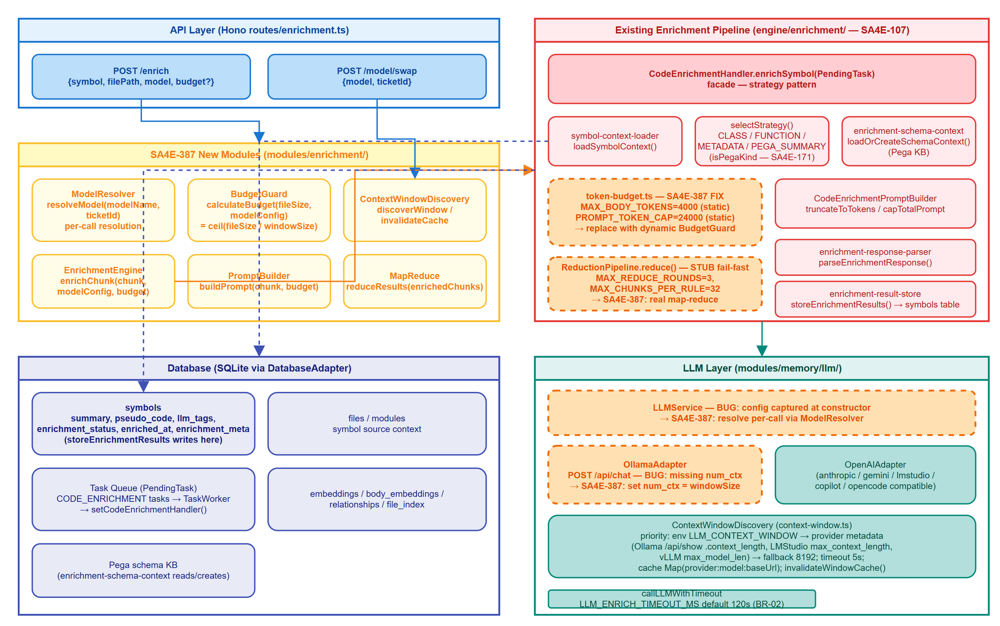
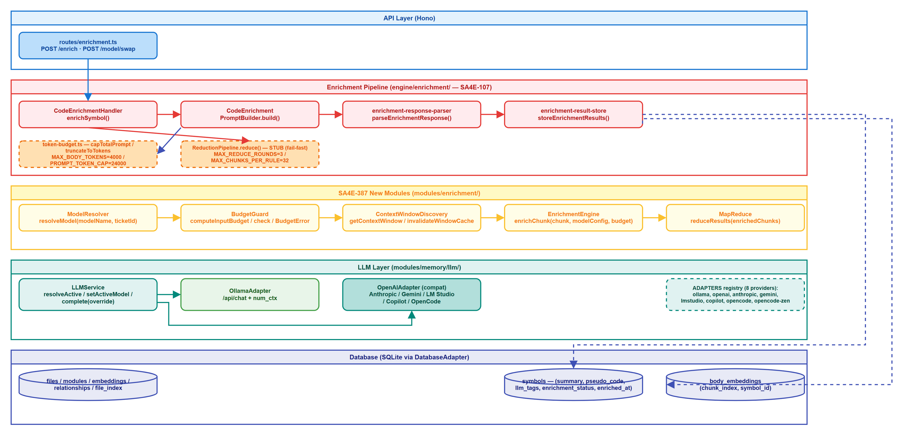
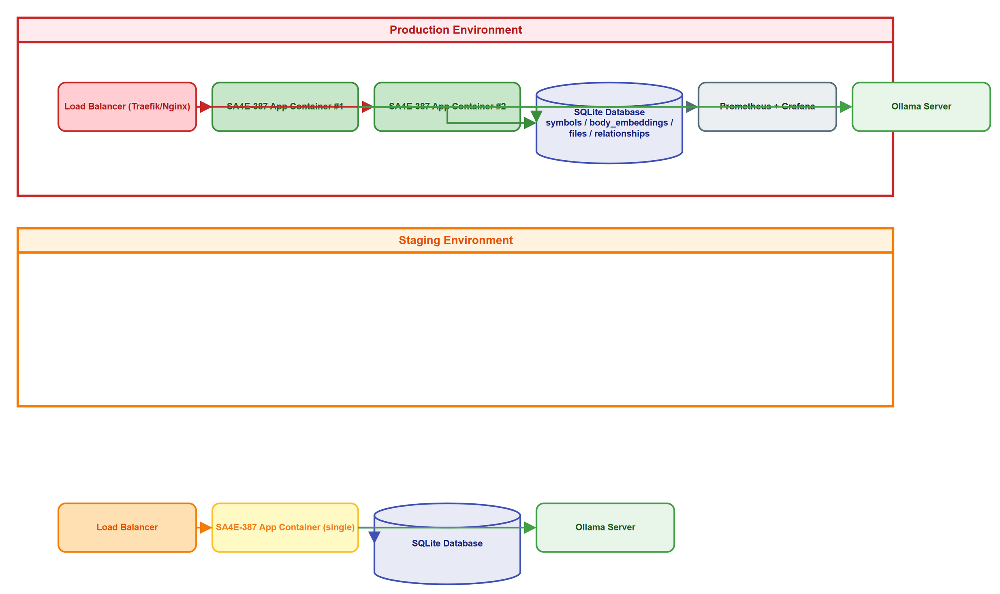
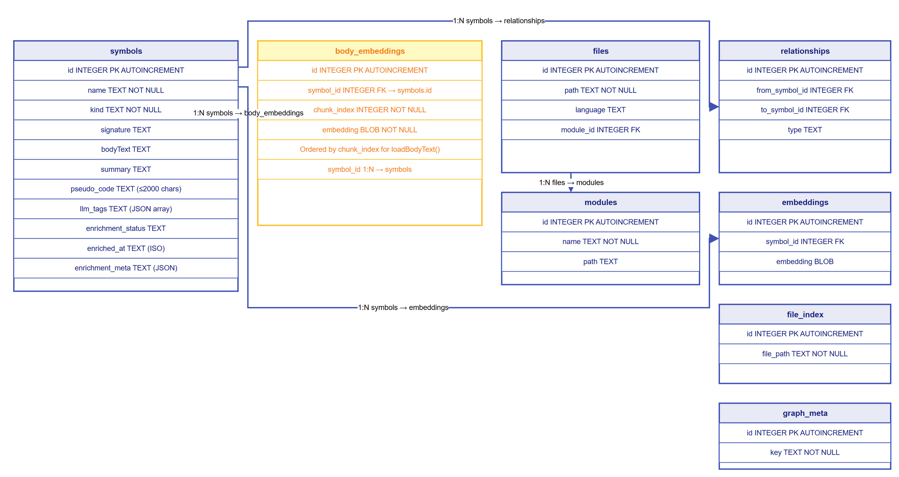
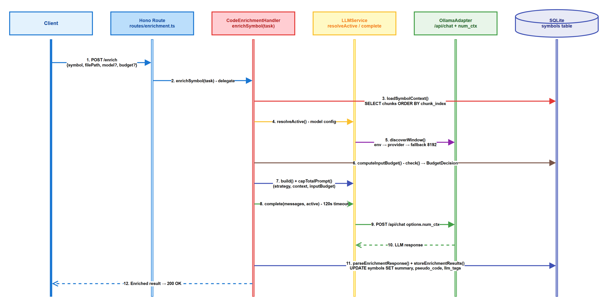

# Technical Design Document (TDD)

## SDLC-Agents-4-Enterprise — SA4E-387: Enrichment with Dynamic Context Budget & Runtime Model Swap

***

> **Source:** Derived from TDD reference `documents/enrichment-runtime-model-swap/TDD-Enrichment-Dynamic-Context-Budget.md` and actual codebase verification.

## Document Information

| Field | Value |
|-------|-------|
| Jira Ticket | SA4E-387 |
| Title | Enrichment with Dynamic Context Budget & Runtime Model Swap |
| Author | SA Agent |
| Version | 1.0 |
| Date | 2026-10-31 |
| Status | Draft |
| Related BRD | documents/SA4E-387/BRD.md |
| Related FSD | documents/SA4E-387/FSD.md |

---

## Author Tracking

| Role | Name / Agent | Responsibility |
|------|--------------|----------------|
| Solution Architect | SA Agent | Technical design, architecture, component design |
| Technical Architect | TA Agent | Technical review, API contracts |
| Developer | DEV Agent | Implementation reference |
| QA | QA Agent | Test design input |

---

## Revision History

| Version | Date | Author | Changes |
|---------|------|--------|---------|
| 1.0 | 2026-10-31 | SA Agent | Initial TDD based on TDD reference and codebase |

---

## Sign-Off

| Role | Name | Signature | Date |
|------|------|-----------|------|
| SA |  |  |  |
| TA |  |  |  |
| DEV |  |  |  |
| QA |  |  |  |

---

## 1. System Overview

### 1.1 Purpose

This TDD specifies the technical design for implementing dynamic context budget calculation and runtime model swap in the LLM enrichment pipeline (SA4E-107). The design replaces static token caps with per-call dynamic budgeting and enables model changes without restart.

### 1.2 Scope

**In scope (10 files to modify per TDD reference checklist):**

| # | File | Change |
|---|------|--------|
| 1 | `modules/memory/llm/types.ts` | Add `contextWindow?` to `LLMConfig` |
| 2 | `modules/memory/llm/LLMService.ts` | `resolveActive()`, `setActiveModel()`, `complete(override)`, `onModelChanged` hook |
| 3 | `modules/memory/llm/context-window.ts` | Per-model env override; TTL cache using `cachedAt` |
| 4 | `modules/memory/llm/ollama-adapter.ts` | Set `num_ctx` from `config.contextWindow` |
| 5 | `engine/enrichment/symbol-context-loader.ts` | `loadBodyText` reads all chunks by `chunk_index` |
| 6 | `engine/enrichment/CodeEnrichmentPromptBuilder.ts` | `build(strategy, context, inputBudget)` |
| 7 | `engine/enrichment/CodeEnrichmentPromptBuilder/token-budget.ts` | `capTotalPrompt(messages, budget)`; `PROMPT_TOKEN_CAP` as fallback |
| 8 | `engine/enrichment/CodeEnrichmentPromptBuilder/prompts.ts` | `MAX_BODY_TOKENS` → `bodyBudget` from `inputBudget` |
| 9 | `engine/enrichment/reduction-pipeline.ts` | Real map-reduce using `chunkedReduce` |
| 10 | `engine/enrichment/CodeEnrichmentHandler.ts` | Wire per-call active/window/budget; route single-shot vs map-reduce |

**Out of scope:** Tokenizer upgrade, context chain, metrics dashboard.

---

## 2. Architecture

### 2.1 Architecture Overview


*[Edit in draw.io](diagrams/architecture.drawio)*

**Layered Architecture:**

```
┌─────────────────────────────────────────────────────────────────┐
│                    API Layer (Hono routes)                       │
│  POST /enrich  |  POST /model/swap                              │
└─────────────────────────┬───────────────────────────────────────┘
                          ▼
┌─────────────────────────────────────────────────────────────────┐
│              Enrichment Pipeline (SA4E-107)                      │
│  CodeEnrichmentHandler → loadSymbolContext → Strategy           │
│  → CodeEnrichmentPromptBuilder → callLLMWithTimeout             │
│  → parseEnrichmentResponse → storeEnrichmentResults             │
└─────────────────────────┬───────────────────────────────────────┘
                          ▼
┌─────────────────────────────────────────────────────────────────┐
│                    SA4E-387 Orchestration                        │
│  ModelResolver │ BudgetGuard │ ContextWindowDiscovery           │
│  EnrichmentEngine │ PromptBuilder │ MapReduce                    │
└─────────────────────────┬───────────────────────────────────────┘
                          ▼
┌─────────────────────────────────────────────────────────────────┐
│                      LLM Layer                                   │
│  LLMService (resolveActive, setActiveModel, complete(override)) │
│  Adapters: Ollama │ OpenAI │ Anthropic │ Gemini │ LM Studio... │
└─────────────────────────┬───────────────────────────────────────┘
                          ▼
┌─────────────────────────────────────────────────────────────────┐
│                    Database (SQLite via DatabaseAdapter)         │
│  symbols │ files │ modules │ embeddings │ body_embeddings...    │
└─────────────────────────────────────────────────────────────────┘
```

### 2.2 Component Diagram


*[Edit in draw.io](diagrams/component.drawio)*

**Component Interactions:**

| Component | Responsibility | Dependencies |
|-----------|----------------|--------------|
| `CodeEnrichmentHandler` | Main orchestrator | All SA4E-387 modules + pipeline |
| `ModelResolver` / `LLMService` | Per-call model resolution | — |
| `BudgetGuard` | Dynamic budget calculation | `TokenBudgetManager.estimateTokens` |
| `ContextWindowDiscovery` | Window discovery + cache | `LLMService.onModelChanged` hook |
| `PromptBuilder` | Dynamic prompt with budget | `token-budget.ts` |
| `EnrichmentEngine` | Single-shot enrichment | `PromptBuilder`, `LLMService` |
| `MapReduce` / `ReductionPipeline` | Chunked enrichment | `chunkedReduce` |
| `LLMService` | Multi-provider facade | Adapters |

### 2.3 Deployment Diagram


*[Edit in draw.io](diagrams/deployment.drawio)*

Single Node.js process (TypeScript/ESM) with SQLite database. No external Redis/PostgreSQL. Containerized via Docker.

---

## 3. Detailed Component Design

### 3.1 `LLMService` — Runtime Model Resolution

**File:** `modules/memory/llm/LLMService.ts`

**New Interface Additions:**

```typescript
// types.ts
export interface LLMConfig {
  provider: LLMProvider;
  model: string;
  baseUrl: string;
  apiKey?: string;
  temperature?: number;
  maxTokens?: number;        // output budget (num_predict)
  contextWindow?: number;    // NEW: input window hint
}

// LLMService.ts additions
export class LLMService {
  // ... existing config, adapter ...
  
  /** Current active model config — reads at call time, NOT constructor snapshot */
  resolveActive(): LLMConfig {
    return { ...this.config };
  }

  /** Runtime model swap. If provider/model/baseUrl changes → rebuild adapter + fire hook */
  setActiveModel(next: Partial<LLMConfig>): void {
    const changed = 
      next.provider !== undefined && next.provider !== this.config.provider ||
      next.model    !== undefined && next.model    !== this.config.model    ||
      next.baseUrl  !== undefined && next.baseUrl  !== this.config.baseUrl;
    this.config = { ...this.config, ...next };
    if (changed) {
      this.adapter = ADAPTERS[this.config.provider]?.() || new OllamaAdapter();
      this.onModelChanged?.(this.config);  // Hook for cache invalidation
    }
  }

  /** complete() accepts optional override for per-call model (no global state mutation) */
  async complete(messages: LLMMessage[], override?: Partial<LLMConfig>): Promise<LLMResponse> {
    const cfg = override ? { ...this.config, ...override } : this.config;
    const adapter = override?.provider && override.provider !== this.config.provider
      ? (ADAPTERS[override.provider]?.() || new OllamaAdapter())
      : this.adapter;
    return adapter.complete(messages, cfg);
  }

  /** Hook fired when model config changes — for window cache invalidation */
  onModelChanged?: (config: LLMConfig) => void;
}
```

**Behavior:**
- Constructor captures initial config from env/defaults
- `resolveActive()` returns current effective config
- `setActiveModel()` mutates config; if provider/model/baseUrl changed → rebuilds adapter + fires `onModelChanged`
- `complete(override?)` uses override for that call only; no global state change

### 3.2 `ContextWindowDiscovery` — Window Discovery + Cache

**File:** `modules/memory/llm/context-window.ts`

**Changes:**

1. **Env override per-model:**
   ```typescript
   const envModelKey = `LLM_CONTEXT_WINDOW__${this.model}`;
   const envModelVal = process.env[envModelKey];
   const envModelParsed = parsePositiveInt(envModelVal);
   if (envModelParsed !== null) {
     // Use per-model env
   }
   // Fallback to global only if per-model not set (or remove global entirely per TDD recommendation)
   ```

2. **TTL cache using existing `cachedAt`:**
   ```typescript
   const WINDOW_CACHE_TTL_MS = 5 * 60 * 1000; // 5 min default
   
   const cached = cache.get(key);
   if (cached && (Date.now() - new Date(cached.cachedAt).getTime() < WINDOW_CACHE_TTL_MS)) {
     return cached;
   }
   ```

3. **Provider discovery unchanged:** Ollama `/api/show`, LM Studio `/api/v0/models`, vLLM `/v1/models`

2. **WindowInfo already has required fields:** `contextWindow`, `windowSource` ('env'|'provider'|'fallback'), `provider`, `providerFieldUsed`, `reservedOutputTokens`, `modelKey`, `cachedAt`

**Cache invalidation:** Called via `LLMService.onModelChanged` hook → `disc.invalidateWindowCache()` (clears relevant modelKey or all)

### 3.3 `BudgetGuard` — Dynamic Budget Calculation

**File:** `engine/enrichment/budget-guard.ts` (existing, complete)

**Interface (already implemented):**

```typescript
export class BudgetGuard {
  static readonly SAFETY_MARGIN = 500;
  static readonly WARNING_THRESHOLD = 0.8;
  static readonly RESERVED_OUTPUT_TOKENS = 800;

  computeInputBudget(window: WindowInfo, overheadTokens: number): InputBudget {
    const available = window.contextWindow - this.RESERVED_OUTPUT_TOKENS - overheadTokens;
    return { budget: Math.max(0, available), windowSize: window.contextWindow, overheadTokens };
  }

  check(params: { digest: string; window: WindowInfo; promptOverheadTokens: number }): BudgetDecision {
    const inputBudget = this.computeInputBudget(params.window, params.promptOverheadTokens);
    const digestTokens = TokenBudgetManager.estimateTokens(params.digest);
    if (inputBudget.budget <= 0) {
      return { withinBudget: false, reason: 'non_positive_budget', strategy: 'map_reduce', inputBudget };
    }
    if (digestTokens <= inputBudget.budget) {
      return { withinBudget: true, reason: 'fits', strategy: 'single_shot', inputBudget };
    }
    return { withinBudget: false, reason: 'exceeds_budget', strategy: 'map_reduce', inputBudget };
  }
}

interface InputBudget { budget: number; windowSize: number; overheadTokens: number; }
interface BudgetDecision { withinBudget: boolean; reason: string; strategy: 'single_shot' | 'map_reduce'; inputBudget: InputBudget; }
```

**Integration:** `CodeEnrichmentHandler` calls `computeInputBudget` → `check` → routes to single-shot or map-reduce.

### 3.4 `CodeEnrichmentPromptBuilder` — Dynamic Budget Prompt

**File:** `engine/enrichment/CodeEnrichmentPromptBuilder.ts`

**Signature Change:**

```typescript
// OLD: build(strategy: EnrichmentStrategy, context: SymbolContext): LLMMessage[]
// NEW:
build(strategy: EnrichmentStrategy, context: SymbolContext, inputBudget: number): LLMMessage[] {
  const messages = this.buildForStrategy(strategy, context);
  return capTotalPrompt(messages, inputBudget);  // budget passed in, NOT PROMPT_TOKEN_CAP
}
```

**token-budget.ts changes:**

```typescript
// OLD: capTotalPrompt(messages: LLMMessage[]): LLMMessage[]
// NEW:
export function capTotalPrompt(messages: LLMMessage[], budget?: number): LLMMessage[] {
  const effectiveBudget = budget ?? PROMPT_TOKEN_CAP;  // fallback only
  // ... rest same: truncate user message to fit effectiveBudget
}
```

**prompts.ts changes:**

```typescript
// MAX_BODY_TOKENS replaced by bodyBudget derived from inputBudget
// e.g., bodyBudget = Math.floor(inputBudget * 0.7) // 70% for body, 30% for schema/sig/prompt
```

### 3.5 `loadBodyText` — Full Body Reading

**File:** `engine/enrichment/symbol-context-loader.ts`

```typescript
// OLD: SELECT embedding FROM body_embeddings WHERE symbol_id = ? AND chunk_index = 0
// NEW:
async function loadBodyText(adapter, symbolId): Promise<string | null> {
  const rows = await adapter.allAsync<{ embedding: Buffer; chunk_index: number }>(
    'SELECT embedding, chunk_index FROM body_embeddings WHERE symbol_id = ? ORDER BY chunk_index',
    [symbolId],
  );
  if (!rows.length) return null;
  return rows.map(r => Buffer.from(r.embedding).toString('utf-8')).join('');
}
```

**Impact:** Single-chunk symbols → no change. Multi-chunk → full body for map-reduce.

### 3.6 `ReductionPipeline` — Real Map-Reduce

**File:** `engine/enrichment/reduction-pipeline.ts`

**Replace stub with real implementation using `chunkedReduce`:**

```typescript
import { chunkedReduce } from '../../modules/memory/llm/chunked-reduce.js';
import { TokenBudgetManager } from '../context/token-budget-manager.js';

export class ReductionPipeline {
  static readonly MAX_REDUCE_ROUNDS = 3;
  static readonly MAX_CHUNKS_PER_RULE = 32;

  async reduce(ast: any, digest: string, trigger: string, budget: number, buildCtx: any): Promise<ReductionOutcome> {
    const report: MapReduceReport = { /* init */ };
    
    // Use chunkedReduce for MAP + MERGE
    const chunks = splitByBudget(digest, budget);
    if (chunks.length > this.MAX_CHUNKS_PER_RULE) {
      throw new BudgetError('chunks_exceed_max', report, 0, chunks.length);
    }

    const partials = await chunkedReduce({
      chunks,
      mapFn: chunk => this.llmService.complete(buildChunkPrompt(buildCtx.strategy, chunk, budget), buildCtx.active),
      mergeFn: results => results,  // keep list for reduce
      maxRetriesPerChunk: 2,
      onChunkFailure: () => 'degrade' as const,  // skip, log, continue
    });

    // REDUCE rounds
    let round = 0;
    let current = partials;
    while (TokenBudgetManager.estimateTokens(current.join('')) > budget && round < this.MAX_REDUCE_ROUNDS) {
      current = await regroupAndReduce(current, budget, buildCtx);
      round++;
    }

    if (TokenBudgetManager.estimateTokens(current.join('')) > budget) {
      const err = new BudgetError('budget_error: reduction exhausted', report, round, chunks.length);
      report.budgetError = { message: err.message, context: {} };
      return { kind: 'budget_error', report, error: err };
    }

    return { kind: 'success', text: current.join('\n\n'), report };
  }
}
```

**Uses existing:** `chunkedReduce` (retry/degrade), `TokenBudgetManager.estimateTokens`, `MAX_REDUCE_ROUNDS`, `MAX_CHUNKS_PER_RULE`, `MapReduceReport`.

### 3.7 `CodeEnrichmentHandler` — Per-Call Orchestration

**File:** `engine/enrichment/CodeEnrichmentHandler.ts`

**Key changes in `enrichSymbol`:**

```typescript
async enrichSymbol(task: PendingTask): Promise<void> {
  // ... parse, loadSymbolContext (now full body), selectStrategy ...

  // PER-CALL resolution
  const active = this.llmService.resolveActive();  // {provider, model, baseUrl, maxTokens, contextWindow?}
  const window = await this.windowProvider.getContextWindow(active);  // WindowInfo
  
  const overhead = this.promptBuilder.estimateSystemTokens(); // or pass systemPrompt to BudgetGuard
  const budget = this.budgetGuard.computeInputBudget(window, overhead);
  const decision = this.budgetGuard.check({ digest: context.bodyText, window, promptOverheadTokens: overhead });

  let raw: string;
  if (decision.withinBudget) {
    const messages = this.promptBuilder.build(strategy, context, decision.inputBudget.budget);
    raw = await this.callLLMWithTimeout(messages, active);  // PASS ACTIVE OVERRIDE
  } else {
    raw = await this.mapReduceEnrich(context, strategy, decision.inputBudget, active);
  }

  const response = parseEnrichmentResponse(raw, strategy);
  await storeEnrichmentResults(this.adapter, this.logger, payload.symbolId, response, strategy);
}
```

**`callLLMWithTimeout` signature change:**
```typescript
private async callLLMWithTimeout(messages: LLMMessage[], active: LLMConfig): Promise<string> {
  const timeout = new Promise<never>((_, reject) => setTimeout(() => reject(new Error('llm_timeout')), LLM_TIMEOUT_MS));
  const result = await Promise.race([
    this.llmService.complete(messages, active),  // PASS ACTIVE OVERRIDE
    timeout,
  ]);
  return result.content;
}
```

### 3.8 `OllamaAdapter` — num_ctx Support

**File:** `modules/memory/llm/ollama-adapter.ts`

```typescript
const body = {
  model: config.model,
  messages: processedMessages,
  stream: false,
  options: {
    temperature: config.temperature ?? 0.3,
    num_predict: config.maxTokens ?? 200,
    ...(config.contextWindow ? { num_ctx: config.contextWindow } : {}),  // NEW
  },
};
```

---

## 4. Database Design

### 4.1 Schema (Existing — SQLite)

No new tables. Enrichment writes to existing `symbols` table:

```sql
-- symbols table (existing)
CREATE TABLE symbols (
  id INTEGER PRIMARY KEY AUTOINCREMENT,
  name TEXT NOT NULL,
  kind TEXT NOT NULL,
  signature TEXT,
  bodyText TEXT,
  summary TEXT,
  pseudo_code TEXT,
  llm_tags TEXT,           -- JSON array
  enrichment_status TEXT,  -- 'PENDING' | 'COMPLETED' | 'FAILED'
  enriched_at TEXT,        -- ISO timestamp
  enrichment_meta TEXT     -- JSON provenance
);

-- body_embeddings (existing)
CREATE TABLE body_embeddings (
  id INTEGER PRIMARY KEY AUTOINCREMENT,
  symbol_id INTEGER NOT NULL,
  chunk_index INTEGER NOT NULL,
  embedding BLOB NOT NULL,
  FOREIGN KEY (symbol_id) REFERENCES symbols(id)
);
```

### 4.2 ER Diagram


*[Edit in draw.io](diagrams/db-schema.drawio)*

---

## 5. API Design

### 5.1 POST /enrich

**Request:**
```json
{
  "symbol": "MyClass.myMethod",
  "filePath": "src/MyClass.ts",
  "model": "ollama",           // optional
  "budget": 5000               // optional
}
```

**Response (success):**
```json
{
  "enrichedContent": "...",
  "status": "success",
  "modelUsed": "ollama",
  "budgetUsed": 5000,
  "strategy": "single_shot"  // or "map_reduce"
}
```

**Response (error):**
```json
{
  "status": "error",
  "error": "Model not found"
}
```

### 5.2 POST /model/swap

**Request:**
```json
{
  "model": "anthropic",
  "ticketId": "SA4E-387"
}
```

**Response:**
```json
{
  "status": "success",
  "message": "Model anthropic swapped successfully and cache invalidated.",
  "activeModel": "anthropic"
}
```

### 5.3 API Sequence Diagram


*[Edit in draw.io](diagrams/api-sequence-enrich.drawio)*

---

## 6. Testing Strategy

### 6.1 Unit Tests (per TDD §6)

| Test | Target | Expected |
|------|--------|----------|
| UT-001 | `BudgetGuard.computeInputBudget` | ctx=8192, reserved=2048, overhead=500 → 5644 |
| UT-002 | `BudgetGuard.check` fits | `withinBudget: true, strategy: 'single_shot'` |
| UT-003 | `BudgetGuard.check` exceeds | `withinBudget: false, strategy: 'map_reduce'` |
| UT-004 | `capTotalPrompt(messages, budget)` | total ≤ budget keeps system, truncates user |
| UT-005 | `loadBodyText` multi-chunk | concatenates in chunk_index order |
| UT-006 | `loadBodyText` single chunk | no behavior change |
| UT-007 | `context-window.ts` per-model env | `LLM_CONTEXT_WINDOW__model=X` → X used |
| UT-008 | `context-window.ts` TTL | cache > 5min → re-discover |
| UT-009 | `ollama-adapter` num_ctx | `config.contextWindow=8192` → `options.num_ctx=8192` |

### 6.2 Integration Tests (fake LLMService + in-memory SQLite)

| Test | Scenario | Verification |
|------|----------|--------------|
| IT-001 | Symbol fits budget | Single `complete` call, `strategy: 'single_shot'` |
| IT-002 | Symbol exceeds budget | Map-reduce: `complete` calls = chunks + reduce rounds |
| IT-003 | Model swap | `setActiveModel` → adapter rebuild + `invalidateWindowCache` called |
| IT-004 | Map-reduce chunk failure | `degrade` path: skip chunk, continue, log entry |

### 6.3 Property / Regression Tests

- ∀ body sizes, ∀ windows ∈ {8192, 32768, 131072}: prompt tokens ≤ budget (never overflow)
- Model swap between two consecutive enrich calls → second call uses new model's window
- `BudgetError` always logged with full `MapReduceReport` (no silent catch)

### 6.4 Edge Cases

- `num_ctx` set correctly for Ollama after swap
- Chunk failure mid-map → degrade, pipeline continues, log entry
- Symbol > `MAX_CHUNKS_PER_RULE` → `BudgetError` with `boundsHit`
- Same model name, different config after TTL → correct window

---

## 7. Migration & Rollback

### 7.1 Migration Steps

1. Deploy code changes (all 10 files)
2. No DB migration needed (existing tables)
3. Verify `LLMService` config resolution works
4. Verify `POST /model/swap` invalidates cache
5. Run integration test suite

### 7.2 Rollback Plan

- Revert code changes
- No DB rollback needed
- Config reverts to static caps behavior

---

## 8. Diagram Requirements

| # | Diagram | File | Section | Mandatory |
|---|---------|------|---------|-----------|
| 1 | Architecture Overview | `diagrams/architecture.drawio` + `.png` | 2.1 | ✅ |
| 2 | Component Diagram | `diagrams/component.drawio` + `.png` | 2.2 | ✅ |
| 3 | Deployment Diagram | `diagrams/deployment.drawio` + `.png` | 2.3 | ✅ |
| 4 | API Sequence (Enrich) | `diagrams/api-sequence-enrich.drawio` + `.png` | 5 | ✅ |
| 5 | Database/Data Schema | `diagrams/db-schema.drawio` + `.png` | 4 | ✅ |
| 6 | Class Diagram | `diagrams/class-diagram.drawio` + `.png` | 3 | ✅ |
| 7 | Model Swap Sequence | `diagrams/sequence-model-swap.drawio` + `.png` | 6.2 | ✅ |
| 8 | Enrichment Sequence | `diagrams/sequence-enrich.drawio` + `.png` | 6.1 | ✅ |
| 9 | Business Flow | `diagrams/business-flow.drawio` + `.png` | 1 | ✅ |
| 10 | Use Case | `diagrams/use-case.drawio` + `.png` | 2 | ✅ |
| 11 | System Context | `diagrams/system-context.drawio` + `.png` | 2 | ✅ |

**All diagrams MUST have corresponding `.drawio` + `.png` files in `diagrams/`.**

**Export command:**
```powershell
& "C:\Program Files\draw.io\draw.io.exe" -x -f png -s 2 -b 20 -o "documents/SA4E-387/diagrams/{name}.png" "documents/SA4E-387/diagrams/{name}.drawio"
```

---

## 9. Checklist

### 9.1 Implementation Checklist

- [ ] `types.ts` — add `contextWindow?` to `LLMConfig`
- [ ] `LLMService.ts` — `resolveActive()`, `setActiveModel()`, `complete(override)`, `onModelChanged`
- [ ] `context-window.ts` — per-model env; TTL cache using `cachedAt`
- [ ] `ollama-adapter.ts` — `num_ctx` from `config.contextWindow`
- [ ] `symbol-context-loader.ts` — `loadBodyText` reads all chunks
- [ ] `CodeEnrichmentPromptBuilder.ts` — `build(strategy, context, inputBudget)`
- [ ] `token-budget.ts` — `capTotalPrompt(messages, budget)`; `PROMPT_TOKEN_CAP` fallback
- [ ] `prompts.ts` — `MAX_BODY_TOKENS` → `bodyBudget` from `inputBudget`
- [ ] `reduction-pipeline.ts` — real map-reduce using `chunkedReduce`
- [ ] `CodeEnrichmentHandler.ts` — wire per-call active/window/budget; route single-shot vs map-reduce

### 9.2 Diagram Checklist

- [ ] All 11 diagrams created in `documents/SA4E-387/diagrams/`
- [ ] All diagrams have `.drawio` + `.png` pair
- [ ] Exported at 2x scale with 20px border

---

## 10. Appendix

### 10.1 Key Constants

| Constant | Value | Location |
|----------|-------|----------|
| `MAX_BODY_TOKENS` | 4000 (legacy) | `token-budget.ts` |
| `PROMPT_TOKEN_CAP` | 24000 (fallback) | `token-budget.ts` |
| `CHARS_PER_TOKEN` | 4 | `token-budget.ts` |
| `RESERVED_OUTPUT_TOKENS` | 800 | `budget-guard.ts` |
| `WARNING_THRESHOLD` | 0.8 | `budget-guard.ts` |
| `MAX_REDUCE_ROUNDS` | 3 | `reduction-pipeline.ts` |
| `MAX_CHUNKS_PER_RULE` | 32 | `reduction-pipeline.ts` |
| `LLM_TIMEOUT_MS` | 120000 (2 min) | `CodeEnrichmentHandler.ts` |
| `WINDOW_CACHE_TTL_MS` | 300000 (5 min) | `context-window.ts` |

### 10.2 References

- Jira Ticket: SA4E-387
- TDD Reference: `documents/enrichment-runtime-model-swap/TDD-Enrichment-Dynamic-Context-Budget.md`
- Existing Pipeline: SA4E-107 (`engine/enrichment/`)