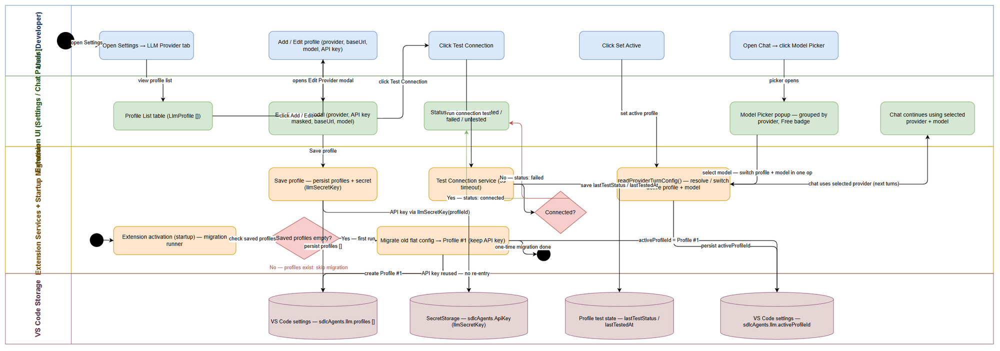
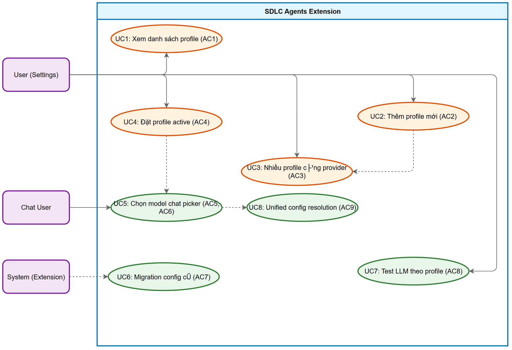

# Business Requirements Document (BRD)

## SA4E — SA4E-389: Multi LLM Configuration (Profiles) + Chat model/provider switcher

---

## Document Information

| Field | Value |
|-------|-------|
| Jira Ticket | SA4E-389 |
| Title | Multi LLM Configuration (Profiles) + Chat model/provider switcher |
| Author | BA Agent |
| Version | 1.0 |
| Date | 2026-10-30 |
| Status | Draft |

---

## Author Tracking

| Role | Name - Position | Responsibility |
|------|-----------------|----------------|
| Author | BA Agent – Business Analyst | Create document |
| Peer Reviewer | TBD – TBD | Review document |

---

## Revision History

| Version | Date | Author | Changes |
|---------|------|--------|---------|
| 1.0 | 2026-10-30 | BA Agent | Initiate document — from Jira ticket SA4E-389 |

---

## Sign-Off

| Name | Signature and date |
|------|--------------------|
| | ☐ I agree and confirm all criteria on this BRD as expected requirements |
| | ☐ I agree and confirm all criteria on this BRD as expected requirements |

---

## 1. Introduction

### 1.1 Scope

Ticket SA4E-389 requires redesign of the LLM configuration architecture from single-config to multi-profile model, enabling:
1. **Multi-profile**: Settings store multiple LLM configuration profiles. Each profile = provider + baseURL + model + apiKey + label + test status.
2. **Chat switcher**: Chat window model dropdown upgrades to grouped picker — grouped by provider, only showing models of connected profiles; selecting one row switches entire profile (provider + baseURL + key) + model in one operation.
3. **No breaking changes**: Automatic migration packages current config into Profile #1. API key migration via existing helper `llmSecretKey(id)`, user does not re-enter.

**Current architecture (verified in code)**:
- LLM config is single-config, flat keys in VS Code settings (namespace `sdlcAgents`):
  - Provider: `sdlcAgents.llm.provider` (1 value)
  - Model: `sdlcAgents.llm.model` (1 value; `"auto"` = clear override)
  - Base URL per provider: `sdlcAgents.llm.<provider>.baseUrl` (map at `PROVIDER_BASE_URL_KEYS`)
  - Ollama URL: `sdlcAgents.llm.ollama.baseUrl`
  - API key: VS Code SecretStorage, key `sdlcAgents.<provider>ApiKey` — resolved UNIQUE via helper `llmSecretKey(providerId)` in `extension/src/config/llm-secret-keys.ts`
- Single source of truth for read provider/model/baseUrl/fallback: `readProviderTurnConfig()` in `extension/src/pi-workflow/pi-provider-config-bridge.ts`. Used by BOTH chat and workflow engine.

**Goal**:
- Multi-profile: Settings store list of LlmProfile. Each profile = provider + baseURL + model + apiKey + label + test status.
- Chat switcher: dropdown model upgrades to grouped picker — grouped by provider, only listing models of connected profiles; selecting one row switches entire profile (provider + baseURL + key) + model in one operation.
- No breaking changes: migration auto packages current config into Profile #1.

**Data model (NEW)**:
```typescrip
interface LlmProfile {
  id: string;              // slug [a-z0-9-]+ (e.g. "lmstudio-qwen"); used as part of secret key
  label: string;           // "LMStudio - Qwen"
  provider: string;        // lmstudio | openrouter | anthropic | ollama | ...
  baseUrl?: string;        // undefined = use provider default
  model: string;           // model id, or "auto"
  useDefaultUrl: boolean;
  lastTestStatus?: "connected" | "failed" | "untested";
  lastTestedAt?: number;
}
```

**Storage**:
- `sdlcAgents.llm.profiles: LlmProfile[]` — VS Code settings, Global (correct prefix `llm.*`)
- `sdlcAgents.llm.activeProfileId: string` — VS Code settings, Global

**Secret key** (MUST follow existing convention):
- Format: `sdlcAgents.<x>ApiKey`
- Every read/write MUST go through helper `llmSecretKey(id)` / `readLlmApiKey(secrets, id)` — DO NOT call `secrets.store/get` with arbitrary string.
- For a profile: secret key = `sdlcAgents.<profileId>ApiKey` (using profileId directly as `<x>`), still via `llmSecretKey(profileId)`.
- ❌ NO: `llmProfile.<id>.apiKey` or any other namespace — violates single source of truth.
- Therefore `profileId` MUST be safe slug `[a-z0-9-]+` (no dots / exotic uuid chars) to form valid key.

**Migration (one-time, on activation)**:
- If `sdlcAgents.llm.profiles` empty/absent → read old config (`llm.provider`, `llm.model`, `llm.<provider>.baseUrl`) → create *Profile #1*.
- `profileId` of Profile #1 = old providerId → secret key = old key (same format `sdlcAgents.<providerId>ApiKey`) → `readLlmApiKey` auto-migrates, user does not re-enter API key.
- Set `activeProfileId` = profileId of Profile #1.
- Guard with globalState flag similar to existing `settings-migration-runner`; DO NOT delete old keys (fail-safe).

---

## 2. Business Requirements

### 2.1 High Level Process Map

1. User opens Settings Panel → tab "LLM Provider".
2. User sees profile list managed via table (each row = one LlmProfile).
3. User can Add Profile, Edit Profile, Delete Profile, Set Active Profile.
4. User opens Chat Window → model selector shows grouped picker (by provider, connected/untested badges).
5. Selecting a model in chat sets both `activeProfileId` + model in one operation.
6. Subsequent turns use the active profile's provider/baseURL/key/model.

---

### 2.2 List of User Stories / Use Cases

| # | Story / Use Case | Priority | Source Ticket |
|---|------------------|----------|---------------|
| 1 | As a user, I want to view and manage multiple LLM profiles in Settings so that I can configure different providers independently. | MUST HAVE | SA4E-389 |
| 2 | As a user, I want to add a new LLM profile so that I can connect to a new LLM service. | MUST HAVE | SA4E-389 |
| 3 | As a user, I want to edit an existing profile (provider, model, base URL, API key) so that I can fine-tune configuration. | MUST HAVE | SA4E-389 |
| 4 | As a user, I want to delete a profile so that I can remove unused configurations. | SHOULD HAVE | SA4E-389 |
| 5 | As a user, I want to set an active profile so that the chat and workflow engine use the correct provider/model. | MUST HAVE | SA4E-389 |
| 6 | As a chat user, I want the model picker to show models grouped by provider, only showing connected profiles. | MUST HAVE | SA4E-389 |
| 7 | As a chat user, I want to select a model from the picker and have both provider + model applied in one operation. | MUST HAVE | SA4E-389 |
| 8 | As a user, I want migration from single config to multi-profile to be automatic, without losing my existing API key. | MUST HAVE | SA4E-389 |
| 9 | As a user, I want to test each profile's connection and see status (connected/failed/untested). | SHOULD HAVE | SA4E-389 |
| 10 | As a user, I want no caller to read flat `llm.provider`/`llm.model` directly outside the profile resolution layer. | MUST HAVE | SA4E-389 |

---

### 2.3 Details of User Stories

#### STORY 1: View and manage multiple LLM profiles

> As a user, I want to view and manage multiple LLM profiles in Settings so that I can configure different providers independently.

**Requirement Details**:

1. Settings tab "LLM Provider" displays list of profiles; each row has label, provider, model, status badge, buttons (Edit/Test/Delete/Set-active).
2. "+ Add Configuration" creates new profile; persists to `sdlcAgents.llm.profiles`; API key stored via `sdlcAgents.<profileId>ApiKey` using `llmSecretKey()`.
3. Edit profile opens modal with current data pre-filled; can change provider, model, base URL, API key.
4. Delete profile removes from list; fail-safe guard.
5. "Set active" changes `activeProfileId`; chat + workflow engine use `readProviderTurnConfig()` to resolve from active profile.

**Data Fields**:

| Field | Type | Required | Description | Example |
|-------|------|----------|-------------|---------|
| profileId | String (slug) | Yes | Internal identifier [a-z0-9-]+ | lmstudio-qwen, openrouter-anthropic |
| label | String | Yes | Display name | "LMStudio - Qwen" |
| provider | Enum | Yes | Provider name | lmstudio, openrouter, anthropic, ollama |
| baseUrl | String | No | Override base URL (undefined = default) | https://api.lmstudio.ai |
| model | String | Yes | Model ID or "auto" | claude-3-sonnet, auto |
| useDefaultUrl | Boolean | Yes | Whether to use provider default URL | true/false |
| lastTestStatus | Enum | No | Last test result | connected, failed, untested |
| lastTestedAt | Number | No | Timestamp of last test | 1730294400000 |

**Acceptance Criteria**:

1. Settings tab "LLM Provider" displays profile list; each row has label, provider, model, status badge, buttons.
2. "+ Add Configuration" creates profile; persists to `sdlcAgents.llm.profiles`; API key stored via `sdlcAgents.<profileId>ApiKey` using `llmSecretKey()`.
3. "Set active" changes `activeProfileId`; chat + workflow engine resolve correctly via `readProviderTurnConfig()`.
4. Migration from old flat config to Profile #1 is automatic; user does not re-enter API key.
5. No caller reads flat `llm.provider`/`llm.model` directly outside profile resolution layer (verified by grep).
6. ProfileId is safe slug `[a-z0-9-]+`; secret key format `sdlcAgents.<profileId>ApiKey` valid.

**UI Specifications**:

| No. | Name | Type | Required | Description | Note |
|-----|------|------|----------|-------------|------|
| 1 | Profile Table | Table | Yes | List of LlmProfile rows | Columns: label, provider, model, status, actions |
| 2 | Profile Label | Label | Yes | Display name of profile | |
| 3 | Provider | Dropdown/Label | Yes | Provider name | lmstudio, openrouter, etc. |
| 4 | Model | Text | Yes | Model ID or "auto" | |
| 5 | Status Badge | Badge | Yes | connected (green), failed (red), untested (gray) | |
| 6 | Actions | Button group | Yes | Edit, Test, Delete, Set-active | |
| 7 | Add Provider Button | Button | Yes | Add new profile | |

**Validation Rules**:

- Profile label not empty when adding new.
- Model ID not empty.
- Provider must be from recognized list.
- ProfileId must match slug pattern `[a-z0-9-]+`.

**Error Handling**:

- If fail to load profiles: show error message, empty table.
- If test profile fails: update `lastTestStatus` badge, show error detail.
- If save fails: show error message, do not navigate away.

---

#### STORY 2: Add new LLM profile

> As a user, I want to add a new LLM profile so that I can connect to a new LLM service.

**Requirement Details**:

1. "Add Profile" button in Settings Panel (tab LLM Provider).
2. Clicking opens modal Edit Profile allowing input of new provider info.
3. User selects provider from list (anthropic, openai, lmstudio, openrouter, ollama), enters API key, base URL, model.
4. "Test Connection" button checks connectivity before saving.
5. After saving, new profile appears in Profile Table.

**Data Fields**:

| Field | Type | Required | Description | Example |
|-------|------|----------|-------------|---------|
| providerId | Enum (select) | Yes | Provider from list | anthropic, openai |
| apiKey | String (password) | Yes (cloud) | API key | sk-ant-... |
| baseUrl | String | No | Base URL override | https://api.custom.com |
| model | String | Yes | Model ID | claude-3-opus |

**Acceptance Criteria**:

1. "Add Profile" button clearly visible in Settings Panel.
2. Modal Edit Provider opens when clicking "Add Profile".
3. User can select provider and enter full configuration.
4. "Test Connection" checks connectivity and shows result.
5. New profile added to Profile Table after save.
6. API key stored via `sdlcAgents.<profileId>ApiKey` using `llmSecretKey()`.

**UI Specifications**:

| No. | Name | Type | Required | Description | Note |
|-----|------|------|----------|-------------|------|
| 1 | Add Profile Button | Button | Yes | Add new profile | |
| 2 | Edit Provider Modal | Modal | Yes | Detailed provider config | Contains API key, base URL, model, test connection |
| 3 | Provider Select | Dropdown | Yes | Select from list | anthropic, openai, lmstudio, openrouter, ollama |
| 4 | API Key Input | Password | Yes (cloud) | Enter API key | Masked |
| 5 | Base URL Input | Text | No | Enter base URL | |
| 6 | Model Input | Text | Yes | Enter model ID | |
| 7 | Test Connection Button | Button | Yes | Check connectivity | Shows result |
| 8 | Save Button | Button | Yes | Save provider | |

**Validation Rules**:

- Provider ID must be from list.
- API key required for cloud providers (anthropic, openai, openrouter).
- Model ID not empty.

**Error Handling**:

- If provider ID invalid: show "Unknown provider" error.
- If test connection error: show detailed error, does not block save (or blocks per design).

---

#### STORY 3: Edit existing profile

> As a user, I want to edit an existing profile (provider, model, base URL, API key) so that I can fine-tune configuration.

**Requirement Details**:

1. "Edit" button appears on each profile row in Provider Table.
2. Clicking opens modal Edit Profile with current data pre-filled (API key masked).
3. User can change API key, base URL, model.
4. "Test Connection" checks connectivity after changes.
5. Changes saved and Profile Table updated.

**Data Fields**:

| Field | Type | Required | Description | Example |
|-------|------|----------|-------------|---------|
| apiKey | String (password) | No | New API key (if changing) | sk-... |
| baseUrl | String | No | New base URL | https://api.custom.com |
| model | String | Yes | New model ID | gpt-4o |

**Acceptance Criteria**:

1. "Edit" button on each profile row.
2. Modal opens with current data pre-filled.
3. User can edit API key, base URL, model.
4. "Test Connection" checks connectivity after changes.
5. Changes saved and displayed in Provider Table.
6. API key stored via `sdlcAgents.<profileId>ApiKey` using `llmSecretKey()`.

**UI Specifications**:

| No. | Name | Type | Required | Description | Note |
|-----|------|------|----------|-------------|------|
| 1 | Edit Button | Button | Yes | On each profile row | Opens modal Edit Provider |
| 2 | Edit Provider Modal | Modal | Yes | Detailed provider config | API key, base URL, model, test connection |
| 3 | API Key Field | Password | No | API key (masked) | |
| 4 | Base URL Field | Text | No | Base URL | |
| 5 | Model Field | Text | Yes | Model ID | |
| 6 | Test Connection Button | Button | Yes | Check connectivity | |
| 7 | Save Button | Button | Yes | Save changes | |

**Validation Rules**:

- Model ID not empty when saving.
- Base URL must be valid URL if provided.

**Error Handling**:

- If save fails: show error message.
- If test connection fails: show error detail and status disconnected.

---

#### STORY 4: Delete profile

> As a user, I want to delete a profile so that I can remove unused configurations.

**Requirement Details**:

1. "Delete" button appears on each profile row in Provider Table.
2. Clicking prompts confirmation dialog.
3. After confirmation, profile removed from list.
4. If deleting active profile, `activeProfileId` reset to first profile or null.

**Acceptance Criteria**:

1. "Delete" button on each profile row.
2. Confirmation dialog before deletion.
3. Profile removed from list after confirmation.
4. If was active profile, `activeProfileId` reset appropriately.

**UI Specifications**:

| No. | Name | Type | Required | Description | Note |
|-----|------|------|----------|-------------|------|
| 1 | Delete Button | Button | Yes | On each profile row | Triggers confirmation |
| 2 | Confirmation Dialog | Modal | Yes | "Are you sure?" | Cancel keeps profile |

**Error Handling**:

- If deletion fails: show error message.

---

#### STORY 5: Set active profile

> As a user, I want to set an active profile so that the chat and workflow engine use the correct provider/model.

**Requirement Details**:

1. "Set active" button on each profile row, or click profile label to toggle active.
2. When set active, `activeProfileId` updated in VS Code settings.
3. Chat window and workflow engine use `readProviderTurnConfig()` to resolve provider/model/baseUrl from active profile.
4. Subsequent chat turns use the new active profile.

**Acceptance Criteria**:

1. "Set active" button changes visual state (highlighted).
2. `activeProfileId` updated in VS Code global settings.
3. `readProviderTurnConfig()` resolves from active profile, NOT flat keys.
4. Chat turn after change uses new provider/baseURL/model.

**UI Specifications**:

| No. | Name | Type | Required | Description | Note |
|-----|------|------|----------|-------------|------|
| 1 | Active Indicator | Badge/Style | Yes | Visual mark showing active profile | Different color/style |
| 2 | Profile Label Click | Action | Yes | Click to toggle active | |

**Error Handling**:

- If no profiles exist: disabled or message "No profiles configured".

---

#### STORY 6: Model picker grouped by provider

> As a chat user, I want the model picker to show models grouped by provider, only showing connected profiles.

**Requirement Details**:

1. Chat window model selector replaces simple dropdown with grouped picker.
2. Picker shows groups by provider (only profiles with `lastTestStatus` = "connected").
3. Within each group, models listed with name, provider badge "Free" if free.
4. Selecting a model sets both `activeProfileId` + model in one operation.

**Acceptance Criteria**:

1. Model picker is grouped by provider.
2. Only connected profiles' models shown (untested/profiles without test disabled/grayed).
3. Model item shows name, provider, Free badge.
4. Selecting model applies both profile + model.

**UI Specifications**:

| No. | Name | Type | Required | Description | Note |
|-----|------|------|----------|-------------|------|
| 1 | Model Picker Popup | Popup | Yes | Grouped by provider | Appears when clicking model selector |
| 2 | Provider Group | Section | Yes | Group of models from same provider | |
| 3 | Model Item | List item | Yes | Individual model | Name + provider + Free badge |
| 4 | Free Badge | Badge | No (conditional) | "Free" if free model | Green color |

**Validation Rules**:

- No special rules.

**Error Handling**:

- If no connected profiles: show "No models available" message.

---

#### STORY 7: Test profile connection

> As a user, I want to test each profile's connection and see status (connected/failed/untested).

**Requirement Details**:

1. "Test" button on each profile row in Provider Table.
2. Clicking runs connection test for that profile.
3. `lastTestStatus` updated (connected/failed/untested).
4. `lastTestedAt` timestamp updated.
5. Badge status updated in table.

**Acceptance Criteria**:

1. "Test" button on each profile row.
2. `lastTestStatus` updated after test.
3. `lastTestedAt` timestamp updated.
4. Badge status updated in table.

**UI Specifications**:

| No. | Name | Type | Required | Description | Note |
|-----|------|------|----------|-------------|------|
| 1 | Test Button | Button | Yes | On each profile row | Triggers test |
| 2 | Status Badge | Badge | Yes | connected (green), failed (red), untested (gray) | |
| 3 | Tested At Timestamp | Text | No | When last tested | |

**Error Handling**:

- If test timeout: show error, set status to "failed" after timeout.
- If network error: show error detail, set status to "failed".

---

#### STORY 8: No direct flat key reading

> As a user, I want no caller to read flat `llm.provider`/`llm.model` directly outside the profile resolution layer.

**Requirement Details**:

1. All callers of provider/model must go through `readProviderTurnConfig()` or `resolveLlmProfile()` helper.
2. No new code may read `sdlcAgents.llm.provider` or `sdlcAgents.llm.model` flat keys directly.
3. Code review (Phase 5) verifies compliance.

**Acceptance Criteria**:

1. Grep confirms no direct reads of `sdlcAgents.llm.provider` or `sdlcAgents.llm.model` outside resolution layer.
2. All profile reads go through `readProviderTurnConfig()` or equivalent.
3. Phase 5 code review passes.

**Error Handling**:

- If found: block merge, require refactor to use profile resolution layer.

---

## 3. Dependencies

| Dependency | Type | Related Ticket | Description |
|------------|------|----------------|-------------|
| LlmProfile interface | Data model | SA4E-389 | New interface for multi-profile |
| `sdlcAgents.llm.profiles` | Storage | VS Code settings | Persist profiles list |
| `sdlcAgents.llm.activeProfileId` | Storage | VS Code settings | Active profile identifier |
| `llmSecretKey(id)` | Helper | extension/src/config/llm-secret-keys.ts | Read/write secret key |
| `readLlmApiKey(secrets, id)` | Helper | extension/src/config/llm-secret-keys.ts | Migrate old API key |
| `readProviderTurnConfig()` | SSOT | extension/src/pi-workflow/pi-provider-config-bridge.ts | Resolve from active profile |
| Migration script | Script | SA4E-389 | Auto-migrate old config → Profile #1 |
| Code standards | Guideline | Project | file ≤ 200 lines, function ≤ 20 lines, SOLID |

---

## 4. Stakeholders

| Role | Name / Team | Responsibility | Source |
|------|-------------|----------------|--------|
| Reporter | Duc Nguyen Minh | Request LLM config change | Jira ticket SA4E-389 |
| BA Agent | BA Agent | Collect requirements, write BRD | Phase 1 |
| Developer | TBD | Implement multi-profile data model, migration, UI | Jira ticket SA4E-389 |
| SA Agent | TBD | Design TDD, ensure no flat key reading | Jira ticket SA4E-389 |
| QA | TBD | Test profile management, migration, chat switcher | Phase 4 |
| End User | Developer / SDLC team | Use LLM profiles, chat model switcher | Business |

---

## 5. Risks and Assumptions

### 5.1 Risks

| Risk | Impact | Likelihood | Mitigation |
|------|--------|------------|------------|
| API key exposed if secret key format violated | High | Medium | Strict enforcement via `llmSecretKey()` helper only; code review guard |
| Migration loses user config | High | Low | Fail-safe: old keys not deleted; globalState flag; backup VS Code settings |
| Model picker too complex UI | Medium | Medium | Start with basic grouped picker; iterate per feedback; use draw.io for mockup first |
| Existing callers break when flat keys removed | High | High | Phase 5 code review mandatory; grep search before removal; deprecation period |
| profileId not safe slug causes secret key invalid | Medium | Low | Enforce `[a-z0-9-]+` pattern at interface level; unit test for slug validation |

### 5.2 Assumptions

- VS Code settings API persists Global settings correctly.
- `readProviderTurnConfig()` currently reads from flat keys; will be updated to read from active profile.
- Existing provider list (anthropic, openai, lmstudio, openrouter, ollama) kept, only storage changes.
- API key continues in VS Code SecretStorage, base URL/model in workspace config.
- No auto-check connection; user initiates test connection.
- Model data comes from saved config (not dynamic API call) in this phase.

---

## 6. Non-Functional Requirements

| Category | Requirement | Details |
|----------|-------------|---------|
| Performance | Profile table render fast | Table with ≤ 10 profiles renders < 500ms |
| Performance | Model picker opens fast | Popup opens < 300ms after click |
| Security | API key encrypted | Stored in VS Code SecretStorage, not displayed raw in table |
| Security | Test connection timeout | Each test has timeout (e.g. 5s like testOllama) to avoid UI hang |
| Scalability | Support many profiles | Profile table can show many profiles (virtual scroll if needed) |
| Usability | Intuitive profile management | Add/Edit/Del/Set-active obvious; confirm actions |
| Availability | UI not hang during test | Test runs async, does not block UI thread |

---

## 7. Related Tickets

| Ticket Key | Summary | Status | Type | Relationship |
|------------|---------|--------|------|--------------|
| SA4E-389 | Multi LLM Configuration (Profiles) + Chat model/provider switcher | In Progress | Story | Main ticket |
| SA4E-323 | LLM provider settings refactor (LlmSettingsHandler) | Resolved | Task | Related (current handler) |
| SA4E-370 | Dotted base URL keys for providers | Resolved | Task | Related (BASE_URL_KEYS mapping) |
| SA4E-390 | Làm lại màn hình cấu hình LLM và chọn model LLM ở cửa sổ chat SDLC CHAT | In Progress | Task | Related (UI implementation, AC3 cross-reference) |

---

## 8. Appendix

### Glossary (if applicable)

| Term | Definition |
|------|------------|
| LlmProfile | Interface representing one LLM configuration profile |
| profileId | Internal slug identifier [a-z0-9-]+, used in secret key `sdlcAgents.<profileId>ApiKey` |
| activeProfileId | Currently active profile, resolved via `readProviderTurnConfig()` |
| Secret key | Format `sdlcAgents.<id>ApiKey`, read/write via `llmSecretKey(id)` |
| Base URL | URL endpoint of provider API; may use provider default |
| Model | ID of LLM model selected for provider |
| Status | Connection state: connected / failed / untested |
| Model Picker | Popup model selection in Chat (grouped by provider) |
| Recent | List of recently used models |
| SecretStorage | VS Code SecretStorage (stores API key securely) |
| SSOT | Single Source of Truth: `readProviderTurnConfig()` resolves from active profile |

### Reference Documents

| Document | Link / Location |
|----------|-----------------|
| Jira Ticket SA4E-389 | SA4E-389 (Jira) |
| LlmProviderConfig Source | extension/src/models/LlmProviderConfig.ts (to be created) |
| LLM Secret Keys | extension/src/config/llm-secret-keys.ts |
| Provider Config Bridge | extension/src/pi-workflow/pi-provider-config-bridge.ts |
| Read Provider Turn Config | `readProviderTurnConfig()` in pi-provider-config-bridge.ts |
| Settings Panel Source | extension/src/panels/settings/SettingsPanel.ts |
| Migration Runner | extension/src/config/settings-migration-runner.ts (existing) |

---

## 9. Diagrams

### 9.1 Business Flow — Multi LLM Profile Management + Chat Model Switcher

Swimlane flow: User opens Settings (LLM Provider tab) → manages the LlmProfile list (Add/Edit → Edit Provider Modal → Save, Test Connection with connected/failed outcome, Set Active) → startup migration runner packs the old flat config (sdlcAgents.llm.provider/model/apiKey) into Profile #1 with API key reused via llmSecretKey — then Chat opens the grouped Model Picker and selecting a model switches activeProfileId + model in one operation via readProviderTurnConfig().


*[Edit in draw.io](diagrams/business-flow.drawio)*

### 9.2 Use Case


*[Edit in draw.io](diagrams/use-case.drawio)*