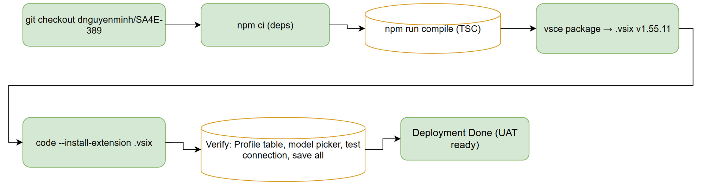
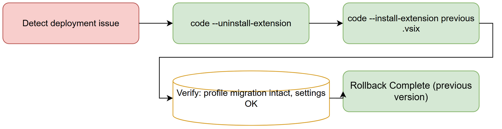

# Deployment Guide (DPG) — SA4E-389

## SDLC-Agents-4-Enterprise — SA4E-389: Multi LLM Configuration (Profiles) + Chat model/provider switcher

---

### Document Information

| Field | Value |
|-------|-------|
| **Jira Ticket** | SA4E-389 |
| **Title** | Multi LLM Configuration (Profiles) + Chat model/provider switcher |
| **Author** | DevOps Agent |
| **Version** | 1.0 |
| **Date** | 2026-10-31 |
| **Status** | Draft — ready for UAT |
| **Extension Version** | 1.55.11 |
| **Branch** | dnguyenminh/SA4E-389 |

---

### 1. Overview

This document describes how to deploy the SA4E-389 extension (Multi LLM Configuration Profiles + Chat model/provider switcher) from source code to a VS Code development host. The extension ships as a VSIX package built from latest main code, version 1.55.11.

SA4E-389 provides the multi-profile data layer:
- `LlmProfile` interface (id slug `[a-z0-9-]+`, label, provider, baseUrl?, model, useDefaultUrl, lastTestStatus?, lastTestedAt?)
- Storage: `sdlcAgents.llm.profiles[]` + `sdlcAgents.llm.activeProfileId` in VS Code settings (Global scope)
- One-time migration: flat config (`sdlcAgents.llm.provider`, `sdlcAgents.llm.model`, `sdlcAgents.llm.<provider>.baseUrl`, SecretStorage `sdlcAgents.<provider>ApiKey`) → Profile #1
- Secret key: `sdlcAgents.<profileId>ApiKey` accessed exclusively via `llmSecretKey(profileId)` / `readLlmApiKey()`
- SSOT: `readProviderTurnConfig()` resolves provider/model/baseUrl from active profile only

---

### 2. Prerequisites

| Requirement | Version | Notes |
|-------------|---------|-------|
| Node.js | 18.x LTS | Extension build toolchain |
| npm | 10.x | Package management |
| vsce | latest | VS Code Extension packaging (`npm install -g vsce`) |
| TypeScript | per package.json | Compilation target |
| VS Code | 1.85+ | Extension Development Host |

### 3. Build Steps

```powershell
# 1. Clone / checkout branch dnguyenminh/SA4E-389 at origin/main v1.55.11
git checkout dnguyenminh/SA4E-389

# 2. Install dependencies
cd extension
npm ci

# 3. Compile TypeScript (must pass with 0 errors)
npm run compile

# 4. Package VSIX
vsce package --out ../SA4E-389-llm-profiles-1.55.11.vsix

# 5. Verify VSIX exists
ls -la ../SA4E-389-llm-profiles-1.55.11.vsix
```

**Build gates:**
- TypeScript compilation: 0 errors
- Flat-key absence check (`check-flat-keys.mjs`): 0 violations
- Secret-bypass check (`check-secret-bypass.mjs`): 0 violations
- Code standards: all files ≤ 200 lines, functions ≤ 20 lines

### 4. Deployment Steps

#### 4.1 Install VSIX

```powershell
# Method A: VS Code Extensions UI
#   Extensions view → "..." → Install from VSIX → select SA4E-389-llm-profiles-1.55.11.vsix

# Method B: CLI
code --install-extension SA4E-389-llm-profiles-1.55.11.vsix
```

#### 4.2 Post-Deployment Verification

| Step | Action | Expected Result |
|------|--------|-----------------|
| 1 | Open VS Code Settings → "LLM Provider" tab | Profile table renders with existing Profile #1 (migrated) |
| 2 | Open Chat panel | Model picker shows grouped-by-provider models from connected profiles |
| 3 | Run Test Connection on a profile | `lastTestStatus` updates to `connected`/`failed` |
| 4 | Add a new profile | Persisted to `sdlcAgents.llm.profiles`; secret key at `sdlcAgents.<profileId>ApiKey` |
| 5 | Set active profile | `activeProfileId` updated; `readProviderTurnConfig()` resolves from active profile |
| 6 | Select model in chat picker | `activeProfileId` + model set in one operation; chat uses selected profile |

#### 4.3 Rollback

```powershell
code --uninstall-extension sdlc-agents-4-enterprise.sdlc-agents
code --install-extension <previous-vsix-file>
```

Or reinstall from the VSIX of the previous stable version.

---

### 5. Configuration Reference

| Setting | Scope | Description |
|---------|-------|-------------|
| `sdlcAgents.llm.profiles` | Global | Array of `LlmProfile` objects |
| `sdlcAgents.llm.activeProfileId` | Global | Slug of active profile |
| `sdlcAgents.<profileId>ApiKey` | SecretStorage | Per-profile encrypted API key |
| `sdlcAgents.llm.<provider>.baseUrl` | Global | Legacy base URL (migrated, not read directly) |

### 6. Security Notes

- API keys are stored in VS Code SecretStorage (encrypted at rest)
- Keys are accessed exclusively via `llmSecretKey(profileId)` / `readLlmApiKey()`
- No direct `secrets.store/get` calls outside the helper layer
- No new secret namespace introduced
- `profileId` is slug `[a-z0-9-]+` to keep secret key valid

---

### 7. Diagrams



*[Edit in draw.io](diagrams/deployment-flow.drawio)*



*[Edit in draw.io](diagrams/rollback-flow.drawio)*

---

### 8. Appendix

#### 8.1 Artifact Index (Phase 7 deliverables)

| Artifact | Path |
|----------|------|
| Deployment Guide | `documents/SA4E-389/DPG.md` |
| Release Notes | `documents/SA4E-389/RLN.md` |
| Deployment flow diagram | `documents/SA4E-389/diagrams/deployment-flow.{drawio,png}` |
| Rollback flow diagram | `documents/SA4E-389/diagrams/rollback-flow.{drawio,png}` |
| VSIX package | `SA4E-389-llm-profiles-1.55.11.vsix` |

#### 8.2 Related Tickets

| Ticket | Relation |
|--------|----------|
| SA4E-390 | UI layer built on top of SA4E-389 data model |
| SA4E-323 | LLM provider settings refactor (prior art) |
| SA4E-370 | Dotted base URL keys for providers |

---

**Last Updated**: 2026-10-31T09:00:00Z  
**Autonomy Level**: L3