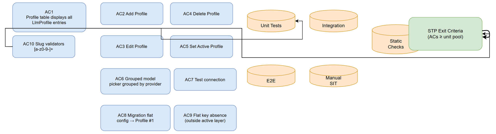
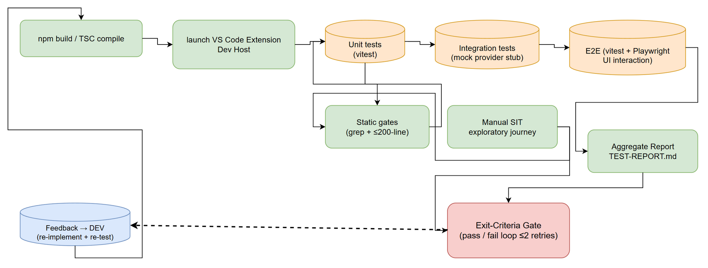

# Software Test Plan (STP)

## SDLC-Agents-4-Enterprise — SA4E-389: Multi LLM Configuration (Profiles) + Chat model/provider switcher

---

## Document Information

| Field | Value |
|-------|-------|
| Jira Ticket | SA4E-389 |
| Title | Multi LLM Configuration (Profiles) + Chat model/provider switcher |
| Author | QA Agent |
| Version | 1.0 |
| Date | 2026-10-30 |
| Status | Draft — pending BA review (Review Gate) |
| Related BRD | BRD.md v1.0 — `documents/SA4E-389/BRD.md` |
| Related FSD | FSD.md v1.0 — `documents/SA4E-389/FSD.md` |
| Related TDD | TDD.md v1.0 — `documents/SA4E-389/TDD.md` |
| Test Cases | STC.md v1.0 — `documents/SA4E-389/STC.md` |

---

## Author Tracking

| Role | Name - Position | Responsibility |
|------|-----------------|----------------|
| Author | QA Agent – QA Engineer | Create document |
| Peer Reviewer | BA Agent – Business Analyst | Review document (Review Gate — business coverage) |

---

## Revision History

| Version | Date | Author | Changes |
|---------|------|--------|---------|
| 1.0 | 2026-10-30 | QA Agent | Initiate document — auto-generated from BRD, FSD, and TDD (Phase 4 Test Planning) |

---

## Sign-Off

| Name | Signature and date |
|------|--------------------|
| | ☐ I agree and confirm the test plan in this STP |
| | ☐ I agree and confirm the test plan in this STP |

---

## 1. Introduction

### 1.1 Purpose

This Software Test Plan (STP) defines the test approach, scope, environments, entry/exit criteria, resources, risks, defect management, and metrics for verifying ticket **SA4E-389 — Multi LLM Configuration (Profiles) + Chat model/provider switcher** in the SDLC Agents VS Code extension.

The feature converts the single-config LLM settings (flat keys `sdlcAgents.llm.provider` / `sdlcAgents.llm.model`) into a multi-profile model:

- **LlmProfile[]** persisted in `sdlcAgents.llm.profiles` (VS Code settings, Global scope), with `sdlcAgents.llm.activeProfileId` pointing to the active profile.
- **Profile management UI** in Settings tab "LLM Provider": table + Add/Edit/Delete/Set-active actions (via Edit Provider modal).
- **Chat model picker**: grouped by provider, showing only models of *connected* profiles; selecting a row switches the entire profile + model in one operation.
- **One-time migration**: legacy flat config → Profile #1 on activation (idempotent, fail-safe, old keys NOT deleted).
- **Secret-key convention**: all API-key reads/writes go strictly through `llmSecretKey(id)` / `readLlmApiKey(secrets, id)` producing keys of the form `sdlcAgents.<profileId>ApiKey`; `profileId` must be a safe slug `[a-z0-9-]+`.
- **SSOT**: provider/model/baseUrl resolution MUST come from `readProviderTurnConfig()` reading the *active profile* — no direct flat-key reads anywhere else.

### 1.2 Test Objectives

1. Verify every Acceptance Criterion **AC1–AC10** from BRD/FSD is implemented and demonstrable (RTM coverage 100%).
2. Verify full CRUD lifecycle on profiles (Add/Edit/Delete/view) with correct persistence in `sdlcAgents.llm.profiles` and correct secret-key storage per profile.
3. Verify active-profile switching updates `activeProfileId` and that `readProviderTurnConfig()` resolves provider/model/baseUrl from the active profile — never from flat keys (AC5, AC9).
4. Verify the chat model picker groups models by provider, shows only connected profiles, renders Free badges, and applies profile + model in one operation (AC6, AC5).
5. Verify connection testing outcomes: connected / failed / timeout → correct `lastTestStatus`, `lastTestedAt`, badge and error detail, with a bounded timeout (5 s) and non-blocking UI (AC7).
6. Verify migration correctness: fresh config, base-URL override, dirty/legacy config, already-migrated (idempotent), concurrent activation — with old keys preserved (fail-safe) and the API key auto-migrated via `readLlmApiKey` (AC8).
7. Verify negative/validation paths: invalid slugs (e.g. `"My Profile!"`), unknown provider, duplicate ids, empty label/model (AC10, AC2/AC3 validation rules).
8. Verify secret-key isolation: no profile can read another profile's key; no namespace other than `sdlcAgents.<profileId>ApiKey`; no direct `secrets.get/store` bypass (Security, AC9).
9. Verify non-functional targets: profile table ≤ 10 profiles renders < 500 ms; model picker opens < 300 ms; test connections bounded at ~5 s.
10. Guard code standards: new files ≤ 200 lines / functions ≤ 20 lines (static checks), consistent with TDD Section 5.1.

### 1.3 References

| Document | Location |
|----------|----------|
| BRD v1.0 (AC1–AC10) | `documents/SA4E-389/BRD.md` |
| FSD v1.0 (Stories 1–9, data model, validation, error handling) | `documents/SA4E-389/FSD.md` |
| TDD v1.0 (API contracts, migration design, E2E test architecture §11) | `documents/SA4E-389/TDD.md` |
| Jira ticket SA4E-389 | Story — Multi LLM Configuration (Profiles) + Chat model/provider switcher |
| `llmSecretKey(id)` / `readLlmApiKey()` | `extension/src/config/llm-secret-keys.ts` |
| `readProviderTurnConfig()` (SSOT) | `extension/src/pi-workflow/pi-provider-config-bridge.ts` |
| Migration script location | `extension/src/config/llm-profile-migration.ts` (new, per TDD §3.3) |
| Test plan (related ticket example) | `documents/SA4E-386/STP.md` (project conventions for 6-level test strategy) |

---

## 2. Test Strategy

### 2.1 Test Levels

| Level | Scope | Automation | Tools |
|-------|-------|------------|-------|
| PBT (Property-Based) | Random-input properties for pure algorithms | Not applicable — feature is configuration CRUD + one-shot migration, no property-friendly algorithm space; 0 cases planned (revisit if slug normalizer grows logic) | fast-check (in reserve) |
| UT — Unit | Slug validation, secret-key helper format/isolation, `readProviderTurnConfig()` resolution proof, migration field mapping, load-failure handling | ✅ Automated | vitest (TypeScript) |
| IT — Integration | Migration lifecycle against real VS Code settings + SecretStorage (Extension Host Test Runner); connection test against mock LLM endpoints (success/failure/timeout) | ✅ Automated | vitest + Extension Host Test Runner, mock HTTP stubs |
| E2E | Real extension UI: profile table, Add/Edit/Delete/Set-active, modal masking, grouped model picker, one-op switching, perf timings | ✅ Automated | Playwright driving the VS Code Extension Development Host + vitest service-level flows (per TDD §11: vitest for E2E-API/service, Playwright for E2E-UI) |
| SIT (Manual) | End-to-end exploratory user journey with visual/UX judgment | ❌ Manual | VS Code dev host (human or agent-browser), screenshots to `evidence/` |
| Static checks | AC9 flat-key/secret-bypass grep gates; file ≤ 200 lines / function ≤ 20 lines standards | ✅ Automated (scripted grep + line-count scripts; result reviewed by QA) | grep / PowerShell + lint script |

### 2.2 Test Types

| Type | Description | Applicable |
|------|-------------|-----------|
| Functional Testing | Verify features work per FSD Stories 1–9 and AC1–AC10 | Yes |
| Regression Testing | Existing provider configuration (SA4E-323 handler, SA4E-370 base-URL keys) and chat/workflow engine keep working; flat keys stay valid for old extension versions (backward compatibility) | Yes |
| Performance Testing | Table render < 500 ms (≤ 10 profiles), picker open < 300 ms, connection test ≤ 5 s — measured with timing assertions | Yes |
| Security Testing | Secret-key isolation, helper-only access, masked API-key input, secret-bypass grep gate | Yes |
| Usability Testing | Add/Edit/Delete/Set-active obviousness, confirmation dialogs, error messages — manual journey | Yes |
| Compatibility Testing | VS Code dev host on Windows 11 (primary); global-scope settings persistence | Partial (dev host only; no OS/browser matrix — this is an extension, not a web page) |

### 2.3 Test Approach

- **Risk-based, automated-first.** Migration data-loss and secret-key exposure are the two highest-risk areas (BRD §5.1); they get the deepest coverage across levels (unit + integration + grep gates + manual journey).
- **No real cloud credentials.** All connection tests run against **local mock LLM endpoints** (LM Studio / Ollama style local HTTP stub) or unreachable ports (timeout). Cloud providers are exercised with masked dummy keys (e.g. `sk-test-anthropic-001`) — never valid production keys.
- **Fixture-driven migration tests.** Legacy flat configs are loaded from `test-data/migration-legacy-config.csv` rows (fresh / override / dirty-legacy / already-migrated / concurrent) to keep integration tests deterministic.
- **Deterministic UI automation.** E2E uses the Extension Development Host with pre-seeded profiles via `test-data/profiles-valid.csv`; selectors follow TDD §11.5 (`.model-picker .provider-group`, `.model-item`, `.free-badge`, profile-table rows).
- **Static gates as merge blockers.** The AC9 grep gate (flat-key absence, secret bypass) and the 200-line file standard are scripted checks; any violation blocks merge (FSD §3.8 error handling).

### 2.4 E2E Automation Coverage

| SIT Scenario Type | Classify As | Rationale |
|-------------------|------------|-----------|
| Profile CRUD operations via Settings UI (AC1–AC4) | E2E (Playwright) | Deterministic click/fill flows |
| Active-profile highlight + `activeProfileId` change (AC5) | E2E (Playwright) | Click + verify state |
| Model-picker grouping, Free badge, connected-only filter (AC6) | E2E (Playwright) | DOM assertions on picker markup |
| Connection test outcomes incl. timeout (AC7) | IT (vitest + HTTP stub) | Deterministic with mock endpoints; timing asserted in-process |
| Migration variants (fresh/dirty/idempotent/concurrent) (AC8) | IT (vitest + Extension Host runner) | Deterministic with settings fixtures |
| Flat-key absence & secret bypass (AC9) | Static check (scripted grep) | Not a runtime scenario — a codebase invariant |
| Slug validation incl. `"My Profile!"` (AC10) | UT (vitest) | Pure input validation |
| Overall UX journey, visual/layout polish | Manual SIT (1 case) | Needs human judgment + screenshots |

### 2.5 Test Cases Summary

| Level | Count | Automated | Manual |
|-------|-------|-----------|--------|
| PBT | 0 | 0 | 0 |
| UT | 8 | 8 | 0 |
| IT | 7 | 7 | 0 |
| E2E | 16 | 16 | 0 |
| SIT (Manual) | 1 | 0 | 1 |
| Static checks | 3 | 3 (scripted) | 0 |
| **Total** | **35** | **34 (97.1%)** | **1 (2.9%)** |

Priority distribution: **P1 = 19, P2 = 12, P3 = 4**. Full case list with steps in `STC.md`.

### 2.6 Entry Criteria

| Level | Entry Criteria |
|-------|---------------|
| UT | Phase 5 implementation merged to SA4E-389 branch; new modules compile (`npm run build` passes); test data CSVs prepared in `test-data/` |
| IT | UT passed ≥ 95%; extension host test runner available; mock LLM endpoint stub runnable (or port-blocked for timeout path) |
| E2E | IT passed with no Critical defects; extension builds and installs in the Extension Development Host; seeded fixtures from `profiles-valid.csv` scriptable |
| SIT (Manual) | E2E passed; release notes / UG evidence screens available; evidence folder created |
| Static | All new/changed source files present on the branch; grep + line-count scripts ready |

### 2.7 Exit Criteria

| Level | Exit Criteria |
|-------|--------------|
| UT | 100% planned UT executed, pass rate 100% within the planned set; slug matrix (valid/invalid) fully asserted |
| IT | 100% planned IT executed; migration suite 100% pass (fresh, override, dirty, idempotent, concurrent); 0 Critical/Major open |
| E2E | 100% planned E2E executed; CRUD/active/picker flows pass; perf timings within targets (or formally waived by SM) |
| SIT | Explorer journey executed with evidence screenshots; no Critical/Major UX defects open |
| Static | AC9 grep gate: 0 unpermitted flat-key reads of `sdlcAgents.llm.provider`/`llm.model` outside `pi-provider-config-bridge.ts` + migration reader; secret bypass grep: 0 direct `secrets.get/store` for LLM keys outside `llm-secret-keys.ts`; 0 new files > 200 lines |
| Overall (STP exit) | RTM 10/10 ACs covered; 35/35 cases executed; pass rate ≥ 95%; 0 Critical, ≤ 2 Major open (with fix plan); TEST-REPORT.md produced |

---

## 3. Test Scope

### 3.1 Features In Scope

| # | Feature / Story | Priority | FSD Reference | Test Types |
|---|----------------|----------|---------------|-----------|
| 1 | Profile table displays all `LlmProfile` entries with label, provider, model, status badge, actions (AC1) | MUST | FSD §3.1 | UT, E2E, Manual |
| 2 | "+ Add Configuration" creates profile; persists to `sdlcAgents.llm.profiles`; API key via `llmSecretKey()` (AC2) | MUST | FSD §3.2 | UT, E2E |
| 3 | Edit profile — modal pre-filled (API key masked); change provider/model/baseURL/key (AC3) | MUST | FSD §3.3 | E2E |
| 4 | Delete profile with confirmation; active-profile reset fallback (AC4) | SHOULD | FSD §3.4 | E2E |
| 5 | Set active profile; `readProviderTurnConfig()` resolves from active profile (AC5) | MUST | FSD §3.5 | UT, E2E |
| 6 | Chat model picker grouped by provider, connected-only, Free badge, one-op switch (AC6) | MUST | FSD §3.6 | E2E |
| 7 | Test profile connection → connected/failed/untested + `lastTestedAt` + badge (AC7) | SHOULD | FSD §3.7 | IT, E2E |
| 8 | One-time migration flat config → Profile #1 (idempotent, fail-safe, key auto-migrated) (AC8) | MUST | FSD §2.4, §3.x | UT, IT |
| 9 | No flat-key reads outside profile-resolution layer (AC9) | MUST | FSD §3.8 | UT, Static |
| 10 | ProfileId slug validation `[a-z0-9-]+` incl. negatives (AC10) | MUST | FSD §2.5, §3.9 | UT |
| 11 | Code standards: file ≤ 200 lines, function ≤ 20 lines for new modules | MUST | TDD §5.1 | Static |

### 3.2 Test Coverage Matrix (AC → Test Types)

| AC | Requirement (short) | UT | IT | E2E | Manual | Static | Covering Test Cases |
|----|---------------------|----|----|-----|--------|--------|---------------------|
| AC1 | Profile table list (rows with label/provider/model/status/actions) | ✔ (load-fail) | — | ✔ | ✔ | — | TC-389-001, TC-389-205, TC-389-500, TC-389-510, TC-389-601 |
| AC2 | Add profile + secret key via helper | ✔ (default URL) | — | ✔ | — | — | TC-389-002, TC-389-102, TC-389-203, TC-389-301, TC-389-510 |
| AC3 | Edit profile, pre-filled modal, masked key | — | — | ✔ | — | — | TC-389-003, TC-389-203, TC-389-501, TC-389-510 |
| AC4 | Delete with confirm + active reset | — | — | ✔ | — | — | TC-389-004, TC-389-101, TC-389-202, TC-389-510 |
| AC5 | Set active + SSOT resolution | ✔ | — | ✔ | — | — | TC-389-005, TC-389-100, TC-389-101, TC-389-300, TC-389-510 |
| AC6 | Grouped model picker (connected-only, Free badge) | — | — | ✔ | — | — | TC-389-006, TC-389-100, TC-389-103, TC-389-204, TC-389-510, TC-389-602 |
| AC7 | Test connection (connected/failed/timeout, badge, timestamp) | — | ✔ | ✔ (badge) | — | — | TC-389-007, TC-389-200, TC-389-201, TC-389-500 |
| AC8 | Migration → Profile #1 (idempotent, fail-safe, key migration) | ✔ (field mapping) | ✔ (lifecycle) | — | ✔ (journey) | — | TC-389-008, TC-389-104, TC-389-105, TC-389-106, TC-389-107, TC-389-302, TC-389-510 |
| AC9 | No direct flat-key/secret reads outside resolution layer | ✔ (resolution proof) | — | — | — | ✔ | TC-389-300, TC-389-403, TC-389-404 |
| AC10 | Slug `[a-z0-9-]+` validation incl. `"My Profile!"` | ✔ | — | — | — | — | TC-389-400, TC-389-401, TC-389-301 |

**Coverage: 10/10 ACs covered (100%) — every AC has ≥ 2 mapped cases.**

### 3.3 Features Out of Scope

| # | Feature | Reason |
|---|---------|--------|
| 1 | Dynamic model discovery from provider API endpoints | Explicitly out of scope in FSD §1.3 (model data comes from saved config in this phase) |
| 2 | Live calls to real cloud providers with production API keys | Security + cost policy — all provider calls stubbed/mocked with dummy keys |
| 3 | SA4E-390 LLM Configuration UI Redesign scope items (beyond what AC1–AC7 surfaces require) | Separate ticket; cross-referenced only where ACs overlap (BRD §7) |
| 4 | Performance/scale testing beyond 10-profile target (e.g. 50+ profiles, virtual scroll) | NFR target defined for ≤ 10 profiles (FSD §4); > 20-profile virtual scroll is TDD guidance for DEV, verified visually in manual journey only |
| 5 | CI/CD matrix beyond Windows dev host | Environments limited to the developer workstation dev host per TDD §10.2; no server deployment exists |
| 6 | Backward-compatibility testing of *older* released extension versions reading flat keys | Requires side-by-side version matrix; backward compatibility is enforced by design (old keys not deleted — covered indirectly by TC-389-008 old-key retention) |

---

## 4. Test Environment

### 4.1 Environment Requirements

| Environment | Host | Storage | Purpose |
|-------------|------|---------|---------|
| UT/IT run environment | Local Node.js (LTS) + vitest; integration runs inside **VS Code Extension Host Test Runner** | Real `settings.json` (Global scope) + real SecretStorage in an **isolated user-data dir** (`--user-data-dir=e2e/.vscode-test-profile`) | UT logic; IT migration lifecycle against real settings/SecretStorage |
| E2E environment | VS Code Extension Development Host (F5 on SA4E-389 branch) driven by Playwright | Same isolated profile; fixtures seeded from `test-data/profiles-valid.csv` | Real-UI profile management + model picker |
| Mock provider endpoint | Local HTTP stub emulating LM Studio / Ollama style endpoints (`/v1/models`); second port intentionally dead for timeout | — | Connection tests: success / failure / timeout |
| SIT (manual) | Same dev host, human/Area-browser driven | Fresh profile state per scenario | Exploratory journey + screenshots |
| Clean-slate option | Scratch VS Code profile (no `sdlcAgents.llm.*` keys, no secrets) | — | Migration fresh-run scenarios (TC-389-008) |

**Identifying the right instance:** before manual runs, confirm the dev host carries the SA4E-389 feature — verify Settings → LLM Provider shows the profile table, and that `context.globalState` / settings contain `sdlcAgents.llm.profiles` after migration. Do not reuse a stale extension build for evidence.

### 4.2 Tooling

| Tool | Purpose | Version/Notes |
|------|---------|---------------|
| TypeScript + npm | Build (`npm run build`) per TDD/DOD | Per repo toolchain |
| vitest | UT + IT + E2E service-level suites | TypeScript config |
| Playwright | E2E-UI automation of the dev host (webview/panel UI) | Per TDD §11 |
| VS Code (Extension Development Host) | Target application under test | Latest stable |
| Draw.io CLI | Test-plan diagram export (`test-coverage`, `test-execution-flow`) | `--width 2000` renders |
| Jira MCP tools | Defect logging & attachment (via SM) | `jira_create_issue`, `jira_attach_file` |

### 4.3 Test Data Requirements

| Data File | Contents | Used By |
|-----------|----------|---------|
| `test-data/profiles-valid.csv` | 4 valid LlmProfile fixtures (`lmstudio-qwen`, `openrouter-anthropic`, `ollama-local`, `openai-gpt`) incl. test-status variants and SSOT resolution expectations | TC-389-001/002/003/005/006/100/103/202/203/500/501/510/601/602; UT resolution seed |
| `test-data/profiles-invalid-slug.csv` | Invalid slugs: `"My Profile!"`, `my.profile`, `WITH-UPPER`, leading/trailing space, empty, unicode, duplicate id; unknown provider row | TC-389-400, TC-389-401, TC-389-203 |
| `test-data/migration-legacy-config.csv` | Legacy flat configs M01–M05: fresh (lmstudio + base URL), override (openai + custom URL), dirty legacy (kiroSdlc.* secret, model missing), already-migrated flag, concurrent double-run | TC-389-008, TC-389-104, TC-389-105, TC-389-106, TC-389-107, TC-389-302 |
| `test-data/connection-test-cases.csv` | C01 success (200 within 5 s), C02 failure (401/500), C03 timeout (dead port, 5 s) with expected badge/timestamp | TC-389-007, TC-389-200, TC-389-201, TC-389-500 |
| `test-data/model-picker-cases.csv` | Picker fixtures: grouped providers, connected-only visibility, Free badge, no-models state | TC-389-006, TC-389-100, TC-389-103, TC-389-204, TC-389-602 |
| `test-data/static-checks.csv` | Grep patterns, allowed-file whitelist, line-count threshold 200 for AC9 + code-standard gates | TC-389-403, TC-389-404, TC-389-603 |

### 4.4 External Dependencies

| Dependency | Need | Mock/Stub Available |
|-----------|------|---------------------|
| LM Studio / Ollama local endpoint | Connection test target | Yes — local HTTP stub; deterministic responses |
| Anthropic/OpenAI/OpenRouter cloud APIs | N/A in tests | Not needed — dummy keys only; never called (network to real APIs blocked by stub config) |
| VS Code SecretStorage | Real (encrypted-at-rest) in isolated user-data dir | No mock — real SecretStorage required for IT
| globalState migration flag | Real in Extension Host runner | No mock — required for idempotency tests |

---

## 5. Test Schedule

| Phase | Start (relative) | End (relative) | Duration | Milestone |
|-------|------------------|----------------|----------|-----------|
| Test Planning (STP + STC + diagrams + data) | T0 | T0+0.5d | 0.5 d | STP/STC v1.0 ready for BA Review Gate |
| BA Review Gate (business coverage) | T0+0.5d | T0+1d | 0.5 d | Verdict APPROVED (or ≤2 fix iterations) |
| Test Data Preparation (CSV fixtures + stub) | T0+1d | T0+1.5d | 0.5 d | Fixtures loadable in UT/IT/E2E harnesses |
| UT + Static execution (after Phase 5 code) | T0+1.5d | T0+2d | 0.5 d | UT/static green |
| IT execution (migration + connection) | T0+2d | T0+3d | 1 d | Migration suite 100% passed |
| E2E execution (Playwright) | T0+3d | T0+4d | 1 d | E2E suite green incl. perf timings |
| Manual SIT explorer journey + evidence | T0+4d | T0+4.5d | 0.5 d | Evidence in `evidence/` |
| Defect fix & retest window | T0+4.5d | T0+5.5d | 1 d | Critical/Major closed |
| TEST-REPORT.md + Jira attachment | T0+5.5d | T0+6d | 0.5 d | Phase 6 exit sign-off |

*Dates are relative to Phase 5 implementation completion; the SM anchors absolute dates at dispatch time.*

---

## 6. Resources & Responsibilities

| Role | Name | Responsibility |
|------|------|----------------|
| Test Lead | QA Agent | STP/STC authorship, coverage matrix, gates, reporting, TEST-REPORT |
| QA Engineer / Automation | QA Agent | UT/IT/E2E spec authorship, test-data fixtures, static gate scripts, execution (Phase 6) |
| BA | BA Agent | Review Gate for business coverage of AC1–AC10; clarifies requirement gaps |
| Developer | DEV Agent | Implements feature; fixes defects raised from testing; unit/integration test code (per AGENTS matrix, DEV owns source+unit tests) |
| Scrum Master | SM Agent | Gate orchestration, Jira status/defect triage, attachments, RUN-LOG |
| DevOps | DevOps Agent | Build/deploy into dev host when needed; environment tooling |

| Tool | Use |
|------|-----|
| Jira MCP (`jira_search`, `jira_transition_report` via SM) | Defect tracking, evidence attachment |
| vitest / Playwright / VS Code test runners | Automation suites |
| grep + line-count scripts | Static gates |
| Draw.io CLI / code-intel dynamic tools | Test-plan diagrams |
| This repo `documents/SA4E-389/` | All test artifacts, evidence, CSVs |

---

## 7. Risk & Mitigation

| # | Risk | Impact | Likelihood | Mitigation |
|---|------|--------|------------|------------|
| 1 | Migration corrupts/loses user config (profiles, API key) | High | Low | Fail-safe design verified: old keys never deleted (TC-389-008 asserts retention); settings backup step in manual journey; idempotency + concurrency tests |
| 2 | API-key exposure via wrong namespace or direct `secrets.*` access | High | Medium | TC-389-301 (helper format + isolation), TC-389-501 (masked UI), TC-389-404 grep gate as merge blocker |
| 3 | Flat-key reads slip through outside resolution layer (AC9 violation by future code) | High | High | TC-389-403 scripted grep gate in exit criteria + unit resolution proof (TC-389-300 with stale flat values) |
| 4 | Mock endpoint drift vs real provider behavior (connection test unrealistically green) | Medium | Medium | Connection matrix covers success/failure/timeout explicitly; manual journey re-runs one live local LM Studio check if available |
| 5 | Playwright + VS Code dev host flakiness (timing, panel focus) | Medium | Medium | Deterministic seeds; retry policy (2); fall back to service-level vitest e2e for state assertions; visual-only checks deferred to manual SIT |
| 6 | Extension Host runner state pollution between migration tests | Medium | Medium | Fresh isolated user-data-dir per suite; globalState flag reset helper in fixtures |
| 7 | Perf thresholds flaky on shared machine (500 ms / 300 ms) | Low | Medium | Repeat 3×, take median; document hardware in TEST-REPORT; waivable by SM only |
| 8 | Requirement churn from cross-ticket SA4E-390 UI redesign | Medium | Low | Change freeze during execution window; BA Review Gate confirms AC wording before Phase 6 |

---

## 8. Defect Management

### 8.1 Severity Levels

| Severity | Definition | Example (this feature) |
|----------|-----------|------------------------|
| Critical | Data loss, security breach, crash | Migration deletes old API key; secret stored to wrong namespace readable by other profiles; extension activation crash |
| Major | Feature broken, no workaround | Profile not persisted after Add; picker shows untested profiles; SSOT reads flat keys (AC9 violation) |
| Minor | Feature degraded, workaround exists | Badge color wrong; timestamp not displayed; label truncation |
| Trivial | Cosmetic | Alignment, tooltip typo |

### 8.2 Priority Levels & SLA

| Priority | Definition | SLA (fix time) |
|----------|-----------|----------------|
| P1 | Must fix immediately — blocks exit criteria | 4 business hours |
| P2 | Must fix before release | 1 business day |
| P3 | Should fix if time permits | 3 business days |
| P4 | Nice to fix — can defer | Next release/window |

### 8.3 Defect Lifecycle

```
New → Open (Jira, severity/priority, repro steps + evidence path)
    → In Progress (DEV)
    → Fixed (build updated)
    → Ready for Retest (QA re-executes failing case + regression subset)
    → Verified → Closed
    → Reopened (if retest fails; max 2 reopen loops before SA escalation)
```

Evidence for every defect: screenshot (UI) or test log/stderr (logic) stored under `documents/SA4E-389/evidence/`, referenced from TEST-REPORT.md.

---

## 9. Suspension & Resumption Criteria

### 9.1 Suspension Criteria (stop testing, hold the gate)

1. Build is broken / extension does not activate in dev host (2 consecutive failed build attempts).
2. Any **Critical** defect open that blocks the test path (e.g. migration loses keys, extension crash on activation).
3. Test environment unavailable for > 2 h (dev host crash loop, missing test runner), or mock endpoint cannot be started.
4. Requirement conflict discovered between BRD/FSD and implementation with no BA decision (BA Review item).
5. More than 30% of planned UT for a level fails on first run (indicates infra-level regression — hold and re-baseline with DEV).

### 9.2 Resumption Criteria (restart the gate)

1. Blocking Critical defects fixed and verified by smoke re-run of the affected level's happy paths.
2. Build stable — `npm run build` + dev host activation verified; feature presence check passes (profile table visible).
3. Environment restored (runner, stub, fixtures) and evidence dir writable.
4. BA has resolved suspension-triggering requirement conflict (documented in ticket).
5. SM updated RUN-LOG and re-authorized the execution window.

Suspended/resumed windows are recorded in RUN-LOG.md with timestamps by QA→SM.

---

## 10. Test Metrics & Reporting

### 10.1 Metrics

| Metric | Formula | Target |
|--------|---------|--------|
| Test Execution Rate | Executed / Planned (35) × 100% | 100% before Phase 6 exit |
| Pass Rate | Passed / Executed × 100% | ≥ 95% (100% for P1 cases) |
| AC Coverage | ACs with ≥1 mapped executed case / 10 × 100% | 100% |
| Defect Density | Defects / 35 executed cases | ≤ 0.34 |
| Critical Defect Count | Severity = Critical open | 0 at exit |
| Migration Suite Reliability | Migration cases passed on first run / 5 × 100% | 100% |
| Static Gate Violations | Unpermitted flat-key reads + secret bypasses + >200-line files | 0 |

### 10.2 Reporting Schedule

| Report | Frequency | Audience | Location |
|--------|-----------|----------|----------|
| Execution status (cases run/passed/failed) | After each level completes | SM, DEV | RUN-LOG.md rows |
| Defect summary | Daily during execution window | SM, DEV | Jira + TEST-REPORT.md §defects |
| Final Test Report | Phase 6 exit | All stakeholders | `TEST-REPORT.md` (+ DOCX export via SM) |
| Evidence bundle | With final report | Reviewers | `documents/SA4E-389/evidence/` |

---

## 11. Diagrams

### 11.1 Test Coverage Map (ACs → Test Levels → Exit Criteria)

Coverage map: 10 acceptance criteria flow into the automated test-level pools (Unit, Integration, E2E, Manual, Static) and terminate at the STP exit-criteria gate.



*[Edit in draw.io](diagrams/test-coverage.drawio)*

### 11.2 Test Execution Flow (Build → Deploy → Levels → Report → Gate)

Execution pipeline: build → deploy to the VS Code Extension Development Host → run unit → integration → E2E (vitest + Playwright per TDD §11) → static checks → manual SIT → aggregate report → exit-criteria gate decision, with the defect feedback loop to DEV and re-test.



*[Edit in draw.io](diagrams/test-execution-flow.drawio)*

---

## 12. Appendix

### 12.1 Glossary

| Term | Definition |
|------|------------|
| LlmProfile | Config record: `id (slug)`, `label`, `provider`, `baseUrl?`, `model`, `useDefaultUrl`, `lastTestStatus?`, `lastTestedAt?` |
| profileId | Slug identifier `[a-z0-9-]+`; forms the secret key `sdlcAgents.<profileId>ApiKey` |
| activeProfileId | Setting (`sdlcAgents.llm.activeProfileId`) referencing the active profile |
| SSOT | Single Source of Truth — `readProviderTurnConfig()` resolves provider/model/baseUrl from the active profile |
| SecretStorage | VS Code SecretStorage — encrypted-at-rest API key store |
| Static check | Scripted codebase invariant (grep pattern / line-count), not a runtime behavior test |
| Connected/Failed/Untested | `lastTestStatus` enumeration driving picker eligibility and table badges |
| SIT | Manual System Integration Testing — exploratory journey in the dev host |
| RTM | Requirements Traceability Matrix (in STC.md §10) |

### 12.2 Assumptions

1. VS Code settings API persists Global scope reliably in the Extension Host Test Runner and dev host.
2. Provider IDs remain `anthropic | openai | lmstudio | openrouter | ollama` (slug-safe); migration therefore yields a valid Profile #1 id.
3. Mock endpoint istimeout/blocked-port paths are stable on the test machine (firewall permits localhost binds).
4. Phase 5 implementation follows TDD file layout; QA does not write production code, only test specs/code in `test-data/` + documentation (per role matrix).
5. Performance targets are measured on the workstation noted in TEST-REPORT; extreme background load may waive thresholds with SM approval.

### 12.3 Artifact Index (Phase 4 deliverables)

| Artifact | Path |
|----------|------|
| Test Plan | `documents/SA4E-389/STP.md` |
| Test Cases + RTM | `documents/SA4E-389/STC.md` |
| Coverage map | `documents/SA4E-389/diagrams/test-coverage.{drawio,png}` |
| Execution flow | `documents/SA4E-389/diagrams/test-execution-flow.{drawio,png}` |
| Test data | `documents/SA4E-389/test-data/*.csv` (6 files) |
| Evidence (Phase 6) | `documents/SA4E-389/evidence/` |
