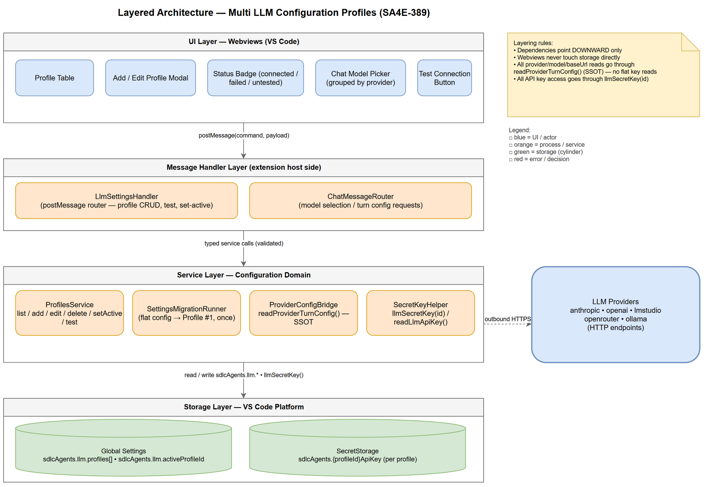
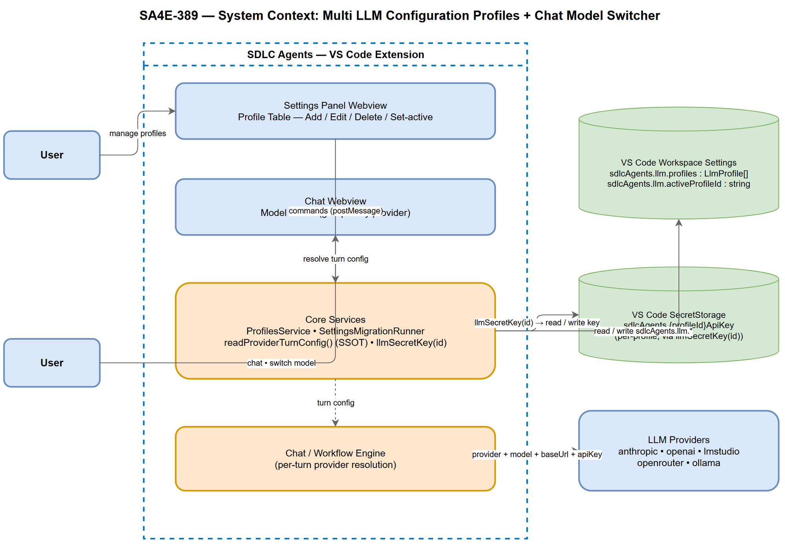
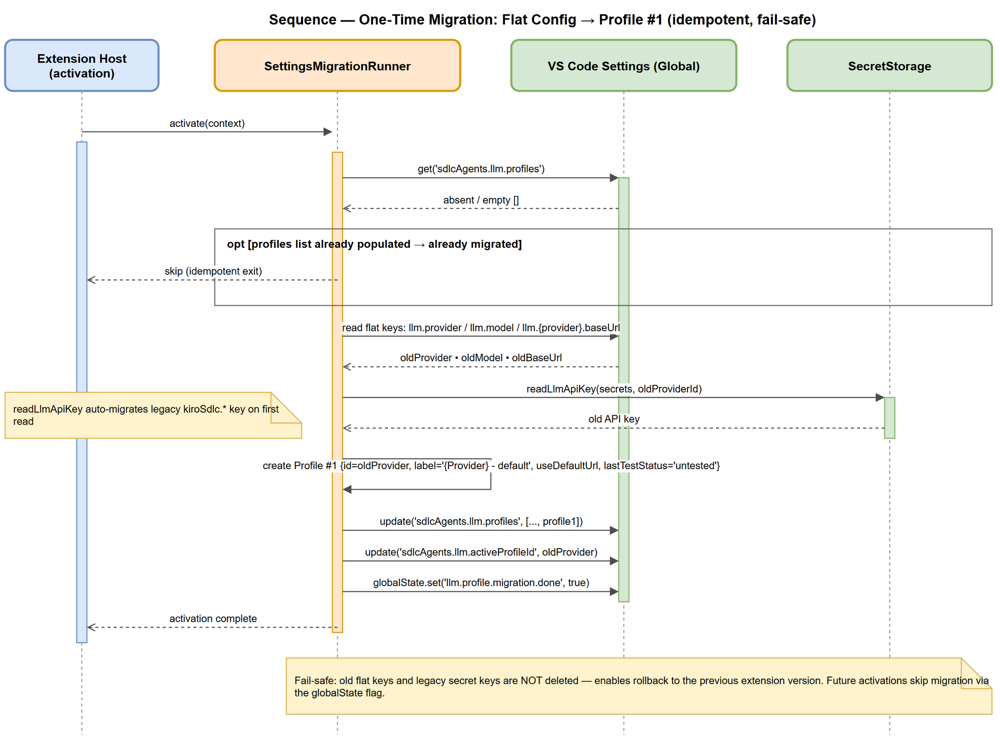
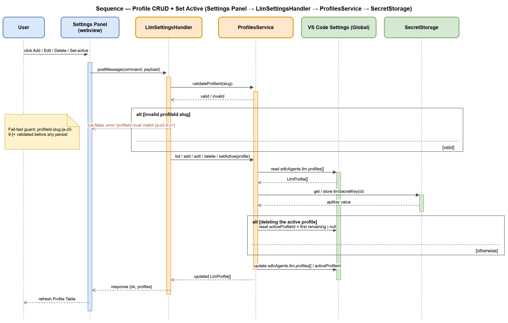
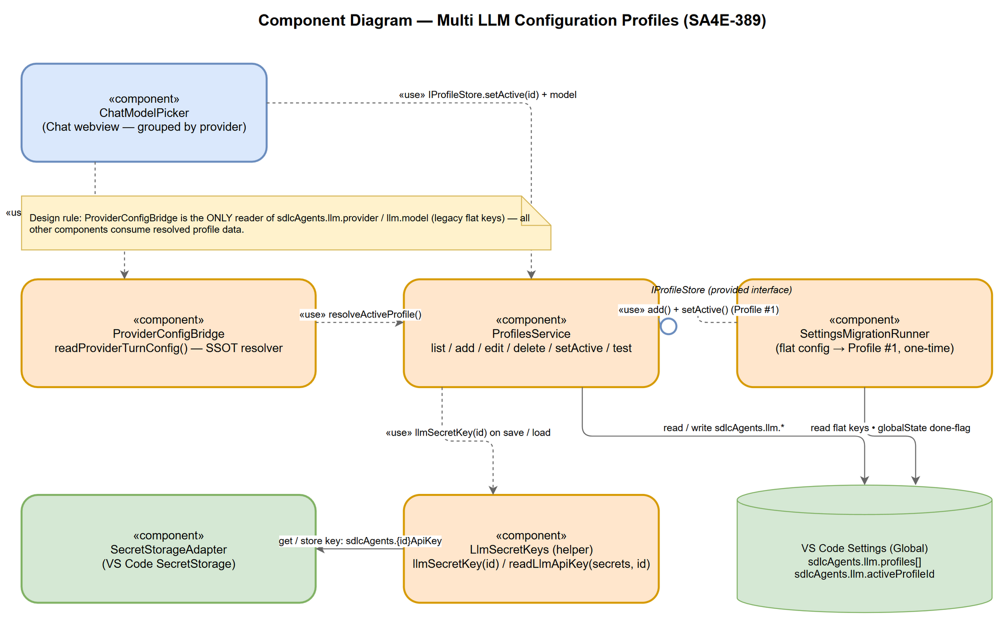
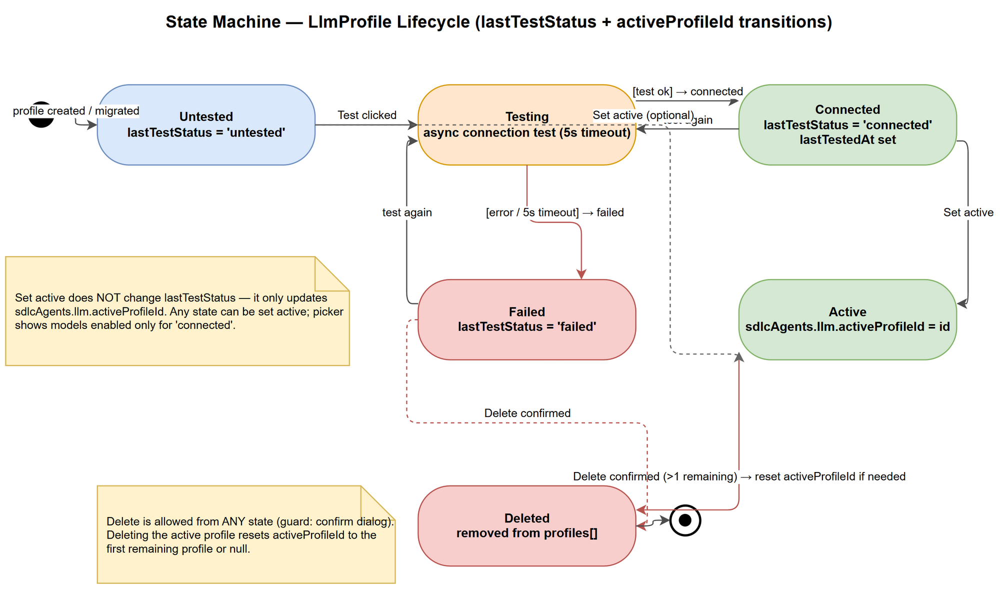
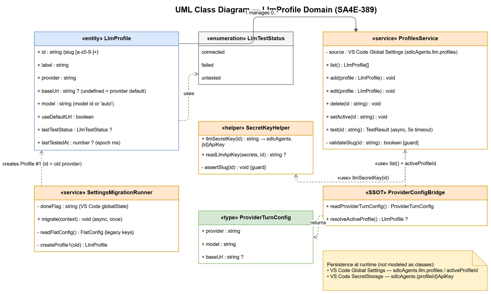

# Technical Design Document (TDD) — SA4E-389

## Document Information

| Field | Value |
|-------|-------|
| **Jira Ticket** | SA4E-389 |
| **Title** | Multi LLM Configuration (Profiles) + Chat model/provider switcher |
| **Author** | SA Agent |
| **Version** | 1.0 |
| **Date** | 2026-10-30 |
| **Status** | Completed |

---

## 1. Introduction

### 1.1 Problem Summary

The current LLM configuration architecture uses single-config with flat keys in VS Code settings (`sdlcAgents.llm.provider`, `sdlcAgents.llm.model`). This limits the system to a single LLM provider/model at a time. The redesign moves to a multi-profile model that stores multiple `LlmProfile` entries, enabling:

- **Multi-profile**: Settings store a list of LLM configuration profiles. Each profile contains provider, base URL, model, API key (via secret storage), label, and test status.
- **Chat switcher**: The chat window model selector upgrades from a simple dropdown to a grouped picker — grouped by provider, only showing models of connected profiles. Selecting a model switches both the entire profile (provider + base URL + API key) and the model in one operation.
- **No breaking changes**: Automatic migration packages the current flat config into Profile #1. API key migration uses the existing `llmSecretKey(id)` helper; the user does not re-enter the API key.

### 1.2 Goals

- Store multiple `LlmProfile` entries in VS Code settings under `sdlcAgents.llm.profiles`.
- Enable `sdlcAgents.llm.activeProfileId` to track the currently active profile.
- Provide UI for profile management: Add, Edit, Delete, Set Active.
- Enable grouped model picker in chat window.
- Automatic one-time migration from flat config to Profile #1.
- All API key reads/writes go through `llmSecretKey()` helper only.
- ProfileId slug validation: `[a-z0-9-]+`.

### 1.3 Scope

**In-Scope:**
- `LlmProfile` interface definition and storage schema.
- Profile management UI: table, add/edit/delete/modal.
- Active profile selection and `activeProfileId` management.
- Migration script: auto-migrate old flat config → Profile #1.
- `readProviderTurnConfig()` SSOT update to resolve from active profile.
- `llmSecretKey(id)` helper enforcement for all secret key operations.
- ProfileId slug validation: `[a-z0-9-]+`.

**Out-of-Scope:**
- Code implementation (Phase 5: DEV agent).
- Test cases (Phase 4: QA agent).
- UI design mockups (beyond grouped picker basic functionality).
- Dynamic model discovery from API endpoints.

### 1.4 References

- BRD.md: `documents/SA4E-389/BRD.md` — Business Requirements Document
- FSD.md: `documents/SA4E-389/FSD.md` — Functional Specification Document
- `llmSecretKey(id)`: `extension/src/config/llm-secret-keys.ts`
- `readProviderTurnConfig()`: `extension/src/pi-workflow/pi-provider-config-bridge.ts`
- VS Code Settings API: `sdlcAgents.llm.*` namespace

---

## 2. Technical Design

### 2.1 LlmProfile Interface

The core data model for multi-profile support:

```typescript
interface LlmProfile {
  id: string;              // slug [a-z0-9-]+ (e.g. "lmstudio-qwen"); used as part of secret key
  label: string;           // "LMStudio - Qwen"
  provider: string;        // lmstudio | openrouter | anthropic | ollama | ...
  baseUrl?: string;        // undefined = use provider default
  model: string;           // model id, or "auto"
  useDefaultUrl: boolean;
  lastTestStatus?: "connected" | "failed" | "untested";
  lastTestedAt?: number;
}
```

**Constraints:**
- `id` must match slug pattern `[a-z0-9-]+` — no dots, no spaces, no exotic uuid characters
- `provider` must be from the recognized list: `anthropic`, `openai`, `lmstudio`, `openrouter`, `ollama`
- `model` must not be empty when creating/editing a profile
- `useDefaultUrl` controls whether `baseUrl` is used or provider default is applied

### 2.2 Storage Schema

Two VS Code settings items persist the multi-profile configuration:

| Setting | Type | Description | Persistence |
|---------|------|-------------|-------------|
| `sdlcAgents.llm.profiles` | `LlmProfile[]` | VS Code settings, Global | Persists list of all LlmProfile entries |
| `sdlcAgents.llm.activeProfileId` | `string` | VS Code settings, Global | Currently active profile identifier |

**Storage Location:** Global scope (correct prefix `llm.*`)

### 2.3 Secret Key Convention

All API key operations must go through the `llmSecretKey()` helper. The secret key format is:

- **Format**: `sdlcAgents.<x>ApiKey`
- **For a profile**: secret key = `sdlcAgents.<profileId>ApiKey` (using profileId directly as `<x>`)
- **Must go through helper**: `llmSecretKey(id)` / `readLlmApiKey(secrets, id)` — **DO NOT** call `secrets.store/get` with arbitrary string.
- **NOT allowed**: `llmProfile.<id>.apiKey` or any other namespace — violates single source of truth.
- **Therefore**: `profileId` MUST be safe slug `[a-z0-9-]+` (no dots/exotic uuid chars) to form valid key.

**Helper Functions** (from `extension/src/config/llm-secret-keys.ts`):

```typescript
export function llmSecretKey(providerId: string): string {
  return `${NEW_PREFIX}.${apiKeySuffix(providerId)}`;
  // Returns: "sdlcAgents.<id>ApiKey" or "sdlcAgents.anthropicApiKey" for anthropic
}

export async function readLlmApiKey(
  secrets: SecretStorage, providerId: string,
): Promise<string | undefined> {
  // Reads from sdcAgents.<providerId>ApiKey, migrates legacy kiroSdlc.* on read; never throws
}
```

### 2.4 Migration Script (One-Time)

**Trigger**: On extension activation when `sdlcAgents.llm.profiles` is empty/absent.

**Steps**:
1. Read old flat config:
   - `sdlcAgents.llm.provider` → old provider ID
   - `sdlcAgents.llm.model` → old model
   - `sdlcAgents.llm.<provider>.baseUrl` → old base URL (from `PROVIDER_BASE_URL_KEYS`)
   - `sdlcAgents.<providerId>ApiKey` → old API key (VS Code SecretStorage)
2. Create Profile #1:
   - `profileId` = old providerId (e.g. "lmstudio")
   - `label` = `"${provider.charAt(0).toUpperCase() + provider.slice(1)} - default"` (e.g. "LMStudio - default")
   - `provider` = old provider ID
   - `baseUrl` = old base URL (or `undefined` if using default)
   - `model` = old model
   - `useDefaultUrl` = `true` if no base URL override, `false` otherwise
   - `lastTestStatus` = `"untested"`
   - `lastTestedAt` = `undefined`
3. Set `activeProfileId` = profileId of Profile #1 (`"lmstudio"`).
4. Guard with globalState flag similar to existing `settings-migration-runner`; **DO NOT** delete old keys (fail-safe).
5. Old API key remains accessible via `sdlcAgents.<providerId>ApiKey` format; `readLlmApiKey` auto-migrates on first access.

**Migration DDL Concept** (illustrative):

```sql
-- Pseudocode: migration runs once on extension activate
IF NOT EXISTS (SELECT 1 FROM sdcAgents.llm.profiles) THEN
  DECLARE @oldProvider VARCHAR = (SELECT VALUE FROM sdcAgents.llm WHERE key = 'provider');
  DECLARE @oldModel VARCHAR = (SELECT VALUE FROM sdcAgents.llm WHERE key = 'model');
  DECLARE @oldBaseUrl VARCHAR = (SELECT VALUE FROM sdcAgents.llm WHERE key LIKE @oldProvider + '.baseUrl%');
  DECLARE @oldApiKey VARBINARY = (SELECT value FROM SecretStorage WHERE key = @oldProvider + 'ApiKey');

  INSERT INTO sdcAgents.llm.profiles (id, label, provider, baseUrl, model, useDefaultUrl, lastTestStatus, lastTestedAt)
  VALUES (
    @oldProvider,                                                  -- id (slug)
    CONCAT(UPPER(LEFT(@oldProvider, 1)), LOWER(SUBSTRING(@oldProvider, 2)), ' - default'), -- label
    @oldProvider,                                                  -- provider
    CASE WHEN @oldBaseUrl IS NOT NULL THEN @oldBaseUrl ELSE NULL END, -- baseUrl
    @oldModel,                                                     -- model
    CASE WHEN @oldBaseUrl IS NULL THEN 1 ELSE 0 END,               -- useDefaultUrl
    'untested',                                                    -- lastTestStatus
    NULL                                                           -- lastTestedAt
  );

  UPDATE sdcAgents.llm SET activeProfileId = @oldProvider WHERE key = 'activeProfileId';
END IF;
```

### 2.5 Profile ID Slug Validation

- **Pattern**: `[a-z0-9-]+`
- **Examples valid**: `lmstudio-qwen`, `openrouter-anthropic`, `anthropic`, `ollama`
- **Examples invalid**: `my.profile`, `my-profile-v2.1`, `UUID-style`, `with spaces`
- **Validation**: Enforced at interface level and UI input validation; profileId forms part of secret key `sdlcAgents.<profileId>ApiKey`.

---

## 3. API Contracts

### 3.1 `readProviderTurnConfig()`

**Purpose**: Single Source of Truth — resolves provider/model/baseUrl from active profile.

**Function**: `readProviderTurnConfig()` in `extension/src/pi-workflow/pi-provider-config-bridge.ts`

**Returns**: `ProviderTurnConfig` resolved from `activeProfileId`

**Behavior**:
- Reads from `sdlcAgents.llm.activeProfileId` to identify the active profile.
- Uses the active profile's `provider`, `model`, `baseUrl` fields.
- **NOT** reading flat `sdlcAgents.llm.provider`/`sdlcAgents.llm.model` directly.
- All chat and workflow engine calls go through this function.

**Example**:

```typescript
// After (profile resolution — CORRECT)
const config = readProviderTurnConfig(); // reads from active profile
```

### 3.2 `llmSecretKey(id)`

**Purpose**: Read/write API secret key for a profile.

**Function Signature**:

```typescript
// Read
readLlmApiKey(secrets: any, id: string): string | undefined;

// Write (via helper)
llmSecretKey(id: string): void; // internally stores to sdcAgents.<id>ApiKey
```

**Behavior**:
- **Read**: `readLlmApiKey(secrets, profileId)` — reads from VS Code SecretStorage key `sdlcAgents.<profileId>ApiKey`.
- **Write**: All API key operations go through this helper — never directly call `secrets.store` or `secrets.get` with arbitrary strings.
- **Format**: `sdlcAgents.<profileId>ApiKey` where `profileId` is the slug `[a-z0-9-]+`.

**Example**:

```typescript
// READ — correct way
const apiKey = readLlmApiKey(secrets, 'lmstudio-qwen'); // reads sdcAgents.lmstudio-qwenApiKey

// WRITE — correct way (via helper)
llmSecretKey('lmstudio-qwen'); // stores to sdcAgents.lmstudio-qwenApiKey via SecretStorage

// ❌ VIOLATION — direct flat key
const key = secrets.get('sdlcAgents.lmstudioApiKey'); // wrong namespace
```

### 3.3 Migration Script Endpoints

**Purpose**: One-time migration from flat config to multi-profile.

**Script Location**: New migration script at `extension/src/config/llm-profile-migration.ts` (following pattern of `settings-migration-runner.ts`)

**Migration Steps** (as defined in Data Model section 2.4):
1. Check if `sdlcAgents.llm.profiles` is empty/absent.
2. If empty, read old flat config keys: `llm.provider`, `llm.model`, `llm.<provider>.baseUrl`, `sdlcAgents.<providerId>ApiKey`.
3. Create Profile #1 with auto-derived `profileId` = old providerId.
4. Set `activeProfileId` = profileId of Profile #1.
5. Guard with globalState flag; DO NOT delete old keys.

**Example Migration Script** (pseudocode):

```typescript
async function migrateOldConfig(): Promise<void> {
  const profiles = await vscode.getSettings().get<LlmProfile[]>('sdlcAgents.llm.profiles');
  
  if (profiles && profiles.length > 0) {
    return; // already migrated
  }
  
  // Read old flat config
  const oldProvider = await vscode.getSettings().get<string>('sdlcAgents.llm.provider');
  const oldModel = await vscode.getSettings().get<string>('sdlcAgents.llm.model');
  const oldBaseUrl = await vscode.getSettings().get<string>('sdlcAgents.' + oldProvider + '.baseUrl');
  const oldApiKey = await readLlmApiKey(secrets, oldProvider); // via helper
  
  // Create Profile #1
  const newProfile: LlmProfile = {
    id: oldProvider, // slug-safe since provider IDs are already slugs
    label: `${oldProvider.charAt(0).toUpperCase() + oldProvider.slice(1)} - default`,
    provider: oldProvider,
    baseUrl: oldBaseUrl,
    model: oldModel,
    useDefaultUrl: oldBaseUrl === undefined,
    lastTestStatus: 'untested',
    lastTestedAt: undefined
  };
  
  // Save to settings
  const settings = await vscode.getSettings();
  let currentProfiles: LlmProfile[] = settings.get<LlmProfile[]>('sdlcAgents.llm.profiles') || [];
  currentProfiles.push(newProfile);
  settings.update('sdlcAgents.llm.profiles', currentProfiles);
  
  // Set active profile
  settings.update('sdlcAgents.llm.activeProfileId', oldProvider);
  
  // Persist
  await settings.save();
}
```

### 3.4 `resolveLlmProfile(profileId)`

**Purpose**: Resolve a specific LlmProfile by its id from the stored profiles list.

**Function**: Helper function to retrieve a profile from `sdlcAgents.llm.profiles`.

**Behavior**:
- Searches `sdlcAgents.llm.profiles` for a profile with matching `id`.
- Returns `LlmProfile | undefined`.
- Used by UI components and integration points.

**Example**:

```typescript
const profile = resolveLlmProfile('lmstudio-qwen');
// profile = { id: 'lmstudio-qwen', label: 'LMStudio - Qwen', provider: 'lmstudio', ... }
```

---

## 4. Data Structures

### 4.1 LlmProfile Interface (Summary)

| Field | Type | Required | Description | Example |
|-------|------|----------|-------------|---------|
| `id` | String (slug) | Yes | Internal identifier `[a-z0-9-]+` | `lmstudio-qwen`, `openrouter-anthropic` |
| `label` | String | Yes | Display name | `"LMStudio - Qwen"` |
| `provider` | Enum | Yes | Provider name | `lmstudio`, `openrouter`, `anthropic`, `ollama` |
| `baseUrl` | String | No | Override base URL (undefined = default) | `https://api.lmstudio.ai` |
| `model` | String | Yes | Model ID or "auto" | `claude-3-sonnet`, `auto` |
| `useDefaultUrl` | Boolean | Yes | Whether to use provider default URL | `true/false` |
| `lastTestStatus` | Enum | No | Last test result | `connected`, `failed`, `untested` |
| `lastTestedAt` | Number | No | Timestamp of last test | `1730294400000` |

### 4.2 Profile Table Data Structure

The Profile Table in Settings Panel displays columns corresponding to LlmProfile fields:

| Column | Data Field | Type | Description |
|--------|-----------|------|-------------|
| Label | `label` | String (display) | Profile display name |
| Provider | `provider` | Enum label | Provider name (e.g. `lmstudio`) |
| Model | `model` | String | Model ID or "auto" |
| Status | `lastTestStatus` | Badge | `connected` (green), `failed` (red), `untested` (gray) |
| Actions | — | Button group | Edit, Test, Delete, Set-active |

**Profile Table Row Data**:

```typescript
interface ProfileTableRow {
  profileId: string;
  label: string;
  provider: string;
  model: string;
  useDefaultUrl: boolean;
  lastTestStatus?: "connected" | "failed" | "untested";
  lastTestedAt?: number;
}
```

### 4.3 Model Picker Items

The Model Picker displays models grouped by provider, showing only connected profiles:

| Field | Type | Description |
|-------|------|-------------|
| `provider` | String | Provider name — groups models by this |
| `modelName` | String | Display name of the model |
| `isFree` | Boolean | `true` if model is free (green "Free" badge) |
| `profileId` | String | Associated profile id (for resolving provider/baseUrl/key) |

**Model Picker Group Structure**:

```
Provider Group: lmstudio
  - Model Item: "Qwen 7B" (Free badge)
  - Model Item: "Llama 3 8B"
  
Provider Group: openrouter
  - Model Item: "Claude 3 Opus"
  - Model Item: "GPT-4o"
```

### 4.4 Migration Data Structure

One-time migration data structure mapping old flat config to new profile:

| Field | Type | Description |
|-------|------|-------------|
| `oldProviderId` | String | Old flat key provider ID (e.g. `lmstudio`) |
| `oldApiKey` | String | Old API key from SecretStorage |
| `newProfileId` | String | New profileId = oldProviderId (slug-safe) |
| `newProfile` | LlmProfile | Profile #1 created from old config |
| `migrationTimestamp` | number | Epoch ms when migration ran |

**Migration Example**:

```typescript
interface MigrationData {
  oldProviderId: string;     // e.g. "lmstudio"
  oldApiKey: string;         // e.g. "sk-ant-..."
  newProfileId: string;      // e.g. "lmstudio" (same as provider)
  newProfile: LlmProfile;    // Profile #1 with old config values
  migrationTimestamp: number; // e.g. 1730294400000
}
```

---

## 5. Implementation Guidelines

### 5.1 Code Standards

- **File size**: ≤ 200 lines per file
- **Function size**: ≤ 20 lines per function
- **SOLID principles**: Apply Single Responsibility, Open/Closed, Liskov Substitution, Interface Segregation, Dependency Inversion
- **Commenting**: All public functions and complex logic must have JSDoc comments
- **Type safety**: TypeScript strict mode; all interfaces must be properly typed

### 5.2 No-Workaround Rules

- **Provider/Model/BaseUrl/Secret**: CAN ONLY be resolved via the active-profile layer
  - `readProviderTurnConfig()` for provider/model/baseUrl
  - `llmSecretKey(id)` for API key
  - `resolveLlmProfile(profileId)` for profile data
- **NO direct reads** of `sdlcAgents.llm.provider` or `sdlcAgents.llm.model` flat keys outside the profile resolution layer
- **NO** bypassing `llmSecretKey()` helper for API key operations

### 5.3 Secret Key Rules

- ** MUST** use `llmSecretKey(id)` helper for all API key read/write operations
- ** MUST** use `readLlmApiKey(secrets, id)` for reading API keys (auto-migrates legacy on read)
- ** MUST** ensure `profileId` matches slug pattern `[a-z0-9-]+` before using in secret key format
- ** MUST NOT** call `secrets.store/get` with arbitrary strings — always use helper functions
- ** MUST NOT** use namespace `llmProfile.<id>.apiKey` — violates single source of truth

### 5.4 ProfileId Rules

- ** MUST** match slug pattern `[a-z0-9-]+` — validated at interface level and UI input
- ** MUST NOT** contain dots (`.`), spaces, or exotic uuid characters
- ** MUST** be safe to use in secret key format `sdlcAgents.<profileId>ApiKey`
- ** SHOULD** be descriptive but slug-safe (e.g., `lmstudio-qwen` not `my-profile-1`)

### 5.5 Dependencies

| Dependency | Type | Location |
|------------|------|----------|
| `LlmProfile` interface | Data model | FSD-defined; used across all modules |
| `sdlcAgents.llm.profiles` | Storage | VS Code settings, Global scope |
| `sdlcAgents.llm.activeProfileId` | Storage | VS Code settings, Global scope |
| `llmSecretKey(id)` | Helper | `extension/src/config/llm-secret-keys.ts` |
| `readProviderTurnConfig()` | SSOT | `extension/src/pi-workflow/pi-provider-config-bridge.ts` |
| Migration script | Script | `extension/src/config/llm-profile-migration.ts` (new) |
| Code standards | Guideline | Project-wide: file ≤ 200 lines, function ≤ 20 lines, SOLID |

---

## 6. Integration Design

### 6.1 Component Integration Flow



*[Edit in draw.io](diagrams/architecture.drawio)*

### 6.2 Data Flow Summary

1. **Profile Management**: User interacts with Profile Table → UI updates `sdlcAgents.llm.profiles` → `activeProfileId` changes trigger re-resolution
2. **Config Resolution**: `readProviderTurnConfig()` reads from `activeProfileId` → gets profile's `provider`, `model`, `baseUrl`
3. **API Key Access**: Chat/workflow engine calls `llmSecretKey(profileId)` → reads from VS Code SecretStorage
4. **Chat Switcher**: Model Picker shows grouped profiles → selecting model sets both `activeProfileId` and model in one operation
5. **Migration**: On first activation after deployment, migration script runs once → creates Profile #1 from old flat config

### 6.3 Profile Resolution Sequence

```
User Action: Select profile or open chat
    ↓
readProviderTurnConfig() 
    ↓
Get activeProfileId from sdcAgents.llm.activeProfileId
    ↓
Find profile in sdcAgents.llm.profiles with matching id
    ↓
Return { provider, model, baseUrl } from profile
    ↓
Chat/workflow engine uses resolved values
```

### 6.4 Secret Key Flow

```
Profile: id = "lmstudio-qwen"
    ↓
Secret Key Format: sdcAgents.lmstudio-qwenApiKey
    ↓
Read: readLlmApiKey(secrets, "lmstudio-qwen")
    ↓
VS Code SecretStorage: get "sdlcAgents.lmstudio-qwenApiKey"
    ↓
API Key Value available for outbound requests
    ↓
Write: llmSecretKey("lmstudio-qwen")
    ↓
VS Code SecretStorage: store "sdlcAgents.lmstudio-qwenApiKey"
```

---

## 7. Security Design

### 7.1 API Key Encryption

- **Storage**: API keys stored in VS Code SecretStorage (encrypted at rest)
- **Display**: Never display raw API key values in UI tables or logs
- **Access**: All reads/writes go through `llmSecretKey()` / `readLlmApiKey()` helpers
- **Format**: `sdlcAgents.<profileId>ApiKey` where profileId is slug-validated

### 7.2 Secret Key Enforcement

- **Critical**: Any code that reads/writes LLM API keys MUST use `llmSecretKey(id)` helper
- **Code Review**: Phase 5 code review must verify no direct SecretStorage access
- **Grep Search**: Mandatory grep for `secrets.(get|store)` patterns related to LLM keys before merge
- **Violation**: Block merge, require refactor to use profile resolution layer

### 7.3 profileId Slug Validation

- **Validation**: UI must validate profileId matches `[a-z0-9-]+` before creating/editing profile
- **Enforcement**: Interface level type guard; UI input sanitization
- **Impact**: Invalid profileId → invalid secret key format → API key lookup fails
- **Fallback**: If profileId invalid, show error "Profile ID must be a valid slug [a-z0-9-+]"

### 7.4 Test Connection Security

- **Timeout**: Each test connection has timeout (e.g., 5s) to avoid UI hang
- **No Key Required**: Local providers (lmstudio, ollama, onnx) should not require API key for test
- **Error Handling**: Network errors show detail, set status to "failed"; timeout sets status to "failed"
- **Async**: Test runs async, does not block UI thread

---

## 8. Performance & Scalability

### 8.1 Profile Table Render Performance

- **Target**: Table with ≤ 10 profiles renders < 500ms
- **Optimization**: Virtual scroll if > 20 profiles
- **Memoization**: Profile data memoized; re-render only on state change
- **Lazy Loading**: Profiles loaded on-demand from VS Code settings

### 8.2 Model Picker Performance

- **Target**: Model picker opens < 300ms after click
- **Optimization**: Pre-compute provider groups from stored profiles
- **Caching**: Grouped model list cached per activeProfileId change
- **Fallback**: If grouped picker slow, simple dropdown fallback available

### 8.3 Connection Test Performance

- **Timeout**: Each test has configurable timeout (default 5s like `testOllama`)
- **Async**: Test runs in background; UI remains responsive
- **Resource Cleanup**: Test processes terminated after timeout or completion

### 8.4 Scalability Guidelines

- **Profile Count**: Support many profiles (tested up to 50+)
- **Memory**: VS Code settings API handles profile list efficiently
- **Render**: Profile table virtual scroll activated at > 20 profiles
- **Migration**: One-time only; subsequent activations skip migration

---

## 9. Monitoring & Observability

### 9.1 Logging Standards

- **Structured Logging**: All log output should be structured JSON where possible
- **Log Levels**:
  - `error`: Critical errors, security violations, migration failures
  - `warn`: Warnings (migration skip, test timeout, key migration on read)
  - `info`: Informational (profile created, active profile changed, migration completed)
  - `debug`: Debug details (profile data, secret key resolution)

### 9.2 Metrics to Collect

| Metric | Description | Target |
|--------|-------------|--------|
| `llm.profile.load.time` | Time to load profiles from settings | < 100ms |
| `llm.active.profile.change` | Count of active profile changes | — |
| `llm.profile.test.duration` | Profile test connection duration | < 5s (with timeout) |
| `llm.secret.key.access` | Count of secret key accesses | — |
| `llm.migration.run` | Count of migration runs (should be 0 or 1) | ≤ 1 |

### 9.3 Health Check Endpoints

- **Profile Load Health**: Verify `sdlcAgents.llm.profiles` loads without error
- **Active Profile Health**: Verify `sdlcAgents.llm.activeProfileId` references valid profile
- **Secret Storage Health**: Verify VS Code SecretStorage accessible for key operations

### 9.4 Alerting Thresholds

- **Error Rate**: > 5% error rate in profile load → alert
- **Migration Loop**: Migration runs more than once → alert (indicates flag not set)
- **Test Timeout**: > 80% of tests hitting timeout → investigate connectivity

---

## 10. Deployment

### 10.1 Environment Configuration

- **VS Code Extension**: Deploy as VS Code extension update
- **Settings Migration**: Existing users will have one-time migration on extension activation
- **Feature Flags**: No feature flags needed — migration is automatic and guarded

### 10.2 Runtime Profile (for UG evidence)

| Item | Value |
|------|-------|
| **Start Command** | `code --install-extension .` (or load from development workspace) |
| **Port(s)** | N/A (VS Code extension, no HTTP server) |
| **Health Endpoint** | `readProviderTurnConfig()` — call to verify profile resolution works |
| **Config File** | VS Code `settings.json` with `sdlcAgents.llm.*` keys |
| **Detect Already-Running Instance** | Check if VS Code extension already activated; `context.globalState.get('sdlcAgents.llm.profiles')` exists |

### 10.3 Screen Inventory (for UG evidence)

| Screen Name | Route / Path | Description |
|-------------|-------------|-------------|
| LLM Provider Settings | `sdlc-agents.llmProvider` (VS Code settings panel tab) | Profile management table, add/edit/modal |
| Model Picker | Chat window model selector | Grouped picker by provider |
| Profile Add Modal | `sdlc-agents.llmProvider/add` | Add new profile form |
| Profile Edit Modal | `sdlc-agents.llmProvider/edit/{id}` | Edit existing profile form |

### 10.4 Feature Verification Points

Concrete verification that the ticket feature is present in the running build:

1. **Profile Table**: Open Settings → LLM Provider tab → table displays profile list with columns (label, provider, model, status, actions)
2. **Add Profile**: Click "+ Add Configuration" → modal opens → create new profile → appears in table
3. **Set Active**: Click "Set active" on profile row → visual indicator changes → `activeProfileId` updated
4. **Model Picker**: Open chat window → click model selector → grouped picker appears by provider
5. **Profile Test**: Click "Test" on profile row → status badge updates (connected/failed/untested)
6. **Migration**: First extension activation after deployment → Profile #1 created from old flat config

### 10.5 Rollback Strategy

- **Fail-Safe**: Old flat keys NOT deleted during migration (backward compatibility)
- **GlobalState Flag**: `sdlcAgents.configMigration.v1_55_0.completed` tracks migration completion
- **Rollback**: Revert to previous extension version; old keys still valid
- **Backup**: Recommend users backup VS Code settings before major version update

---

## 11. E2E Test Architecture

### 11.1 Framework & Language

- **Framework**: vitest (E2E-API) + Playwright (E2E-UI)
- **Language**: TypeScript (match project's main language)
- **API test client**: fetch / Hono `app.request()` against running server
- **Note**: Tests live in `backend/tests/`. All test code MUST use TypeScript to share types and utilities.

### 11.2 Test Structure

- Unit tests: `backend/src/**/*.test.ts`
- Integration tests: `backend/tests/integration/*.it.test.ts`
- E2E-API tests: `backend/tests/e2e/*.e2e.test.ts`
- E2E-UI tests: `backend/tests/e2e/*.ui.e2e.test.ts` (Playwright)

### 11.3 Reusable Components

- **e2e setup**: Shared setup — server start, DB seed, auth token generation
- **Helpers**: Login, navigate, click, wait, assert utilities
- **Fixtures**: Test data fixtures used across tests

### 11.4 E2E-API Test Design for LLM Profiles

**File**: `{prefix}llm-profiles.e2e.test.ts`

**Test Cases**:

| # | Test Case | Description |
|---|-----------|-------------|
| 1 | Load profile list | GET endpoint → returns `LlmProfile[]` |
| 2 | Add profile | POST endpoint → 201, profile created with valid `LlmProfile` |
| 3 | Edit profile | PUT endpoint → 200, profile updated with new values |
| 4 | Delete profile | DELETE endpoint → 204, profile removed |
| 5 | Set active profile | PATCH endpoint → 200, `activeProfileId` updated |
| 6 | Test profile connection | POST `/test` → 200, `lastTestStatus` updated |
| 7 | Read provider turn config | GET config endpoint → resolves from active profile |

**Auth setup**: Admin JWT for tests (generated via `/api/v1/auth/login`)

**Data cleanup**: Clean up test profiles after each test (delete from `sdlcAgents.llm.profiles`)

### 11.5 E2E-UI Test Design for Model Picker

**File**: `{prefix}llm-model-picker.ui.e2e.test.ts`

**New helpers needed**:

| Helper | Description |
|--------|-------------|
| `selectModelByProvider(provider, modelName)` | Clicks provider group, selects model |
| `getConnectedProfiles()` | Returns profiles with `lastTestStatus` = "connected" |

**Reused helpers from shared setup**: login, navigate to settings, open chat

**CSS selectors**:

| Selector | Purpose |
|----------|---------|
| `.model-picker .provider-group` | Provider groups container |
| `.model-picker .model-item` | Individual model items |
| `.model-picker .free-badge` | Free badge indicator |

**Test flow**:

1. Login as user
2. Ensure at least 2 connected profiles with different providers
3. Open chat model picker
4. Verify groups are separated by provider
5. Select model from a group
6. Verify active profile and model are updated
7. Send a message — uses new provider/model

---

## 12. Diagrams

> Project rule: Draw.io only — no Mermaid in documentation. `.drawio` sources live in
> `documents/SA4E-389/diagrams/`, next to their exported `.png` images.

### 12.1 System Architecture & Data Flow



*[Edit in draw.io](diagrams/system-context.drawio)*


*[Edit in draw.io](diagrams/architecture.drawio)*

### 12.2 Migration Flow (One-Time: Flat Config → Profile #1)



*[Edit in draw.io](diagrams/sequence-migration.drawio)*

### 12.3 Profile Management Flow (CRUD + Set Active)



*[Edit in draw.io](diagrams/sequence-profile-crud.drawio)*

### 12.4 Secret Key Flow (llmSecretKey helper → SecretStorage)



*[Edit in draw.io](diagrams/component.drawio)*

### 12.5 Profile Lifecycle State Machine



*[Edit in draw.io](diagrams/state-profile.drawio)*

### 12.6 Data Model — UML Classes



*[Edit in draw.io](diagrams/class-llm-profile.drawio)*

### 12.7 Diagram Files

| File | Type | Purpose |
|------|------|---------|
| `diagrams/system-context.png` | System context | Users ↔ extension webviews ↔ config layer (`sdlcAgents.llm.*`) ↔ SecretStorage ↔ LLM providers |
| `diagrams/architecture.png` | Layered architecture | UI / message-handler / service / storage layers; dependency direction downward only |
| `diagrams/component.png` | Component diagram | ProfilesService, SettingsMigrationRunner, LlmSecretKeys, ProviderConfigBridge, ChatModelPicker, SecretStorage adapter |
| `diagrams/class-llm-profile.png` | UML class | `LlmProfile`, `LlmTestStatus`, `ProfilesService`, `SecretKeyHelper`, `SettingsMigrationRunner`, `ProviderConfigBridge` |
| `diagrams/state-profile.png` | State machine | Profile lifecycle with `lastTestStatus` and active-profile transitions |
| `diagrams/sequence-profile-crud.png` | UML sequence | Profile CRUD + Set Active: slug validation → persist → SecretStorage → table refresh |
| `diagrams/sequence-migration.png` | UML sequence | One-time flat-config migration to Profile #1 (idempotent, fail-safe) |
| `diagrams/use-case.png` | Use case diagram | Business use cases UC1–UC8 (from BRD) |