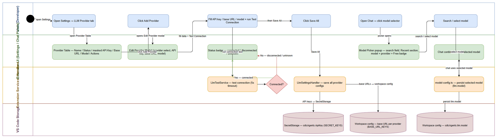

# Business Requirements Document (BRD)

## SA4E — SA4E-390: LLM Configuration UI Redesign + Chat Model Picker

---

## Document Information

| Field | Value |
|-------|-------|
| Jira Ticket | SA4E-390 |
| Title | LLM Configuration UI Redesign + Chat Model Picker |
| Author | BA Agent |
| Version | 1.0 |
| Date | 2026-10-30 |
| Status | Draft |

---

## Author Tracking

| Role | Name - Position | Responsibility |
|------|-----------------|----------------|
| Author | BA Agent – Business Analyst | Create document |
| Peer Reviewer | TBD – TBD | Review document |

---

## Revision History

| Version | Date | Author | Changes |
|---------|------|--------|---------|
| 1.0 | 2026-10-30 | BA Agent | Initiate document — from Jira ticket SA4E-390 |

---

## Sign-Off

| Name | Signature and date |
|------|--------------------|
| | ☐ I agree and confirm all criteria on this BRD as expected requirements |
| | ☐ I agree and confirm all criteria on this BRD as expected requirements |

---

## 1. Introduction

### 1.1 Scope

Ticket SA4E-390 requires redesign of the LLM configuration user interface and model selection experience in the SDLC Agents 4 Enterprise extension:

**Settings Panel (LLM Configuration)**:
- Replace single "Choose provider" dropdown with a **Provider Table** (multi-row table) allowing simultaneous configuration of multiple LLM providers.
- Each row in the table represents one provider with configurable: Provider name, Status, API Key, Base URL, Model, and Action buttons (Edit, Test Connection, Delete).
- Add "Add Provider" button to add new provider configuration.
- Add "Save All" button to persist all provider configurations at once.
- Add modal "Edit Provider" for detailed configuration of each provider (API key, base URL, model, test connection).
- Each provider can have independent API key, base URL, and model.
- Display connection status (connected/disconnected/unknown) for each provider.

**Chat Panel (SDLC CHAT)**:
- Replace simple model dropdown with a **Model Picker popup** (as per provided mockup).
- Model Picker features:
  - Search field to find models by name.
  - "Recent" section showing recently used models.
  - Model list displays: model name, provider, "Free" badge if free model.
  - Keyboard shortcuts: Esc to close, Ctrl+A to "Connect an integration", Ctrl+F to Favorite.
- Provider list (anthropic, openai, lmstudio, openrouter, ollama) kept unchanged; only UI display changes.

**Source**: Jira ticket SA4E-390 (Reporter: Duc Nguyen Minh, Created: 2026-10-29, Priority: Medium, Status: In Progress).

**Current codebase related**:
- `extension/src/panels/settings/SettingsPanel.ts` — Webview panel settings, currently has single tab "LLM Provider" with single dropdown provider-select.
- `extension/src/panels/settings/handlers/LlmSettingsHandler.ts` — Handles LLM messages (getModels, setBaseUrl, saveApiKey, testOllama, testLlm, autoTest).
- `extension/webview-assets/settings/settings-provider.js` — Handles provider switching, section visibility, model datalist.
- `extension/webview-assets/chat/chat-model.js` — Renders model dropdown (shows name + rate badge "Free").
- `extension/src/chat-panel/chat-panel-provider/model-config.ts` — Persists llm.model config.

### 1.2 Out of Scope

- Do not change backend Pega, Atlassian, Server, Proxy, Backend MCP, or Wrapper MCP in Settings Panel (those tabs remain unchanged).
- Do not implement code, do not write TDD/FSD, do not write test cases in this phase.
- Do not change database structure or data persistence schema (still use VS Code SecretStorage and workspace configuration).
- Do not integrate with new LLM providers outside existing list (anthropic, openai, lmstudio, openrouter, ollama) — only change UI display and configuration.

### 1.3 Preliminary Requirement

- SDLC Agents 4 Enterprise extension installed and operational (Settings Panel and Chat Panel already exist).
- VS Code SecretStorage and workspace configuration (`sdlcAgents` section) ready to save API key and llm.model.
- List of existing LLM providers: anthropic, openai, lmstudio, openrouter, ollama.

---

## 2. Business Requirements

### 2.1 High Level Process Map

1. User opens Settings Panel → tab "LLM Provider".
2. User sees Provider Table with list of configured providers (Provider name, Status, API Key, Base URL, Model, Actions).
3. User can click "Add Provider" → open Edit Provider modal → input API key, base URL, model → test connection → new provider appears in table.
4. User can click "Edit" on any provider row → open Edit Provider modal with pre-filled data → modify and save.
5. User can click "Save All" → persist all configurations to VS Code SecretStorage / workspace config.
6. User opens Chat Panel (SDLC CHAT) → clicks model selector → opens Model Picker popup.
7. In Model Picker: search models, view "Recent" section, select model (name + provider + Free badge), use shortcuts (Esc/Ctrl+A/Ctrl+F).
8. Selected model applied to chat configuration.

---

### 2.2 List of User Stories / Use Cases

| # | Story / Use Case | Priority | Source Ticket |
|---|------------------|----------|---------------|
| 1 | As a developer, I want to view and configure multiple LLM providers in a provider table so that I can manage API key, Base URL, and Model for each provider separately. | MUST HAVE | SA4E-390 |
| 2 | As a developer, I want to add a new LLM provider via Add Provider button so that I can connect to a new LLM service. | MUST HAVE | SA4E-390 |
| 3 | As a developer, I want to edit provider details (API key, Base URL, Model, test connection) in a modal so that I can fine-tune each provider configuration. | MUST HAVE | SA4E-390 |
| 4 | As a developer, I want to see connection status (connected/disconnected/unknown) for each provider so that I know which providers are ready to use. | MUST HAVE | SA4E-390 |
| 5 | As a developer, I want to save all provider configurations at once via Save All button so that changes are persisted efficiently. | MUST HAVE | SA4E-390 |
| 6 | As a chat user, I want to open a model picker popup (instead of a simple dropdown) so that I can search and select an LLM model easily. | MUST HAVE | SA4E-390 |
| 7 | As a chat user, I want to search models by name in the model picker so that I can quickly find the model I need. | MUST HAVE | SA4E-390 |
| 8 | As a chat user, I want to see a Recent section with recently used models so that I can quickly reselect them. | SHOULD HAVE | SA4E-390 |
| 9 | As a chat user, I want to see model name, provider, and Free badge in the model list so that I can identify free models. | MUST HAVE | SA4E-390 |
| 10 | As a chat user, I want to use keyboard shortcuts (esc to close, ctrl+a to connect integration, ctrl+f to favorite) so that I can operate the model picker efficiently. | SHOULD HAVE | SA4E-390 |

---

### 2.3 Details of User Stories

#### STORY 1: View and configure multiple LLM providers in provider table

> As a developer, I want to view and configure multiple LLM providers in a provider table so that I can manage API key, Base URL, and Model for each provider separately.

**Requirement Details**:

1. Replace single "Choose provider" dropdown with a Provider Table listing all configured providers.
2. Each table row represents one provider with columns: Provider name, Status, API Key, Base URL, Model, Actions.
3. Provider name displays provider display name (e.g., Anthropic, OpenAI, LM Studio, OpenRouter, Ollama).
4. Status displays connection state: connected / disconnected / unknown.
5. API Key displays in masked format (e.g., ••••••••) or empty if not configured.
6. Base URL displays the provider's endpoint URL or default if using default.
7. Model displays the currently selected model ID for that provider.
8. Actions contain buttons: Edit, Test Connection, Delete (if applicable).

**Data Fields** (if applicable):

| Field | Type | Required | Description | Example |
|-------|------|----------|-------------|---------|
| providerName | String | Yes | Display name of provider | Anthropic, OpenAI |
| providerId | String | Yes | Internal identifier for provider | anthropic, openai |
| status | Enum | Yes | Connection status | connected, disconnected, unknown |
| apiKey | String (secret) | No | API key of provider (stored in SecretStorage) | sk-... |
| baseUrl | String | No | Base URL endpoint of provider | https://api.anthropic.com |
| model | String | No | Model ID selected for this provider | claude-3-sonnet, gpt-4o |

**Acceptance Criteria**:

1. Provider table displays all columns: Provider name, Status, API Key, Base URL, Model, Actions.
2. Each provider can be configured independently with separate API key, Base URL, Model.
3. Connection status displays correctly: connected / disconnected / unknown.
4. Source: SA4E-390, Settings Panel section.

**UI Specifications** (if applicable):

| No. | Name | Type | Required | Description | Note |
|-----|------|------|----------|-------------|------|
| 1 | Provider Table | Table | Yes | Provider list table | Columns: Provider name, Status, API Key, Base URL, Model, Actions |
| 2 | Provider Name | Label/Text | Yes | Provider display name | May have icon/category |
| 3 | Status | Badge/Label | Yes | connected (green), disconnected (red), unknown (gray) | Color-coded |
| 4 | API Key | Masked input | No | Display masked; click to edit | |
| 5 | Base URL | Text | No | Provider endpoint URL or default | |
| 6 | Model | Text | No | Model ID selected | |
| 7 | Actions | Button group | Yes | Edit / Test / Delete | |

**Validation Rules** (if applicable):

- Provider name not empty when adding new.
- API key stored securely (not displayed plainly in table).

**Error Handling** (if applicable):

- If cannot load provider list: show error message, empty table.
- If test connection fails: show status disconnected and error details.

---

#### STORY 2: Add new LLM provider

> As a developer, I want to add a new LLM provider via Add Provider button so that I can connect to a new LLM service.

**Requirement Details**:

1. "Add Provider" button in Settings Panel (tab LLM Provider).
2. Clicking "Add Provider" opens Edit Provider modal allowing input of new provider info.
3. User selects provider from list (anthropic, openai, lmstudio, openrouter, ollama), enters API key, base URL, model.
4. "Test Connection" button in modal checks connectivity before saving.
5. After saving, new provider appears in Provider Table.

**Data Fields** (if applicable):

| Field | Type | Required | Description | Example |
|-------|------|----------|-------------|---------|
| providerId | Enum (select) | Yes | Provider from list | anthropic, openai |
| apiKey | String (password) | Yes (for cloud providers) | API key | sk-ant-... |
| baseUrl | String | No | Base URL override | https://api.custom.com |
| model | String | Yes | Model ID | claude-3-opus |

**Acceptance Criteria**:

1. "Add Provider" button clearly visible in Settings Panel.
2. Modal Edit Provider opens when clicking "Add Provider".
3. User can select provider and enter full configuration.
4. "Test Connection" checks connectivity and shows result.
5. New provider added to Provider Table after save.
6. Source: SA4E-390, Settings Panel section.

**UI Specifications** (if applicable):

| No. | Name | Type | Required | Description | Note |
|-----|------|------|----------|-------------|------|
| 1 | Add Provider Button | Button | Yes | Add new provider | Easy to see on table |
| 2 | Edit Provider Modal | Modal | Yes | Detailed provider configuration | Contains API key, base URL, model, test connection |
| 3 | Provider Select | Dropdown | Yes | Select from list | anthropic, openai, lmstudio, openrouter, ollama |
| 4 | API Key Input | Password input | Yes (cloud) | Enter API key | Masked |
| 5 | Base URL Input | Text input | No | Enter base URL | |
| 6 | Model Input | Text input | Yes | Enter model ID | |
| 7 | Test Connection Button | Button | Yes | Check connectivity | Shows result |
| 8 | Save Button | Button | Yes | Save provider | |

**Validation Rules** (if applicable):

- Provider ID must be selected from list.
- API key required for cloud providers (anthropic, openai, openrouter).
- Model ID not empty.

**Error Handling** (if applicable):

- If provider ID invalid: show "Unknown provider" error.
- If test connection error: show detailed error, does not block save (or blocks per design).

---

#### STORY 3: Edit provider details in modal

> As a developer, I want to edit provider details (API key, Base URL, Model, test connection) in a modal so that I can fine-tune each provider configuration.

**Requirement Details**:

1. "Edit" button appears in Actions column of each provider in Provider Table.
2. Clicking "Edit" opens Edit Provider modal with current data pre-filled (API key masked).
3. User can change API key, base URL, model.
4. "Test Connection" button checks connectivity after changes.
5. Save changes and update Provider Table.

**Data Fields** (if applicable):

| Field | Type | Required | Description | Example |
|-------|------|----------|-------------|---------|
| apiKey | String (password) | No | New API key (if changing) | sk-... |
| baseUrl | String | No | New base URL | https://api.custom.com |
| model | String | Yes | New model ID | gpt-4o |

**Acceptance Criteria**:

1. "Edit" button appears on each provider row.
2. Modal opens with current data pre-filled.
3. User can edit API key, base URL, model.
4. "Test Connection" checks connectivity after changes.
5. Changes saved and displayed updated in Provider Table.
6. Source: SA4E-390, Settings Panel section.

**UI Specifications** (if applicable):

| No. | Name | Type | Required | Description | Note |
|-----|------|------|----------|-------------|------|
| 1 | Edit Button | Button | Yes | On each provider row | Opens modal Edit Provider |
| 2 | Edit Provider Modal | Modal | Yes | Detailed provider config | API key, base URL, model, test connection |
| 3 | API Key Field | Password | No | API key (masked) | |
| 4 | Base URL Field | Text | No | Base URL | |
| 5 | Model Field | Text | Yes | Model ID | |
| 6 | Test Connection Button | Button | Yes | Check connectivity | |
| 7 | Save Button | Button | Yes | Save changes | |

**Validation Rules** (if applicable):

- Model ID not empty when saving.
- Base URL must be valid URL if provided.

**Error Handling** (if applicable):

- If save fails: show error message.
- If test connection fails: show error detail and status disconnected.

---

#### STORY 4: View connection status for each provider

> As a developer, I want to see connection status (connected/disconnected/unknown) for each provider so that I know which providers are ready to use.

**Requirement Details**:

1. Each provider in Provider Table displays Status column.
2. Status has three values: connected (green), disconnected (red), unknown (gray).
3. Status updated after each Test Connection.
4. Default status is unknown if no test connection performed.

**Data Fields** (if applicable):

| Field | Type | Required | Description | Example |
|-------|------|----------|-------------|---------|
| status | Enum | Yes | Connection status | connected, disconnected, unknown |

**Acceptance Criteria**:

1. Status column displayed on Provider Table.
2. Three statuses: connected / disconnected / unknown with color coding.
3. Status updated after each test connection.
4. Default is unknown if no test connection.
5. Source: SA4E-390, Settings Panel section.

**UI Specifications** (if applicable):

| No. | Name | Type | Required | Description | Note |
|-----|------|------|----------|-------------|------|
| 1 | Status Badge | Badge/Label | Yes | connected (green), disconnected (red), unknown (gray) | Color-coded |

**Validation Rules** (if applicable):

- None.

**Error Handling** (if applicable):

- If cannot determine status: show unknown.

---

#### STORY 5: Save all provider configurations

> As a developer, I want to save all provider configurations at once via Save All button so that changes are persisted efficiently.

**Requirement Details**:

1. "Save All" button in Settings Panel (tab LLM Provider).
2. Clicking "Save All" saves all provider configurations (API key, base URL, model) to VS Code SecretStorage and workspace configuration.
3. Show confirmation message after successful save.

**Data Fields** (if applicable):

| Field | Type | Required | Description | Example |
|-------|------|----------|-------------|---------|
| allProviders | List | Yes | List of all configured providers | [anthropic, openai, ...] |

**Acceptance Criteria**:

1. "Save All" button clearly visible.
2. All provider configurations saved when clicking Save All.
3. Confirmation message displayed after successful save.
4. API key stored in SecretStorage, base URL/model stored in workspace config.
5. Source: SA4E-390, Settings Panel section.

**UI Specifications** (if applicable):

| No. | Name | Type | Required | Description | Note |
|-----|------|------|----------|-------------|------|
| 1 | Save All Button | Button | Yes | Save all configurations | Easy to see |

**Validation Rules** (if applicable):

- None.

**Error Handling** (if applicable):

- If save fails: show detailed error message.

---

#### STORY 6: Open model picker popup in chat

> As a chat user, I want to open a model picker popup (instead of a simple dropdown) so that I can search and select an LLM model easily.

**Requirement Details**:

1. Replace simple dropdown model with a popup/model picker.
2. Model picker appears as popup when user clicks model selector in Chat Panel.
3. Model picker displays list of models with name, provider, and "Free" badge if free.
4. Source: ticket SA4E-390, Chat Panel section.

**Acceptance Criteria**:

1. Model picker popup replaces simple dropdown.
2. Popup opens when clicking model selector in Chat Panel.
3. Model list displays name, provider, Free badge.
4. Source: SA4E-390, Chat Panel section.

**UI Specifications** (if applicable):

| No. | Name | Type | Required | Description | Note |
|-----|------|------|----------|-------------|------|
| 1 | Model Selector | Button | Yes | Button to open model picker | In Chat Panel toolbar |
| 2 | Model Picker Popup | Popup | Yes | List of selectable models | Name, provider, Free badge |
| 3 | Model Item | List item | Yes | Each model as item | Name + provider + badge |

**Error Handling** (if applicable):

- If no models available: show "No models available" message.

---

#### STORY 7: Search models in model picker

> As a chat user, I want to search models by name in the model picker so that I can quickly find the model I need.

**Requirement Details**:

1. Model picker has search field (input to search).
2. User types model name to filter list.
3. List filters in real-time as user types.
4. Search matches model name and provider.

**Acceptance Criteria**:

1. Search field displayed in Model Picker popup.
2. List filters by search keyword in real-time.
3. Search by model name and provider.
4. Source: SA4E-390, Chat Panel section.

**Error Handling** (if applicable):

- If no matching model: show "No models found" message.

---

#### STORY 8: View recent models

> As a chat user, I want to see a Recent section with recently used models so that I can quickly reselect them.

**Requirement Details**:

1. Model picker has "Recent" section showing recently used models.
2. Recent list updated when user selects a model.

**Acceptance Criteria**:

1. "Recent" section displayed in Model Picker.
2. Recently used models appear in this section.
3. Source: SA4E-390, Chat Panel section.

**Error Handling** (if applicable):

- If no models used yet: show "No recent models" or hide Recent section.

---

#### STORY 9: Display model name, provider, and Free badge

> As a chat user, I want to see model name, provider, and Free badge in the model list so that I can identify free models.

**Requirement Details**:

1. Each model item in Model Picker displays: model name, provider, and "Free" badge if free.
2. "Free" badge displayed clearly (green color or specific style).

**Data Fields** (if applicable):

| Field | Type | Required | Description | Example |
|-------|------|----------|-------------|---------|
| modelName | String | Yes | Model display name | Claude 3 Haiku |
| provider | String | Yes | Provider name | Anthropic |
| isFree | Boolean | Yes | Whether model is free | true/false |

**Acceptance Criteria**:

1. Model name displayed on each model item.
2. Provider displayed on each model item.
3. "Free" badge displayed if model is free.
4. Source: SA4E-390, Chat Panel section.

**UI Specifications** (if applicable):

| No. | Name | Type | Required | Description | Note |
|-----|------|------|----------|-------------|------|
| 1 | Model Name | Label | Yes | Model display name | |
| 2 | Provider | Label | Yes | Provider name | |
| 3 | Free Badge | Badge | No (conditional) | "Free" if free model | Green color |

**Validation Rules** (if applicable):

- None.

**Error Handling** (if applicable):

- None.

---

#### STORY 10: Keyboard shortcuts in model picker

> As a chat user, I want to use keyboard shortcuts (esc to close, ctrl+a to connect integration, ctrl+f to favorite) so that I can operate the model picker efficiently.

**Requirement Details**:

1. Esc key: close Model Picker popup.
2. Ctrl+A key: activate "Connect an integration" function.
3. Ctrl+F key: focus search field or toggle favorite.

**Acceptance Criteria**:

1. Esc closes Model Picker popup.
2. Ctrl+A activates "Connect an integration".
3. Ctrl+F focuses search field or toggles favorite.
4. Source: SA4E-390, Chat Panel section.

**UI Specifications** (if applicable):

| No. | Name | Type | Required | Description | Note |
|-----|------|------|----------|-------------|------|
| 1 | Keyboard Shortcuts | Global hotkey | Yes | Esc / Ctrl+A / Ctrl+F | Listens key events in popup |

**Error Handling** (if applicable):

- None.

---

## 3. Dependencies

| Dependency | Type | Related Ticket | Description |
|------------|------|----------------|-------------|
| VS Code SecretStorage | Infrastructure | N/A | Securely store API key |
| Workspace configuration (sdlcAgents.llm.*) | Infrastructure | N/A | Store base URL and model |
| LlmSettingsHandler.ts | System | SA4E-323, SA4E-370 | Current handler for LLM settings messages |
| SettingsMessageHandler.ts | System | N/A | General message handler for Settings Panel |
| ProviderConfigService | System | N/A | Service to get model list and provider configuration |
| LlmTestService | System | N/A | Service to test LLM connection |
| SECRET_KEYS | System | N/A | Mapping secret key per provider (models.ts) |
| BASE_URL_KEYS | System | SA4E-370 | Mapping base URL key per provider |
| chat-model.js | System | KSA-237 | Current model dropdown rendering (will be replaced by picker) |
| chat-panel-provider/model-config.ts | System | N/A | Persist llm.model config |

---

## 4. Stakeholders

| Role | Name / Team | Responsibility | Source |
|------|-------------|----------------|--------|
| Reporter | Duc Nguyen Minh | Request LLM UI redesign and chat model change | Jira ticket SA4E-390 |
| BA Agent | BA Agent | Collect requirements, write BRD | Phase 1 |
| Developer | TBD | Implement Settings Panel UI + Chat Panel UI | Jira ticket SA4E-390 |
| QA | TBD | Functional testing | Phase 4 |
| End User | Developer / SDLC team | Use LLM configuration and chat model selection | Business |

---

## 5. Risks and Assumptions

### 5.1 Risks

| Risk | Impact | Likelihood | Mitigation |
|------|--------|------------|------------|
| API key displayed plainly in table causing information leak | High | Medium | Mask API key (e.g., ••••••••), only allow edit via modal |
| Test connection slow or times out causing UI freeze | Medium | Medium | Set timeout (e.g. 5s like testOllama), show loading state |
| Many providers causing complex management | Medium | Low | Provider table clean layout, separate Edit/Delete per row |
| Keyboard shortcut Ctrl+A/Ctrl+F conflict with system/browser shortcut | Low | Medium | Confirm scope only within Model Picker popup |

### 5.2 Assumptions

- Existing LLM provider list (anthropic, openai, lmstudio, openrouter, ollama) kept unchanged; only UI display changes.
- API key continues to be stored in VS Code SecretStorage, base URL/model in workspace configuration.
- Connection status only updated when user clicks Test Connection (not auto-check continuously).
- Model picker data takes from saved configuration (not dynamic API call to provider) in this phase.
- Shortcut scopes limited to Model Picker popup context.

---

## 6. Non-Functional Requirements

| Category | Requirement | Details |
|----------|-------------|---------|
| Performance | Provider table renders fast | Table with ≤ 10 providers renders < 500ms |
| Performance | Model picker opens fast | Popup opens < 300ms after click |
| Security | API key encrypted | Stored in VS Code SecretStorage, not displayed plainly in table |
| Security | Test connection timeout | Each test connection has timeout (e.g. 5s) to avoid UI hang |
| Scalability | Support many providers | Provider table can show many providers (use virtual scroll if needed) |
| Usability | Intuitive keyboard shortcuts | Esc, Ctrl+A, Ctrl+F work correctly in Model Picker |
| Availability | UI not hang during test | Test connection runs async, does not block UI thread |

> Non-functional requirements above inferred from business requirements and current architecture. Need technical confirmation with SA/DEV in Phase 2/3.

---

## 7. Related Tickets

| Ticket Key | Summary | Status | Type | Relationship |
|------------|---------|--------|------|--------------|
| SA4E-390 | LLM Configuration UI Redesign + Chat Model Picker | In Progress | Task | Main ticket |
| SA4E-323 | LLM provider settings refactor (LlmSettingsHandler) | Resolved | Task | Related (current handler) |
| SA4E-370 | Dotted base URL keys for providers | Resolved | Task | Related (BASE_URL_KEYS mapping) |
| KSA-237 | Model dropdown rendering with rate badge | Resolved | Task | Related (current chat-model.js) |

---

## 8. Appendix

### Glossary (if applicable)

| Term | Definition |
|------|------------|
| Provider | LLM service provider (Anthropic, OpenAI, LM Studio, OpenRouter, Ollama) |
| API Key | Authentication key to call provider API (stored securely in SecretStorage) |
| Base URL | Provider API endpoint URL |
| Model | ID of LLM model selected for provider |
| Status | Connection state: connected / disconnected / unknown |
| Model Picker | Popup model selection in Chat Panel (replaces simple dropdown) |
| Recent | List of recently used models |
| Free Badge | Badge indicating model is free (no cost) |
| SecretStorage | VS Code SecretStorage (securely stores API key) |

### Reference Documents

| Document | Link / Location |
|----------|-----------------|
| Jira Ticket SA4E-390 | SA4E-390 (Jira) |
| Settings Panel Source | extension/src/panels/settings/SettingsPanel.ts |
| LlmSettingsHandler Source | extension/src/panels/settings/handlers/LlmSettingsHandler.ts |
| Settings Provider JS | extension/webview-assets/settings/settings-provider.js |
| Chat Model JS | extension/webview-assets/chat/chat-model.js |
| Model Config TS | extension/src/chat-panel/chat-panel-provider/model-config.ts |

---

## 9. Diagrams

### 9.1 Business Flow — LLM Configuration UI Redesign + Chat Model Picker

Swimlane flow: User opens Settings (LLM Provider tab) → Provider Table (Name / Status / masked API Key / Base URL / Model / Actions) → Add Provider opens Edit Provider Modal (provider select, API key, base URL, model) → Test Connection drives the connected/disconnected/unknown badge → Save All persists API keys to SecretStorage (SECRET_KEYS) and base URLs to workspace config (BASE_URL_KEYS) → then Chat opens the Model Picker popup (search, Recent, model + provider + Free badge) and the selected model is persisted via model-config.ts for subsequent turns.

*[Edit in draw.io](diagrams/business-flow.drawio)*

### 9.2 Use Case

*[Edit in draw.io](diagrams/use-case.drawio)*