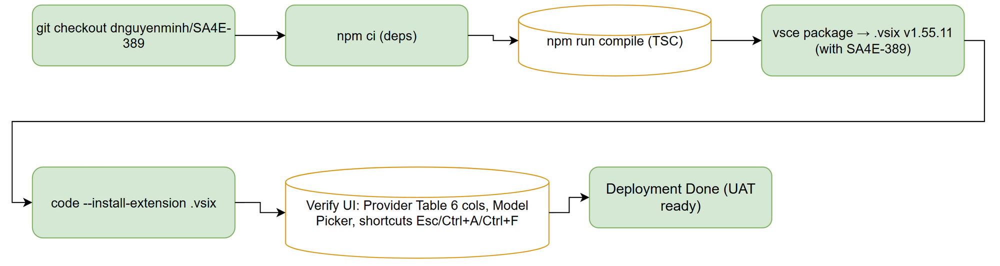
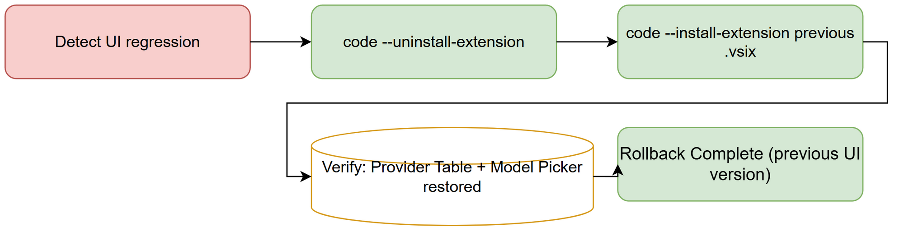

# Deployment Guide (DPG) — SA4E-390

## SDLC-Agents-4-Enterprise — SA4E-390: LLM Configuration UI Redesign + Chat Model Picker

---

### Document Information

| Field | Value |
|-------|-------|
| **Jira Ticket** | SA4E-390 |
| **Title** | LLM Configuration UI Redesign + Chat Model Picker |
| **Author** | DevOps Agent |
| **Version** | 1.0 |
| **Date** | 2026-10-31 |
| **Status** | Draft — ready for UAT |
| **Extension Version** | 1.55.11 |
| **Branch** | dnguyenminh/SA4E-389 |

---

### 1. Overview

This document describes how to deploy the SA4E-390 extension UI (LLM Configuration UI Redesign + Chat Model Picker). SA4E-390 ships together with SA4E-389 data layer in VSIX package v1.55.11 from branch `dnguyenminh/SA4E-389`.

SA4E-390 provides the UI layer:
- Provider Table: 6 columns (Provider name, Status, masked API Key, Base URL, Model, Actions Edit/Test/Delete)
- Add Provider button → Edit Provider modal
- Save All button → atomic persist to workspace config + SecretStorage
- Model Picker popup: search field, Recent section, model list (name + provider + Free badge)
- Keyboard shortcuts: Esc (close), Ctrl+A (connect integration), Ctrl+F (focus search), scoped to picker context

Depends on SA4E-389 multi-profile data layer (`LlmProfile`, `activeProfileId`, `llmSecretKey`, `readProviderTurnConfig`).

---

### 2. Prerequisites

| Requirement | Version | Notes |
|-------------|---------|-------|
| Node.js | 18.x LTS | Extension build toolchain |
| npm | 10.x | Package management |
| vsce | latest | VS Code Extension packaging |
| TypeScript | per package.json | Compilation target |
| VS Code | 1.85+ | Extension Development Host |
| SA4E-389 | deployed | Data layer must be active (Profile #1 migrated) |

### 3. Build Steps

SA4E-390 shares the same extension build as SA4E-389:

```powershell
# 1. Checkout branch dnguyenminh/SA4E-389 at origin/main v1.55.11
git checkout dnguyenminh/SA4E-389

# 2. Install dependencies
cd extension
npm ci

# 3. Compile TypeScript (must pass with 0 errors)
npm run compile

# 4. Package VSIX (shipped with SA4E-389)
vsce package --out ../SA4E-390-llm-ui-redesign-1.55.11.vsix

# 5. Verify VSIX exists
ls -la ../SA4E-390-llm-ui-redesign-1.55.11.vsix
```

**Build gates:**
- TypeScript compilation: 0 errors
- Code standards: all new files ≤ 200 lines, functions ≤ 20 lines
- API key masking: no plaintext secrets in DOM (verified by grep + DOM scan)

### 4. Deployment Steps

#### 4.1 Install VSIX

```powershell
# Method A: VS Code Extensions UI
#   Extensions view → "..." → Install from VSIX → select SA4E-390-llm-ui-redesign-1.55.11.vsix

# Method B: CLI
code --install-extension SA4E-390-llm-ui-redesign-1.55.11.vsix
```

#### 4.2 Post-Deployment Verification

| Step | Action | Expected Result |
|------|--------|-----------------|
| 1 | Open Settings Panel → "LLM Provider" tab | Provider Table renders 6 columns (Name, Status, masked API Key, Base URL, Model, Actions) |
| 2 | Click "+ Add Provider" | Edit Provider modal opens (provider dropdown, masked API key, base URL, model, Test, Save) |
| 3 | Click "Save All" | All configs persisted to workspace config + SecretStorage atomically |
| 4 | Open Chat panel | Model Picker popup replaces plain dropdown |
| 5 | Type in search field | Model list filters in real-time |
| 6 | Click a Recent model | Model selected; chat uses it |
| 7 | Press Esc with picker open | Picker closes |
| 8 | Press Ctrl+F with picker open | Search field focuses |
| 9 | Press Ctrl+A with picker open | Search text selects all |
| 10 | Click "Test" on provider row | Status badge updates (async, UI not frozen) |

#### 4.3 Rollback

```powershell
code --uninstall-extension sdlc-agents-4-enterprise.sdlc-agents
code --install-extension <previous-vsix-file>
```

### 5. Configuration Reference

| Setting | Scope | Description |
|---------|-------|-------------|
| `sdlcAgents.llm.profiles` | Global | Profile list (SA4E-389 data layer) |
| `sdlcAgents.llm.activeProfileId` | Global | Active profile slug |
| `sdlcAgents.<profileId>ApiKey` | SecretStorage | Per-profile encrypted API key |

### 6. Security Notes

- API keys masked as `●●●●●●●●●●●●●●●●●●●●` (20 bullets) in Provider Table and Edit Provider modal
- API keys never appear in clear text in DOM
- Keys stored in VS Code SecretStorage (encrypted at rest)
- Accessed via `llmSecretKey(profileId)` / `readLlmApiKey()` from SA4E-389 layer
- Keyboard shortcuts scoped to Model Picker context only (no editor/OS conflicts)

---

### 7. Diagrams



*[Edit in draw.io](diagrams/deployment-flow.drawio)*



*[Edit in draw.io](diagrams/rollback-flow.drawio)*

---

### 8. Appendix

#### 8.1 Artifact Index (Phase 7 deliverables)

| Artifact | Path |
|----------|------|
| Deployment Guide | `documents/SA4E-390/DPG.md` |
| Release Notes | `documents/SA4E-390/RLN.md` |
| Deployment flow diagram | `documents/SA4E-390/diagrams/deployment-flow.{drawio,png}` |
| Rollback flow diagram | `documents/SA4E-390/diagrams/rollback-flow.{drawio,png}` |

#### 8.2 Related Tickets

| Ticket | Relation |
|--------|----------|
| SA4E-389 | Data layer (multi-profile) — SA4E-390 UI builds on top |
| SA4E-323 | LLM provider settings refactor (prior art) |
| SA4E-370 | Dotted base URL keys for providers |
| KSA-237 | Model dropdown rendering with rate badge |

---

**Last Updated**: 2026-10-31T09:00:00Z  
**Autonomy Level**: L3