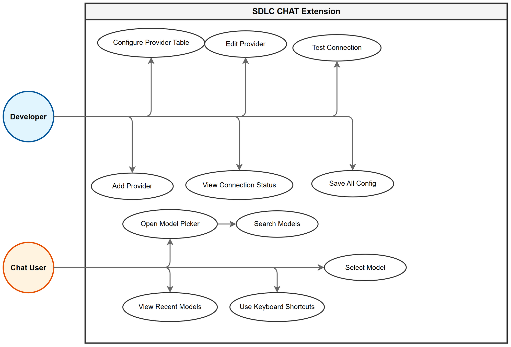
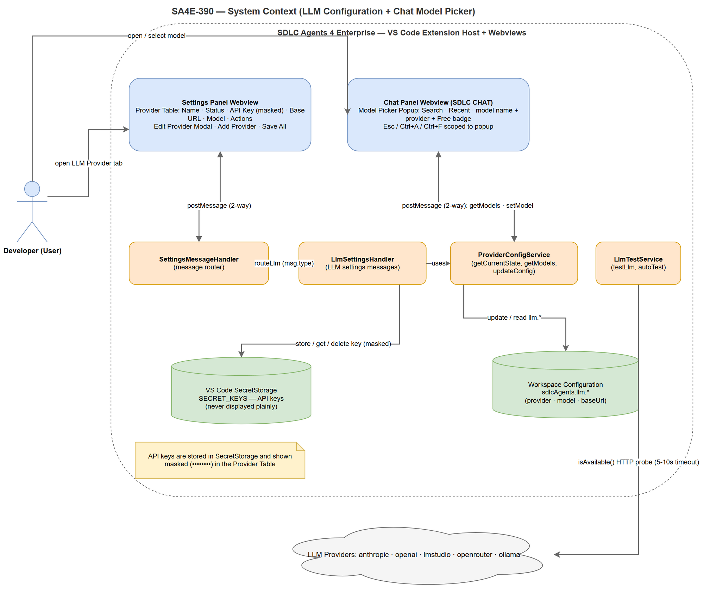
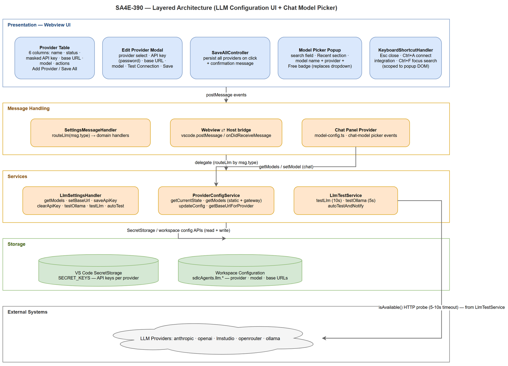
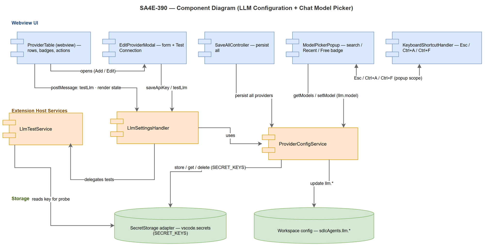
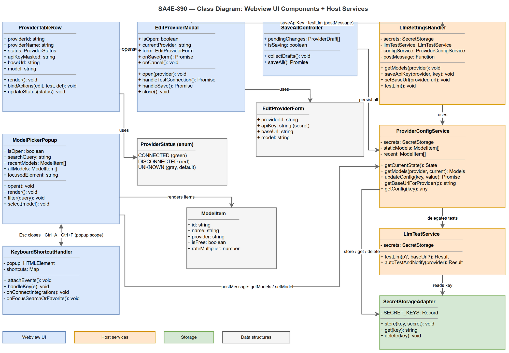
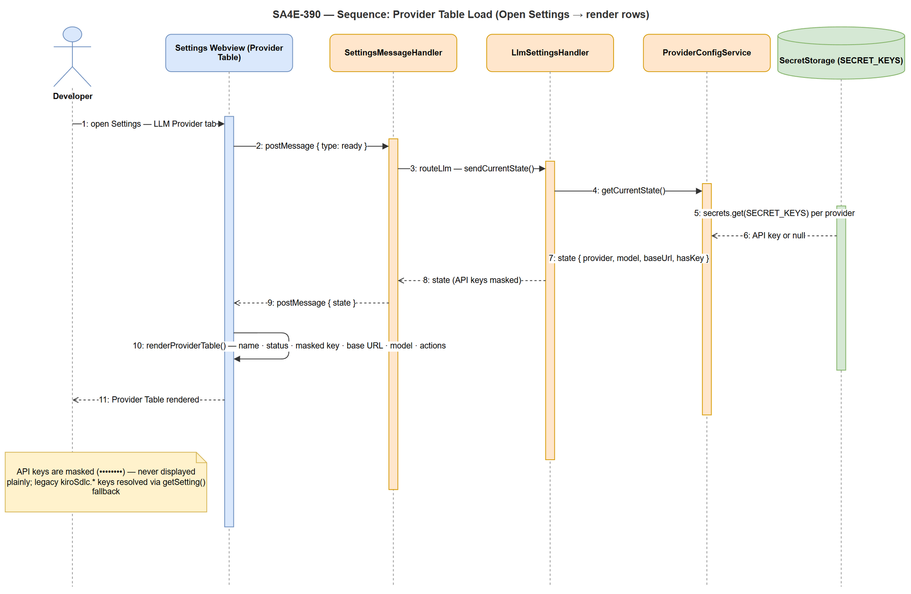
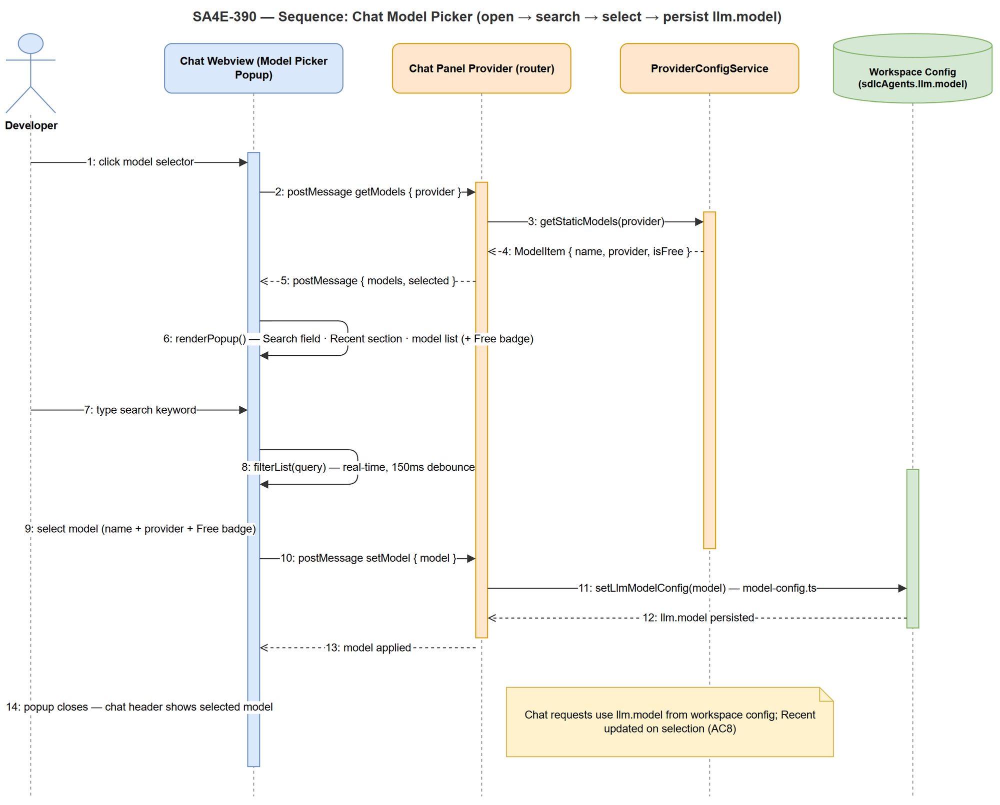
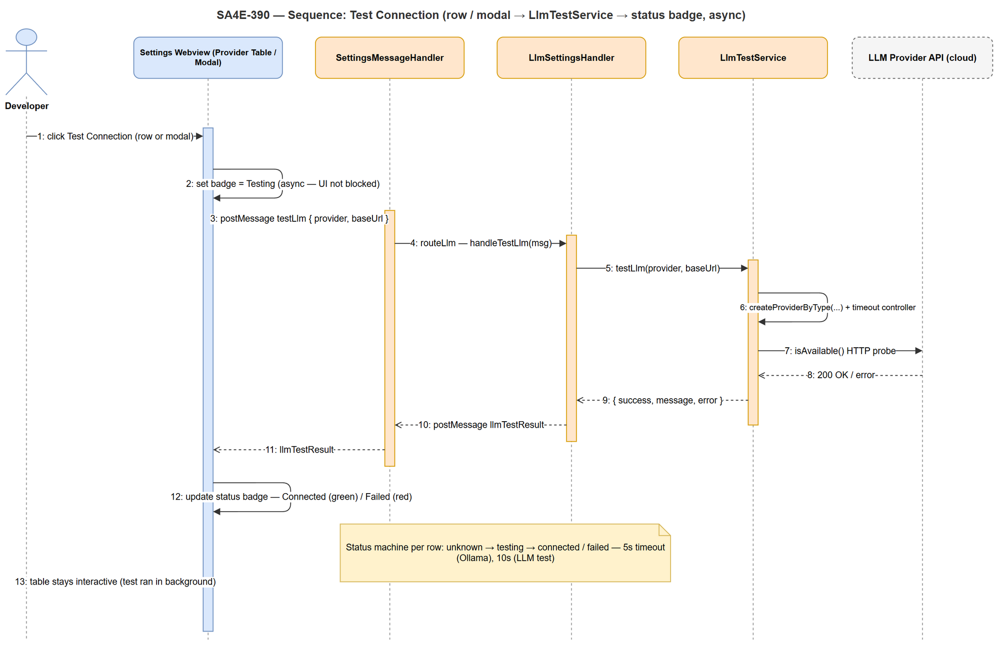
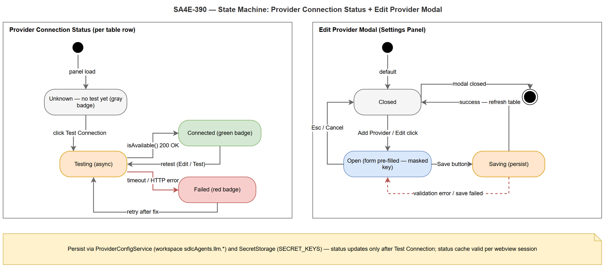

# Functional Specification Document (FSD)
## SA4E-390: LLM Configuration UI Redesign + Chat Model Picker

| Field | Value |
|-------|-------|
| Jira Ticket | SA4E-390 |
| Title | LLM Configuration UI Redesign + Chat Model Picker |
| Author | SA Agent |
| Version | 1.0 |
| Date | 2026-10-30 |
| Status | Completed |

---

## 1. Overview

### 1.1 Problem Summary
This specification defines the functional requirements for redesigning the LLM configuration user interface and chat model picker experience in the SDLC Agents 4 Enterprise extension. The current implementation uses a single "Choose provider" dropdown and a simple model dropdown, which needs to be replaced with a Provider Table multi-row interface and a Model Picker popup with enhanced features.

### 1.2 Goals
- Replace single provider dropdown with a **Provider Table** allowing simultaneous configuration of multiple LLM providers
- Replace simple model dropdown with a **Model Picker popup** (search, Recent section, model list with name/provider/Free badge)
- Add keyboard shortcuts (Esc, Ctrl+A, Ctrl+F) for model picker efficiency
- Add "Add Provider" and "Save All" buttons for configuration management
- Display connection status (connected/disconnected/unknown) for each provider
- Mask API keys to prevent information leak

### 1.3 Scope

**In-Scope:**
- Provider Table component: Columns (Provider name, Status, API Key masked, Base URL, Model, Actions: Edit/Test/Delete)
- "Add Provider" button: Opens Edit Provider modal
- "Save All" button: Persists all configurations
- Model Picker Popup: Search field, Recent section, model list with name/provider/Free badge
- Keyboard Shortcuts: Esc to close, Ctrl+A to connect integration, Ctrl+F to focus search/favorite
- Provider list unchanged: anthropic, openai, lmstudio, openrouter, ollama
- API key storage via VS Code SecretStorage
- Workspace configuration (sdlcAgents.llm.*)

**Out-of-Scope:**
- Backend Pega, Atlassian, Server, Proxy, Backend MCP, or Wrapper MCP changes
- Code implementation, TDD, test cases
- Database structure or data persistence schema changes
- Integration with new LLM providers outside existing list
- New model discovery via API calls (model data from saved configuration in this phase)

### 1.4 References
- BRD.md: SA4E-390 Business Requirements Document
- Dependencies: LlmSettingsHandler.ts, SettingsMessageHandler.ts, ProviderConfigService, LlmTestService, SECRET_KEYS, BASE_URL_KEYS, chat-model.js, model-config.ts

---

## 2. UI Specifications

### 2.1 Provider Table
The Provider Table displays all configured LLM providers in a multi-row table format.

| Column | Type | Required | Description | Notes |
|--------|------|----------|-------------|-------|
| Provider Name | Label/Text | Yes | Display name of provider (e.g., Anthropic, OpenAI, LM Studio, OpenRouter, Ollama) | May have icon/category |
| Status | Badge/Label | Yes | Connection state: connected (green), disconnected (red), unknown (gray) | Color-coded |
| API Key | Masked input | No | Display masked format (e.g., ••••••••) or empty if not configured | Never display plainly |
| Base URL | Text | No | Provider endpoint URL or default if using default | |
| Model | Text | No | Model ID selected for this provider | |
| Actions | Button group | Yes | Edit, Test Connection, Delete | Per-row actions |

**Table Behavior:**
- Rows are scrollable if many providers exist
- Each row represents one provider with independent configuration
- API key stored securely in VS Code SecretStorage, masked in UI
- Status updates after Test Connection click

### 2.2 "Add Provider" Button
- **Location**: Settings Panel tab "LLM Provider", positioned above or beside the Provider Table
- **Appearance**: Standard button labeled "Add Provider"
- **Action**: Opens Edit Provider modal with new provider configuration form
- **Visibility**: Always visible when user has permission to configure providers

**Edit Provider Modal Structure:**
- Provider Select: Dropdown with list [anthropic, openai, lmstudio, openrouter, ollama]
- API Key Input: Password input field (masked entry)
- Base URL Input: Text input field for endpoint URL override
- Model Input: Text input field for model ID
- Test Connection Button: Triggers connectivity check
- Save Button: Saves provider configuration

### 2.3 "Save All" Button
- **Location**: Settings Panel tab "LLM Provider", positioned near Provider Table
- **Appearance**: Standard button labeled "Save All"
- **Action**: Persists all provider configurations (API key, base URL, model) to VS Code SecretStorage and workspace configuration
- **Confirmation**: Displays success message after save completes

**Save All Behavior:**
- Saves all provider configurations at once
- API key stored in VS Code SecretStorage (per provider)
- Base URL and model stored in workspace configuration (sdlcAgents.llm.*)
- Shows confirmation message: "All configurations saved successfully" or error details if failed

### 2.4 Model Picker Popup
The Model Picker replaces the simple model dropdown in the Chat Panel with a popup interface.

**Popup Structure:**
- **Search Field**: Input to search models by name (real-time filtering)
- **Recent Section**: Shows recently used models (updated on selection)
- **Model List**: Displays models with:
  - Model name (e.g., "Claude 3 Haiku")
  - Provider name (e.g., "Anthropic")
  - "Free" badge if model is free (green color/style)
- **Keyboard Shortcuts** (active when popup is focused):
  - **Esc**: Close Model Picker popup
  - **Ctrl+A**: Activate "Connect an integration" function
  - **Ctrl+F**: Focus search field or toggle favorite

**Model Item Structure:**
```
[Model Name] [Provider] [Free Badge if applicable]
```

### 2.5 Keyboard Shortcuts
Key bindings that operate within the Model Picker popup context:

| Shortcut | Action | Context |
|----------|--------|---------|
| Esc | Close Model Picker popup | Global within popup |
| Ctrl+A | Connect an integration | Model Picker popup |
| Ctrl+F | Focus search field / toggle favorite | Model Picker popup |

**Implementation Notes:**
- Shortcuts must not conflict with system/browser hotkeys
- Scope limited to Model Picker popup DOM element
- Event listeners attached to popup container
- Ctrl+A should not trigger "select all" in this context

---

## 3. Functional Requirements (mapped from AC1-AC10 BRD)

| ID | Requirement | Priority | Source | Description |
|----|-------------|----------|--------|-------------|
| AC1 | Provider table displays all columns | MUST HAVE | SA4E-390 | Table shows: Provider name, Status, API Key (masked), Base URL, Model, Actions (Edit/Test/Delete) |
| AC2 | Add Provider button displayed clearly | MUST HAVE | SA4E-390 | Button visible in Settings Panel, opens Edit Provider modal |
| AC3 | Edit Provider modal opens when Add Provider clicked | MUST HAVE | SA4E-390 | Modal appears with form to configure new provider |
| AC4 | View connection status per provider | MUST HAVE | SA4E-390 | Status column shows connected/disconnected/unknown with color coding |
| AC5 | Save All button persists all configurations | MUST HAVE | SA4E-390 | Saves all provider configs to SecretStorage + workspace config |
| AC6 | Model picker popup replaces simple dropdown | MUST HAVE | SA4E-390 | Popup interface replaces former model selector dropdown |
| AC7 | Search model in picker works | MUST HAVE | SA4E-390 | Real-time search filters models by name and provider |
| AC8 | Recent section displays recently used models | SHOULD HAVE | SA4E-390 | List updated when user selects a model |
| AC9 | Display model name, provider, Free badge | MUST HAVE | SA4E-390 | Each model item shows name + provider + Free badge if applicable |
| AC10 | Keyboard shortcuts Esc/Ctrl+A/Ctrl+F work correctly | SHOULD HAVE | SA4E-390 | Esc closes, Ctrl+A activates integration, Ctrl+F focuses search |

### 3.1 Acceptance Criteria Summary
All 10 acceptance criteria from the BRD must be met for the feature to be considered complete. Each criterion maps to specific UI components and behaviors defined in this FSD.

---

## 4. Non-Functional Requirements

| Category | Requirement | Details |
|----------|-------------|---------|
| Performance | Provider table render time | ≤ 500ms for table with ≤ 10 providers |
| Performance | Model picker open time | Popup opens < 300ms after click |
| Security | API key encryption | Stored in VS Code SecretStorage, never displayed plainly in table |
| Security | Test connection timeout | Each test connection has timeout (e.g. 5s max) to avoid UI hang |
| Scalability | Support many providers | Provider table can show many providers; use virtual scroll if needed |
| Usability | Keyboard shortcuts work correctly | Esc, Ctrl+A, Ctrl+F work correctly in Model Picker context |
| Availability | UI not hang during test | Test connection runs async, does not block UI thread |
| Accessibility | Color-coded status badges | connected=green, disconnected=red, unknown=gray |

**Notes:** Non-functional requirements above inferred from business requirements and current architecture. Technical confirmation with SA/DEV needed in Phase 3/4.

---

## 5. Dependencies

| Dependency | Type | Related Ticket/Source | Description |
|------------|------|----------------------|-------------|
| VS Code SecretStorage | Infrastructure | N/A | Securely store API key per provider |
| Workspace configuration (sdlcAgents.llm.*) | Infrastructure | N/A | Store base URL and model per provider |
| LlmSettingsHandler.ts | System | SA4E-323, SA4E-370 | Current handler for LLM settings messages |
| SettingsMessageHandler.ts | System | N/A | General message handler for Settings Panel |
| ProviderConfigService | System | N/A | Service to get model list and provider configuration |
| LlmTestService | System | N/A | Service to test LLM connection |
| SECRET_KEYS | System | N/A | Mapping secret key per provider (models.ts) |
| BASE_URL_KEYS | System | SA4E-370 | Mapping base URL key per provider |
| chat-model.js | System | KSA-237 | Current model dropdown rendering (will be replaced by picker) |
| chat-panel-provider/model-config.ts | System | N/A | Persist llm.model config |
| extension/src/panels/settings/SettingsPanel.ts | System | N/A | Webview panel settings, current LLM Provider tab |

---

## 6. Risks and Assumptions

### 6.1 Risks
| Risk | Impact | Likelihood | Mitigation |
|------|--------|------------|------------|
| API key displayed plainly in table causing information leak | High | Medium | Mask API key (e.g., ••••••••), only allow edit via modal |
| Test connection slow or times out causing UI freeze | Medium | Medium | Set timeout (e.g. 5s like testOllama), show loading state |
| Many providers causing complex management | Medium | Low | Provider table clean layout, separate Edit/Delete per row |
| Keyboard shortcut Ctrl+A/Ctrl+F conflict with system/browser shortcut | Low | Medium | Confirm scope only within Model Picker popup context |

### 6.2 Assumptions
- Existing LLM provider list (anthropic, openai, lmstudio, openrouter, ollama) kept unchanged; only UI display changes
- API key continues to be stored in VS Code SecretStorage, base URL/model in workspace configuration
- Connection status only updated when user clicks Test Connection (not auto-check continuously)
- Model picker data takes from saved configuration (not dynamic API call to provider) in this phase
- Shortcut scopes limited to Model Picker popup context

---

## 7. Related Tickets

| Ticket Key | Summary | Status | Type | Relationship |
|------------|---------|--------|------|--------------|
| SA4E-390 | LLM Configuration UI Redesign + Chat Model Picker | In Progress | Task | Main ticket |
| SA4E-389 | LLM Provider Settings Refactor (previous phase) | Completed | Story | Predecessor/related |
| SA4E-323 | LLM provider settings refactor (LlmSettingsHandler) | Resolved | Task | Related (current handler) |
| SA4E-370 | Dotted base URL keys for providers | Resolved | Task | Related (BASE_URL_KEYS mapping) |
| KSA-237 | Model dropdown rendering with rate badge | Resolved | Task | Related (current chat-model.js) |

---

## 8. Version History

| Version | Date | Author | Changes |
|---------|------|--------|---------|
| 1.0 | 2026-10-30 | SA Agent | Initial specification — from BRD.md SA4E-390 |

---

## 9. Sign-Off

| Name | Signature and date |
|------|--------------------|
| | ☐ I agree and confirm all criteria on this FSD as expected requirements |
| | ☐ I agree and confirm all criteria on this FSD as expected requirements |

---

## Diagrams

All diagrams referenced by this FSD are authored as draw.io XML (`diagrams/*.drawio` — no Mermaid, no ASCII art is used in this document) with rendered PNG copies embedded below.

### Diagram Index

| File | Type | Purpose |
|------|------|---------|
| use-case.png | Use case | Actors and the UI use cases covered by this FSD |
| system-context.png | Context (C1) | Developer ↔ Settings/Chat webviews ↔ host handlers ↔ SecretStorage/workspace config ↔ LLM providers |
| architecture.png | Layered architecture | Presentation / Message Handling / Services / Storage / External system layers |
| component.png | Component | Webview UI components, extension-host services, and storage adapters with provided/required interfaces |
| class-ui-components.png | Class | Webview UI classes + host classes (attributes, methods, relations incl. postMessage contract) |
| sequence-provider-table.png | Sequence | Provider table load flow (Section 2.1) |
| sequence-model-picker.png | Sequence | Model picker: open → search → select → persist llm.model (Section 2.4) |
| sequence-test-connection.png | Sequence | Test connection async flow → status badge update (Section 2.1 status column) |
| state-provider-config.png | State machine | Connection-test status states + Edit Provider modal lifecycle |

### Use Cases

*[Edit in draw.io](diagrams/use-case.drawio)*

### System Context

*[Edit in draw.io](diagrams/system-context.drawio)*

### Layered Architecture

*[Edit in draw.io](diagrams/architecture.drawio)*

### Components

*[Edit in draw.io](diagrams/component.drawio)*

### Webview UI Classes

*[Edit in draw.io](diagrams/class-ui-components.drawio)*

### Provider Table Load Flow

*[Edit in draw.io](diagrams/sequence-provider-table.drawio)*

### Model Picker Flow

*[Edit in draw.io](diagrams/sequence-model-picker.drawio)*

### Test Connection Flow

*[Edit in draw.io](diagrams/sequence-test-connection.drawio)*

### Provider Configuration States

*[Edit in draw.io](diagrams/state-provider-config.drawio)*

---