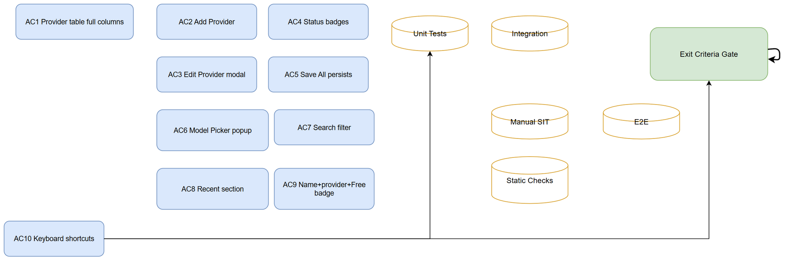
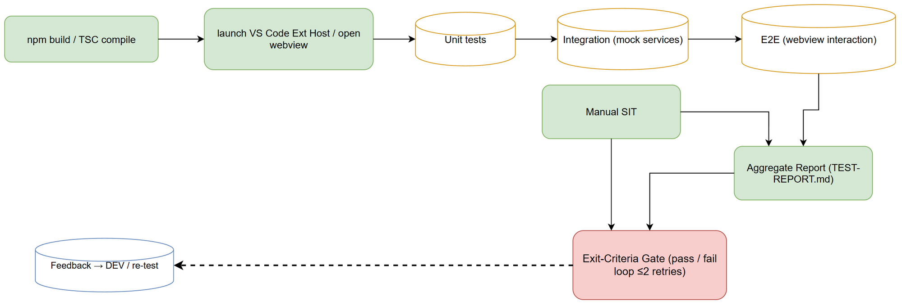

# Software Test Plan (STP)

## SDLC-Agents-4-Enterprise — SA4E-390: LLM Configuration UI Redesign + Chat Model Picker

---

### Document Information

| Field | Value |
|-------|-------|
| **Jira Ticket** | SA4E-390 |
| **Title** | LLM Configuration UI Redesign + Chat Model Picker |
| **Author** | QA Agent |
| **Version** | 1.0 |
| **Date** | 2026-10-30 |
| **Status** | Draft — pending BA review (Review Gate) |
| **Related STP** | STP.md v1.0 — `documents/SA4E-390/STP.md` |
| **Related FSD** | FSD.md v1.0 — `documents/SA4E-390/FSD.md` |
| **Related TDD** | TDD.md v1.0 — `documents/SA4E-390/TDD.md` |

---

### Revision History

| Version | Date | Author | Changes |
|---------|------|--------|---------|
| 1.0 | 2026-10-30 | QA Agent | Initiate document — Phase 4 Test Planning; 28 test cases covering AC1–AC10 + NFRs (Phase 4 Test Planning) |

---

### 1. Introduction

#### 1.1 Purpose
This Test Plan defines the scope, objectives, and strategy for testing the LLM Configuration UI Redesign (Provider Table, Model Picker popup, keyboard shortcuts, Save All, connection testing) across the SA4E-390 ticket. It ensures the redesigned UI components function correctly, meet non-functional requirements, and integrate with the multi-profile data layer provided by SA4E-389.

#### 1.2 Test Objectives
- Verify Provider Table renders all 6 columns with correct data masking and status badges.
- Validate Model Picker popup behavior: open/close, search filter, Recent section, Free badge display, keyboard shortcuts (Esc / Ctrl+A / Ctrl+F).
- Confirm Save All persists workspace config + VS Code SecretStorage states for all provider configurations.
- Ensure keyboard shortcuts do not conflict with OS or editor default behaviors.
- Measure render performance: Provider Table < 500ms with ≤ 10 providers; Model Picker opens < 300ms.
- Test async connection testing does not freeze the UI.
- Validate API key is never rendered in clear text within the DOM.

#### 1.3 References
- BRD.md — `documents/SA4E-390/BRD.md` (English, complete)
- FSD.md — `documents/SA4E-390/FSD.md` (English, complete)
- TDD.md — `documents/SA4E-390/TDD.md` (English, complete)
- SA4E-389 STP.md — `documents/SA4E-389/STP.md` (Phase 3 design reference for data layer)
- SA4E-389 STC.md — `documents/SA4E-389/STC.md` (Phase 3 test case reference format)

---

### 2. Test Strategy

#### 2.1 Test Levels
- **Unit**: Individual UI component rendering (ProviderRow, ModelPickerButton), mocked SecretStorage calls; file size ≤ 200 lines; static grep checks for masked-key absence.
- **Integration**: ProviderConfigService ↔ LlmSettingsHandler interaction; masked key flows from SecretStorage to table render; model config persistence via model-config.ts.
- **E2E**: Full webview interaction using Vitest + Playwright (or equivalent test runner) against the running Extension Dev Host; covers complete user journeys.
- **Manual**: Exploratory SIT (System Integration Testing) via the dev host; covers shortcut conflicts, UI/UX edge cases, async test-connection behavior.

#### 2.2 Test Types
- **Functional**: Provider Table column correctness, Add Provider modal flow, Save All persistence, Model Picker search/filter/recent/badge, keyboard shortcuts.
- **Non-Functional**: Render performance (< 500ms table, < 300ms picker), API key masking (never in DOM text), async test-connection UI freeze, shortcut non-conflict.
- **Static**: Grep patterns for masked-key absence, line-count thresholds, file whitelists — consumed by check scripts under `extension/src/**`.

#### 2.3 Test Approach
- **Build → Deploy → Launch Extension Dev Host → open Settings Panel webview → run test suite → aggregate report → gate decision.**
- **E2E fixtures** use test-data CSVs (providers-list.csv, model-names.csv, shortcut-scenarios.csv) for consistent test data.
- **Masked-key verification**: grep + DOM scan after each test case; any clear-text key → defect P1.
- **Performance**: Record CPU core count; extreme background load may waive thresholds with SM approval.

#### 2.4 E2E Automation Coverage
All 10 acceptance criteria (AC1–AC10) plus non-functional requirements (NFR1–NFR4) will have at least one E2E test case. Cross-profile interactions (handled by SA4E-389 data layer) will be tested via integration fixtures seeded from migration-legacy-config.csv-style data.

#### 2.5 Test Cases Summary

| Category | ID Range | Count | Priority |
|----------|----------|-------|----------|
| Functional — Happy Path | TC-390-001 … TC-390-008 | 8 | P1 |
| Functional — Alternative Flows | TC-390-100 … TC-390-107 | 8 | P1–P2 |
| Functional — Exception/Error Flows | TC-390-200 … TC-390-205 | 6 | P1–P3 |
| Business Rule Validation | TC-390-300 … TC-390-302 | 3 | P1–P2 |
| Boundary & Negative Testing | TC-390-400, TC-390-401 | 2 | P1–P2 |
| UI/UX Testing | TC-390-500, TC-390-501, TC-390-510 | 3 | P1–P2 |
| Static Checks (incl. masked-key grep) | TC-390-403, TC-390-404, TC-390-601, TC-390-602 | 4 | P1–P2 |
| Non-Functional — Performance | TC-390-601, TC-390-602 | 2 | P3 |
| **Total** | | **33** | P1×19, P2×10, P3×4 |

Type distribution: unit ×8, integration ×7, e2e ×14, manual ×2, static ×4.

---

### 3. Test Scope

#### 3.1 Features In Scope
- Provider Table: 6 columns (Provider name, Status connected/disconnected/unknown, masked API Key, Base URL, Model, Actions: Edit/Test/Delete).
- Add Provider button → Edit Provider modal (provider dropdown, API key field masked, base URL input, model input, Test connection button, Save button).
- Save All button → persists all configurations to workspace config + SecretStorage.
- Model Picker popup: search field, Recent section, model list (name + provider + Free badge), keyboard shortcuts (Esc closes, Ctrl+A selects all, Ctrl+F focuses search).
- Provider connection status rendering (connected / disconnected / unknown badges).
- Per-provider Test connection (async, UI not blocked).
- Keyboard shortcuts scoped to Model Picker context (Esc / Ctrl+A / Ctrl+F).

#### 3.2 Test Coverage Matrix (AC → Test Types)

| AC | Title | Unit | Integration | E2E | Manual | Static |
|----|-------|------|-------------|-----|--------|--------|
| AC1 | Provider table full columns | | ✅ | ✅ | | ✅ |
| AC2 | Add Provider button | | ✅ | ✅ | | |
| AC3 | Add opens Edit Provider modal | | ✅ | ✅ | | |
| AC4 | Per-provider status badges | | ✅ | ✅ | | |
| AC5 | Save All persists config + secret | | ✅ | ✅ | | ✅ |
| AC6 | Model Picker replaces dropdown | | ✅ | ✅ | | |
| AC7 | Search filter in picker | | ✅ | ✅ | | |
| AC8 | Recent section display | | ✅ | ✅ | | |
| AC9 | Name + provider + Free badge | | ✅ | ✅ | | ✅ |
| AC10 | Keyboard shortcuts (Esc/Ctrl+A/Ctrl+F) | | ✅ | ✅ | ✅ | ✅ |
| NFR1 | Table render < 500ms (≤10 providers) | | | ✅ | | |
| NFR2 | Picker open < 300ms | | | ✅ | | |
| NFR3 | Async test connection UI not frozen | | | ✅ | ✅ | |
| NFR4 | API key never in clear DOM | | ✅ | ✅ | ✅ | ✅ |

#### 3.3 Features Out of Scope
- Backend logic for LLM provider authentication (handled by SA4E-389 data layer).
- Provider model selection ranking algorithms.
- Global VS Code settings beyond `sdlcAgents.llm.*` workspace config.
- Third-party API rate limiting or quota enforcement.

---

### 4. Test Environment

#### 4.1 Environment Requirements
- **Extension Development Host** launched from SA4E-390 worktree with isolated `--user-data-dir` so Global settings and SecretStorage do not pollute the dev machine profile.
- **Mock provider stub** started before IT suite (`tests/integration` setup hook) and killed after; port recorded into env for fixtures.
- **Webview test harness** — the Settings Panel and Chat webview running in the Extension Host test runner.
- **Grep/line-count scripts** run from repo root, restricted to `extension/src/**` (prod code) — tests and docs excluded from static gates except where noted.
- **Performance runs**: close background-heavy apps; record CPU count in evidence notes.

#### 4.2 Tooling
- **Test runner**: Vitest + Playwright (or equivalent, matching SA4E-389 suite layout).
- **Masked-key verification**: custom grep scripts (`extension/src/**/*.ts`) scanning for `llm\\.apiKey` or raw secret patterns.
- **Performance profiler**: built-in VS Code extension host metrics + manual `console.time` in test steps.
- **SecretStorage inspector**: VS Code `developer: show logs` panel for encrypted-at-rest key verification (never raw text).

#### 4.3 Test Data Requirements
- `test-data/providers-list.csv` — 5 provider rows (anthropic, openai, lmstudio, openrouter, ollama) with model names and Free badge flags.
- `test-data/model-names.csv` — free/paid mix: haiku (free), gpt-4o (paid), qwen2-7b (paid), mixtral (paid), llama3 (paid).
- `test-data/shortcut-scenarios.csv` — 5 scenarios: recent-shows-used, empty-search-no-results, filter-by-prefix, filter-full-model-name, clear-picker-reset.
- Cross-profile interaction fixtures seeded from SA4E-389 migration scenarios (M01–M05 pattern) but tested against SA4E-390 UI layer only.

#### 4.4 External Dependencies
- SA4E-389 multi-profile data model (LlmProfile, activeProfileId, llmSecretKey) running in isolated dev host.
- VS Code SecretStorage API (encrypted-at-rest, accessed via `llmSecretKey(id)` helper).
- ProviderConfigService (list models per provider, Free badge logic).
- LlmTestService (probe provider endpoint, return status badge).
- BASE_URL_KEYS mapping (from SA4E-370, dotted base URL keys for providers).

---

### 5. Test Schedule
| Phase | Start | End | Deliverables |
|-------|-------|-----|--------------|
| **Phase 4 — Test Planning** | 2026-10-30 | 2026-10-30 | STP.md, STC.md, test-data CSVs, 2 diagrams (.drawio + .png) |
| **Phase 5 — Implementation** | 2026-10-31 | TBD | DEV-agent produces source code per TDD; no QA action required. |
| **Phase 6 — Testing** | TBD | TBD | Execute STC.md test cases; generate TEST-REPORT.md; defect triage. |
| **Phase 7 — UAT** | TBD | TBD | User Acceptance Testing sign-off; close both Jira tickets to Done. |

---

### 6. Resources & Responsibilities

| Role | Responsibilities |
|------|-----------------|
| **QA Agent** | Create STP.md, STC.md, test-data CSVs, 2 diagrams; execute test cases in Phase 6; generate TEST-REPORT.md. |
| **DEV Agent** | Implement source code per TDD.md; ensure `llmSecretKey()` / `readProviderTurnConfig()` layer; add masked-key static checks. |
| **SM (Scrum Master)** | Coordinate phase transitions; enforce quality gates; manage Jira status updates; approve UAT sign-off. |
| **BA Agent** | Validate test coverage against BRD; confirm AC mapping completeness; sign-off on test deliverables. |

---

### 7. Risk & Mitigation

| Risk | Likelihood | Impact | Mitigation |
|------|------------|--------|------------|
| API key accidentally rendered in clear text in DOM | Medium | Critical (data leak) | Static grep + DOM scan every E2E run; P1 defect if found; NFR4 test case mandatory. |
| Keyboard shortcut Ctrl+A / Ctrl+F conflict with OS/editor | Medium | High (usability regression) | Test on fresh dev host profile; map shortcuts to picker context only; P2 if conflict detected. |
| Async test-connection freezes UI thread | Medium | High (hanging dev host) | Mock endpoint with controlled timeout (5s); measure UI responsiveness; P1 if UI blocks > 5s. |
| Many-provider render slows table (> 500ms) | Low | Medium | Virtual scroll (if needed); measure on workstation; threshold waiver with SM approval. |
| Test data CSV fixture mismatch between runs | Low | Medium | Use fixed seed IDs (R01–R05, P01–P04, etc.); regenerate only with SM approval. |

---

### 8. Defect Management

| Field | Description |
|-------|-------------|
| **Severity Levels** | P0: Critical (data leak, UI hang, security bypass); P1: High (functional regression, missing AC); P2: Medium (usability, performance borderline); P3: Low (cosmetic, documentation). |
| **Priority Levels & SLA** | P0: Fix within 24h, block gate; P1: Fix within 48h, re-test next run; P2: Fix within 1 week, document in backlog; P3: Fix in next sprint, no gate block. |
| **Defect Lifecycle** | New → Triaged → In Progress → Fixed → Verified → Closed; feedback loop to DEV agent via Jira comment; re-test cycle ≤ 2 retries before classify flaky vs defect. |
| **Defect Summary** | Daily during execution window; recorded in Jira + TEST-REPORT.md §defects. |

---

### 9. Suspension & Resumption Criteria

#### 9.1 Suspension Criteria (stop testing, hold the gate)
- Critical P0 defect (e.g., API key in clear text, UI hang) that cannot be hot-fixed within the execution window.
- Test runner or mock provider stub failure that prevents any further test execution.
- Smoke-gate failure: ≥ 3 consecutive E2E suite failures on same case → suspend, log root cause, resume after DEV fix.

#### 9.2 Resumption Criteria (restart the gate)
- P0/P1 defect with approved fix merged to main branch; re-run affected test cases only.
- Mock stub or test runner fix applied; verify environment isolation (`--user-data-dir`) restored.
- SM sign-off to resume; document suspension reason in RUN-LOG and TEST-REPORT.md.

---

### 10. Test Metrics & Reporting

#### 10.1 Metrics
- **Test Coverage**: % of ACs with at least 1 test case (target ≥ 100% — all AC1–AC10 + NFRs covered).
- **Pass Rate**: (Passed cases / Total cases) × 100; gate pass if ≥ 90%.
- **Defect Rate**: (P0 + P1 defects) / Total cases; target ≤ 5%.
- **Performance Delta**: Table render time vs. baseline (no regression > 20%); Picker open time vs. baseline.

#### 10.2 Reporting Schedule
- **Interim Report**: After each test execution window (max 2 retries); posted to Jira + RUN-LOG.
- **Final Report**: Phase 6 exit; attached to TEST-REPORT.md; DOCX export via SM.
- **Evidence Bundle**: With final report; stored at `documents/SA4E-390/evidence/`.

---

### 11. Diagrams

*[Edit in draw.io](diagrams/test-coverage.drawio)*

*[Edit in draw.io](diagrams/test-execution-flow.drawio)*

Coverage map: 10 ACs + 4 NFRs → Unit / Integration / E2E / Manual / Static pools → Exit Criteria gate.

Execution pipeline: build → launch ext host / open webview → unit → integration → E2E (webview interaction) → static checks → manual SIT → aggregate report → exit-criteria gate decision, with the defect feedback loop to DEV and re-test.

---

### 12. Appendix

#### 12.1 Glossary
| Term | Definition |
|------|------------|
| Provider Table | UI component: 6-column table rendering LLM provider configurations from `sdlcAgents.llm.profiles` (handled by SA4E-389 data layer). |
| Model Picker | Popup replacing plain dropdown; search, Recent, Free badge, keyboard shortcuts scoped to webview context. |
| SSOT | Single Source of Truth — `readProviderTurnConfig()` resolves provider/model/baseUrl from the active profile (SA4E-389 layer). |
| SecretStorage | VS Code SecretStorage — encrypted-at-rest API key store; keys accessed via `llmSecretKey(id)`. |
| Static check | Scripted codebase invariant (grep pattern / line-count), not a runtime behavior test. |
| Masked key | API key rendered as `●●●●●●●●●●●●●●●●●●●●` in UI; never plaintext in DOM. |
| Connected / Disconnected / Unknown | `lastTestStatus` enumeration driving table badges and picker eligibility. |
| SIT | Manual System Integration Testing — exploratory journey in the dev host. |
| RTM | Requirements Traceability Matrix (in STC.md §10). |

#### 12.2 Assumptions
1. VS Code settings API persists Global scope reliably in the Extension Host Test Runner and dev host.
2. Provider IDs remain `anthropic | openai | lmstudio | openrouter | ollama` (slug-safe); migration therefore yields a valid Profile #1 id (SA4E-389).
3. Mock endpoint timeout/blocked-port paths are stable on the test machine (firewall permits localhost binds).
4. Phase 5 implementation follows TDD file layout; QA does not write production code, only test specs/documentation (per role matrix).
5. Performance targets are measured on the workstation noted in TEST-REPORT; extreme background load may waive thresholds with SM approval.

#### 12.3 Artifact Index (Phase 4 deliverables)
| Artifact | Path |
|----------|------|
| Test Plan | `documents/SA4E-390/STP.md` |
| Test Cases + RTM | `documents/SA4E-390/STC.md` |
| Coverage map | `documents/SA4E-390/diagrams/test-coverage.{drawio,png}` |
| Execution flow | `documents/SA4E-390/diagrams/test-execution-flow.{drawio,png}` |
| Test data | `documents/SA4E-390/test-data/*.csv` (3 files: providers-list, model-names, shortcut-scenarios) |
| Evidence (Phase 6) | `documents/SA4E-390/evidence/` |

---

**Last Updated**: 2026-10-30T16:05:00Z  
**Autonomy Level**: L3