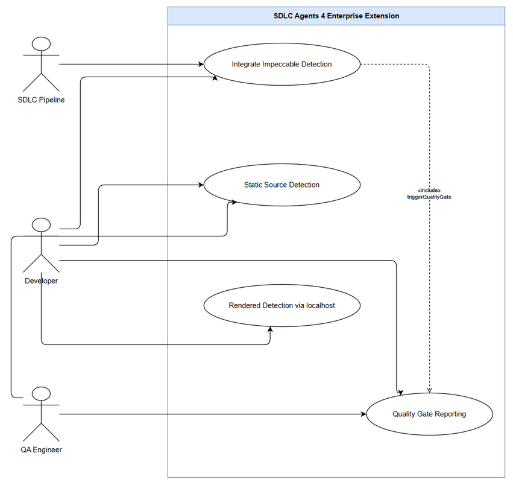
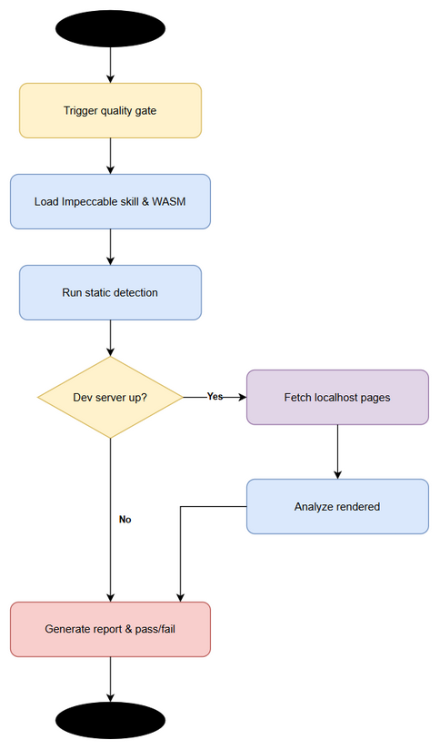

# Business Requirements Document (BRD)

## SA4E — SA4E-393: Integrate Impeccable design detection into SDLC Agents 4 Enterprise extension

---

## Document Information

| Field | Value |
|-------|-------|
| Jira Ticket | SA4E-393 |
| Title | Integrate Impeccable design detection into SDLC Agents 4 Enterprise extension |
| Author | BA Agent |
| Version | 1.0 |
| Date | 2026-10-31 |
| Status | Draft |

---

## Author Tracking

| Role | Name - Position | Responsibility |
|------|-----------------|----------------|
| Author | BA Agent – Business Analyst | Create document |
| Peer Reviewer | - | Review document |

---

## Revision History

| Version | Date | Author | Changes |
|---------|------|--------|---------|
| 1.0 | 2026-10-31 | BA Agent | Initiate document — auto-generated from Jira ticket SA4E-393 and linked tickets |

---

## Sign-Off

| Name | Signature and date |
|------|--------------------|
| | ☐ I agree and confirm all criteria on this BRD as expected requirements |
| | ☐ I agree and confirm all criteria on this BRD as expected requirements |

---

## 1. Introduction

### 1.1 Scope

Integrate Impeccable skill and detector WASM into SDLC Agents 4 Enterprise extension to run design quality gate within SDLC pipeline. The extension will leverage Node runtime available in VSCode/Kiro extension host, requiring no external app installation. The feature supports both static source detection and rendered detection via fetch to localhost dev server.

Objectives:
- Enable automated design quality checks as part of SDLC pipeline
- Detect design issues early using Impeccable skill + WASM detector
- Provide both static source and rendered visual detection capabilities
- Zero external dependency beyond extension host Node runtime

### 1.2 Out of Scope

- Development of Impeccable skill itself – assumed existing
- Development of WASM detector core – assumed existing
- UI redesign of extension – focus on quality gate integration
- Support for non-localhost rendered detection targets
- Creating FSD – will be separate deliverable

### 1.3 Preliminary Requirement

- VSCode/Kiro extension host with Node runtime available
- Impeccable skill package accessible to extension
- Impeccable detector WASM binary available
- SDLC Agents 4 Enterprise extension codebase accessible
- Ability to fetch localhost dev server during pipeline execution

---

## 2. Business Requirements

### 2.1 High Level Process Map

Design quality gate is triggered during SDLC pipeline execution. Agent invokes Impeccable integration which runs static analysis on source files and optionally fetches rendered pages from localhost dev server. Results are collected, scored, and reported as quality gate pass/fail with details.

*[Edit in draw.io](diagrams/use-case.drawio)*

*[Edit in draw.io](diagrams/business-flow.drawio)*

### 2.2 List of User Stories / Use Cases

| # | Story / Use Case / Epic | Priority | Source Ticket |
|---|-------------------------|----------|---------------|
| 1 | As a developer, I want Impeccable design detection integrated into SDLC pipeline so that design issues are caught early | MUST HAVE | SA4E-393 |
| 2 | As a developer, I want static source design detection so that issues can be found without running the app | MUST HAVE | SA4E-393 |
| 3 | As a developer, I want rendered design detection via localhost fetch so that visual issues are validated against running UI | SHOULD HAVE | SA4E-393 |
| 4 | As a QA engineer, I want design quality gate reports so that design quality is measurable and auditable | SHOULD HAVE | SA4E-393 |

### 2.3 Details of User Stories

#### Business Flow

**Step 1:** SDLC pipeline triggers design quality gate phase
**Step 2:** Extension loads Impeccable skill and WASM detector via Node runtime
**Step 3:** Static source detection runs on relevant source files
**Step 4:** If rendered detection enabled, extension fetches localhost dev server pages
**Step 5:** WASM detector analyses static + rendered artifacts
**Step 6:** Results aggregated into quality gate report
**Step 7:** Pipeline proceeds or fails based on quality thresholds

> **Note:** Rendered detection is optional and depends on dev server availability

#### STORY 1: Integrate Impeccable design detection into extension

> As a developer, I want Impeccable design detection integrated into SDLC pipeline so that design issues are caught early

**Requirement Details:**
1. Extension must load Impeccable skill and detector WASM using Node runtime in extension host
2. Integration must not require external app installation
3. Design quality gate must be invocable from SDLC pipeline

**Acceptance Criteria:**
1. Extension starts and loads Impeccable skill without errors
2. WASM detector loads successfully in Node runtime
3. Design quality gate can be triggered via pipeline command
4. No external dependencies beyond extension host

**Data Fields (if applicable):**
| Field | Type | Required | Description | Example |
|-------|------|----------|-------------|---------|
| detectionMode | string | Yes | static / rendered / both | static |
| threshold | number | No | Quality score threshold | 0.8 |

#### STORY 2: Static source design detection

> As a developer, I want static source design detection so that issues can be found without running the app

**Requirement Details:**
1. Detector must analyze source files for design anti-patterns
2. Support common frontend source types
3. Return findings with file location and severity

**Acceptance Criteria:**
1. Static detection runs on specified source path
2. Findings are returned in structured format
3. Detection completes within acceptable time

#### STORY 3: Rendered design detection via localhost

> As a developer, I want rendered design detection via localhost fetch so that visual issues are validated against running UI

**Requirement Details:**
1. Extension must fetch pages from configurable localhost dev server URL
2. Rendered content passed to WASM detector
3. Handle dev server unavailable gracefully

**Acceptance Criteria:**
1. Fetch localhost URL succeeds when server is up
2. Rendered detection results are reported alongside static results
3. Clear error message if localhost unreachable

#### STORY 4: Quality gate reporting

> As a QA engineer, I want design quality gate reports so that design quality is measurable and auditable

**Requirement Details:**
1. Generate report summarizing findings, score, pass/fail
2. Report accessible from pipeline output

**Acceptance Criteria:**
1. Report includes total issues, severity breakdown, score
2. Pass/fail determined by threshold
3. Report persisted for audit

---

## 3. Dependencies

| Dependency | Type | Related Ticket | Description |
|------------|------|----------------|-------------|
| Impeccable skill | External | N/A | Must be available as npm/package for extension |
| Impeccable detector WASM | External | N/A | WASM binary must be loadable in Node |
| VSCode/Kiro extension host | Infrastructure | N/A | Node runtime must be available |
| SDLC Agents 4 Enterprise extension | System | SA4E-393 | Host extension for integration |

---

## 4. Stakeholders

| Role | Name / Team | Responsibility | Source |
|------|-------------|----------------|--------|
| Reporter | Duc Nguyen Minh | Feature requester | SA4E-393 |
| BA Agent | BA Agent | Requirements documentation | Internal |
| Developer | TBD | Implementation | SA4E-393 |
| QA Engineer | TBD | Quality gate validation | SA4E-393 |

---

## 5. Risks and Assumptions

### 5.1 Risks

| Risk | Impact | Likelihood | Mitigation |
|------|--------|------------|------------|
| WASM detector incompatible with Node runtime | High | Medium | Validate WASM compatibility early in spike |
| Localhost dev server not running during pipeline | Medium | High | Make rendered detection optional with graceful fallback |
| Performance impact on pipeline | Medium | Medium | Benchmark detection time, allow async execution |

### 5.2 Assumptions

- Impeccable skill and WASM detector exist and are stable
- Node runtime in extension host supports WASM loading
- Source files follow conventions detectable by Impeccable
- Localhost dev server runs on known port during pipeline

---

## 6. Non-Functional Requirements

| Category | Requirement | Details |
|----------|-------------|---------|
| Performance | Detection must complete within pipeline time budget | Static detection < 30s per module; rendered detection < 60s |
| Security | No external network calls except localhost fetch | WASM runs in-process, no data exfiltration |
| Scalability | Support multiple projects in same workspace | Detector instances isolated per project |
| Availability | Quality gate optional, pipeline continues on failure | Fail-open mode configurable |

> If no specific non-functional requirements are identified from the tickets, state: "No specific non-functional requirements identified. To be confirmed with technical team."

---

## 7. Related Tickets

| Ticket Key | Summary | Status | Type | Relationship |
|------------|---------|--------|------|--------------|
| SA4E-393 | Integrate Impeccable design detection into SDLC Agents 4 Enterprise extension | In Progress | Feature | Main ticket |

---

## 8. Appendix

### Business Objectives

- Improve design quality early in SDLC
- Reduce design debt by automated detection
- Integrate design quality gate into existing pipeline without external tools
- Enable both static and rendered design validation

### Success Criteria

- Impeccable skill and WASM detector load successfully in extension host
- Static source detection runs and returns findings
- Rendered detection via localhost fetch works when dev server is up
- Quality gate report generated and integrated into pipeline
- No external app installation required

### Constraints

- Must use Node runtime already available in VSCode/Kiro extension host
- No external app installation
- Must support both static and rendered detection modes

### Glossary

| Term | Definition |
|------|------------|
| Impeccable | Design quality detection skill and WASM detector |
| Quality Gate | Automated check that must pass before pipeline continues |
| WASM | WebAssembly runtime for detector |
| SDLC Pipeline | Software lifecycle pipeline in SDLC Agents 4 Enterprise |

### Reference Documents

| Document | Link / Location |
|----------|-----------------|
| Jira Ticket SA4E-393 | https://jiraassist.atlassian.net/browse/SA4E-393 |
| BRD Template | documents/templates/BRD-TEMPLATE.md |
