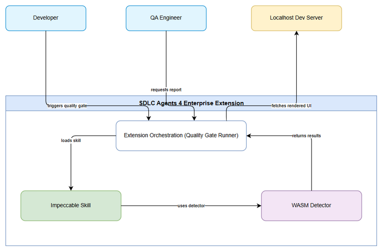
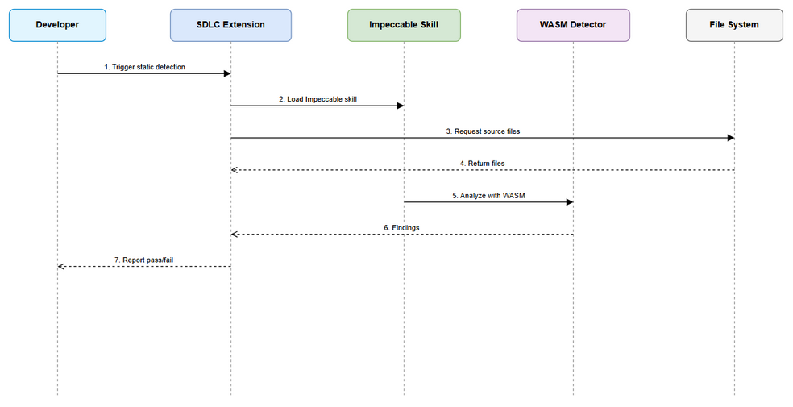
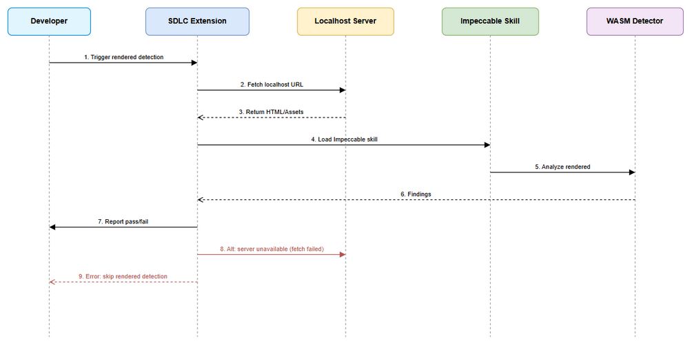
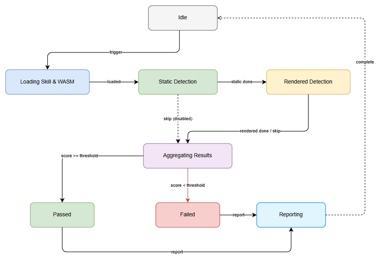

# Functional Specification Document (FSD)

## SDLC Agents 4 Enterprise Extension — SA4E-393: Integrate Impeccable design detection into SDLC Agents 4 Enterprise extension

---

## Document Information

| Field | Value |
|-------|-------|
| Jira Ticket | SA4E-393 |
| Title | Integrate Impeccable design detection into SDLC Agents 4 Enterprise extension |
| Author | BA Agent |
| Version | 1.1 |
| Date | 2026-11-12 |
| Status | Draft |
| Related BRD | documents/SA4E-393/BRD.md |

---

## Revision History

| Version | Date | Author | Changes |
|---------|------|--------|---------|
| 1.0 | 2026-10-31 | BA Agent | Initiate document — auto-generated from BRD and Jira tickets |
| 1.1 | 2026-11-12 | BA Agent | Addendum 4 — Agent-Invocable Design Gate + Agent Self-Check (scope extension, USER-approved per RUN-LOG #43) |
| 1.2 | 2026-11-13 | BA Agent | Addendum 5 — Auto-trust git worktree for base_dir (scope extension, USER-approved; docs only, batch 1/2) |
| 1.3 | 2026-11-13 | BA Agent | Addendum 5 CORRECTIVE — scope narrowed to extension only; backend/sync/parity/MCP_OPEN_WORKSPACE_FOLDERS requirements removed; Correction note added (USER-approved) |

---

## 1. Introduction

### 1.1 Purpose

This FSD specifies the functional requirements for integrating Impeccable design detection skill and WASM detector into SDLC Agents 4 Enterprise extension. The feature enables automated design quality gate execution within the SDLC pipeline using Node runtime available in VSCode/Kiro extension host, supporting both static source and rendered localhost detection.

### 1.2 Scope

Reference BRD scope: integrate Impeccable design detection into SDLC pipeline without external app installation. Technical scope clarifications:
- Detection modes: static source analysis and optional rendered analysis via localhost fetch.
- Quality gate reporting integrated into pipeline output.
- No development of Impeccable skill/WASM core; assumed existing and accessible.

### 1.3 Definitions & Acronyms

| Term | Definition |
|------|------------|
| Impeccable | Design quality detection skill and WASM detector |
| Quality Gate | Automated check that must pass before pipeline continues |
| WASM | WebAssembly runtime for detector |
| SDLC Pipeline | Software lifecycle pipeline in SDLC Agents 4 Enterprise |

### 1.4 References

| Document | Location |
|----------|----------|
| BRD | documents/SA4E-393/BRD.md |
| FSD Template | documents/templates/FSD-TEMPLATE.md |

---

## 2. System Overview

### 2.1 System Context Diagram


*[Edit in draw.io](diagrams/system-context.drawio)*

The system interacts with Developer and QA Engineer actors who trigger the design quality gate. The SDLC Agents 4 Enterprise Extension loads Impeccable Skill and WASM Detector using Node runtime, optionally fetches pages from Localhost Dev Server, and returns aggregated findings as quality gate report.

### 2.2 System Architecture

High-level components:
- **SDLC Agents Extension Host**: entry point for pipeline command, orchestrates detection modes.
- **Impeccable Skill Loader**: loads skill package via Node runtime.
- **WASM Detector Runtime**: executes static and rendered analysis.
- **File System Adapter**: provides source files for static detection.
- **Localhost Fetcher**: fetches rendered pages when rendered mode enabled.
- **Report Generator**: aggregates findings, score, pass/fail.

---

## 3. Functional Requirements

### 3.1 Feature: Integrate Impeccable design detection into extension

**Source:** BRD Story 1

#### 3.1.1 Description

Extension must load Impeccable skill and detector WASM using Node runtime in extension host. Integration must be invocable from SDLC pipeline without external app installation.

#### 3.1.2 Use Case

**Use Case ID:** UC-001
**Actor:** Developer
**Preconditions:** Extension installed; Impeccable skill package accessible; WASM binary available.
**Postconditions:** Impeccable skill and WASM detector loaded and ready for quality gate.

**Main Flow:**

| Step | Actor | System | Description |
|------|-------|--------|-------------|
| 1 | Developer | | Triggers design quality gate via pipeline command |
| 2 | | SDLC Extension | Initializes Node runtime loader |
| 3 | | Impeccable Skill Loader | Loads skill package |
| 4 | | WASM Detector Runtime | Loads WASM binary |
| 5 | | SDLC Extension | Confirms load success |

**Alternative Flows:**

| ID | Condition | Steps |
|----|-----------|-------|
| AF-1 | Rendered mode enabled | Extension also prepares localhost fetcher |
| AF-2 | Skill already cached | Skip load, reuse cached instance |

**Exception Flows:**

| ID | Condition | Steps |
|----|-----------|-------|
| EF-1 | WASM incompatible with Node | Log error, report quality gate failure |
| EF-2 | Package not found | Report missing dependency error |

#### 3.1.3 Business Rules

| Rule ID | Rule | Source |
|---------|------|--------|
| BR-01 | Extension must load Impeccable skill and WASM detector using Node runtime | BRD Story 1 |
| BR-02 | No external app installation required | BRD Story 1 |
| BR-03 | Quality gate must be invocable from SDLC pipeline | BRD Story 1 |

#### 3.1.4 Data Specifications

**Input Data:**

| Field | Type | Required | Validation | Description |
|-------|------|----------|------------|-------------|
| detectionMode | string | Yes | enum: static, rendered, both | Mode of detection |
| threshold | number | No | 0-1 | Quality score threshold |

**Output Data:**

| Field | Type | Description |
|-------|------|-------------|
| loadStatus | string | success / error |
| message | string | Load confirmation or error |

#### 3.1.5 UI Specifications

No direct UI screens for this feature. Interaction via pipeline command output.

<!-- TA enrichment -->
#### 3.1.6 API Contract (Functional View)
**[Implements: Story #1]**

**Endpoint:** `POST /pipeline/design-gate/load`
**Purpose:** Initialize Impeccable skill and WASM detector in extension host

**Input Parameters:**
| Parameter | Type | Required | Business Rule | Description |
|-----------|------|----------|---------------|-------------|
| detectionMode | string | Yes | BR-01 | static / rendered / both |
| threshold | number | No | BR-01 | Quality score threshold 0-1 |
| cacheReuse | boolean | No | — | Reuse cached instance if available |

**Output Data:**
| Field | Type | Description |
|-------|------|-------------|
| loadStatus | string | success / error |
| message | string | Confirmation or error description |
| instanceId | string | Identifier for loaded detector instance |

**Business Error Scenarios:**
| Scenario | User Message | Trigger Condition |
|----------|-------------|-------------------|
| WASM Incompatible | "Impeccable detector failed to load: Node WASM incompatible" | EF-1 |
| Package Not Found | "Impeccable skill package not found in workspace" | EF-2 |
| Runtime Unavailable | "Node runtime unavailable in extension host" | Node runtime missing |

### 3.2 Feature: Static source design detection

**Source:** BRD Story 2

#### 3.2.1 Description

Detector analyzes source files for design anti-patterns without running the app.

#### 3.2.2 Use Case

**Use Case ID:** UC-002
**Actor:** Developer
**Preconditions:** Extension loaded; source path specified.
**Postconditions:** Static findings returned in structured format.

**Main Flow:**

| Step | Actor | System | Description |
|------|-------|--------|-------------|
| 1 | Developer | | Requests static detection on source path |
| 2 | | SDLC Extension | Retrieves source files |
| 3 | | WASM Detector | Analyzes files for anti-patterns |
| 4 | | SDLC Extension | Collects findings with file location and severity |
| 5 | | Developer | Receives findings |

**Alternative Flows:**
<!-- TA enrichment -->
| ID | Condition | Steps |
|----|-----------|-------|
| AF-1 | Source path exceeds size threshold (> 10k files) | Extension switches to incremental batching with progress reporting |
| AF-2 | Static findings cached from previous run (< 5 min old) | Return cached findings with cache-hit flag |

**Exception Flows:**
| ID | Condition | Steps |
|----|-----------|-------|
| EF-1 | Source path invalid | Return error, abort detection |
| EF-2 | Detector timeout (> 30s per module) | Return partial findings with warning, mark run as inconclusive |

#### 3.2.3 Business Rules

| Rule ID | Rule | Source |
|---------|------|--------|
| BR-04 | Static detection must run on specified source path | BRD Story 2 |
| BR-05 | Findings must include file location and severity | BRD Story 2 |
| BR-06 | Detection completes within acceptable time | BRD NFR Performance |

#### 3.2.4 Data Specifications

**Input Data:**

| Field | Type | Required | Validation | Description |
|-------|------|----------|------------|-------------|
| sourcePath | string | Yes | Path exists | Root path for analysis |

**Output Data:**

| Field | Type | Description |
|-------|------|-------------|
| findings | array | List of issues |
| file | string | Source file path |
| severity | string | low/medium/high |
| message | string | Issue description |

#### 3.2.5 UI Specifications

No UI. Output via pipeline report.

<!-- TA enrichment -->
#### 3.2.6 API Contract (Functional View)
**[Implements: Story #2]**

**Endpoint:** `POST /pipeline/design-gate/static-detect`
**Purpose:** Run static design anti-pattern analysis on source files

**Input Parameters:**
| Parameter | Type | Required | Business Rule | Description |
|-----------|------|----------|---------------|-------------|
| sourcePath | string | Yes | BR-04 | Root path for analysis |
| instanceId | string | Yes | BR-01 | Loaded detector instance ID |
| maxFiles | number | No | — | Upper limit for batching (default 10000) |

**Output Data:**
| Field | Type | Description |
|-------|------|-------------|
| findings | array | List of issues with file, severity, message |
| fileCount | number | Number of files analyzed |
| durationMs | number | Processing time |
| cacheHit | boolean | True if result from cache |

**Business Error Scenarios:**
| Scenario | User Message | Trigger Condition |
|----------|-------------|-------------------|
| Invalid Path | "Source path does not exist" | EF-1 |
| Timeout | "Static detection timed out after 30s per module" | EF-2 |
| Empty Result | "No source files found in path" | sourcePath empty |

*Sequence diagram for static detection:*

*[Edit in draw.io](diagrams/sequence-static.drawio)*

### 3.3 Feature: Rendered design detection via localhost

**Source:** BRD Story 3

#### 3.3.1 Description

Extension fetches pages from configurable localhost dev server URL and passes rendered content to WASM detector.

#### 3.3.2 Use Case

**Use Case ID:** UC-003
**Actor:** Developer
**Preconditions:** Dev server running; localhost URL configured.
**Postconditions:** Rendered findings reported alongside static results.

**Main Flow:**

| Step | Actor | System | Description |
|------|-------|--------|-------------|
| 1 | Developer | | Enables rendered detection |
| 2 | | SDLC Extension | Fetches localhost URL |
| 3 | | WASM Detector | Analyzes rendered content |
| 4 | | SDLC Extension | Aggregates rendered findings |
| 5 | | Developer | Receives combined report |

**Alternative Flows:**
<!-- TA enrichment -->
| ID | Condition | Steps |
|----|-----------|-------|
| AF-1 | Dev server unavailable | Skip rendered detection, log warning, continue with static only |
| AF-2 | Multiple URLs provided (comma-separated) | Iterate URLs, aggregate findings per URL |

**Exception Flows:**
| ID | Condition | Steps |
|----|-----------|-------|
| EF-1 | Fetch fails | Return clear error message |
| EF-2 | CORS / network error during fetch | Log warning, mark rendered findings as unavailable, continue with static only |

#### 3.3.3 Business Rules

| Rule ID | Rule | Source |
|---------|------|--------|
| BR-07 | Extension must fetch pages from configurable localhost dev server URL | BRD Story 3 |
| BR-08 | Rendered detection results reported alongside static results | BRD Story 3 |
| BR-09 | Clear error message if localhost unreachable | BRD Story 3 |

#### 3.3.4 Data Specifications

**Input Data:**

| Field | Type | Required | Validation | Description |
|-------|------|----------|------------|-------------|
| localhostUrl | string | Yes if rendered enabled | Valid URL http://localhost | Target dev server URL |

**Output Data:**

| Field | Type | Description |
|-------|------|-------------|
| renderedFindings | array | Issues from rendered UI |
| fetchStatus | string | success / failed |

#### 3.3.5 UI Specifications

No UI. Status reported in pipeline output.

<!-- TA enrichment -->
#### 3.3.6 API Contract (Functional View)
**[Implements: Story #3]**

**Endpoint:** `POST /pipeline/design-gate/rendered-detect`
**Purpose:** Fetch localhost pages and analyze rendered UI

**Input Parameters:**
| Parameter | Type | Required | Business Rule | Description |
|-----------|------|----------|---------------|-------------|
| localhostUrl | string | Yes | BR-07 | Configurable localhost URL |
| instanceId | string | Yes | BR-01 | Loaded detector instance |
| urls | array[string] | No | — | Additional pages to fetch |

**Output Data:**
| Field | Type | Description |
|-------|------|-------------|
| renderedFindings | array | Issues from rendered UI |
| fetchStatus | string | success / failed / partial |
| pagesFetched | number | Count of successful fetches |

**Business Error Scenarios:**
| Scenario | User Message | Trigger Condition |
|----------|-------------|-------------------|
| Dev Server Unreachable | "Dev server not reachable, skipping rendered detection" | AF-1 |
| Fetch Failed | "Failed to fetch localhost page: reason" | EF-1 |
| CORS Error | "CORS block prevented fetch, rendered detection skipped" | EF-2 |

*Sequence diagram for rendered detection:*

*[Edit in draw.io](diagrams/sequence-rendered.drawio)*

### 3.4 Feature: Quality gate reporting

**Source:** BRD Story 4

#### 3.4.1 Description

Generate report summarizing findings, score, pass/fail for audit.

#### 3.4.2 Use Case

**Use Case ID:** UC-004
**Actor:** QA Engineer
**Preconditions:** Detection completed.
**Postconditions:** Report persisted and accessible.

**Main Flow:**

| Step | Actor | System | Description |
|------|-------|--------|-------------|
| 1 | QA Engineer | | Requests quality gate report |
| 2 | | Report Generator | Aggregates findings, calculates score |
| 3 | | Report Generator | Determines pass/fail based on threshold |
| 4 | | SDLC Extension | Persists report |
| 5 | | QA Engineer | Views report |

**Alternative Flows:**
<!-- TA enrichment -->
| ID | Condition | Steps |
|----|-----------|-------|
| AF-1 | Fail-open mode enabled | Report generated with pass=true regardless of score, warning logged |
| AF-2 | Report requested before detection complete | Return pending status with partial data |

**Exception Flows:**
| ID | Condition | Steps |
|----|-----------|-------|
| EF-1 | Score calculation fails | Report error, mark gate as inconclusive |
| EF-2 | Persistence fails | Report generated in memory, log warning, notify user to retry save |

#### 3.4.3 Business Rules

| Rule ID | Rule | Source |
|---------|------|--------|
| BR-10 | Report includes total issues, severity breakdown, score | BRD Story 4 |
| BR-11 | Pass/fail determined by threshold | BRD Story 4 |
| BR-12 | Report persisted for audit | BRD Story 4 |

#### 3.4.4 Data Specifications

**Output Data:**

| Field | Type | Description |
|-------|------|-------------|
| totalIssues | number | Count of findings |
| severityBreakdown | object | Count per severity |
| score | number | Quality score 0-1 |
| pass | boolean | Pass/fail result |
| timestamp | datetime | Generation time |

#### 3.4.5 UI Specifications

No UI. Report accessible via pipeline output artifact.

<!-- TA enrichment -->
#### 3.4.6 API Contract (Functional View)
**[Implements: Story #4]**

**Endpoint:** `GET /pipeline/design-gate/report/{runId}`
**Purpose:** Retrieve quality gate report for audit

**Input Parameters:**
| Parameter | Type | Required | Business Rule | Description |
|-----------|------|----------|---------------|-------------|
| runId | string | Yes | — | Detection run identifier |

**Output Data:**
| Field | Type | Description |
|-------|------|-------------|
| runId | string | Identifier |
| totalIssues | number | Count of findings |
| severityBreakdown | object | Count per severity |
| score | number | Quality score 0-1 |
| pass | boolean | Pass/fail result |
| timestamp | datetime | Generation time |
| findings | array | Full finding details |

**Business Error Scenarios:**
| Scenario | User Message | Trigger Condition |
|----------|-------------|-------------------|
| Report Not Found | "Quality gate report not found for runId" | runId invalid |
| Score Calculation Failed | "Report inconclusive due to scoring error" | EF-1 |
| Persistence Failed | "Report generated but persistence failed" | EF-2 |

---

## 4. Data Model

> Logical data model for detection results.

### 4.1 Entity Relationship Diagram

*ER Diagram not applicable — no persistent DB entities defined in BRD.*

### 4.2 Logical Entities

#### Entity: DetectionRun
<!-- TA enrichment -->
| Attribute | Type | Required | Business Rule | Description |
|-----------|------|----------|---------------|-------------|
| runId | string | Yes | Unique | Identifier for run |
| detectionMode | string | Yes | BR-01 | static/rendered/both |
| threshold | number | No | BR-01 | Quality threshold |
| score | number | Yes | BR-10 | Calculated score |
| pass | boolean | Yes | BR-11 | Pass/fail |
| createdAt | datetime | Yes | Audit | Run timestamp |
| userId | string | Yes | Audit | Initiating user |

**Indexes:** `runId` PK, `createdAt` DESC for audit queries

#### Entity: Finding
| Attribute | Type | Required | Business Rule | Description |
|-----------|------|----------|---------------|-------------|
| findingId | string | Yes | Unique | Identifier |
| runId | string | Yes | FK DetectionRun | Parent run |
| mode | string | Yes | — | static / rendered |
| file | string | No | BR-05 | Source file path |
| severity | string | Yes | — | low/medium/high |
| message | string | Yes | — | Issue description |
| line | number | No | — | Line number if applicable |

**Relationships:**
| From Entity | To Entity | Cardinality | Description |
|-------------|-----------|-------------|-------------|
| DetectionRun | Finding | 1:N | One run produces many findings |

**Constraints:** severity ∈ {low,medium,high}; mode ∈ {static,rendered}

*TA Note:* Codebase currently has no persistent DB for detection results. Entities defined here map to in-memory report objects and optional audit log files. If persistence required, implement as JSON file store under `<workspace>/.code-intel/design-gate/` with runId naming.

---

## 5. Integration Specifications

<!-- TA enrichment -->
### 5.1 External System: Impeccable Skill Package
| Attribute | Value |
|-----------|-------|
| Purpose | Load design detection skill logic |
| Direction | Inbound |
| Data Format | JavaScript/TypeScript modules |
| Frequency | On-demand per pipeline run |

**Data Exchange:**
| Our Data | External Data | Direction | Business Rule |
|----------|--------------|-----------|---------------|
| detectionMode | — | Send | BR-01 |
| skill API call | detection result | Receive | — |

**Integration Contract:**
- **Load API:** `require('impeccable-skill')` → returns Skill API object
- **Request Schema:** `{ mode: 'static'|'rendered'|'both', threshold?: number }`
- **Response Schema:** `{ instanceId: string, status: 'loaded'|'error' }`
- **Auth:** None (local package)
- **Retry Policy:** No retry; fail fast with error message

### 5.2 External System: WASM Detector Binary
| Attribute | Value |
|-----------|-------|
| Purpose | Execute static/rendered analysis |
| Direction | Bidirectional |
| Data Format | WebAssembly binary + JSON |
| Frequency | On-demand |

**Data Exchange:**
| Our Data | External Data | Direction | Business Rule |
|----------|--------------|-----------|---------------|
| source files / HTML content | findings array | Send/Receive | BR-05, BR-08 |

**Integration Contract:**
- **Init API:** `WasmDetector.load(buffer)` → Promise<Detector>
- **Detect API:** `detector.analyze({ content, mode })`
- **Request Schema:** `{ content: string|Uint8Array, mode: 'static'|'rendered' }`
- **Response Schema:** `{ findings: [{ file, severity, message, line? }], score: number }`
- **Error Handling:** Timeout after 30s, return partial findings
- **Retry Policy:** No retry; WASM runs in-process

### 5.3 External System: Localhost Dev Server
| Attribute | Value |
|-----------|-------|
| Purpose | Provide rendered UI for detection |
| Direction | Outbound |
| Data Format | HTTP/HTTPS |
| Frequency | On-demand when rendered mode enabled |

**Data Exchange:**
| Our Data | External Data | Direction | Business Rule |
|----------|--------------|-----------|---------------|
| GET request | HTML page | Send/Receive | BR-07 |

**Integration Contract:**
- **Endpoint:** `GET {localhostUrl}`
- **Request Headers:** `User-Agent: SDLC-Agents-Extension/1.0`
- **Response Schema:** HTTP 200 with HTML body; timeout 10s
- **Auth:** None (localhost only)
- **Retry Policy:** 1 retry with exponential backoff (500ms → 1s); fail gracefully if unreachable
- **Circuit Breaker:** Skip rendered detection after 2 consecutive failures in same run

External systems: Localhost Dev Server (fetch rendered UI), Impeccable Skill Package (npm), WASM Detector Binary.

---

## 6. Processing Logic

### 6.1 Design Quality Gate Process

**Trigger:** SDLC pipeline command
**Input:** detectionMode, threshold, sourcePath, localhostUrl
**Output:** Quality gate report

**Processing Steps:**

| Step | Description | Error Handling |
|------|-------------|----------------|
| 1 | Load Impeccable skill & WASM | Log error, abort |
| 2 | Run static detection | Continue if no source |
| 3 | If rendered enabled, fetch localhost | Graceful fallback if unavailable |
| 4 | Run rendered detection | Skip on fetch error |
| 5 | Aggregate findings & score | Default score 0 on error |
| 6 | Determine pass/fail | Fail-open configurable |
| 7 | Persist report | Log persistence error |

<!-- TA enrichment -->
**Pseudocode — Static Detection Flow**
```typescript
// [Implements: UC-002]
async function runStaticDetection(instanceId: string, sourcePath: string): Promise<StaticResult> {
  if (!fs.existsSync(sourcePath)) {
    throw new Error('Source path does not exist'); // EF-1
  }
  const files = await listFiles(sourcePath, { maxFiles: 10000 });
  if (files.length === 0) {
    return { findings: [], fileCount: 0, durationMs: 0, cacheHit: false };
  }
  const cacheKey = hash(sourcePath);
  const cached = cache.get(cacheKey);
  if (cached && Date.now() - cached.ts < 5*60*1000) {
    return { ...cached.result, cacheHit: true }; // AF-2
  }
  const start = Date.now();
  const findings = [];
  for (const batch of chunk(files, 100)) {
    const batchFindings = await detector.analyzeBatch(batch, { timeout: 30000 });
    findings.push(...batchFindings);
    if (Date.now() - start > 30000) {
      return { findings, fileCount: files.length, durationMs: Date.now()-start, cacheHit: false, partial: true }; // EF-2
    }
  }
  const result = { findings, fileCount: files.length, durationMs: Date.now()-start, cacheHit: false };
  cache.set(cacheKey, { ts: Date.now(), result });
  return result;
}
```

**Pseudocode — Rendered Detection Flow**
```typescript
// [Implements: UC-003]
async function runRenderedDetection(instanceId: string, localhostUrl: string): Promise<RenderedResult> {
  try {
    const html = await fetchWithRetry(localhostUrl, { retries: 1, timeout: 10000 });
    const findings = await detector.analyze({ content: html, mode: 'rendered' });
    return { renderedFindings: findings, fetchStatus: 'success', pagesFetched: 1 };
  } catch (e) {
    if (e.code === 'ECONNREFUSED') {
      log.warn('Dev server unavailable, skipping rendered detection'); // AF-1
      return { renderedFindings: [], fetchStatus: 'skipped', pagesFetched: 0 };
    }
    if (e.type === 'CORS') {
      log.warn('CORS block prevented fetch'); // EF-2
      return { renderedFindings: [], fetchStatus: 'failed', pagesFetched: 0 };
    }
    return { renderedFindings: [], fetchStatus: 'failed', pagesFetched: 0 };
  }
}
```

**Pseudocode — Quality Gate Decision**
```typescript
// [Implements: UC-004]
function determinePassFail(score: number, threshold?: number, failOpen = false): boolean {
  if (failOpen) return true; // AF-1
  if (threshold == null) return true;
  if (isNaN(score)) {
    log.error('Score calculation failed'); // EF-1
    return failOpen; // inconclusive
  }
  return score >= threshold; // BR-11
}
```

*State diagram:*

*[Edit in draw.io](diagrams/state-diagram.drawio)*

---

## 7. Security Requirements

### 7.1 Authentication & Authorization

| Role | Permissions | Screens/Features |
|------|-------------|------------------|
| Developer | Execute quality gate | Pipeline command |
| QA Engineer | View report | Pipeline output |

### 7.2 Data Sensitivity Classification

| Data Type | Classification | Business Requirement |
|-----------|----------------|----------------------|
| Source code | Internal | No exfiltration |
| Detection results | Internal | Audit retained |

### 7.3 Audit Trail

| Event | Logged Fields | Retention | Business Reason |
|-------|--------------|-----------|-----------------|
| Quality gate execution | runId, user, mode, score, pass | 90 days | Auditability |

---

## 8. Non-Functional Requirements

<!-- TA enrichment -->
| Category | Business Requirement | Acceptance Criteria |
|----------|---------------------|---------------------|
| Performance | Detection must complete within pipeline budget | Static < 30s per module (p95), Rendered < 60s per page (p95); WASM load < 2s cold start |
| Security | No external network calls except localhost | WASM in-process; source code never leaves workspace; audit log retention 90 days |
| Availability | Quality gate optional, pipeline continues on failure | Fail-open configurable; availability 99.5% during VSCode active hours |
| Scalability | Support multiple projects in workspace | Isolated instances per project; memory footprint < 150MB per detector instance; concurrent runs ≤ 3 per workspace |
| Reliability | Graceful degradation on errors | Rendered detection skip does not abort static; partial findings returned on timeout |
| Maintainability | Extensible detection modes | New mode added via plugin config without code change; config reload < 1s |

---

## 9. Error Handling (User-Facing)

### 9.1 Error Scenarios

| Scenario | Severity | User Message | Expected Behavior |
|----------|----------|-------------|-------------------|
| WASM load failure | Critical | "Impeccable detector failed to load" | Abort gate |
| Localhost unreachable | Warning | "Dev server not reachable, skipping rendered detection" | Continue static only |
| Source path invalid | Critical | "Source path does not exist" | Abort gate |

---

## 10. Testing Considerations

### 10.1 Test Scenarios

| ID | Scenario | Input | Expected Output | Priority |
|----|----------|-------|-----------------|----------|
| TC-01 | Static detection success | Valid source path | Findings list + score | High |
| TC-02 | Rendered detection with server up | localhostUrl up | Rendered findings | High |
| TC-03 | Rendered detection server down | localhostUrl down | Warning, static only | Medium |
| TC-04 | Threshold pass | score >= threshold | pass=true | High |
| TC-05 | Threshold fail | score < threshold | pass=false | High |

---

## 11. Appendix

### Diagrams

| Diagram | File |
|---------|------|
| System Context | [system-context.png](diagrams/system-context.png) |
| Sequence Static | [sequence-static.png](diagrams/sequence-static.png) |
| Sequence Rendered | [sequence-rendered.png](diagrams/sequence-rendered.png) |
| State Diagram | [state-diagram.png](diagrams/state-diagram.png) |

### Change Log from BRD

- FSD elaborates use cases with main/alternative/exception flows.
- Business rules extracted and numbered.
- Data specifications defined for detection inputs/outputs.
- API Contracts, Integration Specs, Pseudocode omitted per request for TA enrichment.

<!-- TA enrichment -->
### Open Issues

| Issue ID | Description | Owner | Target Date | Severity |
|----------|-------------|-------|-------------|----------|
| OI-01 | WASM detector Node runtime compatibility not validated | SA | 2026-11-10 | High |
| OI-02 | Caching strategy for static detection results undefined | DEV | 2026-11-15 | Medium |
| OI-03 | Localhost URL discovery mechanism (auto-detect port) not specified | BA | 2026-11-12 | Medium |
| OI-04 | Fail-open default behavior needs product decision | PO | 2026-11-08 | High |
| OI-05 | Audit persistence format (JSON vs SQLite) unresolved | TA | 2026-11-20 | Low |

**TA Notes:**
- OI-01 requires spike to confirm WASM loading in VSCode extension host Node version.
- OI-04 impacts Security Requirements §7.3 and NFR Availability.

---

## Addendum 4 (SA4E-393 Scope Extension, 2026-11-12) — Agent-Invocable Design Gate + Agent Self-Check

**Status:** Draft — pending SM review · **Enforcement:** MUST + SM blocker (USER-APPROVED, RUN-LOG #43) · **TDD counterpart:** TDD Addendum 4 (sa-agent, parallel) owns technical design and implementation detail.

> **USER finding (verbatim, RUN-LOG #43):** "Chúng ta làm chức năng này để các AI agent dùng để đảm bảo UI code được thiết kế đúng, nhưng với cách dùng hiện tại thì AI agent không thể dùng được."
>
> **Traceability:** BRD Story 1 original purpose — the gate exists so AI agents ensure UI/design code is designed correctly. FSD BR-03 ("Quality gate must be invocable from SDLC pipeline") is implemented for the AI-agent actor by this addendum.

### A4.1 Background

The design quality gate (native 30-rule engine derived from Impeccable ideas, running inside the extension — no npx/external binary dependency, see TDD Addendum 3) is currently invocable only manually, via VSCode/Kiro commands ("SDLC Agents: Run Design Quality Gate (Static/Rendered/Both)"). AI agents in the SDLC pipeline therefore cannot use it, which leaves the BRD's original purpose unmet. This addendum extends the functional scope (same ticket SA4E-393 — scope extension, no new ticket):

1. **Expose the gate as agent-callable tools** through the extension's existing `LOCAL_TOOL_REGISTRY` (`extension/src/backend-local-tools/registry.ts`, OCP pattern — already used by SA4E-406 drawio tools and SA4E-110 jira/confluence tools). Agents call them through the standard `find_tools` → `execute_dynamic_tool` transport, exactly like `jira_get_issue`. No new MCP server is required.
2. **Mandate agent self-check:** every agent that creates or edits design artifacts MUST run the gate on those artifacts before reporting completion; SM enforces gate evidence at Phase 5/6 completion.

### A4.2 FR-AG1 — Agents invoke the design gate via extension local tools

**Requirement:** Any AI agent in the SDLC pipeline can invoke the design quality gate through the extension-local tools `design_gate_run` and `design_gate_list_rules`, transported via `execute_dynamic_tool` (discovery via `find_tools`), and receives a real report JSON in the same session.

**Actor:** AI agent (primarily dev-agent and ui-agent; any agent per steering rule `.opencode/rules/sdlc/ui-design-gate.md`).

**Use Case UC-AG1 — Agent runs the design gate:**

| Step | Actor | System | Description |
|------|-------|--------|-------------|
| 1 | AI Agent | | Discovers tools: `find_tools("design gate")` |
| 2 | | Extension (LOCAL_TOOL_REGISTRY) | Returns `design_gate_run`, `design_gate_list_rules` |
| 3 | AI Agent | | Calls `execute_dynamic_tool(toolName: "design_gate_run", arguments: { mode, source_path?, threshold? })` |
| 4 | | WASM Detector / native rule engine | Runs locally in the extension host; no npx/external binary |
| 5 | AI Agent | | Receives report JSON (runId, score, pass, findings) in the same session |

**Functional contract (FSD level — TDD Addendum 4 owns exact schemas):**

Tool `design_gate_run` — input arguments (an OBJECT, never a JSON string):

| Field | Type | Required | Default | Description |
|-------|------|----------|---------|-------------|
| mode | string | No | both | static / rendered / both |
| source_path | string | No | "" | Workspace-relative path to scan; omitted/empty = whole workspace |
| threshold | number | No | 0.8 | Pass threshold, 0–1 |

Tool `design_gate_run` — output report JSON:

| Field | Type | Description |
|-------|------|-------------|
| runId | string | Run identifier — required part of agent gate evidence |
| mode | string | Echoed mode |
| score | number | 0–1 (normalized scoring per TDD Addendum (A1)/Addendum 2) |
| pass | boolean | score ≥ threshold |
| threshold | number | Threshold applied |
| findings | array | { file, line?, rule, severity (high/medium/low), message } |
| fileCount / totalFiles | number | Scope accounting |
| severityBreakdown | object | Count per severity (triage) |

Tool `design_gate_list_rules` — input: `{}`; output: catalog of 30 rules (id, severity, description) for triage and traceability to the Impeccable-derived rule set.

**Business Rules:**

| Rule ID | Rule | Source |
|---------|------|--------|
| BR-AG1 | Tools are registered in LOCAL_TOOL_REGISTRY, discoverable via `find_tools`, invocable via `execute_dynamic_tool` — no new MCP server | RUN-LOG #43 (SM verification) |
| BR-AG2 | The gate runs locally inside the extension host; no npx/external binary dependency | RUN-LOG #40 (native decision) |
| BR-AG3 | All report/finding paths are workspace-relative (constraint C5); never absolute paths | RUN-LOG #34/#40; C5 |
| BR-AG4 | Honest reporting: a FAIL on dirty input MUST be returned as FAIL with full findings — never masked, filtered, or force-passed | USER finding; RUN-LOG #40 (FAIL 0.79 = real design debt) |
| BR-AG5 | `arguments` passed to `execute_dynamic_tool` MUST be an object, not a JSON string | tool-usage-dynamic.md |
| BR-AG6 | `design_gate_list_rules` returns the 30-rule catalog | RUN-LOG #43 |

**Acceptance Criteria (FR-AG1):**

| AC ID | Criterion |
|-------|-----------|
| AC-AG1.1 | An agent calling `design_gate_run` via `execute_dynamic_tool` receives, in the same session, a real report JSON containing runId, score, pass, findings |
| AC-AG1.2 | `design_gate_list_rules` returns the rule catalog (30 rules) |
| AC-AG1.3 | Every finding path in the report is workspace-relative |
| AC-AG1.4 | A run over intentionally dirty input returns pass=false with truthful findings (no masking) |
| AC-AG1.5 | `find_tools("design gate")` discovery returns both tools |

### A4.3 FR-AG2 — Agent self-check enforcement (MUST + SM blocker)

**Requirement:** Every agent that creates or edits design artifacts MUST run `design_gate_run` on those artifacts BEFORE reporting done. A FAIL result must be handled by (a) fixing the findings, or (b) a written acceptance justification recorded in RUN-LOG/phase report. Missing gate evidence is an SM blocker for Phase 5 Implementation and Phase 6 Testing completion.

**Trigger scope — design artifacts:**

| Extensions |
|------------|
| .html, .htm, .css, .scss, .sass, .less, .vue, .svelte, .tsx, .jsx |

(Consistent with scan scope TDD Addendum (A1) — `DESIGN_FILE_EXTENSIONS` in `fs.adapter.ts`.)

**FAIL handling — one of the two, no silent acceptance:**

| Option | Requirement | Recorded in |
|--------|-------------|-------------|
| (a) Fix | Fix the findings in the same change/commit and re-run the gate until PASS (LOW findings may be triaged only) | Commit |
| (b) Justify | Written justification (biên bản lý do chấp nhận) for remaining HIGH/MEDIUM findings + follow-up ticket in the shared backlog (SA4E-438) | RUN-LOG / phase report |

**Severity semantics:** HIGH/MEDIUM findings fail the file; LOW is triage-only.

**Gate evidence required in every agent completion report that touches design artifacts:**

| Evidence field | Source |
|----------------|--------|
| tool | "design_gate_run" |
| runId | report JSON |
| score | report JSON |
| pass/fail | report JSON |

**Business Rules:**

| Rule ID | Rule | Source |
|---------|------|--------|
| BR-AG7 | Agents MUST run `design_gate_run` on design artifacts they create/edit before reporting done | USER-APPROVED MUST (RUN-LOG #43) |
| BR-AG8 | FAIL → fix in same change OR written justification + follow-up ticket (SA4E-438 shared backlog) | USER-APPROVED (RUN-LOG #43) |
| BR-AG9 | SM blocks Phase 5 Implementation and Phase 6 Testing completion if the phase report lacks gate evidence (tool name, runId, score, pass/fail) | USER-APPROVED blocker (RUN-LOG #43) |
| BR-AG10 | The steering rule file `.opencode/rules/sdlc/ui-design-gate.md` exists and is loaded in `.opencode/rules` so every agent session carries the obligation | This addendum; AC-AG2.3 |

**Acceptance Criteria (FR-AG2):**

| AC ID | Criterion |
|-------|-----------|
| AC-AG2.1 | An agent that creates/edits a design artifact has gate evidence (tool name, runId, score, pass) in its completion report |
| AC-AG2.2 | Any FAIL is either fixed in the same change or covered by a written justification plus a follow-up ticket (SA4E-438) — never silently accepted |
| AC-AG2.3 | `.opencode/rules/sdlc/ui-design-gate.md` exists and is loaded under `.opencode/rules` |
| AC-AG2.4 | A phase report for Phase 5/6 without gate evidence is blocked by SM |

### A4.4 Scope Boundary

- No changes to the business rules or behavior of FR-01…FR-04 (Sections 3.1–3.4); this addendum adds new actors (AI agents) and enforcement on top of the existing gate.
- Technical wiring (registry registration, exact tool schemas, argument validation) is specified in TDD Addendum 4 (sa-agent).
- No new external dependency; no new MCP server.

### A4.5 Addendum Open Issues

| Issue ID | Description | Owner | Target Date | Severity |
|----------|-------------|-------|-------------|----------|
| OI-AG1 | Confirm `design_gate_list_rules` output shape (id/severity/description vs raw rule text) | SA | before dev hand-off | Low |
| OI-AG2 | Decide whether qa-agent (Phase 6) requires a gate re-run or may reuse the dev-agent runId for the same artifact set | SM/QA | before Phase 6 | Medium |

---


## Addendum 5 (SA4E-393 Scope Extension) — Auto-trust Git Worktree for `base_dir` (CORRECTED: extension-only)

**Status:** Corrected v2 — pending SM review · **Enforcement:** USER-APPROVED (corrective) · **Scope:** EXTENSION ONLY · **TDD counterpart:** TDD Addendum 5 (sa-agent) must be aligned to this scope.

> **Correction note (honest record).** The first version of this Addendum (FSD v1.2, commit f334ab36) and the implementation that followed (backend commits 760316a5, 1ac80e4b, plus sync script / parity TC-702 extension) placed the feature in the **wrong scope**. The initial proposal came from the **main agent**, not from the user, and it was wrong: it treated the backend `MultiWorktreePathResolver` as the source of truth. Root cause of the user-visible failure: the `embed_image` tool and its `base_dir` resolution are **extension-local** (`LOCAL_TOOL_REGISTRY`, `extension/src/backend-local-tools/registry.ts`), and the error `PATH_REJECTED_OUTSIDE_ALLOWLIST` is produced in `extension/src/services/base-dir-resolution.ts`. The backend runs on a **different machine** and cannot read the user's `.git` worktree files, so a worktree check there is meaningless. Consequences, all corrected below: backend commits 760316a5 and 1ac80e4b were **reverted**; the sync script and the backend-dependent parity TC-702 were **dropped**; writing `MCP_OPEN_WORKSPACE_FOLDERS` was **dropped**; every FR/BR/AC/TC depending on the backend was **removed or adjusted**. The correct origin of the logic is `extension/src/services/worktree-trust`, and the open workspace folders come directly from `vscode.workspace.workspaceFolders`.

> **Traceability:** Extends SA4E-394 (multi-worktree `base_dir`, BR-05 allowlist) on the extension surface only. Adds one verifiable way for a `base_dir` to become an accepted root, without relaxing containment (BR-07). Related: `ANALYSIS-settings-worktree.md` (SA4E-438).

### A5.1 Background

**Current state (extension, verified):**

| Component | Behavior today |
|-----------|----------------|
| `extension/src/backend-local-tools/registry.ts` (`LOCAL_TOOL_REGISTRY`) | Hosts extension-local tools (e.g. `embed_image`) executed on the user's machine, with their own `base_dir`. |
| `extension/src/services/base-dir-resolution.ts` (`getExtensionWorkspaceRoots`, `isRootAllowlisted`, `resolveWithBaseDir`) | Resolves `base_dir` against the allowlist = VS Code setting `sdlcAgents.workspace.workspaceRoots`, fallback env `MCP_WORKSPACE_ROOTS`. Not allowlisted → `PATH_REJECTED_OUTSIDE_ALLOWLIST`. Then `FS_ERROR` if not a directory, then containment (BR-07). `isRootAllowlisted` uses `path.resolve` + win32 case-fold only (no `realpath`) — see OI-WT2. |
| Backend (`backend/src/shared/*`) | **Out of scope and unchanged** (runs on another machine; has no access to the user's `.git`). |

**Problem (observed):** a call with `base_dir = C:\Users\ASUS\orca\workspaces\SDLC-Agents-4-Enterprise\SA4E-393-2` is rejected with `PATH_REJECTED_OUTSIDE_ALLOWLIST`. That directory is a **git worktree** of `C:\projects\kiro\SDLC-Agents-4-Enterprise`, the workspace folder open in the IDE. Orca-style tooling creates many short-lived worktrees; pre-registering each is impractical.

**Goal:** in the extension, accept a `base_dir` that is **provably** a linked worktree of a trusted repository, using only on-disk `.git` evidence. The caller-supplied string is never trusted.

### A5.2 Functional Requirements

| FR ID | Requirement |
|-------|-------------|
| FR-WT1 | **Trigger.** In the extension `base_dir` resolution, when `base_dir` is NOT in the allowlist (after normalization), attempt worktree verification (A5.3) before returning `PATH_REJECTED_OUTSIDE_ALLOWLIST`. If allowlisted, behavior is unchanged and no `.git` file is read. |
| FR-WT2 | **Verification steps (all MUST pass, in order, fail-closed):** (1) `<base_dir>/.git` is a regular FILE (not directory, not symlink) containing a single `gitdir: <path>` line; (2) `<path>` realpaths to `<repo>/.git/worktrees/<name>` (linked-worktree admin dir; NOT `.git/modules/…`); (3) back-link: `<admindir>/gitdir` exists and its realpath equals realpath of `<base_dir>/.git`; (4) main repo derived from `<admindir>/commondir` (relative → against admindir; fallback `<admindir>/../..` = `<repo>/.git`), main worktree root = its parent; (5) main worktree root ∈ allowlist OR equals one of `vscode.workspace.workspaceFolders` (realpath-normalized). |
| FR-WT3 | **Do not trust client strings.** Only `base_dir` itself is taken from the caller; trust derives from file contents on disk, the extension allowlist, and `vscode.workspace.workspaceFolders`. |
| FR-WT4 | **Realpath everywhere.** All compared paths (base_dir, `.git` target, admin dir, back-link, repo root, allowlist entries, workspace folders) are `realpath`-normalized; win32 comparisons case-folded. |
| FR-WT5 | **No process spawn.** Direct `fs` reads only; no `git` or child process. |
| FR-WT6 | **Pass outcome.** `base_dir` is accepted as the effective root; the existing pipeline continues (existence → `FS_ERROR`, resolution, containment BR-07). Grants no access beyond `base_dir`. |
| FR-WT7 | **Fail outcome.** Any failed step → `PATH_REJECTED_OUTSIDE_ALLOWLIST` with hint (A5.5). Reason category is logged in the extension output channel only; the response discloses no absolute path beyond the sanitized `base_dir` the caller sent. |
| FR-WT8 | **Submodule rejection.** `.git` pointing into `<repo>/.git/modules/…` or any non-linked-worktree layout is rejected. |
| FR-WT9 | **Bare repo.** If no `<repo>/.git` directory exists (bare), the worktree is trusted only if the common dir's realpath ∈ allowlist. Never matched implicitly against workspace folders. |
| FR-WT10 | **Nested worktree.** Verified independently via its own `.git`. A plain sub-directory of a trusted worktree (no own `.git`) is NOT trusted by inheritance. |
| FR-WT11 | **Prunable / deleted.** Any missing referenced file → fail-closed. Admin dir present but working dir missing → `FS_ERROR` (existing behavior). |
| FR-WT12 | **Bounded reads.** `.git`, `gitdir`, `commondir` ≤ **4 KB** each and **250 ms** total budget; exceeding → fail-closed (`limit_exceeded`). Reject if `.git` is a symlink. |
| FR-WT13 | **Cache.** Verdicts MAY be cached per normalized `base_dir`: positive TTL ≤ 30 s, negative ≤ 5 s; key includes mtimes of `<base_dir>/.git` and `<admindir>/gitdir`; invalidated on mtime change, missing file, or change of allowlist / `workspaceFolders` (subscribe to `onDidChangeWorkspaceFolders` and configuration change). In-memory, bounded (256 entries), never persisted. |
| FR-WT14 | **~~Backend parity~~ — REMOVED.** No backend implementation exists; no cross-surface parity or duplicated logic. Single implementation in `extension/src/services/worktree-trust`. |
| FR-WT15 | **Config/observability.** A VS Code setting to disable auto-trust (default **enabled**, USER-approved; exact name is TDD's call) and a sanitized warn-level log per accept/reject decision (anti log-forging). |
| FR-WT16 | **Module ownership.** `extension/src/services/worktree-trust` is the origin of the logic; `base-dir-resolution.ts` calls it. The module must not depend on backend code, a generated mirror, or a sync script. |

### A5.3 Verification Flow (text)

```
base_dir (raw) → normalize
 ├─ allowlist contains base_dir? ── yes → existing pipeline (no .git read)
 └─ no → auto-trust enabled? ── no → PATH_REJECTED_OUTSIDE_ALLOWLIST
          └─ cache hit (valid)? → use cached verdict
          └─ miss:
             1. lstat <base_dir>/.git → regular file, ≤ 4KB            else FAIL not_a_worktree
             2. parse "gitdir: X"; realpath(X)=ADMIN                   else FAIL malformed
             3. ADMIN matches …/.git/worktrees/<name>                  else FAIL submodule_or_unknown_layout
             4. ADMIN/gitdir realpath == realpath(<base_dir>/.git)     else FAIL backlink_mismatch
             5. COMMON = ADMIN/commondir (or ../..); MAIN = parent(COMMON) (bare ⇒ FR-WT9)
             6. MAIN ∈ allowlist OR MAIN ∈ vscode.workspace.workspaceFolders else FAIL parent_not_trusted
             → PASS → accept → existence → resolve → containment (BR-07)
```

### A5.4 Business Rules

| Rule ID | Rule |
|---------|------|
| BR-WT1 | Auto-trust is evaluated only when `base_dir` is not allowlisted; allowlist always wins (BR-05). |
| BR-WT2 | Trust comes exclusively from on-disk `.git` evidence, never from client strings. |
| BR-WT3 | `<admindir>/gitdir` MUST point to exactly `<base_dir>/.git`; otherwise forged. |
| BR-WT4 | The main repo MUST be in the allowlist or be an open VS Code workspace folder (`vscode.workspace.workspaceFolders`, read directly). |
| BR-WT5 | All paths `realpath`-normalized; win32 case-folded. |
| BR-WT6 | Submodules and non-linked-worktree layouts are rejected. |
| BR-WT7 | No `git` process is spawned. |
| BR-WT8 | BR-07 containment still applies to every `file_path`; only `base_dir` becomes a root. |
| BR-WT9 | Fail-closed on I/O error, missing file, > 4 KB, > 250 ms, ambiguity; error-as-value, no throw on business paths. |
| BR-WT10 | Responses reveal no absolute path beyond the sanitized `base_dir`. |
| BR-WT11 | Cache TTLs positive ≤ 30 s, negative ≤ 5 s; invalidated per FR-WT13. |
| BR-WT12 | Bare-repo parents trusted only via explicit allowlist registration of the common dir. |
| BR-WT13 | **~~Backend source of truth / TC-702 parity~~ — REMOVED.** The extension is the only surface; backend behavior is unchanged and must not be modified by this Addendum. |
| BR-WT14 | The extension MUST NOT write or require `MCP_OPEN_WORKSPACE_FOLDERS` (or any env/config handoff of workspace folders to a backend). |

### A5.5 Error Handling

| Condition | Code | Message (client-visible) | Hint |
|-----------|------|--------------------------|------|
| Not allowlisted, auto-trust disabled | `PATH_REJECTED_OUTSIDE_ALLOWLIST` | `Workspace root '<sanitized base_dir>' is not registered in the allowlist.` | `Configure sdlcAgents.workspace.workspaceRoots (or MCP_WORKSPACE_ROOTS) to include this path.` |
| Not a worktree / `.git` missing or a directory | same code | same + ` It is not a verified git worktree of a trusted repository.` | `Register the path, or use a git worktree of the open workspace repository.` |
| Malformed `.git`, back-link mismatch, submodule, oversize/timeout | same code | generic message (no per-step detail) | same hint |
| Parent repo not trusted | same code | generic message | `The parent repository must be in the allowlist or be an open workspace folder.` |
| Passes but `base_dir` absent | `FS_ERROR` | `Workspace root '<sanitized>' does not exist on filesystem` (unchanged) | — |
| `file_path` escapes root | `PATH_REJECTED_OUTSIDE_ALLOWLIST` | unchanged BR-07 message | — |

Detailed reason codes (`not_a_worktree`, `malformed`, `backlink_mismatch`, `submodule_or_unknown_layout`, `parent_not_trusted`, `limit_exceeded`, `bare_not_registered`) appear only in extension logs.

### A5.6 Use Cases

**UC-WT1 — Extension-local tool (e.g. `embed_image`) uses a linked worktree of the open workspace repo as `base_dir`**

| Flow | Steps |
|------|-------|
| Main | 1. Tool call with `base_dir=<worktree>`. 2. Not allowlisted → verification. 3. `.git` valid, back-link matches, main repo ∈ `workspaceFolders`. 4. Existence + resolve + containment succeed. 5. Tool runs inside the worktree. |
| Alt-1 | Main repo in the allowlist but not an open folder → trusted via allowlist. |
| Alt-2 | Repeat call within TTL → cached verdict. |
| Alt-3 | `base_dir` already allowlisted → no `.git` read. |
| Exc-1 | Any step fails → `PATH_REJECTED_OUTSIDE_ALLOWLIST` + hint. |

**UC-WT2 — Forged `.git` file:** attacker dir `X` with `.git` → `<trusted>/.git/worktrees/foo`; back-link points to the real worktree, not `X/.git` → rejected (BR-WT3). Alt: back-link absent → rejected. Exc: symlink/junction redirect → realpath mismatch → rejected.

**UC-WT3 — Submodule:** `gitdir: ../.git/modules/sub` → layout mismatch → rejected (BR-WT6); accepted only if the path itself is allowlisted.

**UC-WT4 — Deleted / prunable worktree:** `.git` missing or admin dir pruned → rejected; cached positive with directory deleted within TTL → `FS_ERROR`.

**UC-WT5 — Bare repo parent:** accepted only if the bare path ∈ allowlist; else rejected (`bare_not_registered`).

**UC-WT6 — Nested worktree:** verified independently; plain sub-directory without own `.git` rejected unless allowlisted.

**UC-WT7 — ~~Extension mirror of backend decision~~ — REMOVED** (no backend decision exists). Replaced by UC-WT1, which is the only flow.

### A5.7 Non-Functional Requirements

| NFR ID | Requirement |
|--------|-------------|
| NFR-WT1 | Cold verification ≤ **50 ms** typical, hard budget **250 ms**; cache hit ≤ **1 ms**. |
| NFR-WT2 | Each file read ≤ **4 KB**; ≤ 3 reads + ≤ 6 `lstat/realpath` per verification. |
| NFR-WT3 | Cache ≤ 256 entries, in-memory only. |
| NFR-WT4 | No child process, no network; async fs preferred so the extension host is not blocked beyond the budget. |
| NFR-WT5 | Fail-closed; log sanitization; no path disclosure; TOCTOU limited by short TTL and existence re-check per call. |
| NFR-WT6 | Cross-platform: win32 (case-fold, junctions, `\\?\`, drive letters) and POSIX symlinks. |
| NFR-WT7 | Plugin impact: no measurable activation-time cost (verification is lazy, only on non-allowlisted `base_dir`). |

### A5.8 Scope Boundary

- **In scope:** extension only — `extension/src/services/worktree-trust` (origin), integration in `extension/src/services/base-dir-resolution.ts`, the VS Code setting, extension unit/integration tests, docs of new hints.
- **Out of scope / MUST NOT change:** everything under `backend/` (backend commits 760316a5 and 1ac80e4b are reverted), any sync/generation script between backend and extension, backend-dependent parity tests (TC-702 extension for worktree), `MCP_OPEN_WORKSPACE_FOLDERS`, allowlist loading semantics, legacy mode, containment rules.
- **Relation to SA4E-438:** no hard dependency. If SA4E-438 later needs "is this directory a trusted worktree of the open workspace?", it SHOULD reuse `extension/src/services/worktree-trust` (requirement only; SA decides API). SA4E-393 does not modify `runtime-settings.ts` or `remote-backend-client.ts`.

### A5.9 Acceptance Criteria

| AC ID | Criterion |
|-------|-----------|
| AC-WT1 | `base_dir` = linked worktree of an open workspace folder (not allowlisted) is accepted by the extension; relative `file_path` resolves inside it. |
| AC-WT2 | Forged `.git` (back-link mismatch) → `PATH_REJECTED_OUTSIDE_ALLOWLIST`. |
| AC-WT3 | Submodule `.git` → rejected. |
| AC-WT4 | Worktree of an untrusted repo → rejected. |
| AC-WT5 | Symlink/junction-redirected admin dir or repo path → rejected; win32 case variants of a valid path → accepted. |
| AC-WT6 | Prunable/deleted worktree → rejected or `FS_ERROR`, never accepted. |
| AC-WT7 | `.git` > 4 KB or > 250 ms budget → rejected. |
| AC-WT8 | Bare-repo worktree accepted only if bare path allowlisted. |
| AC-WT9 | Nested worktree verified independently; plain sub-directory rejected. |
| AC-WT10 | Accepted worktree still enforces BR-07 containment. |
| AC-WT11 | **~~Backend/extension parity~~ — REMOVED.** Replaced by: `git diff` shows no change under `backend/` and no sync script; the open-folder source is `vscode.workspace.workspaceFolders` (unit-tested with a stubbed `vscode`). |
| AC-WT12 | Rejection exposes no absolute path other than sanitized `base_dir`; no `git` process spawned. |
| AC-WT13 | Second call within TTL performs no file reads; touching `.git`/`gitdir` or changing workspace folders invalidates the cache. |

**Test impact (for QA/TDD alignment):** drop any WT-* / TC case that targets the backend resolver, the sync script/drift guard, or backend↔extension parity for worktree trust; keep and run extension-only cases for AC-WT1..10, 12, 13 plus lifecycle/activation-time checks.

### A5.10 Addendum Open Issues

| Issue ID | Description | Owner | Target | Severity |
|----------|-------------|-------|--------|----------|
| OI-WT1 | **CLOSED** — open workspace folders = `vscode.workspace.workspaceFolders` read directly in the extension (incl. multi-root); no backend handoff. | — | closed | — |
| OI-WT2 | `isRootAllowlisted` lacks `realpath`; FR-WT4 requires it — fix as part of this scope. | SA/TA | TDD Addendum 5 | Medium |
| OI-WT3 | Setting name for disabling auto-trust (FR-WT15) and cache placement within `worktree-trust`. | SA | TDD Addendum 5 | Low |
| OI-WT4 | Whether SA4E-438 reuses `worktree-trust` (A5.8, requirement only). | SA/SM | SA4E-438 kickoff | Medium |
| OI-WT5 | `commondir` absent on older git layouts (fallback `admindir/../..`) — confirm. | SA | TDD Addendum 5 | Low |
| OI-WT6 | Relocated worktrees (`git worktree move/repair`): accept if back-link consistent — confirm. | SA | TDD Addendum 5 | Low |
| OI-WT7 | TDD Addendum 5, STATUS.json and RUN-LOG still describe the backend design (E1–E11, entries #86–#88); sa-agent must realign TDD, SM must record the correction. | SA/SM | next | High |

---
