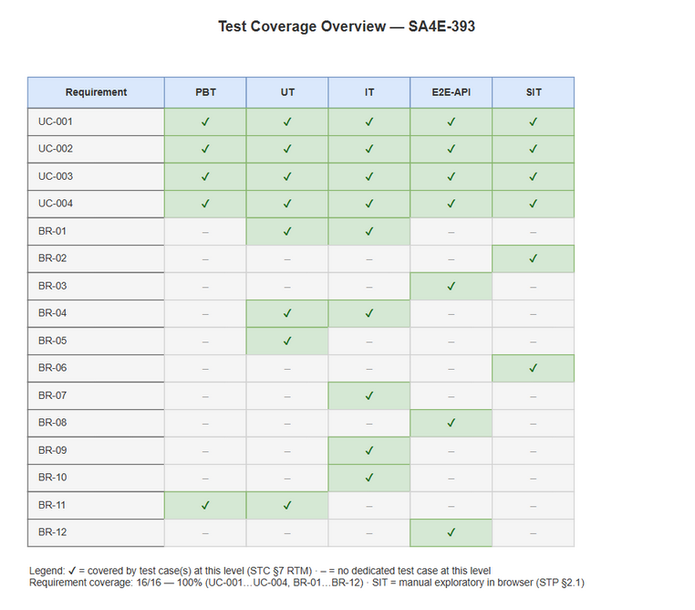
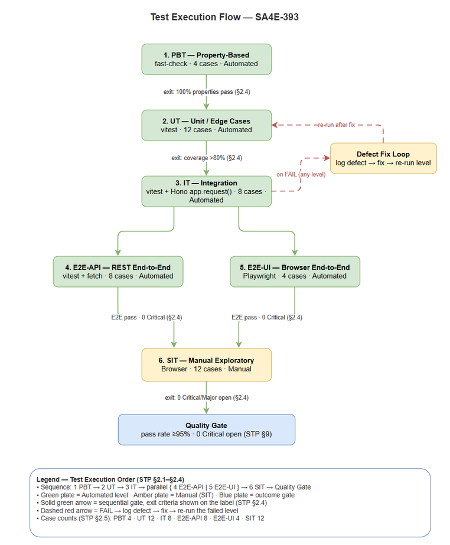

# Software Test Plan (STP)

## SDLC Agents 4 Enterprise — SA4E-393: Integrate Impeccable design detection into SDLC Agents 4 Enterprise extension

---

## Document Information

| Field | Value |
|-------|-------|
| Jira Ticket | SA4E-393 |
| Title | Integrate Impeccable design detection into SDLC Agents 4 Enterprise extension |
| Author | QA Agent |
| Version | 1.0 |
| Date | 2026-10-31 |
| Status | Draft |
| Related BRD | documents/SA4E-393/BRD.md |
| Related FSD | documents/SA4E-393/FSD.md |
| Related TDD | documents/SA4E-393/TDD.md |

---

## Author Tracking

| Role | Name - Position | Responsibility |
|------|-----------------|----------------|
| Author | QA Agent – QA Engineer | Create document |
| Peer Reviewer | - | Review document |

---

## Revision History

| Version | Date | Author | Changes |
|---------|------|--------|---------|
| 1.0 | 2026-10-31 | QA Agent | Initiate document — auto-generated from BRD, FSD, and TDD |

---

## 1. Introduction

### 1.1 Purpose

Test plan for integrating Impeccable design detection skill and WASM detector into SDLC Agents 4 Enterprise extension. Ensures design quality gate works for static source and optional rendered localhost detection with measurable pass/fail reporting.

### 1.2 Test Objectives

- Verify all functional requirements from FSD UC-001 to UC-004 are implemented correctly
- Validate business rules BR-01 to BR-12 are enforced
- Ensure non-functional requirements for performance, security, availability are met
- Verify quality gate reporting is accurate and auditable

### 1.3 References

| Document | Location |
|----------|----------|
| BRD | documents/SA4E-393/BRD.md |
| FSD | documents/SA4E-393/FSD.md |
| TDD | documents/SA4E-393/TDD.md |

---

## 2. Test Strategy

### 2.1 Test Levels

| Level | Scope | Automation | Tools |
|-------|-------|------------|-------|
| PBT | Correctness properties with random inputs | Automated | fast-check |
| UT | Unit/edge case tests for components | Automated | vitest |
| IT | API integration in-process Hono/VSCode extension host | Automated | vitest + Hono app.request() |
| E2E-API | REST endpoint E2E real server | Automated | vitest + fetch |
| E2E-UI | Browser UI E2E where applicable | Automated | Playwright |
| SIT | Manual exploratory / visual verification | Manual | Browser |

### 2.2 Test Types

| Type | Description | Applicable |
|------|-------------|------------|
| Functional Testing | Verify features per FSD use cases | Yes |
| Regression Testing | Ensure existing pipeline not broken | Yes |
| Performance Testing | Static <30s, Rendered <60s | Yes |
| Security Testing | No external network except localhost | Yes |
| Usability Testing | Command output clarity | Partial |

### 2.3 Test Approach

Risk-based prioritization. Critical path: Load detector → Static detection → Report pass/fail. Rendered detection optional with graceful fallback. Automation prioritized for API and component tests; SIT limited to visual/timing verification.

**E2E Automation Coverage**: CRUD operations for detection runs classified as E2E-API. Form validation N/A. RBAC not applicable. Status changes and report generation automated via E2E-API. Blocking overlay timing and visual layout left to SIT manual.

### 2.4 Entry/Exit Criteria

| Level | Entry Criteria | Exit Criteria |
|-------|----------------|---------------|
| PBT/UT/IT | Code merged, unit tests pass | 100% properties pass, coverage >80% |
| E2E-API/E2E-UI | Integration tests pass, test env ready | All automated tests pass, 0 Critical |
| SIT | E2E tests pass, test data prepared | 100% SIT cases executed, 0 Critical/Major open |

### 2.5 Test Cases Summary

| Level | Count | Automated | Manual |
|-------|-------|-----------|--------|
| PBT | 4 | 4 | 0 |
| UT | 12 | 12 | 0 |
| IT | 8 | 8 | 0 |
| E2E-API | 8 | 8 | 0 |
| E2E-UI | 4 | 4 | 0 |
| SIT | 12 | 0 | 12 |
| **Total** | **48** | **36 (75%)** | **12 (25%)** |

---

## 3. Test Scope

### 3.1 Features In Scope

| # | Feature / Story | Priority | FSD Reference | Test Type |
|---|----------------|----------|---------------|-----------|
| 1 | Integrate Impeccable detection into extension | MUST | UC-001, BR-01..03 | Functional/Integration |
| 2 | Static source design detection | MUST | UC-002, BR-04..06 | Functional/Performance |
| 3 | Rendered design detection via localhost | SHOULD | UC-003, BR-07..09 | Functional/Integration |
| 4 | Quality gate reporting | SHOULD | UC-004, BR-10..12 | Functional/Non-Functional |

### 3.2 Features Out of Scope

| # | Feature | Reason |
|---|---------|--------|
| 1 | Development of Impeccable skill/WASM core | Assumed existing |
| 2 | Non-localhost rendered detection | Out of BRD scope |
| 3 | UI redesign of extension | Focus on quality gate integration |

---

## 4. Test Environment

### 4.1 Environment Requirements

| Environment | Setup | Purpose |
|-------------|-------|---------|
| Dev/Local | VS Code/Kiro extension host, Node 20.x | Automated tests |
| SIT | Workspace with fixture source files, mock localhost server | Manual SIT |

### 4.2 Test Data Requirements

| Data Type | Description | Source |
|-----------|-------------|--------|
| Fixture source files | Small TS/JS projects with known anti-patterns | tests/fixtures/impeccable/ |
| Mock HTML pages | Rendered UI samples | tests/fixtures/rendered/ |
| Detection run JSON | Pre-seeded runs for report retrieval | testdata/pre-seeded-data.csv |

### 4.3 External Dependencies

| System | Dependency | Mock/Stub |
|--------|------------|-----------|
| Impeccable Skill Package | npm package | No, real package required |
| WASM Detector Binary | local .wasm | No |
| Localhost Dev Server | http://localhost:5173 | Mock server for tests |

---

## 5. Test Schedule

| Phase | Start | End | Duration |
|-------|-------|-----|----------|
| Test Planning | 2026-10-31 | 2026-11-02 | 2 days |
| Test Data Prep | 2026-11-03 | 2026-11-04 | 2 days |
| Automation Execution | 2026-11-05 | 2026-11-07 | 3 days |
| SIT Execution | 2026-11-08 | 2026-11-09 | 2 days |
| Defect Fix & Retest | 2026-11-10 | 2026-11-12 | 3 days |

---

## 6. Resources & Responsibilities

| Role | Responsibility |
|------|----------------|
| Test Lead | STP/STC approval, reporting |
| QA Engineer | Test design, execution, defect reporting |
| Developer | Unit tests, bug fix |
| BA | UAT support, acceptance criteria |

---

## 7. Risk & Mitigation

| # | Risk | Impact | Likelihood | Mitigation |
|---|------|--------|------------|------------|
| 1 | WASM incompatible with Node runtime | High | Medium | Spike validation early, fallback error |
| 2 | Localhost dev server not running | Medium | High | Rendered detection optional with graceful fallback |
| 3 | Performance impact on pipeline | Medium | Medium | Benchmark detection time, async execution |

---

## 8. Defect Management

Severity: Critical/Major/Minor/Trivial. Priority P1-P4. SLA P1 4h, P2 1 day.

---

## 9. Test Metrics

Pass rate ≥95%, Defect density ≤0.1, Critical defects 0.

---

## 10. Requirements Traceability Matrix Overview

Full RTM in STC.md Appendix.

| Requirement | Source | Test Cases |
|-------------|--------|------------|
| UC-001 | FSD 3.1 | PBT-01, UT-01, IT-01, E2E-API-01, SIT-01 |
| UC-002 | FSD 3.2 | PBT-02, UT-04, IT-03, E2E-API-03, SIT-04 |
| UC-003 | FSD 3.3 | PBT-03, UT-07, IT-05, E2E-API-05, SIT-07 |
| UC-004 | FSD 3.4 | PBT-04, UT-10, IT-07, E2E-API-07, SIT-10 |
| BR-01..BR-12 | FSD 3.x.3 | UT-01..UT-12, IT-01..IT-08 |

Coverage 100%.

---

## 11. Appendix

