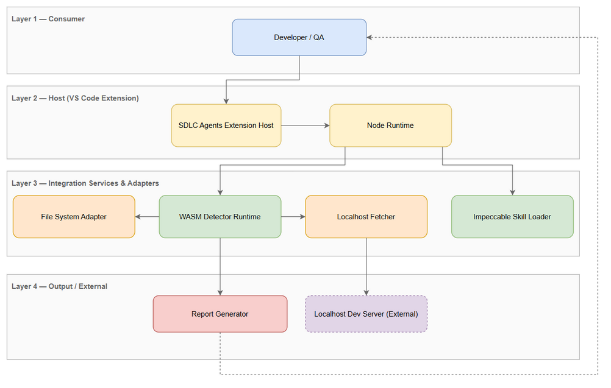
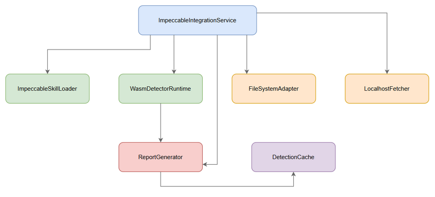
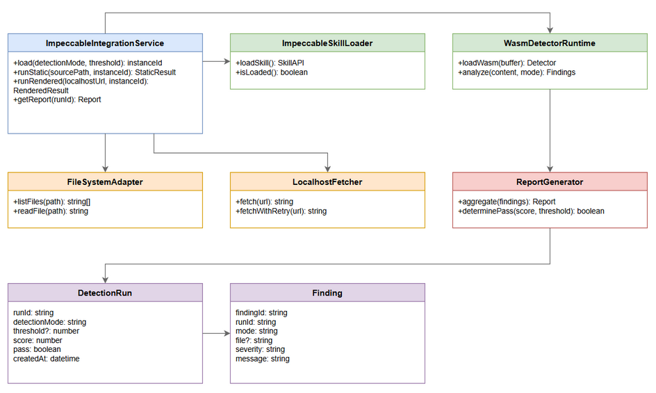
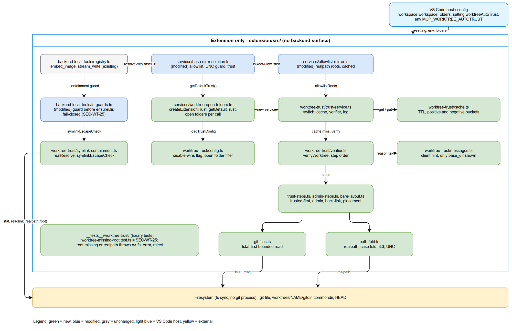
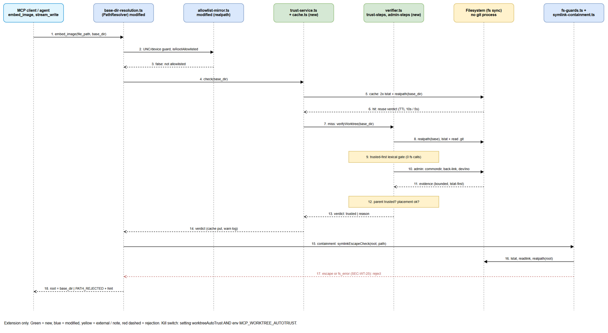

# Technical Design Document (TDD)

## SDLC Agents 4 Enterprise — SA4E-393: Integrate Impeccable design detection into SDLC Agents 4 Enterprise extension

---

## Document Information

| Field | Value |
|-------|-------|
| Jira Ticket | SA4E-393 |
| Title | Integrate Impeccable design detection into SDLC Agents 4 Enterprise extension |
| Author | SA Agent |
| Version | 1.6 |
| Date | 2026-11-14 |
| Status | Draft |
| Related BRD | documents/SA4E-393/BRD.md |
| Related FSD | documents/SA4E-393/FSD.md |

---

## Author Tracking

| Role | Name - Position | Responsibility |
|------|-----------------|----------------|
| Author | SA Agent – Solution Architect | Create document |
| Peer Reviewer |  | Review document |

---

## Revision History

| Version | Date | Author | Changes |
|---------|------|--------|---------|
| 1.0 | 2026-10-31 | SA Agent | Initiate document — auto-generated from BRD and FSD |
| 1.1 | 2026-11-12 | SA Agent | Addendum 4: post-implementation as-built notes for D1, D3, D5, D6 (root causes from commits dd1c5e5d, 88892218) + Open Issues. No diagram changes. |
| 1.2 | 2026-11-13 | SA Agent | Addendum 4: Open Issues rewritten from FIX-EVIDENCE (batches 1-3), DESIGN-addendum4-openissues-fix, ANALYSIS-settings-worktree, SECURITY-ASSESSMENT-addendum4-fix (re-review PASS), TEST-REPORT-addendum4-fix. SEC-F04..F08, log redaction, size 200/20 → CLOSED; D1 as-built (explicit workspaceRoot, `{runId}.json` + `cache/{sha}.json`). Remaining items stated with residual risk; e2e D6 on this build PENDING. No diagram changes. |
| 1.3 | 2026-11-13 | SA Agent | Addendum 5 (batch 1/2, design only): auto-trust git worktree for `base_dir` — module design, decisions OI-WT1..6, pseudocode, security analysis, test plan + RTM. New diagrams `sequence-worktree-trust`, `component-worktree-trust`. Earlier sections unchanged. |
| 1.4 | 2026-11-13 | SA Agent | Addendum 5 (batch 1/2, design only): resolution of SECURITY-REVIEW-addendum5 (APPROVED-WITH-CONDITIONS, 3 High). New section E11 (Gate A: C1 trusted-first + lstat-before-open, C2 UNC/device guard both surfaces with OI-WT8 in scope, C3 fail-closed `symlinkEscape`; Gate B: C4..C9; SEC-WT -> TDD mapping). E11 supersedes conflicting text in E2.5, E3, E4, E5, E8, E10. Sequence diagram `sequence-worktree-trust` redrawn (guard, trusted-first, identity, overlap); component diagram unchanged. |
| 1.5 | 2026-11-13 | SA Agent | Addendum 5 (batch 1/2, design only): resolution of SECURITY-REVIEW-addendum5 section 7 (re-review round 2). E11.3 rewritten: component-wise realpath resolution (no `path.resolve` over link text), `realRoot` defined, scenarios `symlinkDotDotCollapse` / `symlinkDotDotInside` / `symlinkedAncestorViaAbsoluteLink` (SEC-WT-16/17, R2-2/R2-3). SUPERSEDED markers on stale E2.1/E2.5/E3/E4.2/E4.3/E5 text and a banner (R2-1). E11.4 8.3 rule anchored and scoped to the trust path only (SEC-WT-18, R2-4). E11.1/E11.4/E11.5: `O_NONBLOCK ?? 0`, either-side `0n` fallback + debug log, ancestor-of-home rejected (SEC-WT-19, R2-5). DEV file list corrected: extension equivalent is `extension/src/backend-local-tools/fs-guards.ts` (`checkSymlinkGuard`), not a `symlinkEscape`. Diagram `sequence-worktree-trust` fixed (step 2 scope, step 8 flags, step 16 TTL 10 s) and re-exported. |
| 1.6 | 2026-11-14 | SA Agent | Addendum 5 (batch 2/2): new section "As-built (Dot 2b)" - actual file names, sync/drift guard, admit order, fs-guards, SEC-WT-20/21/22/24 and deviations (backlog SA4E-438). Minor bump; E2-E11 design text unchanged. No diagram changes. |
| 1.7 | 2026-11-14 | SA Agent | Addendum 5 CORRECTIVE (USER-APPROVED): scope is the EXTENSION ONLY. New "Correction note (v1.7)"; As-built AB1-AB7 rewritten (no backend copy, no sync script/drift guard, no `MCP_OPEN_WORKSPACE_FOLDERS`, autotrust env read by extension only, tests under `extension/src/__tests__/worktree-trust/`, SEC-WT-25 known gap). Component/sequence diagram and checklist annotated. |
| 1.8 | 2026-11-13 | SM / main agent | Addendum 5 close-out: SEC-WT-25 extension test (`d638e03d`, mutation-verified) → CLOSED; diagrams A5-1/A5-2 redrawn extension-only and re-exported; comments "generated" removed (`8510df56`); new AB9 with real e2e evidence (worktree auto-trust 4/4 PASS, design gate D6 PASS). Backlog items 5/6 of AB7 removed. |

---

## Sign-Off

| Name | Signature and date |
|------|--------------------|
| | ☐ I agree and confirm the technical design in this TDD |
| | ☐ I agree and confirm the technical design in this TDD |

---

## 1. Introduction

> **Scope Boundary:** This TDD specifies HOW to implement the requirements defined in the FSD. It does NOT repeat functional requirements, business rules, use cases, or UI specifications — refer to the FSD for those. This document focuses on: technology choices, architecture decisions, implementation patterns, and deployment concerns.

### 1.1 Purpose

Design integration of Impeccable design detection skill and WASM detector into SDLC Agents 4 Enterprise VS Code/Kiro extension to provide automated design quality gate within SDLC pipeline. The solution enables static source analysis and optional rendered analysis via localhost fetch, using Node runtime available in extension host with zero external app installation.

### 1.2 Scope

Technical scope covers:
- Impeccable skill loading and WASM detector runtime within extension host Node runtime
- Static source design detection adapter
- Localhost fetcher for rendered detection
- Quality gate report aggregation and persistence
- Integration points with SDLC pipeline command

Out of scope: development of Impeccable skill/WASM core.

### 1.3 Technology Stack

| Layer | Technology | Version |
|-------|-----------|---------|
| Language | TypeScript | 5.x |
| Extension Framework | VS Code Extension API | 1.99+ |
| Runtime | Node.js | 20.x |
| WASM Runtime | Node WASM | built-in |
| Package Manager | npm | 10.x |
| Build Tool | Vite / esbuild | latest |
| Client HTTP | Node http/https | built-in |
| Storage | JSON file <workspace>/.code-intel/design-gate/ | N/A |

### 1.4 Design Principles

- Fail-open by default for quality gate
- Single Responsibility per component
- Adapter pattern for external systems
- In-process WASM for performance
- Cache static detection results <5 min
- Graceful degradation on localhost unavailable

### 1.5 Constraints

- Must use Node runtime in VS Code/Kiro extension host
- No external app installation
- WASM must load in extension host Node version
- Rendered detection optional, fail gracefully

### 1.6 References

| Document | Location |
|----------|----------|
| BRD | documents/SA4E-393/BRD.md |
| FSD | documents/SA4E-393/FSD.md |

---

## 2. System Architecture

### 2.1 Architecture Overview

High-level architecture consists of Extension Host orchestrating detection flow via Node runtime, loading Impeccable skill and WASM detector, analyzing source files or fetched UI, and generating quality gate report.



*[Edit in draw.io](diagrams/architecture.drawio)*

### 2.2 Component Diagram

Components are isolated per responsibility with clear interfaces. ImpeccableIntegrationService coordinates loaders, adapters, and report generation.



*[Edit in draw.io](diagrams/component.drawio)*

| Component | Responsibility | Technology |
|-----------|---------------|------------|
| ImpeccableIntegrationService | Orchestrates detection modes and pipeline invocation | TypeScript |
| ImpeccableSkillLoader | Loads skill package via require() | Node.js |
| WasmDetectorRuntime | Loads WASM binary and runs analyze | Node WASM |
| FileSystemAdapter | Lists/reads source files | Node fs |
| LocalhostFetcher | Fetches localhost dev server with retry | Node http |
| ReportGenerator | Aggregates findings, score, pass/fail | TypeScript |
| DetectionCache | In-memory cache <5 min for static results | Map |

### 2.3 Deployment Architecture

Extension ships as VS Code/Kiro extension package. No server deployment required. Detector runs in-process in extension host. Optional localhost dev server must be running for rendered mode.

### 2.4 Communication Patterns

| From | To | Protocol | Pattern | Description |
|------|----|----------|---------|-------------|
| ImpeccableIntegrationService | ImpeccableSkillLoader | in-process | Sync | Load skill |
| ImpeccableIntegrationService | WasmDetectorRuntime | in-process | Sync | Load WASM |
| WasmDetectorRuntime | FileSystemAdapter | in-process | Sync | Read sources |
| LocalhostFetcher | Localhost Dev Server | HTTP GET | Sync | Fetch rendered pages |
| ReportGenerator | File System | FS write | Sync | Persist JSON report |

---

## 3. API Design

> **Prerequisite:** Functional API contracts are defined in FSD §3.x.6. This section specifies technical implementation.

### 3.1 API Overview

| # | Endpoint | Method | Description | Source |
|---|----------|--------|-------------|--------|
| 1 | /pipeline/design-gate/load | POST | Initialize Impeccable skill and WASM | UC-001 |
| 2 | /pipeline/design-gate/static-detect | POST | Run static detection | UC-002 |
| 3 | /pipeline/design-gate/rendered-detect | POST | Fetch and analyze rendered UI | UC-003 |
| 4 | /pipeline/design-gate/report/{runId} | GET | Retrieve quality gate report | UC-004 |

### 3.2 API: Load Detector

**Implements:** UC-001, BR-01, BR-02, BR-03

| Attribute | Value |
|-----------|-------|
| Method | POST |
| Path | /pipeline/design-gate/load |
| Auth | Extension host context, no external auth |
| Rate Limit | N/A |

**Request Body:**
```json
{
  "detectionMode": "static|rendered|both",
  "threshold": 0.8,
  "cacheReuse": true
}
```

**Response 200 OK:**
```json
{
  "loadStatus": "success",
  "message": "Impeccable detector loaded",
  "instanceId": "inst_123"
}
```

**Error Responses:**
| Status | Code | Message | Description |
|--------|------|---------|-------------|
| 500 | WASM_INCOMPATIBLE | Impeccable detector failed to load: Node WASM incompatible | EF-1 |
| 404 | PACKAGE_NOT_FOUND | Impeccable skill package not found | EF-2 |

### 3.3 API: Static Detect

**Implements:** UC-002, BR-04, BR-05, BR-06

| Attribute | Value |
|-----------|-------|
| Method | POST |
| Path | /pipeline/design-gate/static-detect |
| Auth | Extension host |

**Request Body:**
```json
{
  "sourcePath": "/workspace/src",
  "instanceId": "inst_123",
  "maxFiles": 10000
}
```

**Response 200 OK:**
```json
{
  "findings": [{"file":"...", "severity":"medium","message":"..."}],
  "fileCount": 123,
  "durationMs": 15420,
  "cacheHit": false
}
```

**Error Responses:**
| Status | Code | Message |
|--------|------|---------|
| 400 | INVALID_PATH | Source path does not exist |
| 504 | TIMEOUT | Static detection timed out after 30s per module |

### 3.4 API: Rendered Detect

**Implements:** UC-003, BR-07, BR-08, BR-09

**Request Body:**
```json
{
  "localhostUrl": "http://localhost:5173",
  "instanceId": "inst_123",
  "urls": ["http://localhost:5173/page1"]
}
```

**Response 200 OK:**
```json
{
  "renderedFindings": [{"file":"...","severity":"high","message":"..."}],
  "fetchStatus": "success",
  "pagesFetched": 1
}
```

**Error Responses:**
| Status | Code | Message |
|--------|------|---------|
| 503 | DEV_SERVER_UNREACHABLE | Dev server not reachable, skipping rendered detection |
| 502 | FETCH_FAILED | Failed to fetch localhost page |

### 3.5 API: Get Report

**Implements:** UC-004, BR-10, BR-11, BR-12

**Method:** GET /pipeline/design-gate/report/{runId}

**Response 200 OK:**
```json
{
  "runId": "run_abc",
  "totalIssues": 12,
  "severityBreakdown": {"low":5,"medium":5,"high":2},
  "score": 0.72,
  "pass": false,
  "timestamp": "2026-10-31T03:00:00Z",
  "findings": []
}
```

---

## 4. Database Design

> **Prerequisite:** Logical data model defined in FSD §4. Physical implementation uses JSON file store, no relational DB.

### 4.1 Data Model

Detection results persisted as JSON files under `<workspace>/.code-intel/design-gate/{runId}.json`. Entities map to in-memory objects.



**Entity: DetectionRun**
- runId string PK
- detectionMode string
- threshold number?
- score number
- pass boolean
- createdAt datetime
- userId string

**Entity: Finding**
- findingId string PK
- runId FK
- mode string static|rendered
- file string?
- severity low|medium|high
- message string
- line number?

### 4.2 File Store Format

`/.code-intel/design-gate/{runId}.json`
```json
{
  "runId": "...",
  "detectionMode": "both",
  "threshold": 0.8,
  "score": 0.72,
  "pass": false,
  "createdAt": "...",
  "findings": [...]
}
```

### 4.3 Query Patterns

- Load latest report: read JSON by runId
- Audit query: list files sorted by createdAt DESC
- Performance target: read < 50ms

---

## 5. Class / Module Design

### 5.1 Package Structure

```
extension/src/impeccable/
├── ImpeccableIntegrationService.ts
├── loader/
│   ├── ImpeccableSkillLoader.ts
│   └── WasmDetectorRuntime.ts
├── adapter/
│   ├── FileSystemAdapter.ts
│   └── LocalhostFetcher.ts
├── report/
│   ├── ReportGenerator.ts
│   └── DetectionCache.ts
├── model/
│   ├── DetectionRun.ts
│   └── Finding.ts
└── pipeline/
    └── DesignGateCommand.ts
```

### 5.2 Key Interfaces

```typescript
export interface IImpeccableSkillLoader {
  loadSkill(): Promise<SkillAPI>;
  isLoaded(): boolean;
}

export interface IWasmDetectorRuntime {
  loadWasm(buffer: Buffer): Promise<Detector>;
  analyze(content: string|Uint8Array, mode: 'static'|'rendered'): Promise<FindingsResult>;
}
```

### 5.3 Design Patterns

| Pattern | Where Used | Rationale |
|---------|-----------|-----------|
| Adapter | FileSystemAdapter, LocalhostFetcher | Isolate external I/O |
| Strategy | detectionMode static/rendered/both | Switch analysis path |
| Factory | WasmDetectorRuntime | Encapsulate WASM load |

### 5.4 Error Handling

| Exception | When Thrown | Handling |
|-----------|-------------|----------|
| WasmLoadError | WASM incompatible | Abort gate, report error |
| FetchError | Localhost unreachable | Skip rendered, log warning |
| TimeoutError | Detection >30s | Return partial findings |

---

## 6. Integration Design

### 6.1 External System: Impeccable Skill Package

| Attribute | Value |
|-----------|-------|
| Protocol | Node require() |
| Endpoint | npm package impeccable-skill |
| Authentication | None |
| Timeout | N/A |
| Retry Policy | No retry, fail fast |

### 6.2 External System: WASM Detector Binary

| Attribute | Value |
|-----------|-------|
| Protocol | Node WASM API |
| Endpoint | local WASM buffer |
| Timeout | 30s per module |
| Retry Policy | No retry |

### 6.3 External System: Localhost Dev Server

| Attribute | Value |
|-----------|-------|
| Protocol | HTTP GET |
| Endpoint | http://localhost:{port} |
| Timeout | 10s |
| Retry Policy | 1 retry 500ms→1s |
| Circuit Breaker | Skip after 2 consecutive failures |

---

## 7. Security Design

### 7.1 Authentication

Extension host context; no external auth required. Commands invoked by authenticated VS Code user.

### 7.2 Authorization

| Role | Permissions |
|------|-------------|
| Developer | Execute quality gate |
| QA Engineer | View report |

### 7.3 Data Protection

| Data Type | At Rest | In Transit | In Logs |
|-----------|---------|------------|---------|
| Source code | Workspace local | N/A | Not logged |
| Detection results | JSON file workspace | N/A | RunId only |

### 7.4 Input Validation

- detectionMode enum validation
- threshold 0-1 range
- sourcePath exists check
- localhostUrl must start with http://localhost

---

## 8. Performance & Scalability

### 8.1 Caching Strategy

| Cache | What | TTL | Technology |
|-------|------|-----|------------|
| StaticResultsCache | Static findings per sourcePath hash | 5 min | In-memory Map |

### 8.2 Performance Targets

| Operation | Target |
|-----------|--------|
| WASM load cold start | < 2s |
| Static detection per module | < 30s p95 |
| Rendered detection per page | < 60s p95 |
| Memory footprint per instance | < 150MB |

### 8.3 Scalability

Isolated detector instances per project. Concurrent runs ≤3 per workspace.

---

## 9. Monitoring & Observability

### 9.1 Logging

| Event | Level | Fields |
|-------|-------|--------|
| Detector loaded | INFO | instanceId |
| Static detection completed | INFO | runId, fileCount, durationMs |
| Rendered fetch skipped | WARN | localhostUrl, reason |
| Quality gate pass/fail | INFO | runId, score, pass |

### 9.2 Metrics

- detection_duration_ms histogram
- findings_count counter
- pass_rate gauge

### 9.3 Testability

| Aspect | Approach |
|--------|----------|
| Unit Tests | Jest/Vitest for ImpeccableSkillLoader, WasmDetectorRuntime mocks, FileSystemAdapter fake FS |
| Integration Tests | Embedded HTTP server for LocalhostFetcher, real WASM load in test harness |
| E2E Tests | Pipeline command triggers design gate with fixture source path, verify report JSON output |
| Test Data | Mock source files under tests/fixtures/impeccable/, mock HTML for rendered detection |
| Coverage Target | >80% for service layer, 100% for ReportGenerator decision logic |

---

## 10. Deployment Considerations

### 10.1 Environment Configuration

| Property | DEV | PROD |
|----------|-----|------|
| impeccable.skill.path | node_modules/impeccable-skill | bundled |
| impeccable.wasm.path | ./wasm/detector.wasm | bundled |
| designGate.failOpen | true | false |

### 10.2 Feature Flags

| Flag | Default | Description |
|------|---------|-------------|
| designGate.enabled | true | Enable quality gate |
| designGate.rendered | false | Enable rendered detection |

### 10.3 Rollback Strategy

Extension version rollback via VS Code Marketplace. No DB migration required.

### Runtime Profile

- Start command: extension activates on VS Code startup
- Health endpoint: N/A
- Config file: package.json contributes.commands

### Screen Inventory

No UI screens; interaction via pipeline command output.

### Feature Verification

- Command `sdctl design-gate run` triggers load
- Report file created at `/.code-intel/design-gate/{runId}.json`

---

## 11. Appendix

### Glossary

| Term | Definition |
|------|------------|
| Impeccable | Design quality detection skill + WASM |
| Quality Gate | Automated check before pipeline continues |
| WASM | WebAssembly detector runtime |

### Open Questions

| # | Question | Status |
|---|----------|--------|
| 1 | WASM Node runtime compatibility validated? | Open |
| 2 | Audit persistence format JSON vs SQLite? | Open |

---

## ⛔ MANDATORY: Diagram Requirements

Every diagram referenced in this TDD MUST exist as draw.io file + PNG.

Required diagrams created:
- `diagrams/architecture.drawio` + `.png` — §2.1
- `diagrams/component.drawio` + `.png` — §2.2
- `diagrams/class-diagram.drawio` + `.png` — §5 / §4.1

---

## Addendum (SA4E-393, 2026-11-09) — Scan Scope & Normalized Scoring [USER-APPROVED]

> Approved by the human gate (ticket owner) during UAT disposition, after real-run
> evidence showed the original spec produced a vacuous FAIL on any real repository.
> Recorded in RUN-LOG #34. This addendum supersedes the conflicting formulas above.

### A1. Scan scope (static mode) — supersedes "scan all workspace text files"

The design quality gate scans **design artifacts only** — the web/UI surface:

- Extensions: `.html`, `.htm`, `.css`, `.scss`, `.sass`, `.less`, `.vue`, `.svelte`, `.tsx`, `.jsx`
- `SKIP_DIRS` still applies (node_modules, .git, out, dist, build, coverage, .code-intel, .kiro, .opencode, .vscode, resources, webview-assets)

Rationale: the detector's heuristics are design-oriented. Scanning markdown docs,
agent session logs, vendor bundles and patches produced hundreds of noise findings
(497 in the UAT evidence) and a meaningless verdict.

### A2. Normalized scoring — supersedes absolute per-finding deduction

Old (superseded): `score = 1 − (Σ severity weights)` — any repository with more than
6 medium findings clamped to 0 regardless of size.

New formula (scale-independent):

```
score = 1 − (unique files with findings / total files in scan scope)
```

- `totalFiles` = design files scanned (static) + 1 rendered page (when fetched)
- Clamp to [0, 1]; empty scope → score 1.0 with message
  "No design artifacts found in scan scope (0 files)" (vacuous pass, surfaced in report)
- `severityBreakdown` is kept in the report for triage but no longer drives the score
- Threshold semantics unchanged (BR-11: score ≥ 0.8 → pass; configurable via
  `QUALITY_GATE_THRESHOLD`)

### A3. Deferred (follow-up ticket)

Real Impeccable WASM detector binary (Option 2) — blocked on the external
`impeccable-skill` package; heuristics in `simulateWasmAnalysis` remain until then.

---

## Addendum 2 (SA4E-438, 2026-11-10) — Real Design-Quality Rules [USER-APPROVED]

Supersedes the placeholder heuristic (A3 kept for the real WASM binary only).
Follow-up ticket: SA4E-438.

### B1. Rule engine — `design-rules.ts`

13 rule ids applied to design artifacts (extension-aware: CSS rules don't run on TSX):

| Id | Rule | Severity |
|----|------|----------|
| A1 | `` missing `alt` | HIGH |
| A2 | Empty `<button>`/`<a>` | HIGH |
| A3 | `onClick` on div/span without role/tabIndex | MEDIUM |
| B1 | Fixed pixel width ≥300px | MEDIUM |
| B2 | `position:absolute` >5 per file | MEDIUM |
| B3 | Stylesheet >200 lines without `@media` | MEDIUM |
| C1 | ≥3 distinct hardcoded colors | LOW |
| C2 | `!important` | LOW |
| C3 | Magic spacing (off 4/8 scale) | LOW |
| D1 | Inline `style={{…}}` | LOW |
| D2 | `.map()` JSX without key | MEDIUM |
| D3 | Component file >300 lines | LOW |
| D4 | Pending-work markers TODO/FIX | LOW |

### B2. Scoring amendment — significant findings only

```
score = 1 − (files with ≥1 HIGH or MEDIUM finding / total files in scope)
```

LOW findings (tokens, spacing, markers) are triage info and do not fail a file.
Threshold semantics unchanged (BR-11).

### B3. Rendered mode

Phase 2: fetch page → same rule engine over fetched HTML (Lighthouse-class DOM
analysis deferred).

---

## Addendum 3 (SA4E-438, 2026-11-11) — Impeccable-derived slop rules [USER-APPROVED: learn the ideas, implement natively]

User decision: port the IDEAS from github.com/pbakaus/impeccable (Apache-2.0,
107k stars — "the design vocabulary for your coding agent") into OUR extension
natively — **no external CLI/binary dependency at runtime**. Attribution:
rule ideas adapted from the Impeccable detector (62 deterministic rules).

### C1. New rules added to `design-rules.ts` (batch 1 — 17 rules)

| Id | Rule | Severity | Detection |
|----|------|----------|-----------|
| overused-font | Inter/Roboto/Fraunces/Geist/Plus Jakarta/Space Grotesk/Montserrat/Poppins | LOW | font-family + fonts.googleapis links |
| gradient-text | `bg-clip-text` / `background-clip: text` | LOW | regex |
| ai-color-palette | purple/violet Tailwind classes + violet hexes | LOW | regex |
| cream-palette | cream hexes + `bg-stone/amber-50/100` | LOW | regex |
| side-tab | one-side `border-{side}: Npx solid` + `border-[lrtb]-4..8` | LOW | regex |
| dark-glow | `box-shadow: 0 0 Npx` + colored text-shadow | LOW | regex |
| radial-halo | `radial-gradient(…transparent)` | LOW | regex |
| hard-offset-shadow | unblurred `Npx Npx 0` | LOW | regex (style files) |
| broken-image | empty/placeholder `src` | MEDIUM | regex |
| skipped-heading | h1→h3 level skip | MEDIUM | heading-sequence walk |
| tight-leading | line-height <1.3 / `leading-none|tighter|tight` | LOW | regex |
| tiny-text | font-size <12px / `text-[Npx]` <12 | MEDIUM | regex |
| justified-text | `text-align: justify` / `text-justify` | LOW | regex |
| extreme-negative-tracking | negative letter-spacing / `tracking-tighter` | LOW | regex |
| marketing-buzzword | streamline/empower/supercharge/world-class/… | LOW | regex (UI copy) |
| bounce-easing | `animate-bounce` / overshoot cubic-bezier | LOW | regex |
| marquee | marquee animation | LOW | regex |

Full 62-rule reference captured at `documents/SA4E-393/impeccable-rules-reference.txt`.
Rendered-only rules (low-contrast, text-occlusion, cramped-padding geometry,
content-hidden-at-rest, script-error…) = phase 2 — need a rendered page.

### C2. Verified real run (this workspace)

`FAIL - Score 0.79 - Findings 1839` in ~8s across ~447 design files: D1 776,
C1 320, tight-leading 209, overused-font 149, ai-color-palette 106, tiny-text 105,
D3 71, skipped-heading 33, A3 27, B1 14, cream-palette 11, side-tab 5,
buzzword 6, bounce 3, D4 4 — 0 absolute paths (C5). The FAIL is the gate
working: real, actionable design debt with file:line.

---

## Addendum 4 (SA4E-393, 2026-11-12) — Agent-Invocable Design Gate MCP Tools [FR-AG1, FR-AG2]

> User requirement (verbatim): "(1) Phải cung cấp thêm qua MCP tool của extension. (2) Phải cập nhật
> các UI agent... phải luôn tự kiểm tra/test code mới." Decision (user-approved): expand SA4E-393 —
> the design gate becomes (a) agent-invocable via MCP tools (FR-AG1) and (b) a MUST self-check step
> (FR-AG2): agents editing design artifacts run `design_gate_run` before completion; every FAIL must
> be fixed or explicitly justified; SM blocks Phase 5/6 without gate evidence (AGENTS.md Key Rule 8).
> Functional scope: FSD Addendum 4. This addendum specifies HOW. No new diagrams — the tools are
> additional entry points into the existing §2.2 detection flow (runDetection), nothing else changes.

### D1. Tool spec — `design_gate_run`

Executes the REAL gate pipeline — the same `runDetection` entry point the three Command Palette
commands use (extension/src/extension.ts, import at line 13, calls at lines 144–193) — in-process in
the extension host via `LOCAL_TOOL_REGISTRY` (extension/src/backend-local-tools/registry.ts). No new
MCP server; agents reach it through the existing MCP wrapper (`find_tools` → `execute_dynamic_tool`).

**Definition (injected into tools/list — visible, `hidden` unset, drawio precedent):**

```json
{
  "name": "design_gate_run",
  "description": "Run the design quality gate: 30 design-debt rules over design artifacts (.html .css .vue .svelte .tsx .jsx) in the workspace or a sub-path. Returns score, PASS/FAIL vs threshold, severity breakdown and findings with file:line. Agents editing design artifacts MUST call this before completing the task; fix or justify every FAIL.",
  "inputSchema": {
    "type": "object",
    "properties": {
      "mode": {
        "type": "string",
        "enum": ["static", "rendered", "both"],
        "description": "Detection mode. Default: both (static files + localhost dev-server page when reachable)."
      },
      "source_path": {
        "type": "string",
        "description": "Optional workspace-relative path to scan (default: workspace root). Paths resolving outside the workspace are rejected (C3)."
      },
      "threshold": {
        "type": "number",
        "description": "Quality threshold 0-1. Default: DEFAULT_THRESHOLD (0.8; env QUALITY_GATE_THRESHOLD)."
      },
      "findings_limit": {
        "type": "number",
        "description": "Max findings echoed in the tool output (default 200). severityBreakdown/totalIssues always cover ALL findings; full report persisted to .code-intel/design-gate/{runId}.json (BR-12)."
      }
    },
    "required": []
  }
}
```

**Handler flow** (`handleDesignGateRun` — thin orchestrator ≤20 lines, delegates to helpers):

1. Workspace root from `defaultWorkspaceRootProvider()` (services/PathResolver — live
   `vscode.workspace` read per call, SA4E-356 pattern). None open →
   `toolError("No workspace folder open. Open a project folder first.")` (C6).
2. *(As-built: superseded)* `workspaceRoot` passed explicitly, no env/cwd fallback — pipeline fs.adapter
   validates C3 against the explicit root.
3. Detector env: `resolveWasmPath(extensionPath)` (shared helper, D3) sets
   `process.env[EnvConfig.IMPPECABLE_SKILL_PATH]`. Mandatory — integration.service `getWasmPath()`
   otherwise falls back to `./wasm/detector.wasm` relative to the IDE install cwd (load failure).
4. `source_path` given → `PathResolver.resolveWorkspacePath(source_path)` (C3 single validation
   point). `!ok` → forward `resolution.message` verbatim as toolError (messages are CODE:-prefixed
   and sanitized). Empty/absent → sourceRoot = workspace root.
5. Validate `mode` (enum) and `threshold` ∈ [0,1]; invalid → toolError with allowed values.
6. `await runDetection({ detectionMode: mode, sourceRoot, threshold, cacheReuse: true })`.
   loadDetector is handled INSIDE runDetection (idempotent — slash/index.ts:92); the tool never
   calls integration internals directly. Note: runDetection's config key is `detectionMode`
   (verified — slash/types.ts DetectionConfig); the tool's `mode` argument maps onto it.
7. Map `report` (+ `fetchStatus` when mode=rendered) → tool-result JSON, schema below.
8. Whole run in try/catch: DetectionErrorException → sanitized message; unknown error →
   `"Design gate run failed: <ErrorName>"` (C6 — no stack, no internals, workspace-root prefix
   stripped from any path fragment in the text).

**As-built (v1.2) — supersedes step 2 and the persistence wording above** (SEC-F04/F05/F08):

- *Step 2 (env write) is REMOVED.* Nothing writes `process.env.WORKSPACE_ROOT` any more. The root is
  passed explicitly: tool → `runDetection({ workspaceRoot })` → `DetectionConfig.workspaceRoot` →
  integration service, cache, report store and file lister. `workspaceRoot` is explicit, with no
  env/cwd fallback: `getWorkspaceRoot()` and the env read were removed; `requireWorkspaceRoot()`
  throws `DetectionError.WORKSPACE_ROOT_REQUIRED` (see Open Issues A9). Two workspaces running in parallel (`Promise.all`) no longer mix results.
- *Persistence contract kept: `{runId}.json` (BR-12).* SEC-F04 was resolved by changing the code, not
  the contract. `report.store.ts` writes `.code-intel/design-gate/{runId}.json` for every run
  (modes static/rendered/both; a cache hit gets a NEW runId plus `sourceRunId`). The result cache is
  separate: `.code-intel/design-gate/cache/{sha}.json` (`sha` = sha256 of `sourcePath:mode`), storing a
  workspace-relative `sourcePath`, the real `runId` and `fileCount`. An old `{sha}.json` entry directly
  under `design-gate/` is not read (counts as a miss).
- Writes are atomic (`wx` + mode `0o600` temp file in the same directory, then `rename`; temp removed
  on failure). A write failure is surfaced in `report.message` ("report not persisted"), not swallowed.
- `runId` allow-list `^run_\d+_[a-z0-9]+$`, max 64 chars, checked in `saveReport`/`loadReport`/
  `listRunIds`; every path built from it goes through `resolveInside`. Invalid and missing ids both
  return `undefined` (no oracle). `getReport`/`listReports` take an optional `workspaceRoot`.
  The error report now uses a valid runId (`run_<ms>_<id>`, was `run_error`) so failed runs also leave a record.
- Size (BR-18): `integration.service.ts` 751 → 154 lines (logic moved to `detector.runtime.ts`,
  `static.detection.ts`, `rendered.detection.ts`, `full.detection.ts`, `error-text.ts`,
  `detection.types.ts`; public API unchanged); `design-rules.ts` split into 4 rule-group files plus
  types and an assembler (30 rules, IDs and order unchanged); `mapReportToPayload` ≤20 lines; the
  oversized test split. Guarded by `design-gate-size-guard.test.ts` (convention: a `describe`
  callback is a group container, only `it` bodies count toward the 20-line limit).
- Logs: all `console.error` in `slash/` and the tool go through `redactPaths`/`logRedacted`
  (`path-redactor.ts`); `report.message` is redacted too.

**Success response** (isError: false, `content[0].text` = JSON). Example uses the real evidence
run from Addendum 3 C2 (447 design files, ~8s):

```json
{
  "ok": true,
  "runId": "run_1762924800000_ab12cd34",
  "detectionMode": "both",
  "score": 0.79,
  "pass": false,
  "threshold": 0.8,
  "totalIssues": 1839,
  "severityBreakdown": { "low": 1660, "medium": 179, "high": 0 },
  "findings": [
    {
      "findingId": "f1", "runId": "run_1762924800000_ab12cd34", "mode": "static",
      "file": "extension/webview/ui.css",
      "severity": "medium",
      "message": "position:absolute overuse (>5 per file)",
      "line": 42
    }
  ],
  "findingsReturned": 200,
  "findingsTruncated": true,
  "fileCount": 447,
  "durationMs": 8123,
  "message": "optional — QualityReport.message (e.g. vacuous-pass notice)"
}
```

- `fetchStatus` present ONLY when `mode=rendered` (from `RenderedDetectionResult.fetchStatus`,
  values "success" / "skipped" / "failed"). Verified: mode=both builds a fresh aggregate that drops
  fetchStatus (integration.service.ts runFullDetection), so it is not surfaced there; each finding
  already carries `mode` ("static"/"rendered") for attribution.
- `findings_limit` rationale: one full workspace run produced 1,839 findings (~300KB JSON). MCP
  wrapper body budget is 1MB–100MB (services/WrapperServer/constants.ts) so transport is safe, but
  agent context is not — cap the echo, keep `totalIssues`/`severityBreakdown` exact over ALL
  findings, keep the full report on disk.

**Error contract (C6):** `isError: true` + sanitized `content[0].text`. Never stack traces, never
internal paths. Cases:

| Case | Tool result |
|------|-------------|
| No workspace folder | "No workspace folder open. Open a project folder first." |
| source_path outside workspace | PathResolver message verbatim (PATH_EMPTY / PATH_INVALID / PATH_REJECTED_OUTSIDE_WORKSPACE / PATH_REJECTED_OUTSIDE_ALLOWLIST) |
| Bad mode / threshold ∉ [0,1] | Validation message listing allowed values |
| Detector load failure | "Detector load failed: <sanitized message>" |
| Any pipeline throw | "Design gate run failed: <ErrorName>" + console.warn log, no stack |

**Performance:** static full-workspace run ≈ 8s / ~447 design files (Addendum 3 C2 evidence).
In-process call — zero backend round-trip; §8.3 concurrency caps unchanged.

**As-built correction (v1.1) — bare `vscode` identifier (commit dd1c5e5d):**

- *Symptom:* first real `execute_dynamic_tool("design_gate_run")` returned `vscode is not defined`.
- *Root cause:* the handler path (wrapper server → `LOCAL_TOOL_REGISTRY`) touched a bare `vscode`
  identifier. In the esbuild CJS bundle `vscode` exists only via `require("vscode")`; there is no
  global, so a bare reference throws `ReferenceError`. The earlier workaround (tool-router writing
  `process.env.WORKSPACE_ROOT` / `IMPPECABLE_SKILL_PATH` from `deps.workspaceRoot` / `deps.wasmPath`,
  and `defaultWorkspaceRootProvider()` reading the `WORKSPACE_ROOT` env first) masked the real defect
  and could return a stale root.
- *Fix:* (1) no tool code references a bare `vscode`; PathResolver keeps its lazy `require` (SA4E-356).
  (2) New `design-gate-env.ts`: `initDesignGateEnv(context.extensionPath)` is called once in
  `activate()` (before the workspace check); `prepareDesignGateRunEnv()` runs per call → live root via
  `defaultWorkspaceRootProvider()`, passes it explicitly (workspaceRoot truyền tường minh, không có
  env/cwd fallback; no `EnvConfig.WORKSPACE_ROOT` write) and calls `resolveWasmPath(extensionPath)`. This is the "thread `context.extensionPath`" variant of D3, not
  `vscode.extensions.getExtension(...)`. (3) Workaround removed: `workspaceRoot`/`wasmPath` deps dropped
  from RemoteBackendClient/WrapperServer types, the env branch dropped from `defaultWorkspaceRootProvider`,
  and the `isLocalTool` branch in tool-router reduced to `executeLocalTool(name, args)`.
  (4) Guard test `design-gate-no-vscode.test.ts`. Same commit hardened SEC-F01 (generic reject with
  code only, no absolute path), SEC-F02 (realpath containment, junction `source_path` rejected) and
  SEC-F03 (`sanitizeErrorText`: escaped regex, both separators, case-insensitive on win32).

### D2. Tool spec — `design_gate_list_rules`

Purpose (FR-AG2): lets an agent learn the rules BEFORE writing design code — cheaper than
FAIL→fix loops. No input, no file access, no pipeline run.

```json
{
  "name": "design_gate_list_rules",
  "description": "List the 30 design-quality rules the gate enforces (id, severity, rule text, source, applicable extensions) plus the threshold and the scoring formula. Call before creating/editing design artifacts so code passes on the first run.",
  "inputSchema": { "type": "object", "properties": {}, "required": [] }
}
```

**Output** — derived from `DESIGN_RULES` (extension/src/slash/design-rules.ts:96 — exactly 30
entries, verified 2026-11-12):

```json
{
  "ok": true,
  "ruleCount": 30,
  "threshold": 0.8,
  "thresholdSource": "DEFAULT_THRESHOLD = parseFloat(env QUALITY_GATE_THRESHOLD || \"0.8\")",
  "scoringFormula": "score = 1 - (unique files with >=1 HIGH or MEDIUM finding) / (files in scan scope); clamped [0,1]; empty scope -> score 1.0 + vacuous-pass message 'No design artifacts found in scan scope (0 files)'. LOW findings are triage info and never fail a file. pass = score >= threshold (BR-11).",
  "scanScope": ".html .htm .css .scss .sass .less .vue .svelte .tsx .jsx; SKIP_DIRS excluded (node_modules, .git, out, dist, build, coverage, .code-intel, .kiro, .opencode, .vscode, resources, webview-assets)",
  "rules": [
    { "ruleId": "A1", "severity": "high", "message": " missing alt attribute (accessibility)", "source": "base", "appliesTo": ["html", "htm", "tsx", "jsx", "svelte", "vue"] },
    { "ruleId": "overused-font", "severity": "low", "message": "Overused AI font (Inter/Roboto/…)", "source": "impeccable", "appliesTo": ["css", "scss", "sass", "less", "html", "htm", "tsx", "jsx", "svelte", "vue"] }
  ]
}
```

- `message` = `DesignRule.label` — the exact finding template the agent will see in reports.
- `source` classification: static `BASE_RULE_IDS` set in design-gate-tool.ts
  (A1–A3, B1–B3, C1–C3, D1–D4 = 13 base) → "base"; remaining 17 (overused-font … marquee) →
  "impeccable" (Addendum 2 B1, Addendum 3 C1). design-rules.ts untouched.
- `appliesTo` = `DesignRule.extensions` — extension-aware gating (e.g. stylesheet-only rules do
  not run on TSX), so agents know which files each rule hits.

### D3. Module layout + registration

```
extension/src/tools/design-gate/
└── design-gate-tool.ts            // DESIGN_GATE_RUN_DEFINITION + DESIGN_GATE_LIST_RULES_DEFINITION
                                  // + handleDesignGateRun + handleDesignGateListRules
                                  // + toolText/toolError (tools/drawio/drawio-tool.ts pattern)
extension/src/slash/detector-env.ts   // NEW: resolveWasmPath(extensionPath) — 3-tier logic EXTRACTED
                                  // from extension.ts resolveWasmPath (resources/wasm → out/wasm →
                                  // ../source/source-slash/wasm); sets IMPPECABLE_SKILL_PATH
```

- Structure mirrors `tools/drawio/drawio-tool.ts`: exported definitions + handlers; handlers
  delegate to small helpers (`parseRunArgs`, `resolveSourceRoot`, `mapReportToPayload`,
  `sanitizeErrorText`). Limits: file ≤200 lines (BR-18), function ≤20 lines.
- `slash/detector-env.ts` is a pure EXTRACTION (no new dependency): extension.ts's inline
  `resolveWasmPath` refactors to delegate so commands and tool share ONE implementation.
  The tool obtains `extensionPath` lazily via
  `vscode.extensions.getExtension("dnguyenminh.sdlc-agents-4-enterprise")?.extensionPath`
  (lazy-require pattern proven in PathResolver.ts:66–71). Fallback if getExtension proves
  unreliable in the target host: thread `context.extensionPath` from workspace-init (which holds
  `context` — workspace-init.ts:52) into the registration call; dev-agent documents which
  variant shipped.
- **Registration hook (verified call site — NOT extension.ts):** all local tool groups register in
  the `RemoteBackendClient` constructor (extension/src/remote-backend-client.ts lines 68–89:
  registerPegaLocalTools / registerAtlassianLocalTools / registerDevtoolsTools /
  registerIdeControlTools), which runs during activation via `initializeWorkspace` →
  `new McpServerManager(...)` (extension/registration/workspace-init.ts:52 — McpServerManager is
  the RemoteBackendClient alias, KSA-293). Add ONE call there:

```typescript
// remote-backend-client.ts constructor — AFTER the if (secrets) block:
try {
  registerDesignGateLocalTools();   // no credentials needed → outside the secrets gate
} catch (err) {
  console.warn(`[RemoteBackendClient] Design gate tools registration failed: ${(err as Error).message}`);
}
```

```typescript
// design-gate-tool.ts — registration init (mirrors mcp/atlassian/index.ts registerAtlassianLocalTools)
export function registerDesignGateLocalTools(): void {
  registerLocalTool("design_gate_run", handleDesignGateRun, DESIGN_GATE_RUN_DEFINITION);
  registerLocalTool("design_gate_list_rules", handleDesignGateListRules, DESIGN_GATE_LIST_RULES_DEFINITION);
}
```

OCP respected: registry.ts untouched (`registerLocalTool` is the extension point); no new MCP
server; `hidden` unset → tools appear in tools/list (getVisibleLocalToolDefinitions) AND stay
callable via execute_dynamic_tool.

**As-built correction (v1.1) — false PASS from fileCount=0 / cache (commit 88892218):**

- *Symptom:* `both` runs scored differently from `static` on the same tree and could PASS vacuously
  (fileCount 0) while `static` FAILed.
- *Root cause (`slash/integration.service.ts`, cache branch with `cacheReuse: true`):* on a cache hit
  `fileCount` was derived as `cached.findings.length`, and the report was built with
  `cached.fileCount ?? 0`. `fileCount` is the DENOMINATOR of
  `score = 1 − failing files / files in scope`: findings.length (or 0) is not the scan scope, so
  score/pass were wrong, and 0 → vacuous-pass 1.0. Legacy cache entries without `fileCount` triggered
  this. Cache key = sha256(`sourcePath:mode`) (`detection.cache.ts`), so static and both runs reuse
  per-mode entries.
- *Fix:* a cache entry is a HIT only if `typeof cached.fileCount === "number"`; otherwise it is a miss
  and the scan re-runs. Both `result.fileCount` and the report use `cached.fileCount` (no `?? 0`,
  no findings.length fallback). `QualityReport` gained optional `fileCount` (types.ts), set by
  `generateQualityReport` (`fileCount: totalFiles`), so the payload exposes the real denominator.
- *Limit:* the payload has no `cacheHit` field, so a cache hit can only be inferred (matching
  `fileCount`/score and shorter `durationMs`), not read directly.
- *Same commit, path text:* integration.service errors no longer embed absolute paths
  ("Source path escapes workspace root"; "does not exist: <relative>").
- *Tests:* `design-gate-addendum4-fix.test.ts`.

### D4. Security mapping — all four conditions preserved intact

| Condition | Where enforced in the tool flow |
|-----------|--------------------------------|
| C3 workspace-scoped paths | (1) `source_path` → `resolveWorkspacePath` (services/PathResolver — SA4E-356 single validation point: rejects outside-workspace + traversal); (2) pipeline double-check: fs.adapter `validateFilePath` inside listSourceFiles/readSourceFile against `WORKSPACE_ROOT` env; (3) design_gate_list_rules touches no files. |
| C4 SSRF localhost-only | Unchanged: rendered mode fetches via localhost-fetcher (`host === 127.0.0.1 || localhost` only, 10s timeout, 1 retry, response size cap). The tool accepts NO URL parameter — dev-server URL comes from `LOCALHOST_DEV_SERVER_URL` env / runDetection defaults only. |
| C5 no absolute paths in output | Unchanged: `generateQualityReport` sanitizes every `finding.file` to workspace-relative (verified: 0 absolute paths in the Addendum 3 C2 real run). Tool error path additionally strips the workspace-root prefix from any message fragment. |
| C6 error sanitize | Tool-level try/catch → `isError:true` + sanitized text (no stack, no internals). Pipeline's own C6 layer (integration.service getUserFriendlyError) stays untouched beneath it. |

### D5. Test plan (for qa-agent)

**Unit** — `extension/src/__tests__/design-gate-tools.test.ts` (vitest; mock `./slash` runDetection
and PathResolver per existing conventions — e.g. remote-backend-health.test.ts mocks
mcp/atlassian/index):

1. mode=both → handler returns report; JSON has runId, detectionMode, score, pass, threshold,
   totalIssues, severityBreakdown{low,medium,high}, findings[] (field shapes per D1).
2. source_path resolving outside workspace → isError:true, message carries the PathResolver code
   (C3); runDetection NOT called.
3. threshold: passed value lands in report.threshold; omitted → DEFAULT_THRESHOLD (0.8);
   1.5 / −0.1 → validation error.
4. invalid mode ("statics") → validation error listing allowed enum values.
5. findings_limit: findings trimmed to limit, findingsTruncated=true, findingsReturned=limit;
   severityBreakdown/totalIssues remain ALL-finding counts.
6. list_rules → ruleCount=30, ≥30 entries, source split 13 base + 17 impeccable, every entry has
   ruleId/severity/message/appliesTo.
7. C6: runDetection throws → isError:true, text "Design gate run failed: …", no stack, no
   workspace-root absolute path in text.
8. mode=rendered → fetchStatus surfaced from combinedResult; mode=static/both → no fetchStatus.
9. Handler/definition file ≤200 lines, functions ≤20 lines (size guard — repo convention).

**Integration (standalone, real session — no mocks):**

1. `find_tools("design gate")` discovers both tools; tools/list includes them (visible).
2. `execute_dynamic_tool("design_gate_run", {})` on this workspace → output parses as JSON with
   all schema fields; expect honest FAIL (score < 0.8 — 1,839 known findings in this repo).
3. Dirty-input honesty: `source_path` at a fixture dir containing one violating file
   (`` without alt, `width: 500px`, `!important`) → FAIL with that exact file:line.
4. Clean-input honesty: fixture dir with a conforming file (alt attributes, responsive widths,
   spacing on the 4/8 scale) → PASS (score ≥ threshold), or vacuous pass with message when the
   scope has no design artifacts.
5. Rendered without dev server: mode=rendered → fetchStatus "failed"/"skipped", static fallback
   semantics preserved (AF-1 / TC-03).
6. `execute_dynamic_tool("design_gate_list_rules")` → 30 rules + formula string present.

**As-built additions (v1.1) — PATH_NOT_FOUND (commit 88892218, `design-gate-resolve.ts`):**

10. `source_path` that passes lexical resolution but does not exist → `isError: true`,
    `PATH_NOT_FOUND: source_path does not exist: <workspace-relative path>`. Before the fix the
    nonexistent target skipped the realpath check and surfaced later from the scan with an absolute
    path (`Source path does not exist: <abs>`). The message is built with
    `path.relative(workspaceRoot, resolvedPath)`; no absolute path or workspace root. `runDetection`
    is NOT called. Existing targets still go through `isRealPathInside` (SEC-F02), failure →
    generic reject.
11. Negative matrix (no absolute path in any error text): `../..`, absolute path outside workspace,
    junction `source_path`, `does-not-exist-xyz`, regex metacharacters in `source_path`.

Process note: the 88892218 tests were written AFTER the fix (deviation from `dev-bug-diagnosis.md`,
see Open Issues).

**Agent-loop demo (FR-AG2 evidence):** find_tools → design_gate_list_rules (read rules) → write a
small design file violating A1+A2 → design_gate_run → FAIL read → fix the file → design_gate_run →
PASS. Transcripts stored as test evidence for this ticket.

### D6. Acceptance criteria

| # | Criterion |
|---|-----------|
| i | Both tools invocable via `execute_dynamic_tool` in a real session; visible in tools/list. |
| ii | Report JSON matches the D1 schema exactly (field names, types, enums). |
| iii | Honest both ways: clean input → PASS; dirty input → FAIL with actionable file:line. |
| iv | 0 absolute paths in findings[] and in error text (C5/C6). |
| v | Lint + extension test suite pass; ≤200 lines/file, ≤20 lines/function. |
| vi | Rebuilt VSIX contains the tools (bundle includes design-gate-tool + registration call). |
| vii | FR-AG2 enforcement wired: AGENTS.md Key Rule 8 — agents editing design artifacts MUST run design_gate_run before completion; every FAIL fixed or justified; SM blocks Phase 5/6 without gate evidence. |

**As-built e2e result (v1.1)** — fresh instance, root `c:\projects\kiro\SDLC-Agents-4-Enterprise`,
MCP port 9183:

| Run | runId | score | pass | fileCount | totalIssues |
|-----|-------|-------|------|-----------|-------------|
| static | `run_1794496832524_lu5m1z95` | 0 | false | 3 | 9 |
| both #1 | `run_1794496981974_lab651sw` | 0 | false | 3 | 9 |
| both #2 | `run_1794496982501_mfd6u0lh` | 0 | false | 3 | 9 |

- static and both (x2) agree on score 0 and fileCount 3 → the D3 false-pass is gone. The payload has
  no `cacheHit`, so whether both #2 used the cache is inferred only.
- Negative cases `../..`, absolute path outside workspace, junction, `does-not-exist-xyz`, regex
  characters → all rejected (`isError: true`), none exposes an absolute path (criterion iv).
- Quality: vitest design-gate 26 tests pass, `tsc` OK, eslint 0 errors, 1 warning
  (`max-lines` 300/200 in `design-gate-tools.test.ts`, criterion v partially: warning accepted, see
  Open Issues).

### Open Issues (Addendum 4, v1.2)

Sources: FIX-EVIDENCE-addendum4-openissues.md (batches 1-3), DESIGN-addendum4-openissues-fix.md,
ANALYSIS-settings-worktree.md, SECURITY-ASSESSMENT-addendum4-fix.md (re-review: PASS, no
Critical/High/Medium), TEST-REPORT-addendum4-fix.md. State: working tree, NOT committed.

#### A. CLOSED in this round

| # | Item | Resolution (as-built) | Evidence |
|---|------|-----------------------|----------|
| 1 | SEC-F04 (Low) cache naming / absolute `runId` | Fixed in code; contract `{runId}.json` (BR-12) kept. Cache split to `cache/{sha}.json` with relative `sourcePath` and real `runId`; atomic write; write failure surfaced. As-built in D1. | persist-run (a)-(g), report-store; red on old code (ENOENT, cache `runId` = absolute path) |
| 2 | SEC-F05 (Low, latent) `getReport` runId | Allow-list regex + 64 chars + `resolveInside`; invalid = missing = `undefined`. | report-store; red: `../secret` read `.code-intel/secret.json` |
| 3 | SEC-F06 (Low) fetcher | Oversize → `req.destroy()` + reject `FETCH_FAILED` (no `throw` in callback); media type parsed before `;`. SSRF guard unchanged. | localhost-fetcher; red: charset rejected, oversize hung >60s |
| 4 | SEC-F07 (Info) `startsWith` | One implementation, `isPathWithinRoot` (`path-guard.ts`); `..dots/a.css` allowed, sibling `root-evil` blocked. | fs-adapter-containment, batch3 D2 |
| 5 | SEC-F08 (Info) global env | Nothing writes `process.env.WORKSPACE_ROOT`; `workspaceRoot` explicit through the pipeline. The env read fallback was later removed too (see A9). | explicit-root (a)(b); red: fileCount 0 |
| 6 | Absolute paths in logs (old b) | `redactPaths`/`logRedacted` in service, `wasm.loader`, cache failure, tool failure and `report.message`. | log-redaction #1, #2 red; #3 regression guard only (see B2) |
| 7 | Size 200/20 (old d) | `integration.service` split (751→154), `design-rules` split into 4 groups, `mapReportToPayload` ≤20, tests split; `size-guard` covers the folders. | size-guard red (3 files >200, 16 functions >20); tsc, eslint 0/0, full vitest 446 files / 3480 tests pass |
| 8 | Batch 3: D1, D2, D3, S-1, S-2 | D1 cache stores relative paths; D2 `isPathWithinRoot`; D3 `.gitignore` covers `.code-intel/design-gate` and `extension/.code-intel/`; S-1 error report has a valid runId; S-2 `sourceRoot` junction is rejected (realpath, fail-closed). | batch3 test, persist-run (c2) |
| 9 | Stray `extension/.code-intel/` directory (root cause) | Root cause: silent fallback `getWorkspaceRoot()` = env `WORKSPACE_ROOT` \|\| `process.cwd()` (vitest cwd = `extension/`), so tests without a root wrote into `extension/.code-intel/`. Fix: `workspaceRoot` is mandatory; `requireWorkspaceRoot()` throws `DetectionError.WORKSPACE_ROOT_REQUIRED`; `getWorkspaceRoot()` and the env read removed. Commit 66f8a3cf (gitignore `extension/.code-intel/`) was dropped because it only hid the symptom. | Root-cause fix; no fallback remains |

Follow-ups (small, non-blocking) from A9:
- `EnvConfig.WORKSPACE_ROOT` enum member is now dead; remove it.
- `ListOptions.workspaceRoot` is still optional in the type, and `file-lister.ts:27` has a stale comment; make it required and update the comment.
- New tests pass `{}` and are not type-checked (tsconfig excludes `__tests__`); fix the typing or include them in a type-check.

Test gap found by QA and closed: `TEST-REPORT-addendum4-fix.md` ended with verdict FAIL because mutant M2
(remove `isValidRunId` in `loadReport`) survived. Batch 3 added 6 tests (`RUN_1_X`, `run_1_A`,
`run_1_a-b`, `run_1_`, 86-char id); with the check removed, 5 failed (red), restored by hash. This
re-run is recorded in FIX-EVIDENCE; the QA report itself has not been re-issued after it.

#### B. Still OPEN / recorded (not pushed to backlog, except item 1)

| # | Sev | Issue | State / residual risk | Action |
|---|-----|-------|-----------------------|--------|
| 1 | Medium | `settings.json` worktree vs root (instance 9181 vs 9183; agent may resolve the wrong `mcpUrl`). | **Open. Doc-only in this ticket.** ANALYSIS: the fix touches `runtime-settings.ts`, `remote-backend-client.ts` and shared bootstrap steering used by every ticket/agent, with only a characterization baseline test (`runtime-settings.test.ts`, 6 tests, includes a recorded known gap: clear removes the file regardless of pid owner). No SA4E-393 AC depends on it. Code/steering not changed. | **Only this item references SA4E-438.** Mandatory evidence checklist before writing gate evidence: (1) `settings.workspace` equals cwd (normalized); (2) `pid` alive; (3) after `initialize`, the instance's workspace root matches; (4) record port + workspace root in the evidence; (5) mismatch → report to user, do not use the instance. |
| 2 | Process | Test-after-fix in commits 88892218 / dd1c5e5d and earlier fixes (deviates from `dev-bug-diagnosis.md`). | Not corrected retroactively; recorded. This round followed test-first. Honest exceptions: log failure test #3 (no code red, test premise was wrong), oversize/sibling guards (regression, not red), runtime-settings baseline (green from the start), D1 real flow (could not reproduce the leak). | None. |
| 3 | Low/Info | Security residuals: S-3 `redactPaths` is heuristic (POSIX paths with spaces/odd chars outside the root only partly masked); S-4 mode `0600` unverified on POSIX, tmp file not `fsync`ed, dir created with default mode; TOCTOU between `realpath`/`ensureDirInside` and use (needs write access to the workspace); direct `listSourceFiles`/`readSourceFile` callers do not `realpath` `sourceRoot` themselves (only the tool path does). | Risk accepted, low; Windows verified only, POSIX by code reading. | Optional later: `mkdir {mode: 0o700}`, `fsync`, realpath inside PathResolver. |
| 4 | Low | Retention of `run_*.json`: each run writes one file; no TTL, cap or cleanup is designed. Disk grows without bound. | Not designed. | Needs a design decision (age/count cap) before heavy use. |
| 5 | Process | `.code-intel/design-gate/20daf50f…json` is already tracked by git; `.gitignore` does not untrack it. | Open, **needs user decision** on `git rm --cached` (not done). | User decides. |
| 6 | Verification | e2e D6 on THIS fix build not re-run. The v1.1 e2e table above is from the previous build. | **PENDING** until the user installs the VSIX with `--force` and reloads the window. | Re-run D5 Integration 1-6 and the agent-loop demo; also confirm the VSIX was built after the last change. |

#### C. Acceptance status on this build

| Criterion | Status |
|-----------|--------|
| ii, iv, v (unit/integration level) | Evidenced: tsc 0 errors, eslint 0/0, full vitest pass, size-guard pass |
| i, iii, vi (real session / VSIX) | PENDING (item B6). Security re-review is code-and-test based; no dynamic pentest, POSIX not run |
| Security re-review | PASS (F01-F08 FIXED; S-1 fixed in batch 3; S-2 partly closed; S-3, S-4 remain, see B3) |

### Traceability

| Requirement (FSD Addendum 4) | Where designed |
|------------------------------|----------------|
| FR-AG1 — agents invoke the gate via MCP tools | D1, D2, D3 (LOCAL_TOOL_REGISTRY registration, no new MCP server) |
| FR-AG2 — mandatory self-check + blocker | D1 tool contract, D5 agent-loop demo, D6.vii (AGENTS.md Key Rule 8) |


---

## Addendum 5 (SA4E-393 Scope Extension, 2026-11-13) — Auto-trust Git Worktree for `base_dir` [FR-WT1..15]

**Status:** Design only (batch 1/2). No production or test code is written in this batch. **Counterpart:** FSD Addendum 5 (BR-WT1..13, UC-WT1..7, NFR-WT1..6, OI-WT1..6, AC-WT1..13). **Approved design (USER):** if `base_dir` is not in the allowlist, accept it only when (1) `<base_dir>/.git` is a FILE `gitdir: <repo>/.git/worktrees/<name>`, (2) the back-link `<admin>/gitdir` points at exactly `<base_dir>/.git`, (3) the parent repo is in the allowlist OR is a workspace folder open in this instance, (4) every compared path is `realpath`-ed and case-folded on win32, (5) on pass `base_dir` becomes a root and containment (BR-07) is unchanged; on fail the call returns `PATH_REJECTED_OUTSIDE_ALLOWLIST` + hint with no extra absolute path. Files are read directly; `git` is never spawned.

> **⚠ CORRECTIVE BANNER (v1.7, USER-APPROVED).** Addendum 5 is implemented in the **extension only**. Every backend surface, generated mirror, sync script/drift guard and `MCP_OPEN_WORKSPACE_FOLDERS` mentioned below is NOT implemented (reverted). See "Correction note (v1.7)" and the corrected checklist at the end of this addendum. Precedence: v1.7 > E11 > E2-E10.

> **⚠ SUPERSEDED-TEXT BANNER (v1.5, R2-1).** Sections E2-E10 were written before the security review. Where a passage is marked `SUPERSEDED by E11.x` below, **E11 is normative** and the marked text (struck through `~~...~~`) must NOT be implemented. Marked places: E2.1 module table, E2.5 file list, E3.1 numbers table, E4.2 verifier step list and `stepGitFile`/`stepCommon`/`stepBacklink` read calls, E4.3 `readBounded` signature, E4.4 TTL/size comments, E5 table rows 16 and 18. Precedence rule: E11 > E2-E10.

### E1. Summary of decisions

| # | Decision | Section |
|---|----------|---------|
| 1 | New dependency-free library `worktree-trust/` (8 source files + index). Backend copy is the **source of truth**; the extension copy is **generated** by `scripts/sync-worktree-trust.mjs` (not hand-mirrored). | E2 |
| 2 | Parity (BR-WT13 / TC-702) is enforced twice: a drift guard test (generated files == committed files) and one shared scenario matrix executed on both surfaces against REAL `git worktree add` fixtures. | E2.4, E8 |
| 3 | `rootSource` is NOT changed (`'base_dir'` backend, `'workspace'` extension). A new additive field `trustSource: 'allowlist' \| 'worktree'` carries the origin. | E3 (OI-WT3) |
| 4 | Backend "open workspace folders" = `legacyRoot` (already server-pinned) ∪ env `MCP_OPEN_WORKSPACE_FOLDERS`. Never from the request. Extension = all `vscode.workspace.workspaceFolders`. | E3 (OI-WT1) |
| 5 | Added check not spelled out in the FSD: `commondir` must resolve to the same dir as `<admin>/../..` (blocks a forged admin dir in an untrusted repo that points `commondir` at a trusted repo). | E4, E5 |
| 6 | Auto-trust ON by default; kill switch `MCP_WORKTREE_AUTOTRUST=0` (env, both surfaces) and `sdlcAgents.workspace.worktreeAutoTrust` (extension). Allowlist hits never reach this code. | E3, E9 |
| 7 | Plain non-worktree directories keep the **byte-identical** legacy rejection message (existing exact-match tests stay green). Suffix/hint only when a `.git` worktree pointer exists but verification failed. | E6 |

### E2. Module design

#### E2.1 Layout and size budget (code-standards: ≤200 lines/file, ≤20 lines/function, SOLID, TSDoc; strict validators instead of zod, see note below)

The library imports only `fs` and `path`, has no `pino`/`vscode`/`zod`/ESM-only syntax, and takes its collaborators through interfaces (DIP). That is what makes a generated copy possible under bundle boundary C-5.

| File (under `worktree-trust/`) | Responsibility (SRP) | Est. lines |
|---|---|---|
| `worktree-types.ts` | `WorktreeReason` enum, `WorktreeVerdict`, `TrustDeps`, `FsLike`, `TrustLogger`, `TrustPort`, `PointerResult` | ≤90 |
| `worktree-path-fold.ts` | `foldKey`, `samePath`, `stripExtendedPrefix`, `isUncOrDevice`, `isReservedWinName`, `hasAdsColon`, `isUnderGitModules`, `realpathOrNull` | ≤110 |
| `worktree-git-files.ts` | ~~`readBounded` (lstat/open/fstat identity check, 4 KB cap)~~ **SUPERSEDED by E11.1:** `readSmall(p, maxBytes)` with internal lstat-first (4 KB cap), `parseGitdirPointer`, `statSig` | ≤120 |
| `worktree-verifier.ts` | `verifyWorktree` + ~~5 step functions (`stepGitFile`, `stepAdmin`, `stepCommon`, `stepBacklink`, `stepParent`)~~ **SUPERSEDED by E11.1/E11.5:** 7 steps `stepGitFile`, `stepTrustedPrefix`, `stepAdmin`, `stepCommon`, `stepBacklink`, `stepParent`, `stepPlacement` | ≤180 |
| `worktree-cache.ts` | `TrustCache` (~~TTL 30 s / 5 s, 256 entries FIFO~~ **SUPERSEDED by E11.6/E11.8:** positive TTL 10 s / negative 5 s; buckets positive 128 / negative 64; signature `dev:ino:size:mtimeNs:ctimeNs` + `realpath(baseDir)` re-bind) | ≤110 |
| `worktree-config.ts` | `loadTrustConfig(env)`: switch + open folders list (pure; env injected) | ≤60 |
| `worktree-messages.ts` | `reasonGroup`, `buildRejectionDetail` (single source of client text for both surfaces) | ≤60 |
| `worktree-trust-service.ts` | `WorktreeTrustService` facade: switch → cache → verifier → log; implements `TrustPort` | ≤130 |
| `index.ts` | re-exports | ≤20 |

If `worktree-verifier.ts` passes 180 lines at implementation time, move `stepCommon`/`stepBacklink` to `worktree-admin-steps.ts` (no API change).

#### E2.2 Key types (contract the DEV implements)

```typescript
export type WorktreeReason =
  | 'not_a_worktree' | 'malformed' | 'limit_exceeded' | 'unc_unsupported' | 'io_error'
  | 'admin_missing' | 'submodule_or_unknown_layout' | 'commondir_mismatch'
  | 'backlink_missing' | 'backlink_mismatch' | 'parent_not_trusted' | 'bare_not_registered'
  | 'disabled';

export type WorktreeVerdict =
  | { trusted: true; kind: 'main' | 'bare'; repoRoot: string }   // repoRoot: server-side only, never in client text
  | { trusted: false; reason: WorktreeReason };

/** Injectable fs surface (tests fake it to count calls and simulate slow IO). */
export interface FsLike {
  lstat(p: string): StatSigLike; stat(p: string): StatSigLike;   // bigint stats
  realpath(p: string): string;
  readSmall(p: string, maxBytes: number): ReadResult;           // open+fstat+read+close
}
export interface TrustDeps {
  fs: FsLike; platform: NodeJS.Platform; now(): number;          // ms, monotonic
  isAllowlisted(realPath: string): boolean;                      // backend: WorkspaceAllowlist.contains; ext: isRootAllowlisted
  openFolders(): readonly string[];                              // raw folder paths, realpath'd inside verifier
  budgetMs: number; maxBytes: number;                            // 250 / 4096
}
/** What the two resolvers depend on (ISP: one method). */
export interface TrustPort { check(baseDirResolved: string): WorktreeVerdict }
/** Strict pointer validation (hand-written, see note). Pure; never throws. */
export type PointerResult = { ok: true; value: string } | { ok: false; reason: 'malformed' };
export const MAX_POINTER_CHARS = 1024;
```

**zod exception (code-standards "zod for parsed input").** `zod` is a direct dependency of `backend` only; `extension/package.json` lists it just as an override. The library is generated into the extension, so a zod import would add a new bundled dependency to the extension for a 6-line check. Decision: `parseGitdirPointer` / `parseBacklink` are hand-written strict validators (`PointerResult`), covered by PBT `WT-PBT-03` + UT. The input is a ≤4 KB local file, not a protocol payload. If SM prefers zod, add `"zod": "4.6.6"` to `extension/package.json` and swap the validator body; the API does not change.

#### E2.3 Integration points (existing code, exact change)

| Surface | File | Change |
|---|---|---|
| Backend | `multi-worktree-path-resolver.ts` | constructor gets optional 4th param `trust?: TrustPort` (default: `WorktreeTrustService` built from `process.env`, `legacyRoot`, `allowlist`, `logger` → 3-arg constructions in existing tests keep working). `resolveWithBaseDir`: after `allowlist.contains(baseDir) === false` call `trust.check(baseDir)`; on `trusted:false` return the existing `PATH_REJECTED_OUTSIDE_ALLOWLIST` error with `buildRejectionDetail(...)`; on `trusted:true` continue to `isDirectory` → `containAndResolve` unchanged; result gets `trustSource`. Allowlist hit path is byte-for-byte untouched. |
| Backend | `path-resolution-types.ts` | `PathResolutionOk.trustSource?: 'allowlist' \| 'worktree'` (optional, additive). `rootSource` union NOT extended. |
| Extension | `services/base-dir-resolution.ts` | `resolveWithBaseDir` gets the same decision via `TrustPort` (default singleton `getDefaultTrust()`); `isRootAllowlisted` + `getExtensionWorkspaceRoots` gain the realpath parity fix (OI-WT2). Result `rootSource` stays `"workspace"`; `trustSource` added. |
| Extension | `services/PathResolver.ts` | `PathResolutionOk.trustSource?`; `opts.worktreeTrust?: TrustPort` test seam forwarded to `resolveWithBaseDir`. |
| Extension | `services/worktree-open-folders.ts` (new, hand-written, ~40 lines) | `vscode.workspace.workspaceFolders` (all) → `string[]`; lazy `require("vscode")` like `readSettingRoots`; reads setting `sdlcAgents.workspace.worktreeAutoTrust`. |
| Extension | `mcp-config-builder.ts` | `resolveConfig` adds `MCP_OPEN_WORKSPACE_FOLDERS` (all open folders joined by `path.delimiter`) to `config.env` so a multi-root instance tells its backend about folders other than folder[0] (folder[0] is already `CODE_INTEL_WORKSPACE`). |
| Extension | `extension/package.json` | `contributes.configuration`: `sdlcAgents.workspace.worktreeAutoTrust` (boolean, default `true`). |

#### E2.4 Parity mechanism (answers C-5 / TC-702)

Chosen: **single source + generated mirror + two parity tests**, not a hand-written duplicate.

1. Source of truth: `backend/src/shared/worktree-trust/*.ts` (ESM, `./x.js` specifiers).
2. `scripts/sync-worktree-trust.mjs` copies those files (and the two test helpers `__tests__/worktree-fixture.ts`, `worktree-scenarios.ts`) to `extension/src/services/worktree-trust/` and `extension/src/__tests__/worktree-trust/`, rewriting `from './x.js'` → `from './x'`, normalising EOL to `\n`, and prepending `/* GENERATED from <path> by scripts/sync-worktree-trust.mjs - DO NOT EDIT */`. `--check` exits 1 on any difference.
3. Test `worktree-trust.sync.test.ts` (extension) runs the generator in memory and compares with the committed files (drift guard, fails CI if someone edits a generated file or forgets to regenerate). Root script `npm run check:worktree-trust` calls `--check`.
4. The shared scenario matrix (`worktree-scenarios.ts`: id, builder using real `git`, expected `code` + message) runs against the backend `MultiWorktreePathResolver` and the extension `resolveWorkspacePath` and asserts identical `code` and identical `message` strings (extends TC-702). The existing TC-702 tests are left unmodified and must stay green (proof of backward compatibility).
5. Hand-written glue on each side is tiny and covered by the matrix: backend resolver wiring, extension `worktree-open-folders.ts` + `base-dir-resolution.ts`.

Rejected alternative: hand-copied mirror (what SA4E-394 did for the resolver). It has no mechanical guard against drift, and the verifier is ~400 lines of security logic where a silent divergence is a vulnerability.

#### E2.5 Exact file list for DEV (batch 2)

**Create — backend**
- `backend/src/shared/worktree-trust/{index,worktree-types,worktree-path-fold,worktree-git-files,worktree-verifier,worktree-cache,worktree-config,worktree-messages,worktree-trust-service}.ts`
- `backend/src/shared/worktree-trust/__tests__/worktree-fixture.ts` (real-git fixture helper; also synced to extension)
- `backend/src/shared/worktree-trust/__tests__/worktree-scenarios.ts` (shared matrix; also synced to extension)
- `backend/src/shared/worktree-trust/__tests__/{worktree-git-files,worktree-path-fold,worktree-cache,worktree-messages-config,worktree-verifier,worktree-verifier.forgery,worktree-trust-service,worktree-trust.pbt,worktree-parity.backend}.test.ts`
- `backend/src/shared/__tests__/multi-worktree-path-resolver.worktree.test.ts` (resolver integration, compat, no-spawn)
- `backend/src/shared/__tests__/per-tool-base-dir.worktree.test.ts` (one file tool end-to-end, E2E-API)

**Modify — backend:** `backend/src/shared/multi-worktree-path-resolver.ts`, `backend/src/shared/path-resolution-types.ts`. (~~`path-resolver-provider.ts` and `workspace-allowlist.ts` are NOT modified; `legacy-path-gate.ts` untouched~~ **SUPERSEDED by v1.4/v1.5 list below:** `workspace-allowlist.ts` IS modified; `legacy-path-gate.ts` is not edited but calls the hardened `symlinkEscape`, so it is covered by the new tests.)

**Create — extension / repo**
- `extension/src/services/worktree-trust/*` (9 GENERATED files, do not edit)
- `extension/src/__tests__/worktree-trust/{worktree-fixture,worktree-scenarios}.ts` (GENERATED)
- `extension/src/services/worktree-open-folders.ts`
- `extension/src/__tests__/{worktree-trust.parity,worktree-trust.sync,base-dir-resolution.worktree,backend-local-tools.worktree}.test.ts`
- `scripts/sync-worktree-trust.mjs`

**Modify — extension / repo:** `extension/src/services/base-dir-resolution.ts`, `extension/src/services/PathResolver.ts`, `extension/src/mcp-config-builder.ts`, `extension/package.json` (setting), root `package.json` (`sync:worktree-trust`, `check:worktree-trust` scripts).
**Must remain unmodified and green:** `extension/src/__tests__/backend-local-tools.base-dir.test.ts` (TC-702/TC-309, includes an exact-message `toBe`), `backend/src/shared/__tests__/{multi-worktree-path-resolver,per-tool-base-dir.*}.test.ts`.

**v1.4 additions to the DEV file list (security review, see E11.9):** also MODIFY `backend/src/shared/workspace-allowlist.ts` (UNC/device guard before `realpathSync` in `contains`; previously "not modified"), `extension/package.json` setting with `"scope": "machine"`; **v1.5 file list for the shared symlink containment (verified by grep, R2-2):** the backend function is `symlinkEscape` at `backend/src/shared/multi-worktree-path-resolver.ts:167` (exported; also called by `backend/src/shared/legacy-path-gate.ts:58`, so the rewrite hardens the legacy path too: its existing tests must stay green and get the new matrix). The extension has **no `symlinkEscape`**. Its equivalent is `checkSymlinkGuard` in `extension/src/backend-local-tools/fs-guards.ts` (re-exported by `backend-local-tools.ts`; callers `stream-write.ts`, `embed-image.ts`, `Base64ProxyService.ts`, `output-proxy.ts`, `ToolProxy.ts`, `atlassian/{confluence-content,jira-attachment}-tools.ts`), keyed on `rootSource === "workspace"`. It realpaths only the PARENT dir, so a committed symlink as the final component is not followed. DEV MODIFY it to additionally call the shared component-wise resolver of E11.3 on the full `resolvedPath` (existing `PATH_REJECTED_OUTSIDE_WORKSPACE` / `FS_ERROR` messages unchanged; `fs-guards.ts` must stay <= 200 lines). The resolver is a new pure file `symlink-containment.ts` (`fs`+`path` only) inside the `worktree-trust` library (single source in backend, GENERATED copy in extension; add to the file list of `scripts/sync-worktree-trust.mjs`); backend `symlinkEscape` becomes a thin wrapper over it. Other extension `realpathSync` users (`pi-agent/context-retrieval/path-containment.ts`, `mcp/ide-launch-helpers.ts`, `slash/*`, `tools/design-gate/*`) are out of scope; CREATE `backend/src/shared/worktree-trust/__tests__/worktree-security.test.ts` and `extension/src/__tests__/{symlink-escape.worktree,unc-guard.worktree}.test.ts`; CREATE `backend/src/shared/__tests__/{symlink-escape.worktree,unc-guard.worktree}.test.ts`. Backend `multi-worktree-path-resolver.ts` also gets the hardened `symlinkEscape` (wrapper over `worktree-trust/symlink-containment.ts`, see above). New tests are `symlink-escape.worktree.test.ts` on both surfaces.

**Docs (owners other than DEV):** UG/DPG note for the two switches and `MCP_OPEN_WORKSPACE_FOLDERS` (DevOps/BA).


*[Edit in draw.io](diagrams/component-worktree-trust.drawio)*

### E3. Open-issue decisions and tuned numbers

| ID | Decision | Rationale |
|----|----------|-----------|
| **OI-WT1** open workspace folder | Backend: `openFolders() = [legacyRoot, ...parse(env MCP_OPEN_WORKSPACE_FOLDERS)]`, read once at construction, `path.delimiter`-separated, max 16 entries. `legacyRoot` is `getWorkspacePath()` (`--workspace` / `CODE_INTEL_WORKSPACE`, set by the extension from folder[0] via `mcp-config-builder.ts`). Extension: every `vscode.workspace.workspaceFolders[i].uri.fsPath`, read per call. **Not** from request args, headers or `initialize` params. | The backend already pins `legacyRoot` and the legacy path already grants it access to absolute paths inside it, so trusting its worktrees adds no new principal. Per-request context is client-controlled (FR-WT3). Multi-root needs the extra env because the backend only knows folder[0]. Trust level of the env equals `MCP_WORKSPACE_ROOTS` (set by the launcher; note `.kiro/settings/mcp.json` is writable by anyone with workspace write access, same as the existing allowlist env there). Entries are `realpath`-ed during verification; non-existent entries ignored. |
| **OI-WT2** extension realpath | Fix the mirror as part of this scope. `getExtensionWorkspaceRoots` stores BOTH `foldKey(resolve(e))` and `foldKey(realpath(e))` (when it exists); `isRootAllowlisted` checks the resolved key then `foldKey(realpath(candidate))` in try/catch. | FR-WT4 requires realpath on both surfaces and the verifier compares realpaths against the allowlist; without it a worktree of an allowlisted symlinked repo passes on backend and fails on the extension. Side effect (documented): a symlinked spelling of an allowlisted root is now accepted on the extension, as it already is on the backend. Test `WT-IT-23`. |
| **OI-WT3** names | `rootSource` unchanged (`'base_dir'` / `'workspace'`). New optional `trustSource: 'allowlist' \| 'worktree'`. Switch: env `MCP_WORKTREE_AUTOTRUST` (default on; `0`,`false`,`off`,`no` disable, case-insensitive; env wins) + extension setting `sdlcAgents.workspace.worktreeAutoTrust` (default `true`). Cache: per-surface instance inside `WorktreeTrustService` (backend: one per resolver; extension: module singleton), code shared via the generated library. | Extension consumers compare `rootSource === "workspace"` (`fs-guards.ts`, `path-format.ts`, `ToolProxy.ts`); a new enum value would silently drop the symlink guard and change messages. An additive field is safe. |
| **OI-WT4** SA4E-438 | See E7: shared library (not shared cache/config). | |
| **OI-WT5** missing `commondir` | Accept the fallback `<admin>/../..`. It is still subject to the layout check (`<common>/worktrees/<name> == admin`) and the `HEAD` file check, so it is no weaker than a present `commondir`. Test `WT-IT-16`. | Git has written `commondir` for linked worktrees since 2015; the fallback only matters for hand-made or very old layouts. |
| **OI-WT6** moved/repaired worktrees | Accept when the back-link is consistent with the CURRENT `<base_dir>/.git`. `git worktree move`/`repair` rewrite both sides, so they pass. A manual move without `repair` leaves a stale back-link → `backlink_mismatch` → rejected (fail-closed, user runs `git worktree repair`). `extensions.worktreeConfig` is not read (no config parsing), so it has no effect. Relative-path worktrees (`worktree.useRelativePaths`, git ≥ 2.48) are supported: both pointers may be relative; relative `.git` pointer resolves against the dir of the `.git` file, relative back-link against the admin dir. Tests `WT-IT-12`, `WT-IT-17`. | |
| **OI-WT7 (new)** main worktree as `base_dir` | Out of scope here: `<base_dir>/.git` is a directory → `not_a_worktree`. The open folder itself is not auto-trusted by this feature. Proposed follow-up for SM/BA: trust `base_dir == any open folder`. | FSD FR-WT2 defines only linked worktrees. |

#### E3.1 Numbers

| Parameter | FSD proposal | Decision | Reason |
|-----------|--------------|----------|--------|
| Max bytes per evidence file | 4 KB | **4096 (keep)**; pointer text additionally ≤ **1024 chars** | Real `.git`/`gitdir`/`commondir` files are < 300 B. 1024 ≈ 4× typical Windows MAX_PATH use. |
| Total budget | 250 ms | **250 ms (keep)**, checked before every step | Sync fs cannot be pre-empted inside one syscall (hung network share). Mitigation: UNC/device paths are rejected before any fs call (`unc_unsupported`), negative result cached 5 s, steps are few. Residual: mapped network drive that hangs inside one `lstat`. |
| Positive TTL | ≤ 30 s | ~~**30 s**~~ **SUPERSEDED by E11 header: 10 s** | Bounds the TOCTOU/staleness window; evidence signature is re-checked on every hit anyway. |
| Negative TTL | ≤ 5 s | **5 s** | A user who just ran `git worktree add` retries quickly; still absorbs request floods. |
| Cache entries | 256 | ~~**256, FIFO eviction**~~ **SUPERSEDED by E11.8: positive 128 / negative 64, separate buckets** | Orca-style tooling creates dozens of worktrees, not thousands; FIFO is enough (no LRU bookkeeping). |
| Reads per verification | ≤ 3 | **3 content reads** (`.git`, `<admin>/commondir`, `<admin>/gitdir`) | |
| lstat/realpath calls | ≤ 6 | ~~**≤ 12 metadata calls typical**~~ **SUPERSEDED by E11 header: ≤ 13** (adjusted) | Honest count: realpath(base), lstat(.git), realpath(admin), stat(admin), realpath(common), stat(HEAD), realpath(back-link target), allowlist realpath, ≤ 3 open-folder realpaths. Each ~10 µs warm; NFR-WT1 (≤ 50 ms cold) still holds. |
| Cache-hit cost | ≤ 1 ms, "no file reads" | ~~**2 `lstat` + 0 content reads**~~ **SUPERSEDED by E11.6: 2 `lstat` + 1 `realpath(baseDir)` + 0 content reads** | Detecting mtime changes (FR-WT13) requires stat. AC-WT13 is read as "no content reads/parsing on hit"; test asserts `readSmall` count 0 and `lstat` count 2. |
| Open-folder list | — | max **16** | Defensive cap. |

#### E3.2 FSD points resolved or deviated (for BA/SM acknowledgement)

| # | FSD text | TDD decision |
|---|----------|--------------|
| D-WT1 | A5.5: every worktree-style failure appends "It is not a verified git worktree…" + hint "Register the path in MCP_WORKSPACE_ROOTS, or use a git worktree of the open workspace repository." | Legacy sentence is kept verbatim as prefix (it already says "Configure MCP_WORKSPACE_ROOTS to include this path."). Generic hint becomes "Alternatively, use a git worktree of the open workspace repository." to avoid repeating the instruction. For `not_a_worktree` (no `.git` file / `.git` is a dir) the message stays **byte-identical to today** because an existing extension test asserts it with `toBe`. Parent-untrusted hint is verbatim from the FSD. Wording-only change. |
| D-WT2 | UC-WT4 Exc-1: cached positive verdict + deleted directory → `FS_ERROR` | BR-WT11 wins: a missing `.git` evidence file invalidates the cache entry, so the call is re-verified and rejected (`PATH_REJECTED_OUTSIDE_ALLOWLIST`). `FS_ERROR` remains only for the race "verified, then directory vanished before `isDirectory`". AC-WT6 ("rejected or FS_ERROR") holds. |
| D-WT3 | FR-WT2(2): admin dir must contain `.git/worktrees/<name>` | Bare repos have `<bare>/worktrees/<name>` without a `.git` segment (FR-WT9). Rule used: `dirname(admin)` is named `worktrees` and the common dir is not under a `.git/modules/` segment pair. |
| D-WT4 | NFR-WT2 ≤ 6 lstat/realpath | ≤ 12 (see E3.1). |

### E4. Pseudocode

Every function below must stay ≤ 20 lines in the real implementation; helper names are the split points. All functions return values; none throws on business paths (BR-WT9). The outermost `try/catch` of `verifyWorktree` maps unexpected errors to `io_error` and logs them.

#### E4.1 `verifyWorktree` (worktree-verifier.ts)

```typescript
export function verifyWorktree(baseDir: string, d: TrustDeps): WorktreeVerdict {
  try {
    const pre = precheck(baseDir, d.platform);            // NUL, UNC/device, ADS ':', reserved names, not absolute
    if (pre !== null) return deny(pre);
    const deadline = d.now() + d.budgetMs;
    let st: VerifyState = { baseDir, d };
    for (const step of [stepGitFile, stepAdmin, stepCommon, stepBacklink, stepParent]) {
      if (d.now() > deadline) return deny('limit_exceeded');   // fail-closed, budget FR-WT12
      const r = step(st);
      if (!r.ok) return deny(r.reason);
      st = { ...st, ...r.patch };
    }
    return { trusted: true, kind: st.kind!, repoRoot: st.trustRoot! };
  } catch (e) { return deny('io_error'); }                  // logged by the service, never thrown
}
```

#### E4.2 Steps

> **SUPERSEDED in part by E11.1 / E11.5 (v1.5 marker).** The step order below (`stepGitFile, stepAdmin, stepCommon, stepBacklink, stepParent`) is OUTDATED. Normative order: `stepGitFile -> stepTrustedPrefix -> stepAdmin -> stepCommon -> stepBacklink -> stepParent -> stepPlacement`. Every `readBounded(p, l, d)` call below is replaced by `readSmall(p, maxBytes)` (internal lstat-first, E11.1). The step bodies are otherwise still valid reference pseudocode.

```typescript
// 1. .git must be a regular FILE, <= 4 KB, never a symlink/dir (FR-WT2.1, FR-WT12)
function stepGitFile(s) {
  const realBase = d.fs.realpath(s.baseDir);                 // ENOENT -> not_a_worktree (also covers deleted worktree)
  const gitPath = join(realBase, '.git');
  const l = d.fs.lstat(gitPath);                             // ENOENT -> not_a_worktree
  if (!l.isFile()) return fail('not_a_worktree');            // dir (main/clone), symlink, other
  const txt = readBounded(gitPath, l, d);                    // open, fstat, require ino/dev == lstat, size <= maxBytes, read
  if (!txt.ok) return fail(txt.reason);                      // limit_exceeded | io_error | not_a_worktree (swapped)
  const m = /^gitdir: ([^\r\n]+)\r?\n?$/.exec(txt.value);    // single anchored regex on <= 4 KB, no backtracking risk
  const p = m ? validatePointer(m[1], d.platform) : null;
  return p ? ok({ realBase, gitPath, gitSig: sigOf(l), pointer: p }) : fail('malformed');
}

// validatePointer: 1..1024 chars; no code point < 0x20 (covers NUL, CR, LF, TAB); on win32 reject UNC/device
// (\\host, \\?\, \\.\, //host) and drive-relative forms; ".." and relative form are ALLOWED here (decided after realpath).

// 2. admin dir: realpath, directory, parent is "worktrees" (FR-WT2.2, FR-WT8)
function stepAdmin(s) {
  const raw = isAbsolute(s.pointer) ? s.pointer : resolve(s.realBase, s.pointer);   // relative pointer: against dir of .git
  const admin = realpathOrNull(raw);                          // ENOENT -> admin_missing (prunable, FR-WT11)
  if (admin === null) return fail('admin_missing');
  if (!isDir(admin)) return fail('malformed');
  if (fold(basename(dirname(admin))) !== 'worktrees') return fail('submodule_or_unknown_layout'); // .git/modules/x lands here
  return ok({ admin, common0: dirname(dirname(admin)) });
}

// 3. common dir: commondir (relative to admin) or fallback ../.. ; MUST equal admin/../.. (blocks cross-repo commondir forgery)
function stepCommon(s) {
  const cd = readBounded(join(s.admin, 'commondir'), ...);   // ENOENT -> fallback (OI-WT5), other errors -> io_error
  const raw = cd.ok ? resolveRel(s.admin, validatePointerLine(cd.value)) : s.common0;
  const common = realpathOrNull(raw);
  if (common === null) return fail('admin_missing');
  if (!samePath(common, s.common0, d.platform)) return fail('commondir_mismatch');
  if (isUnderGitModules(common) || !isFile(join(common, 'HEAD'))) return fail('submodule_or_unknown_layout');
  const main = fold(basename(common)) === '.git';
  return ok({ common, kind: main ? 'main' : 'bare', trustRoot: main ? dirname(common) : common });
}

// 4. back-link: admin/gitdir must resolve to exactly <realBase>/.git (BR-WT3)
function stepBacklink(s) {
  const bl = readBounded(join(s.admin, 'gitdir'), ...);      // ENOENT -> backlink_missing
  const line = bl.ok ? validatePointerLine(bl.value) : null; // one line, no prefix, same rules as pointer
  if (line === null) return fail(bl.ok ? 'malformed' : 'backlink_missing');
  const target = realpathOrNull(resolveRel(s.admin, line));  // stale/pruned target -> backlink_missing
  if (target === null) return fail('backlink_missing');
  if (!samePath(target, s.gitPath, d.platform)) return fail('backlink_mismatch');
  return ok({ linkSig: sigOf(d.fs.lstat(join(s.admin, 'gitdir'))), linkPath: join(s.admin, 'gitdir') });
}

// 5. parent trust (BR-WT4, BR-WT12)
function stepParent(s) {
  if (s.kind === 'bare') return d.isAllowlisted(s.trustRoot) ? ok({}) : fail('bare_not_registered');
  if (d.isAllowlisted(s.trustRoot)) return ok({});
  const open = d.openFolders().slice(0, 16).map(realpathOrNull).filter(notNull);
  return open.some((f) => samePath(f, s.trustRoot, d.platform)) ? ok({}) : fail('parent_not_trusted');
}
```

`samePath(a,b)` = `foldKey(stripExtendedPrefix(a)) === foldKey(stripExtendedPrefix(b))` after both are realpath results. `foldKey` lower-cases only on win32. Use `fs.realpathSync` (JS implementation, same as `WorkspaceAllowlist`), NOT `.native`, so both sides normalise identically; 8.3 short names are not expanded (false negative only, fail-closed).

#### E4.3 `readBounded` (worktree-git-files.ts)

> **SUPERSEDED by E11.1 (v1.5 marker).** The signature `readBounded(p, lstatSig, d)` with a caller-supplied lstat is withdrawn; use `readSmall(p, maxBytes)` which lstats internally and never opens non-regular files. The block below is kept for history only.

```typescript
function readBounded(p, lstatSig, d): ReadResult {
  // d.fs.readSmall = openSync(p,'r') -> fstat -> compare dev/ino with lstatSig (detects swap between lstat and open)
  //                 -> require isFile && size <= maxBytes -> readSync(size) -> closeSync (always, in finally)
  // returns {ok:true,value} | {ok:false, reason: 'limit_exceeded' | 'not_a_worktree' | 'io_error' | 'missing'}
  // utf8 decode with replacement char; a replacement char later fails the control/format validation.
}
```

#### E4.4 Service, cache, invalidation (worktree-trust-service.ts, worktree-cache.ts)

```typescript
check(baseDir: string): WorktreeVerdict {
  if (!this.cfg.enabled()) return { trusted: false, reason: 'disabled' };
  const key = foldKey(baseDir);                                 // baseDir already path.resolve()d by the caller
  const hit = this.cache.get(key, this.ctxSig());               // validates TTL + signature (below)
  if (hit) { this.log.debug(...); return hit; }
  const v = verifyWorktree(baseDir, this.deps());               // may use up to 250 ms
  this.cache.put(key, v, this.ctxSig(), v.trusted ? this.evidence(v) : null);
  this.logDecision(v, baseDir);                                  // warn, sanitized, only on a real verification (miss)
  return v;
}

// TrustCache.get(key, ctx):
//   e = map.get(key); if !e -> miss
//   if now >= e.expiresAt -> delete, miss                         (SUPERSEDED by E11: 10 s positive / 5 s negative)
//   if e.ctx !== ctx -> delete, miss                              (open-folder list or switch changed)
//   if sig(lstat(e.gitPath)) !== e.gitSig -> delete, miss         (.git rewritten/removed/replaced; missing -> 'absent')
//   if e.trusted && sig(lstat(e.linkPath)) !== e.linkSig -> delete, miss   (back-link rewritten/removed)
//   if !e.trusted && sig(lstat(join(baseDir,'.git'))) !== e.gitSig -> delete, miss  (negative entry: .git appeared/changed)
//   return e.verdict
// sig(stat) = `${dev}:${ino}:${size}:${mtimeNs}` from bigint stats, 'absent' on ENOENT.
// put(): if map.size >= 256 delete first key (FIFO). Entries are never persisted.
// ctxSig = enabled + '|' + openFolders folded & joined (allowlist is immutable per process: BR-13/17).
```

Cost on a hit: 2 `lstat`, 0 content reads, 0 spawns.

#### E4.5 Resolver change (backend; extension equivalent)

```typescript
private resolveWithBaseDir(raw: string, filePath: unknown): PathResolutionResult {
  const baseDir = path.resolve(raw.trim());
  let trustSource: 'allowlist' | 'worktree' = 'allowlist';
  if (!this.allowlist.contains(baseDir)) {                       // BR-WT1: allowlist always wins, no .git read on hit
    const v = this.trust.check(baseDir);
    if (!v.trusted) return this.allowlistErr(baseDir, v.reason); // existing error code, detail from buildRejectionDetail
    trustSource = 'worktree';
  }
  if (!isDirectory(baseDir)) return err('FS_ERROR', ...);        // unchanged
  return this.containAndResolve(baseDir, filePath, trustSource); // unchanged logic, ok-result gains trustSource
}
```


*[Edit in draw.io](diagrams/sequence-worktree-trust.drawio)*

### E5. Security analysis

**Trust anchor.** The only unforgeable evidence is the back-link `<admin>/gitdir` plus the layout `<common>/worktrees/<name>` that lives INSIDE the trusted repo's `.git`. An attacker who controls only `base_dir` can write the `.git` pointer, but not those. Writing into a trusted repo's `.git/worktrees/` already allows hook-based code execution, so it is outside the threat model.

| # | Attack / edge | Result | Blocked by |
|---|---------------|--------|------------|
| 1 | Plain dir `X/.git` file → `gitdir: <trusted>/.git/worktrees/foo` (copied pointer) | rejected `backlink_mismatch` | back-link names the real worktree, not `X/.git` (BR-WT3) |
| 2 | `cp -r` of a valid worktree to a new path | rejected `backlink_mismatch` | same |
| 3 | Untrusted repo T has an admin dir whose `commondir` points at a trusted `.git` | rejected `commondir_mismatch` | `commondir` must equal `<admin>/../..` (E4.2 step 3). **Not in the FSD; required.** |
| 4 | Worktree of an untrusted repo | rejected `parent_not_trusted` | BR-WT4 |
| 5 | Submodule (`gitdir: ../.git/modules/sub`) and worktree of a submodule | rejected `submodule_or_unknown_layout` | parent dir not named `worktrees` / `.git/modules` segment pair |
| 6 | Pointer contains `..` | no special handling needed | only the post-realpath layout, back-link and parent checks decide; a lexical `..` cannot raise trust. Relative pointers are legitimate (git ≥ 2.48) |
| 7 | Pointer contains NUL / CR / LF / control char, length > 1024 | rejected `malformed` | validator; Node fs would also throw on NUL |
| 8 | Pointer or `base_dir` is UNC / `\\?\` / `\\.\` / `//host` (win32) | rejected `unc_unsupported`, **zero fs calls** | `precheck` / `validatePointer`. Prevents NTLM-leaking SMB connections and hung network IO. Note: `WorkspaceAllowlist.contains` already performs `realpathSync` on an unlisted UNC path before this code runs; pre-existing, recommended SEC follow-up (see OI-WT8) |
| 9 | win32 alternate data stream (`C:\x:stream`), reserved device names (`CON`, `NUL`, `COM1`) in `base_dir` | rejected `malformed` | `precheck` |
| 10 | `.git` is a symlink/junction to a file or dir | rejected `not_a_worktree` | `lstat` + `isFile()` (no follow on the last component) |
| 11 | `.git` swapped between `lstat` and read | rejected | `fstat` dev/ino must equal `lstat` |
| 12 | Admin dir reached through a junction/symlink | decided on the realpath; the back-link must still equal `<realBase>/.git`, so a junction cannot fabricate trust | realpath + back-link |
| 13 | `base_dir` itself is a symlink/junction to a real, trusted worktree | verification passes on the real path, but the effective root stays the string the caller sent and the existing `symlinkEscape` (T3) check then sees the real path outside that root → every `file_path` rejected. Net effect: fail-closed; callers must pass the real path | unchanged T3 guard |
| 14 | `base_dir` is a sub-directory of a worktree (no own `.git`) | rejected `not_a_worktree` (FR-WT10) | `lstat` ENOENT |
| 15 | Giant `.git` (> 4 KB), slow filesystem | rejected `limit_exceeded` | size cap, 250 ms budget between steps |
| 16 | Cache poisoning / flooding | ~~bounded 256 FIFO~~ (**SUPERSEDED by E11.8: 128/64 buckets**); negative TTL 5 s; each hit re-checks stat signatures | E4.4 |
| 17 | win32 case variants, `\\?\C:\...` spellings | accepted when equal after realpath + fold | `samePath` |
| 18 | 8.3 short names | false negative only (**refined by E11.4 / SEC-WT-18**: alias vs real name is decided per component on the trust path only) | fail-closed, documented |
| 19 | Separate-git-dir main repo (`.git` is a file in the main worktree) | its common dir is not named `.git` → treated as "bare" → needs explicit allowlist | conservative |

**TOCTOU.** (a) lstat→open: closed by fstat identity. (b) verify→use: the grant is only "`base_dir` is a root"; every `file_path` is still resolved and checked with containment + `symlinkEscape` per call, so swapping the directory for a link after verification is caught at use time (residual: the existing check→use gap of T3, unchanged). (c) The cache window (≤ 30 s) is closed by signature re-check on every hit: rewriting or removing `.git` or the back-link invalidates the entry. Not covered: changes to `commondir` or admin-dir internals inside the trusted repo (needs write access there; bounded by 30 s). (d) Deleted worktree: missing `.git` invalidates; the `isDirectory` re-check runs on every call.

**No process spawn.** The library imports no `child_process`; test `WT-IT-20` spies on `child_process` APIs. **No new secrets.** **ReDoS:** one anchored regex on ≤ 4 KB, no nested quantifiers.

### E6. Error handling, hints and logging

Client-visible text is built ONLY by `buildRejectionDetail(sanitizedBaseDir, reason)` in `worktree-messages.ts` (single source → identical on both surfaces). The callers wrap it with the existing code prefix (`PATH_REJECTED_OUTSIDE_ALLOWLIST: ` in the extension, `${code}: ` in the backend).

| Reason group | Reasons | Detail text |
|--------------|---------|-------------|
| LEGACY (unchanged, byte-identical to today) | `disabled`, `not_a_worktree`, `unc_unsupported` | `Workspace root '<b>' is not registered in the allowlist. Configure MCP_WORKSPACE_ROOTS to include this path.` |
| GENERIC | `malformed`, `limit_exceeded`, `io_error`, `admin_missing`, `submodule_or_unknown_layout`, `commondir_mismatch`, `backlink_missing`, `backlink_mismatch` | LEGACY text + ` It is not a verified git worktree of a trusted repository. Alternatively, use a git worktree of the open workspace repository.` |
| PARENT | `parent_not_trusted`, `bare_not_registered` | LEGACY text + ` It is not a verified git worktree of a trusted repository. The parent repository must be in MCP_WORKSPACE_ROOTS or be the open workspace folder.` |

- `<b>` is the sanitized `path.resolve(base_dir)` the caller sent (same as today). The detail never contains the admin dir, repo root, allowlist content or the reason code (BR-WT10, AC-WT12). Test asserts that no path other than `<b>` appears.
- Known, accepted oracle: PARENT vs GENERIC tells a caller that a valid worktree of an untrusted repo exists. No path is revealed; required by FSD A5.5.
- `FS_ERROR`, containment errors and `file_path` errors are unchanged.
- **Logging** (backend pino child `{module:'worktree-trust'}`, extension `console.warn` with `[worktree-trust]` prefix through the same `TrustLogger` interface): on every real verification (cache miss) one line at `warn`: `{decision:'accepted'|'rejected', reason?, kind?, trustSource:'worktree', base_dir: sanitize(...), cached:false, elapsed_ms}`. Cache hits log at `debug`. The existing resolver `warn('base_dir rejected — not in allowlist')` stays. Startup: one `info` line with `enabled` and the NUMBER of open folders (no paths). `repoRoot` is logged only at `debug`. All strings pass `sanitizePathText`/`sanitizeLogText` (T6).
- Never throws; `io_error` is logged with the sanitized error code only (`err.code`), not the message.

### E7. Relationship to SA4E-438 (`settings.json` in worktree)

| Question | Answer |
|----------|--------|
| Shared mechanism with the SA4E-438 settings fix? | **Library: yes (reuse hook). Cache, config and allowlist semantics: no.** SA4E-438 solves discovery/ownership of `.code-intel/settings.json` (`runtime-settings.ts`, pid, `settings.workspace` vs cwd); this feature decides path-root trust. They have no runtime dependency, and this ticket does not touch `runtime-settings.ts` or `remote-backend-client.ts`. |
| Reuse hook | `verifyWorktree(dir, deps)` is a pure function over `TrustDeps`. SA4E-438 can ask "is `cwd` a linked worktree whose parent is the open workspace?" with `isAllowlisted: () => false`, `openFolders: () => [workspaceFolder]`, and read `repoRoot` from the verdict to compare with `settings.workspace`. It lives in `worktree-trust/`, is exported from `index.ts`, and the extension copy is already generated, so SA4E-438 imports `extension/src/services/worktree-trust`. |
| Why not share more | SA4E-438 would need a different trust set (open workspace only, no allowlist) and no caching of a 1-per-session lookup; forcing the `WorktreeTrustService` facade on it would couple two unrelated switches. |
| Commitments | Keep `verifyWorktree`, `WorktreeVerdict`, `TrustDeps` API stable; the verdict carries `repoRoot`. OI-WT4 → closed as "library shared, facade not". |

### E8. Test plan

Test levels follow the project convention (Vitest; `fast-check` is already a devDependency of backend and extension). IDs use a `WT-` namespace that continues the STC scheme (PBT/UT/IT/E2E-API); QA assigns final numbers in STC; this TDD does not edit STC.md. All integration fixtures are **real**: `worktree-fixture.ts` runs `git init`, commits, and `git worktree add` in `fs.mkdtempSync(os.tmpdir())` whose path is `fs.realpathSync`-ed first (CI tmp may be an 8.3 or symlinked path); it calls `git` with `-c protocol.file.allow=always` and a fixed identity; if `git` is missing the suite fails loudly with a clear message (no silent skip). Production code still never spawns `git`.

**Fixtures (builders in `worktree-scenarios.ts`):** `okWorktree`, `parentAllowlistedOnly`, `untrustedRepoWorktree`, `forgedPointer`, `copiedWorktree`, `missingBacklink`, `staleBacklink` (moved without repair), `movedRepaired`, `submodule`, `submoduleWorktree`, `prunedDirDeleted`, `prunedAdminRemoved`, `bareParent`, `nestedInMain`, `nestedInWorktree`, `plainSubdir`, `oversizeGitFile`, `pointerDotDot`, `pointerRelative` (`git worktree add` with `worktree.useRelativePaths` when git ≥ 2.48, else hand-written relative pointers), `pointerNul`, `pointerUnc` (win32 string only; asserts no fs access), `commondirCrossRepo`, `commondirAbsent`, `gitIsSymlink`, `adminViaJunction`, `baseDirIsJunction`.

| ID | Level | Scenario | Expected | Covers |
|----|-------|----------|----------|--------|
| WT-PBT-01 | PBT | random strings/bytes as `.git` content (fast-check) | never throws; never `trusted:true` | BR-WT9, FR-WT3 |
| WT-PBT-02 | PBT | case permutations of a valid path | `samePath` true on win32, false on POSIX when case differs; symmetric/idempotent | FR-WT4, BR-WT5 |
| WT-PBT-03 | PBT | random pointers incl. `..`, NUL, UNC, long, unicode | validator returns `malformed` or a string without control chars; never throws | FR-WT12, E5.6-9 |
| WT-PBT-04 | PBT | random put/get sequences with fake clock | size ≤ 256; no expired entry returned; negative ≤ 5 s, positive ≤ 30 s | FR-WT13, NFR-WT3 |
| WT-UT-01..08 | UT | `parseGitdirPointer`: absolute, relative, CRLF, multi-line, missing prefix, NUL, > 1024, UNC (win32) | per case ok/`malformed` | FR-WT2.1 |
| WT-UT-09 | UT | `readBounded`: 4096 ok, 4097 `limit_exceeded`, directory, symlink, swap between lstat and open (fake FsLike) | typed results | FR-WT12 |
| WT-UT-10 | UT | layout: `worktrees/NAME` ok; `modules/x`, `modules/x/worktrees/y` rejected; bare layout ok | | FR-WT8, D-WT3 |
| WT-UT-11 | UT | `stripExtendedPrefix`, `samePath` | | NFR-WT6 |
| WT-UT-12 | UT | `buildRejectionDetail` for every reason: exact strings, LEGACY group byte-identical to current message, no extra path | exact | FR-WT7, BR-WT10 |
| WT-UT-13 | UT | `loadTrustConfig`: switch values, open-folder list, cap 16, empty tokens | | FR-WT15, OI-WT1/3 |
| WT-UT-14 | UT | `TrustCache` TTL/eviction/signature (`.git` changed, back-link changed/removed, ctx changed) with fake clock + fake fs | | FR-WT13, BR-WT11 |
| WT-UT-15 | UT | budget: fake clock jumps > 250 ms between steps | `limit_exceeded` | FR-WT12 |
| WT-UT-16 | UT | UNC/device/ADS/reserved name → zero fs calls (spy FsLike) | `unc_unsupported`/`malformed` | E5.8-9 |
| WT-UT-17 | UT | service: disabled → `disabled`, no fs call; log lines sanitized, one per miss, none per hit | | FR-WT15 |
| WT-UT-18 | UT | perf smoke: cold < 50 ms median of 50, hit < 1 ms (soft threshold ×5 on CI, reported) | | NFR-WT1 |
| WT-IT-01 | IT | worktree of `legacyRoot` repo | trusted `main` (AC-WT1) | FR-WT2, UC-WT1 |
| WT-IT-02 | IT | parent in allowlist, not open | trusted (UC-WT1 Alt-1) | BR-WT4 |
| WT-IT-03 | IT | worktree of untrusted repo | `parent_not_trusted` (AC-WT4) | BR-WT4 |
| WT-IT-04 | IT | forged pointer / copied worktree | `backlink_mismatch` (AC-WT2) | BR-WT3, UC-WT2 |
| WT-IT-05 | IT | back-link file deleted / target missing | `backlink_missing` | UC-WT2 Alt-1 |
| WT-IT-06 | IT | submodule and worktree of a submodule | `submodule_or_unknown_layout` (AC-WT3) | BR-WT6, UC-WT3 |
| WT-IT-07 | IT | submodule path itself allowlisted | accepted via allowlist, spy: `.git` never read | BR-WT1 |
| WT-IT-08 | IT | working dir deleted (`rm -rf`) and `git worktree prune` | rejected; resolver returns `PATH_REJECTED…` (AC-WT6) | FR-WT11, UC-WT4 |
| WT-IT-09 | IT | worktree of bare repo: unregistered / registered | `bare_not_registered` / trusted (AC-WT8) | FR-WT9, BR-WT12 |
| WT-IT-10 | IT | nested in main, nested in another worktree, plain sub-dir | trusted, trusted, `not_a_worktree` (AC-WT9) | FR-WT10 |
| WT-IT-11 | IT | `.git` file 5 KB | `limit_exceeded` (AC-WT7) | FR-WT12 |
| WT-IT-12 | IT | pointer with `..`; relative pointer + relative back-link (git ≥ 2.48) | `..` into another worktree's admin → `backlink_mismatch`; legit relative → trusted | E5.6, OI-WT6 |
| WT-IT-13 | IT | pointer NUL / UNC | `malformed` / `unc_unsupported`, no UNC access | E5.7-8 |
| WT-IT-14 | IT | `.git` symlink; admin reached via junction (win32: `fs.symlinkSync(...,'junction')`, POSIX symlink); `base_dir` is a junction | rejected; rejected; resolver rejects at containment (AC-WT5) | FR-WT4, E5.10-13 |
| WT-IT-15 | IT | `commondir` points to another trusted repo | `commondir_mismatch` | E5.3 |
| WT-IT-16 | IT | `commondir` absent | trusted if layout consistent | OI-WT5 |
| WT-IT-17 | IT | `git worktree move` + `repair` → trusted; move without repair → `backlink_mismatch` | | OI-WT6 |
| WT-IT-18 | IT | win32 only: `base_dir` and open-folder with swapped case | trusted (AC-WT5); skipped on POSIX with explicit reason | BR-WT5 |
| WT-IT-19 | IT | cache with counting FsLike: 2nd call `readSmall`=0, `lstat`=2 (AC-WT13); touch `.git` → re-verify; delete back-link within TTL → re-verify → rejected; negative entry 5 s; `.git` appears during negative TTL → re-verify | | FR-WT13, BR-WT11 |
| WT-IT-20 | IT | resolver: BR-07 inside accepted worktree (`..\x`, absolute outside → rejected, AC-WT10); allowlisted base unchanged and `.git` unread; flag off → legacy; `child_process` spies never called; rejection message contains only `<b>` (AC-WT12) | | FR-WT1/6/7/15, BR-WT1/8/10 |
| WT-IT-21 | IT | **parity**: the whole scenario matrix on backend resolver and extension `resolveWorkspacePath` → same `code` and same `message` (AC-WT11) | | FR-WT14, BR-WT13, TC-702 |
| WT-IT-22 | IT | **drift guard**: generator output == committed extension files; generated header present | | FR-WT14 |
| WT-IT-23 | IT | OI-WT2: symlinked spelling of an allowlisted root accepted by both surfaces | | FR-WT4 |
| WT-IT-24 | IT | `MCP_OPEN_WORKSPACE_FOLDERS` multi-root: worktree of folder[1] trusted; folder not listed rejected; value in request args ignored | | OI-WT1, FR-WT3 |
| WT-E2E-01 | E2E-API | backend file tool (pattern of `per-tool-base-dir.file-tools`) with `base_dir` = real worktree | success, file under the worktree | AC-WT1, UC-WT1 |
| WT-E2E-02 | E2E-API | extension `embed_image` (TC-309 adapter) with `base_dir` = real worktree; same forged worktree → verbatim `PATH_REJECTED_OUTSIDE_ALLOWLIST` | | UC-WT7, AC-WT11 |

Regression gates: all existing tests listed under "Must remain unmodified and green" (E2.5); `tsc`, eslint (0 errors; `max-lines` 200 applies to the new files), `size-guard`, `npm run check:worktree-trust`.

#### E8.1 RTM (FSD → module → test)

| Requirement | Module(s) | Tests |
|-------------|-----------|-------|
| FR-WT1, BR-WT1 | resolver wiring | WT-IT-07, WT-IT-20 |
| FR-WT2, UC-WT1 | verifier steps 1-5 | WT-IT-01, 02, WT-UT-01..08 |
| FR-WT3, BR-WT2 | service/verifier (only disk evidence) | WT-PBT-01, WT-IT-24 |
| FR-WT4, BR-WT5 | path-fold, extension realpath fix | WT-PBT-02, WT-UT-11, WT-IT-14, 18, 23 |
| FR-WT5, BR-WT7 | no `child_process` import | WT-IT-20 |
| FR-WT6, BR-WT8 | resolver `containAndResolve` | WT-IT-20, WT-E2E-01 |
| FR-WT7, BR-WT10 | messages, service log | WT-UT-12, WT-IT-20 |
| FR-WT8, BR-WT6 | verifier step 2/3 layout | WT-UT-10, WT-IT-06 |
| FR-WT9, BR-WT12 | verifier step 3/5 | WT-IT-09 |
| FR-WT10 | step 1 | WT-IT-10 |
| FR-WT11 | steps 1/2/4 + cache | WT-IT-05, 08, 19 |
| FR-WT12, BR-WT9 | git-files, verifier budget | WT-UT-09, 15, WT-IT-11, WT-PBT-03 |
| FR-WT13, BR-WT11 | cache | WT-PBT-04, WT-UT-14, WT-IT-19 |
| FR-WT14, BR-WT13 | generator, scenarios | WT-IT-21, 22, WT-E2E-02 |
| FR-WT15 | config, service | WT-UT-13, 17, WT-IT-20 |
| BR-WT3 | step 4 | WT-IT-04, 05, 12 |
| BR-WT4 | step 5 | WT-IT-02, 03 |
| NFR-WT1/2/3 | verifier, cache | WT-UT-18, WT-PBT-04, WT-IT-19 |
| NFR-WT4 | sync fs, no spawn | WT-IT-20 |
| NFR-WT5 | E5 table | WT-IT-04, 13, 14, 15 |
| NFR-WT6 | path-fold | WT-UT-11, WT-IT-14, 18 |
| AC-WT1 / 2 / 3 / 4 | | WT-IT-01 / 04 / 06 / 03 |
| AC-WT5 / 6 / 7 / 8 | | WT-IT-14 + 18 / 08 / 11 / 09 |
| AC-WT9 / 10 / 11 / 12 / 13 | | WT-IT-10 / 20 / 21 / 20 / 19 |

### E9. Migration and backward compatibility

- **Allowlist hit:** identical code path as before; the trust service is not called, no `.git` read (WT-IT-07, WT-IT-20).
- **Non-worktree, non-allowlisted dir:** identical rejection and byte-identical message (LEGACY group). Existing tests, including the exact-match `toBe` in `backend-local-tools.base-dir.test.ts`, stay green unchanged.
- **Behavior change (intended, USER-approved):** a `base_dir` that is a verified worktree of an open/allowlisted repo is now accepted. This also applies in legacy single-root mode (BR-16), where it was rejected before. Other failures gain a suffix only when a worktree `.git` pointer exists.
- **API:** `PathResolutionOk.trustSource` is optional and additive; `rootSource` enums unchanged; the resolver constructor's 4th parameter is optional.
- **Extension allowlist mirror:** realpath fix widens acceptance to symlinked spellings of allowlisted roots (parity with backend).
- **Rollback / kill switch:** `MCP_WORKTREE_AUTOTRUST=0` (env, both surfaces) or `sdlcAgents.workspace.worktreeAutoTrust=false`; no data, schema or on-disk state to migrate. Rollback of the whole feature = revert the commit; the generated mirror reverts with it (`check:worktree-trust` stays green).
- **Config rollout:** multi-root users need the new `MCP_OPEN_WORKSPACE_FOLDERS` (written by `mcp-config-builder.ts` on next MCP config write); single-root works with no config.

### E10. Open issues (Addendum 5)

| ID | Issue | Owner | Severity |
|----|-------|-------|----------|
| OI-WT7 | Main worktree / open folder as `base_dir` is not auto-trusted (FSD scope). Propose: trust `base_dir == open folder`. | SM/BA | Low |
| OI-WT8 | **v1.4: IN SCOPE, High (SEC-WT-2).** UNC/device pre-guard before `allowlist.contains`/`isRootAllowlisted` and any `realpath`, both surfaces. Designed in E11.2; DEV batch 2. | DEV batch 2 | High |
| OI-WT11 | Open folder that is itself a linked worktree: siblings rejected (`parent_not_trusted`). Future: derive `repoRoot` via `verifyWorktree(openFolder)`, never by directory proximity (SEC-WT-13). | SM/SA | Info |
| OI-WT9 | Sync fs cannot be pre-empted by the 250 ms budget on a hung mapped network drive (non-UNC). Accepted residual. | SA | Low |
| OI-WT10 | `mcp.json` env (`MCP_OPEN_WORKSPACE_FOLDERS`) is writable by anyone with workspace write access, like the existing `MCP_WORKSPACE_ROOTS`. Same trust class; documented. | Security | Low |
| D-WT1..4 | FSD wording/number deviations in E3.2 need BA acknowledgement. | BA | Low |
| Closed | OI-WT1, 2, 3, 4, 5, 6 (decisions in E3, E7). | | |

### Diagram Index (Addendum 5)

| # | Diagram | Image | Source (editable) |
|---|---------|-------|-------------------|
| A5-1 | Sequence - worktree trust verification (extension only, redrawn v1.8) | [sequence-worktree-trust.png](diagrams/sequence-worktree-trust.png) | [sequence-worktree-trust.drawio](diagrams/sequence-worktree-trust.drawio) |
| A5-2 | Component - worktree trust library and extension surfaces (extension only, redrawn v1.8) | [component-worktree-trust.png](diagrams/component-worktree-trust.png) | [component-worktree-trust.drawio](diagrams/component-worktree-trust.drawio) |

### Traceability (Addendum 5)

| Requirement (FSD Addendum 5) | Where designed |
|------------------------------|----------------|
| FR-WT1..FR-WT13 | E2-E5 (verifier, cache, resolver wiring) |
| FR-WT14 / BR-WT13 | E2.4, WT-IT-21/22 |
| FR-WT15 | E3 (OI-WT3), E6 |
| OI-WT1..6 | E3; OI-WT4 also E7 |

### E11. Security review resolution (v1.4) [SECURITY-REVIEW-addendum5, C1..C9]

**Precedence.** E11 supersedes any conflicting text in E2-E10. Gate A (E11.1-E11.3) must be implemented before anything else in batch 2; Gate B (E11.4-E11.8) is checked at Phase 5.7. Summary of numeric changes: positive TTL **10 s** (was 30 s, within FSD "<= 30 s"), cache buckets **positive 128 / negative 64** (was 256 shared), cache-hit cost **3 metadata calls** (2 `lstat` + 1 `realpath(baseDir)`), 0 content reads, metadata calls per cold verification **<= 13** (trusted-first removes some; D-WT4 stands).

#### E11.1 Gate A / C1 (SEC-WT-1): trusted-first ordering and safe reads

**Rule 1: lstat-first for EVERY evidence file** (`.git`, `<admin>/commondir`, `<admin>/gitdir`). `FsLike.readSmall(p, maxBytes)` contract becomes:

```typescript
function readSmall(p, maxBytes): ReadResult {
  const l = lstatSync(p, { bigint: true });                    // ENOENT -> {ok:false,reason:'missing'}
  if (!l.isFile() || l.size > BigInt(maxBytes)) return fail(l.isFile() ? 'limit_exceeded' : 'not_a_worktree'); // FIFO, device, dir, symlink: NEVER opened
  const flags = O_RDONLY | (O_NONBLOCK ?? 0) | (O_NOFOLLOW ?? 0); // both undefined on win32 (fs.constants): safety there = lstat-first + post-open fstat identity (v1.5, SEC-WT-19)
  const fd = openSync(p, flags);
  try { const f = fstatSync(fd, { bigint: true });             // identity: f.dev === l.dev && f.ino === l.ino && f.isFile()
        if (!sameIdentity(f, l) || !f.isFile()) return fail('not_a_worktree');
        return readAll(fd, Number(f.size)); } finally { closeSync(fd); }
}
```

`readBounded(p, d)` therefore no longer takes a caller-supplied lstat signature (the `...` in E4.2 steps 3-4 is replaced by this internal lstat). A FIFO or device named `commondir`/`gitdir`/`.git` returns `not_a_worktree` without `open`.

**Rule 2: trusted-first lexical gate BEFORE any fs call on the pointer target.** New step `stepTrustedPrefix` runs between `stepGitFile` (which only touches `base_dir`) and `stepAdmin`:

```typescript
// Candidates computed once per verification (no request input): for each T in allowlist roots ∪ openFolders (<= 16):
//   spellings = {resolve(T), realpath(T)}   // realpath of trusted configured entries only (after E11.2 guard; cached, see E11.7)
//   accepted parents P(T) = { join(S,'.git','worktrees'), join(S,'worktrees') }  for S in spellings   // main layout and bare layout
function stepTrustedPrefix(s) {
  const lex = normalizeLexical(isAbsolute(s.pointer) ? s.pointer : resolve(s.realBase, s.pointer)); // path.resolve only, NO fs
  if (isUncOrDevice(lex) || hasBadWinComponent(lex)) return fail('unc_unsupported');
  const ok = candidates.some((P) => samePathLexical(dirname(lex), P));                              // fold-compare, no fs
  return ok ? pass({ admin0: lex }) : fail('parent_not_trusted');   // also covers submodule_or_unknown_layout (.git/modules/x) cases
}
```

After this step every remaining syscall touches `base_dir` itself or a file inside a repository the user already trusts; attacker-chosen network paths, FIFOs and forged admin dirs are unreachable (zero fs calls on them). The old checks (realpath, `worktrees` layout, back-link, `commondir`) stay as defence in depth; `stepAdmin` realpaths `admin0`. Reason mapping for the client is unchanged: both `parent_not_trusted` and `submodule_or_unknown_layout` keep their message groups, so no new oracle. Known false negative: worktree registered via a spelling that is neither the resolved nor the realpath spelling of a trusted root (e.g. 8.3 or a different junction); remedy documented in UG: `git worktree repair` from the trusted repo or add the root to `MCP_WORKSPACE_ROOTS`. Verifier step order is now: `stepGitFile -> stepTrustedPrefix -> stepAdmin -> stepCommon -> stepBacklink -> stepParent`; `stepParent` keeps the realpath-based allowlist/open-folder check (a prefix match alone never grants trust).

**Tests:** WT-UT-19 (FIFO/device/dir/symlink for each evidence file via fake `FsLike`: `open` call count 0), WT-UT-20 (pointer outside every trusted prefix -> spy `FsLike`: zero calls with that path or any of its parents), WT-IT-25 (POSIX real `mkfifo` as `commondir` and as `gitdir`, with a pointer inside a trusted repo, hard test timeout 2 s, asserts rejection without hang), extends WT-UT-16.

#### E11.2 Gate A / C2 (SEC-WT-2): UNC/device guard on both surfaces (OI-WT8 in scope)

New shared function `assertNoRemotePath(p, platform): boolean` (= `!isUncOrDevice(stripped p)`; also true-rejects `//host/x`, `\\?\UNC\h\x`, `\\.\dev`, `\\?\GLOBALROOT`). It lives in `worktree-path-fold.ts` and is exported via `index.ts`.

Call order in BOTH resolvers (backend `resolveWithBaseDir`, extension `resolveWithBaseDir`), on `path.resolve(raw.trim())`:

1. `if (platform==='win32' && !literalAllowlistHit(baseDir) && isUncOrDevice(baseDir)) return LEGACY rejection` (byte-identical message, no new oracle). `literalAllowlistHit` is a pure Set lookup on the folded string (no fs), so an administrator who listed a UNC root in `MCP_WORKSPACE_ROOTS` keeps working.
2. Only then `allowlist.contains` / `isRootAllowlisted` (these may `realpath`).
3. Only then `trust.check`.

Further hardening in the same files: `WorkspaceAllowlist.contains` (modify `backend/src/shared/workspace-allowlist.ts`) applies the same guard internally before its `realpathSync` fallback, so any other caller is also safe (defence in depth); `file_path` absolute passthrough reaching `symlinkEscape` `existsSync`/`realpathSync` is guarded by the same predicate on win32 (UNC/device -> treated as escape/reject, fail-closed). Extension: OI-WT2 realpath of the candidate in `isRootAllowlisted` runs strictly after the guard. **Extension allowlist realpaths are computed once** per distinct setting/env string and cached in `getExtensionWorkspaceRoots` (invalidated by `onDidChangeConfiguration`), never per request (also SEC-WT-8). Tests: WT-UT-21 (spy on `fs.realpathSync`/`FsLike`: zero calls for `\\h\x`, `//h/x`, `\\?\UNC\h\x`, `\\.\pipe\x` on both surfaces; literal allowlisted UNC still accepted), WT-UT-31 (extension root set cached, single realpath per entry).

#### E11.3 Gate A / C3 (SEC-WT-3): `symlinkEscape` fail-closed

This changes the shared containment helper (backend `symlinkEscape` at `multi-worktree-path-resolver.ts:167`, used also by `legacy-path-gate.ts`; extension `checkSymlinkGuard` in `extension/src/backend-local-tools/fs-guards.ts`, see the v1.5 file list in E2.5); E2.3 is widened to touch them.

> **v1.4 pseudocode WITHDRAWN (v1.5, SEC-WT-16, R2-2).** The v1.4 loop did `cursor = path.resolve(dirname(cursor), readlinkSync(cursor))` and then tested the cursor lexically. `path.resolve` collapses `..` textually, but the OS applies `..` AFTER following a symlink (`d/../x` with `d -> /home/u/.config` is `/home/u/x`). A committed pair `d -> /outside/dir` and `L -> d/../x` therefore passed (lexical `root/x`, ENOENT, climb to root, `null`) while the real write left the worktree. Do not implement it.

**Normative algorithm (v1.5): resolve component by component, realpath style.** Never call `path.resolve`/`path.normalize` on link text or on any path that may contain a symlink. `..` pops the already-resolved REAL prefix, never a textual component.

```typescript
const MAX_LINK_DEPTH = 40;   // ELOOP-like bound, prevents link cycles (shared by hops of all components)
type Resolved = { real: string } | { escape: 'fs_error' | 'link_depth' | 'dotdot_after_missing' };

// realResolve(abs): physical location the OS would use for `abs`. Lives in worktree-trust/symlink-containment.ts (fs + path only).
function realResolve(abs: string): Resolved {
  let prefix = rootOf(abs);                         // '/' or drive root; always a REAL directory
  let todo = components(abs).reverse();             // stack, next component at the end
  let hops = 0; let missing = false;                // missing = a component did not exist; remaining ones are appended unresolved
  while (todo.length > 0) {
    const c = todo.pop()!;
    if (c === '' || c === '.') continue;
    if (c === '..') {
      if (missing) return { escape: 'dotdot_after_missing' };   // OS returns ENOENT for missing/..; fail-closed, never collapse
      prefix = dirname(prefix); continue;           // physical parent of a REAL prefix (parent of the symlink TARGET after a hop)
    }
    const next = join(prefix, c);
    if (missing) { prefix = next; continue; }       // tail below the last real directory: only creatable there
    let st; try { st = lstatSync(next); }
    catch (e) { if (code(e) === 'ENOENT' || code(e) === 'ENOTDIR') { missing = true; prefix = next; continue; }
                return { escape: 'fs_error' }; }     // EACCES, EIO, ELOOP...: fail-closed (was: null)
    if (!st.isSymbolicLink()) { prefix = next; continue; }
    if (++hops > MAX_LINK_DEPTH) return { escape: 'link_depth' };
    let link; try { link = readlinkSync(next); } catch { return { escape: 'fs_error' }; }
    if (isAbsolute(link)) prefix = rootOf(link);    // absolute link text resets the prefix (win32: also drive/UNC -> see E11.2 guard)
    todo.push(...components(link).reverse());       // splice link components IN FRONT of the remaining ones
  }
  return { real: prefix };                          // dangling link: its missing target is the creatable location, checked below
}

function symlinkEscape(root: string, target: string): Escape | null {
  let realRoot; try { realRoot = realpathSync(root); } catch { return ESCAPE('fs_error'); }  // defined ONCE per call (SEC-WT-17)
  const r = realResolve(target);
  if ('escape' in r) return ESCAPE(r.escape);
  return isInsideFolded(realRoot, r.real) ? null : ESCAPE('real_outside');   // realpath vs realpath; win32 foldKey + stripExtendedPrefix
}
```

**`realRoot` and valid links (SEC-WT-17, R2-3).** `realRoot = realpathSync(root)` (root = the `base_dir` / trusted root being enforced). The final check compares the REAL resolved location of the target with `realRoot`; it never compares link text or a lexical root. Consequences: an in-worktree link written with another spelling of the same place (macOS `/tmp` -> `/private/tmp`, `/var`, a Windows junction or `subst` drive, a worktree opened through a symlinked parent) resolves to a real path inside `realRoot` and is accepted; a link whose real target is outside is rejected whatever its spelling. If `realpathSync(root)` fails, fail-closed `fs_error`.

**Call sites.** Backend `resolveWithBaseDir` and `legacy-path-gate.ts` call `symlinkEscape(root, resolvedPath)` as today. Extension `checkSymlinkGuard` keeps its parent-realpath check and additionally calls `realResolve(resolution.resolvedPath)` + the same `isInsideFolded(realpath(rootPath), real)` test, so a symlink as the FINAL component (which the parent-only check misses) is also rejected; its public return values (`null` | message string) are unchanged.

Behavior pinned: dangling link pointing outside is rejected for read and write; chained links and symlinked ancestors are resolved hop by hop; exceptions other than ENOENT/ENOTDIR reject. `rootSource` stays `'workspace'` (extension) for worktree trust, which keeps the extension guard keyed on `rootSource === "workspace"` active; WT-UT-22 pins this (worktree-trusted result has `rootSource==='workspace'` and the guard is invoked). Scenarios added to the shared matrix: `danglingSymlinkOutside`, `symlinkChain`, `symlinkCycle`, `symlinkedAncestor`, `symlinkEscapeErrorFailClosed` (fake fs throwing EACCES), and (v1.5):

| Scenario | Fixture | Expected |
|----------|---------|----------|
| `symlinkDotDotCollapse` | `d -> <outside dir>` and `L -> d/../x` committed in the worktree; call with `file_path="L"` (read and write) | REJECT `real_outside` (resolves to `<parent of outside dir>/x`) |
| `symlinkDotDotInside` | `d -> sub/deep` (inside) and `L -> d/../x` | ACCEPT: real `<root>/sub/x` is inside |
| `symlinkedAncestorViaAbsoluteLink` | root reached through a symlinked ancestor spelling; in-root link with an ABSOLUTE target written with that spelling (macOS `/tmp` -> `/private/tmp` simulated on POSIX, junction on win32 CI) | ACCEPT (compare realpath vs `realRoot`, not lexical) |
| `dotDotAfterMissing` | `file_path="missingdir/../x"` | REJECT `dotdot_after_missing` (fail-closed) |
| `absoluteLinkOutsideSpelledInside` | link text that lexically starts with the root string but a middle component is a symlink out | REJECT `real_outside` |

Tests: WT-IT-26 (dangling outside, write and read, both surfaces, worktree root created by real `git worktree add` with a committed symlink; also `symlinkDotDotCollapse`), WT-IT-27 (chain depth 41 rejected, cycle rejected, ancestor, `symlinkDotDotInside`, `symlinkedAncestorViaAbsoluteLink`, `dotDotAfterMissing`), WT-UT-22, new WT-UT-32 (fake `FsLike` for `realResolve`: `..` pops the real prefix after a hop; no `path.resolve` over link text, asserted by spying `path.resolve`/`normalize` with link input), WT-UT-33 (extension `checkSymlinkGuard`: final-component symlink to outside rejected, new-file write inside still accepted, existing exact messages unchanged). POSIX-only fixtures are skipped on win32 with an explicit `it.skipIf` reason; junction cases run on the Windows CI job (E11.8).

#### E11.4 Gate B / C4 (SEC-WT-4): file identity

In `stepBacklink` after the string compare passes, additionally require `statSig(lstat(<realBase>/.git)).dev/ino === statSig(stat(backlinkTarget)).dev/ino` (bigint; NTFS file IDs, Node >= 12; `bigint: true` for `statSig` as for `readSmall`; **v1.5 (SEC-WT-19): if `ino === 0n` OR `dev === 0n` on EITHER side (FAT/exFAT, some network and virtual filesystems), fall back to comparing the already folded strings and log one `debug` line (no path, reason `identity_unavailable`);** the weakened case is limited to those filesystems and accepted). String compare remains the fast negative. **Win32 component rule (v1.5, SEC-WT-18, replaces the v1.4 unanchored `/~\d+/` rule).**

- *Scope.* Applied ONLY inside the worktree-trust path (`trust.check`: `precheck` of `base_dir` after `allowlist.contains` has returned false, and pointer validation in `stepTrustedPrefix`). It is NOT part of the shared GUARD of E11.2 and never runs before `literalAllowlistHit` / `allowlist.contains`, so allowlisted roots spelled with 8.3 names (`C:\Users\LONGUS~1\...`, `PROGRA~1`) keep today's behavior (LEGACY byte-identical). The shared GUARD (step 2 in the diagram) keeps only UNC/device.
- *Trailing dot / space.* A component (not `.`/`..`, not the drive prefix) ending with `.` or space -> reject (`malformed` for `base_dir`, `unc_unsupported`-group for pointers; client text unchanged).
- *8.3 shape.* Only a component that really has short-name shape, `^[^.\s]{1,6}~\d+(\.\w{1,3})?$`, is examined (so `a.b`, `v~1-fix`, `proj~2x`, `release~10.0` with a long extension do not match). It is rejected ONLY IF the verified path shows it is an alias: for such a component, `fs.realpathSync.native(<prefix up to and including it>)` is taken (the native call expands 8.3 on Windows; it runs only for matching components, a handful per verification, cost inside the <= 13 budget of E11 header) and its last component must equal the component under `foldKey`. Equal -> it is the real directory name (`proj~2`, `ASUS~1` genuinely named so) -> accepted. Different (alias of a long name), non-existent, or native call fails -> reject (fail-closed). The check is applied to the paths already verified by the chain (`base_dir` realpath and pointer/admin prefix), never as a blanket regex over arbitrary input or over allowlist entries.
- *Why it exists.* An alias and its long name are two spellings of one directory that `foldKey` equality cannot unify (identity gap closed by the dev/ino check above); rejecting aliases on the trust path keeps `samePath` honest, while real names that merely look like aliases stay usable.

Tests: WT-UT-23 (identity mismatch with equal strings via fake FsLike), WT-UT-24 (win32 table; positive rejects: trailing dot, trailing space, `PROGRA~1` where native expands to `Program Files`; **negatives that MUST be accepted**: component `proj~2` whose native realpath is `proj~2`, `ASUS~1` confirmed as the real name, `a.b`, `v~1-fix`; a literal allowlisted 8.3 root such as `C:\Users\LONGUS~1\repo` still accepted via the allowlist path with the rule never invoked, asserted with a spy on `realpathSync.native`), WT-IT-34 (win32 CI: real directory named `proj~2` containing a worktree under `os.tmpdir()`-style path accepted; alias spelling of the same directory rejected), WT-IT-28 (win32 `copiedWorktreeFoldCollision` using U+212A look-alike directory; hardlink-copy of `.git` file: same inode, different path still fails string check).

#### E11.5 Gate B / C5 (SEC-WT-5): where a trusted worktree may live

After `stepParent` returns trusted, `stepPlacement` rejects (`submodule_or_unknown_layout`, no new message group) when any holds, comparing realpath-folded paths: (1) `base_dir` is inside, equal to, or an ancestor of the common dir; (2) `base_dir` is an ancestor-or-self of `repoRoot` or of any allowlist/open-folder root; (3) `base_dir` is a filesystem/drive root, equals `os.homedir()`, **or is an ancestor of `os.homedir()`** such as `C:\Users` or `/home` (v1.5, SEC-WT-19; realpath, injected via `TrustDeps.homedir()`); (4) `warn` (non-blocking) when `base_dir` is not under `dirname(repoRoot)`. Defence-in-depth note for DEV (code comment): `stepTrustedPrefix` accepts `join(S,'worktrees')` for every trusted root `S` even if `S` is not bare; harmless because `stepParent` and `stepPlacement` still decide on realpaths. Tests: WT-IT-29 (worktree registered at `<repo>/.git/x`, at `<repo>/..`, at `/` or drive root, at `$HOME`, at an ancestor of `$HOME` (`/home`, `C:\Users`); all rejected; sibling directory accepted).

#### E11.6 Gate B / C6 (SEC-WT-6): cache re-binding

On every hit `TrustCache.get` also compares `realpath(baseDir)` with the stored `realBase` (3rd metadata call), and the signature becomes `dev:ino:size:mtimeNs:ctimeNs` (ctime where available; mtime only otherwise). A mismatch evicts and forces re-verification. AC-WT13 expectation becomes: 2 `lstat` + 1 `realpath`, 0 content reads. WT-IT-19 is updated accordingly; new WT-IT-30 (swap `base_dir` for a junction/symlink to another directory within the TTL -> re-verify -> rejected).

#### E11.7 Gate B / C7 (SEC-WT-7): feature flag semantics

`effective = envEnabled && settingEnabled`; either source can disable, neither can override a disable (the "env wins" rule in OI-WT3 is withdrawn). Env parsing (`parseAutotrustFlag`): unset or empty -> on; trimmed, case-insensitive `1,true,on,yes` -> on; `0,false,off,no` -> off; ANY other value -> OFF plus one `warn` naming the variable (fail-closed, value sanitized and truncated). Exceptions while reading the setting -> disabled. The extension setting is declared with `"scope": "machine"` in `contributes.configuration` so `.vscode/settings.json` of the repository cannot set it. Backend has the env only. Tests: WT-UT-25 (`"disable"`, `"False"`, `" 0 "`, `"of"`, `""`, setting false + env 1 => off, setting true + env 0 => off), WT-UT-26 (reads `extension/package.json` and asserts `scope === "machine"`).

#### E11.8 Gate B / C8, C9 and Gate C hardening

- **C9 messages/logs:** `buildRejectionDetail` output contains `<b>` only: tests WT-UT-12 and WT-IT-20 additionally assert that no `WorktreeReason` token (e.g. `backlink_mismatch`) and no other absolute path appears in the client text (WT-UT-27). `repoRoot` is logged at `debug` only (WT-UT-28, spy logger levels over all scenarios). SEC-WT-10: optional collapse of GENERIC into LEGACY for remote HTTP transport left to SM (not required).
- **SEC-WT-9:** separate buckets (positive 128, negative 64; negatives never evict positives); miss `warn` rate-limited to one line per reason per 10 s plus a counter in the next line (WT-UT-30).
- **SEC-WT-11:** `MCP_OPEN_WORKSPACE_FOLDERS` entries that are filesystem roots or `homedir()` are ignored; an entry used as a parent must be an existing directory containing a `.git` directory.
- **SEC-WT-12:** `base-dir-resolution.ts` imports `foldKey` from the generated library; WT-UT-29 asserts both `isAllowlisted` adapters answer identically for a fixed table (symlinked spelling, case, trailing slash, legacy mode); `check:worktree-trust` also runs in `npm run build`/CI; win32 scenarios (WT-IT-18, 28) run at least once per release on a Windows CI job.
- **Gate C docs:** UG notes for SEC-WT-14/15 (stale registration, `C:/` forward-slash/WSL/MSYS/8.3 false negatives), kill switch semantics, separate-git-dir "bare" behavior (D-WT3).

#### E11.9 Security review resolution (SEC-WT-n -> TDD)

| Finding | Sev | Condition | Resolved in | New/updated tests |
|---------|-----|-----------|-------------|-------------------|
| SEC-WT-1 FIFO/blocking open, hostile pointer | High | C1 | E11.1 (+ E4.2 step order, E4.3 superseded) | WT-UT-19, 20, WT-IT-25, WT-UT-16 ext. |
| SEC-WT-2 UNC realpath, OI-WT8 | High | C2 | E11.2, E10 (OI-WT8 in scope), E2.5 additions | WT-UT-21, 31 |
| SEC-WT-3 `symlinkEscape` fail-open | High | C3 | E11.3, E2.3 widened | WT-IT-26, 27, WT-UT-22 |
| **SEC-WT-16** (round 2) lexical `..` collapse after symlink hop | High | R2-2 (blocks shared helper) | E11.3 v1.5 component-wise `realResolve`; v1.4 pseudocode withdrawn; extension equivalent = `checkSymlinkGuard` in `backend-local-tools/fs-guards.ts` (E2.5) | `symlinkDotDotCollapse`, `dotDotAfterMissing` in WT-IT-26/27, WT-UT-32, 33 |
| **SEC-WT-17** (round 2) `realRoot` undefined, lexical false rejects | Med | R2-3 | E11.3: `realRoot = realpathSync(root)`, realpath-vs-realpath compare | `symlinkDotDotInside`, `symlinkedAncestorViaAbsoluteLink` in WT-IT-27 |
| **SEC-WT-18** (round 2) 8.3 / dot-space precheck over-blocks | Med | R2-4 | E11.4 v1.5: anchored shape, per-component alias check via native realpath, trust path only, GUARD keeps UNC/device only | WT-UT-24 (negatives `proj~2`, `ASUS~1`, allowlisted 8.3 root), WT-IT-34 |
| **SEC-WT-19** (round 2) wording/platform items | Low | R2-5 | `O_NONBLOCK ?? 0` (E11.1); either-side `0n` + debug log (E11.4); ancestor-of-home (E11.5); `stepTrustedPrefix` note; diagram steps 2/8/16 | WT-UT-09/19, WT-UT-23, WT-IT-29 |
| R2-1 stale text | - | R2-1 | Banner + SUPERSEDED markers in E2.1, E2.5, E3.1, E4.2, E4.3, E4.4, E5; diagram step 16 = 10 s | - |
| SEC-WT-4 fold != identity | Med | C4 | E11.4 (+ v1.5 either-side `0n` fallback) | WT-UT-23, 24, WT-IT-28 |
| SEC-WT-5 placement/overlap | Med | C5 | E11.5 | WT-IT-29 |
| SEC-WT-6 cache re-bind, signature | Med | C6 | E11.6 (AC-WT13 updated) | WT-IT-19 (updated), WT-IT-30 |
| SEC-WT-7 flag semantics | Med | C7 | E11.7 (OI-WT3 amended) | WT-UT-25, 26 |
| SEC-WT-8 extension realpath per call | Low | Gate C | E11.2 (cached root set) | WT-UT-31 |
| SEC-WT-9 cache/log flooding | Low | Gate C | E11.8 | WT-UT-30 |
| SEC-WT-10 message oracle | Low | C9 | E11.8, E6 (accepted) | WT-UT-27 |
| SEC-WT-11 open-folders env | Low | Gate C | E11.8 | WT-UT-13 (extended) |
| SEC-WT-12 parity drift | Low | Gate C | E11.8 | WT-UT-29, WT-IT-21/22 |
| SEC-WT-13 worktree as open folder | Info | Gate C | E10 (OI-WT11) | - |
| SEC-WT-14/15 stale registration, formats | Info | Gate C | E11.8 (UG notes) | - |
| C8 test mapping for all High/Medium | - | C8 | E11.10 | see table |
| C9 messages/logs | - | C9 | E11.8 | WT-UT-27, 28 |

#### E11.10 Added test plan rows and RTM

| ID | Level | Scenario | Covers |
|----|-------|----------|--------|
| WT-UT-19 | UT | `readSmall` lstat-first on every evidence file; FIFO/device/dir/symlink never opened | SEC-WT-1 |
| WT-UT-20 | UT | trusted-first: pointer outside trusted prefixes causes zero fs calls on it | SEC-WT-1 |
| WT-UT-21 | UT | UNC/device zero `realpath` on backend and extension; literal allowlisted UNC accepted | SEC-WT-2 |
| WT-UT-22 | UT | worktree-trusted result keeps `rootSource==='workspace'`; extension symlink guard invoked | SEC-WT-3 |
| WT-UT-23 | UT | dev/ino mismatch with equal strings -> `backlink_mismatch` | SEC-WT-4 |
| WT-UT-24 | UT | win32 trailing dot/space/8.3 precheck table | SEC-WT-4 |
| WT-UT-25 | UT | flag parse table + disable-wins | SEC-WT-7 |
| WT-UT-26 | UT | package.json setting `scope: "machine"` | SEC-WT-7 |
| WT-UT-27 | UT | client text: only `<b>`, no reason token | SEC-WT-10, C9 |
| WT-UT-28 | UT | `repoRoot` only at `debug` | C9 |
| WT-UT-29 | UT | allowlist adapters parity table | SEC-WT-12 |
| WT-UT-30 | UT | cache buckets: negative flood does not evict positives; warn rate limit | SEC-WT-9 |
| WT-UT-31 | UT | extension allowlist root set cached; realpath once per entry | SEC-WT-8 |
| WT-IT-25 | IT | POSIX real FIFO as `commondir`/`gitdir`, hard timeout | SEC-WT-1 |
| WT-IT-26 | IT | dangling symlink outside, read and write, both surfaces | SEC-WT-3 |
| WT-IT-27 | IT | symlink chain/cycle/depth 41, symlinked ancestor, EACCES fail-closed | SEC-WT-3 |
| WT-IT-28 | IT | win32 Kelvin fold collision; hardlinked `.git` copy | SEC-WT-4 |
| WT-IT-29 | IT | placement: inside `.git`, `<repo>/..`, root, home | SEC-WT-5 |
| WT-IT-30 | IT | `base_dir` swapped for junction within TTL -> rejected | SEC-WT-6 |
| WT-UT-32 | UT | `realResolve` with fake FsLike: `..` after a hop pops the real prefix; `path.resolve`/`normalize` never applied to link text | SEC-WT-16 |
| WT-UT-33 | UT | extension `checkSymlinkGuard`: final-component symlink outside rejected; new file inside accepted; existing messages unchanged | SEC-WT-16 |
| WT-IT-26/27 (extended v1.5) | IT | `symlinkDotDotCollapse`, `symlinkDotDotInside`, `symlinkedAncestorViaAbsoluteLink`, `dotDotAfterMissing`, `absoluteLinkOutsideSpelledInside` | SEC-WT-16, 17 |
| WT-IT-34 | IT | win32: real `proj~2` directory accepted, alias spelling rejected; allowlisted 8.3 root unaffected | SEC-WT-18 |

RTM additions: BR-WT3/NFR-WT5 (security) -> WT-UT-19..24, WT-IT-25, 28, 29, 30; BR-WT8 (containment) -> WT-IT-26, 27, WT-UT-22, 32, 33; NFR-WT5 (8.3 / path forms) -> WT-UT-24, WT-IT-34; FR-WT15 -> WT-UT-25, 26; BR-WT10 -> WT-UT-27, 28; NFR-WT3 / AC-WT13 -> WT-IT-19 (updated), WT-UT-30; FR-WT14 -> WT-UT-29. QA assigns final STC numbers; this TDD does not edit STC.md. The sequence diagram (A5-1) was redrawn to show the C2 guard, the C1 trusted-first step, the C4 identity check, the C5 placement guard and the C6 re-bind. The component diagram (A5-2) is unchanged: no new component or dependency was added (`workspace-allowlist.ts` and the `symlinkEscape` helpers are existing boxes whose behavior changed).

### Correction note (v1.7) — Addendum 5 CORRECTIVE, phạm vi CHỈ extension

**Trạng thái: chuẩn as-built hiện hành. Ghi đè mọi chỗ trong E2-E11, v1.6 và các diagram A5-1/A5-2 có nhắc tới bề mặt backend, bản sao sinh tự động, sync script/drift guard hoặc `MCP_OPEN_WORKSPACE_FOLDERS`.** Các đoạn đó là lịch sử thiết kế, KHÔNG phản ánh code hiện tại.

**Root cause của sai phạm vi (trung thực):** thiết kế ban đầu (E2, v1.3-v1.6) giả định `base_dir` bị từ chối ở backend và thêm bề mặt backend + bản sao đồng bộ. Thực tế:
- `embed_image` và tool `base_dir` là **extension-local** (`extension/src/backend-local-tools/registry.ts`).
- `PATH_REJECTED_OUTSIDE_ALLOWLIST` được sinh ở `extension/src/services/base-dir-resolution.ts`.
- Backend chạy trên máy khác, không đọc được `.git` của worktree người dùng, nên kiểm tra worktree ở backend vô nghĩa và không thể xác minh.

**Đã làm (corrective):**
- Revert commit `760316a5` và `1ac80e4b`; `backend/` trở về trạng thái `ff753553` (không còn `backend/src/shared/worktree-trust/`, không sửa `multi-worktree-path-resolver.ts`, `path-resolution-types.ts`, `workspace-allowlist.ts`, `legacy-path-gate.ts` cho Addendum 5).
- `extension/src/services/worktree-trust/*` là **nguồn gốc** (hết header `GENERATED`; sửa trực tiếp).
- Xoá `scripts/sync-worktree-trust.mjs`, hai npm script `sync:worktree-trust` / `check:worktree-trust` ở root `package.json`, và drift-guard test (`worktree-trust.sync.test.ts`).
- Bỏ ghi `MCP_OPEN_WORKSPACE_FOLDERS`; multi-root dùng `vscode.workspace.workspaceFolders` qua `extension/src/services/worktree-open-folders.ts`.
- `MCP_WORKTREE_AUTOTRUST` chỉ còn do **extension** đọc; launcher/`mcp-config-builder.ts` KHÔNG ghi nó vào env backend.
- Test thư viện đặt tại `extension/src/__tests__/worktree-trust/`.

**SEC-WT-25 (v1.8, đã đóng):** test cũ thuộc `backend/` mất khi revert. Đã viết lại phía extension: `extension/src/__tests__/worktree-trust/worktree-missing-root.test.ts` (commit `d638e03d`, 3 test) — root không tồn tại và `realpathSync` ném lỗi đều cho `fs_error`, guard trả `PATH_REJECTED` không throw và không lộ error text. Mutation: thay `catch { return { reason: 'fs_error' } }` trong `symlink-containment.ts` bằng `catch { realRoot = root; }` → 3/3 test đỏ; đã hoàn tác.

**Diagram (v1.8, đã vẽ lại):** A5-1 (sequence) và A5-2 (component) chỉ còn bề mặt extension (`base-dir-resolution.ts` → `allowlist-mirror.ts` → `worktree-trust` library → `fs-guards.ts`/`symlink-containment.ts` → filesystem). Không còn khối backend, sync script hay `MCP_OPEN_WORKSPACE_FOLDERS`. PNG export bằng draw.io CLI và đã kiểm tra bằng mắt.

### As-built (Đợt 2b) — Addendum 5, TDD v1.6 (đã hiệu chỉnh v1.7)

**Phạm vi:** ghi nhận thực tế triển khai. **Từ v1.7, chỉ extension** (xem Correction note). Khi lệch với E2-E11, mục này là chuẩn as-built. Các mục AB1-AB7 dưới đây đã sửa theo v1.7.

#### AB1. Tên file thực tế (bỏ tiền tố `worktree-`)

Thư viện là nguồn gốc duy nhất tại `extension/src/services/worktree-trust/` (sửa trực tiếp, không còn header `GENERATED`). **Không có** bản backend.

| File (`extension/src/services/worktree-trust/`) | Vai trò as-built | Tên thiết kế cũ (E2) |
|---------------------|------------------|----------------------|
| `index.ts` | Public barrel | — |
| `types.ts` | Kiểu dùng chung (kết quả verify, `trustSource`, reason) | `worktree-types.ts` |
| `config.ts` | Parse cờ `MCP_WORKTREE_AUTOTRUST` (disable-wins), hằng số TTL/size | `worktree-config.ts` |
| `messages.ts` | Thông điệp client (chỉ `<b>`, không lộ reason token) | `worktree-messages.ts` |
| `verifier.ts` | `verifyWorktree` — điều phối các bước | `worktree-verifier.ts` |
| `trust-steps.ts` | Bước trusted-first: đọc `.git` pointer, back-link, placement (SEC-WT-5/20) | một phần `verifier` |
| `admin-steps.ts` | Bước admin dir: `gitdir`/`commondir`, identity `dev`/`ino` (SEC-WT-4, 23) | một phần `verifier` |
| `bare-layout.ts` | Nhận diện layout bare repo hợp lệ (SEC-WT-20) | mới |
| `git-files.ts` | `readSmall` lstat-first, bounded read, không mở FIFO/device/symlink (SEC-WT-1) | `worktree-git-files.ts` |
| `path-fold.ts` | Fold đường dẫn (win32 case/Kelvin, dot/space, 8.3 precheck) (SEC-WT-4, 18) | mới |
| `symlink-containment.ts` | `realResolve` component-wise, `symlinkEscape` fail-closed (SEC-WT-16/25) | `worktree-symlink-containment.ts` |
| `cache.ts` | Cache kết quả theo bucket (positive/negative), TTL, rate-limit warn (SEC-WT-9) | `worktree-cache.ts` |
| `trust-service.ts` | Facade: `ctxSig`, cache + verify (SEC-WT-24) | `worktree-trust-service.ts` |
| (tests) | Test thư viện đặt tại `extension/src/__tests__/worktree-trust/` | — |

File khác ở extension: `extension/src/services/worktree-open-folders.ts` (folder đang mở lấy từ `vscode.workspace.workspaceFolders`), `extension/src/services/allowlist-mirror.ts` — `getExtensionWorkspaceRoots`, `getExtensionAllowlistRoots`, `isRootAllowlisted` (mirror allowlist dạng realpath, cache theo entry; SEC-WT-8, 12). Glue tích hợp: `extension/src/services/PathResolver.ts` (235 dòng, xem AB7), `extension/src/backend-local-tools/fs-guards.ts`, `extension/src/mcp-config-builder.ts`.

#### AB2. Sync script và drift guard — ĐÃ GỠ (v1.7)

Không còn `scripts/sync-worktree-trust.mjs`, không còn npm script `sync:worktree-trust` / `check:worktree-trust` ở root `package.json`, không còn drift-guard test. Không có bản sinh tự động: chỉ có một bản duy nhất ở `extension/src/services/worktree-trust/`, sửa trực tiếp. Mọi tham chiếu `check:worktree-trust` ở E2.4, E8, E9 là lịch sử, không còn là regression gate.

#### AB3. Thứ tự admit (chỉ extension)

`extension/src/services/PathResolver.ts` / `base-dir-resolution.ts`: allowlist → UNC/device guard → worktree trust. UNC/device guard luôn chạy trước mọi `realpath`/fs call lên đường dẫn người dùng cấp; chỉ allowlist literal khớp (kể cả UNC liệt kê tường minh, WT-UT-21) được nhận mà không qua verify; nhánh worktree trust luôn nằm sau cả hai. Không còn bề mặt backend nên không còn bài toán parity hai thứ tự. Test: WT-UT-21.

#### AB4. fs-guards (extension)

`extension/src/backend-local-tools/fs-guards.ts`:
- `checkFullPathEscape` — dùng `realResolve` component-wise (không `path.resolve`/`normalize` trên text của link); đóng SEC-WT-16 (`..` sau symlink, final-component là link). Thông điệp hiện có không đổi (WT-UT-33).
- `checkSymlinkGuardBeforeEnsureDir` — chạy guard **trước** `ensureDir` trong `stream_write`, `embed_image` và output proxy; đóng SEC-WT-22 (thư mục bị tạo ngoài root qua link do repo tác giả).

#### AB5. Bảo mật bổ sung (SEC-WT-20..29)

| ID | As-built |
|----|----------|
| SEC-WT-20 | `bare-layout.ts`: chỉ chấp nhận layout bare khi repo là bare thật; `<repo>/worktrees/<n>/` trong repo thường **không** được coi là bare registration (commit `050cd40b`). |
| SEC-WT-21 | Setting `sdlcAgents.workspace.worktreeAutoTrust` (`boolean`, `scope: machine`, default `true`) và env `MCP_WORKTREE_AUTOTRUST=0` đều do **extension** đọc (disable-wins: env `0` luôn thắng). Launcher/`mcp-config-builder.ts` KHÔNG ghi biến này vào env backend (v1.7). **Hiệu lực sau reload window** (SEC-WT-28), không live-reload. |
| SEC-WT-22 | Xem AB4. |
| SEC-WT-24 | `ctxSig` của trust-service gồm **hash allowlist**; đổi allowlist làm vô hiệu cache cũ (commit `7532ec8b`). Cửa sổ check-then-use còn lại là rủi ro dư đã chấp nhận (tái-bind SEC-WT-6 trong TTL). |
| SEC-WT-25 | **Đóng (v1.8):** fail-closed khi root không tồn tại / không realpath được; test extension `worktree-missing-root.test.ts` (`d638e03d`), mutation-verified. |
| SEC-WT-29 | Guard-before-ensureDir chỉ áp cho root kiểu `workspace`; xem AB7. |

`MCP_OPEN_WORKSPACE_FOLDERS`: **đã bỏ (v1.7)**. Folder đang mở (multi-root) lấy trực tiếp từ `vscode.workspace.workspaceFolders` qua `worktree-open-folders.ts`; không ghi env, không cần reload MCP. OI-WT10 (env writable) không còn áp dụng.

#### AB6. Cấu hình as-built

| Khóa | Nơi | Giá trị |
|------|-----|---------|
| `sdlcAgents.workspace.worktreeAutoTrust` | `extension/package.json` | boolean, machine, default `true` |
| `MCP_WORKTREE_AUTOTRUST` | env, chỉ extension đọc | `0` = tắt (thắng setting); không ghi vào backend env |
| `MCP_OPEN_WORKSPACE_FOLDERS` | — | ĐÃ BỎ |

#### AB7. Deviations và backlog (SA4E-438)

| # | Deviation | Tác động / xử lý |
|---|-----------|------------------|
| 1 | `extension/src/services/PathResolver.ts` dài **235 dòng** (> 200, code-standards) | Backlog SA4E-438: tách (vd. phần admit worktree/allowlist ra module riêng). Chưa vi phạm chức năng. |
| 2 | **WT-IT-34** (win32 junction / 8.3 `proj~2`) chưa chạy trên Windows CI | Chỉ có UT (WT-UT-24); backlog SA4E-438: bật job Windows CI. SEC-WT-18/26 vẫn dựa trên precheck + fail-closed. |
| 3 | Kill-switch **không live-reload** (SEC-WT-28) | Cần reload window / restart MCP sau khi đổi setting. Ghi trong UG/Release Notes. |
| 4 | Guard-before-ensureDir chỉ cho root kiểu `workspace` (SEC-WT-29) | Root kiểu khác (vd. allowlist-only) vẫn theo luồng cũ; backlog SA4E-438 mở rộng. |


Bổ sung v1.7: WT-IT/WT-UT liên quan backend (`multi-worktree-path-resolver.worktree.test.ts`, `per-tool-base-dir.worktree.test.ts`, `worktree-parity.backend`, `worktree-trust.sync.test.ts`) không còn; RTM chỉ còn các test phía extension.

Các mục trên là nợ có chủ đích, được ghi nhận minh bạch; không che giấu trong báo cáo gate. Nguồn bằng chứng: `SECURITY-ASSESSMENT-addendum5.md` (PASS-WITH-CONDITIONS; SEC-WT-20/21 đã sửa trước release, SEC-WT-22/24/25 đã đóng bằng các commit nêu trên).

#### AB8. Implementation checklist (Addendum 5, as-built v1.7 — extension only)

| # | Item | State |
|---|------|-------|
| 1 | `extension/src/services/worktree-trust/*` là nguồn gốc (không header `GENERATED`) | Done |
| 2 | `base-dir-resolution.ts` / `PathResolver.ts` gọi worktree trust sau allowlist + UNC guard | Done |
| 3 | `allowlist-mirror.ts`, `worktree-open-folders.ts` (vscode `workspaceFolders`) | Done |
| 4 | `fs-guards.ts`: `realResolve` component-wise, guard-before-ensureDir | Done |
| 5 | Setting `sdlcAgents.workspace.worktreeAutoTrust` + env `MCP_WORKTREE_AUTOTRUST` (extension đọc) | Done |
| 6 | Tests tại `extension/src/__tests__/worktree-trust/` và `base-dir-resolution.worktree`, `backend-local-tools.worktree` | Done |
| 7 | Backend (`backend/` == `ff753553`) không đổi; revert `760316a5`, `1ac80e4b` | Done |
| 8 | Xoá `scripts/sync-worktree-trust.mjs`, npm scripts sync/check, drift-guard test | Done |
| 9 | Bỏ ghi `MCP_OPEN_WORKSPACE_FOLDERS` và ghi `MCP_WORKTREE_AUTOTRUST` vào backend env | Done |
| 10 | Test SEC-WT-25 (`worktree-missing-root.test.ts`, `d638e03d`) | Done (v1.8) |
| 11 | Vẽ lại diagram A5-1/A5-2 theo phạm vi extension | Done (v1.8) |
| 12 | `PathResolver.ts` ≤ 200 dòng; job Windows CI cho WT-IT-34 | Open (SA4E-438) |
| 13 | E2E thật trên instance (worktree auto-trust + design gate D6) | Done (v1.8, xem AB9) |

#### AB9. E2E evidence (v1.8, chạy thật trên instance)

Môi trường: VSIX `dist-sa4e-393-worktree-ext.vsix` cài `--force` lúc 2026-11-13 12:07 (bundle có `MCP_WORKTREE_AUTOTRUST`, không có `MCP_OPEN_WORKSPACE_FOLDERS`), user đã reload window. MCP `http://127.0.0.1:9183/mcp`, instance workspace `C:\projects\kiro\SDLC-Agents-4-Enterprise`. Gọi qua `execute_dynamic_tool`.

**Worktree auto-trust (`embed_image`)**

| # | Case | Kết quả thật | Verdict |
|---|------|--------------|---------|
| 1 | `base_dir` = worktree `SA4E-393-2`, `file_path` = `tmp-wt-e2e/doc.md` | `Embedded 0 image(s), skipped 0 → ...\SA4E-393-2\tmp-wt-e2e\doc-embedded.md`; file tồn tại. Trước v1.7 case này bị `PATH_REJECTED_OUTSIDE_ALLOWLIST`. | PASS |
| 2 | `file_path` = `../outside.md`, `base_dir` = worktree | `PATH_REJECTED_OUTSIDE_ALLOWLIST: Resolved path ... is outside workspace root ...` | PASS |
| 3 | `base_dir` = thư mục thường (không git) | Message legacy: `... is not registered in the allowlist. Configure MCP_WORKSPACE_ROOTS to include this path.` (D-WT1) | PASS |
| 4 | `base_dir` có file `.git` giả mạo `gitdir: C:/projects/kiro/SDLC-Agents-4-Enterprise/.git/worktrees/SA4E-393-2` | `... It is not a verified git worktree of a trusted repository. ...`; không tạo file output (back-link check chặn) | PASS |

**Design gate D6** (fixture 3 file `tmp-dg-d6/` ở root instance; 2 file có `` thiếu alt; đã xoá sau test)

| Run | runId | score | pass | fileCount | totalIssues |
|-----|-------|-------|------|-----------|-------------|
| static | `run_1794547862160_tuold3k6` | 0.3333 | false | 3 | 2 |
| both #1 | `run_1794547862715_08ppzhmm` | 0.3333 | false | 3 | 2 |
| both #2 | `run_1794547863247_o7mb0uw8` | 0.3333 | false | 3 | 2 |

- Score khớp công thức 1 − 2/3; static == both (không false PASS). Findings workspace-relative (`tmp-dg-d6\bad.html`, `tmp-dg-d6\bad2.html`).
- `source_path=no-such-dir` → `PATH_NOT_FOUND: source_path does not exist: no-such-dir`; `source_path=../..` → `PATH_REJECTED_OUTSIDE_WORKSPACE: source_path resolves outside the workspace`; `design_gate_list_rules` → `ruleCount=30`.
- Giới hạn: payload không có field `cacheHit`; cache-hit của lần `both #2` chỉ suy luận gián tiếp (cùng kết quả), chưa xác nhận trực tiếp.
