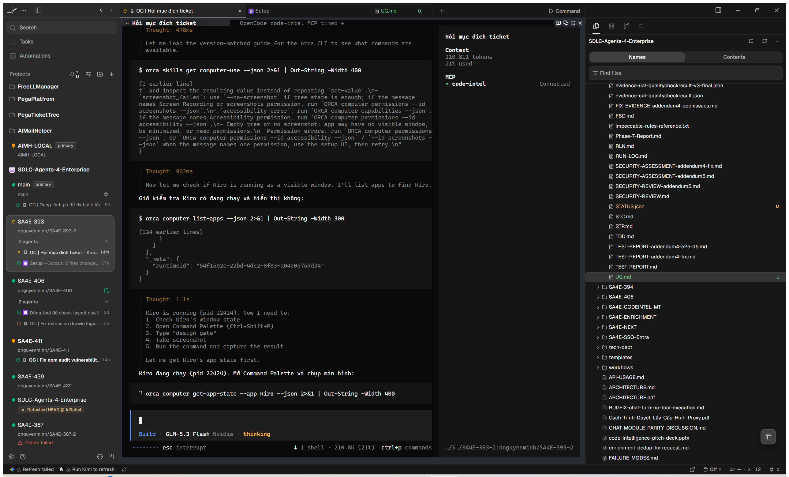
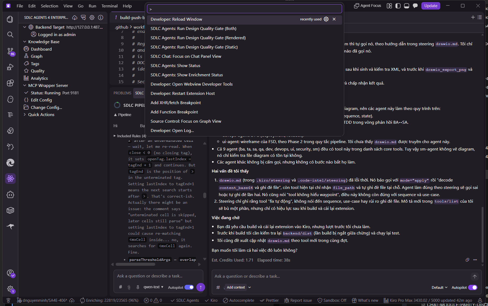
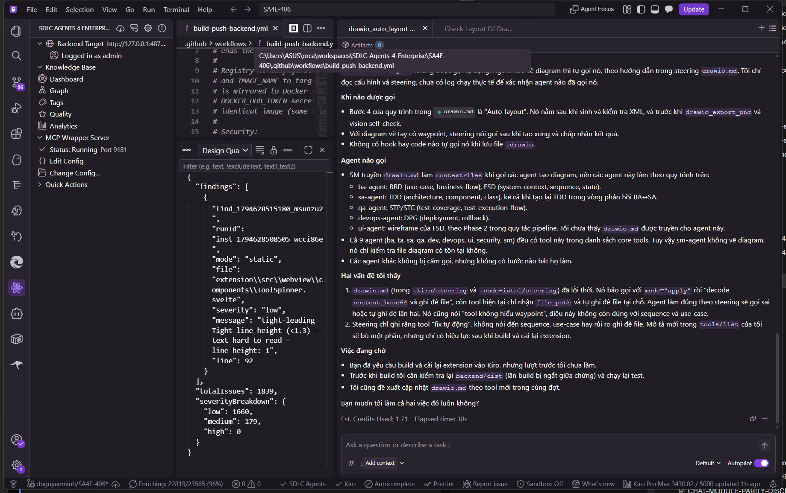

# User Guide — Design Quality Gate

> **Dành cho:** Developer sử dụng extension **SDLC Agents 4 Enterprise** trong Kiro  
> **Phiên bản:** 1.55.19 · **UAT:** ✅ PASS (Integration 6/6) · **Ticket:** SA4E-393  
> **Ảnh chụp:** thực hiện trên bản build 1.55.19 đang chạy thật (2026-11-14)

Design Quality Gate quét các file giao diện (`.tsx`, `.svelte`, `.html`, `.css`) trong workspace, chấm điểm chất lượng design từ 0 → 1 và liệt kê vi phạm. Bạn dùng nó để tự kiểm tra code UI trước khi commit; AI agent cũng bị **bắt buộc** chạy gate trước khi báo hoàn thành.

---

## 1. Nhận diện extension trong Kiro

Sau khi cài VSIX 1.55.19 và reload window, thanh bên trái Kiro xuất hiện panel **SDLC AGENTS 4 ENTERPRISE** với các mục: Backend Target, Knowledge Base, Dashboard, Graph, Tags, Quality, Analytics, và **MCP Wrapper Server** (trạng thái `Running` + port).

**Các thành phần chính trên màn hình:**

| Vùng | Vị trí | Dùng để làm gì |
|------|--------|----------------|
| Panel SDLC Agents | Cột trái | Xem trạng thái backend, MCP Wrapper Server (port), Knowledge Base |
| Editor | Giữa | Mở file code, xem findings theo dòng |
| Chat Panel | Phải | Làm việc với AI agent |
| Status bar | Dưới cùng | Trạng thái SDLC Agents / Kiro |

---

## 2. Chạy Design Quality Gate — từng bước

### Bước 1: Mở Command Palette

Nhấn `Ctrl+Shift+P`. Hộp thoại lệnh hiện ra; gõ `design` để lọc. Ba lệnh gate xuất hiện:

**Key Elements (ảnh trên):**

| Thành phần | Vị trí trên ảnh | Ý nghĩa |
|-----------|-----------------|---------|
| Ô nhập lệnh | Trên cùng, tiền tố `>` | Gõ tên lệnh để lọc |
| `SDLC Agents: Run Design Quality Gate (Static)` | Trong danh sách | Quét trực tiếp file trong workspace — nhanh, không cần app chạy |
| `SDLC Agents: Run Design Quality Gate (Rendered)` | Trong danh sách | Fetch trang từ localhost rồi phân tích DOM đã render |
| `SDLC Agents: Run Design Quality Gate (Both)` | Trong danh sách | Chạy cả hai chế độ, kết quả đầy đủ nhất |

**User Actions:**

| Bước | Thao tác | Kết quả mong đợi |
|------|----------|------------------|
| 1 | Nhấn `Ctrl+Shift+P` | Command Palette hiện ra ở giữa màn hình |
| 2 | Gõ `design` | Danh sách lọc còn lại các lệnh SDLC gate |
| 3 | Chọn một trong 3 lệnh (mũi tên ↑↓ + Enter, hoặc click) | Palette đóng, gate bắt đầu chạy |

> 💡 **Chọn lệnh nào?** Lần đầu dùng → chọn **(Static)** (nhanh, ~vài giây). Muốn kết quả đầy đủ nhất → **(Both)**. Chỉ có (Rendered) cần web app đang chạy tại localhost.

### Bước 2: Xem kết quả gate

Sau vài giây, panel **Design Quality Gate** mở ở khu vực dưới, hiển thị báo cáo JSON. Ảnh dưới là kết quả chạy thật trên workspace mẫu:

**Key Elements (ảnh trên):**

| Thành phần | Vị trí trên ảnh | Ý nghĩa |
|-----------|-----------------|---------|
| Tab `Design Qua...` | Tiêu đề panel dưới | Báo cáo kết quả gate; nút `✕` để đóng |
| Ô `Filter` | Trên đầu panel | Lọc findings theo text/severity, vd `text1,text2` |
| `"runId"` | Trong JSON | Định danh lần chạy — dùng làm evidence đính kèm ticket |
| `"mode"` | Trong JSON | Chế độ đã chạy: `static` / `rendered` |
| `"file"` + `"line"` | Trong JSON | File và dòng bị phát hiện vi phạm |
| `"severity"` | Trong JSON | Mức độ: `low` / `medium` / `high` |
| `"totalIssues"` | Cuối JSON | Tổng số vi phạm tìm thấy |
| `"severityBreakdown"` | Cuối JSON | Phân bổ theo mức độ: low/medium/high |

**User Actions:**

| Bước | Thao tác | Kết quả mong đợi |
|------|----------|------------------|
| 1 | Đọc `totalIssues` + `severityBreakdown` cuối báo cáo | Biết tổng quan: ví dụ ảnh trên là 1839 issues (low 1660, medium 179, high 0) |
| 2 | Ưu tiên sửa finding `high` trước, rồi `medium` | `low` là gợi ý thẩm mỹ, không chặn |
| 3 | Click vào giá trị `"file"` của một finding | Editor mở đúng file, nhảy tới dòng bị báo |
| 4 | Sửa xong → chạy lại gate | Báo cáo mới với `runId` mới; số issues giảm |
| 5 | Copy file `/.code-intel/design-gate/{runId}.json` | Evidence đính kèm ticket khi SM yêu cầu |

> ⚠️ **Lưu ý:** totalIssues cao (hàng nghìn) **không phải lỗi extension** — đó là inventory design-debt thật của workspace. UAT đã xác nhận đây là hành vi đúng của gate (RUN-LOG #28). Hãy sửa dần theo thứ tự severity.

### Bước 3: Hiểu điểm score

| Score | Ý nghĩa | Bạn cần làm gì |
|-------|---------|----------------|
| **0.8 → 1.0** | ✅ PASS ngưỡng (mặc định 0.8) | Commit bình thường |
| **0.3 → 0.79** | ❌ FAIL | Xem `findings`, sửa theo severity rồi chạy lại |
| **< 0.3** | ❌ FAIL — thường do lỗi đường dẫn | `PATH_NOT_FOUND` = file không tồn tại; `PATH_REJECTED_OUTSIDE_WORKSPACE` = file nằm ngoài workspace. Kiểm tra lại workspace root |

---

## 3. AI agent tự chạy gate (từ 1.55.19)

Nếu bạn điều phối AI agent qua extension: agent sửa file UI **bắt buộc** phải chạy gate trước khi báo hoàn thành. Agent không chạy, hoặc FAIL mà không sửa/không nêu lý do → **Scrum Master sẽ chặn Phase 5/6**. Rule này đã được đồng bộ tới cả 7 platform (.kiro, .code-intel, 5 conversions/).

Bạn không cần thao tác gì thêm — chỉ cần **kiểm tra evidence** khi agent báo việc: yêu cầu agent cung cấp `runId` và file báo cáo `{runId}.json`.

---

## 4. Auto-trust Git Worktree

Khi mở một **git worktree** làm workspace, extension tự xác thực — không cần cấu hình tay:

| Trường hợp | Extension phản ứng |
|-----------|-------------------|
| Worktree hợp lệ | ✅ Tự động tin nhiệm, dùng `base_dir` của worktree |
| Path trỏ ra ngoài workspace (`../`) | ⛔ Từ chối, không ghi file |
| Folder thường (không phải worktree) | ℹ️ Hoạt động như cũ |
| `.git` giả mạo trong worktree | ⛔ Từ chối, không ghi file trust |

---

## 5. Xử lý sự cố

| Hiện tượng | Nguyên nhân | Cách xử lý |
|-----------|-------------|-----------|
| Command Palette **không thấy** lệnh gate | VSIX cũ | Cài `sdlc-agents-4-enterprise-1.55.19.vsix` → Reload Window |
| Panel MCP Wrapper hiện **không Running** | Backend/wrapper chưa lên | Đợi vài giây reload; kiểm tra port trong panel |
| Score luôn thấp bất thường | Lỗi đường dẫn | Xem `PATH_NOT_FOUND` / `PATH_REJECTED_OUTSIDE_WORKSPACE` trong báo cáo |
| (Rendered) báo lỗi | Web app chưa chạy tại localhost | Chạy app local trước, hoặc dùng (Static) |
| Gate chậm với workspace lớn | Nhiều file UI | Dùng (Static) thay vì (Both), hoặc quét theo thư mục con |

---

## 6. FAQ

**Hỏi: Gate có gửi code của tôi đi đâu không?**  
Đáp: Không. Static đọc file cục bộ. Rendered chỉ fetch từ `localhost/127.0.0.1`, giới hạn 10MB (điều kiện bảo mật C4 đã được kiểm chứng).

**Hỏi: Báo cáo lưu ở đâu?**  
Đáp: `/.code-intel/design-gate/{runId}.json` trong workspace — mỗi lần chạy một file riêng theo `runId`, không bị ghi đè.

**Hỏi: Tôi có bắt buộc dùng gate không?**  
Đáp: Người chạy tay là tùy chọn. Bắt buộc áp dụng cho **AI agent** sửa file UI.

**Hỏi: Muốn đổi ngưỡng PASS 0.8?**  
Đáp: Liên hệ Scrum Master — threshold nằm trong cấu hình extension và ảnh hưởng toàn team.

---

## 7. Tài liệu liên quan

| Tài liệu | Nội dung |
|----------|----------|
| `documents/SA4E-393/RUN-LOG.md` | Lịch sử chạy + evidence đầy đủ |
| `documents/SA4E-393/FSD.md` | Đặc tả chức năng (Addendum 4, 5) |
| `documents/SA4E-393/TDD.md` | Thiết kế kỹ thuật + kiến trúc (diagrams nằm ở đây) |
| `.opencode/rules/sdlc/ui-design-gate.md` | Rule enforcement cho AI agent |
