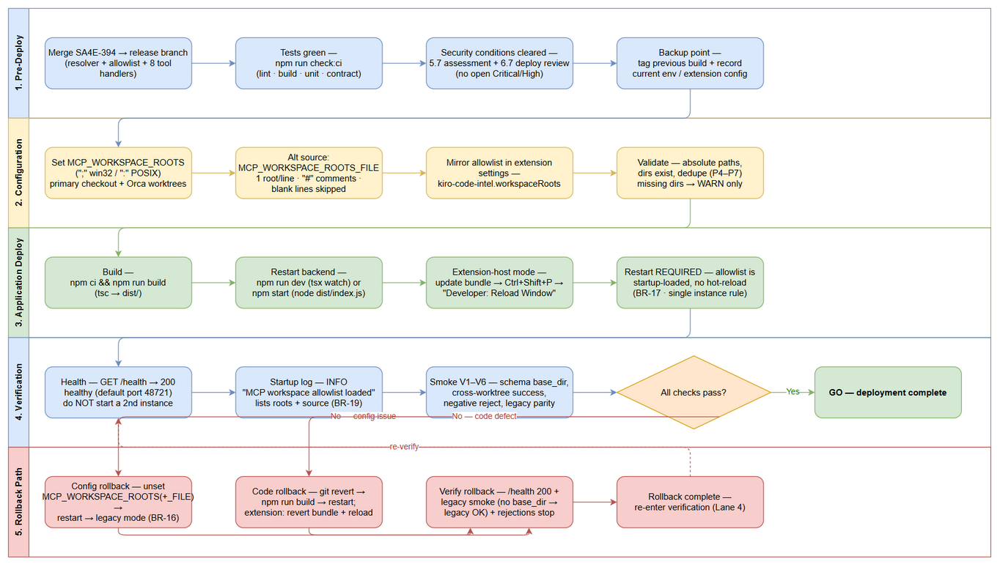
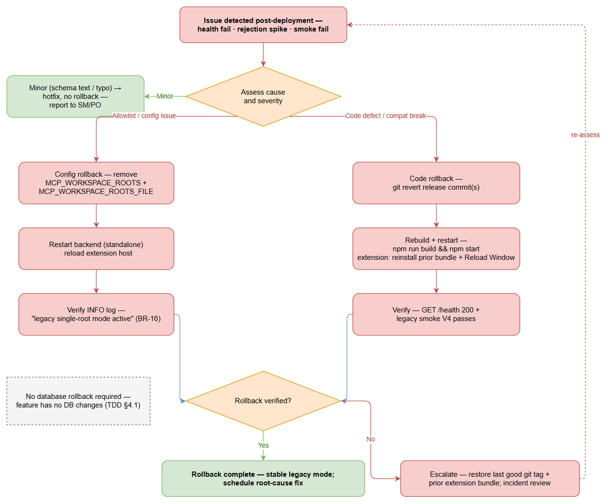

# Deployment Guide (DPG)

## Code-Intel MCP Server — SA4E-394: Multi-Worktree Support — Per-Call base_dir for All file_path Tools

---

## Document Information

| Field | Value |
|-------|-------|
| Jira Ticket | SA4E-394 |
| Title | [MCP Tools] Hỗ trợ multi-worktree: tham số base_dir per-call (hoặc multi-root registry) cho mọi tool nhận file_path |
| Author | DevOps Agent |
| Version | 1.0 |
| Date | 2026-11-01 |
| Status | Draft |
| Related TDD | TDD-v1.0-SA4E-394.docx |
| Related BRD / FSD | BRD v1.0 · FSD v1.1 (documents/SA4E-394/) |

---

## Revision History

| Version | Date | Author | Changes |
|---------|------|--------|---------|
| 1.0 | 2026-11-01 | DevOps Agent | Initiate document — auto-generated from TDD and project context |

---

## Sign-Off

| Name | Role | Signature and date |
|------|------|--------------------|
| | Dev Lead | ☐ Approved for deployment |
| | QA Lead | ☐ Testing completed |
| | Ops Lead | ☐ Infrastructure ready |

---

## 1. Overview

### 1.1 Feature Summary

SA4E-394 adds **multi-worktree support** to the Code-Intel MCP server (BRD/FSD Option A). Today the server pins ONE workspace root at startup (`getWorkspacePath()`, `backend/src/config/index.ts:34`) — the primary checkout (`c:\projects\kiro\SDLC-Agents-4-Enterprise`). Agent sessions running in other Git/Orca worktrees fail on every `file_path` tool: relative paths resolve into the old checkout (`FS_ERROR` ENOENT) and absolute paths are rejected by containment (`PATH_REJECTED_OUTSIDE_WORKSPACE`).

The feature delivers:

1. **Per-call `base_dir` parameter** (deprecated alias: `workspace_root`) on ALL 8 `file_path` tools: `mem_ingest_file`, `embed_image`, `drawio_export_png`, `drawio_auto_layout`, `jira_attach_file`, `confluence_add_attachment`, `sandbox_run`, `stream_write_file`.
2. **Startup workspace allowlist** — `MCP_WORKSPACE_ROOTS` env var or `MCP_WORKSPACE_ROOTS_FILE` config file lists permitted roots (primary checkout + Orca worktrees). Source precedence: **env → file → legacy single-root**.
3. **One shared resolver** (`backend/src/shared/multi-worktree-path-resolver.ts`): normalize → allowlist → existence → resolve → containment-after-resolution; fail-closed; rejects with `PATH_REJECTED_OUTSIDE_ALLOWLIST` BEFORE any filesystem access.
4. **Backward compatibility** — empty/unset allowlist → legacy single-root mode; omitted `base_dir` → byte-identical legacy behavior.
5. **Restart required** — allowlist changes require a server restart; no hot-reload (BR-17).

Deployment target is the existing local dev / prod-consistent setup (TDD §2.3): no new services, ports, containers, or databases; topology unchanged.

### 1.2 Deployment Scope

| Item | Type | Description |
|------|------|-------------|
| Code-Intel backend (`backend/src/`) | Modified | New shared resolver + workspace-allowlist loader + path-resolution types; startup wiring (`index.ts`) + DI registration (`Container.ts`); 8 tool handlers route paths through the resolver; tool schemas gain `base_dir`/`workspace_root` |
| VS Code/Kiro extension (`extension/src/`) | Modified | `PathResolver` adapter gains `baseDir` + allowlist options; 5 call sites forward `base_dir`; settings mirror `kiro-code-intel.workspaceRoots` |
| Database | None | No schema changes, no migrations (TDD §4.1) |
| Configuration | New | `MCP_WORKSPACE_ROOTS`, `MCP_WORKSPACE_ROOTS_FILE` (backend); `kiro-code-intel.workspaceRoots` (extension mirror) |
| Ports / topology | Unchanged | HTTP on `CODE_INTEL_PORT` (default 48721), `GET /health`; no new endpoints or processes |

### 1.3 Target Environments

| Environment | URL | Deploy Order | Approval Required |
|-------------|-----|-------------|-------------------|
| DEV | http://localhost:48721 (developer workstation, tsx watch) | 1st | No |
| SIT | CI pipeline gate (`npm run check:ci`) + container test stage | 2nd | No |
| UAT | http://localhost:48721 (extension-host dogfood with real Orca worktrees) | 3rd | QA Sign-off |
| PROD | http://localhost:48721 (prod-consistent: `node dist/index.js` or Docker production stage) | 4th | PM + Ops Sign-off |

---

## 2. Prerequisites

### 2.1 Infrastructure

| Requirement | Status | Notes |
|-------------|--------|-------|
| Primary checkout present | Ready | c:\projects\kiro\SDLC-Agents-4-Enterprise (current MCP pin target) |
| Orca worktree directories exist | Ready | C:\Users\<user>\orca\workspaces\<PROJECT>\<TICKET> — create BEFORE server start (missing dirs → startup WARN; per-call FS_ERROR) |
| Filesystem permissions | Ready | Backend process user needs read/write on every allowlisted root |
| Port availability | Ready | CODE_INTEL_PORT default 48721 must be free; no new ports introduced |
| Node.js runtime | Ready | v22.23.4 (engines pin, backend/package.json) |
| Database | N/A | No DB changes; existing DB services untouched |

### 2.2 Software Dependencies

| Dependency | Version | Status |
|-----------|---------|--------|
| Node.js | 22.23.4 | Installed |
| npm | 11.x (bundled with Node) | Installed |
| TypeScript + tsx | 5.5+ / 4.x (devDependencies) | Installed via npm ci |
| Vitest + fast-check | 4.1.9 | Installed — resolver/allowlist unit suites |
| VS Code / Kiro extension host | current | Installed (extension surface) |
| Docker (optional container mode) | 24+ | Optional — production stage of backend/Dockerfile |

### 2.3 Access Requirements

| Access | Type | Who Needs It |
|--------|------|-------------|
| Workspace roots (primary + worktrees) | Filesystem read/write | Backend process user |
| Server restart (standalone / extension host) | Local process control | Developer / DevOps |
| Extension window reload | VS Code command palette | Developer (extension-host mode) |
| CI pipeline | Existing service account | Automated (`npm run check:ci` gate) |
| MCP HTTP transport | Existing API key (unchanged) | Agent sessions (POST /mcp) |

### 2.4 Backup Requirements

- [ ] Database backup — **N/A**: this release has NO database changes (TDD §4.1)
- [ ] Application backup — tag the previous release build (`git tag`) so `dist/` can be rebuilt from the prior commit
- [ ] Configuration backup — record current launch env (`--workspace` / `CODE_INTEL_WORKSPACE`), shell profile env vars, and extension settings before adding the new allowlist variables
- [ ] Snapshot `.code-intel/settings.json` (self-written at startup: mcpUrl, pid, version, startedAt) for post-restart comparison

---

## 3. Pre-Deployment Checklist

| # | Item | Responsible | Status |
|---|------|-------------|--------|
| 1 | Code merged to release branch (resolver + allowlist loader + 8 tool handlers + extension adapter) | Developer | ☐ |
| 2 | All unit tests passed — npm run test:unit incl. workspace-allowlist.test.ts (P1–P9) and multi-worktree-path-resolver.test.ts (TC-1..TC-11) | Developer | ☐ |
| 3 | All integration + contract tests passed — npm run test:integration / test:contract | QA | ☐ |
| 4 | SIT/UAT sign-off obtained (smoke V1–V6 of TDD §10.4 executed against a real Orca worktree) | QA + BA | ☐ |
| 5 | Database backup completed | N/A — no DB changes | ☐ |
| 6 | Configuration files prepared — MCP_WORKSPACE_ROOTS (or _FILE) values per host; extension settings mirror | DevOps | ☐ |
| 7 | Feature flags configured | N/A — env-driven: empty/unset allowlist = legacy mode (TDD §10.2) | ☐ |
| 8 | Monitoring/alerting configured — allowlist-size gauge + rejection-rate alerts (§7.4) | DevOps | ☐ |
| 9 | Rollback plan reviewed (§8) | Team | ☐ |
| 10 | Deployment window confirmed (restart of local / extension-host server acceptable) | PM | ☐ |
| 11 | Security review conditions cleared — SECURITY-ASSESSMENT (Phase 5.7) + SECURITY-DEPLOY-REVIEW (Phase 6.7) with no open Critical/High findings | Security Agent | ☐ |
| 12 | Previous version artifact retained (git tag / prior dist/ + extension bundle) for rollback | DevOps | ☐ |

---

## 4. Database Migration

### 4.1 Migration Scripts

| Order | Script | Description | Estimated Time |
|-------|--------|-------------|----------------|
| — | N/A | NO database changes — the allowlist is process-local in-memory state built from environment configuration at startup (TDD §4.1) | — |

### 4.2 Execution Steps

No migration scripts exist for this release. The configuration rollout below replaces the DB migration step:

```bash
# Step 1 (Windows PowerShell): configure the allowlist — env-var source (";" delimiter on Windows)
$env:MCP_WORKSPACE_ROOTS = "c:\projects\kiro\SDLC-Agents-4-Enterprise;C:\Users\ASUS\orca\workspaces\SDLC-Agents-4-Enterprise\SA4E-394"

# Step 1b (alternative): config-file source (used when the env var is unset)
$env:MCP_WORKSPACE_ROOTS_FILE = "C:\sdlc\config\mcp-workspace-roots.txt"

# Step 2: restart the backend — the allowlist is loaded ONCE at startup (BR-13, BR-17)
# (exact restart commands per deployment mode: Section 5.2)
```

### 4.3 Verification Queries

No SQL verification applies. Verify via the startup allowlist log (BR-19):

```text
INFO: MCP workspace allowlist loaded { roots: [...], source: "env", legacyMode: false, count: 2 }
WARN: allowlist entry "C:\path\missing" reason=missing   <- startup continues; entry retained (BR-15)
INFO: legacy single-root mode active                       <- expected when env + file are unset (BR-16)
```

- Every configured root MUST appear in the `roots` snapshot (admin verification surface, FSD §3.2.6).
- Missing / not-a-directory entries produce a WARN naming the entry; startup continues (BR-15).

### 4.4 Rollback Scripts

```bash
# Configuration rollback = unset + restart (preferred — no code roll)
Remove-Item Env:MCP_WORKSPACE_ROOTS -ErrorAction SilentlyContinue
Remove-Item Env:MCP_WORKSPACE_ROOTS_FILE -ErrorAction SilentlyContinue
# restart the backend -> INFO "legacy single-root mode active" (BR-16)
```

---

## 5. Application Deployment

### 5.1 Deployment Flow



*[Edit in draw.io](diagrams/dpg-deployment-flow.drawio)*

### 5.2 Deployment Steps

Two supported modes (TDD §2.3). **Single-instance rule:** if `GET /health` already returns 200, an instance is running — do NOT start a second instance; restart the existing one. **Zero-downtime note:** this is a local dev / prod-consistent single-instance server — a brief restart window is acceptable; agent sessions simply reconnect after restart.

**Mode A — Standalone (npm / tsx):**

| Step | Action | Command | Verification |
|------|--------|---------|-------------|
| 1 | Stop existing service (if running) | Stop process (Ctrl+C on tsx watch, or kill the PID from .code-intel/settings.json) | GET /health no longer responds; old PID gone |
| 2 | Deploy new artifact | git checkout <release-commit> && cd backend && npm ci && npm run build | tsc exits 0; dist/ rebuilt |
| 3 | Update configuration | set MCP_WORKSPACE_ROOTS or MCP_WORKSPACE_ROOTS_FILE (§6.1) | env echoed correctly; file exists and is < 64 KB |
| 4 | Start service | dev: npm run dev (tsx watch src/index.ts) · prod-consistent: npm start (node dist/index.js) | startup logs complete; .code-intel/settings.json rewritten with new pid/startedAt |
| 5 | Health check | GET http://localhost:48721/health | 200 {"status":"healthy",...} + allowlist INFO line in logs |

**Mode B — VS Code / Kiro extension host:**

| Step | Action | Command | Verification |
|------|--------|---------|-------------|
| 1 | Update + reload extension | Update extension bundle → Ctrl+Shift+P → "Developer: Reload Window" | extension host restarts; wrapper MCP tools re-registered |
| 2 | Mirror allowlist | Settings: kiro-code-intel.workspaceRoots = same roots as backend env | settings show string[] with identical values (backend remains source of truth) |
| 3 | Restart backend | Mode A steps 1–5 | /health 200 |
| 4 | Verify wrapper tools | tools/list | base_dir + workspace_root present on all 8 tools |

Rollout order (TDD §10.1): set env → deploy new build → verify startup allowlist log → run Feature Verification V1–V6 (§7.2).

### 5.3 Docker Deployment (if applicable)

```bash
# Build the production image (existing multi-stage Dockerfile — unchanged by this feature)
docker build --target production -t sa4e-backend:1.55.13 backend/

# Run with the allowlist env var + workspace mounts.
# IMPORTANT: every allowlisted root MUST be mounted into the container and the
# in-container path registered in MCP_WORKSPACE_ROOTS; the non-root user (uid 1001) needs RW.
docker run -d --name sa4e-backend \
  -p 48721:48721 \
  -e MCP_WORKSPACE_ROOTS="/workspaces/main;/workspaces/wt-SA4E-394" \
  -v C:\projects\kiro\SDLC-Agents-4-Enterprise:/workspaces/main \
  -v C:\Users\ASUS\orca\workspaces\SDLC-Agents-4-Enterprise\SA4E-394:/workspaces/wt-SA4E-394 \
  sa4e-backend:1.55.13

# Verify
docker logs sa4e-backend --tail 50                                  # INFO "MCP workspace allowlist loaded"
docker inspect --format '{{.State.Health.Status}}' sa4e-backend     # HEALTHCHECK -> healthy
```

Image tags must be specific — never `latest` in production. The built-in HEALTHCHECK probes `GET /health` every 30s (Dockerfile CMD contract unchanged).

### 5.4 CI/CD Integration Notes

- **Existing pipeline gate unchanged:** `npm run check:ci` = lint + lint:lines (≤200 lines/file, ≤20 lines/function) + build + test:unit + test:contract. The feature must keep this green; no pipeline file edits are part of this release.
- **Where the new tests hook in:** `backend/src/shared/__tests__/workspace-allowlist.test.ts` (startup rules P1–P9; TC-9/10/11) and `backend/src/shared/__tests__/multi-worktree-path-resolver.test.ts` (core matrix TC-1..TC-8 + perf budget) run inside the existing `test:unit` stage. Per-tool suites (TC-1..TC-5 × 8 tools) are co-located with handler tests (tool-router, servers/atlassian, modules/sandbox, extension backend-local-tools) and run in the same stage.
- **Deployment stage remains manual local restart** (Mode A/B) or `docker run` — no CI/CD config changes are required for rollout; the allowlist is environment configuration, not build output.

---

## 6. Configuration Changes

### 6.1 New Environment Variables

| Variable | Description | DEV | SIT | UAT | PROD |
|----------|-------------|-----|-----|-----|------|
| MCP_WORKSPACE_ROOTS | Allowlist of workspace roots; delimiter ";" on Windows / ":" on POSIX; precedence: env → file → legacy | c:\projects\kiro\SDLC-Agents-4-Enterprise;C:\Users\ASUS\orca\workspaces\SDLC-Agents-4-Enterprise\SA4E-394 | primary checkout + CI worktree clones (absolute paths per runner) | primary + UAT worktrees (absolute paths per host) | PLACEHOLDER: <PRIMARY_CHECKOUT>;<ORCA_WORKTREE_1>;...;<ORCA_WORKTREE_N> |
| MCP_WORKSPACE_ROOTS_FILE | Optional config-file source (used when the env var is unset): 1 root per line, "#" comments, blank lines skipped, < 64 KB | unset (env used) | set on hosts where env is file-managed | optional | recommended for long lists — PLACEHOLDER: /etc/sdlc/mcp-workspace-roots.txt |

Example `MCP_WORKSPACE_ROOTS_FILE` content:

```text
# Workspace roots allowed as base_dir — one per line; "#" starts a comment
c:\projects\kiro\SDLC-Agents-4-Enterprise
C:\Users\ASUS\orca\workspaces\SDLC-Agents-4-Enterprise\SA4E-394
```

**Validation steps (after restart):**

1. Startup INFO line `MCP workspace allowlist loaded` lists EVERY root + source (env / config_file) + legacyMode=false.
2. Missing / not-a-directory entries → WARN naming the entry; startup continues (entry retained; per-call existence check still guards it).
3. Both sources unset/empty → INFO `legacy single-root mode active` (backward-compatible default).
4. Platform delimiter check: ";" on Windows, ":" on POSIX (TC-11).

### 6.2 Application Properties Changes

| Property | Old Value | New Value | File |
|----------|-----------|-----------|------|
| Legacy pinned root | --workspace CLI arg or CODE_INTEL_WORKSPACE env | unchanged — remains the fallback root when base_dir is omitted | backend launch env (config/index.ts:34-41) |
| kiro-code-intel.workspaceRoots | N/A | string[] mirror of MCP_WORKSPACE_ROOTS (extension-side allowlist) | VS Code / Kiro settings.json |
| Tool input schemas (8 file_path tools) | no base_dir | optional base_dir + workspace_root (plain strings, not required) | backend tool definitions + extension definitions |

### 6.3 Feature Flags

| Flag | DEV | SIT | UAT | PROD |
|------|-----|-----|-----|------|
| MCP_WORKSPACE_ROOTS (empty/unset = legacy mode — this IS the flag) | set (2–3 roots) | set | set | set after verification; empty → legacy fallback |
| MCP_WORKSPACE_ROOTS_FILE | unset | set (file-managed hosts) | optional | set for long lists |

No separate feature flag is required: an empty/unset `MCP_WORKSPACE_ROOTS` selects legacy single-root mode with byte-identical behavior (TDD §10.2). The new code is active but inert until a `base_dir` is supplied.

---

## 7. Post-Deployment Verification

### 7.1 Health Checks

| Check | Endpoint/Command | Expected Result | Timeout |
|-------|-----------------|-----------------|---------|
| Backend health | GET http://localhost:48721/health | 200 {"status":"healthy", version, uptime, module health} — unchanged by this feature | 30s |
| Instance freshness | startup log line "MCP workspace allowlist loaded" | present → new build active; absent → old build, restart required (TDD §10.4) | 60s after start |
| Docker (optional) | docker inspect --format '{{.State.Health.Status}}' sa4e-backend | healthy | 60s |
| Extension host | Reload Window → wrapper tools re-registered | tools/list lists the 8 tools with base_dir | 60s |

Reuse rule: if `/health` already returns 200, an instance is running — do NOT start a second instance; restart that same instance instead.

### 7.2 Smoke Tests

Example MCP `tools/call` (cross-worktree ingest from an Orca worktree):

```json
{
  "name": "mem_ingest_file",
  "arguments": {
    "file_path": "documents/SA4E-394/DPG.md",
    "base_dir": "C:\\Users\\ASUS\\orca\\workspaces\\SDLC-Agents-4-Enterprise\\SA4E-394"
  }
}
```

| # | Scenario | Steps | Expected Result |
|---|----------|-------|-----------------|
| 1 | Schema documentation (V1) | tools/list → inspect all 8 file_path tools | base_dir + workspace_root present with description + example in each |
| 2 | Cross-worktree success (V2) | mem_ingest_file with relative file_path + base_dir = registered Orca worktree | success; file resolved under the worktree; INFO log "successful cross-worktree operation" |
| 3 | Unregistered root rejected (V3) | same call with base_dir = C:\not-registered | error text starts PATH_REJECTED_OUTSIDE_ALLOWLIST: "...not registered in the allowlist. Configure MCP_WORKSPACE_ROOTS..." — NO filesystem access |
| 4 | Backward compatibility (V4) | same call with NO base_dir | legacy behavior: resolves against the pinned root; legacy error codes unchanged |
| 5 | Traversal blocked (V5) | file_path = ../../../etc/passwd with a valid base_dir | PATH_REJECTED_OUTSIDE_ALLOWLIST: "Resolved path ... outside workspace root ..." |
| 6 | Registered-but-missing root | base_dir pointing at a deleted (but allowlisted) directory | FS_ERROR: "Workspace root '...' does not exist on filesystem" |

### 7.3 Log Verification

| Log Entry | Level | Expected | Location |
|-----------|-------|----------|----------|
| MCP workspace allowlist loaded (roots, source, legacyMode, count) | INFO | Within 60s of start (BR-19) | server stdout / log pipeline |
| legacy single-root mode active | INFO | Only when env + file are unset (BR-16) | server log |
| Allowlist entry warning (entry, reason) | WARN | 0 on a clean deploy; only for missing/not-dir entries (BR-15) | server log |
| base_dir rejected (tool_name, base_dir, file_path, code) | WARN | ~0 in steady state; audit trail for rejections | server log |
| Successful cross-worktree operation (tool_name, base_dir, resolved_path) | INFO | One per legitimate cross-worktree call | server log |
| Resolution timing (tool_name, duration_ms) | DEBUG | dev/debug builds only | server log |

**Rate expectations:** `PATH_REJECTED_*` WARN events should be ~0 in steady state; > 10/min sustained indicates allowlist misconfiguration or probing (alert threshold, TDD §9.2).

### 7.4 Monitoring Dashboard

- [ ] mcp_workspace_allowlist_size = expected root count (> 0 in multi-worktree environments; 0 = config-drift alert)
- [ ] mcp_tool_path_rejections_total{tool, code} — no sustained spike (> 10/min)
- [ ] mcp_tool_call_duration_ms p95 regression ≤ 5 ms vs baseline (resolution overhead)
- [ ] Legacy tool-call volume unchanged (backward-compatibility signal)
- [ ] No unexpected alerts triggered

---

## 8. Rollback Plan

### 8.1 Rollback Flow



*[Edit in draw.io](diagrams/dpg-rollback-flow.drawio)*

### 8.2 Rollback Decision Criteria

| Condition | Action |
|-----------|--------|
| Health check fails after restart | Immediate rollback — config first (unset env → restart → legacy), code rollback if persistent |
| Legacy (no base_dir) calls broken — backward-compatibility regression | Immediate code rollback (git revert of release commit(s)) |
| Rejection rate > 10/min sustained for legitimate roots | Allowlist misconfiguration — correct config; roll back to legacy mode if not fixable quickly |
| Any filesystem access observed outside the allowlist (security) | Immediate code rollback + security incident review |
| Tool-call p95 regression > 5 ms attributable to the resolver | Code rollback |
| Minor issue (schema text / typo), workaround available | Hotfix — no rollback; report to SM/PO |

### 8.3 Rollback Steps

| Step | Action | Command | Verification |
|------|--------|---------|-------------|
| 1 | Confirm failure signature | inspect logs + failing smoke scenario | classify: config vs code vs extension |
| 2 | Rollback database | N/A — no DB changes (§4.1) | — |
| 3 | Config rollback (preferred, TDD §10.3) | Remove-Item Env:MCP_WORKSPACE_ROOTS; Remove-Item Env:MCP_WORKSPACE_ROOTS_FILE → restart backend | INFO "legacy single-root mode active"; base_dir calls now rejected with PATH_REJECTED_OUTSIDE_ALLOWLIST (expected, empty allowlist); all legacy calls unchanged |
| 4 | Code rollback (only if config rollback insufficient) | git revert <release-commit(s)> → npm run build → restart backend | /health 200; failing smoke scenario now passes |
| 5 | Extension rollback (if extension bundle at fault) | reinstall previous extension bundle → Ctrl+Shift+P → Reload Window | wrapper tools re-registered; legacy calls OK |
| 6 | Verify rollback | GET /health + legacy smoke (V4) + rejection WARNs stop | all green → stable legacy mode |

The feature is **additive**: config rollback alone restores the exact pre-release behavior (legacy single-root mode); code rollback via `git revert` requires no data/schema recovery.

### 8.4 Rollback Time Estimate

| Action | Estimated Time |
|--------|---------------|
| Database rollback | N/A (no DB changes) |
| Config rollback + restart | ~2 min |
| Code rollback (revert + rebuild + restart) | ~10 min |
| Extension rollback (bundle + reload) | ~5 min |
| Verification | ~3 min |
| **Total** | **≤ 20 min** |

---

## 9. Environment-Specific Notes

### 9.1 DEV

- Start with tsx watch: `npm run dev` in `backend/` — code changes hot-restart, but `MCP_WORKSPACE_ROOTS` changes require a MANUAL restart (no config watcher, BR-17).
- Recommended DEV allowlist: primary checkout + 1–2 scratch worktrees, e.g. `c:\projects\kiro\SDLC-Agents-4-Enterprise;C:\Users\ASUS\orca\workspaces\SDLC-Agents-4-Enterprise\SA4E-394`.
- Orca worktrees are created by the Orca CLI before agent sessions start — add them to the allowlist only after they exist on disk (missing dirs WARN at startup and FS_ERROR per call).

### 9.2 SIT

- Gate: `npm run check:ci` must be green (lint, line budget, build, unit incl. new resolver/allowlist suites, contract).
- Container test stage: `docker build --target test -t sa4e-backend-test backend/ && docker run --rm sa4e-backend-test`.
- Allowlist = primary checkout + CI worktree clones (absolute paths per runner; set via runner env or `MCP_WORKSPACE_ROOTS_FILE`).

### 9.3 UAT

- Extension-host dogfooding: run real agent sessions in Orca worktrees against the updated backend + extension.
- Configure backend env AND `kiro-code-intel.workspaceRoots` from the SAME values — the backend is the source of truth; the extension mirror is required for extension-executed tools.
- QA sign-off required on smoke V1–V6 evidence before PROD rollout.

### 9.4 PROD

- **Deployment Window:** low-activity period agreed with agent users (restart disconnects active MCP sessions; agents reconnect).
- **Approval Required From:** Ops Lead + PM (prod-consistent local deployment; no cloud/IaaS changes).
- **Communication Plan:** notify agent-session owners before (restart window) and after (new `base_dir` capability + allowlist scope).
- **On-Call Contact:** DevOps on-call (Appendix).
- PROD allowlist values are host-specific — record placeholders in change tickets; never commit machine-specific paths with credentials.

---

## 10. Appendix

### Contacts

| Role | Name | Contact |
|------|------|---------|
| DevOps Lead | TBD | TBD |
| Backend Lead | TBD | TBD |
| QA Lead | TBD | TBD |
| On-Call Dev | TBD | TBD |

### Related Tickets

| Ticket | Summary | Relationship |
|--------|---------|-------------|
| SA4E-394 | [MCP Tools] Multi-worktree support — per-call base_dir for all file_path tools | Main ticket |
| SA4E-357 | [MCP Tools] Fix multi-worktree path resolution | Parent — defines the 8-tool scope (In Progress) |
| SA4E-356 | [MCP Tools] Multi-worktree support duplicate | Duplicate of SA4E-357 (Closed) |

### References

| Document | Location |
|----------|----------|
| BRD | documents/SA4E-394/BRD.md (v1.0) |
| FSD | documents/SA4E-394/FSD.md (v1.1) |
| TDD | documents/SA4E-394/TDD.md (v1.0) — §2.3 deployment architecture, §4.1 no-DB note, §10.1 env config, §10.4 runtime profile |
| Path safety utility | backend/src/shared/path-safety.ts |
| Backend runtime | backend/package.json (dev / build / start / check:ci), backend/Dockerfile |

*End of DPG for SA4E-394*

