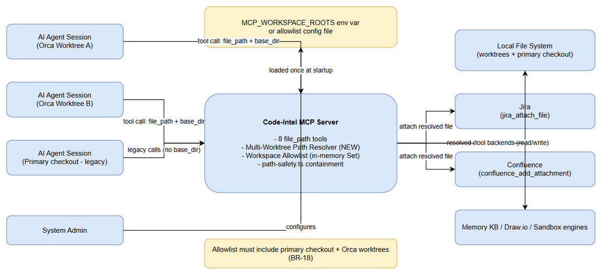
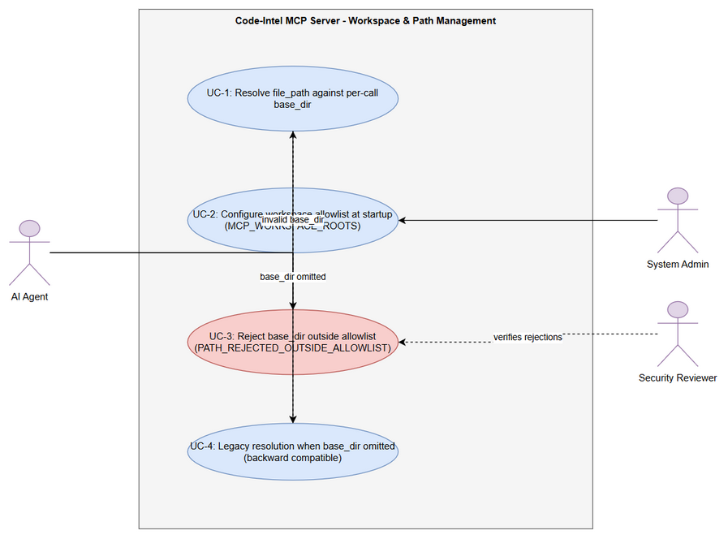
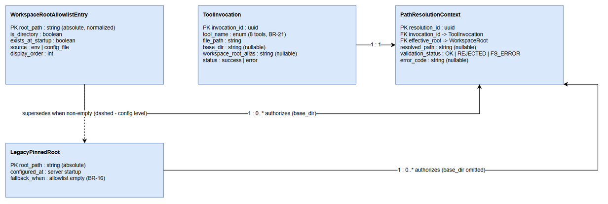
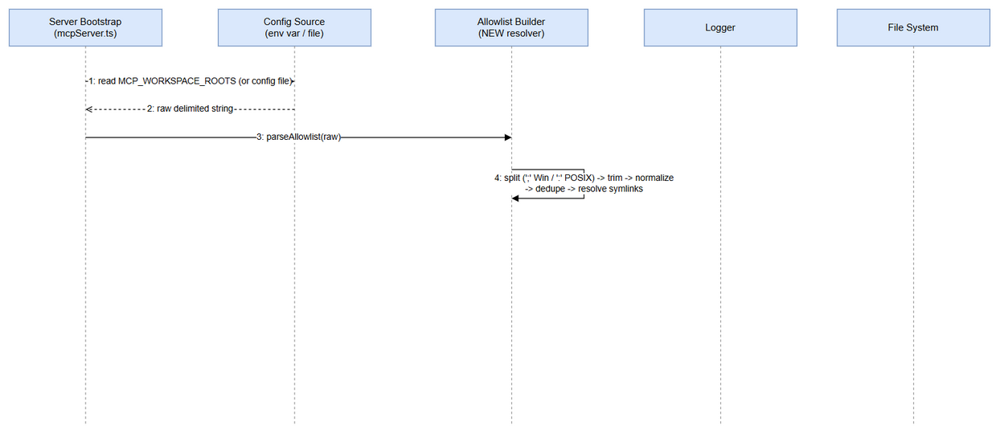
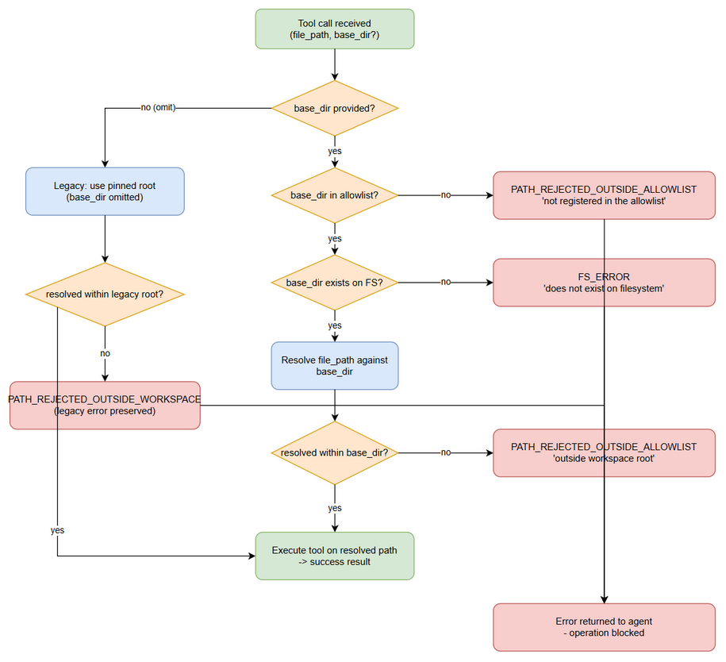
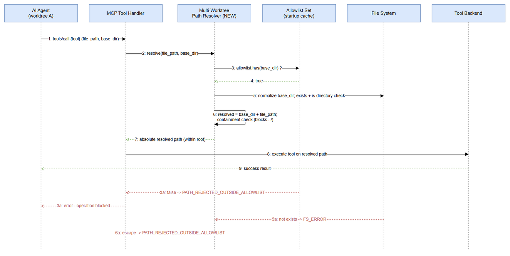

# Functional Specification Document (FSD)

## Code-Intel MCP Server — SA4E-394: [MCP Tools] Multi-Worktree Support — Per-Call base_dir Parameter for All file_path Tools

---

## Document Information

| Field | Value |
|-------|-------|
| Jira Ticket | SA4E-394 |
| Title | [MCP Tools] Hỗ trợ multi-worktree: tham số base_dir per-call (hoặc multi-root registry) cho mọi tool nhận file_path |
| Author | TA Agent (Technical Architect) |
| Version | 1.1 |
| Date | 2026-11-01 |
| Status | Draft |
| Related BRD | documents/SA4E-394/BRD.md |

---

## Author Tracking

| Role | Name - Position | Responsibility |
|------|-----------------|----------------|
| Author | TA Agent – Technical Architect | Create functional specification from BRD |
| Peer Reviewer | SA Agent – Solution Architect | Review document and produce TDD |

---

## Revision History

| Version | Date | Author | Changes |
|---------|------|--------|---------|
| 1.0 | 2026-11-01 | TA Agent | Initiate document — auto-generated from BRD SA4E-394 (Option A selected: per-call base_dir) |
| 1.1 | 2026-11-01 | BA Agent | Synced with TDD per DISCREPANCY.md (DISC-1..DISC-5) |

---

## 1. Introduction

### 1.1 Purpose

This Functional Specification Document (FSD) defines the **functional behavior** of multi-worktree support for the Code-Intel MCP server. Today the server pins **one** workspace root at startup; agent sessions running in other Git worktrees (e.g., Orca worktrees) fail on both relative paths (resolved into the old checkout → `FS_ERROR` ENOENT) and absolute paths (`PATH_REJECTED_OUTSIDE_WORKSPACE`).

This document specifies the selected solution — **Option A: an optional per-call `base_dir` parameter** (alias `workspace_root`) on every path-accepting tool (per-tool path-argument names in §3.3.4), validated against a startup-loaded **workspace allowlist**. It covers: parameter semantics, path resolution and containment rules, allowlist configuration, uniform behavior across all 8 affected tools, business error scenarios, and functional test scenarios.

### 1.2 Scope

**In scope** (aligned with BRD §1.1):

- 8 MCP tools that accept a path argument (inherited scope from SA4E-357): `mem_ingest_file`, `embed_image`, `drawio_export_png`, `drawio_auto_layout`, `jira_attach_file`, `confluence_add_attachment`, `sandbox_run` (path argument: `file`), `stream_write_file` (path argument: `path` or `file_path`, both accepted — see §3.3.4).
- New optional parameters `base_dir` / `workspace_root` on each of these tools.
- Workspace allowlist loading at server startup from `MCP_WORKSPACE_ROOTS` (delimiter: `; ` on Windows, `:` on POSIX) or the `MCP_WORKSPACE_ROOTS_FILE` configuration file (normative line-based format in TDD §4.2 — see §3.2.4).
- A shared path-resolution utility (functional behavior defined here; implementation specified in TDD §3) used by all 8 tools, extending the existing path-safety helpers.
- Containment enforcement **after** resolution (blocks `../` traversal).

**Out of scope** (aligned with BRD §1.2):

- Tools that do NOT accept `file_path`.
- Changes to the MCP protocol specification itself.
- UI/UX changes to any frontend application (no UI screens exist for this feature — see §3.x.5 notes).
- Database schema migrations; authentication/authorization system changes.
- File-system permission model changes beyond path validation.
- Hot-reload of the allowlist (a server restart is required — see BR-16).

### 1.3 Definitions & Acronyms

| Term | Definition |
|------|------------|
| MCP | Model Context Protocol — the protocol used by the code-intelligence server to expose tools to agents |
| Worktree | Git worktree — a linked working directory attached to the same repository |
| Orca Worktree | A worktree managed by the Orca CLI for isolated agent sessions |
| Allowlist | The list of workspace root directories that a per-call `base_dir` is validated against |
| Pinned Root (legacy root) | The single workspace root fixed at server startup — legacy behavior when `base_dir` is omitted |
| base_dir | Optional per-call parameter naming the workspace root that relative `file_path` values resolve against |
| workspace_root | Deprecated alias of `base_dir`, kept for compatibility; behavior is identical |
| Path Containment | Security property ensuring a resolved path cannot escape its effective root (blocks `../` traversal) |
| PATH_REJECTED_OUTSIDE_ALLOWLIST | Business error code returned when `base_dir` (or a resolved path) is outside the allowlist/effective root |
| PATH_REJECTED_OUTSIDE_WORKSPACE | Legacy error code preserved when `base_dir` is omitted and the path escapes the pinned root |
| FS_ERROR | Business error code for filesystem-level failures (missing directory, permission denied) |

### 1.4 References

| Document | Location |
|----------|----------|
| BRD SA4E-394 | documents/SA4E-394/BRD.md |
| TDD SA4E-394 (v1.0 — technical source of truth for §2.2 handler locations, §3.3.4 parameter naming, §3.2.4 config format) | documents/SA4E-394/TDD.md |
| FSD Template | documents/templates/FSD-TEMPLATE.md |
| SA4E-98 FSD (style reference) | documents/SA4E-98/FSD.md |
| Parent ticket (tool scope) | Jira SA4E-357 (in progress); SA4E-356 (closed duplicate) |
| Existing path-safety helpers | backend/src/shared/path-safety.ts |
| MCP server entry points | backend/src/server/HttpServer.ts, backend/src/server/mcpServer.ts |
| Tool registration | backend/src/engine/tools/register-tools.ts |
| KB Entry 952 | code-intel memory: ERROR_PATTERN mem_ingest_file FS_ERROR |
| KB Entry 953 | code-intel memory: CONTEXT multi-worktree |

---

## 2. System Overview

### 2.1 System Context Diagram

The Code-Intel MCP server is invoked by **AI agent sessions** that may run in the primary checkout or in any Orca worktree. Each session calls one of the 8 affected tools with a path argument and — with this feature — an optional `base_dir` naming the worktree it intends to operate on. The **System Admin** configures the workspace allowlist once, at server startup, via the `MCP_WORKSPACE_ROOTS` environment variable or a configuration file. The server then performs all file operations against the **Local File System**, and for two tools (`jira_attach_file`, `confluence_add_attachment`) forwards the resolved file to **Atlassian** services. The allowlist must include the primary checkout plus every Orca worktree the agents are expected to use.

### 2.2 System Architecture

The feature touches one new component and the existing path-safety helpers, server bootstrap, and the 8 tool handlers at their **actual code locations** (verified against the codebase per TDD §3.3; internal design specified in TDD §2–§3):

| Component | Location | Responsibility |
|-----------|----------|----------------|
| Multi-Worktree Path Resolver (NEW) | backend/src/shared/multi-worktree-path-resolver.ts (planned) | Shared utility: validate `base_dir` against allowlist → resolve relative path arguments → enforce containment. Single implementation shared by all 8 tools |
| Path Safety helpers (existing) | backend/src/shared/path-safety.ts | `isPathSafe`, `isWithinRoot`, `resolveWithinWorkspace` — extended by the resolver for allowlist validation |
| MCP server bootstrap (existing) | backend/src/server/mcpServer.ts, backend/src/server/HttpServer.ts | Read allowlist config at startup, build in-memory registry, log loaded roots |
| Tool handlers — backend engine tools (3 of 8) | backend/src/engine/tools/: `drawio-tool.ts` (drawio_auto_layout — `handleDrawioLayout`), `drawio-export-png.ts` (drawio_export_png — `handleDrawioExportPng`), `code-intel-handlers.ts` (stream_write_file code-intel variant — `handleStreamWriteFile`) | Accept new parameters; delegate path resolution to the shared resolver |
| Tool handlers — backend module tools | backend/src/modules/utility/UtilityModule.ts (stream_write_file module variant — path argument `path`); backend/src/modules/sandbox/tools/tool-handlers.ts (sandbox_run — path argument `file`); backend/src/modules/memory/definitions/search.ts (mem_ingest_file backend-fallback schema) | Same resolution delegation per TDD §3.3 |
| Tool handlers — Atlassian server tools (2 of 8) | backend/src/servers/atlassian/tools/: `jira-attachment-tools.ts` (jira_attach_file), `confluence-content-tools.ts` (confluence_add_attachment) | These carry a **second, divergent containment implementation** today (`ALLOWED_BASES = [process.cwd()]` at jira-attachment-tools.ts:17; per-tool `validateFilePath` at :66 / :65) — replaced by the shared resolver per TDD §6.4 (one containment implementation, no-workaround rule) |
| Tool handlers — extension-side | extension/src/backend-local-tools/embed-image.ts (embed_image), extension/src/backend-local-tools/stream-write.ts (stream_write_file extension variant), extension/src/services/Base64ProxyService.ts (mem_ingest_file pre-read proxy) | Execute in the VS Code extension host and cannot import backend ESM modules — adopt `base_dir` through the existing extension `PathResolver` adapter with an identical resolution contract (TDD §6.3) |

Resolution behaves as one decision pipeline: **validate root → resolve path → contain path → execute tool**. Omitting `base_dir` reproduces today's behavior exactly (legacy pinned root, legacy error codes).

> **Handler-location note (synced with TDD §3.3, §6.3–§6.4):** the 8 tools execute across three surfaces — backend engine/module handlers, backend Atlassian server tools, and the VS Code extension host (which cannot import backend ESM modules). Uniform behavior (BR-20) holds on every surface: backend handlers share the single resolver; the Atlassian tools' local `ALLOWED_BASES`/`validateFilePath` containment is replaced by it; extension-side tools adopt `base_dir` via the extension `PathResolver` adapter with an identical resolution contract, verified behaviorally by the shared test matrix (§10).

---

## 3. Functional Requirements

The requirements are grouped into three features: (3.1) the per-call `base_dir` parameter, (3.2) the startup workspace allowlist, and (3.3) uniform enforcement across all 8 tools including the rejection use case.

---

### 3.1 Feature: Per-Call base_dir Path Resolution

**Source:** BRD Story #1 [Implements: BR-01…BR-10]; AC1–AC5 of BRD Story 1.

#### 3.1.1 Description

Every tool that accepts a `file_path` parameter MUST also accept an optional `base_dir` parameter (alias: `workspace_root`). When `base_dir` is provided and registered in the startup allowlist, relative `file_path` values are resolved against it and absolute values are validated to be inside it. When `base_dir` is omitted, the tool falls back to the legacy pinned root with unchanged behavior (backward compatible). The containment check runs **after** resolution, so `../` traversal inside `file_path` cannot escape the effective root. This lets an agent session running in worktree A correctly operate on files in worktree B in a single call.

#### 3.1.2 Use Case

**Use Case ID:** UC-1
**Actor:** AI Agent (session running in any worktree)
**Preconditions:** MCP server is running; allowlist loaded at startup (Feature 3.2); agent holds a valid `file_path` (relative or absolute) and optionally `base_dir`.
**Postconditions:** On success — the tool executed its file operation on exactly one resolved absolute path inside the effective root; on rejection — no file operation occurred and a business error was returned.

**Main Flow:**

| Step | Actor | System | Description |
|------|-------|--------|-------------|
| 1 | AI Agent | | Calls a tool, e.g. `mem_ingest_file`, with `file_path`="documents/SA4E-394/BRD.md" and `base_dir`="/home/user/project-worktree-B" |
| 2 | | MCP Tool Handler | Accepts the call; recognizes `base_dir` (or alias `workspace_root`) |
| 3 | | Path Resolver | Normalizes `base_dir` to an absolute path (BR-09); checks it is registered in the allowlist (BR-05) |
| 4 | | Path Resolver | Checks `base_dir` exists and is a directory (BR-06) |
| 5 | | Path Resolver | Resolves `file_path` against `base_dir` → absolute path (BR-02) |
| 6 | | Path Resolver | Runs containment check: resolved path must be within `base_dir` (BR-07) |
| 7 | | Tool Handler | Executes the tool's file operation on the resolved absolute path |
| 8 | | Tool Handler | Returns the tool's normal success result, including the resolved path |

**Alternative Flows:**

| ID | Condition | Steps |
|----|-----------|-------|
| AF-1 | `base_dir` omitted | Resolve relative `file_path` against the legacy pinned root (BR-03); preserve legacy error codes (PATH_REJECTED_OUTSIDE_WORKSPACE / FS_ERROR) — AC3 |
| AF-2 | `workspace_root` alias used instead of `base_dir` | Treat identically to `base_dir` (BR-10); if both are provided, `base_dir` wins |
| AF-3 | `base_dir` provided as relative path | Normalize to absolute against the server's working directory before validation (BR-09) |
| AF-4 | `file_path` provided as absolute path | Skip relative resolution; validate the absolute path is within the effective root (BR-04) |
| AF-5 | `file_path` contains `../` segments | Allowed only if the final resolved path is still within the effective root (BR-07); otherwise rejected |

**Exception Flows:**

| ID | Condition | Steps |
|----|-----------|-------|
| EF-1 | `base_dir` not in allowlist | Return `PATH_REJECTED_OUTSIDE_ALLOWLIST` with message per §3.1.6; no FS access — AC2 |
| EF-2 | `base_dir` does not exist on filesystem | Return `FS_ERROR` with message per §3.1.6 |
| EF-3 | Resolved path escapes `base_dir` (traversal) | Return `PATH_REJECTED_OUTSIDE_ALLOWLIST` with message per §3.1.6 — AC4 |
| EF-4 | Permission denied on the file operation | Return `FS_ERROR` with OS error details |
| EF-5 | Allowlist empty and `base_dir` provided | Any `base_dir` is rejected with `PATH_REJECTED_OUTSIDE_ALLOWLIST` (empty allowlist enables legacy mode only — BR-15) |

#### 3.1.3 Business Rules

| Rule ID | Rule | Source |
|---------|------|--------|
| BR-01 | Every `file_path`-accepting tool accepts optional `base_dir` (alias `workspace_root`) | BRD Story 1, req 1 |
| BR-02 | When `base_dir` is provided, relative `file_path` resolves against `base_dir` | BRD Story 1, req 2 |
| BR-03 | When `base_dir` is omitted, relative `file_path` resolves against the legacy pinned root (backward compatible) | BRD Story 1, req 3 |
| BR-04 | Absolute `file_path` must be within `base_dir` (if provided) or the legacy root (if omitted) | BRD Story 1, req 4 |
| BR-05 | `base_dir` must be in the server's startup allowlist; otherwise reject with `PATH_REJECTED_OUTSIDE_ALLOWLIST` | BRD Story 1, validation |
| BR-06 | `base_dir` must exist on the filesystem and be a directory; otherwise `FS_ERROR` | BRD Story 1, validation |
| BR-07 | Containment check runs AFTER resolution — resolved path must be within the effective root (blocks `../`) | BRD Story 1, validation |
| BR-08 | `base_dir` is documented in every affected tool's JSON schema with description and example | BRD Story 1, req 5 |
| BR-09 | A relative `base_dir` input is normalized to an absolute path before validation | BRD Story 1, validation |
| BR-10 | `workspace_root` alias behaves identically to `base_dir`; if both are sent, `base_dir` takes precedence | BRD Story 1 data fields; TA clarification |
| BR-11 | Allowlist membership is checked before filesystem existence (error precedence: allowlist → existence → containment) | TA clarification of BRD error ordering |

#### 3.1.4 Data Specifications

**Input Data (applies to each of the 8 tools):**

| Field | Type | Required | Validation | Description |
|-------|------|----------|------------|-------------|
| file_path | string | Y | Non-empty; no null bytes; relative (no drive letter) or absolute | Relative or absolute path to the target file/directory |
| base_dir | string | N | Absolute after normalization; exists; is directory; in allowlist | Workspace root to resolve relative paths against (BR-05/06/09) |
| workspace_root | string | N | Same as base_dir | Deprecated alias of `base_dir` (BR-10) |
| *(tool-specific params)* | varies | varies | unchanged | All pre-existing parameters of each tool keep their current semantics |

> **Per-tool path-parameter naming (verified against codebase — TDD §3.3):** the path argument is `file_path` on `mem_ingest_file`, `embed_image`, `drawio_export_png`, `drawio_auto_layout`, `jira_attach_file`, `confluence_add_attachment`; **`file`** on `sandbox_run`; and **both `path` and `file_path`** on `stream_write_file` (module vs code-intel/extension variants). `base_dir`/`workspace_root` semantics are identical regardless of the path argument's name.

**Output Data:**

| Field | Type | Description |
|-------|------|-------------|
| *(tool-specific result)* | varies | The tool's normal success payload, unchanged |
| resolved_path | string | The absolute path the operation was performed on (where the tool already reports a path) |
| status | string | `success` or `error` |
| error_code | string | On failure: PATH_REJECTED_OUTSIDE_ALLOWLIST / PATH_REJECTED_OUTSIDE_WORKSPACE / FS_ERROR |
| message | string | Human-readable business error message (§3.1.6) |

#### 3.1.5 UI Specifications

**Not applicable** — MCP tools are consumed programmatically by AI agents; this feature has no screens, dialogs, or mockups. The "user-facing surface" is the tool JSON schema documentation (BR-08), specified functionally in §3.3.6.

#### 3.1.6 API Contract (Functional View)

> **Note:** This section defines the functional API contract (what data flows in/out and business error scenarios). Technical details (transport headers, JSON schema drafting, retry policies) are specified in the TDD §3 and §5.

**Endpoint:** `MCP tools/call → {tool_name}` where `{tool_name}` ∈ { mem_ingest_file, embed_image, drawio_export_png, drawio_auto_layout, jira_attach_file, confluence_add_attachment, sandbox_run, stream_write_file }
**Purpose:** Execute a file-based tool operation against the correct workspace root for the calling agent session.

**Input Parameters:**

| Parameter | Type | Required | Business Rule | Description |
|-----------|------|----------|---------------|-------------|
| file_path | string | Y | BR-04, BR-07 | Relative or absolute path to the file |
| base_dir | string | N | BR-05, BR-06, BR-09 | Registered workspace root to resolve against |
| workspace_root | string | N | BR-10 | Alias of base_dir (deprecated) |
| *(tool params)* | varies | varies | unchanged | Existing parameters per tool |

**Output Data:**

| Field | Type | Description |
|-------|------|-------------|
| tool result | object | Normal tool result on success (with resolved_path where applicable) |
| error.code | string | One of the business error codes below |
| error.message | string | Message shown to the calling agent |

**Business Error Scenarios:**

| Scenario | User Message | Trigger Condition |
|----------|-------------|-------------------|
| base_dir not registered | "Workspace root '{base_dir}' is not registered in the allowlist. Configure MCP_WORKSPACE_ROOTS to include this path." | `base_dir` ∉ allowlist (BR-05) — error code PATH_REJECTED_OUTSIDE_ALLOWLIST |
| base_dir missing on disk | "Workspace root '{base_dir}' does not exist on filesystem" | `base_dir` not found / not a directory (BR-06) — error code FS_ERROR |
| Resolved path escapes root | "Resolved path '{resolved}' is outside workspace root '{base_dir}'" | Containment failure after resolution (BR-07) — error code PATH_REJECTED_OUTSIDE_ALLOWLIST |
| Permission denied | "FS_ERROR: {OS error details}" | OS denies read/write on the resolved path (EF-4) |
| Legacy absolute path outside pinned root | (unchanged legacy behavior) | `base_dir` omitted and absolute path outside pinned root — error code PATH_REJECTED_OUTSIDE_WORKSPACE (AF-1) |

---

### 3.2 Feature: Workspace Allowlist Configuration at Server Startup

**Source:** BRD Story #2 [Implements: BR-12…BR-17].

#### 3.2.1 Description

At startup the MCP server loads a **workspace allowlist** — the set of workspace roots that `base_dir` may name. The allowlist is supplied via the `MCP_WORKSPACE_ROOTS` environment variable (semicolon-separated on Windows, colon-separated on POSIX) or the `MCP_WORKSPACE_ROOTS_FILE` configuration file — normative line-based format (one root per line, `#` comments, blank lines skipped) and source precedence (env var → config file → legacy mode) are defined in TDD §4.2. Entries are normalized to absolute, deduplicated paths with symlinks resolved; missing entries produce a startup warning but do not abort startup. The validated allowlist is cached in memory for O(1) lookups and logged at info level. An empty allowlist selects legacy single-root mode (pinned root only). Allowlist changes take effect on server restart.

#### 3.2.2 Use Case

**Use Case ID:** UC-2
**Actor:** System Admin
**Preconditions:** MCP server is about to start (or restarting); admin can set environment variables or edit the config file.
**Postconditions:** Allowlist loaded, normalized, cached, and logged; legacy root registered when allowlist is empty.

**Main Flow:**

| Step | Actor | System | Description |
|------|-------|--------|-------------|
| 1 | System Admin | | Sets `MCP_WORKSPACE_ROOTS` = "/home/user/project;/home/user/project-worktree-A;/home/user/project-worktree-B" (Windows `; `, POSIX `:`) or writes the config file |
| 2 | | Server bootstrap | Reads the variable (or config file) at startup |
| 3 | | Allowlist builder | Splits on the platform delimiter; trims entries |
| 4 | | Allowlist builder | Normalizes each entry to an absolute path; deduplicates; resolves symlinks (BR-14) |
| 5 | | Allowlist builder | Validates each entry exists and is a directory (BR-15) |
| 6 | | Server bootstrap | Builds an in-memory Set of registered roots (O(1) lookup) and caches it (BR-13) |
| 7 | | Server bootstrap | Logs the loaded allowlist at info level |
| 8 | | Server bootstrap | Server becomes ready; every tool call can now validate `base_dir` against the Set |

**Alternative Flows:**

| ID | Condition | Steps |
|----|-----------|-------|
| AF-1 | Allowlist empty / variable unset | Fall back to legacy single-root mode: only the pinned root is registered (BR-16) |
| AF-2 | Config file supplied instead of env var | Read entries from the config file using the same normalization and validation steps |
| AF-3 | An entry does not exist or is a file | Log a warning naming the entry; continue startup with the remaining entries (BR-15) |

**Exception Flows:**

| ID | Condition | Steps |
|----|-----------|-------|
| EF-1 | Malformed entry (empty token after split) | Skip the empty token; warn at startup |
| EF-2 | Config file unreadable/unparseable | Warn, treat allowlist as empty → legacy mode (AF-1) |

#### 3.2.3 Business Rules

| Rule ID | Rule | Source |
|---------|------|--------|
| BR-12 | Allowlist is supplied via `MCP_WORKSPACE_ROOTS` (`; ` on Windows, `:` on POSIX) or a config file | BRD Story 2, req 1 |
| BR-13 | Allowlist is loaded once at startup and cached in memory (Set); no per-call re-read of config | BRD Story 2, req 2 |
| BR-14 | Entries are normalized to absolute paths, deduplicated, and symlinks resolved to real paths | BRD Story 2, validation |
| BR-15 | Startup validates each entry exists and is a directory; missing entries warn but do not abort startup | BRD Story 2, req 4 / AC 3 |
| BR-16 | Empty allowlist → legacy single-root mode (pinned root only) | BRD Story 2, req 5 / AC 4 |
| BR-17 | Allowlist changes require a server restart (no hot reload) | BRD Story 2, AC 5 |
| BR-18 | The allowlist must support both the primary checkout and Orca worktrees | BRD Story 2, req 6 |
| BR-19 | The loaded allowlist is logged at startup (info level) | BRD Story 2, AC 2 |

#### 3.2.4 Data Specifications

**Input Data:**

| Field | Type | Required | Validation | Description |
|-------|------|----------|------------|-------------|
| MCP_WORKSPACE_ROOTS | string (env) | N | Delimited list; each entry absolute (or normalized per BR-14); non-empty tokens | Registered workspace roots, e.g. "/home/user/project:/home/user/project-worktree-A" |
| MCP_WORKSPACE_ROOTS_FILE | string (env var holding a path to a UTF-8 text file) | N | File must be readable; one root per line; `#` starts a comment; blank lines skipped (normative format: TDD §4.2) | Alternative allowlist source when `MCP_WORKSPACE_ROOTS` is not set; source precedence: env var → file → legacy mode |

**Output Data (startup artifacts):**

| Field | Type | Description |
|-------|------|-------------|
| registeredRoots | string[] (in-memory Set) | Normalized absolute roots available for `base_dir` validation |
| startupLog | log lines (info) | The loaded allowlist; warnings for invalid/missing entries |

#### 3.2.5 UI Specifications

**Not applicable** — configuration is environment/file based; there is no admin UI. Startup logging (BR-19) is the admin's verification surface.

#### 3.2.6 API Contract (Functional View)

**Endpoint:** `Server startup (configuration surface — not a runtime API)`
**Purpose:** Register the workspace roots that per-call `base_dir` values are validated against.

**Input Parameters:**

| Parameter | Type | Required | Business Rule | Description |
|-----------|------|----------|---------------|-------------|
| MCP_WORKSPACE_ROOTS | env string | N | BR-12, BR-14 | Delimited workspace roots (`; ` Windows / `:` POSIX) |
| MCP_WORKSPACE_ROOTS_FILE | env string (file path) | N | BR-12 | Alternative allowlist source; file format defined in TDD §4.2 (one root per line, `#` comments, blank lines skipped) |

**Output Data:**

| Field | Type | Description |
|-------|------|-------------|
| in-memory allowlist Set | string[] | Registered roots used by UC-1 step 3 |
| startup log (info) | log entry | Lists loaded roots and any warnings (BR-19) |

**Business Error Scenarios:**

| Scenario | User Message | Trigger Condition |
|----------|-------------|-------------------|
| Non-existent allowlist entry | Startup warning: "Allowlist entry '{root}' does not exist or is not a directory" (startup continues) | BR-15 / AF-3 |
| Empty allowlist | Startup info: "MCP_WORKSPACE_ROOTS empty — legacy single-root mode active" | BR-16 / AF-1 |
| Config file unreadable | Startup warning; legacy mode fallback | EF-2 |

---

### 3.3 Feature: Uniform Multi-Worktree Behavior Across All file_path Tools

**Source:** BRD Story #3 and Story #4 [Implements: BR-20…BR-23].

#### 3.3.1 Description

All 8 path-accepting tools (§3.3.4 — path-argument names vary per tool) implement `base_dir` with **identical** semantics, delegated to one shared resolution utility — no tool-specific deviations. Every tool exposes the new parameters in its JSON schema (AC5), and every unauthorized-root attempt is rejected with the explicit `PATH_REJECTED_OUTSIDE_ALLOWLIST` error so security reviewers can identify misuse unambiguously (Story #4). Uniformity is verified by the common 5-scenario test matrix per tool (§10).

#### 3.3.2 Use Case

**Use Case ID:** UC-3
**Actor:** AI Agent (primary); Security Reviewer (beneficiary)
**Preconditions:** Server running; allowlist loaded; agent calls a tool with a `base_dir` that is not registered (or a path that resolves outside the effective root).
**Postconditions:** Operation blocked; explicit business error returned; no file read/write occurred outside the allowlist.

**Main Flow:**

| Step | Actor | System | Description |
|------|-------|--------|-------------|
| 1 | AI Agent | | Calls any of the 8 tools with `base_dir` = an unregistered directory |
| 2 | | Path Resolver | Allowlist lookup fails (BR-05, BR-11) |
| 3 | | Tool Handler | Returns `PATH_REJECTED_OUTSIDE_ALLOWLIST` with the §3.1.6 message; operation aborted before any FS access |
| 4 | | Tool Handler | Logs the rejection event (§7.3) |
| 5 | AI Agent | | Corrects the call (registered root / omit `base_dir`) or asks the admin to extend the allowlist |

**Alternative Flows:**

| ID | Condition | Steps |
|----|-----------|-------|
| AF-1 | Resolved path escapes an allowed `base_dir` | Same rejection flow with the "Resolved path … outside workspace root" message (BR-07) |
| AF-2 | Security review scenario | Security Reviewer inspects rejection logs to confirm zero out-of-allowlist access (AC4) |

**Exception Flows:**

| ID | Condition | Steps |
|----|-----------|-------|
| EF-1 | Allowlist empty and `base_dir` provided | Rejected per BR-16/EF-5 of UC-1 |
| EF-2 | Resolver internal failure (unexpected) | Tool returns a generic error; no partial file operation is left behind |

#### 3.3.3 Business Rules

| Rule ID | Rule | Source |
|---------|------|--------|
| BR-20 | All 8 tools accept `base_dir` with identical behavior via the shared resolver — no tool-specific deviations | BRD Story 3, req 2 / AC 4 |
| BR-21 | Tool inventory is fixed to the SA4E-357 scope (8 tools listed in §3.3.6) | BRD Story 3, req 1 |
| BR-22 | Every tool documents `base_dir` (description + example) in its JSON schema | BRD Story 1 req 5 / Story 3 AC 5 |
| BR-23 | Unauthorized roots are always rejected with explicit `PATH_REJECTED_OUTSIDE_ALLOWLIST` before any filesystem access | BRD Story 4 |

#### 3.3.4 Data Specifications

**Input Data:** same parameter set as §3.1.4, applied uniformly to the tool inventory below.

**Output Data (per-tool applicability):**

| Tool | Path-argument role (name per TDD §3.3) | Operation class | base_dir effect |
|------|----------------|-----------------|-----------------|
| mem_ingest_file | Document to ingest into memory KB | Read | Resolve/validate ingest source |
| embed_image | Image to inline as base64 | Read | Resolve/validate image source |
| drawio_export_png | .drawio source file — backend `file_path` is **reference-only** (backend writes to a temp dir and returns `output_base64`); `output_path` write-back exists only in the extension output proxy | Read (backend) + write-back (extension proxy) | Backend: resolve/validate `file_path` (reference); extension adapter: resolve/validate `output_path` (TDD §3.3) |
| drawio_auto_layout | .drawio file to auto-layout | Read/Write | Resolve/validate diagram file |
| jira_attach_file | Local file to attach to a Jira issue | Read → upload | Resolve/validate upload source |
| confluence_add_attachment | Local file to attach to a Confluence page | Read → upload | Resolve/validate upload source |
| sandbox_run | Script input — path argument is **`file`** (not `file_path`); resolved **host-side pre-mount** into the sandbox; sandbox-internal path semantics unchanged | Execute (FS-bound) | Resolve/validate the host-side `file` value before sandbox mount |
| stream_write_file | Destination file to write — parameter name differs by surface: `path` (backend module variant), `file_path` (code-intel variant), `file_path` (extension variant); **both `path` and `file_path` are accepted and routed through the resolver on every surface** (TDD §3.3) | Write | Resolve/validate write target under either parameter name |

#### 3.3.5 UI Specifications

**Not applicable** — see §3.1.5.

#### 3.3.6 API Contract (Functional View)

**Endpoint:** `MCP tools/call` — parameter applicability matrix (all tools share the contract of §3.1.6)
**Purpose:** Guarantee uniform `base_dir` semantics and schema documentation across the toolset.

**Input Parameters (per tool):**

| Parameter | Type | Required | Business Rule | Description |
|-----------|------|----------|---------------|-------------|
| base_dir / workspace_root | string | N (all 8 tools) | BR-20, BR-22 | Same semantics as §3.1.6 on every tool |
| file_path | string | Y (7 of 8 tools) | BR-04, BR-07 | Role per tool listed in §3.3.4 — exceptions: `sandbox_run` requires `file` (its path argument name); `stream_write_file` accepts both `path` and `file_path` |

**Output Data:**

| Field | Type | Description |
|-------|------|-------------|
| tool result | object | Tool-specific success payload (unchanged per tool) |
| schema description | string | Each tool's JSON schema documents `base_dir` with description + example (AC5) |

**Business Error Scenarios:**

| Scenario | User Message | Trigger Condition |
|----------|-------------|-------------------|
| Unregistered root on ANY of the 8 tools | "Workspace root '{base_dir}' is not registered in the allowlist. Configure MCP_WORKSPACE_ROOTS to include this path." | BR-23 / UC-3 step 2 |
| Schema gap (missing base_dir docs) | N/A — build/test failure | Tool schema lacks `base_dir` documentation → TC-5 fails |

---

## 4. Data Model

> **Note:** This section defines the logical data model (entities, relationships, business attributes). Physical implementation (DDL scripts, indexes, migration plans, query patterns) is specified in the TDD §4. This feature is configuration-centric — no database tables are added; entities below are logical/runtime structures.

### 4.1 Entity Relationship Diagram

### 4.2 Logical Entities

#### Entity: WorkspaceRootAllowlistEntry

A workspace root registered at startup and eligible as `base_dir`.

| Attribute | Type | Required | Business Rule | Description |
|-----------|------|----------|---------------|-------------|
| root_path | string (absolute path) | Y | BR-14 | Normalized absolute path; symlinks resolved; unique in the Set |
| is_directory | boolean | Y | BR-15 | Entry must be a directory at startup (warn if not) |
| exists_at_startup | boolean | Y | BR-15 | False entries trigger a warning but remain in config review |
| source | enum(env | config_file) | Y | BR-12 | Where the entry was loaded from |
| display_order | int | Y | BR-12 | Position in the delimited input (diagnostics only) |

#### Entity: LegacyPinnedRoot

The single workspace root fixed at server startup — pre-existing behavior.

| Attribute | Type | Required | Business Rule | Description |
|-----------|------|----------|---------------|-------------|
| root_path | string (absolute path) | Y | BR-03 | The pinned workspace root used when `base_dir` is omitted |
| fallback_when | enum(allowlist empty) | Y | BR-16 | When the allowlist is empty this is the only registered root |

#### Entity: ToolInvocation

One agent call to one of the 8 tools.

| Attribute | Type | Required | Business Rule | Description |
|-----------|------|----------|---------------|-------------|
| invocation_id | uuid | Y | — | Identifies a single tool call |
| tool_name | enum(8 tools) | Y | BR-21 | One of the tools in §3.3.4 |
| file_path | string | Y | BR-04 | Relative or absolute path as sent by the agent |
| base_dir | string (nullable) | N | BR-05, BR-09 | Requested workspace root (null → legacy) |
| workspace_root_alias | string (nullable) | N | BR-10 | Alias value when the deprecated name is used |
| status | enum(success | error) | Y | — | Outcome of the invocation |

#### Entity: PathResolutionContext

The per-call resolution outcome produced by the shared resolver.

| Attribute | Type | Required | Business Rule | Description |
|-----------|------|----------|---------------|-------------|
| resolution_id | uuid | Y | — | Identifies one resolution |
| invocation_id | uuid (FK) | Y | — | Owning tool invocation |
| effective_root | string (FK) | Y | BR-03, BR-05 | The root authorization is checked against (base_dir or pinned root) |
| resolved_path | string (nullable) | N | BR-02, BR-07 | Absolute path after resolution; null when rejected before resolution |
| validation_status | enum(OK | REJECTED | FS_ERROR) | Y | BR-11 | Outcome in precedence order: allowlist → existence → containment |
| error_code | string (nullable) | N | §3.1.6 | PATH_REJECTED_OUTSIDE_ALLOWLIST / PATH_REJECTED_OUTSIDE_WORKSPACE / FS_ERROR |

**Relationships:**

| From Entity | To Entity | Cardinality | Description |
|-------------|-----------|-------------|-------------|
| ToolInvocation | PathResolutionContext | 1 : 1 | Every invocation produces exactly one resolution context |
| WorkspaceRootAllowlistEntry | PathResolutionContext | 1 : 0..* | A registered root authorizes many invocations that name it as base_dir |
| LegacyPinnedRoot | PathResolutionContext | 1 : 0..* | The pinned root authorizes all invocations that omit base_dir |
| WorkspaceRootAllowlistEntry | LegacyPinnedRoot | 1 : 0..1 | When the allowlist is non-empty it supersedes the pinned root as the only multi-root registry (dashed — configuration-level) |

---

## 5. Integration Specifications

> **Note:** This section defines what external systems are involved and what data is exchanged (business view). Technical details (timeout, retry, circuit breaker, connection strings) are specified in the TDD §6.

### 5.1 External System: AI Agent Sessions (MCP Clients — Orca worktrees / primary checkout)

| Attribute | Value |
|-----------|-------|
| Purpose | Consumers of the 8 tools; need per-worktree file operations |
| Direction | Inbound |
| Data Format | JSON (MCP tools/call) |
| Frequency | Real-time, per agent step |

**Data Exchange:**

| Our Data | External Data | Direction | Business Rule |
|----------|--------------|-----------|---------------|
| Tool result / business error | file_path + base_dir (or workspace_root) in tool arguments | Receive | BR-01…BR-10 |
| resolved_path | Agent's intended worktree root | Send | Returned on success for traceability |

### 5.2 External System: Local File System (worktrees + primary checkout)

| Attribute | Value |
|-----------|-------|
| Purpose | Actual read/write/execute target of every resolved path |
| Direction | Bidirectional (read for ingest/export/upload; write for stream_write_file, drawio output) |
| Data Format | Files/directories on disk |
| Frequency | Real-time, per tool call |

**Data Exchange:**

| Our Data | External Data | Direction | Business Rule |
|----------|--------------|-----------|---------------|
| Resolved absolute path | File/directory content | Send/Receive | BR-04, BR-07 — only paths within the effective root are touched |
| base_dir existence query | Directory metadata | Receive | BR-06 (existence + is-directory check) |

### 5.3 External System: Configuration Provider (env var / config file)

| Attribute | Value |
|-----------|-------|
| Purpose | Supplies the workspace allowlist at startup |
| Direction | Inbound |
| Data Format | Delimited string (`; ` Windows / `:` POSIX) via `MCP_WORKSPACE_ROOTS`, or `MCP_WORKSPACE_ROOTS_FILE` line-based text file (one root per line, `#` comments — TDD §4.2) |
| Frequency | Once at server startup |

**Data Exchange:**

| Our Data | External Data | Direction | Business Rule |
|----------|--------------|-----------|---------------|
| Normalized root set | MCP_WORKSPACE_ROOTS raw string (or MCP_WORKSPACE_ROOTS_FILE file content) | Receive | BR-12…BR-16 |
| Startup warnings | Invalid/missing entries | Send (log) | BR-15, BR-19 |

### 5.4 External System: Atlassian (Jira / Confluence) — downstream of resolved files

| Attribute | Value |
|-----------|-------|
| Purpose | Receives files resolved by jira_attach_file / confluence_add_attachment |
| Direction | Outbound |
| Data Format | Multipart file upload (per existing integration) |
| Frequency | On-demand, per tool call |

**Data Exchange:**

| Our Data | External Data | Direction | Business Rule |
|----------|--------------|-----------|---------------|
| File content from resolved_path | Attachment on issue/page | Send | Path must pass containment BEFORE upload (BR-07); upload behavior itself unchanged |

---

## 6. Processing Logic

### 6.1 Server Startup — Allowlist Loading

**Trigger:** MCP server start (process launch / restart).
**Schedule:** Once per server lifetime (BR-17 — restart required for changes).
**Input:** `MCP_WORKSPACE_ROOTS` env var or `MCP_WORKSPACE_ROOTS_FILE` config file (format per TDD §4.2).
**Output:** In-memory allowlist Set; startup log lines (info + warnings).

**Processing Steps:**

| Step | Description | Error Handling |
|------|-------------|----------------|
| 1 | Read raw allowlist from `MCP_WORKSPACE_ROOTS` (env) or `MCP_WORKSPACE_ROOTS_FILE` (config file) | Config unreadable → warn, treat as empty → legacy mode (EF-2 of UC-2) |
| 2 | Split on platform delimiter (`; ` Windows / `:` POSIX); trim tokens | Empty tokens skipped with warning |
| 3 | Normalize each entry to absolute path; deduplicate; resolve symlinks | Non-absolute entries normalized against server working directory (BR-14, BR-09) |
| 4 | Validate each entry exists and is a directory | Missing entry → warning naming the entry; startup continues (BR-15) |
| 5 | Build in-memory Set of registered roots (O(1) lookup) | — |
| 6 | Log loaded allowlist at info level; note legacy mode if empty | Empty set → info "legacy single-root mode active" (BR-16, BR-19) |

**Activity Diagram:**

### 6.2 Per-Call Path Resolution and Execution

**Trigger:** Any of the 8 tools invoked with `file_path` (and optional `base_dir`/`workspace_root`).
**Schedule:** Real-time, per tool call.
**Input:** Tool arguments (file_path, base_dir/workspace_root, tool-specific params).
**Output:** Tool success result (with resolved_path where applicable) or business error (§3.1.6).

**Processing Steps:**

| Step | Description | Error Handling |
|------|-------------|----------------|
| 1 | Detect `base_dir` (or alias `workspace_root`; `base_dir` wins — BR-10) | — |
| 2 | base_dir provided? No → effective root = legacy pinned root; resolution and error codes unchanged (AF-1) | Legacy rejection keeps code PATH_REJECTED_OUTSIDE_WORKSPACE |
| 3 | Normalize base_dir to absolute (BR-09) | — |
| 4 | Allowlist membership check (BR-05, BR-11 — before FS checks) | Fail → PATH_REJECTED_OUTSIDE_ALLOWLIST, abort |
| 5 | Existence + is-directory check on base_dir (BR-06) | Fail → FS_ERROR "does not exist on filesystem", abort |
| 6 | Resolve file_path: relative → resolve against base_dir; absolute → use as-is (BR-02, BR-04) | — |
| 7 | Containment check AFTER resolution: resolved path within effective root (BR-07) | Fail → PATH_REJECTED_OUTSIDE_ALLOWLIST "Resolved path … outside workspace root", abort |
| 8 | Execute the tool's file operation on the resolved path | OS permission failure → FS_ERROR with OS details (EF-4) |
| 9 | Return tool result; include resolved_path where the tool reports paths; log invocation (§7.3) | Unexpected internal failure → generic error, no partial writes left behind |

**Activity Diagram (decision flow including all error branches):**

**Sequence view (happy path + rejection branches):**

---

## 7. Security Requirements

> **Note:** This section defines business-level security requirements (who can do what). Technical implementation (transport auth config, encryption algorithms, input validation internals) is specified in the TDD §7.

### 7.1 Authentication & Authorization

| Role | Permissions | Screens/Features |
|------|-------------|-------------------|
| AI Agent (MCP client session) | Execute the 8 tools; may pass `base_dir` **only** for roots registered in the allowlist | All 8 file_path tools |
| System Admin | Configure `MCP_WORKSPACE_ROOTS` / config file; restart server to apply | Allowlist configuration (UC-2) |
| Security Reviewer | Read rejection logs; verify zero out-of-allowlist access (AC4) | Audit trail (§7.3) |

Authorization model: the allowlist IS the authorization boundary for workspaces. An agent never gains filesystem reach beyond (a) the effective root derived from its call and (b) the containment check. Transport-level authentication of MCP clients is pre-existing behavior and is specified in TDD §7.

### 7.2 Data Sensitivity Classification

| Data Type | Classification | Business Requirement |
|-----------|---------------|---------------------|
| Workspace file contents (documents, diagrams, code) | Internal / Confidential | Ingested/exported only from within allowlisted roots — no cross-worktree leakage outside the allowlist |
| Allowlist configuration (root paths) | Internal | Reveals server-side directory layout; logged at info level to trusted server logs only |
| Resolved absolute paths in results/logs | Internal | Returned only to the calling agent; avoid logging secrets embedded in path names |
| Business error messages | Public (to calling agent) | Must not echo filesystem internals beyond the offending base_dir/resolved path already supplied by the caller |

### 7.3 Audit Trail

| Event | Logged Fields | Retention | Business Reason |
|-------|--------------|-----------|-----------------|
| Allowlist loaded at startup | All registered roots, source (env/config), warnings for invalid entries | Server log lifecycle | BR-19; admin verification of configuration |
| base_dir rejected (PATH_REJECTED_OUTSIDE_ALLOWLIST) | tool_name, base_dir, file_path, timestamp | Server log lifecycle | Story #4 — make unauthorized access attempts clearly identifiable |
| Path escape rejected (containment failure) | tool_name, resolved_path, effective_root, timestamp | Server log lifecycle | AC4 evidence — containment integrity |
| Successful cross-worktree operation | tool_name, base_dir, resolved_path, timestamp | Server log lifecycle | Traceability of multi-worktree usage |

---

## 8. Non-Functional Requirements

> **Note:** This section defines business-level NFR targets. Technical implementation (caching strategy, connection pooling, monitoring setup) is specified in the TDD §8–§9.

| Category | Business Requirement | Acceptance Criteria |
|----------|---------------------|---------------------|
| Performance | Path resolution adds negligible latency to tool calls | Allowlist lookup + normalization < 5 ms per call (Set-based O(1) lookup) |
| Security | Zero path traversal | 100% of resolved paths verified within the effective root; traversal attempts (`../`) always rejected |
| Security | Explicit allowlist enforcement | Any unregistered `base_dir` rejected with PATH_REJECTED_OUTSIDE_ALLOWLIST before FS access |
| Reliability | Backward compatibility | Omitting `base_dir` reproduces legacy behavior exactly (paths, results, error codes) |
| Maintainability | Shared utility | One shared resolver used by all 8 tools; zero tool-specific resolution logic |
| Testability | Full coverage of new logic | ≥ 40 unit test cases (5 scenarios × 8 tools) plus supplementary scenario tests (§10) |

---

## 9. Error Handling (User-Facing)

> **Note:** This section defines user-facing error scenarios and expected behavior. Technical logging specifications (log levels, destinations, formats) are specified in the TDD §9.

### 9.1 Error Scenarios

| Scenario | Severity | User Message | Expected Behavior |
|----------|----------|-------------|-------------------|
| base_dir not in allowlist | Warning | "Workspace root '{base_dir}' is not registered in the allowlist. Configure MCP_WORKSPACE_ROOTS to include this path." | Agent re-calls with a registered root, or admin extends the allowlist and restarts the server |
| base_dir does not exist / not a directory | Warning | "Workspace root '{base_dir}' does not exist on filesystem" | Agent corrects the path or creates the directory; admin checks allowlist entry validity |
| Resolved path escapes effective root | Warning | "Resolved path '{resolved}' is outside workspace root '{base_dir}'" | Agent fixes the relative path (remove `../` traversal) |
| Permission denied on operation | Warning | "FS_ERROR: {OS error details}" | Agent/admin fixes filesystem permissions on the worktree |
| Legacy: absolute path outside pinned root (base_dir omitted) | Info | (unchanged legacy message) | Agent passes a path within the pinned root or adopts base_dir — legacy code PATH_REJECTED_OUTSIDE_WORKSPACE preserved |

### 9.2 Notification Requirements

| Event | Who is Notified | Channel | Timing |
|-------|----------------|---------|--------|
| Allowlist loaded (with warnings) | System Admin | Server startup log (info/warn) | Immediate at startup |
| Allowlist rejected a base_dir | Calling AI Agent | Tool error response | Immediate (same call) |
| Rejection pattern (repeated unauthorized roots) | Security Reviewer | Server audit log (§7.3) | Immediate logging; review is on-demand |
| Legacy mode active (empty allowlist) | System Admin | Server startup log (info) | Immediate at startup |

---

## 10. Testing Considerations

### 10.1 Test Scenarios

TC-1…TC-5 map 1:1 to the BRD acceptance criteria and run **for each of the 8 tools** (5 × 8 = 40 minimum cases). TC-6…TC-11 are supplementary scenario tests.

| ID | Scenario | Input | Expected Output | Priority |
|----|----------|-------|-----------------|----------|
| TC-1 | Cross-worktree success (AC1) — per tool | Agent "in worktree A" calls tool with relative file_path + base_dir = worktree B (registered) | Success; operation performed in worktree B; resolved_path under worktree B | High |
| TC-2 | Unregistered root rejected (AC2) — per tool | base_dir = directory NOT in allowlist | PATH_REJECTED_OUTSIDE_ALLOWLIST with §3.1.6 message; no FS access | High |
| TC-3 | Backward compatibility (AC3) — per tool | Same call with base_dir omitted | Legacy behavior: resolves against pinned root; results and error codes unchanged | High |
| TC-4 | Containment enforced (AC4) — per tool | file_path with `../` traversal escaping base_dir; also absolute path outside base_dir | PATH_REJECTED_OUTSIDE_ALLOWLIST ("Resolved path … outside workspace root"); no read/write outside allowlist | High |
| TC-5 | Schema documentation (AC5) — per tool | Inspect tool JSON schema | base_dir (and workspace_root alias) documented with description + example | Medium |
| TC-6 | Non-existent base_dir | base_dir = registered-format path that does not exist on disk | FS_ERROR "Workspace root '{base_dir}' does not exist on filesystem" | High |
| TC-7 | Relative base_dir normalization | base_dir = relative path | Normalized to absolute before validation; behaves like its absolute form | Medium |
| TC-8 | Alias handling | workspace_root used instead of base_dir; both provided together | Alias behaves identically; when both present base_dir wins (BR-10) | Medium |
| TC-9 | Allowlist startup validation | MCP_WORKSPACE_ROOTS with a valid entry + a missing directory + a duplicate + a symlink | Missing entry warned (startup continues); duplicates deduplicated; symlink resolved to real path; allowlist logged | High |
| TC-10 | Empty allowlist → legacy mode | MCP_WORKSPACE_ROOTS unset/empty | Startup info "legacy single-root mode"; base_dir provided → rejected per EF-5; base_dir omitted → legacy success | High |
| TC-11 | Platform delimiters | Windows list with `; `; POSIX list with `:` | Both parse into the same normalized root set | Medium |

---

## 11. Appendix

### Diagrams

| Diagram | File |
|---------|------|
| System Context Diagram | [system-context.png](diagrams/system-context.png) |
| Use Case Diagram | [use-case.png](diagrams/use-case.png) |
| Path Resolution Sequence | [sequence-path-resolution.png](diagrams/sequence-path-resolution.png) |
| Startup Allowlist Sequence | [sequence-startup.png](diagrams/sequence-startup.png) |
| Error Handling Decision Flow | [error-handling.png](diagrams/error-handling.png) |
| Entity Relationship Diagram | [er-diagram.png](diagrams/er-diagram.png) |

### Change Log from BRD

| # | Clarification / Deviation | Rationale |
|---|---------------------------|-----------|
| 1 | Option A (per-call `base_dir`) selected; Option B (implicit multi-root registry without per-call parameter) not pursued | BRD §1.1 presents both options; ticket decision record selects Option A as chosen solution |
| 2 | Error precedence fixed as: allowlist membership → filesystem existence → containment | BRD lists validations without explicit ordering; ordering avoids confusing errors for unregistered AND missing roots (BR-11) |
| 3 | `workspace_root` alias retained but marked deprecated; `base_dir` wins when both are sent | BRD data fields list the alias; precedence rule added for deterministic behavior (BR-10) |
| 4 | Legacy error code named explicitly as PATH_REJECTED_OUTSIDE_WORKSPACE when base_dir is omitted | Ticket problem statement distinguishes legacy absolute-path rejection from the new allowlist rejection code |
| 5 | UI Specifications sections marked Not Applicable | MCP tools have no UI; schema documentation is the agent-facing surface (BR-08) |
| 6 | Logical ER model added (§4) for configuration/runtime entities | Template requires a data model; feature is config-centric — no DB migration (BRD out-of-scope) |
| 7 | Supplementary test scenarios TC-6…TC-11 added beyond the 5-per-tool matrix | Cover BRD validation rules (relative base_dir, symlink, delimiters, empty allowlist) not explicitly enumerated as ACs |

---

*End of FSD for SA4E-394*
