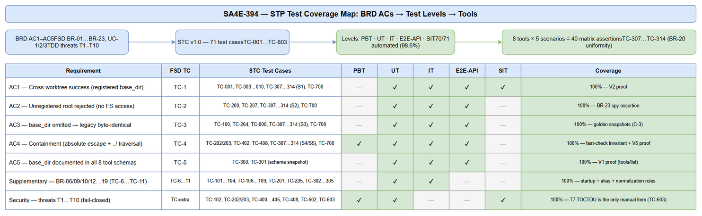

# Software Test Plan (STP)

## Code-Intel MCP Server — SA4E-394: [MCP Tools] Multi-Worktree Support — Per-Call base_dir Parameter for All file_path Tools

---

## Document Information

| Field | Value |
|-------|-------|
| Jira Ticket | SA4E-394 |
| Title | [MCP Tools] Hỗ trợ multi-worktree: tham số base_dir per-call (hoặc multi-root registry) cho mọi tool nhận file_path |
| Author | QA Agent |
| Version | 1.0 |
| Date | 2026-11-01 |
| Status | Draft |
| Related BRD | BRD-v1.0-SA4E-394 (documents/SA4E-394/BRD.md) |
| Related FSD | FSD-v1.1-SA4E-394.docx (documents/SA4E-394/FSD.md) |
| Related TDD | TDD-v1.0-SA4E-394.docx (documents/SA4E-394/TDD.md) |

---

## Author Tracking

| Role | Name - Position | Responsibility |
|------|-----------------|----------------|
| Author | QA Agent – QA Engineer | Create document |
| Peer Reviewer | BA Agent – Business Analyst | Review business coverage of test plan |

---

## Revision History

| Version | Date | Author | Changes |
|---------|------|--------|---------|
| 1.0 | 2026-11-01 | QA Agent | Initiate document — auto-generated from BRD, FSD, TDD, and DISCREPANCY |

---

## Sign-Off

| Name | Signature and date |
|------|--------------------|
| | ☐ I agree and confirm the test plan in this STP |
| | ☐ I agree and confirm the test plan in this STP |

---

## 1. Introduction

### 1.1 Purpose

This Software Test Plan (STP) defines the test strategy, scope, environment, schedule, and defect management for **SA4E-394 — multi-worktree support via an optional per-call `base_dir` parameter (alias `workspace_root`) on all 8 path-accepting MCP tools**: `mem_ingest_file`, `embed_image`, `drawio_export_png`, `drawio_auto_layout`, `jira_attach_file`, `confluence_add_attachment`, `sandbox_run` (path argument `file`), `stream_write_file` (path argument `path`/`file_path`).

The feature introduces a shared path resolver (`backend/src/shared/multi-worktree-path-resolver.ts` + `workspace-allowlist.ts` + `path-resolution-types.ts`) enforcing the resolution order (BR-11): **normalize `base_dir` → allowlist check → existence check → resolve → containment AFTER resolution**. Omitting `base_dir` must reproduce legacy pinned-root behavior byte-for-byte (BR-03, C-3). This plan verifies the feature against BRD acceptance criteria AC1–AC5, FSD use cases UC-1/UC-2/UC-3, business rules BR-01…BR-23, FSD test scenarios TC-1…TC-11, the TDD threat model T1–T10, and the non-functional budgets of TDD §8.3.

The detailed test cases are in the companion document **STC v1.0 (documents/SA4E-394/STC.md)**; the executable test data sets are in **documents/SA4E-394/test-data/*.csv**.

### 1.2 Test Objectives

- Verify all 5 BRD acceptance criteria (AC1–AC5) for **each of the 8 tools** — the 5-scenario × 8-tool matrix (40 parametrized assertions minimum, FSD §10.1 TC-1…TC-5).
- Validate every business rule BR-01…BR-23 of the FSD, including error precedence (BR-11), alias precedence (BR-10), relative `base_dir` normalization (BR-09), and allowlist startup rules (BR-12…BR-19).
- Verify the business error contract exactly: `PATH_REJECTED_OUTSIDE_ALLOWLIST`, `PATH_REJECTED_OUTSIDE_WORKSPACE` (legacy branch only), `FS_ERROR` — with verbatim FSD §3.1.6 messages and correct precedence.
- Prove backward compatibility: omitted `base_dir` yields legacy paths, results, and error codes byte-identically (BR-03, TDD C-3).
- Verify the security threat model T1–T10 (traversal, absolute escape, symlink escape, null byte, drive-letter/UNC, log forgery, TOCTOU ordering, `.`-poisoning, sibling-prefix confusion, alias conflict) — fail-closed containment.
- Verify non-functional budgets: `resolve()` p95 < 5 ms; allowlist startup build < 50 ms for ≤ 20 entries (TDD §8.3).
- Verify uniform behavior across all 8 tools via the shared resolver and identical contract on the extension surface (BR-20, TDD §6.3, C-5).

### 1.3 References

| Document | Location |
|----------|----------|
| BRD SA4E-394 (v1.0) | documents/SA4E-394/BRD.md |
| FSD SA4E-394 (v1.1 — synced with TDD per DISCREPANCY.md) | documents/SA4E-394/FSD.md |
| TDD SA4E-394 (v1.0 — technical source of truth) | documents/SA4E-394/TDD.md |
| Discrepancy Report (DISC-1…DISC-5 — resolved) | documents/SA4E-394/DISCREPANCY.md |
| STC — Software Test Cases (v1.0) | documents/SA4E-394/STC.md |
| Test data sets | documents/SA4E-394/test-data/*.csv |
| Existing path-safety helpers | backend/src/shared/path-safety.ts (+ `__tests__/path-safety.test.ts`) |
| PBT conventions reference | backend/src/servers/atlassian/__tests__/pbt.test.ts |
| MCP bootstrap / tool registration | backend/src/index.ts, backend/src/server/mcpServer.ts, backend/src/engine/tools/register-tools.ts |

---

## 2. Test Strategy

### 2.1 Test Levels

| Level | Scope | Responsibility | Tools |
|-------|-------|---------------|-------|
| Property-Based Testing (PBT) | Containment invariant: `resolve()` never returns `ok` with a `resolvedPath` outside the effective root, for random adversarial path inputs | QA Agent | Vitest + fast-check (pattern: `servers/atlassian/__tests__/pbt.test.ts`) |
| Unit Testing (UT) | Resolver pipeline steps, allowlist parsing rules P1–P9 (TDD §4.2), schema contract, boundary/negative path inputs | QA Agent + Developer | Vitest |
| Integration Testing (IT) | Tool handlers + injected resolver (in-process), per-tool 5-scenario matrix, startup wiring, audit logging, Atlassian/extension integration points with stubs | QA Agent | Vitest (in-process handler invocation, temp-dir worktree fixtures) |
| E2E-API | Real transport E2E: MCP `tools/call` over streamable HTTP `POST /mcp`, REST `POST /tools`, stdio — runtime proofs V1–V6 (TDD §10.4) | QA Agent | Vitest + HTTP/MCP client against running server (port 48721) |
| System Testing (SIT) | Manual verification only where automation cannot judge: TOCTOU/realpath ordering review (T7), audit-log spot check, cross-platform delimiter confirmation | QA Team | Manual + server log inspection |
| User Acceptance Testing (UAT) | Admin allowlist configuration walkthrough, clarity of rejection messages, legacy-mode rollback drill | BA + System Admin | Manual |

### 2.2 Test Types

| Type | Description | Applicable |
|------|-------------|------------|
| Functional Testing | Verify features work per FSD use cases (UC-1 resolution, UC-2 allowlist startup, UC-3 uniform rejection) | Yes |
| Regression Testing | Ensure existing features are not broken — legacy byte-identical parity (TC-800), existing path-safety suite (TC-801), multi-tenant scope stamps (TC-802), health/metrics (TC-803) | Yes |
| Performance Testing | Verify response times and load capacity — `resolve()` p95 < 5 ms, startup < 50 ms | Yes |
| Security Testing | Verify auth, authorization, data protection — allowlist as authorization boundary, containment T1–T10, log sanitization | Yes |
| Usability Testing | Verify UI/UX meets specifications | No — MCP tools have no UI (FSD §3.1.5); agent-facing surface is the JSON schema, verified as functional test TC-301 |
| Compatibility Testing | Verify browser/device compatibility | Yes (OS-level) — Windows (`;` delimiter, case-folded dedupe) vs POSIX (`:` delimiter), drive-letter handling (TC-109, TC-403) |

### 2.3 Test Approach

The approach is **automated-first and risk-based**, layered bottom-up:

1. **Core resolver unit tests (UT)** — the 5-step pipeline is tested in isolation with temp-dir fixtures; error messages asserted verbatim against the FSD §3.1.6 contract; precedence (BR-11) asserted by mixed-condition matrices.
2. **Per-tool parametrized matrix (IT)** — one suite per tool (TC-307…TC-314) runs the 5 mandatory BRD scenarios against the real handler with the resolver injected (5 × 8 = 40 assertions). Per-tool path-argument naming follows DISCREPANCY.md: `file` for `sandbox_run`; both `path` and `file_path` for `stream_write_file`; `file_path` reference-only for `drawio_export_png` (backend).
3. **Startup allowlist tests (UT/IT)** — parsing rules P1–P9 with env-var and config-file sources, duplicates, symlinks, missing entries, empty allowlist → legacy mode.
4. **Transport E2E-API** — the runtime proofs V1–V6 (TDD §10.4) replayed over real HTTP/REST/stdio transports on representative tools plus schema checks over all 8 (`tools/list`).
5. **Manual SIT** — restricted to what automation cannot judge: TOCTOU/realpath ordering review (T7/TC-603) and audit-log spot check.
6. **Regression** — golden-snapshot legacy parity suite + existing test suites must pass unmodified.

**Test data is CSV-driven:** `documents/SA4E-394/test-data/*.csv` provide concrete inputs and expected codes/messages; Vitest fixtures simulate worktrees under `{TEMP_DIR}/sa4e394/` (created in `beforeEach`, removed in `afterEach` — no shared state, no repo pollution). Risk prioritization: security scenarios (containment, allowlist rejection) and backward compatibility are Highest priority and run first in CI; supplementary and performance scenarios follow.

**Test Case Summary (see STC v1.0 for details):**

| Level | Count | Automated | Manual |
|-------|-------|-----------|--------|
| PBT | 1 | 1 | 0 |
| UT | 37 | 37 | 0 |
| IT | 28 | 28 | 0 |
| E2E-API | 4 | 4 | 0 |
| SIT | 1 | 0 | 1 |
| **Total** | **71** | **70 (98.6%)** | **1 (1.4%)** |

### 2.4 Entry Criteria

| Level | Entry Criteria |
|-------|---------------|
| UT / IT / PBT | FSD v1.1 + TDD v1.0 approved and synced (DISCREPANCY closed); resolver, allowlist, and types modules implemented per TDD §5.1; all 8 handlers delegate to the shared resolver; Vitest + fast-check available; temp-dir fixture helper implemented; test CSVs loaded |
| E2E-API | UT/IT pass rate ≥ 95% with 0 Critical defects; server build starts with `MCP_WORKSPACE_ROOTS` configured; `GET /health` returns 200; startup log shows the allowlist snapshot (BR-19 — freshness proof of the new build) |
| SIT | E2E-API complete; no Critical/Major defects open; server logs accessible for audit verification |
| UAT | SIT exit criteria met; BA/admin walkthrough script (allowlist config + restart + rejection-message review) prepared |

### 2.5 Exit Criteria

| Level | Exit Criteria |
|-------|--------------|
| UT / IT / PBT | 100% of TC-001…TC-604 executed and passed; per-tool matrix 40/40 assertions passed; containment property (TC-408) holds for all fast-check iterations; 0 open Critical/Major defects |
| E2E-API | Runtime proofs V1–V6 (TDD §10.4) recorded as evidence; 0 Critical/Major defects open |
| SIT | TC-603 TOCTOU/realpath-ordering checklist signed off; audit-log spot check shows zero out-of-allowlist filesystem access |
| UAT | BA/System Admin sign-off on allowlist configuration flow and clarity of all rejection messages |

---

## 3. Test Scope

### 3.1 Features In Scope

| # | Feature / Story | Priority | FSD Reference | Test Type |
|---|----------------|----------|---------------|-----------|
| 1 | Per-call `base_dir` path resolution — relative/absolute paths resolved and contained against registered root (Story 1, AC1/AC4) | High | UC-1, BR-01…BR-11 | Functional — UT/IT/E2E-API |
| 2 | Workspace allowlist configuration at server startup — env/config-file sources, normalization, warnings, legacy fallback (Story 2) | High | UC-2, BR-12…BR-19 | Functional — UT/IT |
| 3 | Uniform multi-worktree behavior across all 8 tools + explicit rejection of unregistered roots (Stories 3–5) | High | UC-3, BR-20…BR-23 | Functional — IT (parametrized matrix), E2E-API |
| 4 | Business error contract — 3 error codes, verbatim messages, precedence allowlist → existence → containment | High | FSD §3.1.6, §9.1 | Exception — UT/IT |
| 5 | Security containment — threat model T1–T10 (traversal, symlink, null byte, log forging, TOCTOU ordering, prefix confusion, alias conflict) | High | TDD §7.4 | Security — UT/PBT/SIT |
| 6 | `base_dir`/`workspace_root` schema documentation on all 8 tool schemas (AC5) | Medium | BR-08, BR-22 | Functional — UT (schema snapshot) |
| 7 | Backward compatibility — omitted `base_dir` byte-identical legacy behavior | High | BR-03, TDD C-3 | Regression — IT |
| 8 | Performance budgets — `resolve()` p95 < 5 ms; allowlist build < 50 ms (≤ 20 entries) | Medium | TDD §8.3, FSD §8 | Non-Functional — UT/IT |
| 9 | Extension-surface contract parity (embed_image, extension stream_write, mem pre-read) via shared scenario fixture | High | TDD §6.3, C-5 | Integration — IT |
| 10 | Atlassian tools — containment passes BEFORE upload; divergent `ALLOWED_BASES` containment replaced by shared resolver | High | TDD §6.4, BR-07 | Integration — IT |



### 3.2 Features Out of Scope

| # | Feature | Reason |
|---|---------|--------|
| 1 | MCP tools that do not accept a path argument | Outside SA4E-357/394 scope (BRD §1.2) |
| 2 | MCP protocol specification changes | Explicitly out of scope (BRD §1.2) |
| 3 | UI/UX testing | No UI exists — MCP tools are agent-facing (FSD §3.1.5); schema documentation is verified functionally (TC-301) |
| 4 | Database schema/migration testing | Feature is config-centric — no DB changes (TDD §4.1) |
| 5 | Authentication/authorization system changes (API-key middleware, project scope stamps logic) | Pre-existing behavior, unchanged; only verified unaffected (TC-802, TC-803) |
| 6 | Allowlist hot-reload | Out of scope by design — restart required (BR-17); TC-305 verifies absence of hot reload |
| 7 | Atlassian upload client internals (retry, multipart encoding) | Behavior unchanged; clients stubbed; only containment-before-upload ordering is tested (TC-703) |
| 8 | Sandbox-internal path semantics (`mountSecurity.ts`, sandbox mount layout) | Unchanged by design (DISC-2/TDD §3.3) — only host-side pre-mount resolution of `file` is tested (TC-008, TC-110) |
| 9 | Extension bundle build/distribution pipeline | Extension behavior verified by contract fixture (TC-702); packaging tested in extension CI, not here |

---

## 4. Test Environment

### 4.1 Environment Requirements

| Environment | URL | Database | Purpose |
|-------------|-----|----------|---------|
| SIT-Automated (UT/IT/PBT) | In-process (Vitest worker, no network) | None (no DB usage — TDD §4.1) | Resolver, allowlist, handler-matrix, security, and performance tests with temp-dir worktree fixtures |
| SIT-E2E (E2E-API) | `http://localhost:48721` (`CODE_INTEL_PORT` default — TDD §10.4), health at `GET /health`; reuse a running instance if `/health` returns 200 | None | Transport-level E2E: `POST /mcp` (tools/call), `POST /tools`, stdio; runtime proofs V1–V6 |
| UAT / Manual SIT | Same server instance + admin shell for env configuration | None | TC-603 manual verification, V1–V6 evidence capture, BA/admin walkthrough |

**Environment setup (automated levels):**

1. `npm ci` in `backend/` (Node.js 22.23.4, TypeScript ESM strict; Vitest + fast-check already present).
2. Fixture root created per test run under `{TEMP_DIR}/sa4e394/` (see §4.3 and `test-data/pre-seeded-worktrees.csv`): `main` (legacy pinned root), `wt-a`, `wt-b` (registered worktrees), `wt-unreg` (unregistered), `wt-ghost` (registered but missing on disk), `outside`, and a symlink `wt-b/link-out → outside`.
3. Allowlist sources per `test-data/allowlist-configs.csv`: `MCP_WORKSPACE_ROOTS` (Windows `;` / POSIX `:`) or `MCP_WORKSPACE_ROOTS_FILE` (one root per line, `#` comments, blank lines skipped — TDD §4.2).
4. Legacy pinned root via `CODE_INTEL_WORKSPACE` (or `--workspace`) pointing at the `main` fixture.
5. pino log capture via in-memory transport for startup/audit assertions (TC-303, TC-604).

### 4.2 Browser / Device Requirements

| Browser | Version | OS | Required |
|---------|---------|-----|----------|
| Not applicable — headless Node.js runtime (MCP server, no UI) | — | Windows 10/11 x64 (primary), Linux x64 (CI POSIX leg) | No |

OS matrix note: Windows run verifies `;` delimiter, case-insensitive dedupe (P7), and drive-letter rejection (TC-403); POSIX run verifies `:` delimiter and exact-case dedupe (TC-109).

### 4.3 Test Data Requirements

| Data Type | Description | Source | Preparation |
|-----------|-------------|--------|-------------|
| Worktree fixtures | Temp worktree simulation: `main`, `wt-a`, `wt-b`, `wt-unreg`, `wt-ghost`, `outside`, symlink `link-out`, plain file `plainfile.txt` | `test-data/pre-seeded-worktrees.csv` | Created in Vitest `beforeEach` under `{TEMP_DIR}/sa4e394/`; removed in `afterEach`; `{TEMP_DIR}` placeholder resolved at runtime |
| Path resolution cases | Concrete path/base_dir inputs + expected code + verbatim message fragment for all 8 tools (5 scenarios each) + core resolver rows | `test-data/path-resolution-cases.csv` | Loaded by parametrized Vitest suites (TC-307…TC-314, TC-001/002, TC-100…TC-103) |
| Allowlist configurations | Startup configs: env/file sources, duplicates, missing entries, symlinks, empty/unset, unreadable file, platform delimiters | `test-data/allowlist-configs.csv` | Loaded by `workspace-allowlist.test.ts` suites (TC-104…TC-109, TC-302, TC-601) |
| Security threat cases | T1–T10 attack vectors with expected fail-closed outcomes | `test-data/security-threat-cases.csv` | Loaded by security suites (TC-202…TC-205, TC-400…TC-405, TC-408, TC-602) |
| Schema contract | Expected `base_dir`/`workspace_root` documentation per tool | `test-data/schema-contract.csv` | Loaded by TC-300/TC-301 schema snapshot tests |
| Error message fixtures | Verbatim FSD §3.1.6 message templates (single source, shared by UT/IT/E2E to prevent drift) | Embedded in `path-resolution-cases.csv` (`expected_message_fragment`) | Asserted with `startsWith`/`contains` on the `CODE:`-prefixed text |

### 4.4 External Dependencies

| System | Dependency | Mock/Stub Available |
|--------|-----------|---------------------|
| Atlassian (Jira / Confluence) | Upload target for `jira_attach_file`, `confluence_add_attachment` | Yes — stubbed clients (existing doubles in `servers/atlassian/__tests__`); TC-703 asserts containment-before-upload with zero real HTTP calls on rejection |
| VS Code extension host | Executes `embed_image`, extension `stream_write_file`, `mem_ingest_file` pre-read | Partial — contract-parity fixture JSON (shared scenarios) executed against the extension `PathResolver` adapter in TC-702; full extension host not required |
| Local file system | Read/write targets for all 8 tools; symlink creation for T3 | n/a — temp fixtures per run; on Windows CI, symlink creation requires developer-mode/privilege → TC-602/TC-107 symlink rows guarded with capability check and reported as SKIP-with-reason if unavailable |
| pino logging pipeline | Startup/audit log assertions | Yes — in-memory transport capture |

---

## 5. Test Schedule

| Phase | Start Date | End Date | Duration | Milestone |
|-------|-----------|----------|----------|-----------|
| Test Planning | 2026-11-01 | 2026-11-01 | 1 day | STP + STC approved (BA coverage review passed) |
| Test Data Preparation | 2026-11-01 | 2026-11-02 | 1 day | 5 CSV data sets + Vitest fixture helper ready |
| SIT Execution (UT/IT/PBT/E2E-API) | 2026-11-02 | 2026-11-04 | 3 days | 71 test cases executed; V1–V6 proofs captured |
| Defect Fix & Retest | 2026-11-04 | 2026-11-05 | 2 days | All Critical/Major defects fixed and verified |
| UAT Execution | 2026-11-05 | 2026-11-05 | 1 day | BA/System Admin sign-off |
| Go-Live | 2026-11-06 | 2026-11-06 | 1 day | Release readiness confirmed (config rollout per TDD §10.1) |

---

## 6. Resources & Responsibilities

| Role | Name | Responsibility |
|------|------|---------------|
| Test Lead | QA Agent | Test planning, coordination, reporting, RTM maintenance |
| QA Engineer | QA Agent | Test case design (STC), CSV test data, automated execution (Vitest/fast-check), defect reporting |
| BA | BA Agent | UAT support, acceptance-criteria clarification, business-coverage review of STC |
| Developer | DEV Agent | Bug fixing, unit test co-ownership, resolver/handler implementation queries |
| Solution Architect | SA Agent | TDD clarification (resolution order, extension contract C-5) |
| Security Reviewer | Security Agent | Threat-model review T1–T10, audit-log verification support |
| DevOps | DevOps Agent | CI pipeline legs (Windows + POSIX), environment provisioning |

---

## 7. Risk & Mitigation

| # | Risk | Impact | Likelihood | Mitigation |
|---|------|--------|------------|------------|
| 1 | Path semantics differ between win32 and POSIX (delimiters, case folding, drive letters, separators) causing platform-specific defects | High | Medium | Dual-OS CI legs; dedicated delimiter test TC-109; case-fold dedupe P7 tests; drive-letter boundary TC-403 |
| 2 | Symlink fixtures cannot be created on Windows CI without privileges | Medium | Medium | Capability check before symlink tests (TC-602, TC-107 symlink row); SKIP-with-reason is reported, never silently passed |
| 3 | Legacy parity drift — handler refactoring accidentally changes behavior when `base_dir` is omitted | High | Medium | Golden-snapshot regression suite TC-800 (byte-identical paths/results/error codes); existing suites (TC-801) must pass unmodified |
| 4 | Extension surface (C-5 bundle boundary) cannot be fully exercised from backend CI | High | Medium | Shared scenario fixture JSON guarantees identical codes/messages (TC-702); extension suite runs in extension CI; backend-first merge rule per TDD Open Question #1 |
| 5 | Error message text drifts from FSD §3.1.6 verbatim contract | Medium | Medium | Single expected-message fixture column in `path-resolution-cases.csv` asserted across UT/IT/E2E |
| 6 | Atlassian cloud dependency flakiness | Medium | Low | Stubbed clients; only containment-before-upload ordering is asserted (TC-703); no live cloud calls in CI |
| 7 | TOCTOU residual risk (T7) accepted by design | Medium | Low | TC-603 manual verification that realpath runs in the same tick immediately before the handler FS op; residual risk documented and signed off |
| 8 | Requirement changes during testing | High | Low | Change freeze during SIT/UAT; any FSD change re-triggers RTM impact analysis |

---

## 8. Defect Management

### 8.1 Severity Levels

| Severity | Definition | Example |
|----------|-----------|---------|
| Critical | Security boundary broken, data loss/corruption, system crash | Containment bypass: resolved path outside effective root succeeds (T1/T2/T3 failure); `base_dir`-omitted calls break existing integrations |
| Major | Feature not working per FSD, workaround exists | Wrong error code returned (e.g., `FS_ERROR` for an unregistered root — BR-11 violation); `base_dir` ignored by one of the 8 tools (BR-20); schema missing `base_dir` (AC5 failure); alias precedence wrong (BR-10) |
| Minor | Feature works but with quality gaps | Missing startup warning for a nonexistent allowlist entry (BR-15); audit-log event missing a field; startup log omits legacyMode flag |
| Trivial | Cosmetic, no functional impact | Typo in an error message; misleading log wording |

### 8.2 Priority Levels

| Priority | Definition | SLA (Fix Time) |
|----------|-----------|----------------|
| P1 | Must fix immediately — security/compatibility breach | 4 hours |
| P2 | Must fix before release | 1 business day |
| P3 | Should fix if time permits | 3 business days |
| P4 | Nice to fix, can defer | Next release |

### 8.3 Defect Lifecycle

```
New → Open → In Progress → Fixed → Ready for Retest → Verified → Closed
                                                     → Reopened → In Progress
```

Escalation: any Critical (containment bypass / legacy break) is escalated to SM + Security Agent immediately and blocks exit criteria until Verified.

---

## 9. Test Metrics & Reporting

### 9.1 Metrics

| Metric | Formula | Target |
|--------|---------|--------|
| Test Execution Rate | Executed / Total × 100% | 100% (71/71) |
| Pass Rate | Passed / Executed × 100% | ≥ 95% (first run), 100% at exit |
| Per-Tool Matrix Coverage | Tools with 5/5 scenarios passed / 8 | 8/8 (40/40 assertions) |
| Requirement Coverage (RTM) | Requirements with ≥ 1 test case / Total | 100% (5 AC, 3 UC, 23 BR, 3 error codes, 10 threats) |
| Defect Density | Defects / Test Cases | ≤ 0.1 |
| Critical Defect Count | Count of Critical severity | 0 |
| Defect Fix Rate | Fixed / Total Defects × 100% | ≥ 90% |
| Performance Budget Compliance | `resolve()` p95 < 5 ms; startup < 50 ms | 2/2 budgets met (TC-600, TC-601) |

### 9.2 Reporting Schedule

| Report | Frequency | Audience |
|--------|-----------|----------|
| Daily Test Status (execution progress, blockers) | Daily during SIT/UAT | Project team |
| Defect Summary (new/fixed/verified by severity) | Daily | Dev team + SM |
| Test Completion Report (TEST-REPORT.md — final results + re-test history appendix) | End of SIT / End of UAT | All stakeholders |
| Security verification note (containment + audit-log evidence) | End of SIT | Security Agent, SM |

---

## 10. Appendix

### Glossary

| Term | Definition |
|------|------------|
| SIT | System Integration Testing |
| UAT | User Acceptance Testing |
| STP | Software Test Plan |
| STC | Software Test Cases |
| RTM | Requirements Traceability Matrix |
| MCP | Model Context Protocol — protocol used by the code-intel server to expose tools to agents |
| Worktree / Orca Worktree | Git worktree (linked working directory); Orca-managed variant for isolated agent sessions |
| Allowlist | Startup-loaded set of workspace roots a per-call `base_dir` is validated against (BR-05) |
| Pinned Root (legacy root) | Single workspace root fixed at startup (`getWorkspacePath()`) — used when `base_dir` is omitted |
| base_dir / workspace_root | Optional per-call workspace-root parameter / its deprecated alias (`base_dir` wins — BR-10) |
| Effective root | The root authorization/containment is enforced against for one call (base_dir or legacy root) |
| Path Containment | Post-resolution guarantee that the resolved path stays inside the effective root (BR-07) |
| PBT | Property-Based Testing — randomized invariant testing with fast-check |

### Assumptions

- Vitest + fast-check infrastructure is available in `backend/` and the extension test setup (per TDD §1.3).
- Temp directories under the OS temp path are writable and support symlink creation where the OS allows it (guarded otherwise).
- Atlassian and extension dependencies are represented by the existing stubs/doubles; no live cloud credentials are required for CI.
- The legacy pinned root (`getWorkspacePath()`) derivation is unchanged and points to a valid directory in every environment.
- The 8-tool inventory is frozen per DISCREPANCY.md (path-argument names: `file` for sandbox_run; `path`/`file_path` for stream_write_file; `file_path` reference-only for drawio_export_png backend).
- BA coverage review of the STC (business-coverage gate) is orchestrated by the SM before sign-off.

### Deliverables Inventory

| Deliverable | Location |
|-------------|----------|
| Test Plan (this document) | documents/SA4E-394/STP.md |
| Test Cases | documents/SA4E-394/STC.md |
| Test data — worktree fixtures | documents/SA4E-394/test-data/pre-seeded-worktrees.csv |
| Test data — path resolution cases | documents/SA4E-394/test-data/path-resolution-cases.csv |
| Test data — allowlist configs | documents/SA4E-394/test-data/allowlist-configs.csv |
| Test data — security threat cases | documents/SA4E-394/test-data/security-threat-cases.csv |
| Test data — schema contract | documents/SA4E-394/test-data/schema-contract.csv |
| Coverage diagram | documents/SA4E-394/diagrams/stp-test-coverage.drawio (+ .png) |
| Execution tracker (pre-filled) | documents/SA4E-394/TEST-REPORT-SA4E-394.csv (generated at execution start) |

*End of STP for SA4E-394*

## BA Review (Sign-off)

| Verdict | PASS |
|---------|------|
| Date | 2026-11-01 |
| Checklist | 8/8 PASS |
| Notes | All 8 review checks passed: STP sections, STC test case coverage, AC verification, BRD story coverage, RTM BR-01..BR-23, error code verbatim, per-tool path arguments, T1-T10 security threats |

📚 BRD ingested into Knowledge Base for cross-agent access.
