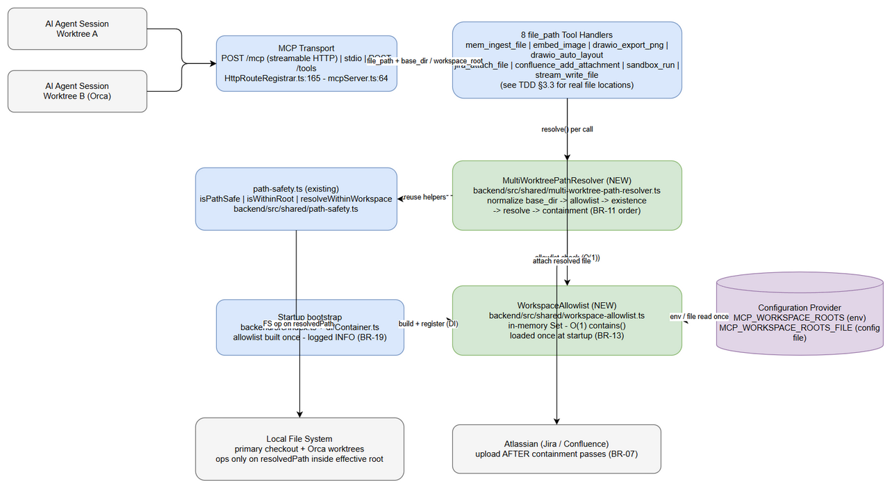
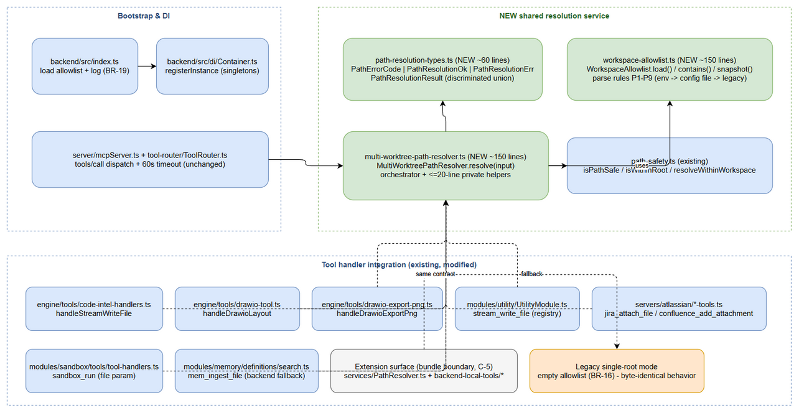
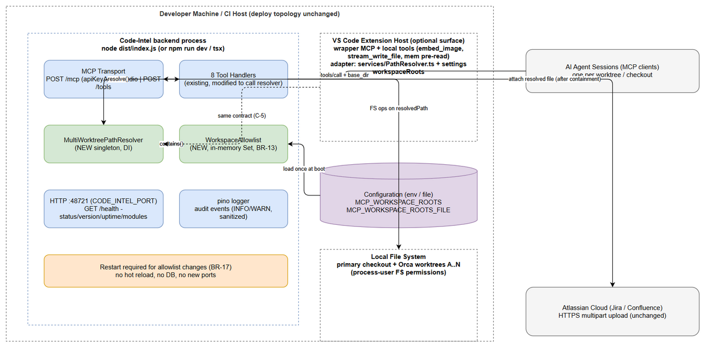
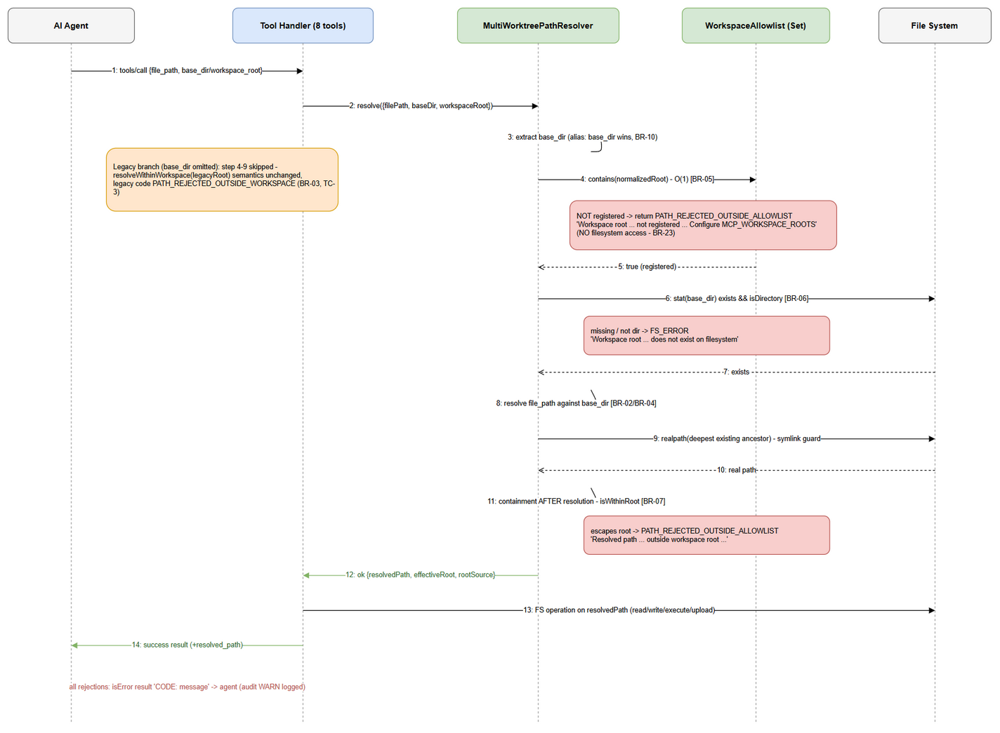
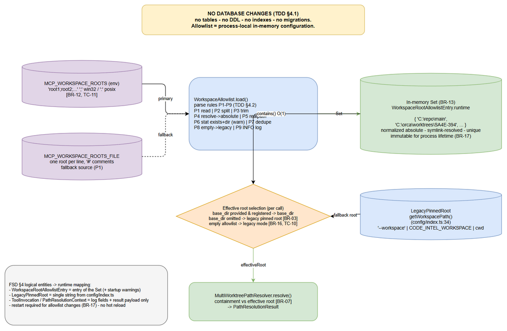
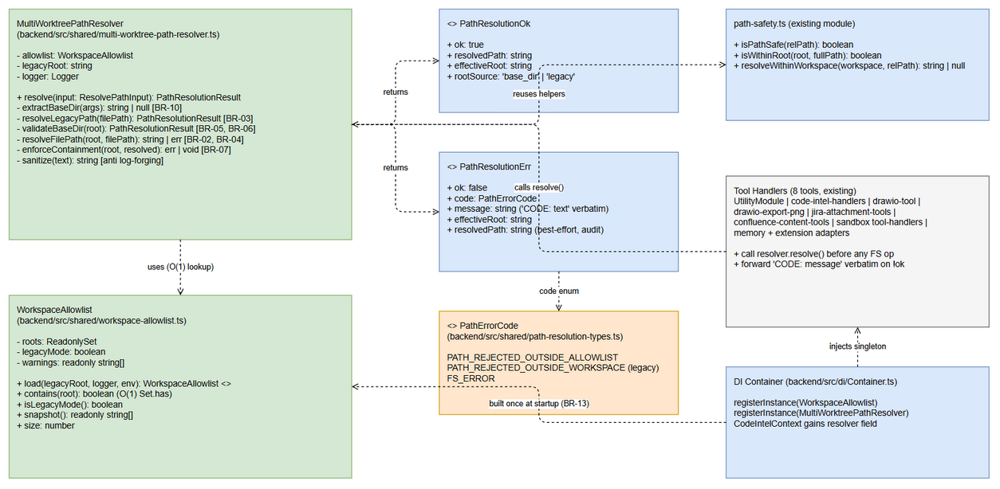
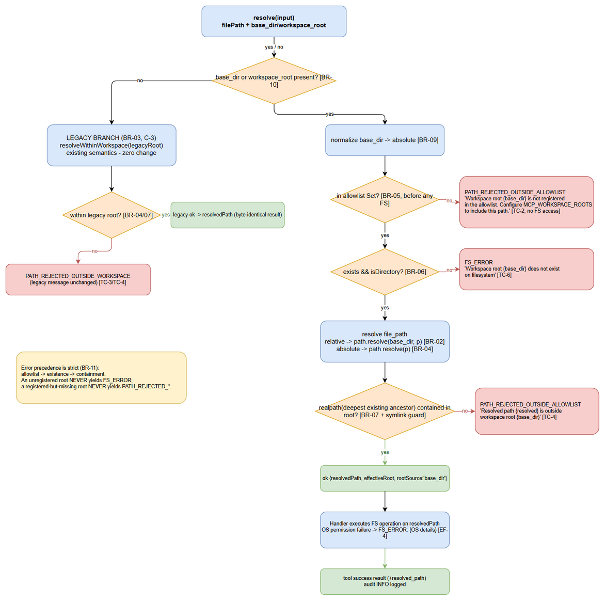
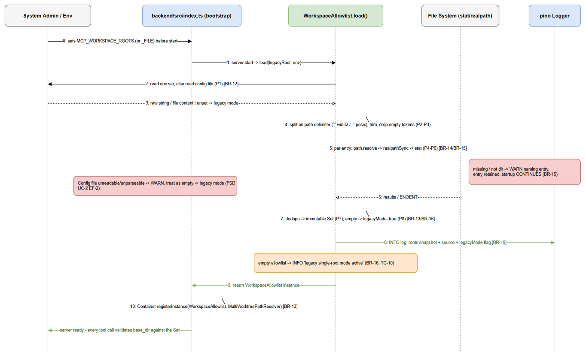

# Technical Design Document (TDD)

## Code-Intel MCP Server — SA4E-394: Multi-Worktree Support — Per-Call base_dir for All file_path Tools

---

## Document Information

| Field | Value |
|-------|-------|
| Jira Ticket | SA4E-394 |
| Title | [MCP Tools] Hỗ trợ multi-worktree: tham số base_dir per-call (hoặc multi-root registry) cho mọi tool nhận file_path |
| Author | SA Agent |
| Version | 1.0 |
| Date | 2026-11-01 |
| Status | Draft |
| Related BRD | documents/SA4E-394/BRD.md (v1.0) |
| Related FSD | documents/SA4E-394/FSD.md (v1.0) |

---

## Author Tracking

| Role | Name - Position | Responsibility |
|------|-----------------|----------------|
| Author | SA Agent – Solution Architect | Create document |
| Peer Reviewer | TA Agent – Technical Architect | Review document |

---

## Revision History

| Version | Date | Author | Changes |
|---------|------|--------|---------|
| 1.0 | 2026-11-01 | SA Agent | Initiate document — auto-generated from BRD and FSD; integration points verified against actual codebase |

---

## Sign-Off

| Name | Signature and date |
|------|--------------------|
| | ☐ I agree and confirm the technical design in this TDD |
| | ☐ I agree and confirm the technical design in this TDD |

---

## 1. Introduction

> **Scope Boundary:** This TDD specifies HOW to implement the requirements defined in the FSD. It does NOT repeat functional requirements, business rules, use cases, or UI specifications — refer to the FSD for those. This document focuses on: technology choices, architecture decisions, implementation patterns, and deployment concerns.

### 1.1 Purpose

The Code-Intel MCP server pins **one** workspace root at startup (legacy root from `getWorkspacePath()` in `backend/src/config/index.ts:34`). Agent sessions running in other Git/Orca worktrees fail on every `file_path` tool: relative paths resolve into the old checkout (`FS_ERROR` ENOENT) and absolute paths are rejected by containment (`PATH_REJECTED_OUTSIDE_WORKSPACE`).

This TDD specifies the technical design for **Option A (per FSD §1.1)**: an optional per-call `base_dir` parameter (alias `workspace_root`) on all 8 `file_path` tools, validated against a startup-loaded **workspace allowlist**, enforced by **one shared resolver** (`backend/src/shared/multi-worktree-path-resolver.ts`) with containment checked **after** resolution. Omitting `base_dir` reproduces legacy behavior byte-for-byte (BR-03).

Design traceability: implements UC-1/UC-2/UC-3 and BR-01…BR-23 of the FSD; test scenarios TC-1…TC-11 (FSD §10.1).

### 1.2 Scope

**Technical scope — covered by this TDD:**

- New shared resolver module `backend/src/shared/multi-worktree-path-resolver.ts` (+ 2 supporting files under `backend/src/shared/`) implementing: base_dir normalization → allowlist check → existence check → path resolution → post-resolution containment.
- New allowlist loader `backend/src/shared/workspace-allowlist.ts`: parse `MCP_WORKSPACE_ROOTS` env var (or `MCP_WORKSPACE_ROOTS_FILE` config file), normalize/realpath/dedupe/validate, cache in an in-memory `Set` (BR-12…BR-16).
- Startup wiring in `backend/src/index.ts` + DI registration in `backend/src/di/Container.ts`; resolver injected into tool handler contexts.
- Schema updates (`base_dir`, `workspace_root`) on all 8 tool definitions (BR-08, BR-22).
- Integration changes in the 8 tool handlers at their **actual** code locations (§3.3, §6.2), including the extension-side local tools and the Atlassian server tools.
- Error codes `PATH_REJECTED_OUTSIDE_ALLOWLIST`, `PATH_REJECTED_OUTSIDE_WORKSPACE` (legacy, when `base_dir` omitted), `FS_ERROR`.
- Security hardening: post-resolution containment, symlink-escape rejection, null-byte rejection, log-forging sanitization, TOCTOU analysis (§7.4).

**Not covered (aligned with FSD §1.2):** tools without `file_path`; MCP protocol changes; UI; database migrations (§4.1 — no DB changes); auth system changes; allowlist hot-reload (BR-17).

### 1.3 Technology Stack

| Layer | Technology | Version |
|-------|-----------|---------|
| Language | TypeScript (ESM, strict) | 5.x on Node.js 22.23.4 |
| Runtime | Node.js | 22.23.4 |
| MCP Protocol | @modelcontextprotocol/sdk (Server, WebStandardStreamableHTTPServerTransport, StdioServerTransport) | ^1.32.1 |
| HTTP Framework | Hono + @hono/node-server (existing transport only — no new endpoints) | ^1.x |
| Logging | pino (child loggers per module) | existing |
| DI | backend/src/di/Container.ts (token-based manual DI) | existing |
| Testing | Vitest (+ fast-check for property tests, matching `servers/atlassian/__tests__/pbt.test.ts` conventions) | existing |
| Database | SQLite/PostgreSQL (existing, **unchanged** — this feature stores no DB data) | existing |
| Build Tool | tsc + tsx (npm scripts in backend/package.json) | existing |
| Container | Docker (existing deployment; no image changes required) | existing |

**NEW DEPENDENCY: none.** The design reuses Node.js `path`/`fs`, the existing `path-safety.ts` helpers, and pino. No third-party library is added.

### 1.4 Design Principles

- **SOLID / DRY:** exactly ONE resolution pipeline shared by all 8 tools (BR-20) — zero tool-specific resolution logic. Decomposed into ≤200-line files with ≤20-line functions (code-standards).
- **Error-as-value (no throws on business paths):** resolver returns a discriminated union `PathResolutionResult` (mirrors the proven pattern in `extension/src/services/PathResolver.ts`, C-1/C-2 "NEVER throws").
- **Fail-closed security:** containment is enforced after resolution (BR-07); allowlist membership is checked before any filesystem access (BR-11, BR-23); containment can only narrow, never widen (§7.2).
- **Backward compatibility by default:** empty/unset allowlist ⇒ legacy single-root mode (BR-16); omitted `base_dir` ⇒ legacy behavior byte-for-byte (BR-03, TC-3).
- **Reuse existing patterns:** pino child loggers, `withErrorHandling` decorator (`backend/src/tool-router/ToolHandlerDecorators.ts`), `isPathSafe`/`isWithinRoot`/`resolveWithinWorkspace` from `backend/src/shared/path-safety.ts`, `CODE:`-prefixed error messages (extension PathResolver convention, C-5).
- **Pure resolution core:** allowlist membership + path math are pure string ops (no I/O); filesystem syscalls (stat/realpath) are explicit, isolated steps — testable without disk fixtures.

### 1.5 Constraints

- **C-1 — No new runtime dependencies** (§1.3); resolver uses Node built-ins only.
- **C-2 — Line budget:** every new/modified file ≤ 200 lines, every new function ≤ 20 lines (repo gate `npm run lint:lines`).
- **C-3 — Legacy parity:** when `base_dir` is omitted, results and error codes must be byte-identical to current behavior (TC-3) — the legacy branch delegates to the existing `resolveWithinWorkspace`/`resolveFilePath` semantics unchanged.
- **C-4 — No hot reload:** allowlist changes require a server restart (BR-17); no config watcher is introduced.
- **C-5 — Bundle boundary:** the VS Code extension (`extension/src`) cannot import backend ESM modules; extension-executed tools (embed_image, mem_ingest_file pre-read, stream_write_file extension variant) integrate `base_dir` through the existing extension `PathResolver` with an identical contract (§6.3) — resolution order and error codes are duplicated **by contract**, verified by the shared TC matrix, not by shared code.
- **C-6 — Multi-tenant scope stamps unaffected:** `__projectId`/`_projectContext` injection in `mcpServer.ts:79-86` is orthogonal to `base_dir` and must not be altered.
- **C-7 — No DB writes:** allowlist is process-local in-memory state (§4.1).

### 1.6 References

| Document | Location |
|----------|----------|
| BRD SA4E-394 | documents/SA4E-394/BRD.md |
| FSD SA4E-394 | documents/SA4E-394/FSD.md |
| SA4E-356 PathResolver (pattern reference) | extension/src/services/PathResolver.ts |
| SA4E-356 extension local tools | extension/src/backend-local-tools/*.ts |
| Path safety helpers (existing) | backend/src/shared/path-safety.ts |
| MCP bootstrap (existing) | backend/src/server/mcpServer.ts, backend/src/server/HttpServer.ts, backend/src/index.ts |
| Tool registration (existing) | backend/src/engine/tools/register-tools.ts |
| Workspace config (existing) | backend/src/config/index.ts (getWorkspacePath, line 34) |
| Parent ticket (tool scope) | Jira SA4E-357 (in progress); SA4E-356 (closed) |

---
## 2. System Architecture

### 2.1 Architecture Overview

The feature adds one **shared resolution service** and one **startup configuration component** to the existing Code-Intel MCP server, and rewires 8 tool handlers to route every path-bearing argument through the resolver before touching the filesystem.

**Current flow (unchanged for omitted `base_dir`):** MCP client → `POST /mcp` (streamable HTTP, `backend/src/server/HttpRouteRegistrar.ts:165`) or stdio → `CallToolRequestSchema` handler (`backend/src/server/mcpServer.ts:64`) → `ModuleRegistry.getToolHandlers()` → handler executes FS ops against the legacy pinned root from `getWorkspacePath()`.

**New flow:** at startup, `backend/src/index.ts` loads the workspace allowlist from `MCP_WORKSPACE_ROOTS` (env) or `MCP_WORKSPACE_ROOTS_FILE` (config file) into a `WorkspaceAllowlist` (in-memory `Set`, BR-13), registers it in the DI `Container`, and injects a singleton `MultiWorktreePathResolver` into tool handler contexts. Per call, a handler passes `{ filePath, baseDir?, workspaceRoot? }` to `resolver.resolve()`, which runs the 5-step pipeline (normalize → allowlist → existence → resolve → containment) and returns either an absolute `resolvedPath` or a typed business error — the handler then executes its normal FS operation or returns the error result.



*[Edit in draw.io](diagrams/tdd-architecture.drawio)*

Key properties:

- The allowlist is the **authorization boundary** for workspaces (FSD §7.1): an effective root can only ever be (a) a registered allowlist root or (b) the legacy pinned root.
- Containment is checked **after** resolution against the effective root (BR-07) — `../` traversal inside `file_path` cannot escape.
- When the allowlist is empty, the resolver behaves as today (legacy mode, BR-16) — zero behavior change for existing deployments.

### 2.2 Component Diagram



*[Edit in draw.io](diagrams/tdd-component.drawio)*

| Component | Location | Responsibility | Technology |
|-----------|----------|----------------|------------|
| **WorkspaceAllowlist** (NEW) | backend/src/shared/workspace-allowlist.ts | Parse env/config file → normalize → realpath → dedupe → validate (warn on missing) → immutable in-memory `Set<string>`; O(1) `contains()`; startup snapshot for logging (BR-19) | Node path/fs + Set |
| **MultiWorktreePathResolver** (NEW) | backend/src/shared/multi-worktree-path-resolver.ts | Per-call pipeline: extract base_dir (alias handling BR-10) → normalize (BR-09) → allowlist (BR-05) → existence (BR-06) → resolve (BR-02/04) → containment (BR-07); returns `PathResolutionResult` | Node path/fs + path-safety helpers |
| **path-resolution-types** (NEW) | backend/src/shared/path-resolution-types.ts | Error codes + `PathResolutionOk`/`PathResolutionErr` discriminated union (single contract, no drift) | TypeScript types |
| Path Safety helpers (existing) | backend/src/shared/path-safety.ts | `isPathSafe` (null byte / absolute / traversal rejection), `isWithinRoot`, `resolveWithinWorkspace` — reused by the resolver; legacy branch delegates to `resolveWithinWorkspace` unchanged (C-3) | Node path |
| MCP bootstrap (existing) | backend/src/index.ts, backend/src/server/mcpServer.ts, backend/src/server/HttpServer.ts | Build allowlist + resolver at boot; register in DI Container; log allowlist at info (BR-19); tool-call pipeline unchanged | MCP SDK, Hono, pino |
| DI Container (existing) | backend/src/di/Container.ts | `registerInstance` for allowlist + resolver singletons (BR-13: load once) | existing token DI |
| Tool handlers (existing, 8 tools) | see §3.3 integration table | Accept `base_dir`/`workspace_root`; delegate ALL path decisions to the resolver; execute FS op on `resolvedPath` | per-tool |
| Extension adapter (existing surface) | extension/src/services/PathResolver.ts (+ 4 call sites) | Extension-executed tools adopt `base_dir` via `resolveWorkspacePath` extension; identical contract (§6.3, C-5) | VS Code extension TS |

### 2.3 Deployment Architecture

The deployment topology is unchanged — this feature is code + configuration only (no new process, port, container, or database).



*[Edit in draw.io](diagrams/tdd-deployment.drawio)*

- **Code-Intel backend process** (`node dist/index.js`, port `CODE_INTEL_PORT` default 48721 — `backend/src/config/index.ts:58`; health at `GET /health`, `backend/src/server/routes/health.ts:15`). Holds: allowlist Set (in-memory), resolver singleton, 8 tool handlers.
- **MCP clients** (AI agent sessions) connect via streamable HTTP `POST /mcp` (API-key guarded, `HttpRouteRegistrar.ts:86`) or REST `POST /tools`; extension-hosted wrapper tools remain as-is.
- **VS Code extension host** (optional surface): wrapper MCP server + local tools; updated to forward `base_dir` (§6.3).
- **Local filesystem**: primary checkout + N Orca worktrees; all roots must be readable/writable by the backend process user.
- **Configuration surface**: process environment (`MCP_WORKSPACE_ROOTS`, `MCP_WORKSPACE_ROOTS_FILE`) set by the launch script / container env — the ONLY new deployment input (BR-12).

### 2.4 Communication Patterns

| From | To | Protocol | Pattern | Description |
|------|----|----------|---------|-------------|
| AI Agent session | MCP server | MCP JSON-RPC (streamable HTTP `/mcp`, stdio, or REST `/tools`) | Sync, request/response | `tools/call` with `file_path` + optional `base_dir`/`workspace_root`; errors returned in-band as `isError` results |
| Tool handler | MultiWorktreePathResolver | In-process function call | Sync | `resolve(input): PathResolutionResult` — ≤5 ms, no I/O except 1-2 stat/realpath syscalls (§8) |
| Resolver | WorkspaceAllowlist | In-process (Set lookup) | Sync, O(1) | Allowlist membership; loaded once at startup (BR-13) |
| Bootstrap (index.ts) | Env / config file | process.env / fs.readFileSync | Sync, once at startup | Allowlist source; warnings logged (BR-15, BR-19) |
| jira_attach_file / confluence_add_attachment | Atlassian cloud | HTTPS multipart (existing client) | Sync, downstream | Unchanged — file content read from `resolvedPath` only AFTER containment passes (BR-07) |
| Extension local tools | Local FS | fs (extension host) | Sync | Same resolution contract via extension adapter (§6.3) |

---
## 3. API Design

> **Prerequisite:** Functional API contracts (parameters, business errors, data flows) are defined in FSD §3.x.6. This section specifies the technical implementation: transport, JSON schema additions, per-tool parameter mapping at real code locations, and error code → transport mapping.

**Transport surface (no new endpoints):** tools are invoked via (a) MCP `tools/call` over streamable HTTP `POST /mcp` (`backend/src/server/HttpRouteRegistrar.ts:165`, API-key guarded) or stdio, and (b) REST `POST /tools` (`createToolsRoute`, `HttpRouteRegistrar.ts:108`). The feature modifies tool **input schemas** and handler behavior only.

### 3.1 API Overview

| # | Endpoint | Method | Description | Source |
|---|----------|--------|-------------|--------|
| 1 | MCP tools/call → mem_ingest_file | POST /mcp (or stdio / POST /tools) | Ingest document by path — gains `base_dir` | UC-1, BR-01 |
| 2 | MCP tools/call → embed_image | POST /mcp (extension local tool) | Inline image as base64 — gains `base_dir` | UC-1, BR-01 |
| 3 | MCP tools/call → drawio_export_png | POST /mcp | Export .drawio → PNG — gains `base_dir` | UC-1, BR-01 |
| 4 | MCP tools/call → drawio_auto_layout | POST /mcp | Auto-fix diagram layout — gains `base_dir` | UC-1, BR-01 |
| 5 | MCP tools/call → jira_attach_file | POST /mcp | Attach file to Jira — gains `base_dir` | UC-1, BR-01 |
| 6 | MCP tools/call → confluence_add_attachment | POST /mcp | Upload file to Confluence — gains `base_dir` | UC-1, BR-01 |
| 7 | MCP tools/call → sandbox_run | POST /mcp | Run code file — gains `base_dir` (applies to `file` param, §3.3) | UC-1, BR-01 |
| 8 | MCP tools/call → stream_write_file | POST /mcp | Write/append file — gains `base_dir` | UC-1, BR-01 |

All 8 share one identical parameter contract (§3.2) and one identical error contract (§3.4) — BR-20.

---

### 3.2 Common Parameter Contract: base_dir / workspace_root

**Implements:** UC-1, BR-01, BR-08, BR-09, BR-10, BR-22

| Attribute | Value |
|-----------|-------|
| Transport | MCP tools/call (JSON-RPC), REST /tools |
| Auth | API key (HTTP `/mcp` middleware, `HttpRouteRegistrar.ts:86`); project scope stamped by `mcpServer.ts:79-86` (unchanged) |
| Rate Limit | Existing `/mcp` + `/tools` limits unchanged |

**Schema fragment added to each of the 8 tool `inputSchema.properties`:**

```json
{
  "base_dir": {
    "type": "string",
    "description": "Optional workspace root to resolve relative file_path against. Must be registered in the server allowlist (MCP_WORKSPACE_ROOTS). Relative values are normalized to absolute. Example: /home/user/project-worktree-B"
  },
  "workspace_root": {
    "type": "string",
    "description": "Deprecated alias of base_dir (same semantics). Ignored when base_dir is present."
  }
}
```

Rules: neither property is `required` (backward compatible, BR-03); both are plain strings — validation happens in the resolver, NOT in JSON-schema `pattern` (paths are platform-dependent; schema stays permissive, TC-5 asserts description + example presence).

**Resolution order (normative, BR-11):** normalize `base_dir` → allowlist check → filesystem existence/is-directory check → resolve `file_path` → containment check → execute.

---

### 3.3 Per-Tool Parameter Applicability & Integration Points (verified against codebase)

| Tool | Path param(s) resolver applies to | Definition (schema) location | Handler / function to modify |
|------|-----------------------------------|------------------------------|------------------------------|
| stream_write_file | `path` (module variant) / `file_path` (code-intel variant) — **both names accepted; both gain base_dir** | backend/src/modules/utility/UtilityModule.ts:104; backend/src/engine/tools/register-tools.ts:74 | UtilityModule.ts:57 handler (`resolveWithinWorkspace` call at line 64); backend/src/engine/tools/code-intel-handlers.ts (`handleStreamWriteFile`, `resolveWithinWorkspace` at line 118) |
| mem_ingest_file | `file_path` (extension pre-read proxy); backend fallback when `content_base64` sent directly | backend/src/modules/memory/definitions/search.ts:40; backend/src/modules/memory/tool-definitions.ts:9 | extension/src/services/Base64ProxyService.ts:177 (`resolveWorkspacePath` call); backend memory handler (backend fallback path) |
| embed_image | `file_path`, `output_path` | extension/src/backend-local-tools/definitions.ts | extension/src/backend-local-tools/embed-image.ts:34 (`file_path`), :57 (`output_path`) |
| drawio_export_png | `file_path` (reference) + `output_path` (extension output proxy) | backend/src/engine/tools/drawio-export-png.ts:14 | backend/src/engine/tools/drawio-export-png.ts:54 `handleDrawioExportPng`; extension output proxy (Base64ProxyService/output-proxy.ts:59) |
| drawio_auto_layout | `file_path` | backend/src/engine/tools/drawio-tool.ts:13 | backend/src/engine/tools/drawio-tool.ts:34 `handleDrawioLayout` + `resolveFilePath` |
| jira_attach_file | `file_path` | backend/src/servers/atlassian/models/jira-schemas.ts (AttachFileSchema) | backend/src/servers/atlassian/tools/jira-attachment-tools.ts:21 handler; `validateFilePath` (:66) and `ALLOWED_BASES` (:17) replaced by allowlist-driven resolver |
| confluence_add_attachment | `file_path` | backend/src/servers/atlassian/models/confluence-schemas.ts (AddAttachmentSchema) | backend/src/servers/atlassian/tools/confluence-content-tools.ts:26 handler; `validateFilePath` (:65) replaced likewise |
| sandbox_run | `file` (host-side input path; mapped into the sandbox after resolution) | backend/src/modules/sandbox/tools/tool-definitions.ts:70 | backend/src/modules/sandbox/tools/tool-handlers.ts:91 handler; resolution before `buildRunCommand` / executor mount (mountSecurity.ts unchanged) |

> Note (tracked as DISC-1 in DISCREPANCY.md): FSD §3.3.4 lists sandbox_run under "`file_path` tools"; the actual parameter is `file`. The design applies the same resolver to the `file` argument — behavior is identical, only the argument name differs.

**Handler wiring pattern (uniform, OCP-safe):** each handler extracts `{ filePath, baseDir, workspaceRoot }` from `args`, calls `resolver.resolve(...)`; on `!result.ok` returns the error ToolResult (§3.4); on `ok` proceeds with `result.resolvedPath`. Handlers currently receiving `workspace: string` (`CodeIntelContext.workspace`, register-tools.ts:95-102) receive the resolver via the context object instead — one field added to `CodeIntelContext`, no signature churn.

---

### 3.4 Response & Error Contract

**Success — normal tool result, plus `resolved_path` where the tool already reports a path (FSD §3.1.4):**

```json
{
  "content": [{ "type": "text", "text": "{\"success\":true, \"resolved_path\":\"/home/user/project-worktree-B/documents/SA4E-394/BRD.md\"}" }],
  "isError": false
}
```

**Error — in-band business error with `CODE:` prefix (extension PathResolver convention, C-5; tools forward the text verbatim):**

```json
{
  "content": [{ "type": "text", "text": "PATH_REJECTED_OUTSIDE_ALLOWLIST: Workspace root '/home/user/other' is not registered in the allowlist. Configure MCP_WORKSPACE_ROOTS to include this path." }],
  "isError": true
}
```

**Error mapping matrix (all tools):**

| Condition | Error code | MCP/REST surface | Message (verbatim, after `CODE:` prefix) | Log level |
|-----------|-----------|------------------|------------------------------------------|-----------|
| `base_dir` (or alias) not in allowlist | PATH_REJECTED_OUTSIDE_ALLOWLIST | `isError: true` text result | `Workspace root '{base_dir}' is not registered in the allowlist. Configure MCP_WORKSPACE_ROOTS to include this path.` | WARN |
| `base_dir` missing / not a directory | FS_ERROR | `isError: true` text result | `Workspace root '{base_dir}' does not exist on filesystem` | WARN |
| Containment failure with `base_dir` set (incl. `../` traversal, absolute escape, symlink escape) | PATH_REJECTED_OUTSIDE_ALLOWLIST | `isError: true` text result | `Resolved path '{resolved}' is outside workspace root '{base_dir}'` | WARN |
| Legacy containment failure (`base_dir` omitted) | PATH_REJECTED_OUTSIDE_WORKSPACE | `isError: true` text result | **unchanged legacy message** (e.g. drawio-tool.ts:48 format: `Path rejected: {sanitized} resolves to {resolved} — outside backend workspace {workspace}`) | INFO |
| OS permission failure on the operation | FS_ERROR | `isError: true` text result | `FS_ERROR: {OS error details}` | WARN |
| Empty/invalid `file_path`, null byte | per-tool existing behavior (unchanged) | unchanged | unchanged (isPathSafe rejection) | unchanged |

Error precedence is strict (BR-11): allowlist → existence → containment. An unregistered root must never produce `FS_ERROR`, and a registered-but-missing root must never produce `PATH_REJECTED_*`.

---

### 3.5 Per-Call Resolution Sequence



*[Edit in draw.io](diagrams/tdd-sequence-resolution.drawio)*

Flow (maps 1:1 to FSD §6.2 steps): Agent → Tool Handler → Resolver → Allowlist/FS → back to handler → FS operation → result. Rejection branches abort **before any FS access** (BR-23).

---
## 4. Database Design

> **Prerequisite:** Logical data model (entities, relationships, business attributes) is defined in FSD §4. This section specifies the physical implementation: DDL scripts, indexes, migration plans, and query performance patterns.

### 4.1 Schema Overview

**⛔ NO DATABASE CHANGES.** This feature is configuration-centric: the allowlist is process-local, in-memory state derived from the environment at startup (FSD §4 note; BRD §1.2 excludes DB migrations). There are **no tables, no DDL, no indexes, and no migrations**. The logical entities from FSD §4.2 (`WorkspaceRootAllowlistEntry`, `LegacyPinnedRoot`, `ToolInvocation`, `PathResolutionContext`) are **runtime structures** — the first two materialize as strings in an in-memory `Set`, the latter two exist only as log fields / result payloads.

The "data store" for this feature is the configuration pipeline below:



*[Edit in draw.io](diagrams/tdd-db-schema.drawio)*

| Runtime structure | Representation | Lifecycle |
|-------------------|----------------|-----------|
| Allowlist roots (`WorkspaceRootAllowlistEntry.root_path`) | `Set<string>` of normalized absolute paths (BR-13, BR-14) | Built once at startup; immutable; destroyed at shutdown |
| Legacy pinned root (`LegacyPinnedRoot.root_path`) | single string from `getWorkspacePath()` (backend/src/config/index.ts:34) | Existing behavior, unchanged |
| `MCP_WORKSPACE_ROOTS` raw value | process.env string | Read once at startup (BR-12); restart required to change (BR-17) |
| `MCP_WORKSPACE_ROOTS_FILE` raw value | UTF-8 text file, one root per line | Read once at startup when env var is unset (FSD UC-2 AF-2) |

### 4.2 Configuration Schema (env var format & parsing rules)

**Env variable (primary source, BR-12):**

```bash
# Windows delimiter: ';'   |   POSIX delimiter: ':'   (TC-11)
MCP_WORKSPACE_ROOTS="C:\repo\main;C:\orca\worktrees\SA4E-394;C:\orca\worktrees\feature-x"
```

**Config file (fallback source, FSD UC-2 AF-2):**

```bash
MCP_WORKSPACE_ROOTS_FILE=/etc/sdlc/mcp-workspace-roots.txt
```

```text
# mcp-workspace-roots.txt — one root per line; '#' starts a comment; blank lines skipped
C:\repo\main
C:\orca\worktrees\SA4E-394
```

**Source precedence (normative):** `MCP_WORKSPACE_ROOTS` env → `MCP_WORKSPACE_ROOTS_FILE` → legacy single-root mode (empty allowlist, BR-16).

**Parsing rules (normative, implemented in `WorkspaceAllowlist.load`):**

| # | Rule | Error handling | FSD ref |
|---|------|----------------|---------|
| P1 | Read raw string from env, else read+parse file | File unreadable/unparseable → WARN, treat as empty → legacy mode (EF-2 of UC-2) | BR-12 |
| P2 | Split on platform delimiter (`path.delimiter`: `;` win32, `:` POSIX) | — | BR-12, TC-11 |
| P3 | Trim each token; skip empty tokens | Empty token → WARN, skipped | UC-2 EF-1 |
| P4 | Normalize each entry to absolute (`path.resolve`) | Relative entries resolved against server CWD | BR-09, BR-14 |
| P5 | Resolve symlinks (`fs.realpathSync`) where the entry exists | ENOENT → keep resolved path + WARN | BR-14, BR-15 |
| P6 | Validate exists && is a directory (`fs.statSync().isDirectory()`) | Missing/not-dir → WARN naming the entry; **entry retained** (per-call BR-06 check still guards it); startup continues | BR-15, UC-2 AF-3, TC-9 |
| P7 | Deduplicate case-insensitively on win32, exactly on POSIX | Duplicates silently merged (Set semantics) | TC-9 |
| P8 | If the resulting set is empty → `legacyMode = true`; register only the pinned root for diagnostics | INFO log "legacy single-root mode active" | BR-16, TC-10 |
| P9 | Log the final allowlist at INFO (roots + source + warnings) | — | BR-19 |

**Validation:** entries must be absolute after P4 (relative entries are normalized, never rejected — BR-09); no URL/unc-validation is added (filesystem decides).

### 4.3 Migration Plan

| Order | Script | Description | Estimated Time | Rollback |
|-------|--------|-------------|----------------|----------|
| — | **N/A** | No database migration. Configuration rollout only: set `MCP_WORKSPACE_ROOTS` + restart (§10.1) | ~1 min per environment | Unset env var + restart → legacy mode |

### 4.4 Query Patterns

| Operation | Query Pattern | Expected Performance |
|-----------|--------------|---------------------|
| Allowlist membership (`base_dir` check, per tool call) | `Set<string>.has(normalizedRoot)` | O(1), < 0.01 ms |
| Startup allowlist build | parse → stat/realpath per entry (n = typically 2–20) | < 50 ms total at boot (off the request path) |
| base_dir existence check (per call, BR-06) | `fs.statSync(baseDir).isDirectory()` | 1 syscall, ~0.05–0.3 ms (§8.3) |
| Containment (per call, BR-07) | `isWithinRoot` string compare + `fs.realpathSync` on the deepest existing ancestor | 1 syscall + O(|path|) string ops |

---
## 5. Class / Module Design

### 5.1 Package Structure

```
backend/src/shared/
├── path-safety.ts                       # EXISTING — reused (isPathSafe, isWithinRoot, resolveWithinWorkspace)
├── path-resolution-types.ts             # NEW  (~60 lines)  — error codes + result union
├── workspace-allowlist.ts               # NEW  (~150 lines) — startup allowlist loader (Set)
├── multi-worktree-path-resolver.ts      # NEW  (~150 lines) — shared per-call resolver (public API)
└── __tests__/
    ├── workspace-allowlist.test.ts      # NEW — P1..P9 rules, TC-9/10/11
    └── multi-worktree-path-resolver.test.ts  # NEW — TC-1..TC-8 core matrix

backend/src/index.ts                     # MODIFIED — build allowlist + resolver, register in DI, log (BR-19)
backend/src/di/Container.ts              # MODIFIED — registerInstance tokens (no logic change)
backend/src/engine/tools/register-tools.ts        # MODIFIED — CodeIntelContext gains resolver; defs gain base_dir
backend/src/engine/tools/code-intel-handlers.ts   # MODIFIED — handleStreamWriteFile uses resolver
backend/src/engine/tools/drawio-tool.ts           # MODIFIED — handleDrawioLayout uses resolver
backend/src/engine/tools/drawio-export-png.ts     # MODIFIED — handleDrawioExportPng validates file_path via resolver
backend/src/modules/utility/UtilityModule.ts      # MODIFIED — stream_write_file uses resolver (accepts path/file_path)
backend/src/modules/sandbox/tools/tool-handlers.ts        # MODIFIED — sandbox_run resolves 'file' pre-mount
backend/src/servers/atlassian/tools/jira-attachment-tools.ts     # MODIFIED — validateFilePath → resolver
backend/src/servers/atlassian/tools/confluence-content-tools.ts  # MODIFIED — validateFilePath → resolver
backend/src/modules/memory/definitions/search.ts  # MODIFIED — schema gains base_dir (backend fallback path)

extension/src/services/PathResolver.ts                   # MODIFIED — resolveWorkspacePath gains baseDir + allowlist opts (§6.3)
extension/src/backend-local-tools/embed-image.ts         # MODIFIED — forward base_dir
extension/src/backend-local-tools/stream-write.ts        # MODIFIED — forward base_dir
extension/src/services/Base64ProxyService.ts             # MODIFIED — forward base_dir (mem_ingest_file pre-read)
extension/src/mcp/atlassian/jira-attachment-tools.ts     # MODIFIED — forward base_dir
extension/src/mcp/atlassian/confluence-content-tools.ts  # MODIFIED — forward base_dir
```

Rationale for 3 new files instead of 1: the repo gate enforces ≤200 lines/file (`npm run lint:lines`) and ≤20 lines/function; `multi-worktree-path-resolver.ts` remains the **single public entry point** (SOLID's ISP for consumers — handlers import only the resolver), while types and allowlist loading are internal collaborators.

### 5.2 Key Interfaces

```typescript
// ── backend/src/shared/path-resolution-types.ts (NEW) ──────────────────
/** Business error codes — FSD §3.1.6 (BR-05/06/07, AF-1). */
export type PathErrorCode =
  | 'PATH_REJECTED_OUTSIDE_ALLOWLIST'   // base_dir not registered; or resolved path escapes effective root
  | 'PATH_REJECTED_OUTSIDE_WORKSPACE'   // LEGACY: base_dir omitted, path escapes pinned root (BR-03)
  | 'FS_ERROR';                          // base_dir missing/not-dir; OS permission failures

export interface PathResolutionOk {
  ok: true;
  resolvedPath: string;                 // absolute — the ONLY path a handler may touch
  effectiveRoot: string;                // base_dir (normalized) or legacy pinned root
  rootSource: 'base_dir' | 'legacy';
}

export interface PathResolutionErr {
  ok: false;
  code: PathErrorCode;
  message: string;                      // full 'CODE: message' text — forwarded VERBATIM by handlers
  effectiveRoot: string;
  resolvedPath: string;                 // best-effort (may be '') for audit logs (FSD §7.3)
}

/** Discriminated union — callers MUST check .ok first (mirrors extension PathResolver). */
export type PathResolutionResult = PathResolutionOk | PathResolutionErr;
```

```typescript
// ── backend/src/shared/workspace-allowlist.ts (NEW) ────────────────────
export class WorkspaceAllowlist {
  private constructor(roots: ReadonlySet<string>, legacyMode: boolean, warnings: readonly string[]);

  /** Load once at startup (BR-13). Precedence: env var → config file → legacy mode. */
  static load(legacyRoot: string, logger: Logger, env?: NodeJS.ProcessEnv): WorkspaceAllowlist;

  /** O(1) membership check (BR-05). */
  contains(root: string): boolean;
  isLegacyMode(): boolean;              // BR-16
  /** Startup log snapshot (BR-19). */
  snapshot(): readonly string[];
  get size(): number;
}
```

```typescript
// ── backend/src/shared/multi-worktree-path-resolver.ts (NEW) ───────────
export interface ResolvePathInput {
  filePath: unknown;                    // tool's file_path / path / file argument (validated inside)
  baseDir?: unknown;                    // args.base_dir
  workspaceRoot?: unknown;              // args.workspace_root (deprecated alias, BR-10)
}

export class MultiWorktreePathResolver {
  /** Injected once via DI Container; stateless per call (allowlist immutable). */
  constructor(allowlist: WorkspaceAllowlist, legacyRoot: string, logger: Logger);

  /**
   * Pipeline (BR-11 order): extract base_dir (BR-10) → normalize (BR-09) →
   * allowlist (BR-05) → existence (BR-06) → resolve (BR-02/04) →
   * containment AFTER resolution (BR-07, incl. symlink escape).
   * Legacy branch (baseDir absent) delegates to resolveWithinWorkspace
   * semantics with legacy error codes — byte-for-byte parity (BR-03, C-3).
   * Never throws on business paths; returns typed errors (§1.4).
   */
  resolve(input: ResolvePathInput): PathResolutionResult;
}
```

**Method budget (≤20 lines each, per code-standards):** `resolve` is an orchestrator delegating to private helpers `extractBaseDir`, `resolveLegacyPath`, `validateBaseDir` (allowlist + existence), `resolveFilePath`, `enforceContainment` (string check + realpath anti-escape), `sanitize` (log-forging strip, pattern of drawio-tool.ts:42).

### 5.3 Class Diagram & Design Patterns



*[Edit in draw.io](diagrams/tdd-class.drawio)*

| Pattern | Where Used | Rationale |
|---------|-----------|-----------|
| Discriminated Union Result | `PathResolutionResult` (path-resolution-types.ts) | Error-as-value; no exceptions on business paths; identical to proven `extension/src/services/PathResolver.ts` pattern (C-1/C-2) |
| Facade | `MultiWorktreePathResolver` composes `path-safety.ts` helpers | Single entry point for 8 tools (BR-20); containment logic stays in one place (SEC-04/SEC-05 lineage) |
| Singleton (DI-managed) | `WorkspaceAllowlist` + resolver registered via `Container.registerInstance` | Load config once at startup (BR-13); immutable state ⇒ thread-safe reads |
| Dependency Injection | resolver passed via `CodeIntelContext` (register-tools.ts:95) and module constructors | Matches existing manual DI style; handlers stay unit-testable with a stub resolver |
| Adapter | extension `PathResolver` extension (§6.3) | Bundle boundary (C-5): same contract, independent implementation |
| Strategy (implicit) | `rootSource: 'base_dir' | 'legacy'` picks the effective root | Deterministic effective-root selection (BR-03/BR-10/BR-16) |

**Dependency injection configuration (backend/src/index.ts, boot order):**

```typescript
// Conceptual wiring (NOT implementation code — DEV implements in Phase 5)
const allowlist = WorkspaceAllowlist.load(config.workspace, logger, process.env); // BR-12..BR-19
logger.info({ roots: allowlist.snapshot(), legacyMode: allowlist.isLegacyMode() },
  'MCP workspace allowlist loaded');                                            // BR-19
container.registerInstance(WorkspaceAllowlist, allowlist);
container.registerInstance(MultiWorktreePathResolver,
  new MultiWorktreePathResolver(allowlist, config.workspace, logger));
// CodeIntelContext (register-tools.ts:95) gains: resolver: MultiWorktreePathResolver
// ModuleFactory passes the resolver into UtilityModule / sandbox / atlassian tool factories.
```

### 5.4 Error Handling

**Resolver error flow (decisions in orange, rejections in red, success in green):**



*[Edit in draw.io](diagrams/tdd-error-flow.drawio)*

| Exception / Condition | Transport (MCP ToolResult) | Error Code | When Thrown/Returned |
|-----------------------|---------------------------|------------|----------------------|
| base_dir ∉ allowlist | `isError: true`, text = `PATH_REJECTED_OUTSIDE_ALLOWLIST: {FSD §3.1.6 message}` | PATH_REJECTED_OUTSIDE_ALLOWLIST | BR-05, UC-1 EF-1, TC-2 — **before any FS access** |
| base_dir missing / not a directory | `isError: true`, `FS_ERROR: Workspace root '{base_dir}' does not exist on filesystem` | FS_ERROR | BR-06, UC-1 EF-2, TC-6 — after allowlist pass |
| Resolved path escapes effective root | `isError: true`, `PATH_REJECTED_OUTSIDE_ALLOWLIST: Resolved path '{resolved}' is outside workspace root '{base_dir}'` | PATH_REJECTED_OUTSIDE_ALLOWLIST | BR-07, UC-1 EF-3/AF-5, TC-4 — after resolution |
| Legacy escape (base_dir omitted) | `isError: true`, legacy message text (unchanged) | PATH_REJECTED_OUTSIDE_WORKSPACE | BR-03/AF-1, TC-3/TC-4-legacy — byte-for-byte legacy |
| OS permission denied on operation | `isError: true`, `FS_ERROR: {OS details}` | FS_ERROR | UC-1 EF-4 — raised by the tool's own try/catch (e.g. `withErrorHandling` decorator), prefixed `FS_ERROR:` |
| Resolver internal failure (unexpected) | `isError: true`, generic message | n/a (tool-specific) | UC-3 EF-2 — caught by ToolRouter/mcpServer catch; no partial writes |

**Invariants (enforced by design + tests):**

1. Error precedence is fixed: allowlist → existence → containment (BR-11) — an unregistered root can never surface as `FS_ERROR`.
2. Handlers never construct paths themselves — the only path used after `resolve()` is `result.resolvedPath` (single source of truth, SA4E-356 lineage).
3. Error messages never contain raw control characters — all echoed paths pass through `sanitize` (\r\n\0 → `?`), preventing log forgery (§7.4/T6).

---
## 6. Integration Design

> **Prerequisite:** Business integration requirements (what systems, what data is exchanged, business rules) are defined in FSD §5. This section specifies the technical implementation: protocols, timeouts, retry policies, circuit breakers, and sequence diagrams.

### 6.1 External System: Configuration Provider (env var / config file)

| Attribute | Value |
|-----------|-------|
| Protocol | process environment + local file read (`fs.readFileSync`, UTF-8) |
| Endpoint | `MCP_WORKSPACE_ROOTS` env var; `MCP_WORKSPACE_ROOTS_FILE` env var pointing to a text file |
| Authentication | n/a (host-local configuration) |
| Timeout | n/a (synchronous one-shot read; file must be < 64 KB — larger files WARN and truncate to first 100 entries, defensive cap) |
| Retry Policy | none — startup-only (BR-13, BR-17) |
| Circuit Breaker | n/a — unreadable config degrades to legacy mode with WARN (FSD UC-2 EF-2), never blocks startup |

**Data Mapping:**

| Source Field | Target Field | Transformation |
|-------------|-------------|----------------|
| Raw delimited string / file lines | token list | split on `path.delimiter` (env) or newline (file); trim; drop empties (P1–P3, §4.2) |
| token | normalized root | `path.resolve` → `fs.realpathSync` (if exists) (P4–P5, BR-14) |
| normalized root | allowlist `Set` | dedupe (P7); missing entries retained with WARN (P6, BR-15) |
| empty set | legacy mode flag | pinned root remains the only effective root (P8, BR-16) |

**Startup Sequence (allowlist loading — env parse → normalize → validate → Set):**



*[Edit in draw.io](diagrams/tdd-sequence-startup.drawio)*

### 6.2 External System: Local File System (per-call resolution)

| Attribute | Value |
|-----------|-------|
| Protocol | Node `fs` (stat/realpath + the tool's own read/write/execute calls) |
| Endpoint | effective root (= `base_dir` or legacy pinned root) + resolved path |
| Authentication | filesystem permissions of the backend process user (unchanged) |
| Timeout | n/a — local syscalls; tool-level timeout already enforced by `ToolRouter` (60 s default, `ToolRouter.ts:12`) |
| Retry Policy | none (filesystem ops are not retried) |
| Circuit Breaker | n/a |

**Per-call resolution sequence (happy path + rejection branches):**


*[Edit in draw.io](diagrams/tdd-sequence-resolution.drawio)*

**FS touch contract:** the resolver performs at most (a) `statSync` on `base_dir` (BR-06) and (b) `realpathSync` on the deepest existing ancestor of the resolved path (symlink-escape guard, §7.4/T3). All content I/O stays in the tool handler, executed on `resolvedPath` only.

### 6.3 Extension Surface (bundle-boundary adapter — C-5)

Three of the 8 tools execute (pre-dominantly or partially) in the VS Code extension host and cannot import backend ESM modules (C-5). Uniformity (BR-20) is preserved by extending the existing extension resolver rather than duplicating a new one:

| Extension touchpoint | File (real path) | Change |
|----------------------|------------------|--------|
| Core resolver | extension/src/services/PathResolver.ts | `resolveWorkspacePath` gains `opts.baseDir` + `opts.allowlist: ReadonlySet<string>`; when `baseDir` is present it becomes the effective root and runs the SAME order: normalize → allowlist → (existence is caller-side) → resolve → containment; on allowlist failure returns `{ ok:false, code:'PATH_REJECTED_OUTSIDE_ALLOWLIST', message:'CODE: …' }` |
| embed_image | extension/src/backend-local-tools/embed-image.ts:34,57 | forward `args.base_dir`/`args.workspace_root` into `resolveWorkspacePath` |
| stream_write_file (extension variant) | extension/src/backend-local-tools/stream-write.ts:39 | same forwarding |
| mem_ingest_file pre-read | extension/src/services/Base64ProxyService.ts:177 | same forwarding |
| Atlassian wrappers | extension/src/mcp/atlassian/jira-attachment-tools.ts:35, confluence-content-tools.ts:34 | same forwarding |
| Allowlist mirror | VS Code settings `kiro-code-intel.workspaceRoots` (string[]) | extension-side allowlist; backend remains source of truth — deployments configure both from the same values (documented in DPG) |

Contract duplication is intentional and verified behaviorally: the shared test matrix (TC-1…TC-5 per tool) asserts identical codes and messages on both surfaces; a contract-test fixture (shared JSON of scenarios) is used by both test suites to prevent drift (see §11 Test Plan Hooks).

### 6.4 External System: Atlassian (downstream of resolved files)

Unchanged behavior (FSD §5.4): `jira_attach_file` (`backend/src/servers/atlassian/tools/jira-attachment-tools.ts:21`) and `confluence_add_attachment` (`backend/src/servers/atlassian/tools/confluence-content-tools.ts:26`) read the file **only after** the resolver returns `ok` — i.e., containment passes before any upload (BR-07). The local `ALLOWED_BASES = [process.cwd()]` constant (`jira-attachment-tools.ts:17`) and the per-tool `validateFilePath` (`:66`, and confluence `:65`) are **replaced** by the shared resolver — removing a second, divergent containment implementation (root-cause fix, no-workaround rule). Upload client code (`clients/jira-client.ts`, `clients/confluence-client.ts`) is not modified. No retry/circuit-breaker changes.

---

## 7. Security Design

> **Prerequisite:** Business security requirements (roles, permissions, data classification, audit needs) are defined in FSD §7. This section specifies the technical implementation: authentication mechanism, token configuration, encryption algorithms, and input validation rules.

### 7.1 Authentication

Unchanged (pre-existing): MCP streamable HTTP transport is API-key guarded (`app.use('/mcp/*', apiKeyAuth)`, `HttpRouteRegistrar.ts:86`); REST `/tools` uses the existing tools-route auth; project/user context is stamped server-side (`mcpServer.ts:79-86` — `__projectId`, `_projectContext`) and MUST NOT be influenced by `base_dir` (C-6). stdio/extension transports are host-local. `base_dir` is a **workspace selector, not an identity** — it never relaxes authentication.

### 7.2 Authorization

| Role | Endpoints | Permissions |
|------|-----------|-------------|
| AI Agent (MCP client session) | all 8 file_path tools | May pass `base_dir` **only** for roots in the startup allowlist (BR-05, BR-23); may always omit `base_dir` (legacy root) |
| System Admin | env/config file + restart | Configure allowlist; no runtime mutation path exists (BR-17) |
| Security Reviewer | server logs (FSD §7.3) | Read rejection audit events; verify zero out-of-allowlist FS access |

**Authorization model:** the allowlist IS the workspace authorization boundary (FSD §7.1). Hard invariants:

- An effective root is **only ever** a registered allowlist root or the legacy pinned root — there is no code path that widens containment beyond the effective root (containment never widened).
- Permitting a new worktree = admin edits env/config + restarts; agents cannot self-authorize.
- Containment check uses the effective root, and the effective root is always ⊆ (allowlist ∪ {legacy root}).

### 7.3 Data Protection

| Data Type | At Rest | In Transit | In Logs |
|-----------|---------|------------|---------|
| Workspace file contents | untouched by this feature (filesystem ACLs as-is) | n/a (local FS; Atlassian uploads use existing HTTPS) | **never logged** by resolver |
| Allowlist root paths (Internal) | env/file on host | n/a | INFO at startup only, trusted server log (BR-19) |
| Resolved absolute paths (Internal) | n/a | returned only to the calling agent in the tool result | sanitized before logging (`sanitize`: \r\n\0 → `?`; anti log-forging, pattern of drawio-tool.ts:42 / extension `sanitizeLogText`) |
| base_dir values in rejections | n/a | echoed only in the in-band error for the caller | sanitized; no filesystem internals beyond the caller-supplied value (FSD §7.2) |

### 7.4 Input Validation & Threat Model

| Field | Validation | Sanitization |
|-------|-----------|--------------|
| file_path | non-empty string; null-byte rejected by `isPathSafe` (`path-safety.ts:15`); absolute paths allowed but containment-checked (BR-04) | control chars stripped before any echo/log |
| base_dir / workspace_root | must normalize to absolute (BR-09); must be in allowlist (BR-05); must exist and be a directory (BR-06) | sanitized in error/log output |
| MCP_WORKSPACE_ROOTS entries | parse rules P1–P9 (§4.2) | warnings carry only the offending entry |

**Threat model (attack → control):**

| ID | Threat | Vector | Control | Residual risk |
|----|--------|--------|---------|---------------|
| T1 | Path traversal via `../` in file_path | `file_path: "../../etc/passwd"` | Containment AFTER resolution (BR-07) rejects when the final path leaves the effective root; in-root `../` allowed per FSD AF-5 | none |
| T2 | Absolute path escape | `file_path: "/etc/passwd"` with `base_dir` set | `isWithinRoot(effectiveRoot, resolved)` (BR-04/07) | none |
| T3 | Symlink escape | `base_dir` contains a symlink pointing outside the allowlist | startup realpath of allowlist entries (P5, BR-14); per-call `realpathSync` of the resolved path's deepest existing ancestor with re-containment check | TOCTOU window (T7) |
| T4 | Null byte / control chars | `file_path: "a\0b"` | `isPathSafe` rejects `\0` (existing); sanitize before logging | none |
| T5 | Windows drive-letter / UNC absolute path | `C:\\Windows\\system32\\...` | `isPathSafe` rejects drive-letter form (`path-safety.ts:17`); containment is case-folded on win32 (extension `isPathWithinRoot` fold pattern reused) | none |
| T6 | Log forgery via `
` in echoed paths | malicious path text | `sanitize` on every echoed path (§5.4 invariant 3) | none |
| T7 | TOCTOU race between containment check and file open | path target swapped between check and use | realpath is performed immediately before the handler's FS call, in the same tick; single-host, agent-scoped trust model; documented and accepted for V1 | accepted (documented) — candidate for future fd-based hardening |
| T8 | Allowlist poisoning via relative `base_dir` | `base_dir: "."` resolves to server CWD | relative input normalized (BR-09) BEFORE the allowlist check; only normalized values are looked up | none |
| T9 | Prefix confusion (trailing-separator / sibling dir) | `/root-evil` vs `/root` | `isWithinRoot` boundary uses `root + path.sep` semantics (`path-safety.ts:26-31`; extension UC-03 EF-2 pattern) | none |
| T10 | Containment bypass by passing both alias and base_dir with conflicting values | `base_dir` A, `workspace_root` B | `base_dir` wins deterministically (BR-10); alias ignored — no merge | none |

**Audit logging implementation** (maps FSD §7.3 → §9.1): allowlist-loaded (INFO), base_dir rejected (WARN, fields `tool_name, base_dir, file_path, code`), containment rejected (WARN, `tool_name, resolved_path, effective_root`), successful cross-worktree operation (INFO, `tool_name, base_dir, resolved_path`).

---
## 8. Performance & Scalability

> **Prerequisite:** Business NFR targets (response time, availability, scalability expectations) are defined in FSD §8. This section specifies how to achieve those targets: caching strategy, connection pooling, and technical performance benchmarks.

### 8.1 Caching Strategy

| Cache | What | TTL | Eviction | Technology |
|-------|------|-----|----------|------------|
| Workspace allowlist | normalized absolute roots (Set) | process lifetime | none — immutable after startup (BR-13, BR-17) | in-memory `Set<string>` (O(1) `has`) |
| Legacy pinned root | single string | process lifetime | n/a | existing `getWorkspacePath()` value |
| Renderer/tool caches | **unchanged** (e.g. `cachedRenderer` in drawio-export-png.ts:29) | n/a | n/a | existing |

**Deliberately NOT cached:** per-call `stat`/`realpath` results for `base_dir`/resolved paths — correctness beats microseconds (TOCTOU T7); syscall cost is bounded and small (§8.3).

### 8.2 Connection Pooling

| Resource | Min | Max | Timeout | Idle Timeout |
|----------|-----|-----|---------|--------------|
| Database | n/a — **no DB usage added** (existing pools untouched, §4.1) | — | — | — |
| Filesystem syscalls | n/a | 2 per resolution (`stat` + `realpath`) | synchronous | n/a |
| Atlassian HTTP client | existing (unchanged) | existing | existing | existing |

### 8.3 Performance Targets

| Operation | Target | Measurement |
|-----------|--------|-------------|
| Full `resolve()` with `base_dir` (normalize + allowlist + stat + resolve + containment + realpath) | **< 5 ms p95** (FSD §8: "allowlist lookup + normalization < 5 ms", Set-based O(1)) | unit benchmark in `multi-worktree-path-resolver.test.ts` (timing assertion with generous CI headroom) + pino `duration_ms` field on debug logs |
| `resolve()` legacy branch (base_dir omitted) | zero regression — identical code path to today (`resolveWithinWorkspace`), no added syscall | TC-3 parity tests; existing perf unchanged |
| Allowlist startup build | < 50 ms for ≤ 20 entries | startup log timestamp delta (BR-19) |
| Throughput impact on tools/call | no measurable change beyond §8.3 row 1 (resolution ≪ tool FS/IO work) | existing tool-call duration logging (`ToolRouter.ts:59`) |

**Horizontal scaling:** stateless per call — any backend replica built from the same env sees the same allowlist; no cross-instance coordination needed. Scaling the allowlist (hundreds of roots) has no per-call cost impact (Set lookup is O(1)).

---

## 9. Monitoring & Observability

### 9.1 Logging

Framework: **pino** (existing; child loggers per module — pattern `UtilityModule.ts:27`, `logger.child({ module: this.name })`). Resolver uses `logger.child({ module: 'mw-path-resolver' })`.

| Log Event | Level | Fields | Destination |
|-----------|-------|--------|-------------|
| Allowlist loaded (BR-19) | INFO | `roots` (snapshot), `source` (env/config_file), `legacyMode`, `count` | server stdout/log pipeline |
| Allowlist entry warning (BR-15) | WARN | `entry` (sanitized), `reason` (missing/not-directory/unreadable-file) | server log |
| Empty allowlist → legacy mode (BR-16) | INFO | `legacyMode: true` | server log |
| base_dir rejected (BR-23, FSD §7.3) | WARN | `tool_name`, `base_dir` (sanitized), `file_path` (sanitized), `code: 'PATH_REJECTED_OUTSIDE_ALLOWLIST'` | server log (audit trail) |
| Containment rejected | WARN | `tool_name`, `resolved_path` (sanitized), `effective_root`, `code` | server log (audit trail) |
| FS_ERROR on base_dir / operation | WARN | `tool_name`, `base_dir` or `resolved_path`, OS error details | server log |
| Successful cross-worktree operation | INFO | `tool_name`, `base_dir`, `resolved_path` (sanitized) | server log (traceability, FSD §7.3) |
| Resolution debug timing | DEBUG | `tool_name`, `duration_ms` | server log (dev/debug builds) |

All path-valued fields pass through `sanitize` before logging (§7.4/T6). Legacy rejections keep their existing log levels/lines byte-for-byte (C-3).

### 9.2 Metrics

| Metric | Type | Description | Alert Threshold |
|--------|------|-------------|-----------------|
| `mcp_tool_path_rejections_total{tool,code}` | Counter | Rejections per tool per error code (derived from WARN audit events; optional Prometheus exporter if already present in deployment) | spike review: > 10/min sustained → misconfigured allowlist or probing |
| `mcp_workspace_allowlist_size` | Gauge (startup) | Number of registered roots + legacyMode flag | 0 in environments that require multi-worktree → config drift alert |
| `mcp_tool_call_duration_ms{tool}` | Histogram | Existing tool-call duration logging (`ToolRouter.ts:59`) — resolution overhead visible as delta | p95 regression > 5 ms vs baseline |

Metric emission reuses the existing `trackToolUsage` success-counting hook (`mcpServer.ts:90`) plus the WARN audit events; no new metrics framework is introduced (no new dependency, §1.3).

### 9.3 Health Checks

| Endpoint | Checks | Expected Response |
|----------|--------|-------------------|
| `GET /health` (backend/src/server/routes/health.ts:15) | existing: backend status, version, uptime, module health | 200 `{ status: 'healthy', ... }` — **unchanged** by this feature |
| Startup log (BR-19) | allowlist snapshot + legacyMode + warnings | INFO line listing every registered root — the admin verification surface (FSD §3.2.6) |

No new health endpoint is added: allowlist health is observable via the startup log and the `mcp_workspace_allowlist_size` gauge; runtime rejection behavior is diagnosable from audit logs.

---

## 10. Deployment Considerations

### 10.1 Environment Configuration

| Property | DEV | SIT | UAT | PROD |
|----------|-----|-----|-----|------|
| `MCP_WORKSPACE_ROOTS` | primary checkout + 1–2 scratch worktrees (e.g. `C:\repo\main;C:\orca\worktrees\SA4E-394`) | primary + CI worktree clones | primary + UAT worktrees (absolute paths per host) | primary + all operator-approved Orca worktrees |
| `MCP_WORKSPACE_ROOTS_FILE` | unset (env used) | set on hosts where env is managed via file | optional | recommended for long lists (one root per line) |
| Legacy pinned root source | `--workspace` CLI arg or `CODE_INTEL_WORKSPACE` (unchanged, config/index.ts:34-41) | same | same | same |
| Restart required after change | yes (BR-17) | yes | yes | yes (change-window + restart) |

Rollout order: set env → deploy new build → verify startup log shows the allowlist (BR-19) → run Feature Verification points (§10.4).

### 10.2 Feature Flags

| Flag | Default | Description |
|------|---------|-------------|
| *(none — env-driven)* | — | No feature flag is required: an **empty/unset** `MCP_WORKSPACE_ROOTS` IS the flag — it selects legacy single-root mode (BR-16) with byte-identical behavior (TC-3). The new code is active but inert until a `base_dir` is supplied. |
| `MCP_WORKSPACE_ROOTS_FILE` | unset | Optional alternate allowlist source (§4.2); acts as a config-only switch between env and file sourcing. |

### 10.3 Rollback Strategy

1. **Config rollback (preferred, no code roll):** unset `MCP_WORKSPACE_ROOTS`/`MCP_WORKSPACE_ROOTS_FILE` → restart → server is in legacy single-root mode; `base_dir` calls then fail with `PATH_REJECTED_OUTSIDE_ALLOWLIST` (empty allowlist, FSD UC-1 EF-5) while all legacy calls behave exactly as before — safe, deterministic fallback.
2. **Code rollback:** revert the release commit(s); no schema/data rollback is needed (§4.3 — no DB changes). Extension rollback = revert extension bundle.
3. **Partial degradation:** if only some tools misbehave, per-tool rejections are visible in audit logs (`tool` label) — narrowing the blast radius; no tool is forced to adopt `base_dir` (omission = legacy path).

### 10.4 Runtime Profile & Verification (for UG evidence)

**Runtime Profile:**

| Item | Value |
|------|-------|
| Start command (dev) | `npm run dev` in `backend/` (tsx watch `src/index.ts`, backend/package.json:11) |
| Start command (prod-style) | `npm run build && npm start` → `node dist/index.js` |
| Port(s) | HTTP `CODE_INTEL_PORT` default **48721** (`backend/src/config/index.ts:58`); viewer 3202 (unchanged) |
| Health endpoint | `GET http://localhost:48721/health` (`backend/src/server/routes/health.ts:15`) |
| Config file(s) | env `MCP_WORKSPACE_ROOTS` / `MCP_WORKSPACE_ROOTS_FILE`; legacy root via `--workspace` / `CODE_INTEL_WORKSPACE` |
| Reuse check (already running?) | `GET /health` returns 200 → instance running — do NOT start a second instance; freshness: startup log line "MCP workspace allowlist loaded" with roots proves the new build (feature present) |
| Freshness check | startup log must show the allowlist snapshot (BR-19) — absent ⇒ old build, restart required |

**Screen Inventory (non-UI deliverable — MCP tool surface):**

| Surface | Route / command |
|---------|-----------------|
| MCP streamable HTTP | `POST http://localhost:48721/mcp` — `tools/list`, `tools/call` |
| REST tools | `POST http://localhost:48729/tools` (existing tools route, `HttpRouteRegistrar.ts:108`) |
| Health | `GET /health` |
| *(No UI screens — MCP tools are agent-facing; FSD §3.1.5 N/A)* | — |

**Feature Verification points (concrete proofs for UG/TEST-REPORT):**

| # | Proof | How |
|---|-------|-----|
| V1 | `base_dir` documented in all 8 schemas (TC-5) | `tools/list` → assert `base_dir` + `workspace_root` present with description+example in each of the 8 tools |
| V2 | Cross-worktree success (TC-1) | `tools/call stream_write_file` with `{path:"tmp/ug-proof.txt", content:"ok", base_dir:"<worktree-B>"}` → file exists under worktree-B; response cites worktree-B path |
| V3 | Unregistered root rejected (TC-2) | same call with `base_dir:"/non-registered"` → error text starts `PATH_REJECTED_OUTSIDE_ALLOWLIST:` |
| V4 | Backward compat (TC-3) | same call with no `base_dir` → written under legacy pinned root (pre-change behavior) |
| V5 | Traversal blocked (TC-4) | `file_path:"../../../etc/passwd"` with valid `base_dir` → `PATH_REJECTED_OUTSIDE_ALLOWLIST: Resolved path ... outside workspace root` |
| V6 | Startup allowlist logged (TC-9/TC-10) | restart with allowlist → INFO log lists roots; unset env → INFO "legacy single-root mode active" |

---
## 11. Appendix

### Glossary

| Term | Definition |
|------|------------|
| MCP | Model Context Protocol — protocol used by the code-intel server to expose tools to agents |
| Worktree | Git worktree — a linked working directory attached to the same repository |
| Orca Worktree | A worktree managed by the Orca CLI for isolated agent sessions |
| Allowlist | Startup-loaded set of workspace roots a per-call `base_dir` is validated against (BR-05) |
| Pinned Root (legacy root) | Single workspace root fixed at startup (`getWorkspacePath()`) — used when `base_dir` is omitted |
| base_dir | Optional per-call parameter naming the workspace root for relative `file_path` resolution |
| workspace_root | Deprecated alias of `base_dir`; `base_dir` wins when both are sent (BR-10) |
| Effective root | The root authorization/containment is enforced against for one call (base_dir or legacy root) |
| Path Containment | Post-resolution guarantee that the resolved path stays inside the effective root (BR-07) |
| PathResolutionResult | Discriminated union returned by the shared resolver (§5.2) |
| CODE: prefix | Error-message convention — machine-readable code followed by the human message (extension PathResolver C-5) |

### Open Questions

| # | Question | Status | Answer |
|---|----------|--------|--------|
| 1 | Should extension-side tool updates (§6.3) ship in this ticket or a follow-up? | Open | Recommendation: same ticket (BR-20 uniformity); else DEV implements backend first, extension follow-up must not merge before backend |
| 2 | Hot-reload of the allowlist? | Resolved | Out of scope — restart required (BR-17, BRD assumption) |
| 3 | `sandbox_run` `file` param is sandbox-internal per its schema description — resolve host-side pre-mount? | Resolved by design | Yes: resolver runs on the host-side value before `buildRunCommand`/executor mount; sandbox-internal path semantics unchanged (§3.3, DISC-1) |
| 4 | Config file format — line-based vs JSON? | Resolved by design | Line-based (one root per line, `#` comments) — simplest for admins, matches FSD "one entry per line or documented format" (FSD §3.2.4) |
| 5 | Cap on allowlist size? | Resolved by design | Soft cap 100 entries (WARN beyond) — defensive only, no hard failure (§6.1) |

### Test Plan Hooks (unit test cases per tool — FSD §10.1 TC-1…TC-11)

Target files: `backend/src/shared/__tests__/multi-worktree-path-resolver.test.ts` (core matrix), `backend/src/shared/__tests__/workspace-allowlist.test.ts` (startup rules), plus one parametrized suite per tool (TC-1…TC-5) co-located with each handler's existing tests (e.g. `backend/src/tool-router/__tests__`, `servers/atlassian/__tests__`, `modules/sandbox`, `extension/src/__tests__/backend-local-tools.*`). Framework: Vitest; property-based (fast-check) for containment invariants, matching `servers/atlassian/__tests__/pbt.test.ts` conventions. Minimum 40 per-tool cases (5 × 8) + supplementary.

| ID | Scenario (per tool where applicable) | Expected | Maps to |
|----|--------------------------------------|----------|---------|
| TC-1 | Cross-worktree success: relative `file_path` + registered `base_dir` (worktree B) | ok; `resolvedPath` under worktree B; operation performed there | UC-1, BR-02, AC1 |
| TC-2 | Unregistered `base_dir` | `PATH_REJECTED_OUTSIDE_ALLOWLIST`, FSD §3.1.6 message; no FS access (spy: 0 fs calls) | BR-05/23, AC2 |
| TC-3 | `base_dir` omitted | legacy behavior byte-for-byte (same resolved path + legacy error codes) | BR-03, AC3 |
| TC-4 | `../` traversal escaping root; absolute path outside root | `PATH_REJECTED_OUTSIDE_ALLOWLIST` ("Resolved path … outside workspace root") | BR-07, AC4 |
| TC-5 | Schema documentation | each of 8 schemas documents `base_dir` + `workspace_root` (description + example) | BR-08/22, AC5 |
| TC-6 | Registered-format `base_dir` missing on disk | `FS_ERROR` "does not exist on filesystem" | BR-06 |
| TC-7 | Relative `base_dir` | normalized to absolute before allowlist check; behaves as absolute form | BR-09 |
| TC-8 | Alias: `workspace_root` alone ⇒ works; both present ⇒ `base_dir` wins | BR-10 | BR-10 |
| TC-9 | Startup: valid + missing + duplicate + symlink entries | missing → WARN + startup continues; duplicates deduped; symlink → real path; allowlist logged | BR-14/15/19 |
| TC-10 | Empty/unset allowlist | INFO legacy mode; `base_dir` provided → rejected (EF-5); omitted → legacy success | BR-16 |
| TC-11 | Platform delimiters | `; ` on win32 / `:` on POSIX parse to identical normalized sets | BR-12 |
| TC-extra | Error precedence | allowlist failure never yields `FS_ERROR`; existence failure never yields `PATH_REJECTED_*` | BR-11 |
| TC-extra | Symlink escape (runtime) | resolved target symlinked outside effective root → rejected | §7.4/T3 |
| TC-extra | Perf budget | `resolve()` p95 < 5 ms in benchmark test | §8.3 |
| TC-extra | Containment property (fast-check) | for random path pairs, `resolve` never returns `ok` with a `resolvedPath` outside the effective root | BR-07 |

### Traceability Matrix (FSD BR/TC → TDD sections)

| FSD ref | TDD design coverage |
|---------|---------------------|
| BR-01 (base_dir on all 8 tools) | §3.1, §3.2, §3.3 (integration table), §5.1 |
| BR-02 (resolve against base_dir) | §5.2 resolve() pipeline step 4; §3.5 sequence |
| BR-03 (legacy fallback) | §5.2 legacy branch (C-3); §5.4 legacy row; TC-3 |
| BR-04 (absolute within root) | §5.2 resolve step 4/5; §7.4 T2 |
| BR-05 (allowlist membership) | §5.2 step 3; §4.2 P-rules; §7.2 |
| BR-06 (exists + is-directory) | §5.2 step (validateBaseDir); §4.4; TC-6 |
| BR-07 (containment AFTER resolution) | §5.2 enforceContainment; §7.4 T1/T2; TC-4 |
| BR-08 / BR-22 (schema documentation) | §3.2 schema fragment; TC-5 |
| BR-09 (normalize relative base_dir) | §5.2 extractBaseDir; §4.2 P4; TC-7 |
| BR-10 (alias precedence) | §5.2 extractBaseDir; §7.4 T10; TC-8 |
| BR-11 (error precedence) | §3.4 invariants; §5.4; TC-extra |
| BR-12 (env/config source, delimiters) | §4.2; §6.1; TC-11 |
| BR-13 (load once, in-memory Set) | §5.3 DI wiring; §8.1 |
| BR-14 (normalize/realpath/dedupe) | §4.2 P4–P7; TC-9 |
| BR-15 (warn, continue startup) | §4.2 P6; §9.1; TC-9 |
| BR-16 (empty → legacy mode) | §4.2 P8; §10.2; TC-10 |
| BR-17 (restart required) | §1.5 C-4; §10.1; §8.1 |
| BR-18 (primary checkout + worktrees) | §2.3 deployment; §10.1 |
| BR-19 (startup logging) | §9.1; §6.1 sequence; §10.4 V6 |
| BR-20 (identical behavior, shared resolver) | §1.4; §5.1 (single public API); §6.3 (extension contract) |
| BR-21 (fixed inventory of 8 tools) | §3.3 (verified actual locations) |
| BR-23 (reject before FS access) | §5.4 invariants; §9.1 audit events; TC-2 spy assertion |
| UC-1 (main + alt/exception flows) | §3.5 sequence; §6.2 sequence; §5.4 error flow |
| UC-2 (allowlist startup) | §6.1 startup sequence; §4.2 |
| UC-3 (uniform rejection) | §5.4; §9.1; TC-2 |
| TC-1…TC-11 | §11 Test Plan Hooks |
| NFR < 5 ms | §8.3 (+ benchmark test) |
| FSD §7.3 audit trail | §9.1 log events |

---

## ⛔ MANDATORY: Diagram Requirements

**Every diagram referenced in this TDD exists as a draw.io file (.drawio) AND an exported PNG (.png).** This document deliberately uses **draw.io only — no Mermaid** (repo rule: "Draw.io Only").

### Diagrams produced for SA4E-394

| # | Diagram | File | Section | Required |
|---|---------|------|---------|----------|
| 1 | Architecture Overview | `diagrams/tdd-architecture.drawio` + `.png` | §2.1 | ✅ MANDATORY |
| 2 | Component Diagram | `diagrams/tdd-component.drawio` + `.png` | §2.2 | ✅ MANDATORY |
| 3 | Deployment Diagram | `diagrams/tdd-deployment.drawio` + `.png` | §2.3 | ✅ MANDATORY |
| 4 | Per-Call Resolution Sequence | `diagrams/tdd-sequence-resolution.drawio` + `.png` | §3.5, §6.2 | ✅ MANDATORY (api-sequence) |
| 5 | Startup Allowlist Sequence | `diagrams/tdd-sequence-startup.drawio` + `.png` | §6.1 | ✅ MANDATORY (api-sequence) |
| 6 | Error Flow (exact error codes) | `diagrams/tdd-error-flow.drawio` + `.png` | §5.4 | ✅ MANDATORY |
| 7 | Class Diagram | `diagrams/tdd-class.drawio` + `.png` | §5.3 | ✅ MANDATORY |
| 8 | Config Store (no DB changes) | `diagrams/tdd-db-schema.drawio` + `.png` | §4.1 | ✅ MANDATORY (db-schema slot) |

### Rules

1. **Every `` reference in this TDD has a corresponding `.drawio` + `.png` file** in `documents/SA4E-394/diagrams/`.
2. **Draw.io XML format:** bare `<mxGraphModel>` (no `<mxfile>` wrapper); every edge has a non-self-closing `<mxGeometry>` child; orthogonal edge styles; semantic colors — blue = process, orange = decision, red = error/rejection, green = success, gray = external system.
3. Export command: `& "C:\Program Files\draw.io\draw.io.exe" -x -f png -b 10 -o "documents/SA4E-394/diagrams/{name}.png" "documents/SA4E-394/diagrams/{name}.drawio"`.

---

*End of TDD for SA4E-394*
