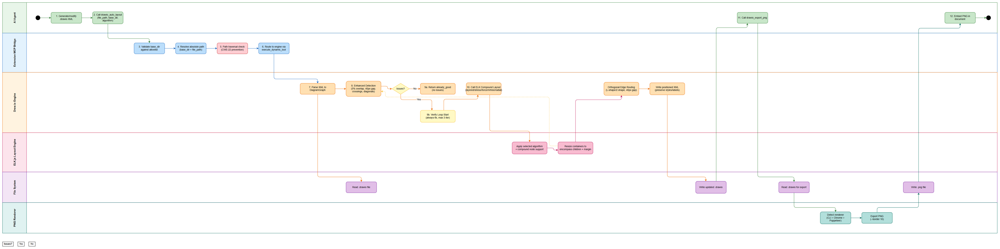
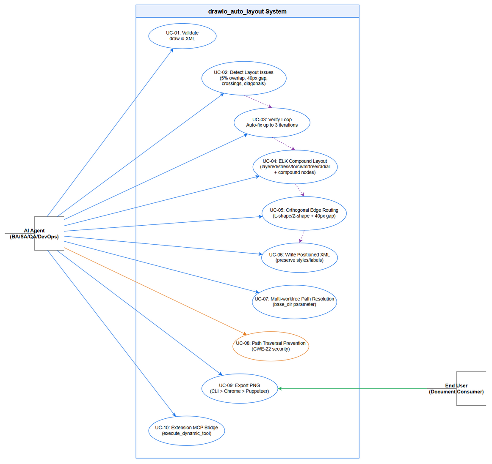
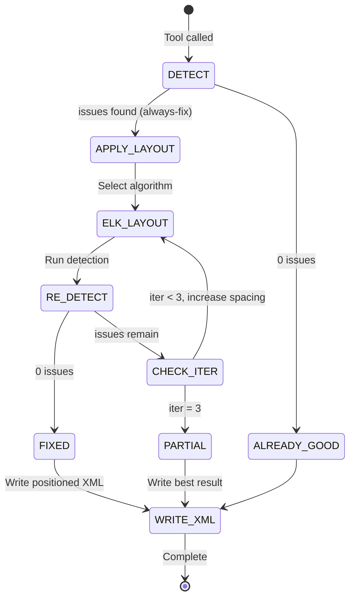
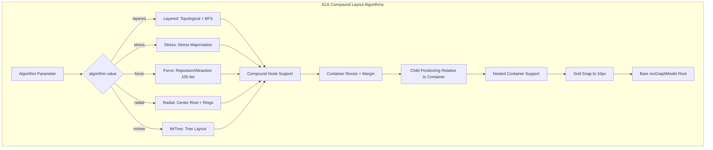

# Business Requirements Document (BRD)

## SA4E — SA4E-406: drawio_auto_layout detector precision + verify loop + ELK compound + extension migration

---

## Document Information

| Field | Value |
|-------|-------|
| Jira Ticket | SA4E-406 |
| Title | drawio_auto_layout: detector precision + verify loop + ELK compound + extension migration |
| Author | BA Agent |
| Version | 1.1 |
| Date | 2026-11-11 |
| Status | Draft |

---

## Author Tracking

| Role | Name - Position | Responsibility |
|------|-----------------|----------------|
| Author | BA Agent — Business Analyst | Create document |
| Peer Reviewer | SA Agent — Solution Architect | Review document |

---

## Revision History

| Version | Date | Author | Changes |
|---------|------|--------|---------|
| 1.0 | 2026-11-09 | BA Agent | Initiate document — auto-generated from Jira ticket SA4E-406 and linked tickets |
| 1.1 | 2026-11-11 | BA Agent | Specification reconciliation: (a) STORY 7 added — 9 user-reported diagram defects given explicit requirement IDs BR-57..BR-65 with an explicit TOOL-OWNED / CONTENT-OWNED split; (b) STORY 1/2/3 data fields reconciled with the implemented contract (`mode`, `auto_fix`, `detect_overlaps`, `detect_crossings`, `detect_diagonals`, `container_margin`, `elk_options` removed; `scope`, `overlap_threshold`, `gap_threshold` added; `stress` algorithm added; always-fix behaviour stated); (c) unreachable validation error codes removed |

---

## Sign-Off

| Name | Signature and date |
|------|--------------------|
| | ☐ I agree and confirm all criteria on this BRD as expected requirements |
| | ☐ I agree and confirm all criteria on this BRD as expected requirements |

---

## 1. Introduction

### 1.1 Scope

The SA4E-406 ticket addresses critical improvements to the drawio_auto_layout MCP tool, which is a core component of the Draw.io Engine (F6-drawio-engine). The tool provides automated layout analysis and issue detection for draw.io diagrams used throughout the SDLC pipeline (BRD, FSD, TDD, STP, DPG documents).

**Key improvements in this ticket:**

1. **Detector Precision Improvements** — Reduce overlap threshold from 50% to 5% for more sensitive node overlap detection; introduce 40px gap threshold for edge routing decisions
2. **Verify Loop** — After auto-layout execution, automatically verify layout quality and re-run if issues persist (maximum 3 iterations)
3. **ELK Compound Layout** — Integrate ELK.js layout engine with 5 algorithms (layered, stress, force, mrtree, radial) supporting compound nodes (containers/swimlanes)
4. **Extension MCP Bridge Migration** — Migrate from legacy extension architecture to new MCP-based bridge for draw.io integration, enabling proper multi-worktree path resolution
5. **Multi-worktree Path Resolution** — Implement per-call `base_dir` parameter (alias `workspace_root`) on all MCP tools accepting `file_path` to support multiple git worktrees
6. **Security Enhancement** — Path traversal prevention (CWE-22) with strict file path validation against workspace allowlist
7. **Diagram Quality Guarantees** — Guarantee nine structural properties of the produced diagram (band sizing, child distribution, edge waypoints, cross-lane edge parenting, band layout algorithm, grid alignment, band titles, decision branch labels, bare `<mxGraphModel>` root). Seven of the nine are **tool-owned** (the layout engine must detect and/or fix them); two are **content-owned** (the engine may only detect — the human/agent must author the text). Full requirements: STORY 7 (BR-57..BR-65).

### 1.2 Out of Scope

- Interactive diagram editing UI (remains with draw.io desktop application)
- Real-time collaborative diagram editing
- Non-draw.io diagram format conversions (Mermaid, PlantUML)
- Diagram version control (managed by git)
- Cloud-based draw.io rendering services
- Migration of other MCP tools beyond drawio_auto_layout and drawio_export_png (handled in SA4E-394)

### 1.3 Preliminary Requirement

1. draw.io desktop application installed on host machine (for CLI PNG export)
2. Node.js runtime (TypeScript execution environment, >= 18.14)
3. MCP (Model Context Protocol) server infrastructure with orchestration engine
4. Workspace file system access for reading/writing .drawio and .png files
5. Existing F6-drawio-engine modules operational (parser, detector, router, writer, exporter)
6. SA4E-394 multi-worktree path resolution framework implemented (base_dir parameter on file_path tools)

---

## 2. Business Requirements

### 2.1 High Level Process Map

The enhanced drawio_auto_layout tool operates within the AI agent pipeline as follows:

1. AI agent (BA/SA/QA/DevOps) generates or modifies draw.io XML content
2. Agent calls `drawio_auto_layout` MCP tool with file path and optional parameters
3. **NEW**: Tool resolves file path using `base_dir` parameter for multi-worktree support
4. Engine parses XML, extracts graph structure (nodes, edges, containers)
5. **ENHANCED**: Detector runs with improved precision (5% overlap threshold, 40px gap threshold)
6. **NEW**: If issues detected, Verify Loop triggers — re-run layout up to 3 iterations
7. **NEW**: ELK Compound Layout applies selected algorithm (layered/stress/force/mrtree/radial) with container support
8. Engine routes edges orthogonally with improved gap threshold
9. Engine writes positioned XML back to .drawio file
10. **NEW**: Security validation ensures all paths are within workspace allowlist
11. Agent calls `drawio_export_png` to render final PNG for document embedding


*[Edit in draw.io](diagrams/business-flow.drawio)*

### 2.2 List of User Stories / Use Cases

| # | Story / Use Case / Epic | Priority | Source Ticket |
|---|-------------------------|----------|---------------|
| 1 | As an AI agent, I want improved detector precision (5% overlap threshold) so that subtle node overlaps are caught before document generation | MUST HAVE | SA4E-406 |
| 2 | As an AI agent, I want a verify loop that re-runs layout up to 3 times so that diagrams are automatically corrected without manual iteration | MUST HAVE | SA4E-406 |
| 3 | As an AI agent, I want ELK Compound Layout with 5 algorithms so that different diagram types get optimal layouts with container support | MUST HAVE | SA4E-406 |
| 4 | As an AI agent, I want MCP bridge migration for draw.io integration so that multi-worktree path resolution works correctly | MUST HAVE | SA4E-406, SA4E-394 |
| 5 | As an AI agent, I want 40px gap threshold for edge routing so that edge paths have adequate clearance from nodes | SHOULD HAVE | SA4E-406 |
| 6 | As a system, I want path traversal prevention (CWE-22) so that file operations are secured against directory traversal attacks | MUST HAVE | SA4E-406 |
| 7 | As an AI agent, I want per-call base_dir parameter so that tools work correctly across multiple git worktrees | MUST HAVE | SA4E-406, SA4E-394 |
| 8 | As a diagram author, I want the layout engine to guarantee nine structural diagram properties (band size, child spread, edge routing, cross-lane edge parenting, band layout algorithm, grid alignment, band titles, decision branch labels, bare XML root) so that generated diagrams are readable and reviewable | MUST HAVE | SA4E-406 (UAT feedback) |


*[Edit in draw.io](diagrams/use-case.drawio)*

---

### 2.3 Details of User Stories

#### Business Flow

**Step 1:** AI agent generates or modifies draw.io XML content with mxGraphModel root element, defining cells (nodes, edges, containers)

**Step 2:** Agent calls `drawio_auto_layout` MCP tool with `file_path` and optional `base_dir` (workspace root for multi-worktree support)

**Step 3:** Extension MCP Bridge validates `base_dir` against registered workspace allowlist (security: path traversal prevention)

**Step 4:** Tool resolves absolute file path using `base_dir` if provided, otherwise falls back to primary workspace

**Step 5:** Engine parses XML into DiagramGraph (nodes, edges, containers) using regex-based extraction

**Step 6:** **Detector Precision** — Run enhanced detection:
   - Node overlaps: intersection area / smaller node area > 5% (was 50%)
   - Edge-node crossings: line-rect intersection with 5px margin
   - Diagonal edges: both dx > 20px AND dy > 20px tolerance
   - **NEW**: Gap threshold check — edge paths must maintain 40px clearance from non-endpoint nodes
   - **NEW (STORY 7)**: band oversize, children corner cluster, stale edge waypoints, wrong edge parent, `childLayout=stackLayout`, off-grid coordinates, empty lane title, missing decision label, `<mxfile>` root

**Step 7:** **Verify Loop** — If issues detected:
   - Apply ELK Compound Layout with selected algorithm (layered/stress/force/mrtree/radial)
   - Layout respects container boundaries (compound node support)
   - Re-run detector (iteration 1 of max 3)
   - If issues persist and iterations < 3: repeat layout with adjusted parameters
   - If iterations = 3 or no issues: return final status

**Step 8:** **ELK Compound Layout** — Apply selected algorithm:
   - Layered: topological sort + BFS layer assignment (default)
   - Stress: force-directed with stress majorization
   - Force: classic force-directed (repulsion/attraction, 100 iterations, damping)
   - Radial: root at center, concentric rings (max 8 nodes/ring)
   - All algorithms: container-aware (resize containers to encompass children + margin)

**Step 9:** **Orthogonal Edge Routing** — Compute routes with 40px gap threshold:
   - Exit/entry port selection based on relative positions
   - L-shape routing tried first (single waypoint)
   - Z-shape when L-shape blocked (bypass with 30px offset + 40px gap)
   - Obstacle margin: 5px + 40px gap = 45px effective clearance

**Step 10:** Write positioned XML back to .drawio file (preserving all styles/labels)

**Step 11:** Agent calls `drawio_export_png` to render PNG for document embedding

> **Note:** The tool operates in a **single always-fix mode** — when the detector reports any high/medium severity issue the engine repairs the diagram and writes it back. The historical REVIEW/APPLY split (`mode` / `auto_fix`) was removed in v1.1 because it was never parsed by the implementation.

---

#### STORY 1: Detector Precision Improvements

> As an AI agent, I want improved detector precision (5% overlap threshold) so that subtle node overlaps are caught before document generation

**Requirement Details:**

1. Reduce node overlap detection threshold from 50% to 5% of smaller node area
2. Introduce 40px gap threshold for edge routing — edges must maintain minimum 40px clearance from non-endpoint nodes
3. Maintain existing detection types: node overlaps, edge crossings, diagonal edges — all detection runs unconditionally; there is **no** per-detector on/off switch
4. Issue severity levels unchanged: high (overlap), medium (crossing), low (diagonal)
5. Fix hints must include actionable coordinates for 5% threshold sensitivity
6. The two precision thresholds are **optional** input parameters. When omitted, the compiled detector constants are used (`OVERLAP_EPS = 0.05`, `MIN_GAP = 40`, containment tolerance `CONTAINMENT_TOL = 5`). An out-of-range value does **not** raise an error — the tool falls back to the default, consistent with how invalid `algorithm` / `spacing` / `scope` values are handled today.

**Data Fields:**

| Field | Type | Required | Description | Default | Example |
|-------|------|----------|-------------|---------|---------|
| overlap_threshold | number | No | Overlap ratio threshold (0-1) — fraction of the smaller node's area that must be intersected to flag `node_overlap` | 0.05 (`OVERLAP_EPS`) | 0.05 |
| gap_threshold | number | No | Minimum edge-to-node clearance in pixels used for proximity/gap evaluation | 40 (`MIN_GAP`) | 40 |

> **Removed from this story's contract (v1.1):** `detect_overlaps`, `detect_crossings`, `detect_diagonals`. These flags were advertised but never parsed by the implementation; every detector always runs. They are not part of the tool schema and no caller may rely on them.

**Acceptance Criteria:**

1. Two nodes with 6% overlap area ratio are detected as overlapping (was undetected at 50%)
2. Edge passing within 30px of a node is flagged as gap violation (new)
3. Edge passing at 45px from a node passes gap check
4. Overlap detection still applies same-parent constraint (BR-08 from F6)
5. Fix hints suggest specific coordinate adjustments for 5% threshold
6. Performance: detection completes within 500ms for 50-node diagrams

**Validation Rules:**

- overlap_threshold is accepted in the range (0, 0.5]; a value outside the range is **ignored** and the default 0.05 is used — no error is raised
- gap_threshold is accepted as a positive number ≥ 10; a value below 10 is **ignored** and the default 40 is used — no error is raised
- No per-detector enable/disable flags exist — detection of all issue types is unconditional

**Error Handling:**

- Invalid threshold values: silently fall back to the compiled default (no error code is emitted)
- Detection algorithm failure: return error with exception message, continue other detections

---

#### STORY 2: Verify Loop (Auto-Fix with Iteration)

> As an AI agent, I want a verify loop that re-runs layout up to 3 times so that diagrams are automatically corrected without manual iteration

**Requirement Details:**

1. The tool has a **single, always-fix behaviour**: when the detector reports any high/medium severity issue, the engine fixes the diagram automatically. There is no review-only mode — detection-only was removed in v1.1 because it was never parsed by the implementation and is superseded by always-fix.
2. After initial detection, when issues are found:
   - Apply the fix strategy (ports-only → local repair → full ELK relayout)
   - Re-parse the fixed XML → re-run the full detection pipeline
   - If issues remain and the iteration count is below `max_iterations`: repeat with the node spacing increased by `spacing_increment`%
   - If the iteration count reaches `max_iterations`: stop and return the final status
3. Track iteration count and issues per iteration in the response (`iteration_history`)
4. Return `status="fixed"` if all high/medium issues are resolved, `status="partial"` if issues remain after the maximum iterations, `status="already_good"` if no actionable issue was found
5. Preserve the original diagram if the verify loop makes things worse (compare issue counts)

**Data Fields:**

| Field | Type | Required | Description | Default | Example |
|-------|------|----------|-------------|---------|---------|
| max_iterations | number | No | Maximum verify loop iterations | 3 | 3 |
| spacing_increment | number | No | Spacing increase per iteration (%), applied to `spacing` | 20 | 20 |

> **Removed from this story's contract (v1.1):** `mode` (`review` / `apply`) and `auto_fix`. Neither was parsed by the implementation — `mode` and `auto_fix` were silently ignored and the tool always fixed the diagram. Advertising them was the root cause of the "110/110 = 100 % coverage but 5 defects unimplemented" gap found in the 3-reviewer code review.

**Acceptance Criteria:**

1. Diagram with 3 overlaps resolved in 1 iteration returns status="fixed"
2. Diagram requiring 2 iterations returns status="fixed" with iteration_history showing 2 rounds
3. Diagram with persistent issues after the maximum iterations returns status="partial" with remaining issues
4. Each iteration increases node spacing by the configured increment (default 20%)
5. Response includes `iteration_history` array with issues count per round
6. Original diagram restored if final iteration has MORE issues than initial

**Validation Rules:**

- max_iterations is accepted in the range [1, 5]; a value outside the range is **ignored** and the default 3 is used — no error is raised
- spacing_increment is accepted in the range [10, 50]; a value outside the range is **ignored** and the default 20 is used — no error is raised
- There is no `mode`/`auto_fix` parameter and no review-only code path

**Error Handling:**

- Layout algorithm failure in iteration: stop loop, return best result so far
- Spacing increment causes overflow: cap at maximum canvas bounds

---

#### STORY 3: ELK Compound Layout (5 Algorithms + Container Support)

> As an AI agent, I want ELK Compound Layout with 5 algorithms (stress added by the SA4E-406 fix round) so that different diagram types get optimal layouts with container support

**Requirement Details:**

1. Integrate ELK.js layout engine as primary layout provider
2. Support the ELK layout algorithms advertised by the tool:
   - **Layered** (default): Topological sort + BFS layer assignment, DOWN/RIGHT/LEFT/UP direction
   - **Stress**: Force-directed with stress majorization (high quality, slower) — added by the SA4E-406 fix round (previously advertised but missing from the implementation's algorithm map; see FSD OI-2)
   - **Force**: Classic force-directed (repulsion/attraction, 100 iterations, damping)
   - **MrTree**: Tree layout (`org.eclipse.elk.mrtree`) — retained from the implementation (see FSD OI-3)
   - **Radial**: Root at center, concentric rings (max 8 nodes per ring)
3. **Compound Node Support**: All algorithms respect container boundaries:
   - Containers (swimlanes, groups) treated as compound nodes
   - Child nodes positioned relative to container
   - Container resized to encompass all children + margin
   - Nested containers supported (container within container)
4. Algorithm selection via `algorithm` parameter (invalid names fall back to `layered`)
5. Layout direction configurable per algorithm

**Data Fields:**

| Field | Type | Required | Description | Default | Example |
|-------|------|----------|-------------|---------|---------|
| algorithm | string | No | "layered" \| "stress" \| "force" \| "mrtree" \| "radial" | "layered" | "layered" |
| direction | string | No | "DOWN" \| "RIGHT" \| "LEFT" \| "UP" | "DOWN" | "DOWN" |
| spacing | number | No | Base node spacing in pixels (capped at 500) | 80 | 80 |

> **Removed from this story's contract (v1.1):** `container_margin` and `elk_options`. Neither was parsed by the implementation — container padding is a compiled ELK layout option (`elk.padding = [top=40,left=20,bottom=20,right=20]`) and raw ELK option pass-through was never wired.

**Acceptance Criteria:**

1. Layered algorithm produces no overlaps for DAG-structured diagrams with containers
2. Stress algorithm converges with stress value < 0.01 for diagrams up to 30 nodes
3. Force algorithm completes 100 iterations with damping, no node drift
4. Radial algorithm places max 8 nodes per ring, root at center
5. All algorithms: container bounds encompass all children + margin
6. Nested containers: inner container positioned within outer, both resize correctly
7. Algorithm falls back to layered if invalid name provided (backward compatible)

**Validation Rules:**

- algorithm must be one of: layered, stress, force, mrtree, radial — an unrecognised value falls back to `layered`
- direction must be one of: DOWN, RIGHT, LEFT, UP — an unrecognised value falls back to `DOWN`
- spacing must be > 0 and is capped at 500 px

**Error Handling:**

- ELK.js initialization failure: the failure is caught and reported as a generic layout failure; the diagram is left unmodified
- Compound node layout failure: layout failure is reported; no silent partial write
- There is no `elk_options` pass-through and therefore no invalid-ELK-option handling

---

#### STORY 4: Extension MCP Bridge Migration

> As an AI agent, I want MCP bridge migration for draw.io integration so that multi-worktree path resolution works correctly

**Requirement Details:**

1. Migrate `drawio_auto_layout` and `drawio_export_png` from legacy extension architecture to new MCP-based bridge
2. Legacy: Extension directly called backend functions via IPC
3. New: Tools registered via MCP orchestration, invoked through `execute_dynamic_tool`
4. Bridge handles:
   - File path resolution with `base_dir` parameter (per SA4E-394)
   - Workspace allowlist validation (security)
   - Content passthrough (base64 XML in/out for large diagrams) — the **raw backend** interface of `drawio_export_png` is `content_base64` → `output_base64`; the **extension client** interface is `file_path` (+ optional `output_path` / `base_dir`) → `{success, file_path, size_bytes, renderer}`. The Base64ProxyService performs the translation. See FSD §12.1.2.
   - Renderer detection and fallback (CLI > Chrome > Puppeteer)
5. Backward compatibility: existing calls without `base_dir` continue to work (primary workspace)

**Data Fields:**

| Field | Type | Required | Description | Example |
|-------|------|----------|-------------|---------|
| file_path | string | Yes | Path to .drawio file (relative to base_dir or absolute) | "diagrams/arch.drawio" |
| base_dir | string | No | Workspace root for path resolution (must be in allowlist) | "C:/projects/worktree-A" |
| workspace_root | string | No | Alias for base_dir (backward compat) | "C:/projects/worktree-A" |
| content_base64 | string | No | Raw backend interface only — base64 XML content. **Not** exposed to the extension client; the proxy supplies it from `file_path` | "PG14R3JhcG..." |
| output_base64 | boolean | No | Raw backend interface only — return the result as base64 instead of writing a file. **Not** exposed to the extension client; the proxy writes to `output_path` | true |

**Acceptance Criteria:**

1. Tool call with `base_dir` pointing to registered worktree resolves file correctly
2. Tool call without `base_dir` uses primary workspace (backward compatible)
3. `base_dir` not in allowlist → error: "PATH_REJECTED_OUTSIDE_ALLOWLIST"
4. `drawio_export_png` called through the proxy with `file_path` (and optional `output_path`) reads the file, renders it, writes the PNG to `output_path` and returns `{success, file_path, size_bytes, renderer}` — the extension client never sees `content_base64` / `output_base64`
5. Renderer detection works via orchestration engine (not hardcoded paths)
6. Extension bridge registers tools with `find_tools` discoverable

**Validation Rules:**

- file_path must end with .drawio (if provided)
- base_dir must be absolute path and in registered allowlist
- content_base64 and file_path are mutually exclusive (one required)
- output_base64 only valid with content_base64 input

**Error Handling:**

- PATH_REJECTED_OUTSIDE_ALLOWLIST: clear message with offending path
- FILE_NOT_FOUND: suggest checking base_dir and relative path
- BASE64_DECODE_ERROR: invalid base64 content
- RENDERER_UNAVAILABLE: tool hidden from MCP list (existing behavior)

---

#### STORY 5: Multi-worktree Path Resolution (base_dir Parameter)

> As an AI agent, I want per-call base_dir parameter so that tools work correctly across multiple git worktrees

**Requirement Details:**

1. Implement `base_dir` (alias `workspace_root`) parameter on `drawio_auto_layout` and `drawio_export_png`
2. Server maintains allowlist of registered workspace roots (configured at startup or via `register_workspace` tool)
3. Path resolution logic:
   - If `base_dir` provided and in allowlist: resolve relative path against `base_dir`
   - If `base_dir` not in allowlist: reject with PATH_REJECTED_OUTSIDE_ALLOWLIST
   - If no `base_dir`: resolve against primary workspace (backward compatible)
   - Absolute paths: validate within allowlist (any registered workspace)
4. Applies to all file_path parameters in drawio tools
5. Containment enforced — no file access outside allowlist

**Data Fields:**

| Field | Type | Required | Description | Example |
|-------|------|----------|-------------|---------|
| base_dir | string | No | Workspace root for path resolution (must be in allowlist) | "/home/user/project-worktree-B" |
| workspace_root | string | No | Deprecated alias for base_dir | "/home/user/project-worktree-B" |

**Acceptance Criteria:**

1. Agent in worktree A calls tool with base_dir=worktree B (registered) → success
2. Agent calls tool with base_dir=unregistered path → PATH_REJECTED_OUTSIDE_ALLOWLIST
3. Agent calls tool without base_dir → uses primary workspace (existing behavior)
4. Absolute file_path within registered worktree → success
5. Absolute file_path outside all worktrees → PATH_REJECTED_OUTSIDE_ALLOWLIST
6. Tool schema documents base_dir parameter clearly

**Validation Rules:**

- base_dir must be absolute path
- base_dir must exist in workspace allowlist
- Relative paths with ../ that escape base_dir → rejected

**Error Handling:**

- PATH_REJECTED_OUTSIDE_ALLOWLIST: include attempted path and allowlist in error
- WORKSPACE_NOT_FOUND: base_dir doesn't exist on filesystem

---

#### STORY 6: Path Traversal Prevention (CWE-22)

> As a system, I want path traversal prevention (CWE-22) so that file operations are secured against directory traversal attacks

**Requirement Details:**

1. All file_path inputs validated against workspace allowlist
2. Path resolution uses `path.resolve(base_dir, file_path)` then validates result is within allowlist
3. Reject paths containing `..` that escape workspace boundary
4. Reject absolute paths not within any registered workspace
5. Apply to: `drawio_auto_layout`, `drawio_export_png`, and all tools accepting file_path (per SA4E-394 scope)
6. Error messages must not leak filesystem structure (generic messages)

**Acceptance Criteria:**

1. file_path="..\\..\\etc\\passwd" with any base_dir → rejected
2. file_path="C:\\Windows\\System32\\config\\SAM" → rejected (outside allowlist)
3. file_path="diagrams/../../secrets.txt" → rejected (traversal attempt)
4. Valid relative path within base_dir → accepted
5. Error messages generic: "File path not allowed" not "Cannot access C:\\Windows"
6. All drawio tools enforce same validation

**Validation Rules:**

- Resolved absolute path must start with one of the allowlist workspace roots
- Path traversal attempts logged (security audit) but not detailed in response
- Symbolic links resolved before validation (prevent link traversal)

**Error Handling:**

- All path violations return generic error: "File path not allowed: path traversal detected"
- Security audit log entry created with timestamp, attempted path, client info
- No stack traces or filesystem details in error responses

---

#### STORY 7: Diagram Quality Guarantees (9 user-reported defects)

> As a diagram author, I want the layout engine to guarantee nine structural properties of the diagram it produces so that generated diagrams are readable, reviewable and machine-checkable — without a human having to redraw them

**Background (why this story exists):** the 3-reviewer code review returned FAIL because the ticket's own requirement documents never described the nine defects the user reported. The five defects that were never implemented therefore had no requirement ID, and the STC's "110/110 = 100 % coverage" was vacuously true. This story gives every one of the nine defects a stable requirement ID so that QA can hang a test case on it.

**Requirement IDs:** `BR-57` .. `BR-65` (one per defect). Acceptance criteria are `AC-1` .. `AC-9` in this story, each mapped 1:1 to one `BR-xx`.

**Ownership model (explicit — this split is part of the requirement):**

| Owner | Meaning | QA test style | Defects |
|-------|---------|---------------|---------|
| **TOOL-OWNED** | The layout engine must **detect** the defect and, where it is geometric, **fix** it automatically. QA tests this mechanically: run the tool, assert the property holds in the output file. | Mechanical / automated assertion on the output `.drawio` | (a) band oversize, (b) corner bunching, (c) stale waypoints, (d) wrong edge parent, (e) `childLayout=stackLayout`, (f) off-grid coordinates, (i) `<mxfile>` wrapper |
| **CONTENT-OWNED** | The engine can only **DETECT** the defect. The text itself is business-meaningful and must be authored by the human / AI agent that produced the diagram. The engine must **not** invent the text from cell ids. QA tests this as a **review item** (a flagged issue is raised and a human must act on it), not as a mechanical fix assertion. | Review item — assert the issue is *reported*, and assert the engine did **not** fabricate text | (g) empty lane titles, (h) missing decision branch labels |

**Requirement Details:**

1. The engine shall detect the five new geometric/structural defect classes and repair them where repair is well-defined: oversized swimlane bands, children bunched in one corner, stale edge waypoints that cross the page or other lanes, cross-lane edges with an incorrect `parent`, swimlanes carrying `childLayout=stackLayout`, and node coordinates off the 10 px grid.
2. The engine shall detect — but never fabricate — the two content defect classes: a swimlane/container with an empty `value=""`, and a decision edge leaving a `rhombus` node without a `Yes` / `No` branch label.
3. The engine shall always write a **bare `<mxGraphModel>`** root — never an `<mxfile>` wrapper — so that the file satisfies the project diagram rule (`.code-intel/steering/shared-diagrams.md`).
4. Band titles (BR-63) must be authored by the diagram author as the real architectural role of the band (e.g. "Presentation Layer", "Backend Layout Engine"). The engine must not synthesise a title from a cell id such as `layer1`.
5. Decision branch labels (BR-64) must be authored by the diagram author. Where the branch meaning is unambiguous the author assigns `Yes` to the happy-path branch and `No` to the alternative; where it is ambiguous the author must flag the edge rather than guess. The engine detects the missing label and reports it; it does not assign it.

**Data Fields — new detector issue types (added by the SA4E-406 fix round):**

| Issue type (canonical) | Defect-report name | Severity | Detection rule | Auto-fixable? | Related BR |
|-------------------------|--------------------|----------|----------------|---------------|------------|
| `band_oversize` | band-oversize | high | Swimlane/container absolute width or height exceeds the band budget derived from its children (a band that is 3.5k–5k px wide / 1.5k–2k px tall while its children are 120–220 px) | Yes — band resized to fit children + margin | BR-57 |
| `children_corner_cluster` | children bunched in one corner | high | Children of a container occupy only a small fraction of the container's area (all clustered in one corner instead of being spread) | Yes — children redistributed over the band interior | BR-58 |
| `stale_edge_waypoints` | stale edge waypoints | high | An edge carries explicit waypoints that no longer match the (re)computed route, or that cross the page/other lanes | Yes — waypoints recomputed from the new geometry | BR-59 |
| `wrong_edge_parent` | wrong edge parent | high | An edge whose source and target live in different containers is not parented to the root layer (`parent="1"`), so draw.io renders it relative to the wrong coordinate space | Yes — edge re-parented to `parent="1"` | BR-60 |
| `stack_layout_container` | `childLayout=stackLayout` | high | A swimlane carries `childLayout=stackLayout`, which makes draw.io re-stack its children on edit instead of keeping the computed arrangement | Yes — the auto-layout style is stripped before the file is written | BR-61 |
| `off_grid_alignment` | off-grid coordinates | medium | A node coordinate is not a multiple of the 10 px grid (e.g. 2371.7, 3575.7) | Yes — coordinate snapped to the nearest 10 px | BR-62 |
| `empty_lane_title` | empty lane title | medium | A swimlane/container has `value=""` | **No — detect only (CONTENT-OWNED)** | BR-63 |
| `missing_decision_label` | missing decision label | medium | An edge whose source is a `rhombus` node has an empty `value` | **No — detect only (CONTENT-OWNED)** | BR-64 |
| `mxfile_root` | `<mxfile>` wrapper | high | The file root element is `<mxfile>` instead of `<mxGraphModel>` | Yes — file unwrapped to a bare `<mxGraphModel>` root | BR-65 |

**Acceptance Criteria:**

| AC ID | BR ID | Defect | Owner | Acceptance criterion |
|-------|-------|--------|-------|----------------------|
| AC-1 | BR-57 | (a) Oversized swimlane bands | TOOL-OWNED | After `drawio_auto_layout` runs on a diagram whose band is 3.5k–5k px wide / 1.5k–2k px tall while its children are 120–220 px, the band is resized so that it encloses its children plus the margin, and the rendered PNG is no longer an unreadable ~6718×3580 canvas. The tool reports a `band_oversize` issue for the band before/while fixing it. |
| AC-2 | BR-58 | (b) Children bunched in one corner | TOOL-OWNED | After `drawio_auto_layout` runs, the children of a container are distributed across the band interior rather than clustered in one corner; no container's children occupy only a corner region of it. The tool reports a `children_corner_cluster` issue. |
| AC-3 | BR-59 | (c) Stale edge waypoints crossing the page / other lanes | TOOL-OWNED | After `drawio_auto_layout` runs, no edge carries waypoints that cross the page canvas or another lane; every edge's route is recomputed from the geometry actually written. The tool reports a `stale_edge_waypoints` issue. |
| AC-4 | BR-60 | (d) Cross-lane edges with the wrong `parent` | TOOL-OWNED | After `drawio_auto_layout` runs, every edge whose source and target are in different containers has `parent="1"` on the root layer — verified for the reported instances `edge4` (bridge→tool), `edge11` (apply→applyts) and `edge23` (agent→export). The tool reports a `wrong_edge_parent` issue. |
| AC-5 | BR-61 | (e) Lanes using `childLayout=stackLayout` | TOOL-OWNED | After `drawio_auto_layout` runs, no swimlane/container in the written file carries `childLayout=stackLayout` (the auto-layout style is stripped before writing, so draw.io does not re-stack the children on the next edit). The tool reports a `stack_layout_container` issue. |
| AC-6 | BR-62 | (f) Coordinates off the 10 px grid | TOOL-OWNED | After `drawio_auto_layout` runs, every node `x` / `y` in the written file is a multiple of 10 (no value such as 2371.7 or 3575.7 remains). The tool reports an `off_grid_alignment` issue for each offending node. |
| AC-7 | BR-63 | (g) Swimlane with an empty `value=""` | **CONTENT-OWNED** | The tool **detects** every swimlane/container whose `value` is empty and reports it as `empty_lane_title`. It **must not** synthesise a title from the cell id (a band `layer1` must not be auto-named "Layer 1"). Satisfying the defect therefore requires the human/agent to author the real architectural role of the band (e.g. "Presentation Layer", "Backend Layout Engine"). QA verifies (i) the issue is reported and (ii) no fabricated title was written — and the human review supplies the title. |
| AC-8 | BR-64 | (h) Decision edges missing `Yes` / `No` labels | **CONTENT-OWNED** | The tool **detects** every edge that leaves a `rhombus` node without a branch label and reports it as `missing_decision_label`. It **must not** guess the branch meaning. The diagram author assigns `Yes` to the happy-path branch and `No` to the alternative, and flags the edge instead of guessing where the branch meaning is ambiguous. QA verifies (i) the issue is reported and (ii) the engine wrote no invented label; the branch labels themselves are supplied by the author and reviewed. |
| AC-9 | BR-65 | (i) File wrapped in `<mxfile>` | TOOL-OWNED | After `drawio_auto_layout` runs, the written `.drawio` file starts with `<mxGraphModel>` and contains a bare `<mxGraphModel><root>…</root></mxGraphModel>` structure — no `<mxfile>` wrapper, no `<diagram>` element. The tool reports an `mxfile_root` issue when the input was wrapped. |

**Validation Rules:**

- Issue type ids are stable strings; QA test cases assert on them.
- Severity assignment: `band_oversize`, `children_corner_cluster`, `stale_edge_waypoints`, `wrong_edge_parent`, `stack_layout_container` and `mxfile_root` are high (they block the file from being readable); `off_grid_alignment`, `empty_lane_title` and `missing_decision_label` are medium.
- Only `high` and `medium` issues trigger the write-back path (low severity stays cosmetic and never triggers a rewrite, preserving idempotency).
- Content-owned issues are reported and are **not** silently auto-fixed by the engine.

**Error Handling:**

- A defect that the engine cannot repair (e.g. a band whose children cannot be measured because the container has no geometry) is reported as an issue and left unchanged; the file is still written.
- If the input file's root element is neither `<mxGraphModel>` nor `<mxfile>`, the tool refuses the file with an actionable message rather than guessing the format.
- If unwrapping `<mxfile>` would change the cell set, the tool refuses and reports; it never drops or duplicates cells.

---

| Dependency | Type | Related Ticket | Description |
|------------|------|----------------|-------------|
| F6-drawio-engine (existing) | System | F6 | Core draw.io engine modules (parser, detector, router, writer, exporter) |
| ELK.js | External | — | Layout engine for compound node algorithms (layered, stress, force, radial) |
| SA4E-394 (Multi-worktree) | System | SA4E-394 | base_dir parameter framework and workspace allowlist |
| draw.io Desktop CLI | External | — | Primary PNG renderer (--export --format png --border 10) |
| Chrome DevTools MCP | External | — | Fallback PNG renderer (browser screenshot) |
| Puppeteer MCP | External | — | Secondary fallback PNG renderer |
| MCP Orchestration Engine | System | F3 | Tool registration, find_tools, execute_dynamic_tool |
| Extension MCP Bridge | System | SA4E-406 | New bridge layer replacing legacy extension IPC |
| Workspace Filesystem | Infrastructure | — | Read/write .drawio and .png files within allowlist |

---

## 4. Stakeholders

| Role | Name / Team | Responsibility | Source |
|------|-------------|----------------|--------|
| Reporter | Duc Nguyen Minh | Product Owner, ticket author | Jira reporter |
| Assignee | (Unassigned) | Implementation owner | Jira assignee |
| BA Agent | BA Agent | Requirements analysis, BRD creation | This document |
| SA Agent | SA Agent | Technical design, TDD creation | Phase 3 |
| DEV Agent | DEV Agent | Implementation of detector, verify loop, ELK integration | Phase 5 |
| QA Agent | QA Agent | Test planning, test cases for precision, verify loop, security | Phase 4 |
| DevOps Agent | DevOps Agent | Deployment, CI/CD for draw.io CLI dependency | Phase 7 |
| UI Agent | UI Agent | Wireframes for diagram generation workflow | Phase 2 |

---

## 5. Risks and Assumptions

### 5.1 Risks

| Risk | Impact | Likelihood | Mitigation |
|------|--------|------------|------------|
| ELK.js integration complexity | High | Medium | Prototype with single algorithm first; fallback to legacy layered |
| Verify loop infinite regression | High | Low | Hard cap at 3 iterations; compare issue counts; restore original if worse |
| Multi-worktree path resolution breaks existing tools | High | Medium | Comprehensive regression tests; backward compatible defaults |
| Path traversal validation too restrictive | Medium | Low | Allowlist-based not blocklist; test with legitimate nested paths |
| draw.io CLI not available on CI/CD | Medium | Medium | Browser fallback renderers (Chrome DevTools MCP, Puppeteer MCP) |
| 5% overlap threshold too sensitive (false positives) | Medium | Medium | Configurable threshold; default 5% but adjustable per diagram type |
| Extension bridge migration breaks tool discovery | High | Medium | Phased migration; legacy tools deprecated not removed immediately |
| Compound node layout with nested containers | Medium | Medium | ELK.js has native compound support; test nested swimlanes |

### 5.2 Assumptions

- ELK.js library available via npm and compatible with Node.js >= 18.14
- draw.io desktop CLI installation paths follow standard locations (per F6 detection logic)
- MCP orchestration engine supports `execute_dynamic_tool` for bridge routing
- SA4E-394 workspace allowlist framework implemented before or in parallel
- The tool always fixes detected issues; there is no review-only mode, so callers cannot ask for detection without a write-back
- Maximum diagram size: 100 nodes (performance tested at 50 nodes)
- All file operations synchronous (execSync, readFileSync, writeFileSync)
- No database persistence — all state in-memory per tool call

---

## 6. Non-Functional Requirements

| Category | Requirement | Details |
|----------|-------------|---------|
| Performance | Detection pipeline < 500ms | For diagrams up to 50 nodes with enhanced precision |
| Performance | Verify loop (3 iterations) < 2s | Each iteration re-runs detection + layout |
| Performance | ELK layout < 1s | Layered/Force for 50 nodes; Stress for 30 nodes |
| Performance | PNG export < 30s | CLI timeout enforced |
| Security | Path traversal prevention (CWE-22) | All file paths validated against workspace allowlist |
| Security | No network calls in layout | Pure local computation |
| Security | CLI stdio piped | Prevent output leakage |
| Reliability | Graceful degradation | CLI unavailable → browser fallback; none → tool hidden |
| Reliability | Verify loop rollback | Restore original if final iteration worse than initial |
| Maintainability | No external XML deps | Regex-based parsing (existing) |
| Compatibility | Cross-platform path detection | Windows, macOS, Linux CLI paths detected |
| Compatibility | Backward compatible | Existing calls without base_dir work unchanged |
| Testability | Deterministic layout | Same input + algorithm = same output |
| Availability | Tool availability detection | isExportPngAvailable() reports before registration |

---

## 7. Related Tickets

| Ticket Key | Summary | Status | Type | Relationship |
|------------|---------|--------|------|--------------|
| SA4E-406 | drawio_auto_layout: detector precision + verify loop + ELK compound + extension migration | Done | Task | Main ticket |
| SA4E-84 | [drawio] Upgrade drawio_auto_layout to FIX mode - auto-layout reduce edge crossings with elkjs | Done | Story | Predecessor (initial ELK integration) |
| SA4E-359 | [Follow-up SA4E-356/OI-1] drawio_auto_layout: proxy-route refactor (content_base64 → output_base64) | To Do | Story | Related (proxy-route pattern) |
| SA4E-13 | Upgrade Draw.io Skill - Vision Self-Check + Quality Validation | Done | Story | Related (diagram quality standards) |
| SA4E-394 | [MCP Tools] Multi-worktree: base_dir per-call parameter for file_path tools | Done | Enhancement | Dependency (path resolution framework) |
| SA4E-356 | [Bug] MCP tools: relative file_path resolves against process CWD instead of workspace root | Done | Bug | Root cause for multi-worktree need |
| SA4E-357 | Duplicate of SA4E-356 | Done | Bug | Same as SA4E-356 |
| SA4E-396 | Integrate ECC into Inject All Agents | To Do | Enhancement | Related (extension architecture) |
| SA4E-367 | [BUG] Chatbox extension expose 12 hardcoded tools — missing dynamic tools | Done | Bug | Related (extension tool wiring) |
| SA4E-363 | export_docx fails for >1MB payloads — extension caps at 1MB | Done | Bug | Related (content_base64 pattern) |
| F6-drawio-engine | Draw.io Engine — XML Generation, Auto-Layout, PNG Export | Done | Feature | Parent feature |

---

## 8. Appendix

### Glossary

| Term | Definition |
|------|------------|
| mxGraphModel | Root XML element of draw.io diagram format |
| mxCell | XML element representing a node or edge in draw.io |
| mxGeometry | XML element defining position and size of a cell |
| MCP | Model Context Protocol — AI tool communication standard |
| ELK.js | Eclipse Layout Kernel — JavaScript port for graph layout algorithms |
| Compound Node | Node that contains other nodes (e.g., swimlane, group container) |
| Layered Layout | Topological layout assigning nodes to layers (hierarchical) |
| Stress Layout | Force-directed layout using stress majorization |
| Force Layout | Classic force-directed (repulsion/attraction forces) |
| Radial Layout | Circular layout with root at center, rings outward |
| Orthogonal Routing | Edge paths using only horizontal/vertical segments |
| L-shape Route | Single bend point connecting source to target |
| Z-shape Route | Multiple bend points bypassing obstacles |
| CWE-22 | Common Weakness Enumeration: Path Traversal |
| base_dir | Per-call workspace root parameter for multi-worktree path resolution |
| Verify Loop | Automatic re-layout and re-detection up to N iterations |
| Overlap Threshold | Minimum intersection area ratio to flag as overlap (5%) |
| Gap Threshold | Minimum edge-to-node clearance in pixels (40px) |

### Reference Documents

| Document | Link / Location |
|----------|-----------------|
| F6-drawio-engine BRD | documents/F6-drawio-engine/BRD.md |
| F6-drawio-engine FSD | documents/F6-drawio-engine/FSD.md |
| F6-drawio-engine TDD | documents/F6-drawio-engine/TDD.md |
| SA4E-394 Multi-worktree | Jira ticket SA4E-394 |
| Draw.io Skill (steering) | .code-intel/steering/drawio.md |
| MCP Tools Reference | .code-intel/steering/mcp-tools-reference.md |
| ELK.js Documentation | https://github.com/kieler/elkjs |

---

## Mermaid Diagrams

### High-Level Process Flow

```mermaid
flowchart TD
    A[AI Agent generates/modifies .drawio XML] --> B[Call drawio_auto_layout with file_path + base_dir]
    B --> C[Extension MCP Bridge validates base_dir against allowlist]
    C --> D[Resolve absolute path using base_dir]
    D --> E[Parse XML to DiagramGraph]
    E --> F[Enhanced Detection: 5% overlap, 40px gap, crossings, diagonals]
    F --> G{Issues found?}
    G -- No --> H[Return status=already_good]
    G -- Yes --> K[Verify Loop: max 3 iterations (always-fix)]
    K --> L[Apply ELK Compound Layout selected algorithm]
    L --> M[Re-run detection]
    M --> N{Issues resolved or iter=3?}
    N -- Issues remain, iter<3 --> K
    N -- Resolved or iter=3 --> O[Return status=fixed or partial with history]
    O --> P[Write positioned XML to .drawio file]
    P --> Q[Agent calls drawio_export_png]
    Q --> R[PNG rendered via CLI/browser fallback]
    R --> S[PNG embedded in document]
```

### Verify Loop State Machine



### ELK Algorithm Selection



### Multi-worktree Path Resolution

```mermaid
flowchart TD
    A[Tool Call with file_path] --> B{base_dir provided?}
    B -- Yes --> C{base_dir in allowlist?}
    C -- Yes --> D[Resolve: path.resolve(base_dir, file_path)]
    C -- No --> E[Error: PATH_REJECTED_OUTSIDE_ALLOWLIST]
    B -- No --> F[Resolve: path.resolve(primaryWorkspace, file_path)]
    D --> G{Resolved path in allowlist?}
    F --> G
    G -- Yes --> H[Proceed with file operation]
    G -- No --> E
    E --> I[Return generic error: File path not allowed]
    H --> J[Read/Write file]
    J --> K[Return result]
```

---

*End of BRD for SA4E-406*