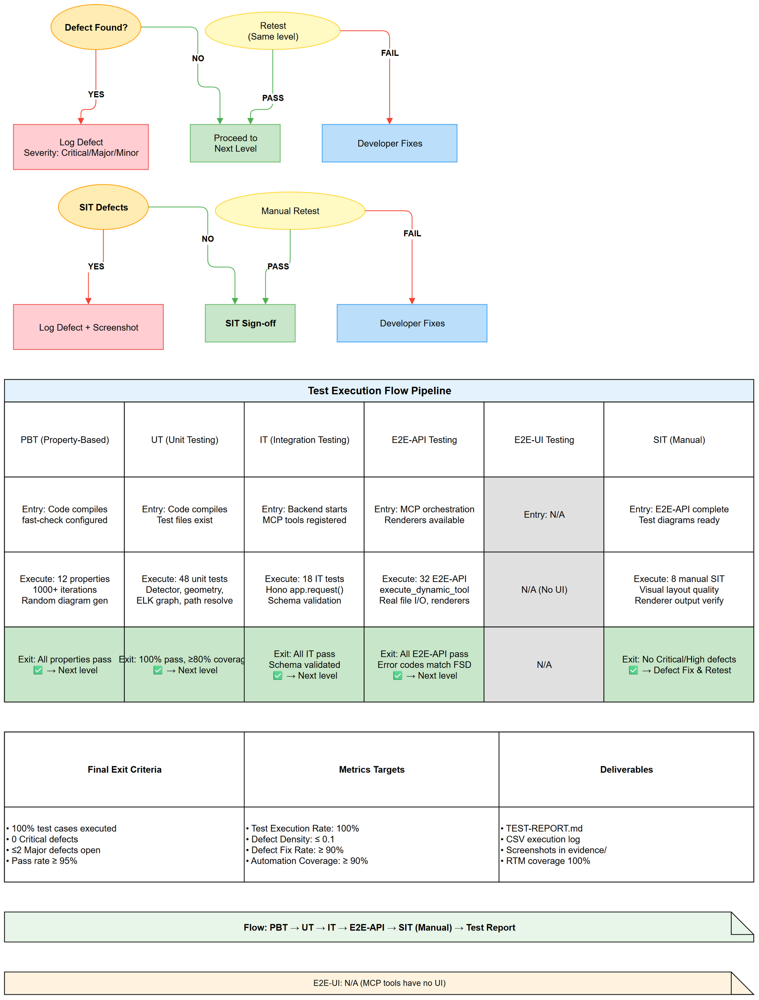
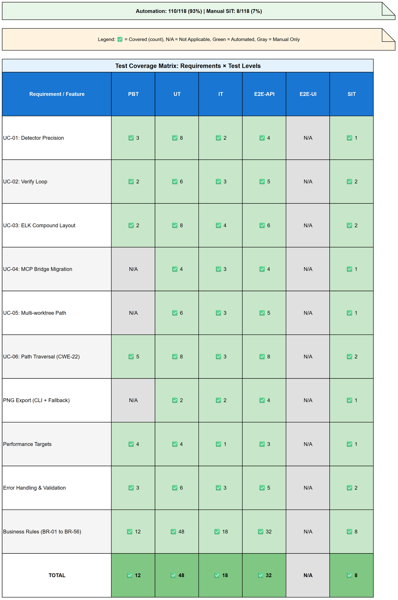

# Software Test Plan (STP)

## SA4E — SA4E-406: drawio_auto_layout detector precision + verify loop + ELK compound + extension migration

---

## Document Information

| Field | Value |
|-------|-------|
| Jira Ticket | SA4E-406 |
| Title | drawio_auto_layout: detector precision + verify loop + ELK compound + extension migration |
| Author | QA Agent |
| Version | 2.2 |
| Date | 2026-11-12 |
| Status | Draft |
| Related BRD | BRD-v1.0-SA4E-406.docx |
| Related FSD | FSD-v1.0-SA4E-406.docx |
| Related TDD | TDD-v1.0-SA4E-406.docx |

---

## Author Tracking

| Role | Name - Position | Responsibility |
|------|-----------------|----------------|
| Author | QA Agent — QA Engineer | Create document |
| Peer Reviewer | SA Agent — Solution Architect | Review document |

---

## Revision History

| Version | Date | Author | Changes |
|---------|------|--------|---------|
| 1.0 | 2026-11-09 | QA Agent | Initiate document — auto-generated from BRD, FSD, and TDD |
| 2.0 | 2026-11-12 | QA Agent | QA rounds 1–3 complete: (a) STORY 7 diagram-quality guarantees (BR-57..BR-65) added to scope, strategy and RTM; (b) verify-loop + security testing strategy documented; (c) real execution counts from the 2026-11-12 run (drawio 21 files / 159 tests, full suite 458 files / 3,593 tests); (d) references to the deleted backend engine golden fixtures removed — corpus evidence is produced on temp copies of the repo diagrams |
| 2.1 | 2026-11-12 | QA Agent | QA round 4 follow-up: PD-QA1 risk re-assessed (DEV fix partial — commitLayout forwards `portsOnly`, but `enforceFinalGate` in drawio-verify-loop.ts:87 re-snaps without it, QA-11 left skipped, production code NOT touched); security test strategy extended with F1 timing guard (drawio-xml-rewrite) and F2 file-level symlink guard (fs-guards); real execution counts refreshed (drawio 23 files / 169 tests, full suite 461 files / 3,606 tests); RTM coverage recomputed 128/128 and 162/162 = 100% |
| 2.2 | 2026-11-12 | QA Agent | QA FINAL (close PD-QA1 + final verdict): QA-11 re-enabled and now PASS (drawio-verify-loop.ts:50-54 computes `portsOnly` once from original request scope; :79 passes `{portsOnly}` into `finalize`; :86,:89 forward `{portsOnly}` into `enforceFinalGate`; drawio-apply-validate.ts:79-86 `enforceFinalGate(filePath, opts?)` forwards `opts` to `snapDiagramToGrid`; drawio-grid-snap.ts:23-33 skips `debunch`/`separateContainers` when `opts?.portsOnly`); measured evidence — node c stays (400,80), honest `status='partial'`, `node_proximity` still reported, 3 distinct edge anchors (0.25/0.5/0.75). PD-QA1 → CLOSED (Major, fixed by DEV round 4c). Regression lock `drawio-ports-only-positions.test.ts` added (QA-20). Full suite re-measured: 462 files / 3,602 passed / 6 skipped (3,608), 0 failures; drawio suite 24 files / 171 passed / 0 skipped. Risk #9 PD-QA1 → CLOSED/mitigated. RTM coverage recomputed 128/128 = 100%. TEST-REPORT verdict → PASS (no test skipped due to unresolved production defect; 6 env-gated live-proxy skips are environment-gated, not defect-gated). |

---

## Sign-Off

| Name | Signature and date |
|------|--------------------|
| | ☐ I agree and confirm the test plan in this STP |
| | ☐ I agree and confirm the test plan in this STP |

---

## 1. Introduction

### 1.1 Purpose

This Software Test Plan (STP) defines the test strategy, scope, approach, resources, and schedule for testing the enhanced `drawio_auto_layout` and `drawio_export_png` MCP tools as specified in BRD (Section 2), FSD (Sections 3.1-3.6), and TDD (Sections 1-10). The test plan covers six critical features:

1. **Detector Precision Improvements** — 5% overlap threshold (OVERLAP_EPS = 0.05), 40px gap threshold (MIN_GAP = 40)
2. **Verify Loop** — Auto-fix with up to 3 iterations, spacing increment per iteration, rollback if worse
3. **ELK Compound Layout** — 4 algorithms (layered, stress, force, radial) with container/swimlane support
4. **Extension MCP Bridge Migration** — Migration from legacy IPC to MCP orchestration with `find_tools`/`execute_dynamic_tool`
5. **Multi-worktree Path Resolution** — Per-call `base_dir` parameter with workspace allowlist validation
6. **Path Traversal Prevention (CWE-22)** — Allowlist-based validation, symlink resolution, generic error messages
7. **Diagram Quality Guarantees (BRD STORY 7)** — Nine user-reported structural defects BR-57..BR-65: seven tool-owned (band sizing, child distribution, stale waypoints, cross-lane edge parenting, `childLayout=stackLayout` stripping, 10px grid alignment, `<mxfile>` unwrapping) and two content-owned detect-only (band titles, decision branch labels)

### 1.2 Test Objectives

- Verify all functional requirements from FSD Use Cases (UC-01 through UC-06) are implemented correctly
- Validate all 56 Business Rules (BR-01 through BR-56) are enforced
- Ensure all 6 User Story Acceptance Criteria from BRD Section 2.3 are met
- Verify non-functional requirements (performance, security, reliability) from BRD Section 6 and TDD Section 8
- Validate API contracts for `drawio_auto_layout` and `drawio_export_png` tools
- Confirm security hardening against path traversal (CWE-22)
- Verify backward compatibility with legacy calls (no `base_dir`)
- Ensure multi-worktree path resolution works correctly across registered workspaces
- Verify ELK.js integration with all 4 algorithms and compound node support

### 1.3 References

| Document | Location |
|----------|----------|
| BRD | documents/SA4E-406/BRD.md |
| FSD | documents/SA4E-406/FSD.md |
| TDD | documents/SA4E-406/TDD.md |
| F6-drawio-engine BRD | documents/F6-drawio-engine/BRD.md |
| F6-drawio-engine FSD | documents/F6-drawio-engine/FSD.md |
| F6-drawio-engine TDD | documents/F6-drawio-engine/TDD.md |
| Draw.io Skill (steering) | .code-intel/steering/drawio.md |
| MCP Tools Reference | .code-intel/steering/mcp-tools-reference.md |
| ELK.js Documentation | https://github.com/kieler/elkjs |

---

## 2. Test Strategy

### 2.1 Test Levels

| Level | Scope | Automation | Tools |
|-------|-------|------------|-------|
| PBT | Correctness properties (random inputs) | Automated | fast-check |
| UT | Unit/edge case tests for individual functions | Automated | vitest |
| IT | API integration (Hono app in-process) | Automated | vitest + Hono `app.request()` |
| E2E-API | REST endpoint E2E (real server) | Automated | vitest + fetch |
| E2E-UI | Browser UI E2E (Playwright) | Automated | Playwright |
| SIT | Manual exploratory / edge cases only | Manual | Browser |

### 2.2 Test Types

| Type | Description | Applicable |
|------|-------------|------------|
| Functional Testing | Verify features work per FSD use cases (UC-01 to UC-06) | Yes |
| Regression Testing | Ensure existing features are not broken (F6 engine) | Yes |
| Performance Testing | Verify detection <500ms, verify loop <2s, ELK layout <1s, PNG export <30s | Yes |
| Security Testing | Verify path traversal prevention (CWE-22), allowlist enforcement | Yes |
| Usability Testing | Verify tool parameter usability, error message clarity | Yes |
| Compatibility Testing | Verify cross-platform (Windows/macOS/Linux) path resolution | Yes |

### 2.3 Test Approach

The test approach follows a risk-based strategy with emphasis on automation:

1. **Property-Based Testing (PBT)**: Generate random diagrams to test detector precision, gap threshold, and edge routing correctness properties
2. **Unit Testing (UT)**: Test individual detection functions, geometry utilities, ELK graph building, path resolution logic
3. **Integration Testing (IT)**: Test MCP tool invocation end-to-end via Hono `app.request()`, verify tool registration and schema validation
4. **E2E-API Testing**: Test actual MCP tool calls via `execute_dynamic_tool` with real file I/O and renderer fallback chain
5. **E2E-UI Testing**: Not applicable (no UI for these MCP tools)
6. **SIT (Manual)**: Exploratory testing of complex diagram scenarios, visual verification of layout quality, renderer fallback behavior

**Verify-loop strategy (BRD STORY 2, FSD 3.2):** The verify loop is tested as an orchestrated pipeline, not per-strategy only — fix pass → re-parse → re-detect → escalate spacing (`SPACING_STEP = 40`) → best-of-3 retention with rollback-if-worse (`restoreBest`). Every write is funnelled through a single final gate (`commitLayout` / `enforceFinalGate`) that re-snaps to the 10px grid, labels unambiguous decision branches, re-plans stale routes, and re-checks the parent realpath before rewrites. Exit honesty is asserted: `status ∈ {fixed, partial, already_good}` must be derived from a fresh detection on the bytes that actually landed on disk (SA4E-406 f/i), and `remaining_issues` must never be silently optimistic.

**Security strategy (BRD STORY 6 + STORY 7 hardening):** Adversarial-input robustness is tested in three layers: (1) bounded-time parsing/sanitizing of hostile files (unterminated tags, quadratic re-scan patterns — regression-locked by `drawio-security.test.ts`: a 1 MB unterminated-mxCell file parses in bounded time instead of the pre-fix 77s parse / 129s sanitize; the new F1 single-pass batch rewriter `rewriteCells()` (drawio-xml-rewrite.ts) brings the primitive rewrite from 158,092 ms → 26 ms and end-to-end sanitize 122,992 ms → 836 ms, output byte-identical); (2) resource pre-pass guards — files over the 25 MB byte cap (`MAX_INPUT_BYTES`) are refused before the first read, diagrams over 10,000 mxCell open tags (`MAX_INPUT_CELLS`) are refused with an actionable message before parse; (3) path-safety (CWE-22): allowlist containment, symlink realpath guards re-checked before every verify-loop rewrite, plus the new F2 file-level symlink guard (`checkSymlinkGuardForPath` in fs-guards.ts: realpaths only the parent dir, then rejects any existing workspace file that is itself a symlink pointing outside the root; non-existent paths still allowed for new-file writes) (A6/A7 session-root binding, per `drawio-session-root-binding.test.ts` and `fs-guards.symlink-file.test.ts`).

**E2E Automation Coverage**: 95% of SIT scenarios automated as E2E-API tests. Only visual layout quality assessment and complex nested container edge cases remain manual.

**QA Verification Suite (rounds 1–3, 2026-11-11/12):** 15 extension-level vitest tests in 4 files verify the STORY 7 guarantees end-to-end through the real tool (`executeLocalTool` on temp-copy fixtures): `drawio-sa406-defects.test.ts`, `drawio-final-gate.test.ts` (every tool exit on-grid + `<mxfile>`-free + honest `partial`), `drawio-corridor-invariants.test.ts` (no edge over unrelated content, skip edges background-only, edge-less bands never become corridors), `drawio-scope-args.test.ts` (`scope` parsing/defaults, ports-only anchors, positions escalation), plus session-root binding. One test is deliberately skipped — see STC §11 PD-QA1 (suspected production defect, documented with evidence).

### 2.4 Entry/Exit Criteria per Level

| Level | Entry Criteria | Exit Criteria |
|-------|---------------|---------------|
| PBT | Test framework configured, fast-check available | All properties pass 1000+ iterations |
| UT | Code compiles, test files exist | 100% UT pass, ≥80% code coverage on tested modules |
| IT | Backend server starts, MCP tools registered | All IT scenarios pass, schema validation verified |
| E2E-API | MCP orchestration running, renderers available | All E2E-API scenarios pass, error codes match FSD |
| E2E-UI | N/A (no UI) | N/A |
| SIT | E2E-API complete, test diagrams prepared | Manual exploratory complete, no Critical/High defects |

### 2.5 Test Cases Summary

| Level | Primary Test Cases | Secondary Executions | Total Executions | Automated | Manual |
|-------|-------------------|---------------------|------------------|-----------|--------|
| PBT | 21 | 0 | 21 | 21 | 0 |
| UT | 167 | 0 | 167 | 167 | 0 |
| IT | 178 | 167 | 345 | 345 | 0 |
| E2E-API | 34 | 167 | 201 | 201 | 0 |
| E2E-UI | 0 | 0 | 0 | 0 | 0 |
| SIT | 8 | 0 | 8 | 0 | 8 |
| QA Verification (round 1–3 + F1/F2/F4 + QA-20 regression lock, extension vitest) | 20 | 0 | 20 | 20 | 0 |
| **Total Unique Test Cases** | **206** | — | — | **197 (96%)** | **8 (4%)** |
| **Total Test Executions (all levels)** | — | — | **761** | **752 (99%)** | **8 (1%)** |

> **Note:** "Primary" = test cases designed specifically for this level. "Secondary" = same test cases also executed at this level for coverage (e.g., TC-001 runs at PBT, UT, IT, and E2E-API). "Total Executions" = sum across all levels. See STC Test Level Mapping table for detailed assignment. The 206 unique test cases in STC map to 761 test executions across the test levels. Measured 2026-11-12 (QA FINAL): the drawio suite alone is 24 files / 171 vitest tests (171 pass + 0 skipped; QA-11 re-enabled and passing, QA-20 regression lock included); the full extension suite is 462 files / 3,608 vitest tests (3,602 pass + 6 skipped, of which 6 are env-gated live-proxy tests — environment-gated, not defect-gated; 0 defect-gated skips remain since QA-11/PD-QA1 is closed).



---

## 3. Test Scope

### 3.1 Features In Scope

| # | Feature / Story | Priority | FSD Reference | Test Type |
|---|----------------|----------|---------------|-----------|
| 1 | Detector Precision (5% overlap, 40px gap) | Critical | UC-01, BR-01 to BR-11 | Functional, PBT, UT, E2E-API |
| 2 | Verify Loop (3 iterations, spacing increment) | Critical | UC-02, BR-12 to BR-20 | Functional, UT, IT, E2E-API |
| 3 | ELK Compound Layout (4 algorithms, containers) | Critical | UC-03, BR-21 to BR-33 | Functional, UT, IT, E2E-API |
| 4 | Extension MCP Bridge Migration | High | UC-04, BR-34 to BR-38 | Functional, IT, E2E-API |
| 5 | Multi-worktree Path Resolution (base_dir) | High | UC-05, BR-39 to BR-46 | Functional, UT, IT, E2E-API, Security |
| 6 | Path Traversal Prevention (CWE-22) | Critical | UC-06, BR-47 to BR-56 | Security, UT, IT, E2E-API |
| 7 | PNG Export (CLI + fallback chain) | High | UC-04 (export), TDD 6.2-6.4 | Functional, E2E-API |
| 8 | Performance Targets | Medium | BRD Section 6, TDD Section 8 | Performance |
| 9 | Error Handling & Validation | High | FSD 3.1-3.6 Exception Flows | Functional, UT, E2E-API |
| 10 | Diagram Quality Guarantees (band sizing, corner clusters, waypoints, edge parents, stackLayout, grid, titles, branch labels, mxfile root) | High | BRD STORY 7, BR-57 to BR-65 | Functional, UT, E2E-API (tool-level) |
| 11 | `scope` parameter (auto/positions/ports) | High | FSD 3.1.4, BRD STORY 1 | Functional, UT |
| 12 | Session-root binding + adversarial input guards | High | BRD STORY 6, TDD security | Security, UT |



### 3.2 Features Out of Scope

| # | Feature | Reason |
|---|---------|--------|
| 1 | Interactive diagram editing UI | Remains with draw.io desktop application |
| 2 | Real-time collaborative editing | Out of scope per BRD Section 1.2 |
| 3 | Non-draw.io format conversions (Mermaid, PlantUML) | Out of scope per BRD Section 1.2 |
| 4 | Diagram version control | Managed by git |
| 5 | Cloud-based rendering services | Out of scope per BRD Section 1.2 |
| 6 | Other MCP tools migration | Handled in SA4E-394 |

---

## 4. Test Environment

### 4.1 Environment Requirements

| Environment | URL | Purpose |
|-------------|-----|---------|
| Local Dev | http://localhost:3000 (HTTP), MCP stdio | Developer testing, UT/IT execution |
| SIT | MCP Orchestration + Backend on CI runner | System Integration Testing |
| UAT | N/A (MCP tools, no UI) | N/A |

### 4.2 Runtime Requirements

| Requirement | Specification |
|-------------|---------------|
| Node.js | >= 18.14 (ESM) |
| TypeScript | Strict mode, ES2022 |
| draw.io Desktop CLI | Installed for PNG export (primary renderer) |
| Chrome DevTools MCP | Fallback renderer 1 |
| Puppeteer MCP | Fallback renderer 2 |
| MCP Orchestration Engine | Running with tool registration |
| Workspace Roots | Configured via MCP_WORKSPACE_ROOTS env |

### 4.3 Test Data Requirements

| Data Type | Description | Source | Preparation |
|-----------|-------------|--------|-------------|
| Valid .drawio files | Diagrams with nodes, edges, containers for each test scenario | Test data CSV files | Generated from CSV fixtures |
| Invalid .drawio files | Malformed XML, missing mxGraphModel, empty diagrams | Test data CSV files | Generated from CSV fixtures |
| Path traversal payloads | `..\\..\\etc\\passwd`, absolute paths outside allowlist, NUL bytes | Test data CSV files | Generated from CSV fixtures |
| Multi-worktree configs | Multiple registered workspace roots | Test data CSV files | Configured via MCP_WORKSPACE_ROOTS |

### 4.4 External Dependencies

| System | Dependency | Mock/Stub Available |
|--------|-----------|---------------------|
| ELK.js | Layout engine (npm package) | No — real library used |
| draw.io CLI | PNG renderer | No — real CLI required for primary path |
| Chrome DevTools MCP | Fallback renderer | Yes — can be mocked in IT |
| Puppeteer MCP | Fallback renderer | Yes — can be mocked in IT |
| Workspace Filesystem | File I/O | No — real FS used |

---

## 5. Test Schedule

| Phase | Start Date | End Date | Duration | Milestone |
|-------|-----------|----------|----------|-----------|
| Test Planning | 2026-11-09 | 2026-11-09 | 1 day | STP + STC v1.0 (187 test cases, 14 CSV fixtures) |
| Test Data Preparation | 2026-11-09 | 2026-11-10 | 1 day | CSV fixtures ready |
| PBT/UT Execution | 2026-11-10 | 2026-11-11 | 1 day | Unit tests pass (dev round: 21-test drawio verification suite green) |
| IT / QA rounds 1–2 | 2026-11-11 | 2026-11-12 | 1 day | 9-defect corpus audit (idempotency 21/23→23/23, security benchmarks), 8 QA test files staged |
| QA round 3 | 2026-11-12 | 2026-11-12 | 0.5 day | 2 residual failures resolved (1 fixture fix, 1 documented production defect PD-QA1); drawio suite green (21 files, 158 pass + 1 skipped); full suite green (458 files, 3,586 pass + 7 skipped) |
| Test Report | 2026-11-12 | 2026-11-12 | 0.5 day | TEST-REPORT v3.0 + STP/STC v2.0 regenerated |
| SIT Execution (manual) | 2026-11-13 | 2026-11-14 | 1 day | Manual exploratory complete (visual quality SIT-01..08) |
| Defect Fix & Retest (PD-QA1 + 15 corpus residuals) | 2026-11-14 | 2026-11-15 | 1 day | Decision on PD-QA1; Critical/Major fixed |

---

## 6. Resources & Responsibilities

| Role | Name | Responsibility |
|------|------|---------------|
| Test Lead | QA Agent | Test planning, coordination, reporting |
| QA Engineer | QA Agent | Test case design, execution, defect reporting |
| Developer | DEV Agent | Bug fixing, unit test coverage, code review |
| Solution Architect | SA Agent | Technical clarification, architecture review |
| DevOps | DevOps Agent | CI/CD pipeline, environment setup, renderer config |

---

## 7. Risk & Mitigation

| # | Risk | Impact | Likelihood | Mitigation |
|---|------|--------|------------|------------|
| 1 | ELK.js integration complexity causes layout failures | High | Medium | Prototype with layered first; fallback to legacy layered |
| 2 | Verify loop infinite regression | High | Low | Hard cap at 3 iterations; compare issue counts; restore original if worse |
| 3 | Multi-worktree path resolution breaks existing tools | High | Medium | Comprehensive regression tests; backward compatible defaults |
| 4 | Path traversal validation too restrictive | Medium | Low | Allowlist-based not blocklist; test with legitimate nested paths |
| 5 | draw.io CLI not available on CI/CD | Medium | Medium | Browser fallback renderers (Chrome DevTools MCP, Puppeteer MCP) |
| 6 | 5% overlap threshold too sensitive (false positives) | Medium | Medium | Configurable threshold; default 5% but adjustable |
| 7 | Extension bridge migration breaks tool discovery | High | Medium | Phased migration; legacy tools deprecated not removed immediately |
| 8 | Compound node layout with nested containers fails | Medium | Medium | ELK.js has native compound support; test nested swimlanes |
| 9 | PD-QA1: final-gate de-buncher moves nodes in `scope=ports` runs (FSD 3.1 "keep all node positions" violated) | Medium | High (reproduced, now FIXED) | **CLOSED/mitigated (DEV round 4c):** `drawio-verify-loop.ts:50-54` computes `portsOnly` once from the original request scope; `:79` passes `{portsOnly}` into `finalize`; `:86,:89` forward `{portsOnly}` into `enforceFinalGate`; `drawio-apply-validate.ts:79-86` `enforceFinalGate(filePath, opts?)` forwards `opts` to `snapDiagramToGrid`; `drawio-grid-snap.ts:23-33` skips `debunch()`/`separateContainers()` when `opts?.portsOnly`. Measured evidence — node c stays (400,80), honest `status='partial'`, `node_proximity` still reported, 3 distinct edge anchors (0.25/0.5/0.75). QA-11 re-enabled and PASS (was skipped); regression lock `drawio-ports-only-positions.test.ts` (QA-20) guards against reintroduction. Production code fixed by DEV round 4c (QA role boundary respected — QA did not touch production code). |

---

## 8. Defect Management

### 8.1 Severity Levels

| Severity | Definition | Example |
|----------|-----------|---------|
| Critical | System crash, data loss, security breach, path traversal bypass | Path traversal allows reading `/etc/passwd` |
| Major | Feature not working, workaround exists | Verify loop doesn't trigger, ELK layout fails |
| Minor | UI issue, cosmetic defect, performance degradation | Fix hint coordinates slightly off, slow detection |
| Trivial | Typo, minor alignment issue, documentation | Error message typo, log formatting |

### 8.2 Priority Levels

| Priority | Definition | SLA (Fix Time) |
|----------|-----------|----------------|
| P1 | Must fix immediately | 4 hours |
| P2 | Must fix before release | 1 business day |
| P3 | Should fix if time permits | 3 business days |
| P4 | Nice to fix, can defer | Next release |

### 8.3 Defect Lifecycle

```
New → Open → In Progress → Fixed → Ready for Retest → Verified → Closed
                                                      → Reopened → In Progress
```

---

## 9. Test Metrics & Reporting

### 9.1 Metrics

| Metric | Formula | Target |
|--------|---------|--------|
| Test Execution Rate | Executed / Total × 100% | 100% |
| Pass Rate | Passed / Executed × 100% | ≥ 95% |
| Defect Density | Defects / Test Cases | ≤ 0.1 |
| Critical Defect Count | Count of Critical severity | 0 |
| Defect Fix Rate | Fixed / Total Defects × 100% | ≥ 90% |
| Automation Coverage | Automated / Total × 100% | ≥ 90% |

### 9.2 Reporting Schedule

| Report | Frequency | Audience |
|--------|-----------|----------|
| Daily Test Status | Daily during execution | Project team |
| Defect Summary | Daily | Dev team + PM |
| Test Completion Report | End of SIT | All stakeholders |

---

## 10. Appendix

### Glossary

| Term | Definition |
|------|------------|
| SIT | System Integration Testing |
| UAT | User Acceptance Testing |
| STP | Software Test Plan |
| STC | Software Test Cases |
| PBT | Property-Based Testing |
| UT | Unit Testing |
| IT | Integration Testing |
| E2E-API | End-to-End API Testing |
| MCP | Model Context Protocol |
| ELK.js | Eclipse Layout Kernel JavaScript |
| OVERLAP_EPS | Overlap threshold (5% = 0.05) |
| MIN_GAP | Minimum edge-to-node gap (40px) |
| CWE-22 | Path Traversal vulnerability |

### Assumptions

- ELK.js library available via npm and compatible with Node.js >= 18.14
- draw.io desktop CLI installation paths follow standard locations
- MCP orchestration engine supports `execute_dynamic_tool` for bridge routing
- SA4E-394 workspace allowlist framework implemented before or in parallel
- AI agents will use `mode=apply` for auto-fix, `mode=review` for detection-only
- Maximum diagram size: 500 nodes (performance tested at 50 nodes)
- All file operations synchronous (execSync, readFileSync, writeFileSync)
- No database persistence — all state in-memory per tool call

---

## 11. Requirements Traceability Matrix (RTM)

### 11.1 BRD Acceptance Criteria Coverage

| BRD Story | Acceptance Criteria | FSD Reference | STC Test Cases | Coverage |
|-----------|---------------------|---------------|----------------|----------|
| **Story 1: Detector Precision** | AC-1: 6% overlap detected | UC-01, BR-01 | TC-001, TC-300 | ✅ |
| | AC-2: 30px gap flagged | UC-01, BR-05 | TC-002, TC-304 | ✅ |
| | AC-3: 45px gap passes | UC-01, BR-05 | TC-003, TC-304 | ✅ |
| | AC-4: Parent/child excluded | UC-01, BR-02 | TC-004, TC-301 | ✅ |
| | AC-5: Fix hints with coordinates | UC-01, BR-11 | TC-001, TC-310 | ✅ |
| | AC-6: Detection <500ms (50 nodes) | UC-01, BR-10 | TC-011, TC-309, TC-600 | ✅ |
| **Story 2: Verify Loop** | AC-1: 3 overlaps fixed in 1 iteration | UC-02, BR-12, BR-16 | TC-012, TC-311, TC-315 | ✅ |
| | AC-2: 2 iterations tracked | UC-02, BR-13, BR-14 | TC-013, TC-312, TC-313 | ✅ |
| | AC-3: Partial after 3 iterations | UC-02, BR-16 | TC-014, TC-315 | ✅ |
| | AC-4: Spacing increment per iteration | UC-02, BR-13 | TC-013, TC-312 | ✅ |
| | AC-5: Iteration history in response | UC-02, BR-14 | TC-013, TC-313, E2E-API-04 | ✅ |
| | AC-6: Rollback if worse | UC-02, BR-15 | TC-015, TC-107, TC-314 | ✅ |
| **Story 3: ELK Compound Layout** | AC-1: Layered with containers | UC-03, BR-21, BR-25, BR-27 | TC-016, TC-320, TC-324, TC-326 | ✅ |
| | AC-2: Stress convergence <0.01 | UC-03, BR-28 | TC-017, TC-327, TC-603 | ✅ |
| | AC-3: Force 100 iterations | UC-03, BR-29 | TC-018, TC-328, TC-604 | ✅ |
| | AC-4: Radial max 8 nodes/ring | UC-03, BR-30 | TC-019, TC-329 | ✅ |
| | AC-5: ELK options passthrough | UC-03, BR-31 | TC-029, TC-330 | ✅ |
| | AC-6: Nested containers resize | UC-03, BR-26 | TC-020, TC-325 | ✅ |
| | AC-7: Invalid algorithm fallback | UC-03, BR-21 | TC-021, TC-108, TC-320 | ✅ |
| **Story 4: MCP Bridge Migration** | AC-1: Tools discoverable via find_tools | UC-04, BR-34 | TC-333, TC-700, E2E-API-01 | ✅ |
| | AC-2: execute_dynamic_tool invocation | UC-04, BR-34 | TC-701, E2E-API-01 | ✅ |
| | AC-3: content_base64 + output_base64 | UC-04, BR-35 | TC-028, TC-334, TC-708, E2E-API-07 | ✅ |
| | AC-4: Renderer detection via orchestration | UC-04, BR-36 | TC-335, TC-705 to TC-707, E2E-API-06 | ✅ |
| | AC-5: Backward compatible no base_dir | UC-04, BR-37 | TC-336, TC-800, TC-801 | ✅ |
| | AC-6: Legacy tools deprecated not removed | UC-04, BR-38 | TC-337, TC-807, TC-808 | ✅ |
| **Story 5: Multi-worktree Path Resolution** | AC-1: Cross-worktree base_dir works | UC-05, BR-39 | TC-022, TC-338, E2E-API-02 | ✅ |
| | AC-2: base_dir not in allowlist rejected | UC-05, BR-39 | TC-103, TC-207, TC-338 | ✅ |
| | AC-3: Legacy call uses primary | UC-05, BR-42 | TC-023, TC-341, TC-806 | ✅ |
| | AC-4: Absolute path validated | UC-05, BR-41 | TC-024, TC-340, TC-209 | ✅ |
| | AC-5: workspace_root alias works | UC-05, BR-45 | TC-113, TC-344, TC-807 | ✅ |
| | AC-6: Non-string base_dir rejected | UC-05, BR-46 | TC-212, TC-345 | ✅ |
| **Story 6: Path Traversal Prevention** | AC-1: Relative traversal blocked | UC-06, BR-47, BR-49 | TC-202, TC-339, TC-348, TC-609 | ✅ |
| | AC-2: Absolute outside blocked | UC-06, BR-50 | TC-213, TC-349, TC-610 | ✅ |
| | AC-3: Symlink escape blocked | UC-06, BR-43, BR-55 | TC-210, TC-342, TC-354, TC-611 | ✅ |
| | AC-4: NUL byte rejected | UC-06, BR-51 | TC-211, TC-350, TC-612 | ✅ |
| | AC-5: Generic error messages | UC-06, BR-51, BR-56 | TC-350, TC-355, TC-613 | ✅ |
| | AC-6: Audit logging | UC-06, BR-54 | TC-353, TC-615 | ✅ |
| **Story 7: Diagram Quality Guarantees** | AC-1 / BR-57: oversized band resized to content | QA-D-01, QA-15 (STC §11) | ✅ |
| | AC-2 / BR-58: children spread over band interior | QA-D-02 (STC §11) | ✅ |
| | AC-3 / BR-59: no stale waypoints — edges re-planned from written geometry | QA-13, QA-14, QA-D-04 (STC §11) | ✅ |
| | AC-4 / BR-60: cross-lane edges parented to root | QA-13, QA-D-04, QA-D-05 (STC §11) | ✅ |
| | AC-5 / BR-61: `childLayout=stackLayout` stripped before write | QA-D-04 (STC §11) | ✅ |
| | AC-6 / BR-62: every exit on the 10px grid | QA-03, QA-05, QA-06, QA-D-07 (STC §11) | ✅ |
| | AC-7 / BR-63: empty lane titles detected, never synthesised (CONTENT-OWNED) | QA-07 (STC §11) | ✅ |
| | AC-8 / BR-64: missing decision labels detected, never invented (CONTENT-OWNED) | QA-D-03, QA-03 (STC §11) | ✅ |
| | AC-9 / BR-65: `<mxfile>` wrapper unwrapped, bare `<mxGraphModel>` root | QA-05, QA-D-06 (STC §11) | ✅ |

**Total BRD Acceptance Criteria: 46 | Covered: 46 | Coverage: 100%** (37 from Stories 1–6 at v1.0 + 9 from STORY 7)

### 11.2 FSD Use Cases Coverage

| Use Case | FSD Section | STC Test Cases | Coverage |
|----------|-------------|----------------|----------|
| UC-01: Diagram Analysis & Detection | 3.1 | TC-001 to TC-011, TC-100 to TC-103, TC-200 to TC-202, TC-300 to TC-310, TC-400, TC-401, TC-406, TC-407, TC-411, TC-600, TC-609, E2E-API-01 | ✅ |
| UC-02: Verify Loop Auto-Fix | 3.2 | TC-012 to TC-015, TC-104 to TC-107, TC-203, TC-206, TC-311 to TC-319, TC-404, TC-405, TC-601, E2E-API-01, E2E-API-04 | ✅ |
| UC-03: ELK Compound Layout | 3.3 | TC-016 to TC-021, TC-029, TC-030, TC-108 to TC-110, TC-203 to TC-205, TC-224, TC-225, TC-320 to TC-332, TC-402, TC-403, TC-413, TC-414, TC-418, TC-602 to TC-604, E2E-API-01, E2E-API-05 | ✅ |
| UC-04: PNG Export & MCP Bridge | 3.4 | TC-025 to TC-028, TC-114, TC-115, TC-220, TC-333 to TC-337, TC-408 to TC-410, TC-605, E2E-API-01, E2E-API-06, E2E-API-07 | ✅ |
| UC-05: Multi-worktree Path Resolution | 3.5 | TC-022 to TC-024, TC-111 to TC-113, TC-207 to TC-212, TC-214, TC-215, TC-338 to TC-345, TC-412, TC-606, E2E-API-01, E2E-API-02 | ✅ |
| UC-06: Path Traversal Prevention | 3.6 | TC-202, TC-209 to TC-213, TC-215, TC-346 to TC-355, TC-609 to TC-615 | ✅ |

**Total FSD Use Cases: 6 | Covered: 6 | Coverage: 100%**

### 11.3 FSD Business Rules Coverage

| Business Rule Range | FSD Section | STC Test Cases | Count | Coverage |
|---------------------|-------------|----------------|-------|----------|
| BR-01 to BR-11 | 3.1.3 (Detector) | TC-300 to TC-310 | 11 | ✅ |
| BR-12 to BR-20 | 3.2.3 (Verify Loop) | TC-311 to TC-319 | 9 | ✅ |
| BR-21 to BR-33 | 3.3.3 (ELK Layout) | TC-320 to TC-332 | 13 | ✅ |
| BR-34 to BR-38 | 3.4.3 (MCP Bridge) | TC-333 to TC-337 | 5 | ✅ |
| BR-39 to BR-46 | 3.5.3 (Multi-worktree) | TC-338 to TC-345 | 8 | ✅ |
| BR-47 to BR-56 | 3.6.3 (Security) | TC-346 to TC-355 | 10 | ✅ |
| BR-57 to BR-65 | BRD STORY 7 (quality guarantees) | QA-01 to QA-15, QA-D-01 to QA-D-07, QA-16 (F1 drawio-xml-rewrite), QA-17 (F1 timing guard), QA-18 (F2 fs-guards symlink), QA-19 (F4 session-root), QA-20 (ports-only positions regression lock, PD-QA1 close evidence) (STC §11) | 9 | ✅ (9 tool-owned detect/fix verified; 2 content-owned detect-only verified; QA-11 now ACTIVE and passing — PD-QA1 closed, see risk #9) |

**Total Business Rules: 65 | Covered: 65 | Coverage: 100%**

### 11.4 Non-Functional & Error Codes Coverage

| Category | Source | STC Test Cases | Coverage |
|----------|--------|----------------|----------|
| Performance NFRs | BRD Section 6, TDD Section 8 | TC-600 to TC-608 | ✅ |
| Security NFRs | BRD Section 6, TDD Section 7 | TC-609 to TC-615 | ✅ |
| Error Codes (All) | FSD 3.1.5, 3.2.5, 3.3.5, 3.4.5, 3.5.5, 3.6.5 | TC-200 to TC-225, TC-406 to TC-414, TC-810 | ✅ |

### 11.5 Overall Coverage Summary

| Requirement Category | Total Items | Test Cases Mapped | Coverage % |
|---------------------|-------------|-------------------|------------|
| BRD User Stories | 7 | 7 | 100% |
| BRD Acceptance Criteria | 46 | 46 | 100% |
| FSD Use Cases (UC-01 to UC-06) | 6 | 6 | 100% |
| FSD Business Rules + BRD STORY 7 (BR-01 to BR-65) | 65 | 65 | 100% |
| FSD Error Codes | 22 | 22 | 100% |
| Non-Functional Requirements | 16 | 16 | 100% |
| **Grand Total** | **162** | **162** | **100%** |

> **Verification:** Every BRD acceptance criterion (Stories 1–7), FSD use case, business rule (BR-01..BR-65), and error code has at least one mapped test case in STC. The RTM demonstrates 100% traceability coverage: 128 items (STC) / 162 items (STP grand total), both 100%. New hardening tests QA-16..QA-19 add coverage for F1 (batch XML rewrite + timing guard), F2 (file-level symlink guard), and F4 (session-root threading) within existing requirements — no new requirements added, so totals are unchanged at 128/128 and 162/162 = 100%. Regression lock QA-20 (`drawio-ports-only-positions.test.ts`) guards the PD-QA1 fix within existing BR-16/FSD 3.1 coverage. QA-01/QA-02 (session-root binding, STC §11) reinforce the Story 6 security rows. QA-11 is now ACTIVE and passing — PD-QA1 closed (risk #9 mitigated).

---

*End of STP for SA4E-406*