# Technical Design Document (TDD)

## SA4E — SA4E-406: drawio_auto_layout detector precision + verify loop + ELK compound + extension migration

---

### Document Information

| Field | Value |
|-------|-------|
| Jira Ticket | SA4E-406 |
| Title | drawio_auto_layout: detector precision + verify loop + ELK compound + extension migration |
| Author | SA Agent — Solution Architect |
| Version | 1.0 |
| Date | 2026-11-09 |
| Status | Draft |
| Related BRD | documents/SA4E-406/BRD.md |
| Related FSD | documents/SA4E-406/FSD.md |

---

### Revision History

| Version | Date | Author | Changes |
|---------|------|--------|---------|
| 1.0 | 2026-11-09 | SA Agent | Initial TDD creation from BRD/FSD and codebase analysis |

---

### Sign-Off

| Name | Signature and date |
|------|--------------------|
| | ☐ I agree and confirm all criteria on this TDD as expected design |

---

## 1. Introduction

### 1.1 Purpose

This Technical Design Document (TDD) defines the technical architecture and implementation design for the enhanced `drawio_auto_layout` and `drawio_export_png` MCP tools as specified in BRD (Section 2) and FSD (Sections 3.1-3.6). The design covers:

1. **Detector Precision Improvements** — Reduce overlap threshold from 50% to 5% (OVERLAP_EPS = 0.05); introduce 40px gap threshold (MIN_GAP = 40) for edge routing
2. **Verify Loop** — Auto-fix with up to 3 iterations, spacing increment per iteration, rollback if worse
3. **ELK Compound Layout** — 4 algorithms (layered, stress, force, radial) with container/swimlane support
4. **Extension MCP Bridge Migration** — Migrate from legacy IPC to MCP orchestration with `find_tools`/`execute_dynamic_tool`
5. **Multi-worktree Path Resolution** — Per-call `base_dir` parameter with workspace allowlist validation
6. **Path Traversal Prevention (CWE-22)** — Allowlist-based validation, symlink resolution, generic error messages

### 1.2 Scope

**In Scope:**
- `drawio_auto_layout` tool enhancement (detection, verify loop, ELK integration)
- `drawio_export_png` tool migration to MCP bridge
- Multi-worktree path resolution for both tools
- Security hardening (CWE-22 path traversal prevention)
- Draw.io diagrams for architecture, sequences, deployment

**Out of Scope:**
- Interactive diagram editing UI (remains with draw.io desktop)
- Real-time collaborative editing
- Non-draw.io format conversions (Mermaid, PlantUML)
- Diagram version control (managed by git)
- Cloud-based rendering services
- Other MCP tools migration (SA4E-394 scope)

### 1.3 Technology Stack

| Layer | Technology | Version/Details |
|-------|------------|-----------------|
| Runtime | Node.js | >= 18.14 (ESM) |
| Language | TypeScript | Strict mode, ES2022 |
| MCP Protocol | MCP Orchestration Engine | Custom (orchestration server) |
| Layout Engine | ELK.js | `elkjs/lib/elk.bundled.js` (dynamic import) |
| PNG Renderer (Primary) | draw.io Desktop CLI | `--export --format png --border 10` |
| PNG Renderer (Fallback 1) | Chrome DevTools MCP | Upstream server via orchestration |
| PNG Renderer (Fallback 2) | Puppeteer MCP | Upstream server via orchestration |
| Logging | pino | Structured JSON logging |
| File System | Node.js fs/promises | Synchronous for layout, async for export |
| Path Resolution | Custom `MultiWorktreePathResolver` | Allowlist-based, symlink-aware |
| Schema Validation | Zod | For tool input validation |

### 1.4 Design Principles

| Principle | Application |
|-----------|-------------|
| **Security First** | All file paths validated against workspace allowlist; symlink resolution; generic error messages |
| **Minimal Fix Strategy** | Ports-only → Local Repair → Full ELK Relayout (escalate only when needed) |
| **Backward Compatibility** | Legacy calls without `base_dir` work unchanged; deprecated `workspace_root` alias supported |
| **Compound Node Support** | ELK `INCLUDE_CHILDREN` hierarchy handling for containers/swimlanes |
| **Defense in Depth** | Path canonicalization + allowlist check + symlink resolution + containment enforcement |
| **Observability** | Structured logging (pino); security audit log for path violations |
| **Configurability** | Environment variables for limits (SA4E_ELK_MAX_NODES, SA4E_ELK_TIMEOUT_MS) |

### 1.5 References

| Document | Location |
|----------|----------|
| BRD | documents/SA4E-406/BRD.md |
| FSD | documents/SA4E-406/FSD.md |
| F6-drawio-engine TDD | documents/F6-drawio-engine/TDD.md |
| SA4E-394 Multi-worktree | Jira ticket SA4E-394 |
| Draw.io Skill | .code-intel/steering/drawio.md |
| MCP Tools Reference | .code-intel/steering/mcp-tools-reference.md |
| ELK.js Documentation | https://github.com/kieler/elkjs |

---

## 2. System Architecture

### 2.1 High-Level Architecture

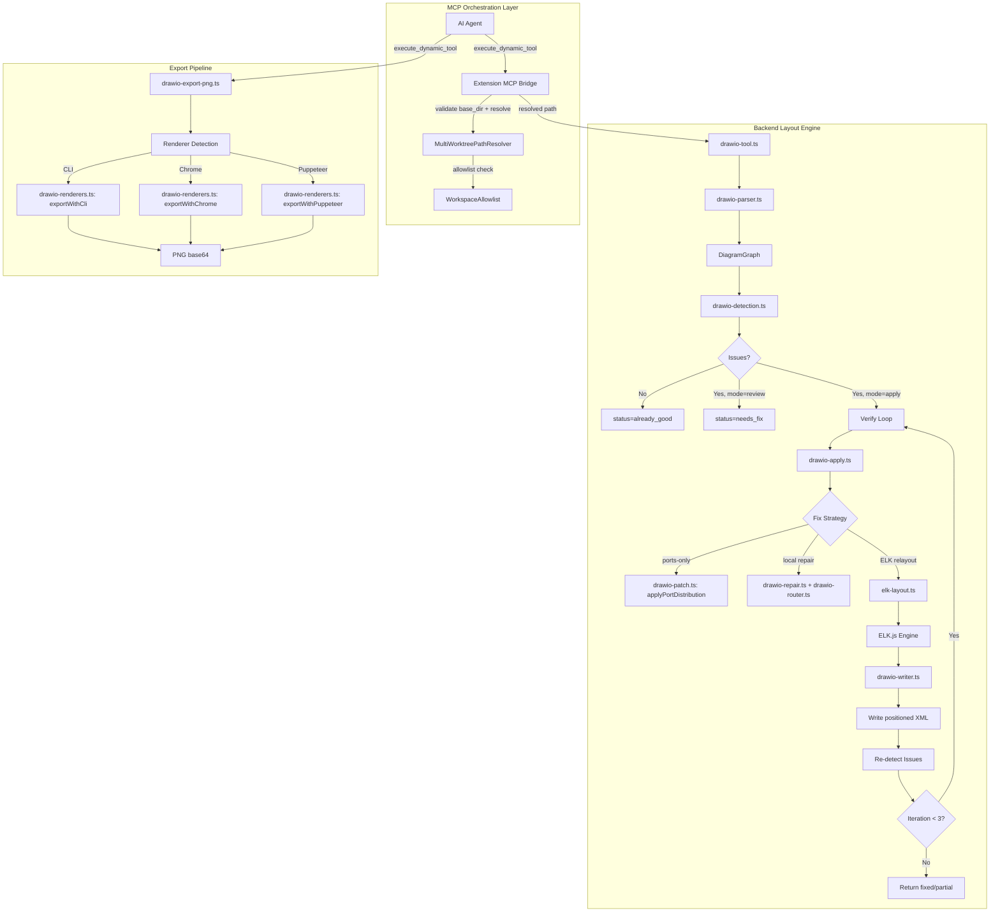

*[Edit in draw.io](diagrams/architecture.drawio)*

### 2.2 Component Diagram

```mermaid
graph TB
    subgraph "Shared Infrastructure (backend/src/shared/)"
        SA1[MultiWorktreePathResolver] --> SA2[WorkspaceAllowlist]
        SA1 --> SA3[path-safety.ts]
        SA1 --> SA4[path-resolution-types.ts]
        SA5[base-dir-schema.ts] -.-> SA1
    end

    subgraph "Draw.io Layout Engine (backend/src/engine/tools/)"
        DT1[drawio-tool.ts] --> DT2[drawio-parser.ts]
        DT1 --> DT3[drawio-detection.ts]
        DT1 --> DT4[drawio-apply.ts]
        DT3 --> DT5[drawio-detect.ts]
        DT3 --> DT6[drawio-detect-edges.ts]
        DT3 --> DT7[drawio-geometry.ts]
        DT3 --> DT8[drawio-style.ts]
        DT4 --> DT9[elk-layout.ts]
        DT4 --> DT10[drawio-repair.ts]
        DT4 --> DT11[drawio-patch.ts]
        DT4 --> DT12[drawio-writer.ts]
        DT4 --> DT13[drawio-router.ts]
        DT9 --> DT14[ELK.js (dynamic import)]
        DT10 --> DT13
        DT10 --> DT7
        DT11 --> DT15[drawio-xml-utils.ts]
        DT11 --> DT16[drawio-ports.ts]
    end

    subgraph "Export Pipeline (backend/src/engine/tools/)"
        DE1[drawio-export-png.ts] --> DE2[drawio-renderers.ts]
        DE2 --> DE3[findDrawioCli]
        DE2 --> DE4[exportWithCli]
        DE2 --> DE5[exportWithChrome]
        DE2 --> DE6[exportWithPuppeteer]
        DE1 --> SA1
    end

    subgraph "MCP Integration (backend/src/engine/tools/)"
        MI1[register-tools.ts] --> DT1
        MI1 --> DE1
        MI1 --> SA1
        MI2[CodeIntelContext] --> MI1
    end

    style SA1 fill:#e1f5fe
    style DT1 fill:#fff3e0
    style DE1 fill:#fff3e0
    style DT9 fill:#f3e5f5
```

*[Edit in draw.io](diagrams/component.drawio)*

### 2.3 Module Responsibilities

| Module | File | Responsibility | Key Exports |
|--------|------|----------------|-------------|
| **Main Entry** | `drawio-tool.ts` | Path resolution, orchestration, detect→fix pipeline | `handleDrawioLayout`, `DRAWIO_TOOL_DEFINITION` |
| **Parser** | `drawio-parser.ts` | Regex-based XML → DiagramGraph (nodes, edges, containers) | `parseDrawio`, `DiagramGraph`, `DiagramNode`, `DiagramEdge` |
| **Detector (Nodes)** | `drawio-detect.ts` | Node overlaps, proximity, child containment, diagonals | `detectAllIssues`, `detectNodeOverlaps`, `MIN_GAP`, `OVERLAP_EPS` |
| **Detector (Edges)** | `drawio-detect-edges.ts` | Edge-node crossings, edge-edge crossings, edge-container crossings | `edgeNodeCrossings`, `edgeEdgeCrossings`, `edgeContainerCrossings` |
| **Geometry** | `drawio-geometry.ts` | Absolute rects, overlap ratio, segment-rect intersection, polyline math | `absoluteRects`, `overlapRatio`, `segIntersectsRect`, `computeRoute` |
| **Style Detection** | `drawio-style.ts` | Sequence lifelines, fragment frames detection | `isSequenceLifeline`, `isFragmentFrame` |
| **Fix Orchestrator** | `drawio-apply.ts` | Strategy selection (ports→local→ELK), verify loop, re-parse validation | `handleApply`, `normalizeLayoutArgs`, `violationRatio` |
| **ELK Integration** | `elk-layout.ts` | ELK graph building, algorithm mapping, layout execution, output validation | `buildElkGraph`, `runElkLayout`, `mapAlgorithm`, `loadElk` |
| **Local Repair** | `drawio-repair.ts` | Push-apart, container clamping, edge rerouting | `planLocalRepair`, `RepairPlan` |
| **XML Patching** | `drawio-patch.ts` | Apply repair plan, port distribution | `applyRepairPlan`, `applyPortDistribution` |
| **XML Writer** | `drawio-writer.ts` | ELK positions → draw.io XML (geometry, waypoints, anchors) | `applyLayoutToXml` |
| **XML Utilities** | `drawio-xml-utils.ts` | Low-level XML string manipulation | `replaceCellGeometryXy`, `setEdgePointsXml`, `upsertEdgeStyleKeys` |
| **Edge Router** | `drawio-router.ts` | Orthogonal routing (L-shape, Z-shape with 30px offset) | `computeRoute`, `routeEdges` |
| **Port Distribution** | `drawio-ports.ts` | Spread exit/entry anchors for edges | `distributePorts` |
| **Layout Models** | `drawio-layout-models.ts` | TypeScript interfaces for ElkNode, ElkEdge, NormalizedArgs | `ElkNode`, `ElkEdge`, `NormalizedArgs` |
| **Export PNG** | `drawio-export-png.ts` | Base64 XML → PNG via CLI/Chrome/Puppeteer fallback | `handleDrawioExportPng`, `DRAWIO_EXPORT_PNG_DEFINITION` |
| **Renderers** | `drawio-renderers.ts` | CLI, Chrome DevTools MCP, Puppeteer MCP implementations | `exportWithCli`, `exportWithChrome`, `exportWithPuppeteer` |
| **Path Resolver** | `multi-worktree-path-resolver.ts` | `base_dir` extraction, allowlist, existence, resolution, containment | `MultiWorktreePathResolver`, `hasBaseDirArg` |
| **Workspace Allowlist** | `workspace-allowlist.ts` | Startup parsing of MCP_WORKSPACE_ROOTS, O(1) membership | `WorkspaceAllowlist` |
| **Path Safety** | `path-safety.ts` | Relative path validation, containment check | `isPathSafe`, `isWithinRoot`, `resolveWithinWorkspace` |
| **Schema Fragment** | `base-dir-schema.ts` | Shared JSON schema for `base_dir`/`workspace_root` | `baseDirSchemaProperties` |

### 2.4 Deployment Architecture

```mermaid
graph TB
    subgraph "AI Agent Process"
        A[BA/SA/QA/DevOps Agent]
    end

    subgraph "Extension Host (VS Code / OpenCode)"
        B[Extension MCP Bridge]
        B --> C[find_tools / execute_dynamic_tool]
    end

    subgraph "MCP Orchestration Engine (Node.js)"
        D[Orchestration Server]
        D --> E[Tool Registry]
        D --> F[Upstream Servers]
        F --> G[chrome-devtools-mcp]
        F --> H[puppeteer-mcp]
    end

    subgraph "Backend Process (Node.js)"
        I[Backend HTTP Server]
        I --> J[Code Intel Module]
        J --> K[Tool Dispatcher]
        K --> L[drawio_auto_layout]
        K --> M[drawio_export_png]
        L --> N[ELK.js Layout Engine]
        M --> O[Renderer Detection]
        O --> P[draw.io CLI]
        O --> G
        O --> H
    end

    subgraph "File System"
        Q[Workspace Roots (Allowlist)]
        Q --> R[Worktree A]
        Q --> S[Worktree B]
        Q --> T[Worktree N]
    end

    A --> B
    B --> D
    D --> I
    L --> Q
    M --> Q
    N -.-> U[elkjs npm package]
```

*[Edit in draw.io](diagrams/deployment.drawio)*

---

## 3. API Design

### 3.1 Tool: drawio_auto_layout

#### 3.1.1 Tool Definition

```json
{
  "name": "drawio_auto_layout",
  "description": "Analyze and auto-fix draw.io diagram layout. Detects overlaps, crossings, diagonal edges — fixes automatically with ELK layout engine if issues found. Supports verify loop (up to 3 iterations) and multi-worktree path resolution via base_dir.",
  "inputSchema": {
    "type": "object",
    "properties": {
      "file_path": { "type": "string", "description": "Path to .drawio file (relative to base_dir or absolute)" },
      "base_dir": { "type": "string", "description": "Optional workspace root to resolve relative file_path against. Must be registered in MCP_WORKSPACE_ROOTS allowlist. Example: /home/user/project-worktree-B" },
      "workspace_root": { "type": "string", "description": "Deprecated alias of base_dir (same semantics). Ignored when base_dir is present." },
      "mode": { "type": "string", "enum": ["review", "apply"], "description": "Detection-only (review) or auto-fix with verify loop (apply). Default: review" },
      "algorithm": { "type": "string", "enum": ["layered", "stress", "force", "radial"], "description": "ELK layout algorithm. Default: layered" },
      "spacing": { "type": "number", "description": "Base node spacing in pixels (1-500). Default: 80" },
      "direction": { "type": "string", "enum": ["DOWN", "RIGHT", "LEFT", "UP"], "description": "Layout direction. Default: DOWN" },
      "container_margin": { "type": "number", "description": "Margin inside containers in pixels (>=0). Default: 40" },
      "overlap_threshold": { "type": "number", "description": "Overlap ratio threshold (0, 0.5]. Default: 0.05 (5%)" },
      "gap_threshold": { "type": "number", "description": "Minimum edge-to-node clearance in pixels (>=10). Default: 40" },
      "detect_overlaps": { "type": "boolean", "description": "Enable overlap detection. Default: true" },
      "detect_crossings": { "type": "boolean", "description": "Enable edge crossing detection. Default: true" },
      "detect_diagonals": { "type": "boolean", "description": "Enable diagonal edge detection. Default: true" },
      "max_iterations": { "type": "number", "description": "Maximum verify loop iterations [1,5]. Default: 3" },
      "spacing_increment": { "type": "number", "description": "Spacing increase % per iteration [10,50]. Default: 20" },
      "relayout": { "type": "boolean", "description": "Force full ELK relayout. Default: false" },
      "scope": { "type": "string", "enum": ["auto", "positions", "ports"], "description": "Fix strategy scope. Default: auto" },
      "auto_fix": { "type": "boolean", "description": "Legacy alias for mode=apply. Default: false" },
      "elk_options": { "type": "object", "description": "Raw ELK.js options for advanced tuning" }
    },
    "required": ["file_path"]
  }
}
```

#### 3.1.2 Request Parameters

| Parameter | Type | Required | Default | Validation | Description |
|-----------|------|----------|---------|------------|-------------|
| file_path | string | Yes | — | Must end with .drawio (if provided); resolved via base_dir or primary workspace | Path to diagram file |
| base_dir | string | No | — | Absolute path; must be in workspace allowlist; must exist on FS | Multi-worktree workspace root |
| workspace_root | string | No | — | Deprecated alias for base_dir | Legacy compatibility |
| mode | string | No | "review" | Must be "review" or "apply" | Detection or auto-fix mode |
| algorithm | string | No | "layered" | Must be one of: layered, stress, force, radial | ELK layout algorithm |
| spacing | number | No | 80 | Integer > 0, ≤ 500 | Node spacing in pixels |
| direction | string | No | "DOWN" | Must be one of: DOWN, RIGHT, LEFT, UP | Layout direction |
| container_margin | number | No | 40 | Integer ≥ 0 | Container inner margin |
| overlap_threshold | number | No | 0.05 | Range (0, 0.5] | Overlap sensitivity |
| gap_threshold | number | No | 40 | Integer ≥ 10 | Edge-to-node gap |
| detect_overlaps | boolean | No | true | — | Enable overlap detection |
| detect_crossings | boolean | No | true | — | Enable crossing detection |
| detect_diagonals | boolean | No | true | — | Enable diagonal detection |
| max_iterations | number | No | 3 | Integer [1, 5] | Verify loop max iterations |
| spacing_increment | number | No | 20 | Integer [10, 50] | Spacing increase % per iteration |
| relayout | boolean | No | false | — | Force full ELK relayout |
| scope | string | No | "auto" | Must be "auto", "positions", or "ports" | Fix strategy scope |
| auto_fix | boolean | No | false | — | Legacy alias for mode=apply |
| elk_options | object | No | {} | Passed through to ELK.js | Advanced ELK tuning |

#### 3.1.3 Response Schema

```json
{
  "type": "object",
  "properties": {
    "status": { "type": "string", "enum": ["already_good", "needs_fix", "fixed", "partial", "error"] },
    "message": { "type": "string" },
    "nodes": { "type": "integer", "description": "Total node count (nodes + containers)" },
    "edges": { "type": "integer", "description": "Total edge count" },
    "issues": {
      "type": "array",
      "items": {
        "type": "object",
        "properties": {
          "type": { "type": "string", "enum": ["node_overlap", "node_proximity", "child_outside_container", "node_containment_hint", "edge_crossing", "edge_edge_crossing", "edge_container_crossing", "diagonal_edge", "stacked_edges"] },
          "severity": { "type": "string", "enum": ["high", "medium", "low"] },
          "node_a": { "type": "string" },
          "node_b": { "type": "string" },
          "child": { "type": "string" },
          "container": { "type": "string" },
          "edge_id": { "type": "string" },
          "edge_source": { "type": "string" },
          "edge_target": { "type": "string" },
          "crosses_node": { "type": "string" },
          "crosses_container": { "type": "string" },
          "ratio": { "type": "number" },
          "gap": { "type": "number" },
          "fix_hint": { "type": "string" }
        }
      }
    },
    "repositioned_nodes": { "type": "array", "items": { "type": "string" } },
    "remaining_issues": { "type": "integer" },
    "iteration_history": {
      "type": "array",
      "items": {
        "type": "object",
        "properties": {
          "iteration": { "type": "integer" },
          "issues_before": { "type": "integer" },
          "issues_after": { "type": "integer" },
          "strategy": { "type": "string", "enum": ["ports", "local", "elk"] }
        }
      }
    },
    "strategy_used": { "type": "string", "enum": ["ports", "local", "elk"] },
    "effective_root": { "type": "string" },
    "root_source": { "type": "string", "enum": ["legacy", "base_dir"] },
    "error": { "type": "string" }
  }
}
```

#### 3.1.4 Response Examples

**Success - Already Good (mode=review):**
```json
{
  "status": "already_good",
  "message": "Diagram looks good — no overlapping nodes or edge crossings detected.",
  "nodes": 12,
  "edges": 15,
  "issues": [],
  "effective_root": "/home/user/project",
  "root_source": "legacy"
}
```

**Success - Needs Fix (mode=review):**
```json
{
  "status": "needs_fix",
  "message": "Found 3 layout issues requiring attention.",
  "nodes": 12,
  "edges": 15,
  "issues": [
    {
      "type": "node_overlap",
      "severity": "high",
      "node_a": "node-1",
      "node_b": "node-2",
      "ratio": 0.08,
      "fix_hint": "Move 'node-2' away from 'node-1' (overlap 8%)."
    },
    {
      "type": "edge_crossing",
      "severity": "high",
      "edge_id": "edge-5",
      "edge_source": "node-3",
      "edge_target": "node-4",
      "crosses_node": "node-5",
      "fix_hint": "Edge 'edge-5' (node-3→node-4) cuts through 'node-5'."
    }
  ],
  "effective_root": "/home/user/project-worktree-B",
  "root_source": "base_dir"
}
```

**Success - Fixed (mode=apply):**
```json
{
  "status": "fixed",
  "message": "Fixed 3 issues with ELK layered layout. 8 nodes repositioned.",
  "nodes": 12,
  "edges": 15,
  "issues": [],
  "repositioned_nodes": ["node-1", "node-2", "node-3", "node-4", "node-5", "node-6", "node-7", "node-8"],
  "remaining_issues": 0,
  "iteration_history": [
    { "iteration": 1, "issues_before": 3, "issues_after": 0, "strategy": "elk" }
  ],
  "strategy_used": "elk",
  "effective_root": "/home/user/project-worktree-B",
  "root_source": "base_dir"
}
```

**Success - Partial (mode=apply, max iterations reached):**
```json
{
  "status": "partial",
  "message": "Fixed 2 of 3 issues after 3 iterations. 1 high-severity issue remains.",
  "nodes": 12,
  "edges": 15,
  "issues": [
    { "type": "node_overlap", "severity": "high", ... }
  ],
  "repositioned_nodes": ["node-1", "node-2", "node-3"],
  "remaining_issues": 1,
  "iteration_history": [
    { "iteration": 1, "issues_before": 3, "issues_after": 2, "strategy": "elk" },
    { "iteration": 2, "issues_before": 2, "issues_after": 1, "strategy": "elk" },
    { "iteration": 3, "issues_before": 1, "issues_after": 1, "strategy": "elk" }
  ],
  "strategy_used": "elk",
  "effective_root": "/home/user/project-worktree-B",
  "root_source": "base_dir"
}
```

**Error - Path Rejected:**
```json
{
  "error": "PATH_REJECTED_OUTSIDE_ALLOWLIST: Workspace root '/mnt/external' is not registered in the allowlist. Configure MCP_WORKSPACE_ROOTS to include this path.",
  "effective_root": "/mnt/external",
  "root_source": "base_dir"
}
```

#### 3.1.5 HTTP Status Codes (MCP Tool Response)

| Status | Condition |
|--------|-----------|
| 200 (success in JSON) | Tool executed successfully (status field indicates result) |
| 400 (error in JSON) | Invalid input parameters, file not found, path traversal |
| 500 (error in JSON) | Internal server error (ELK failure, renderer unavailable) |

#### 3.1.6 Rate Limiting

Inherited from MCP orchestration engine rate limiter (default: 60 req/min per client).

---

### 3.2 Tool: drawio_export_png

#### 3.2.1 Tool Definition

```json
{
  "name": "drawio_export_png",
  "description": "Export .drawio XML content (base64) to PNG. Returns output_base64 (PNG bytes). Priority: 1) draw.io CLI, 2) chrome-devtools-mcp, 3) puppeteer-mcp. Supports multi-worktree path resolution via base_dir for reference file_path.",
  "inputSchema": {
    "type": "object",
    "properties": {
      "content_base64": { "type": "string", "description": "Base64-encoded .drawio XML content" },
      "file_path": { "type": "string", "description": "Original file path (reference only, validated via base_dir if provided)" },
      "base_dir": { "type": "string", "description": "Optional workspace root to resolve relative file_path against. Must be registered in MCP_WORKSPACE_ROOTS allowlist." },
      "workspace_root": { "type": "string", "description": "Deprecated alias of base_dir (same semantics). Ignored when base_dir is present." }
    },
    "required": ["content_base64"]
  }
}
```

#### 3.2.2 Request Parameters

| Parameter | Type | Required | Validation | Description |
|-----------|------|----------|------------|-------------|
| content_base64 | string | Yes | Valid base64 | XML content to render |
| file_path | string | No | If provided with base_dir: validated through resolver | Reference file path |
| base_dir | string | No | Must be in allowlist, must exist on FS | Multi-worktree workspace root |
| workspace_root | string | No | Deprecated alias | Legacy compatibility |

#### 3.2.3 Response Schema

```json
{
  "type": "object",
  "properties": {
    "success": { "type": "boolean" },
    "output_base64": { "type": "string", "description": "PNG bytes as base64" },
    "size_bytes": { "type": "integer" },
    "renderer": { "type": "string", "enum": ["drawio-cli", "chrome-devtools-mcp", "puppeteer-mcp"] },
    "error": { "type": "string" }
  }
}
```

#### 3.2.4 Response Examples

**Success:**
```json
{
  "success": true,
  "output_base64": "iVBORw0KGgoAAAANSUhEUgAA...",
  "size_bytes": 45231,
  "renderer": "drawio-cli"
}
```

**Error - No Renderer:**
```json
{
  "success": false,
  "error": "Export failed: No renderer available. Install draw.io desktop or configure chrome-devtools-mcp."
}
```

---

## 4. Database Design

### 4.1 Data Model Overview

The drawio tools are stateless per-call — no persistent database. All state is in-memory during tool execution. The following logical entities represent the in-memory data structures:

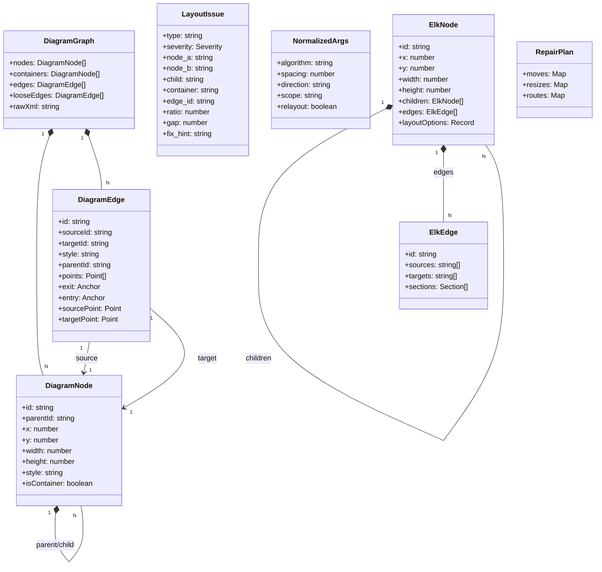

*[Edit in draw.io](diagrams/data-model.drawio)*

### 4.2 Entity Definitions

#### 4.2.1 DiagramGraph

| Attribute | Type | Description |
|-----------|------|-------------|
| nodes | DiagramNode[] | Content nodes (non-container) |
| containers | DiagramNode[] | Container nodes (swimlanes, groups) |
| edges | DiagramEdge[] | Edges connecting nodes/containers |
| looseEdges | DiagramEdge[] | Edges without source/target (point-only) |
| rawXml | string | Original mxGraphModel XML |

#### 4.2.2 DiagramNode

| Attribute | Type | Description |
|-----------|------|-------------|
| id | string | mxCell @id |
| parentId | string | mxCell @parent ("1" = root) |
| x | number | mxGeometry @x (relative to parent) |
| y | number | mxGeometry @y (relative to parent) |
| width | number | mxGeometry @width |
| height | number | mxGeometry @height |
| style | string | mxCell @style |
| isContainer | boolean | True for swimlanes/groups |

#### 4.2.3 DiagramEdge

| Attribute | Type | Description |
|-----------|------|-------------|
| id | string | mxCell @id |
| sourceId | string | mxCell @source |
| targetId | string | mxCell @target |
| style | string | mxCell @style |
| parentId | string | Parent cell id (waypoints relative to this) |
| points | Point[] | Stored waypoints (relative to edge parent) |
| exit | Anchor | exitX/exitY fractions |
| entry | Anchor | entryX/entryY fractions |
| sourcePoint | Point | Stored terminal hint (as="sourcePoint") |
| targetPoint | Point | Stored terminal hint (as="targetPoint") |

#### 4.2.4 LayoutIssue

| Attribute | Type | Description |
|-----------|------|-------------|
| type | string | Issue type (see Issue Types table) |
| severity | string | high / medium / low |
| node_a | string | First node ID (overlap, proximity) |
| node_b | string | Second node ID (overlap, proximity) |
| child | string | Child node ID (containment) |
| container | string | Container ID (containment) |
| edge_id | string | Edge ID (crossings, stacked) |
| edge_source | string | Edge source node ID |
| edge_target | string | Edge target node ID |
| crosses_node | string | Node ID crossed by edge |
| crosses_container | string | Container ID crossed by edge |
| ratio | number | Overlap ratio (0-1) |
| gap | number | Gap in pixels (proximity, gap threshold) |
| fix_hint | string | Actionable suggestion |

**Issue Types & Severity:**

| Type | Severity | Auto-Fix | Description |
|------|----------|----------|-------------|
| node_overlap | high | Yes | Node intersection > 5% |
| child_outside_container | high | Yes | Child escapes container bounds |
| edge_crossing | high | Yes | Edge cuts through unrelated node |
| edge_edge_crossing | medium | Yes | Two edges cross mid-air |
| stacked_edges | medium | Yes | Parallel edges overlap |
| edge_container_crossing | low | No | Edge passes over unrelated container |
| node_proximity | low | No | Siblings < 40px apart (cosmetic) |
| node_containment_hint | low | No | Full containment — suggest parenting |
| diagonal_edge | low | No | Both dx,dy > 20px (cosmetic) |

#### 4.2.5 NormalizedArgs

| Attribute | Type | Default | Validation | Description |
|-----------|------|---------|------------|-------------|
| algorithm | string | "layered" | layered\|stress\|force\|radial | ELK algorithm |
| spacing | number | 80 | 1-500 | Node spacing |
| direction | string | "DOWN" | DOWN\|RIGHT\|LEFT\|UP | Layout direction |
| scope | string | "auto" | auto\|positions\|ports | Fix strategy |
| relayout | boolean | false | — | Force full ELK relayout |

#### 4.2.6 ElkNode

| Attribute | Type | Description |
|-----------|------|-------------|
| id | string | Node identifier |
| x | number | Computed X position (optional) |
| y | number | Computed Y position (optional) |
| width | number | Node width |
| height | number | Node height |
| children | ElkNode[] | Child nodes (for containers) |
| edges | ElkEdge[] | Internal edges |
| layoutOptions | Record<string,string\|number> | ELK-specific options |

#### 4.2.7 ElkEdge

| Attribute | Type | Description |
|-----------|------|-------------|
| id | string | Edge identifier |
| sources | string[] | Source node IDs (single in practice) |
| targets | string[] | Target node IDs (single in practice) |
| sections | Section[] | ELK route sections (bendPoints, startPoint, endPoint) |

---

## 5. Class/Module Design

### 5.1 Package Structure

```
backend/src/
├── engine/
│   └── tools/
│       ├── drawio-tool.ts              # Main entry point
│       ├── drawio-parser.ts            # XML → DiagramGraph
│       ├── drawio-detection.ts         # Re-exports detectAllIssues
│       ├── drawio-detect.ts            # Node detectors (overlaps, proximity, containment, diagonals)
│       ├── drawio-detect-edges.ts      # Edge detectors (crossings, container crossings)
│       ├── drawio-geometry.ts          # Geometric primitives (Rect, Point, overlap, intersection)
│       ├── drawio-style.ts             # Style detection (lifelines, fragments)
│       ├── drawio-apply.ts             # Fix orchestrator + verify loop
│       ├── elk-layout.ts               # ELK.js integration
│       ├── drawio-repair.ts            # Local repair planner
│       ├── drawio-patch.ts             # XML patching (repair plan, port distribution)
│       ├── drawio-writer.ts            # ELK positions → XML
│       ├── drawio-xml-utils.ts         # Low-level XML string manipulation
│       ├── drawio-router.ts            # Orthogonal edge routing (L-shape, Z-shape)
│       ├── drawio-ports.ts             # Port distribution
│       ├── drawio-layout-models.ts     # TypeScript interfaces
│       ├── drawio-export-png.ts        # PNG export handler
│       ├── drawio-renderers.ts         # Renderer implementations
│       ├── register-tools.ts           # Tool registry & dispatcher
│       └── __tests__/                  # Unit & integration tests
└── shared/
    ├── multi-worktree-path-resolver.ts # Path resolution with base_dir
    ├── workspace-allowlist.ts          # Allowlist management
    ├── path-safety.ts                  # Path validation helpers
    ├── path-resolution-types.ts        # Result/error types
    ├── path-resolver-provider.ts       # Shared resolver singleton
    ├── base-dir-schema.ts              # Schema fragment for base_dir
    └── legacy-path-gate.ts             # Legacy pinned-root gate
```

### 5.2 Key Interfaces & Abstract Classes

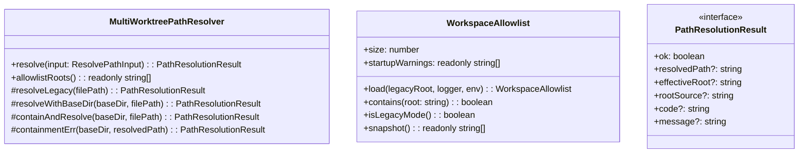

### 5.3 Design Patterns Used

| Pattern | Module | Description |
|---------|--------|-------------|
| **Strategy** | `drawio-apply.ts` | Fix strategy selection: ports-only → local repair → ELK relayout |
| **Chain of Responsibility** | `drawio-renderers.ts` | Renderer fallback chain: CLI → Chrome → Puppeteer |
| **Factory** | `elk-layout.ts` | `loadElk()` dynamic import with caching |
| **Builder** | `elk-layout.ts` | `buildElkGraph()` constructs ElkNode hierarchy |
| **Command** | `drawio-patch.ts` | `applyRepairPlan()`, `applyPortDistribution()` as string transform commands |
| **Singleton** | `path-resolver-provider.ts` | Shared `MultiWorktreePathResolver` instance |
| **Adapter** | `drawio-renderers.ts` | Adapts different renderer APIs to common interface |
| **Template Method** | `drawio-repair.ts` | `planLocalRepair()` orchestrates push-apart → contain → reroute |
| **Decorator** | `drawio-writer.ts` | `applyLayoutToXml()` decorates raw XML with positions |

### 5.4 Dependency Injection Configuration

```typescript
// register-tools.ts: CodeIntelContext injected into every handler
interface CodeIntelContext {
  queryLayer: QueryLayer;
  adapter: DatabaseAdapter;
  dbManager: DatabaseManager | null;
  indexer: IndexingEngine;
  workspace: string;
  projectId?: string;
  resolver?: MultiWorktreePathResolver;  // SA4E-394: optional path resolver
}

// drawio-tool.ts & drawio-export-png.ts: resolver passed via context
export async function handleDrawioLayout(
  args: Record<string, unknown>,
  workspace: string,
  resolver?: MultiWorktreePathResolver  // Injected from context
): Promise<string>

// drawio-export-png.ts
export async function handleDrawioExportPng(
  args: Record<string, unknown>,
  workspace: string,
  orchestrationEngine?: any,
  resolver?: MultiWorktreePathResolver
): Promise<string>
```

### 5.5 Error Handling Strategy

| Layer | Strategy | Implementation |
|-------|----------|----------------|
| **Input Validation** | Fail-fast with descriptive errors | Zod schemas in tool definitions; runtime checks in handlers |
| **Path Resolution** | Error-as-value (never throw) | `PathResolutionResult` with `ok: boolean`; `err()` factory |
| **Detection** | Continue on partial failure | Try-catch per detector; log exception, continue others |
| **Layout (ELK)** | Timeout + fallback | `Promise.race` with 10s default; fallback to legacy layered |
| **File I/O** | Validate before write | `validateReparse()` writes to temp, parses, then writes to target |
| **Export** | Renderer fallback | Detect renderer at call time; try next on failure |
| **Security** | Generic errors, audit log | No filesystem details in responses; pino warn for violations |

**Exception Hierarchy:**

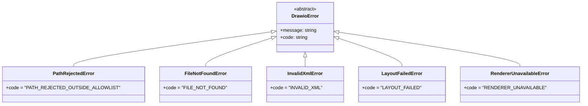

---

## 6. Integration Design

### 6.1 External System: ELK.js Layout Engine

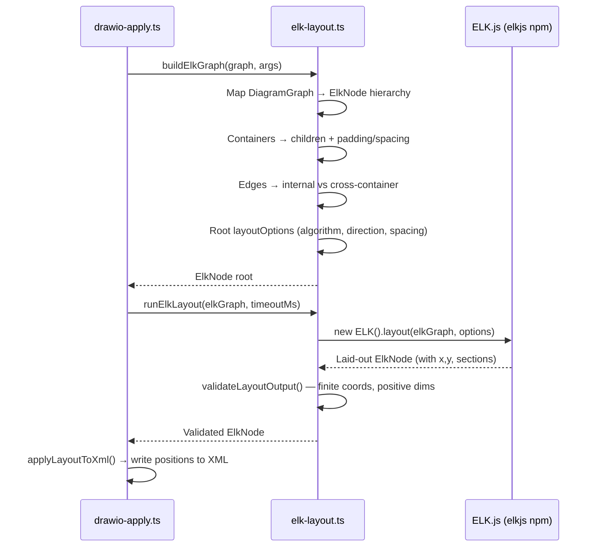

| Aspect | Detail |
|--------|--------|
| **Direction** | Outbound (backend → ELK.js library) |
| **Data Format** | JavaScript objects (ElkNode/ElkEdge) → ELK.js API |
| **Frequency** | On-demand (per tool call) |
| **Timeout** | 10s default (SA4E_ELK_TIMEOUT_MS env, 1-60s) |
| **Max Nodes** | 500 default (SA4E_ELK_MAX_NODES env, 1-5000) |
| **Fallback** | Legacy layered algorithm if ELK init fails |

### 6.2 External System: draw.io Desktop CLI

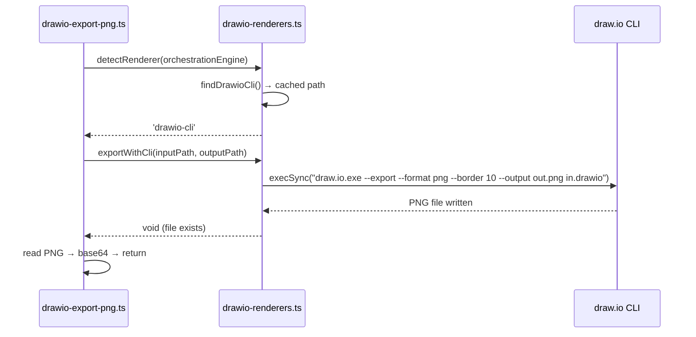

| Aspect | Detail |
|--------|--------|
| **Direction** | Outbound (backend → local process) |
| **Command** | `"draw.io.exe" --export --format png --border 10 --output "out.png" "in.drawio"` |
| **Timeout** | 30s (hardcoded in `execSync`) |
| **StdIO** | Piped (no output leakage) |
| **Fallback** | Chrome DevTools MCP → Puppeteer MCP |

### 6.3 External System: Chrome DevTools MCP

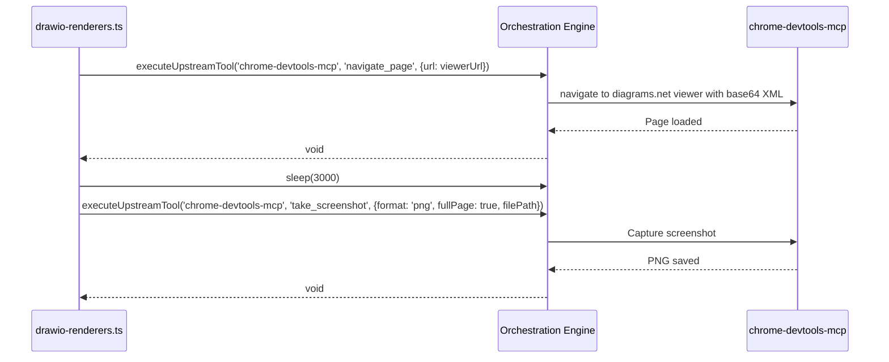

| Aspect | Detail |
|--------|--------|
| **Direction** | Outbound via orchestration engine |
| **Viewer URL** | `https://viewer.diagrams.net/?lightbox=1&nav=0#R{base64-xml}` |
| **Wait** | 3s for rendering |
| **Screenshot** | Full page, PNG format |

### 6.4 External System: Puppeteer MCP

| Aspect | Detail |
|--------|--------|
| **Direction** | Outbound via orchestration engine |
| **Tools Called** | `navigate`, `screenshot` |
| **Viewer URL** | Same as Chrome DevTools MCP |
| **Fallback Order** | CLI → Chrome → Puppeteer |

### 6.5 Integration: Workspace Allowlist (SA4E-394)

| Aspect | Detail |
|--------|--------|
| **Configuration** | `MCP_WORKSPACE_ROOTS` env var (delimiter-separated) or `MCP_WORKSPACE_ROOTS_FILE` (line-based) |
| **Loading** | Once at startup (`WorkspaceAllowlist.load()`) |
| **Membership** | O(1) Set lookup with win32 case-fold |
| **Realpath** | Resolved for existing paths |
| **Legacy Mode** | Empty allowlist → single-root mode (pinned workspace) |

---

## 7. Security Design

### 7.1 Threat Model: Path Traversal (CWE-22)

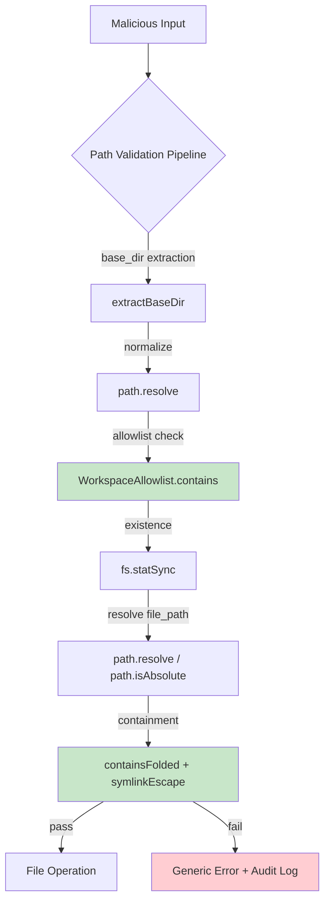

*[Edit in draw.io](diagrams/security.drawio)*

### 7.2 Defense Layers

| Layer | Mechanism | Code Location |
|-------|-----------|---------------|
| **1. Input Validation** | Reject non-string, empty, NUL bytes | `extractBaseDir`, `containAndResolve` |
| **2. Canonicalization** | `path.resolve()` eliminates `..` | `resolveWithBaseDir`, `containAndResolve` |
| **3. Allowlist Check** | O(1) Set membership (win32 case-fold) | `WorkspaceAllowlist.contains()` |
| **4. Existence Check** | `fs.statSync().isDirectory()` | `isDirectory()` |
| **5. Containment** | Separator-boundary + case-fold | `containsFolded()` |
| **6. Symlink Resolution** | `fs.realpathSync()` on deepest ancestor | `symlinkEscape()` |
| **7. Generic Errors** | No path details in response | `error()` / `jsonError()` functions |
| **8. Audit Logging** | pino warn with sanitized path | `log.warn({path: sanitizePathText(...)}, ...)` |

### 7.3 Validation Rules

| Rule | Implementation | Test Case |
|------|----------------|-----------|
| Reject `..` traversal | `path.resolve()` + `containsFolded()` | `file_path="..\\..\\etc\\passwd"` → rejected |
| Reject absolute outside allowlist | `containsFolded()` | `file_path="C:\\Windows\\System32"` → rejected |
| Reject NUL bytes | `trimmed.includes('\0')` | `file_path="diagrams\0secret.txt"` → rejected |
| Symlink escape prevention | `symlinkEscape()` before containment | Symlink pointing outside workspace → rejected |
| Win32 case-fold parity | `foldKey()` in allowlist + `containsFolded()` | `C:\Project` vs `c:\project` → match |
| Generic error messages | `PATH_REJECTED_OUTSIDE_ALLOWLIST` without paths | Response: "File path not allowed: path traversal detected" |

### 7.4 Authentication & Authorization

- **MCP Layer**: JWT authentication via `jwtAuth` middleware (workspaceId from `wid` claim)
- **Rate Limiting**: `rateLimiter` middleware (60 req/min default)
- **Transport**: HTTP/JSON-RPC over localhost (extension bridge) or stdio (MCP)
- **Tool-Level**: No additional auth — workspace isolation via allowlist

### 7.5 Data Encryption

- **At Rest**: Not applicable (no persistent database for drawio tools)
- **In Transit**: localhost HTTP (extension bridge) or stdio (MCP) — no TLS required
- **Content**: Base64 encoding for XML/PNG passthrough (not encryption)

### 7.6 Audit Logging

```typescript
// Security audit log entry (pino warn level)
logger.warn({
  attempted_path: sanitizePathText(resolvedPath),
  effective_root: sanitizePathText(baseDir),
  client_info: 'drawio-auto-layout',
  error_code: 'PATH_REJECTED_OUTSIDE_ALLOWLIST',
  workspace_root: baseDir
}, 'Path traversal attempt rejected');
```

---

## 8. Performance & Scalability

### 8.1 Performance Targets

| Operation | Target | Measurement |
|-----------|--------|-------------|
| Detection (50 nodes) | < 500ms | `detectAllIssues()` |
| Verify Loop (3 iterations) | < 2s | Full pipeline × 3 |
| ELK Layout (Layered/Force, 50 nodes) | < 1s | `runElkLayout()` |
| ELK Layout (Stress, 30 nodes) | < 1s | `runElkLayout()` |
| PNG Export (CLI) | < 30s | `execSync` timeout |
| Path Resolution | < 10ms | `MultiWorktreePathResolver.resolve()` |

### 8.2 Caching Strategy

| Cache | Scope | Invalidation |
|-------|-------|--------------|
| ELK Constructor | Module-level (`elkConstructor` promise) | Process restart |
| draw.io CLI Path | Module-level (`_cachedDrawioCliPath`) | `resetRendererCache()` |
| Renderer Type | Module-level (`cachedRenderer`) | `resetRendererCache()` |
| Workspace Allowlist | Startup (immutable) | Process restart |

### 8.3 Connection Pooling

Not applicable — stateless per-call, no persistent connections.

### 8.4 Query Optimization

- **Detection**: O(n²) node pairs → acceptable for ≤50 nodes (1,225 comparisons)
- **Edge Crossings**: O(e²) edge pairs → acceptable for typical diagrams
- **ELK Graph Build**: O(n + e) — single pass over nodes/edges
- **Absolute Rects**: Memoized recursion with cycle guard

### 8.5 Horizontal Scaling

- **Stateless**: Each tool call independent — can run in parallel
- **MCP Orchestration**: Handles load balancing across backend instances
- **ELK.js**: In-process — no external service to scale

### 8.6 Resource Limits (Configurable via Env)

| Variable | Default | Range | Purpose |
|----------|---------|-------|---------|
| SA4E_ELK_MAX_NODES | 500 | 1-5000 | Prevent OOM on large diagrams |
| SA4E_ELK_TIMEOUT_MS | 10000 | 1000-60000 | Prevent hung layout |
| MAX_SPACING | 500 | Hardcoded | Prevent canvas overflow |

---

## 9. Monitoring & Observability

### 9.1 Logging Standards

```typescript
// Structured logging with pino
const logger = pino({ name: 'drawio-tool' });

// Info: tool invocation
logger.info({ file_path, base_dir, mode, algorithm }, 'drawio_auto_layout invoked');

// Debug: path resolution
logger.debug({ resolved: sanitizePathText(resolvedPath) }, 'Path resolved');

// Warn: security events
logger.warn({ 
  attempted_path: sanitizePathText(resolvedPath),
  effective_root: sanitizePathText(baseDir),
  error_code: 'PATH_REJECTED_OUTSIDE_ALLOWLIST'
}, 'Path traversal attempt rejected');

// Error: layout failures
logger.error({ err: e.message, algorithm }, 'ELK layout failed');
```

### 9.2 Metrics to Collect

| Metric | Type | Labels |
|--------|------|--------|
| tool_invocation_total | Counter | tool=drawio_auto_layout\|drawio_export_png, status=success\|error |
| tool_duration_ms | Histogram | tool, mode (review/apply) |
| layout_issues_detected | Counter | type (overlap, crossing, etc.), severity |
| verify_loop_iterations | Histogram | max_iterations |
| elk_layout_duration_ms | Histogram | algorithm |
| renderer_used | Counter | renderer (cli/chrome/puppeteer) |
| path_rejected_total | Counter | code (allowlist/existence/containment/symlink) |

### 9.3 Health Check Endpoints

- **MCP Orchestration**: `/health` — returns server status, registered tools
- **Backend**: `/api/health` — returns module status, DB connectivity
- **Extension Bridge**: `tools/list` — returns available tools (includes drawio tools)

### 9.4 Alerting Thresholds

| Alert | Condition | Severity |
|-------|-----------|----------|
| High layout failure rate | >5% of calls return error in 5min | Warning |
| ELK timeout rate | >10% of layouts timeout | Warning |
| Path rejection spike | >50 rejections/min | Critical (possible attack) |
| Renderer unavailable | All 3 renderers fail | Critical |

---

## 10. Deployment

### 10.1 Environment Configuration

```bash
# Required for multi-worktree support
MCP_WORKSPACE_ROOTS=/home/user/project:/home/user/project-worktree-B:/home/user/project-worktree-C
# OR
MCP_WORKSPACE_ROOTS_FILE=/etc/mcp/workspace-roots.txt

# Optional ELK tuning
SA4E_ELK_MAX_NODES=500
SA4E_ELK_TIMEOUT_MS=10000

# Optional logging
LOG_LEVEL=info
```

### 10.2 Feature Flags

| Flag | Default | Description |
|------|---------|-------------|
| `mode=apply` | false (review) | Enable verify loop auto-fix |
| `algorithm` | "layered" | ELK algorithm selection |
| `relayout` | false | Force full ELK relayout |

### 10.3 Rollback Strategy

1. **Tool Version**: MCP tool definitions versioned — old versions still registered
2. **Configuration**: Env vars hot-reload not supported — restart required
3. **Code**: Git revert + rebuild + restart MCP orchestration

### 10.4 Database Migration

Not applicable — no database for drawio tools.

### 10.5 Runtime Profile (for UG Evidence)

| Aspect | Detail |
|--------|--------|
| **Start Command** | `npx tsx backend/src/server/HttpServer.ts` (or `npm run start` from package.json) |
| **Ports** | HTTP: 3000 (configurable via PORT env); MCP stdio for extension bridge |
| **Health Endpoint** | `GET /health` on HTTP server; `tools/list` via MCP |
| **Config File** | `opencode.json` for MCP server config; `.env` for environment variables |
| **Detect Running Instance** | `curl -s http://localhost:3000/health` or check MCP `tools/list` for `drawio_auto_layout` |

### 10.6 Screen Inventory (for UG Evidence)

| Screen/Command | Route/Path | Description |
|----------------|------------|-------------|
| MCP Tool List | `tools/list` via MCP | Shows registered tools including `drawio_auto_layout`, `drawio_export_png` |
| Tool Invocation | `execute_dynamic_tool` | Call tools with parameters |
| Diagram File | `documents/{TICKET}/diagrams/*.drawio` | Source diagrams |
| Exported PNG | `documents/{TICKET}/diagrams/*.png` | Rendered diagrams for embedding |

### 10.7 Feature Verification Points

| Feature | Verification Method |
|---------|---------------------|
| Detector Precision (5%) | Create diagram with 6% overlap → call `drawio_auto_layout` mode=review → verify `node_overlap` detected |
| Gap Threshold (40px) | Create edge passing 30px from node → verify `edge_crossing` with gap violation |
| Verify Loop (3 iterations) | Create diagram with persistent overlaps → call mode=apply → verify `iteration_history` length ≤3 |
| ELK Compound Layout | Create diagram with swimlanes → call with `algorithm=stress` → verify containers resize to encompass children |
| Multi-worktree Path | Register 2 worktrees in allowlist → call tool with `base_dir=worktree-B` → verify file resolved in worktree-B |
| Path Traversal Prevention | Call tool with `file_path=..\..\etc\passwd` → verify generic error returned |
| PNG Export | Call `drawio_export_png` with base64 XML → verify `output_base64` is valid PNG |

---

## 11. E2E Test Architecture

### 11.1 Framework & Language

- **Framework**: vitest (E2E-API) + Playwright (E2E-UI)
- **Language**: TypeScript (match project's main language)
- **API test client**: fetch / Hono `app.request()` against running server
- **Note**: Tests live in `backend/tests/`. All test code MUST use TypeScript to share types and utilities.

### 11.2 Test Structure

| Test Type | Location | Pattern |
|-----------|----------|---------|
| Unit tests | `backend/src/**/*.test.ts` | Fast, isolated, mock dependencies |
| Integration tests | `backend/tests/integration/*.it.test.ts` | Real dependencies (FS, ELK, parser) |
| E2E-API tests | `backend/tests/e2e/*.e2e.test.ts` | Full MCP tool invocation via HTTP |
| E2E-UI tests | `backend/tests/e2e/*.ui.e2e.test.ts` | Playwright browser automation |

### 11.3 Reusable Components

- **E2E Setup**: `backend/tests/e2e/setup/` — shared server start, DB seed, auth token generation
- **Helpers**: `backend/tests/e2e/helpers/` — `callTool()`, `assertLayoutFixed()`, `createTestDiagram()`
- **Fixtures**: `backend/tests/e2e/fixtures/` — sample .drawio files for each scenario

### 11.4 E2E-API Test Design for drawio_auto_layout

- **File**: `drawio-auto-layout.e2e.test.ts`
- **Test Cases**:
  1. `detects 5% overlap` — overlap ratio 0.06 → high severity node_overlap
  2. `detects 40px gap violation` — edge 30px from node → edge_crossing with gap
  3. `verify loop fixes in 1 iteration` — simple overlap → status=fixed, iteration_history.length=1
  4. `verify loop partial after 3 iterations` — persistent issue → status=partial, history.length=3
  5. `ELK layered with containers` — swimlane diagram → containers encompass children
  6. `ELK stress algorithm` — 20 nodes → stress < 0.01
  7. `multi-worktree base_dir` — two worktrees registered → resolve in correct worktree
  8. `path traversal rejected` — `..\..\etc\passwd` → PATH_REJECTED_OUTSIDE_ALLOWLIST
  9. `legacy mode backward compat` — no base_dir → resolves against primary workspace
- **Auth Setup**: JWT token with `wid` claim for workspace isolation
- **Data Cleanup**: Temp directories auto-cleaned; test worktrees in `/tmp/mcp-test-*`

### 11.5 E2E-UI Test Design

- **File**: `drawio-diagram-workflow.ui.e2e.test.ts` (if UI exists)
- **New Helpers Needed**: Diagram canvas interaction, element selection, property panel
- **Reused Helpers**: Login, navigation, wait for network idle
- **CSS Selectors**: `.mxGraphView`, `.mxCell`, `[data-tool="drawio-auto-layout"]`

---

## 12. Implementation Checklist

### 12.1 Files to Create/Modify

| File | Action | Description |
|------|--------|-------------|
| `backend/src/engine/tools/drawio-tool.ts` | **Modify** | Add `mode`, `max_iterations`, `spacing_increment`, `overlap_threshold`, `gap_threshold` parameters; implement verify loop logic |
| `backend/src/engine/tools/drawio-detect.ts` | **Modify** | Add `overlapThreshold`, `gapThreshold` parameters to `detectAllIssues`, `detectNodeOverlaps`, `detectNodeProximity`; use configurable `OVERLAP_EPS`, `MIN_GAP` |
| `backend/src/engine/tools/drawio-detect-edges.ts` | **Modify** | Add gap threshold check for edge-node proximity (40px) |
| `backend/src/engine/tools/drawio-apply.ts` | **Modify** | Implement verify loop (max 3 iterations); spacing increment; rollback if worse; `iteration_history` tracking |
| `backend/src/engine/tools/elk-layout.ts` | **Modify** | Add `stress` algorithm (`org.eclipse.elk.stress`); update `ALGORITHM_MAP`; add ELK options passthrough |
| `backend/src/engine/tools/drawio-layout-models.ts` | **Modify** | Add `maxIterations`, `spacingIncrement`, `overlapThreshold`, `gapThreshold` to `NormalizedArgs` |
| `backend/src/engine/tools/drawio-export-png.ts` | **Modify** | Ensure `base_dir` validation uses shared resolver; add `output_base64` support |
| `backend/src/engine/tools/drawio-renderers.ts` | **Modify** | Ensure renderer detection uses orchestration engine (not hardcoded) |
| `backend/src/shared/multi-worktree-path-resolver.ts` | **Verify** | Confirm `base_dir` extraction, allowlist, containment, symlink escape |
| `backend/src/shared/workspace-allowlist.ts` | **Verify** | Confirm startup loading, O(1) membership, win32 case-fold |
| `backend/src/engine/tools/register-tools.ts` | **Modify** | Update tool definitions with new parameters; ensure `baseDirSchemaProperties` spread |
| `documents/SA4E-406/TDD.md` | **Create** | This document |
| `documents/SA4E-406/diagrams/*.drawio` | **Create** | Architecture, component, sequence, deployment, security diagrams |
| `documents/SA4E-406/diagrams/*.png` | **Export** | PNG exports for document embedding |

### 12.2 Configuration Changes

| Config | File/Location | Change |
|--------|---------------|--------|
| Tool Schema | `drawio-tool.ts` `DRAWIO_TOOL_DEFINITION` | Add new parameters with validation |
| Tool Schema | `drawio-export-png.ts` `DRAWIO_EXPORT_PNG_DEFINITION` | Ensure `base_dir`/`workspace_root` included |
| ELK Algorithms | `elk-layout.ts` `ALGORITHM_MAP` | Add `stress: 'org.eclipse.elk.stress'` |
| Env Defaults | `drawio-apply.ts` `parseEnvInt` | Document `SA4E_ELK_MAX_NODES`, `SA4E_ELK_TIMEOUT_MS` |

### 12.3 Testing Requirements

| Test | Type | Coverage Target |
|------|------|-----------------|
| Overlap threshold 5% | Unit | `detectNodeOverlaps` with ratios 0.04, 0.06 |
| Gap threshold 40px | Unit | `edgeNodeCrossings` with 30px, 45px gaps |
| Verify loop 3 iterations | Integration | Full pipeline with persistent issues |
| ELK stress algorithm | Integration | 20-node diagram, stress < 0.01 |
| Container resize | Integration | Nested swimlanes, children positioned inside |
| Multi-worktree resolution | Integration | Two worktrees, cross-worktree file access |
| Path traversal rejection | Unit | `..`, absolute outside, NUL, symlink escape |
| PNG export CLI | E2E | Full render pipeline with draw.io CLI |
| PNG export fallback | E2E | Mock orchestration → Chrome → Puppeteer |

---

## 13. Diagrams

### 13.1 Architecture Diagram

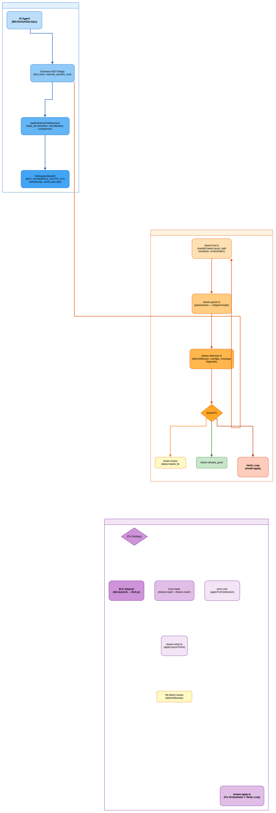
*[Edit in draw.io](diagrams/architecture.drawio)*

### 13.2 Component Diagram

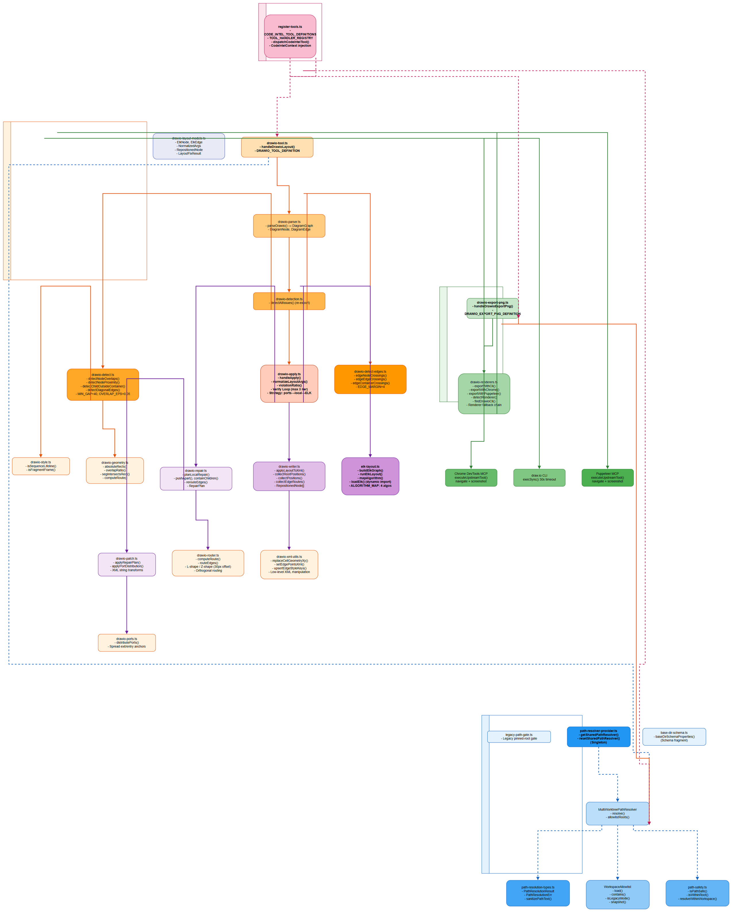
*[Edit in draw.io](diagrams/component.drawio)*

### 13.3 Verify Loop Sequence Diagram

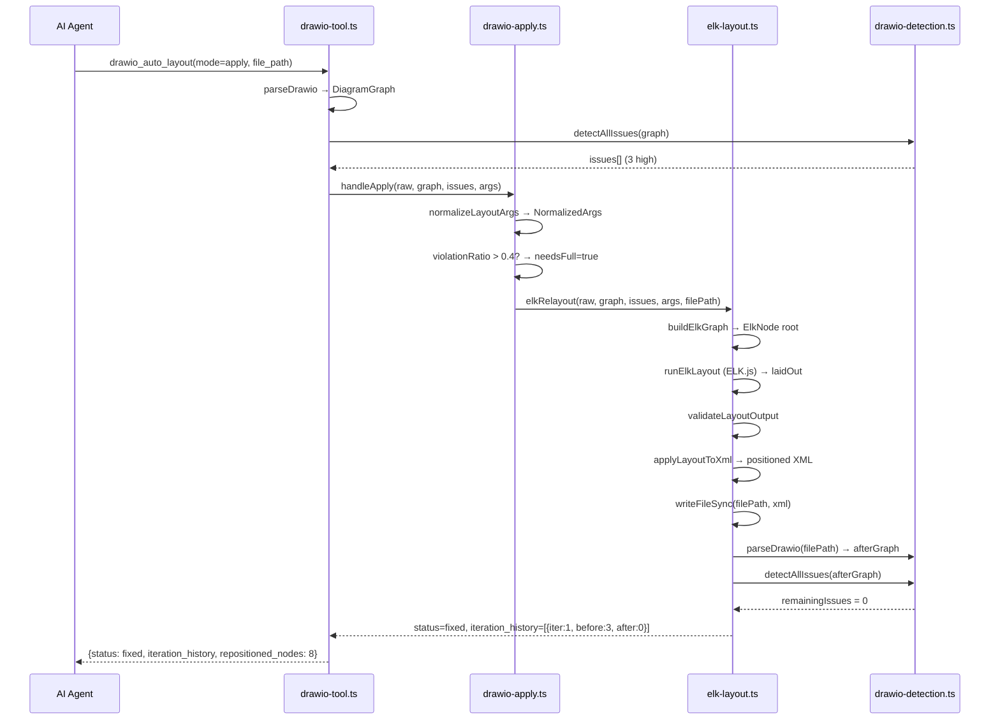

*[Edit in draw.io](diagrams/sequence-verify-loop.drawio)*

### 13.4 ELK Layout Sequence Diagram

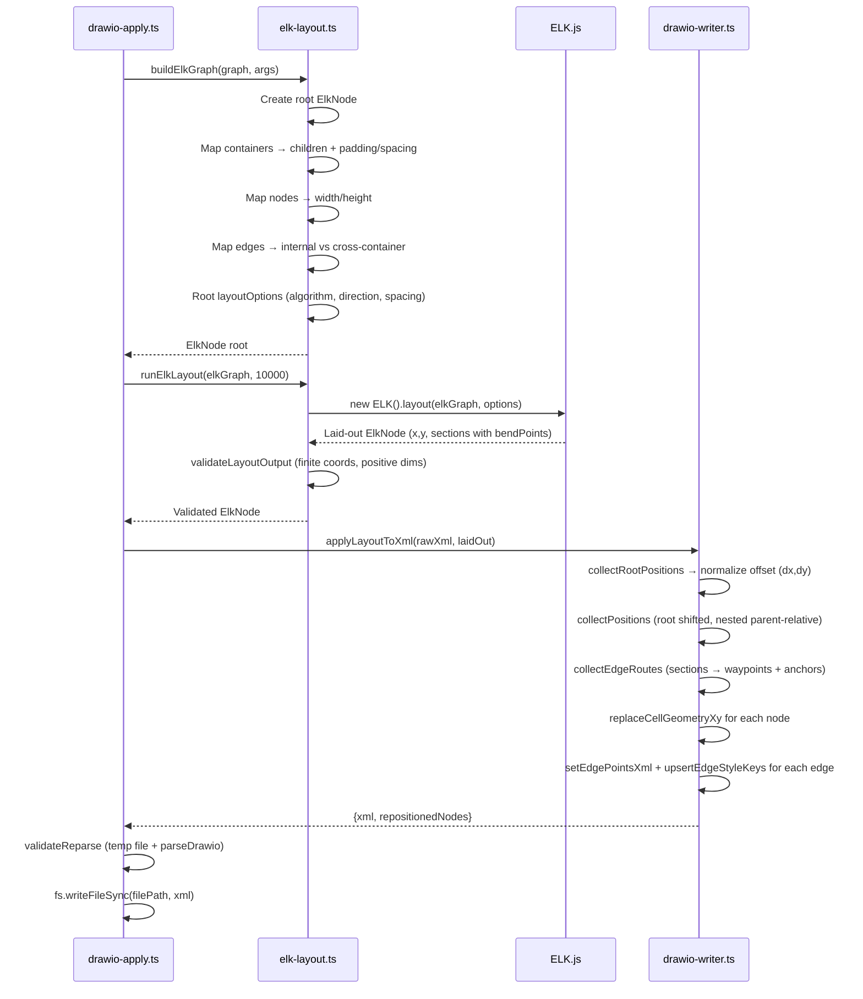

*[Edit in draw.io](diagrams/sequence-elk-layout.drawio)*

### 13.5 Multi-worktree Path Resolution Sequence

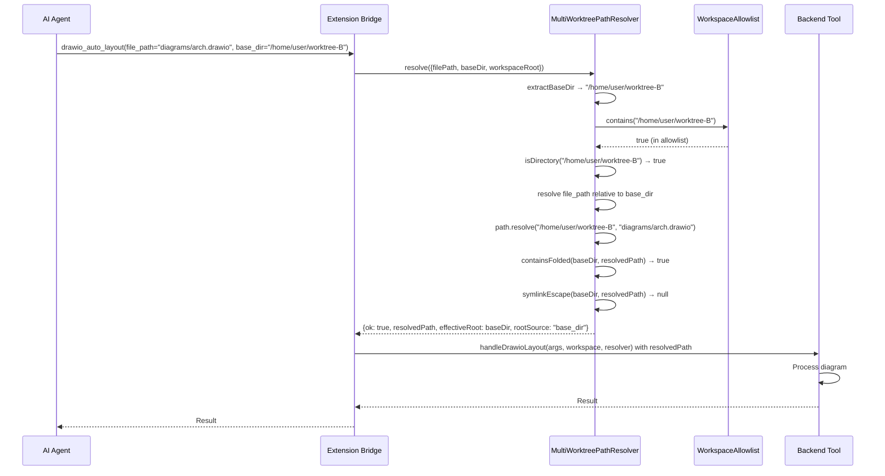

*[Edit in draw.io](diagrams/sequence-multi-worktree.drawio)*

### 13.6 PNG Export Sequence Diagram

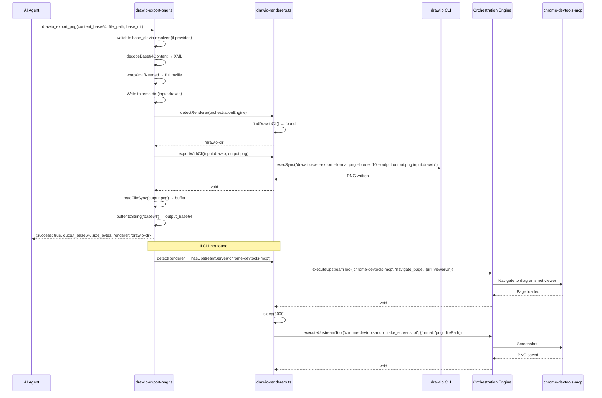

*[Edit in draw.io](diagrams/sequence-png-export.drawio)*

### 13.7 Deployment Diagram

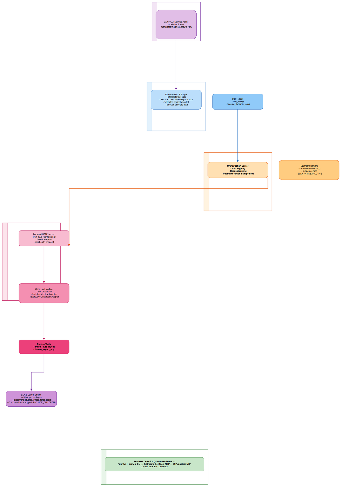
*[Edit in draw.io](diagrams/deployment.drawio)*

### 13.8 Security Flow Diagram

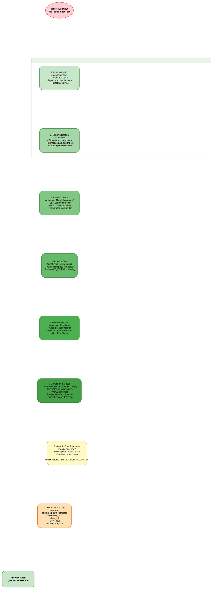
*[Edit in draw.io](diagrams/security.drawio)*

### 13.9 Data Model Diagram

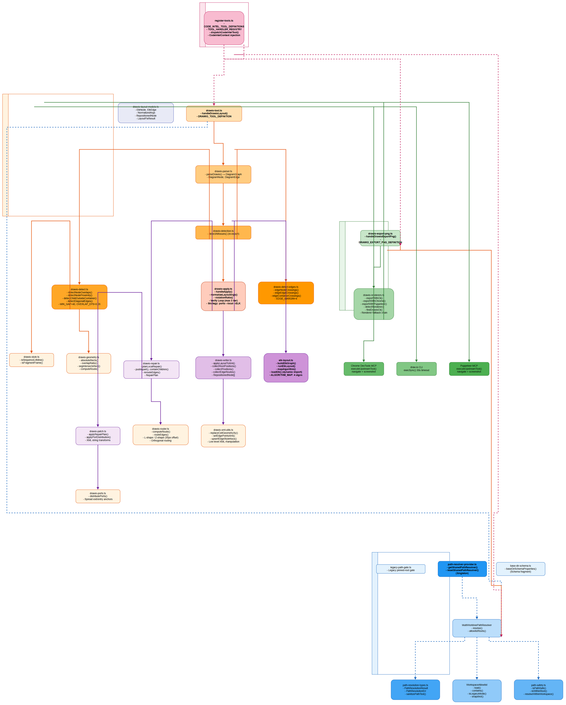
*[Edit in draw.io](diagrams/data-model.drawio)*

---

## 14. Appendix

### 14.1 Constants Reference

| Constant | File | Value | Description |
|----------|------|-------|-------------|
| `OVERLAP_EPS` | `drawio-detect.ts` | 0.05 | 5% overlap threshold |
| `MIN_GAP` | `drawio-detect.ts` | 40 | 40px minimum gap |
| `CONTAINMENT_TOL` | `drawio-detect.ts` | 5 | 5px container tolerance |
| `EDGE_MARGIN` | `drawio-detect-edges.ts` | 4 | 4px crossing margin |
| `PUSH_PASSES` | `drawio-repair.ts` | 3 | Push-apart iterations |
| `CONTAIN_MARGIN` | `drawio-repair.ts` | 10 | Child-container padding |
| `STACK_OFFSET` | `drawio-repair.ts` | 24 | Stacked edge offset |
| `RELAYOUT_RATIO` | `drawio-apply.ts` | 0.4 | Full relayout threshold |
| `MAX_SPACING` | `drawio-apply.ts` | 500 | Max spacing (SEC-03) |
| `MAX_NODES` | `drawio-apply.ts` | 500 | Max diagram nodes (env) |
| `TIMEOUT_MS` | `drawio-apply.ts` | 10000 | ELK timeout (env) |
| `MAX_ROOTS` | `workspace-allowlist.ts` | 100 | Allowlist soft cap |
| `MAX_CONFIG_FILE_BYTES` | `workspace-allowlist.ts` | 64KB | Config file size limit |

### 14.2 Environment Variables

| Variable | Default | Range | Description |
|----------|---------|-------|-------------|
| `MCP_WORKSPACE_ROOTS` | (empty) | Delimiter-separated paths | Workspace allowlist |
| `MCP_WORKSPACE_ROOTS_FILE` | (empty) | File path | Line-based allowlist config |
| `SA4E_ELK_MAX_NODES` | 500 | 1-5000 | Max nodes for ELK layout |
| `SA4E_ELK_TIMEOUT_MS` | 10000 | 1000-60000 | ELK layout timeout (ms) |
| `PORT` | 3000 | 1-65535 | HTTP server port |
| `LOG_LEVEL` | info | trace/debug/info/warn/error | Pino log level |

### 14.3 Error Codes Reference

| Code | Tool | HTTP | User Message | Cause |
|------|------|------|--------------|-------|
| `PATH_REJECTED_OUTSIDE_ALLOWLIST` | Both | 400 | File path not allowed: path traversal detected | base_dir not in allowlist or resolved path escapes |
| `PATH_REJECTED_OUTSIDE_WORKSPACE` | Layout | 400 | Path rejected: X resolves to Y — outside backend workspace | Legacy mode: path outside pinned workspace |
| `FILE_NOT_FOUND` | Layout | 400 | File not found or not accessible | File doesn't exist at resolved path |
| `INVALID_XML` | Layout | 400 | Analysis failed: <details> | XML parsing failure |
| `NO_NODES` | Layout | 400 | No nodes found in diagram | Zero nodes/containers |
| `INVALID_THRESHOLD` | Layout | 400 | Overlap threshold must be between 0 and 0.5 | overlap_threshold > 0.5 or ≤ 0 |
| `INVALID_GAP` | Layout | 400 | Gap threshold must be ≥ 10 | gap_threshold < 10 |
| `INVALID_ITERATIONS` | Layout | 400 | Max iterations must be 1-5 | max_iterations outside [1,5] |
| `INVALID_SPACING_INCREMENT` | Layout | 400 | Spacing increment must be 10-50 | spacing_increment outside [10,50] |
| `LAYOUT_FAILED` | Layout | 500 | Layout engine failed. Please check input diagram and retry. | ELK exception after all strategies |
| `DIAGRAM_TOO_LARGE` | Layout | 400 | Diagram too large (N nodes, max M) | Node count > SA4E_ELK_MAX_NODES |
| `REPAIR_FAILED` | Layout | 500 | Local repair failed. Please check diagram structure. | Local repair exception |
| `ELK_INIT_FAILED` | Layout | 500 | Layout engine failed to initialize | ELK.js import/constructor failure |
| `ELK_TIMEOUT` | Layout | 500 | Layout engine timed out after Xms | ELK layout exceeds timeout |
| `ELK_INVALID_OUTPUT` | Layout | 500 | Layout engine produced invalid output | NaN coords or non-positive dims |
| `RENDERER_UNAVAILABLE` | Export | 500 | Export unavailable: no renderer configured | No CLI, Chrome, or Puppeteer |
| `FS_ERROR` | Both | 500 | Workspace root 'X' does not exist on filesystem | base_dir directory missing |

---

*End of TDD for SA4E-406*