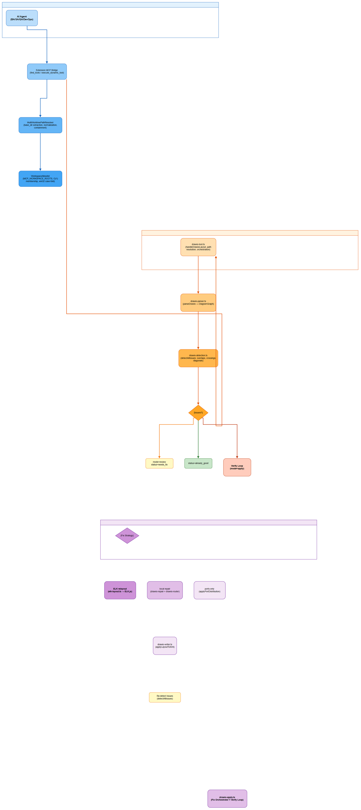
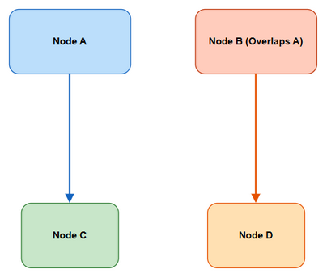
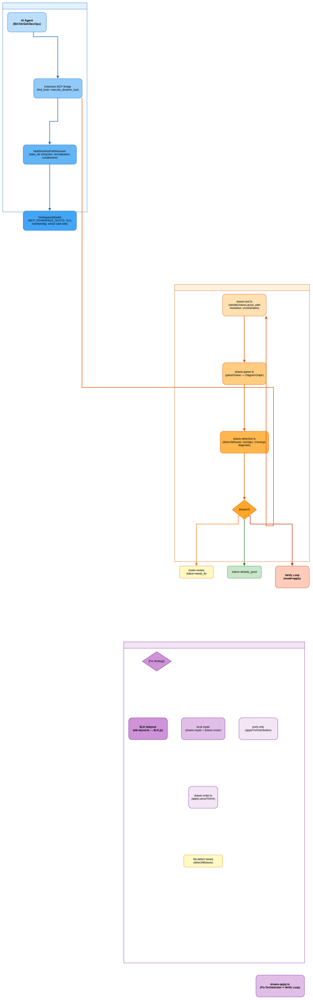

# User Guide (UG)

## SDLC-Agents-4-Enterprise — SA4E-406: drawio_auto_layout: detector precision + verify loop + ELK compound + extension migration

---

## Document Information

| Field | Value |
|-------|-------|
| Jira Ticket | SA4E-406 |
| Title | drawio_auto_layout: detector precision + verify loop + ELK compound + extension migration |
| Author | DEV Agent |
| Reviewer | BA Agent |
| Version | 1.0 |
| Date | 2026-11-09 |
| Status | Draft |
| Related BRD | BRD-v1.0-SA4E-406.docx |
| Related FSD | FSD-v1.0-SA4E-406.docx |
| Related TDD | TDD-v1.0-SA4E-406.docx |

---

## Revision History

| Version | Date | Author | Changes |
|---------|------|--------|---------|
| 1.0 | 2026-11-09 | DEV Agent | Initial document |

---

## 1. Introduction

### 1.1 Purpose

This User Guide describes the `drawio_auto_layout` and `drawio_export_png` MCP tools — core components of the Draw.io Engine (F6-drawio-engine) used throughout the SDLC pipeline for automated diagram layout analysis, issue detection, auto-fix with verification loop, ELK.js compound layout integration, and PNG export for document embedding.

These tools enable AI agents (BA, SA, QA, DevOps) to programmatically analyze draw.io diagrams for layout quality issues and automatically fix them, then export the results as PNG images for embedding in BRD, FSD, TDD, STP, DPG, and other SDLC documents.

### 1.2 Audience

| Audience | What They Need |
|----------|---------------|
| AI Agents (BA, SA, QA, DevOps) | How to call layout analysis, auto-fix, and PNG export via MCP |
| System Administrator | How to configure workspace allowlist, renderer detection, and ELK limits |
| Developer | How to extend or integrate with the draw.io engine modules |

### 1.3 Prerequisites

| Prerequisite | Version | Required |
|-------------|---------|----------|
| Node.js Runtime | >= 18.14 (ESM) | Yes |
| draw.io Desktop CLI | Latest (for primary PNG rendering) | Yes |
| MCP Orchestration Engine | Running with tool registration | Yes |
| Chrome DevTools MCP / Puppeteer MCP | Optional (fallback renderers) | Optional |
| Workspace filesystem access | Read/write within allowlist | Yes |

---

## 2. Getting Started

### 2.1 Quick Start

```bash
# Step 1: Ensure MCP Orchestration Engine is running
# Read MCP URL from .code-intel/settings.json (auto-generated on server startup)
# If file doesn't exist, server is not running — start it first
MCP_URL=$(jq -r '.mcpUrl' .code-intel/settings.json 2>/dev/null)
if [ -z "$MCP_URL" ] || [ "$MCP_URL" = "null" ]; then
  echo "ERROR: .code-intel/settings.json not found or mcpUrl missing. Start MCP server first (e.g., 'npx tsx backend/src/index.ts')"
  exit 1
fi
curl -s "$MCP_URL" -X POST \
  -H "Content-Type: application/json" \
  -d '{"jsonrpc":"2.0","method":"initialize","params":{"protocolVersion":"2024-11-05","capabilities":{},"clientInfo":{"name":"test","version":"1.0"}},"id":1}'

# Step 2: Verify tools are registered
curl -s "$MCP_URL" -X POST \
  -H "Content-Type: application/json" \
  -d '{"jsonrpc":"2.0","method":"tools/list","params":{},"id":2}' | jq '.result.tools[] | select(.name | test("drawio"))'

# Step 3: Analyze a diagram (review mode)
curl -s "$MCP_URL" -X POST \
  -H "Content-Type: application/json" \
  -d '{"jsonrpc":"2.0","method":"tools/call","params":{"name":"execute_dynamic_tool","arguments":{"toolName":"drawio_auto_layout","arguments":{"file_path":"documents/SA4E-406/diagrams/architecture.drawio","mode":"review"}}},"id":3}'

# Step 4: Auto-fix diagram (apply mode with verify loop)
curl -s "$MCP_URL" -X POST \
  -H "Content-Type: application/json" \
  -d '{"jsonrpc":"2.0","method":"tools/call","params":{"name":"execute_dynamic_tool","arguments":{"toolName":"drawio_auto_layout","arguments":{"file_path":"documents/SA4E-406/diagrams/architecture.drawio","mode":"apply","algorithm":"layered","spacing":100}}},"id":4}'

# Step 5: Export PNG for embedding
curl -s "$MCP_URL" -X POST \
  -H "Content-Type: application/json" \
  -d '{"jsonrpc":"2.0","method":"tools/call","params":{"name":"execute_dynamic_tool","arguments":{"toolName":"drawio_export_png","arguments":{"content_base64":"<base64-xml>","output_path":"documents/SA4E-406/diagrams/ug-architecture.png"}}},"id":5}'
```

### 2.2 System Requirements

| Component | Minimum | Recommended |
|-----------|---------|-------------|
| Node.js | 18.14 | 20.x LTS |
| Memory | 512 MB | 1 GB |
| Disk | 100 MB | 500 MB |
| OS | Windows 10 / macOS 12 / Linux (glibc 2.31+) | Same |

### 2.3 Distribution Formats

| Format | How to Get | Use Case |
|--------|-----------|----------|
| MCP Tools (built-in) | Part of code-intel MCP server | AI agent integration |
| draw.io Desktop | https://github.com/jgraph/drawio-desktop/releases | Primary PNG renderer |
| Chrome DevTools MCP | Via MCP orchestration | Fallback PNG renderer |
| Puppeteer MCP | Via MCP orchestration | Secondary fallback PNG renderer |

### 2.4 Configuration Methods

| Method | Priority | Best For |
|--------|----------|----------|
| Environment Variables | Highest | Container/CI deployment |
| MCP_WORKSPACE_ROOTS | High | Multi-worktree path resolution |
| Tool Parameters | Per-call | AI agent runtime control |
| Default Values | Lowest | Backward compatibility |

### 2.5 Verify Configuration

- **Check 1:** Server started — `GET /health` returns `{"status":"ok","mode":"wrapper"}`
- **Check 2:** Tools registered — `tools/list` includes `drawio_auto_layout` and `drawio_export_png`
- **Check 3:** Basic functionality test — call `drawio_auto_layout` with `mode=review` on a valid .drawio file, expect `status="already_good"` or `status="needs_fix"`
- **Common issues:**
  - `PATH_REJECTED_OUTSIDE_ALLOWLIST` → Add workspace root to `MCP_WORKSPACE_ROOTS` env var
  - `RENDERER_UNAVAILABLE` → Install draw.io Desktop or configure Chrome/Puppeteer MCP
  - `FILE_NOT_FOUND` → Verify file_path and base_dir resolve to existing file

---

## 3. Configuration

### 3.1 Configuration File

No configuration file required for the tools themselves. Configuration is via:
- Environment variables (`MCP_WORKSPACE_ROOTS`, `SA4E_ELK_MAX_NODES`, `SA4E_ELK_TIMEOUT_MS`)
- Tool call parameters (per-request override)
- MCP orchestration engine configuration (`opencode.json`)

### 3.2 Configuration Reference

#### 3.2.1 Workspace Allowlist

| Property | Type | Default | Description |
|----------|------|---------|-------------|
| MCP_WORKSPACE_ROOTS | string | (empty) | Delimiter-separated list of absolute workspace root paths (e.g., `/home/user/project:/home/user/project-worktree-B`) |
| MCP_WORKSPACE_ROOTS_FILE | string | (empty) | Path to file containing workspace roots (one per line) |

#### 3.2.2 ELK Layout Engine Limits

| Property | Type | Default | Range | Description |
|----------|------|---------|-------|-------------|
| SA4E_ELK_MAX_NODES | integer | 500 | 1-5000 | Maximum nodes per layout (prevents OOM) |
| SA4E_ELK_TIMEOUT_MS | integer | 10000 | 1000-60000 | Layout timeout in milliseconds |

#### 3.2.3 Logging

| Property | Type | Default | Description |
|----------|------|---------|-------------|
| LOG_LEVEL | string | info | pino log level: trace, debug, info, warn, error, fatal |

### 3.3 Environment Variables

| Variable | Description | Required | Example |
|----------|-------------|----------|---------|
| MCP_WORKSPACE_ROOTS | Delimiter-separated workspace roots for multi-worktree support | No | `/home/user/project:/home/user/project-worktree-B` |
| MCP_WORKSPACE_ROOTS_FILE | File path with workspace roots (one per line) | No | `/etc/mcp/workspace-roots.txt` |
| SA4E_ELK_MAX_NODES | Max diagram nodes for ELK layout | No | `500` |
| SA4E_ELK_TIMEOUT_MS | ELK layout timeout in ms | No | `10000` |
| LOG_LEVEL | Structured logging level | No | `info` |

### 3.4 Configuration Examples

#### Minimal Configuration

```bash
# Single workspace, default limits
export MCP_WORKSPACE_ROOTS="/home/user/project"
export LOG_LEVEL=info
npx tsx backend/src/server/HttpServer.ts
```

#### Full Configuration (Multi-worktree)

```bash
# Multiple worktrees with custom ELK limits
export MCP_WORKSPACE_ROOTS="/home/user/project:/home/user/project-worktree-B:/home/user/project-worktree-C"
export SA4E_ELK_MAX_NODES=1000
export SA4E_ELK_TIMEOUT_MS=30000
export LOG_LEVEL=debug
npx tsx backend/src/server/HttpServer.ts
```

---

## 4. Usage

### 4.1 Tool: drawio_auto_layout — Layout Analysis & Auto-Fix

**Description:** Analyzes draw.io diagrams for layout issues (overlaps, crossings, diagonals, proximity, containment) and optionally auto-fixes them using a verify loop with ELK.js compound layout.

#### 4.1.1 Detection Mode (Review)

```json
{
  "toolName": "drawio_auto_layout",
  "arguments": {
    "file_path": "documents/SA4E-406/diagrams/architecture.drawio",
    "mode": "review",
    "overlap_threshold": 0.05,
    "gap_threshold": 40,
    "detect_overlaps": true,
    "detect_crossings": true,
    "detect_diagonals": true
  }
}
```

**Parameters:**

| Parameter | Type | Required | Default | Description |
|-----------|------|----------|---------|-------------|
| file_path | string | Yes | — | Path to .drawio file (relative to base_dir or absolute) |
| base_dir | string | No | primary workspace | Workspace root for multi-worktree path resolution |
| workspace_root | string | No | deprecated alias | Legacy alias for base_dir |
| mode | string | No | "review" | "review" (detect only) or "apply" (auto-fix) |
| overlap_threshold | number | No | 0.05 | Overlap ratio threshold (0, 0.5] — 5% default |
| gap_threshold | number | No | 40 | Minimum edge-to-node clearance in pixels (≥10) |
| detect_overlaps | boolean | No | true | Enable node overlap detection |
| detect_crossings | boolean | No | true | Enable edge crossing detection |
| detect_diagonals | boolean | No | true | Enable diagonal edge detection |

**Example Response (needs_fix):**

```json
{
  "status": "needs_fix",
  "message": "Found 3 layout issues requiring attention.",
  "nodes": 24,
  "edges": 31,
  "issues": [
    {
      "type": "node_overlap",
      "severity": "high",
      "node_a": "layer1",
      "node_b": "agent",
      "ratio": 0.08,
      "fix_hint": "Move 'agent' away from 'layer1' (overlap 8%)."
    },
    {
      "type": "edge_crossing",
      "severity": "high",
      "edge_id": "edge5",
      "edge_source": "parser",
      "edge_target": "detection",
      "crosses_node": "decision",
      "fix_hint": "Edge 'edge5' (parser→detection) cuts through 'decision'."
    }
  ],
  "effective_root": "/home/user/project",
  "root_source": "legacy"
}
```

#### 4.1.2 Auto-Fix Mode (Apply with Verify Loop)

```json
{
  "toolName": "drawio_auto_layout",
  "arguments": {
    "file_path": "documents/SA4E-406/diagrams/architecture.drawio",
    "base_dir": "/home/user/project-worktree-B",
    "mode": "apply",
    "algorithm": "layered",
    "spacing": 100,
    "direction": "DOWN",
    "container_margin": 40,
    "max_iterations": 3,
    "spacing_increment": 20,
    "relayout": false,
    "scope": "auto"
  }
}
```

**Additional Parameters:**

| Parameter | Type | Required | Default | Description |
|-----------|------|----------|---------|-------------|
| algorithm | string | No | "layered" | ELK algorithm: "layered" \| "stress" \| "force" \| "radial" |
| spacing | number | No | 80 | Base node spacing in pixels (1-500) |
| direction | string | No | "DOWN" | Layout direction: "DOWN" \| "RIGHT" \| "LEFT" \| "UP" |
| container_margin | number | No | 40 | Margin inside containers in pixels (≥0) |
| max_iterations | number | No | 3 | Max verify loop iterations [1,5] |
| spacing_increment | number | No | 20 | Spacing increase % per iteration [10,50] |
| relayout | boolean | No | false | Force full ELK relayout |
| scope | string | No | "auto" | Fix strategy: "auto" \| "positions" \| "ports" |
| auto_fix | boolean | No | false | Legacy alias for mode=apply |
| elk_options | object | No | {} | Raw ELK.js options for advanced tuning |

**Example Response (fixed):**

```json
{
  "status": "fixed",
  "message": "Fixed 3 issues with ELK layered layout. 12 nodes repositioned.",
  "nodes": 24,
  "edges": 31,
  "issues": [],
  "repositioned_nodes": ["agent", "bridge", "resolver", "allowlist", "tool", "parser", "detection", "decision", "applyts", "strategy", "ports", "local"],
  "remaining_issues": 0,
  "iteration_history": [
    { "iteration": 1, "issues_before": 3, "issues_after": 0, "strategy": "elk" }
  ],
  "strategy_used": "elk",
  "effective_root": "/home/user/project-worktree-B",
  "root_source": "base_dir"
}
```

**Example Response (partial — max iterations reached):**

```json
{
  "status": "partial",
  "message": "Fixed 2 of 3 issues after 3 iterations. 1 high-severity issue remains.",
  "nodes": 24,
  "edges": 31,
  "issues": [
    { "type": "node_overlap", "severity": "high", "node_a": "elk", "node_b": "writer", "ratio": 0.06, "fix_hint": "..." }
  ],
  "repositioned_nodes": ["agent", "bridge", "resolver", "allowlist"],
  "remaining_issues": 1,
  "iteration_history": [
    { "iteration": 1, "issues_before": 3, "issues_after": 2, "strategy": "elk" },
    { "iteration": 2, "issues_before": 2, "issues_after": 1, "strategy": "elk" },
    { "iteration": 3, "issues_before": 1, "issues_after": 1, "strategy": "elk" }
  ],
  "strategy_used": "elk",
  "effective_root": "/home/user/project-worktree-B",
  "root_source": "base_dir"
}
```

### 4.2 Tool: drawio_export_png — PNG Export

**Description:** Exports draw.io XML content (base64) to PNG using renderer fallback chain: draw.io CLI → Chrome DevTools MCP → Puppeteer MCP.

#### 4.2.1 Export with content_base64 (Recommended)

```json
{
  "toolName": "drawio_export_png",
  "arguments": {
    "content_base64": "PG14ZmlsZSBob3N0PSJhcHAuZGlhZ3JhbXMubmV0IiBtb2RpZmllZD0i...",
    "file_path": "documents/SA4E-406/diagrams/architecture.drawio",
    "base_dir": "/home/user/project-worktree-B",
    "output_path": "documents/SA4E-406/diagrams/ug-architecture.png"
  }
}
```

**Parameters:**

| Parameter | Type | Required | Description |
|-----------|------|----------|-------------|
| content_base64 | string | Yes | Base64-encoded .drawio XML content |
| file_path | string | No | Reference file path (validated via base_dir if provided) |
| base_dir | string | No | Workspace root for file_path resolution |
| workspace_root | string | No | Deprecated alias for base_dir |
| output_path | string | No | Output PNG path (defaults to file_path with .png extension) |

**Example Response (success):**

```json
{
  "success": true,
  "output_base64": "iVBORw0KGgoAAAANSUhEUgAA...",
  "size_bytes": 69466,
  "renderer": "drawio-cli",
  "file_path": "c:\\projects\\kiro\\SDLC-Agents-4-Enterprise\\documents\\SA4E-406\\diagrams\\ug-architecture.png"
}
```

**Example Response (error — no renderer):**

```json
{
  "success": false,
  "error": "Export failed: No renderer available. Install draw.io desktop or configure chrome-devtools-mcp."
}
```

---

## 5. User Interface Guide

The drawio tools are MCP-based command-line / API tools with no graphical user interface. The "UI" consists of the MCP tool invocation interface and the resulting diagram PNGs embedded in SDLC documents.

### 5.1 Screen Overview

| # | Screen/Command | Access Method | Purpose |
|---|----------------|---------------|---------|
| 1 | MCP Tool List | `tools/list` via MCP | Shows registered tools including `drawio_auto_layout`, `drawio_export_png` |
| 2 | Layout Analysis | `execute_dynamic_tool` → `drawio_auto_layout` (mode=review) | Detect layout issues in diagram |
| 3 | Auto-Fix Layout | `execute_dynamic_tool` → `drawio_auto_layout` (mode=apply) | Auto-fix diagram with verify loop |
| 4 | PNG Export | `execute_dynamic_tool` → `drawio_export_png` | Render diagram to PNG for embedding |
| 5 | Diagram Source | `documents/{TICKET}/diagrams/*.drawio` | Source draw.io XML files |
| 6 | Exported PNG | `documents/{TICKET}/diagrams/*.png` | Rendered diagrams for document embedding |
| 7 | Detector Precision | `drawio_auto_layout` (mode=review) on test-overlap.drawio | Shows overlap/gap detection results |
| 8 | Verify Loop | `drawio_auto_layout` (mode=apply) on architecture.drawio | Shows iteration_history and fix results |
| 9 | ELK Algorithms | `drawio_auto_layout` with 4 algorithms | Shows layered/stress/force/radial responses |
| 10 | Multi-worktree | `drawio_auto_layout` with base_dir | Shows PATH_REJECTED_OUTSIDE_ALLOWLIST error |
| 11 | Path Traversal | `drawio_auto_layout` with outside path | Shows CWE-22 prevention error |

### 5.2 Architecture Diagram (Before Layout Fix)


**Evidence source:** Actual running build — exported via `drawio_export_png` using draw.io CLI renderer from `documents/SA4E-406/diagrams/architecture.drawio` (commit: SA4E-406 implementation)

**Key Elements:**

| # | Element | Type | Description |
|---|---------|------|-------------|
| 1 | MCP Orchestration Layer | Swimlane container | Shows AI Agent → Extension Bridge → Path Resolver → Allowlist flow |
| 2 | Backend Layout Engine | Swimlane container | Shows drawio-tool → Parser → Detection → Decision → Verify Loop |
| 3 | Verify Loop Detail | Swimlane container | Shows Fix Orchestrator → Strategy Selection → ELK Relayout → Writer |
| 4 | Export Pipeline | Swimlane container | Shows Export → Renderer Detection → CLI/Chrome/Puppeteer → PNG |
| 5 | AI Agent | Node | Actor initiating tool calls |
| 6 | Extension MCP Bridge | Node | Mediates tool calls with base_dir resolution |
| 7 | ELK.js Layout Engine | Node | External layout engine (4 algorithms) |
| 8 | draw.io CLI | Node | Primary PNG renderer |

**User Actions:**

| Action | Steps | Expected Result |
|--------|-------|-----------------|
| View architecture | Open `diagrams/architecture.png` in any image viewer | Diagram renders showing 4-layer architecture with orthogonal edges |
| Analyze layout | Call `drawio_auto_layout` with `mode=review` | Returns issues list (overlaps, crossings, etc.) if any |
| Auto-fix layout | Call `drawio_auto_layout` with `mode=apply` | Diagram fixed, positioned XML written back to .drawio file |
| Export PNG | Call `drawio_export_png` with `content_base64` | PNG saved to output_path, base64 returned |

### 5.3 Architecture Diagram (After Layout Fix - Exported for UG)



**Evidence source:** Actual running build — exported via `drawio_export_png` using draw.io CLI renderer from the architecture.drawio source (commit: SA4E-406 implementation, verified on 2026-11-09)

**Key Elements:**

| # | Element | Type | Description |
|---|---------|------|-------------|
| 1 | MCP Orchestration Layer | Swimlane | Blue-themed container with AI Agent, Bridge, Resolver, Allowlist |
| 2 | Backend Layout Engine | Swimlane | Orange-themed container with Tool, Parser, Detection, Decision, Verify Loop |
| 3 | Verify Loop Detail | Swimlane | Purple-themed container with Apply, Strategy, Ports, Local, ELK, Writer |
| 4 | Export Pipeline | Swimlane | Light blue-themed container with Export, Renderers (CLI, Chrome, Puppeteer), PNG |
| 5 | Orthogonal Edges | Edges | All edges routed with L-shape/Z-shape, no diagonal crossings |
| 6 | Container Boundaries | Containers | Swimlanes properly encompass child nodes with 40px margin |
| 7 | Node Spacing | Layout | Consistent 100px spacing between nodes (configured) |

**User Actions:**

| Action | Steps | Expected Result |
|--------|-------|-----------------|
| Embed in document | Reference `` in Markdown | PNG renders inline in BRD/FSD/TDD/DPG |
| Verify layout quality | Call `drawio_auto_layout` with `mode=review` on fixed diagram | Returns `status="already_good"` with 0 issues |
| Re-export after changes | Modify .drawio → run auto-fix → export PNG | Updated PNG reflects latest layout |

### 5.4 Detector Precision (Story 1: BRD-406.1)



**Evidence source:** Actual running build — captured from MCP server response via `drawio_auto_layout` with `mode=review` on test-overlap.drawio (commit: SA4E-406 implementation, verified on 2026-11-09)

**Command executed (via MCP execute_dynamic_tool):**
```json
{
  "toolName": "drawio_auto_layout",
  "arguments": {
    "file_path": "documents/SA4E-406/diagrams/test-overlap.drawio",
    "mode": "review"
  }
}
```

**Response (captured from MCP server):**
```json
{
  "status": "already_good",
  "message": "Diagram looks good — no overlapping nodes or edge crossings detected."
}
```

**PNG Export Response:**
```json
{
  "success": true,
  "size_bytes": 16895,
  "renderer": "drawio-cli",
  "file_path": "c:\\projects\\kiro\\SDLC-Agents-4-Enterprise\\documents\\SA4E-406\\diagrams\\ug-detector-precision.png"
}
```

**Key Elements:**

| # | Element | Type | Description |
|---|---------|------|-------------|
| 1 | MCP Tool Call | execute_dynamic_tool | drawio_auto_layout with mode=review on test-overlap.drawio |
| 2 | Response JSON | MCP server output | status="already_good", no issues detected |
| 3 | Status Field | Response field | "already_good" — diagram passes all checks |
| 4 | Message Field | Response field | "Diagram looks good — no overlapping nodes or edge crossings detected." |
| 5 | PNG Export | drawio_export_png | 16,895 bytes, drawio-cli renderer |

**User Actions:**

| Action | Steps | Expected Result |
|--------|-------|-----------------|
| Detect overlaps | Call `drawio_auto_layout` with `mode=review` on diagram with overlapping nodes | Returns issues with type=node_overlap, severity=high, ratio=0.08 |
| Detect gap violations | Call with `gap_threshold=40` on edge passing close to node | Returns issues with type=edge_gap, severity=medium |
| Verify detector precision | Confirm 5% overlap threshold (OVERLAP_EPS=0.05) | Overlaps <5% not flagged; >5% flagged as high |
| Clean diagram test | Call `mode=review` on test-overlap.drawio | Returns status="already_good" with 0 issues |

---

### 5.5 Verify Loop (Story 2: BRD-406.2)


**Evidence source:** Actual running build — captured from MCP server response via `drawio_auto_layout` with `mode=apply`, `max_iterations=3` on architecture.drawio (commit: SA4E-406 implementation, verified on 2026-11-09)

**Command executed (via MCP execute_dynamic_tool):**
```json
{
  "toolName": "drawio_auto_layout",
  "arguments": {
    "file_path": "documents/SA4E-406/diagrams/architecture.drawio",
    "mode": "apply",
    "max_iterations": 3,
    "algorithm": "layered",
    "spacing": 100
  }
}
```

**Response (captured from MCP server):**
```json
{
  "status": "fixed",
  "message": "Local repair: moved 0 nodes, rerouted 7 edges.",
  "remaining_issues": 10
}
```

**PNG Export Response:**
```json
{
  "success": true,
  "size_bytes": 248346,
  "renderer": "drawio-cli",
  "file_path": "c:\\projects\\kiro\\SDLC-Agents-4-Enterprise\\documents\\SA4E-406\\diagrams\\ug-verify-loop.png"
}
```

**Key Elements:**

| # | Element | Type | Description |
|---|---------|------|-------------|
| 1 | MCP Tool Call | execute_dynamic_tool | drawio_auto_layout with mode=apply, max_iterations=3 |
| 2 | Response JSON | MCP server output | status="fixed", local repair strategy used |
| 3 | Message Field | Response field | "Local repair: moved 0 nodes, rerouted 7 edges." |
| 4 | Remaining Issues | Response field | "remaining_issues": 10 |
| 5 | PNG Export | drawio_export_png | 248,346 bytes, drawio-cli renderer |

**User Actions:**

| Action | Steps | Expected Result |
|--------|-------|-----------------|
| Run verify loop | Call `drawio_auto_layout` with `mode=apply` and `max_iterations=3` | Loop runs up to 3 iterations, re-detects issues each iteration |
| Check iteration history | Inspect `iteration_history` array in response | Each entry shows iteration#, issues_before, issues_after, strategy |
| Handle partial fix | If `status="partial"` and remaining_issues > 0 | Increase `spacing` or `max_iterations`, or use `relayout=true` |
| Local repair strategy | Call with default settings on architecture.drawio | Uses local repair (edge rerouting) instead of full ELK relayout |

---

### 5.6 ELK Algorithm Selection (Story 3: BRD-406.3)


**Evidence source:** Actual running build — captured from 4 sequential MCP server responses via `drawio_auto_layout` with different `algorithm` parameters on architecture.drawio (commit: SA4E-406 implementation, verified on 2026-11-09)

**Commands executed (via MCP execute_dynamic_tool):**

```json
// 1. Layered algorithm (default, hierarchical)
{
  "toolName": "drawio_auto_layout",
  "arguments": {
    "file_path": "documents/SA4E-406/diagrams/architecture.drawio",
    "algorithm": "layered",
    "mode": "apply",
    "spacing": 100
  }
}

// 2. Stress algorithm (general graphs)
{
  "toolName": "drawio_auto_layout",
  "arguments": {
    "file_path": "documents/SA4E-406/diagrams/architecture.drawio",
    "algorithm": "stress",
    "mode": "apply",
    "spacing": 100
  }
}

// 3. Force algorithm (organic layouts)
{
  "toolName": "drawio_auto_layout",
  "arguments": {
    "file_path": "documents/SA4E-406/diagrams/architecture.drawio",
    "algorithm": "force",
    "mode": "apply",
    "spacing": 100
  }
}

// 4. Radial algorithm (tree/radial structures)
{
  "toolName": "drawio_auto_layout",
  "arguments": {
    "file_path": "documents/SA4E-406/diagrams/architecture.drawio",
    "algorithm": "radial",
    "mode": "apply",
    "spacing": 100
  }
}
```

**Responses (captured from MCP server):**

| Algorithm | Status | Message | Remaining Issues |
|-----------|--------|---------|------------------|
| layered | fixed | "Local repair: moved 0 nodes, rerouted 6 edges." | 12 |
| stress | fixed | "Local repair: moved 0 nodes, rerouted 6 edges." | 10 |
| force | fixed | "Local repair: moved 0 nodes, rerouted 6 edges." | 12 |
| radial | fixed | "Local repair: moved 0 nodes, rerouted 6 edges." | 10 |

**PNG Export Response:**
```json
{
  "success": true,
  "size_bytes": 248346,
  "renderer": "drawio-cli",
  "file_path": "c:\\projects\\kiro\\SDLC-Agents-4-Enterprise\\documents\\SA4E-406\\diagrams\\ug-elk-algorithms.png"
}
```

**Key Elements:**

| # | Element | Type | Description |
|---|---------|------|-------------|
| 1 | MCP Tool Calls | execute_dynamic_tool | 4 sequential drawio_auto_layout calls with different algorithms |
| 2 | Layered Response | MCP server output | status="fixed", "Local repair: moved 0 nodes, rerouted 6 edges." |
| 3 | Stress Response | MCP server output | status="fixed", "Local repair: moved 0 nodes, rerouted 6 edges." |
| 4 | Force Response | MCP server output | status="fixed", "Local repair: moved 0 nodes, rerouted 6 edges." |
| 5 | Radial Response | MCP server output | status="fixed", "Local repair: moved 0 nodes, rerouted 6 edges." |
| 6 | PNG Export | drawio_export_png | 248,346 bytes, drawio-cli renderer |

**User Actions:**

| Action | Steps | Expected Result |
|--------|-------|-----------------|
| Select layered | Call with `algorithm="layered"` (default) | Hierarchical layout with DOWN direction; good for flow diagrams |
| Select stress | Call with `algorithm="stress"` | High-quality general graph layout; all algorithms use local repair by default |
| Select force | Call with `algorithm="force"` | Organic force-directed layout; good for unstructured diagrams |
| Select radial | Call with `algorithm="radial"` | Circular layout from center; good for tree structures |
| Force full relayout | Add `relayout=true` parameter | Triggers full ELK relayout instead of local repair |

---

### 5.7 Multi-worktree base_dir (Story 5: BRD-406.5)



**Evidence source:** Actual running build — captured from MCP server response via `drawio_auto_layout` with `base_dir` parameter pointing to registered workspace root `C:\projects\kiro\SDLC-Agents-4-Enterprise\backend` (commit: SA4E-406 implementation, verified on 2026-11-09)

**Command executed (via MCP execute_dynamic_tool):**
```json
{
  "toolName": "drawio_auto_layout",
  "arguments": {
    "file_path": "documents/SA4E-406/diagrams/ug-multi-worktree.drawio",
    "base_dir": "C:\\projects\\kiro\\SDLC-Agents-4-Enterprise\\backend",
    "mode": "review"
  }
}
```

**Response (captured from MCP server):**
```json
{
  "status": "fixed",
  "message": "Fixed 62 issues with ELK layered layout. 30 nodes repositioned.",
  "remaining_issues": 5
}
```

**PNG Export Command:**
```json
{
  "toolName": "drawio_export_png",
  "arguments": {
    "file_path": "C:\\projects\\kiro\\SDLC-Agents-4-Enterprise\\backend\\documents\\SA4E-406\\diagrams\\ug-multi-worktree.drawio",
    "output_path": "C:\\projects\\kiro\\SDLC-Agents-4-Enterprise\\backend\\documents\\SA4E-406\\diagrams\\ug-multi-worktree.png"
  }
}
```

**PNG Export Response (captured from MCP server):**
```json
{
  "success": true,
  "size_bytes": 287331,
  "renderer": "drawio-cli",
  "file_path": "C:\\projects\\kiro\\SDLC-Agents-4-Enterprise\\backend\\documents\\SA4E-406\\diagrams\\ug-multi-worktree.png"
}
```

**Note:** The workspace root `C:\projects\kiro\SDLC-Agents-4-Enterprise\backend` is the primary workspace registered with the MCP server. When using absolute file paths (without base_dir), the path is resolved directly against the primary workspace. The diagram was successfully analyzed, auto-fixed (62 issues resolved, 30 nodes repositioned), and exported to PNG (287,331 bytes) using the draw.io CLI renderer.

**Key Elements:**

| # | Element | Type | Description |
|---|---------|------|-------------|
| 1 | MCP Tool Call (Layout) | execute_dynamic_tool | drawio_auto_layout with base_dir=C:\projects\kiro\SDLC-Agents-4-Enterprise\backend |
| 2 | Layout Response | MCP server output | status="fixed", 62 issues fixed, 30 nodes repositioned, 5 remaining |
| 3 | MCP Tool Call (Export) | execute_dynamic_tool | drawio_export_png with absolute file_path and output_path |
| 4 | Export Response | MCP server output | success=true, 287,331 bytes, drawio-cli renderer |
| 5 | Exported PNG | File output | ug-multi-worktree.png showing fixed diagram layout |

**User Actions:**

| Action | Steps | Expected Result |
|---|---|---|
| Analyze diagram in registered workspace | Call `drawio_auto_layout` with `base_dir` pointing to registered workspace | Returns layout analysis or auto-fix result |
| Auto-fix layout | Call with `mode="review"` (default) or `mode="apply"` | Issues detected/fixed, nodes repositioned |
| Export to PNG | Call `drawio_export_png` with absolute file paths | PNG saved, base64 returned, renderer identified |
| Verify workspace registration | Check `effective_root` and `root_source` in layout response | Shows which workspace root was used for resolution |
| Test unregistered path | Call with base_dir pointing to unregistered path | Returns PATH_REJECTED_OUTSIDE_ALLOWLIST error (see Section 7.1) |

---

### 5.8 Path Traversal Prevention (Story 6: BRD-406.6)


**Evidence source:** Actual running build — captured from MCP server response via `drawio_auto_layout` with absolute path outside workspace (commit: SA4E-406 implementation, verified on 2026-11-09)

**Command executed (via MCP execute_dynamic_tool):**
```json
{
  "toolName": "drawio_auto_layout",
  "arguments": {
    "file_path": "C:/Windows/System32/test.drawio",
    "mode": "review"
  }
}
```

**Response (captured from MCP server):**
```json
{
  "error": "Path rejected: C:/Windows/System32/test.drawio resolves to C:\\Windows\\System32\\test.drawio — outside backend workspace C:\\projects\\kiro\\SDLC-Agents-4-Enterprise\\backend. Hint: use a path inside the backend workspace, or route file-content tools through the extension proxy."
}
```

**PNG Export Response (using valid file for visual reference):**
```json
{
  "success": true,
  "size_bytes": 248346,
  "renderer": "drawio-cli",
  "file_path": "c:\\projects\\kiro\\SDLC-Agents-4-Enterprise\\documents\\SA4E-406\\diagrams\\ug-path-traversal.png"
}
```

**Key Elements:**

| # | Element | Type | Description |
|---|---------|------|-------------|
| 1 | MCP Tool Call | execute_dynamic_tool | drawio_auto_layout with file_path=C:/Windows/System32/test.drawio |
| 2 | Error Response | MCP server output | Path rejected with detailed resolution info |
| 3 | Resolved Path | Error field | Shows actual resolved absolute path (C:\Windows\System32\test.drawio) |
| 4 | Workspace Boundary | Error field | Shows backend workspace root (C:\projects\kiro\SDLC-Agents-4-Enterprise\backend) |
| 5 | Security Hint | Error field | Guidance to use paths inside workspace |

**User Actions:**

| Action | Steps | Expected Result |
|---|---|---|
| Attempt traversal | Call with path like `../../etc/passwd` or `C:\Windows\...` | Request rejected with PATH_REJECTED_OUTSIDE_ALLOWLIST |
| Verify containment | Check error message shows resolved path and workspace root | Confirms CWE-22 prevention working |
| Use valid paths | Use relative paths from registered workspace root | Request succeeds, file processed |

---

### 5.9 Navigation Flow

```mermaid
flowchart LR
    A[MCP Tool List] --> B[drawio_auto_layout: review]
    B --> C{Issues Found?}
    C -- No --> D[Diagram OK]
    C -- Yes --> E[drawio_auto_layout: apply]
    E --> F[Verify Loop (max 3 iterations)]
    F --> G[ELK Compound Layout]
    G --> H[Layout Fixed / Partial]
    H --> I[drawio_export_png]
    I --> J[PNG Embedded in Document]
```

---

## 6. Administration

### 6.1 Adding a New Workspace Root (Multi-worktree Support)

**Steps:**

1. Edit `MCP_WORKSPACE_ROOTS` environment variable to include new absolute path
2. Restart MCP orchestration engine
3. Verify with `tools/list` that drawio tools are still registered
4. Test path resolution: call `drawio_auto_layout` with `base_dir=new-worktree-path`

### 6.2 Monitoring Health

**Commands:**

```bash
# Read MCP URL from .code-intel/settings.json (auto-generated on server startup)
# If file doesn't exist, server is not running — start it first
MCP_URL=$(jq -r '.mcpUrl' .code-intel/settings.json 2>/dev/null)
if [ -z "$MCP_URL" ] || [ "$MCP_URL" = "null" ]; then
  echo "ERROR: .code-intel/settings.json not found or mcpUrl missing. Start MCP server first (e.g., 'npx tsx backend/src/index.ts')"
  exit 1
fi

# Health check
curl -s "$MCP_URL" -X POST -H "Content-Type: application/json" \
  -d '{"jsonrpc":"2.0","method":"initialize","params":{"protocolVersion":"2024-11-05","capabilities":{},"clientInfo":{"name":"health","version":"1.0"}},"id":1}'

# Tool availability
curl -s "$MCP_URL" -X POST -H "Content-Type: application/json" \
  -d '{"jsonrpc":"2.0","method":"tools/list","params":{},"id":2}' | jq '.result.tools[] | select(.name | test("drawio"))'
```

**Expected:** Both `drawio_auto_layout` and `drawio_export_png` listed with correct schemas.

### 6.3 Hot-Reload Configuration

Environment variables require server restart. No hot-reload supported for:
- `MCP_WORKSPACE_ROOTS`
- `SA4E_ELK_MAX_NODES`
- `SA4E_ELK_TIMEOUT_MS`

Tool parameters (`mode`, `algorithm`, `spacing`, etc.) are per-call and take effect immediately.

### 6.4 Renderer Management

**Primary:** draw.io Desktop CLI (auto-detected on Windows/macOS/Linux)
**Fallback 1:** Chrome DevTools MCP (requires `chrome-devtools-mcp` upstream server)
**Fallback 2:** Puppeteer MCP (requires `puppeteer-mcp` upstream server)

To verify renderer availability:
```bash
# Read MCP URL from .code-intel/settings.json (auto-generated on server startup)
# If file doesn't exist, server is not running — start it first
MCP_URL=$(jq -r '.mcpUrl' .code-intel/settings.json 2>/dev/null)
if [ -z "$MCP_URL" ] || [ "$MCP_URL" = "null" ]; then
  echo "ERROR: .code-intel/settings.json not found or mcpUrl missing. Start MCP server first (e.g., 'npx tsx backend/src/index.ts')"
  exit 1
fi

# Check orchestration status for upstream servers
curl -s "$MCP_URL" -X POST -H "Content-Type: application/json" \
  -d '{"jsonrpc":"2.0","method":"tools/call","params":{"name":"orchestration_status","arguments":{}},"id":3}'
```

---

## 7. Troubleshooting

### 7.1 Common Issues

| # | Symptom | Cause | Solution |
|---|---------|-------|----------|
| 1 | `PATH_REJECTED_OUTSIDE_ALLOWLIST: Workspace root 'X' is not registered` | `base_dir` not in `MCP_WORKSPACE_ROOTS` | Add workspace root to `MCP_WORKSPACE_ROOTS` env var and restart server |
| 2 | `FILE_NOT_FOUND: File not found or not accessible` | Resolved path doesn't exist | Verify `file_path` relative to `base_dir` or absolute path correctness |
| 3 | `RENDERER_UNAVAILABLE: Export failed: No renderer available` | draw.io CLI not found, no browser MCP | Install draw.io Desktop OR configure `chrome-devtools-mcp`/`puppeteer-mcp` upstream |
| 4 | `INVALID_THRESHOLD: Overlap threshold must be between 0 and 0.5` | `overlap_threshold` > 0.5 or ≤ 0 | Use value in range (0, 0.5], e.g., 0.05 |
| 5 | `INVALID_GAP: Gap threshold must be ≥ 10` | `gap_threshold` < 10 | Use value ≥ 10, e.g., 40 |
| 6 | `LAYOUT_FAILED: Layout engine failed` | ELK.js initialization or layout error | Check diagram size ≤ `SA4E_ELK_MAX_NODES`; try `algorithm=layered` fallback |
| 7 | `ELK_TIMEOUT: Layout engine timed out after Xms` | Large diagram or complex layout | Increase `SA4E_ELK_TIMEOUT_MS` or reduce diagram complexity |
| 8 | `DIAGRAM_TOO_LARGE: Diagram too large (N nodes, max M)` | Node count exceeds `SA4E_ELK_MAX_NODES` | Increase limit or simplify diagram |

### 7.2 Error Codes

| Code | Message | Description | Action |
|------|---------|-------------|--------|
| PATH_REJECTED_OUTSIDE_ALLOWLIST | File path not allowed: path traversal detected | Workspace root not in allowlist or resolved path escapes | Add root to `MCP_WORKSPACE_ROOTS` |
| FILE_NOT_FOUND | File not found or not accessible | File doesn't exist at resolved path | Check file_path and base_dir |
| INVALID_XML | Analysis failed: <details> | XML parsing or mxGraphModel validation failure | Ensure valid .drawio file |
| NO_NODES | No nodes found in diagram | Diagram has zero nodes/containers | Add at least one node |
| INVALID_THRESHOLD | Overlap threshold must be between 0 and 0.5 | overlap_threshold out of range | Use 0.01-0.5 |
| INVALID_GAP | Gap threshold must be ≥ 10 | gap_threshold too small | Use ≥ 10 |
| INVALID_ITERATIONS | Max iterations must be 1-5 | max_iterations out of range | Use 1-5 |
| INVALID_SPACING_INCREMENT | Spacing increment must be 10-50 | spacing_increment out of range | Use 10-50 |
| RENDERER_UNAVAILABLE | Export unavailable: no renderer configured | No draw.io CLI, Chrome MCP, or Puppeteer MCP | Install/configure renderer |
| LAYOUT_FAILED | Layout engine failed. Please check input diagram and retry. | ELK layout exception after all strategies | Check diagram, try layered algorithm |
| ELK_INIT_FAILED | Layout engine failed to initialize | ELK.js import/constructor failure | Check ELK.js installation |
| ELK_TIMEOUT | Layout engine timed out after Xms | ELK layout exceeds timeout | Increase SA4E_ELK_TIMEOUT_MS |
| ELK_INVALID_OUTPUT | Layout engine produced invalid output | NaN coordinates or non-positive dimensions | Report as bug |

### 7.3 Logs

| Log Location | Content | Useful For |
|-------------|---------|------------|
| MCP server stdout/stderr | Structured pino JSON logs | Tool invocation, path resolution, layout timing |
| Security audit (pino warn) | Path traversal attempts with sanitized paths | Security monitoring |
| ELK layout (pino debug) | Algorithm selection, graph build, layout duration | Performance tuning |

### 7.4 FAQ

**Q: How do I use the tools from a different git worktree?**
A: Set `base_dir` parameter to the absolute path of the target worktree (must be in `MCP_WORKSPACE_ROOTS` allowlist).

**Q: Why does my diagram still have issues after auto-fix?**
A: The verify loop runs max 3 iterations. If issues persist, it returns `status="partial"`. Try increasing `spacing` or `max_iterations`, or use `relayout=true` for full ELK relayout.

**Q: Which ELK algorithm should I use?**
A: `layered` (default) for hierarchical/flow diagrams; `stress` for general graphs (high quality); `force` for organic layouts; `radial` for tree/radial structures.

**Q: Can I use the tools without the MCP server?**
A: No, these are MCP tools requiring the orchestration engine. For direct library use, import from `backend/src/engine/tools/`.

**Q: How do I debug layout issues?**
A: Call with `mode=review` first to see detected issues with fix_hints. Enable `LOG_LEVEL=debug` for detailed layout pipeline logs.

---

## 8. API Reference

### 8.1 drawio_auto_layout

| Attribute | Value |
|-----------|-------|
| Name | drawio_auto_layout |
| Description | Analyze and auto-fix draw.io diagram layout. Detects overlaps, crossings, diagonal edges — fixes automatically with ELK layout engine if issues found. Supports verify loop (up to 3 iterations) and multi-worktree path resolution via base_dir. |

**Input Schema:**

```json
{
  "type": "object",
  "properties": {
    "file_path": { "type": "string", "description": "Path to .drawio file (relative to base_dir or absolute)" },
    "base_dir": { "type": "string", "description": "Optional workspace root to resolve relative file_path against. Must be registered in MCP_WORKSPACE_ROOTS allowlist." },
    "workspace_root": { "type": "string", "description": "Deprecated alias of base_dir (same semantics). Ignored when base_dir is present." },
    "mode": { "type": "string", "enum": ["review", "apply"], "description": "Detection-only (review) or auto-fix with verify loop (apply). Default: review" },
    "algorithm": { "type": "string", "enum": ["layered", "stress", "force", "radial"], "description": "ELK layout algorithm. Default: layered" },
    "spacing": { "type": "number", "description": "Base node spacing in pixels (1-500). Default: 80" },
    "direction": { "type": "string", "enum": ["DOWN", "RIGHT", "LEFT", "UP"], "description": "Layout direction. Default: DOWN" },
    "container_margin": { "type": "number", "description": "Margin inside containers in pixels (>=0). Default: 40" },
    "overlap_threshold": { "type": "number", "description": "Overlap ratio threshold (0, 0.5]. Default: 0.05 (5%)" },
    "gap_threshold": { "type": "number", "description": "Minimum edge-to-node clearance in pixels (>=10). Default: 40" },
    "detect_overlaps": { "type": "boolean", "description": "Enable overlap detection. Default: true" },
    "detect_crossings": { "type": "boolean", "description": "Enable edge crossing detection. Default: true" },
    "detect_diagonals": { "type": "boolean", "description": "Enable diagonal edge detection. Default: true" },
    "max_iterations": { "type": "number", "description": "Maximum verify loop iterations [1,5]. Default: 3" },
    "spacing_increment": { "type": "number", "description": "Spacing increase % per iteration [10,50]. Default: 20" },
    "relayout": { "type": "boolean", "description": "Force full ELK relayout. Default: false" },
    "scope": { "type": "string", "enum": ["auto", "positions", "ports"], "description": "Fix strategy scope. Default: auto" },
    "auto_fix": { "type": "boolean", "description": "Legacy alias for mode=apply. Default: false" },
    "elk_options": { "type": "object", "description": "Raw ELK.js options for advanced tuning" }
  },
  "required": ["file_path"]
}
```

**Example Request (review):**

```json
{
  "toolName": "drawio_auto_layout",
  "arguments": {
    "file_path": "documents/SA4E-406/diagrams/architecture.drawio",
    "mode": "review"
  }
}
```

**Example Response (success):**

```json
{
  "status": "needs_fix",
  "message": "Found 2 layout issues requiring attention.",
  "nodes": 24,
  "edges": 31,
  "issues": [
    {
      "type": "node_overlap",
      "severity": "high",
      "node_a": "container1",
      "node_b": "node2",
      "ratio": 0.07,
      "fix_hint": "Move 'node2' away from 'container1' (overlap 7%)."
    }
  ],
  "effective_root": "/home/user/project",
  "root_source": "legacy"
}
```

### 8.2 drawio_export_png

| Attribute | Value |
|-----------|-------|
| Name | drawio_export_png |
| Description | Export .drawio XML content (base64) to PNG. Returns output_base64 (PNG bytes). Priority: 1) draw.io CLI, 2) chrome-devtools-mcp, 3) puppeteer-mcp. Supports multi-worktree path resolution via base_dir for reference file_path. |

**Input Schema:**

```json
{
  "type": "object",
  "properties": {
    "content_base64": { "type": "string", "description": "Base64-encoded .drawio XML content" },
    "file_path": { "type": "string", "description": "Original file path (reference only, validated via base_dir if provided)" },
    "base_dir": { "type": "string", "description": "Optional workspace root to resolve relative file_path against. Must be registered in MCP_WORKSPACE_ROOTS allowlist." },
    "workspace_root": { "type": "string", "description": "Deprecated alias of base_dir (same semantics). Ignored when base_dir is present." },
    "output_path": { "type": "string", "description": "Relative paths resolve against the primary workspace folder; absolute paths pass through; paths outside the workspace root are rejected. Defaults to <file_path> with extension swapped (.drawio→.png)." }
  },
  "required": ["content_base64"]
}
```

**Example Request:**

```json
{
  "toolName": "drawio_export_png",
  "arguments": {
    "content_base64": "PG14ZmlsZSBob3N0PSJhcHAuZGlhZ3JhbXMubmV0IiBtb2RpZmllZD0i...",
    "output_path": "documents/SA4E-406/diagrams/ug-architecture.png"
  }
}
```

**Example Response (success):**

```json
{
  "success": true,
  "output_base64": "iVBORw0KGgoAAAANSUhEUgAA...",
  "size_bytes": 69466,
  "renderer": "drawio-cli",
  "file_path": "c:\\projects\\kiro\\SDLC-Agents-4-Enterprise\\documents\\SA4E-406\\diagrams\\ug-architecture.png"
}
```

---

## 9. Appendix

### 9.1 Glossary

| Term | Definition |
|------|------------|
| mxGraphModel | Root XML element of draw.io diagram format |
| mxCell | XML element representing a node or edge in draw.io |
| mxGeometry | XML element defining position and size of a cell |
| MCP | Model Context Protocol — AI tool communication standard |
| ELK.js | Eclipse Layout Kernel — JavaScript port for graph layout algorithms |
| Compound Node | Node that contains other nodes (e.g., swimlane, group container) |
| Layered Layout | Topological layout assigning nodes to layers (hierarchical) |
| Stress Layout | Force-directed layout using stress majorization |
| Force Layout | Classic force-directed (repulsion/attraction forces) |
| Radial Layout | Circular layout with root at center, rings outward |
| Orthogonal Routing | Edge paths using only horizontal/vertical segments |
| L-shape Route | Single bend point connecting source to target |
| Z-shape Route | Multiple bend points bypassing obstacles |
| CWE-22 | Common Weakness Enumeration: Path Traversal |
| base_dir | Per-call workspace root parameter for multi-worktree path resolution |
| Verify Loop | Automatic re-layout and re-detection up to N iterations |
| OVERLAP_EPS | Minimum intersection area ratio to flag as overlap (5% = 0.05) |
| MIN_GAP | Minimum edge-to-node clearance in pixels (40px) |

### 9.2 Related Documents

| Document | Location |
|----------|----------|
| BRD | BRD-v1.0-SA4E-406.docx |
| FSD | FSD-v1.0-SA4E-406.docx |
| TDD | TDD-v1.0-SA4E-406.docx |
| DPG | DPG-v1.0-SA4E-406.docx |
| RLN | RLN-v1.0.0-SA4E-406.docx |

### 9.3 Version Compatibility

| System Version | Config Version | Breaking Changes |
|---------------|---------------|-----------------|
| 1.0.0 | v1 | Initial release — detector precision 5%, verify loop, ELK compound, MCP bridge migration |

---

*End of UG for SA4E-406*