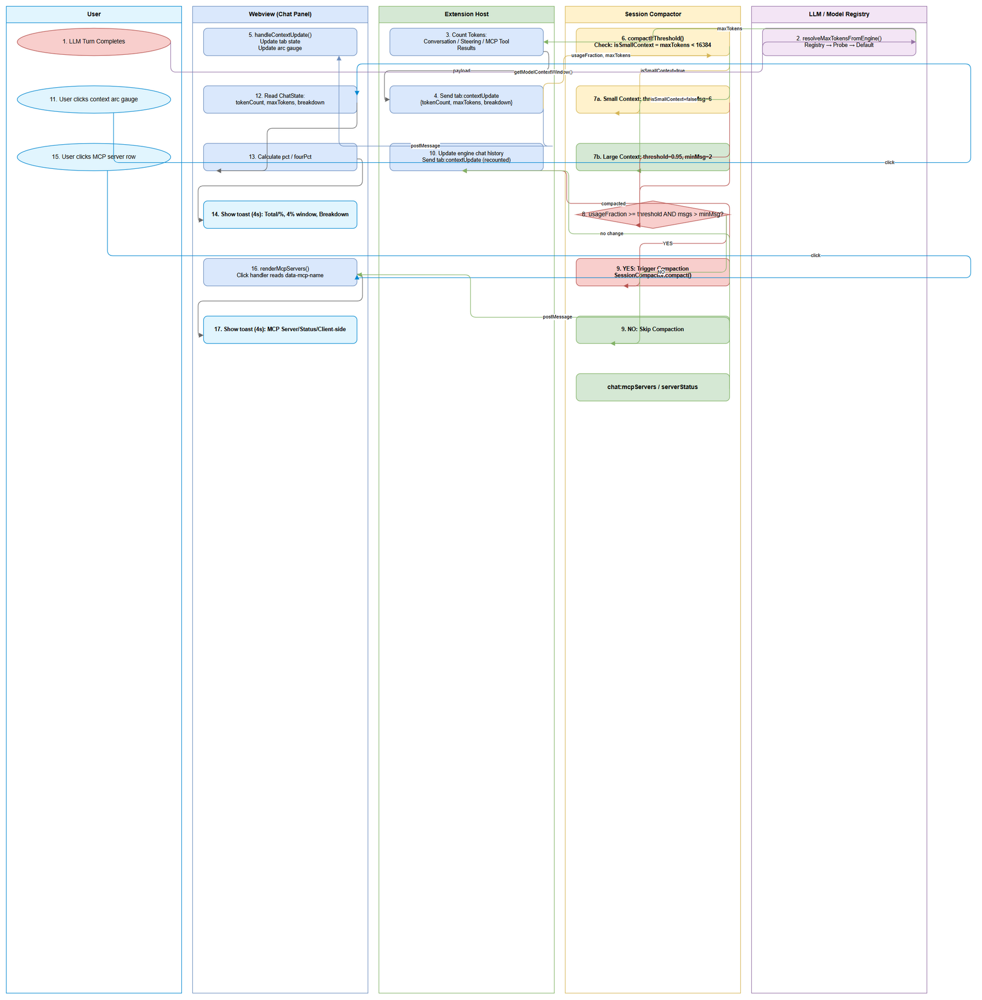
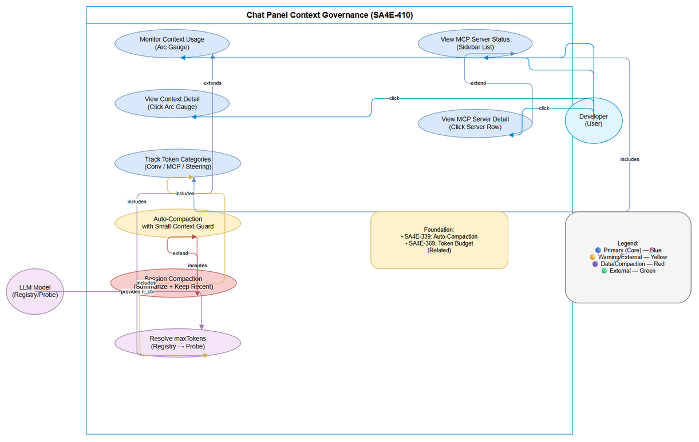

# Business Requirements Document (BRD)

## SA4E-410 — Context Usage UI Enhancements & Small-Context Compaction Guard

---

## Document Information

| Field | Value |
|-------|-------|
| Jira Ticket | SA4E-410 |
| Title | Context Usage UI Enhancements & Small-Context Compaction Guard |
| Author | BA Agent |
| Version | 1.0 |
| Date | 2026-11-07 |
| Status | Draft |

---

## Author Tracking

| Role | Name - Position | Responsibility |
|------|-----------------|----------------|
| Author | BA Agent – Business Analyst | Create document |
| Peer Reviewer | – | Review document |

---

## Revision History

| Version | Date | Author | Changes |
|---------|------|--------|---------|
| 1.0 | 2026-11-07 | BA Agent | Initiate document — retrospective BRD for implemented features in SA4E-410. References SA4E-339 (Auto-Compaction) and SA4E-369 (Token Budget/Registry-First Context Window). |

---

## Sign-Off

| Name | Signature and date |
|------|--------------------|
| | ☐ I agree and confirm all criteria on this BRD as expected requirements |
| | ☐ I agree and confirm all criteria on this BRD as expected requirements |

---

## 1. Introduction

### 1.1 Scope

This BRD documents the **retrospective business requirements** for ticket **SA4E-410**, which formalizes two UI/UX enhancements and one small-context guard already implemented in the codebase (uncommitted changes):

1. **Small-Context Compaction Guard** — For models with context windows `< 16,384` tokens, the auto-compaction threshold is raised from 95% to 97% and a minimum of 6 messages is required before compaction can trigger. This prevents aggressive compaction loops on small-context models (e.g., 4k, 8k windows).

2. **Client-Side Context Usage Detail on Click** — When the user clicks the context usage arc gauge in the chat header, a detailed toast shows:
   - Total tokens used / max tokens / percentage
   - Breakdown by category: Conversation, MCP Tools, Steering (each as %)
   - **4% window value** — the token count representing 4% of the context window (used as a mental reference for "how much headroom is 4%")

3. **Client-Side MCP Server List Detail on Click** — When the user clicks an MCP server entry in the right sidebar, a toast shows the server name and its connection status (Connected/Disconnected/Failed/Unknown), displayed client-side to avoid tool-call loops.

**Note:** This is a retrospective BRD. The implementation is already complete in the codebase. This document provides traceability and documentation for the delivered features.

### 1.2 Out of Scope

- Changes to the core compaction algorithm (`SessionCompactor`) — covered by SA4E-339
- Changes to the token budget registry/probe logic — covered by SA4E-369
- Server-side MCP server management — only client-side display is in scope
- New compaction triggers or thresholds for large-context models (≥16k)

### 1.3 Preliminary Requirement

- SA4E-339 (Context Management: auto-compact, token budget, hallucination prevention) — provides the auto-compaction infrastructure
- SA4E-369 (Token Budget / SEC-01: registry-first context window, probe fallback) — provides the registry-first `maxTokens` resolution
- Extension host with webview chat panel (KSA-240)

---

## 2. Business Requirements

### 2.1 High Level Process Map

The features in SA4E-410 enhance the existing context governance pipeline established by SA4E-339 and SA4E-369:

1. **Context Tracking** (SA4E-369): On each LLM turn, `updateContextUsageAfterTurn` calculates token usage per category (Conversation, MCP Tools, Steering) using the resolved model's actual context window (`maxTokens` from registry → probe → default).

2. **Small-Context Guard** (SA4E-410): Before triggering auto-compaction, the system checks if `maxTokens < 16,384`. If true:
   - Compaction threshold is raised from 0.95 → 0.97
   - Minimum message count is raised from 2 → 6
   - This prevents thrashing on small-context models where every token matters

3. **Context Usage UI** (SA4E-410): The webview receives `tab:contextUpdate` payload with breakdown. The arc gauge displays usage with color coding (safe/warning/critical/full). **Clicking the gauge** reveals a detailed toast with absolute tokens, percentages, category breakdown, and the 4% window reference value.

4. **MCP Server List UI** (SA4E-410): The right sidebar renders MCP servers with status dots. **Clicking a server** shows a toast with the server name and status — purely client-side, no host round-trip.

*[Edit in draw.io](diagrams/business-flow.drawio)*

*[Edit in draw.io](diagrams/use-case.drawio)*

### 2.2 List of User Stories / Use Cases

| # | Story / Use Case / Epic | Priority | Source Ticket |
|---|-------------------------|----------|---------------|
| 1 | As a developer using a small-context model (e.g., 4k, 8k), I want the auto-compaction threshold raised and a minimum message guard so that my session doesn't thrash with premature compactions | MUST HAVE | SA4E-410 |
| 2 | As a developer monitoring context usage, I want to click the context arc gauge to see a detailed breakdown (tokens, %, categories, 4% window value) so I can understand what consumes my context window | MUST HAVE | SA4E-410 |
| 3 | As a developer using MCP servers, I want to click an MCP server in the sidebar to see its name and connection status so I can quickly diagnose connectivity issues without triggering tool calls | SHOULD HAVE | SA4E-410 |

---

### 2.3 Details of User Stories

#### Business Flow

**Step 1: Context Usage Update (Per Turn)**
After each LLM turn completes, `updateContextUsageAfterTurn` (from SA4E-339) is invoked. It:
- Resolves `maxTokens` from the model's registry value (SA4E-369: registry-first, probe fallback)
- Counts conversation tokens from message history
- Estimates steering tokens (system prompt + steering files, ~7500 chars = ~1875 tokens)
- Counts MCP tool definition tokens (schema sent to LLM on every request)
- Sends `tab:contextUpdate` payload to webview with breakdown and `maxTokens`

**Step 2: Small-Context Guard Evaluation**
Before auto-compaction triggers, `compactIfThreshold` evaluates:
- `isSmallContext = maxTokens > 0 && maxTokens < 16384`
- If small context: `compactThreshold = 0.97`, `messageThreshold = 6`
- If large context: `compactThreshold = 0.95` (COMPACT_USAGE_THRESHOLD), `messageThreshold = 2`
- Only triggers compaction if `usageFraction >= compactThreshold` AND `messages.length > messageThreshold`

**Step 3: Context Usage UI — Click Detail**
- User clicks the context usage arc gauge in the chat header
- Webview reads current tab's `tokenCount`, `maxTokens`, `breakdown` from `ChatState`
- Calculates `pct` and `fourPct = Math.round(maxTokens * 0.04)`
- Shows toast with: total tokens, percentage, 4% window value, category breakdown

**Step 4: MCP Server List UI — Click Detail**
- User clicks an MCP server item in the right sidebar
- Webview reads server `name` and `status` from the rendered item's `data-mcp-name` attribute
- Shows toast with: server name, status, note that details are client-side

> **Note:** All click-detail toasts use `S.showToast(html, 4000)` — a lightweight client-side notification that auto-dismisses after 4 seconds. No host round-trip, no tool calls.

---

#### STORY 1: Small-Context Compaction Guard

> As a developer using a small-context model (e.g., 4k, 8k), I want the auto-compaction threshold raised and a minimum message guard so that my session doesn't thrash with premature compactions

**Requirement Details:**

1. **Small-context detection**: A model is considered "small-context" if its resolved `maxTokens` (from registry → probe → default) is greater than 0 and less than 16,384 tokens.

2. **Raised compaction threshold**: For small-context models, the auto-compaction trigger threshold is increased from the standard 95% (`COMPACT_USAGE_THRESHOLD = 0.95`) to 97% (`0.97`). This provides more headroom before compaction activates.

3. **Minimum message guard**: For small-context models, auto-compaction requires at least **6 messages** in the conversation history (vs. 2 for large-context models). This prevents compaction on very short conversations where summarization would lose disproportionate context.

4. **Large-context behavior unchanged**: For models with `maxTokens >= 16,384`, the original thresholds apply (95%, 2 messages).

5. **Implementation location**: `extension/src/chat-panel/chat-panel-provider/context-compaction.ts`, function `compactIfThreshold` (lines 102-123).

**Data Fields:**

| Field | Type | Required | Description | Example |
|-------|------|----------|-------------|---------|
| maxTokens | number | Yes | Resolved model context window from registry/probe | 8192 |
| isSmallContext | boolean | Derived | `maxTokens > 0 && maxTokens < 16384` | true |
| compactThreshold | number | Derived | 0.97 (small) or 0.95 (large) | 0.97 |
| messageThreshold | number | Derived | 6 (small) or 2 (large) | 6 |
| usageFraction | number | Yes | Normalized usage [0,1] from `normalizeUsageToFraction` | 0.96 |
| messages.length | number | Yes | Current conversation message count | 4 |

**Acceptance Criteria:**

1. **AC-410-01**: When `maxTokens = 8192` (small context) and usage reaches 96%, compaction does NOT trigger (threshold is 97%).
2. **AC-410-02**: When `maxTokens = 8192` and usage reaches 97% with 5 messages, compaction does NOT trigger (minimum 6 messages).
3. **AC-410-03**: When `maxTokens = 8192` and usage reaches 97% with 7 messages, compaction TRIGGERS.
4. **AC-410-04**: When `maxTokens = 32768` (large context) and usage reaches 95% with 3 messages, compaction TRIGGERS (original behavior preserved).
5. **AC-410-05**: The guard logic is unit-tested in `chat-panel-provider.compaction.trigger.test.ts` (STC-410-01 through STC-410-05).

**Validation Rules:**

- `maxTokens` must be a positive integer (> 0) for guard evaluation; if 0 or undefined, default to large-context behavior
- `usageFraction` must be in [0, 1] — validated by `normalizeUsageToFraction` (returns 0 for invalid input)
- `messages.length` must be non-negative integer

**Error Handling:**

- If `maxTokens` resolution fails (returns 0), the guard defaults to large-context behavior (threshold 0.95, min 2 messages) — fail-safe to avoid blocking compaction entirely
- Compaction errors are caught and logged; session continues with un-compacted messages (non-fatal)

---

#### STORY 2: Context Usage Detail on Click

> As a developer monitoring context usage, I want to click the context arc gauge to see a detailed breakdown (tokens, %, categories, 4% window value) so I can understand what consumes my context window

**Requirement Details:**

1. **Click target**: The context usage arc gauge in the chat header (`#context-usage-icon`).

2. **Displayed information** (in a toast notification):
   - **Header**: "Context Details"
   - **Line 1**: `{tokenCount} / {maxTokens} tokens ({pct}%)` — e.g., "45,231 / 128,000 tokens (35%)"
   - **Line 2**: "4% of window = {fourPct} tokens" — e.g., "4% of window = 5,120 tokens" (calculated as `Math.round(maxTokens * 0.04)`)
   - **Breakdown section** (if `breakdown` payload available):
     - Conversation: `{breakdown.conversation}%`
     - MCP tools: `{breakdown.mcpTools}%`
     - Steering: `{breakdown.steering}%`

3. **Data source**: Reads from `ChatState` — `tab.tokenCount`, `tab.maxTokens`, `tab.breakdown` (populated by `handleContextUpdate` from `tab:contextUpdate` host messages).

4. **Debounce**: Click detail uses `lastClickDetail` cache to avoid redundant toast updates if token counts haven't changed.

5. **Implementation location**: `extension/webview-assets/chat/chat-context-usage.js`, lines 83-108 (click event handler).

**Data Fields:**

| Field | Type | Required | Description | Example |
|-------|------|----------|-------------|---------|
| tokenCount | number | Yes | Total tokens used in current tab | 45231 |
| maxTokens | number | Yes | Model context window | 128000 |
| pct | number | Derived | `Math.min(100, Math.round(tokenCount / maxTokens * 100))` | 35 |
| fourPct | number | Derived | `Math.round(maxTokens * 0.04)` | 5120 |
| breakdown.conversation | number | Optional | Conversation tokens as % of maxTokens | 20 |
| breakdown.mcpTools | number | Optional | MCP tool def tokens as % of maxTokens | 10 |
| breakdown.steering | number | Optional | Steering tokens as % of maxTokens | 5 |

**Acceptance Criteria:**

1. **AC-410-06**: Clicking the context arc gauge shows a toast with total tokens, max tokens, percentage.
2. **AC-410-07**: The toast includes "4% of window = {value} tokens" where value = `round(maxTokens * 0.04)`.
3. **AC-410-08**: When breakdown data is available, the toast shows Conversation/MCP Tools/Steering percentages.
4. **AC-410-09**: Toast auto-dismisses after 4 seconds (via `S.showToast(html, 4000)`).
5. **AC-410-10**: Rapid clicks without data change do not spawn duplicate toasts (debounced by `lastClickDetail`).

**UI Specifications:**

| No. | Name | Type | Required | Description | Note |
|-----|------|------|----------|-------------|------|
| 1 | Context Arc Gauge | SVG Circle | Yes | Clickable area showing usage as circular progress | Click triggers detail toast |
| 2 | Detail Toast | HTML Toast | Yes | 4-second auto-dismiss toast with breakdown | Client-side only, no host call |

**Validation Rules:**

- `maxTokens > 0` required for percentage and 4% calculations; if 0, show "N/A"
- Percentages are rounded integers (0-100)
- Breakdown percentages are derived from `ContextUsagePayload` — sum may not equal 100% due to rounding

---

#### STORY 3: MCP Server List Detail on Click

> As a developer using MCP servers, I want to click an MCP server in the sidebar to see its name and connection status so I can quickly diagnose connectivity issues without triggering tool calls

**Requirement Details:**

1. **Click target**: Each MCP server row in the right sidebar (`.oc-mcp-item`).

2. **Displayed information** (in a toast notification):
   - **Header**: "MCP Server: {name}"
   - **Line**: "Status: {status}" — one of: Connected, Disconnected, Failed, Unknown
   - **Note**: "Details shown client-side to avoid tool-call loops."

3. **Data source**: Server list rendered by `S.renderMcpServers(servers)` where `servers = [{ name, status }, ...]`. Click handler reads `data-mcp-name` attribute and finds matching server object.

4. **Status values**: Derived from `serverStatus` events and `chat:mcpServers` host messages. Status is lowercased: `connected`, `disconnected`, `failed`, `unknown`.

5. **Implementation location**: `extension/webview-assets/chat/chat-sidebar.js`, lines 34-63 (`renderMcpServers` and click handler).

**Data Fields:**

| Field | Type | Required | Description | Example |
|-------|------|----------|-------------|---------|
| name | string | Yes | MCP server display name | "code-intel" |
| status | string | Yes | Connection status (connected/disconnected/failed/unknown) | "connected" |

**Acceptance Criteria:**

1. **AC-410-11**: Clicking an MCP server row shows a toast with the server name.
2. **AC-410-12**: The toast shows the current status (Connected/Disconnected/Failed/Unknown).
3. **AC-410-13**: The toast includes the note "Details shown client-side to avoid tool-call loops."
4. **AC-410-14**: Toast auto-dismisses after 4 seconds.
5. **AC-410-15**: No host round-trip or tool call is made on click — purely client-side.

**UI Specifications:**

| No. | Name | Type | Required | Description | Note |
|-----|------|------|----------|-------------|------|
| 1 | MCP Server Row | Div (`.oc-mcp-item`) | Yes | Clickable row with dot indicator, name, status badge | Click triggers detail toast |
| 2 | Status Badge | Span (`.oc-mcp-status`) | Yes | Colored badge: green=connected, red=failed, gray=disconnected/unknown | Updated via `serverStatus` events |
| 3 | Detail Toast | HTML Toast | Yes | 4-second auto-dismiss toast | Client-side only |

**Validation Rules:**

- Server `name` must be non-empty string
- Status must be one of the known values; unknown falls back to "Unknown"

---

## 3. Dependencies

| Dependency | Type | Related Ticket | Description |
|------------|------|----------------|-------------|
| SA4E-339 Auto-Compaction | System | SA4E-339 | Provides `SessionCompactor`, `compactIfThreshold` hook, `normalizeUsageToFraction` |
| SA4E-369 Token Budget | System | SA4E-369 | Provides registry-first `maxTokens` resolution via `resolveMaxTokensFromEngine` |
| ContextUsageTracker | System | SA4E-339 / KSA-240 | Tracks per-category token usage, sends `tab:contextUpdate` |
| Chat Webview (KSA-240) | System | KSA-240 | Hosts context arc gauge, sidebar, toast notifications |
| PiWorkflowAdapter | System | SA4E-339 | Provides `getModelContextWindow()`, `listAvailableTools()`, `getChatHistory()` |

---

## 4. Stakeholders

| Role | Name / Team | Responsibility | Source |
|------|-------------|----------------|--------|
| Reporter | Duc Nguyen Minh | Requirement owner | Jira reporter |
| BA Agent | BA Agent | BRD author | This document |
| DEV Agent | DEV Agent | Implementation (already done) | Code commits |
| QA Agent | QA Agent | Test coverage verification | STC/STP |

---

## 5. Risks and Assumptions

### 5.1 Risks

| Risk | Impact | Likelihood | Mitigation |
|------|--------|------------|------------|
| Small-context guard too conservative — compaction never triggers on 4k models | Medium | Low | Threshold 97% + 6 messages tested; can be tuned via config if needed |
| Click-detail toast obstructs UI on small screens | Low | Medium | Toast auto-dismisses at 4s; positioned via `S.showToast` (top-center) |
| MCP server status stale between `serverStatus` events | Low | Medium | `renderMcpServers` called on each `chat:mcpServers` and `serverStatus` event |
| 4% window value misleads users about actual headroom | Low | Low | Clearly labeled as "4% of window" — a reference, not available space |

### 5.2 Assumptions

- SA4E-339 and SA4E-369 are fully implemented and tested
- `maxTokens` resolution via registry/probe is reliable (SA4E-369)
- Webview `ChatState` reliably holds per-tab `tokenCount`, `maxTokens`, `breakdown`
- Toast notification system (`S.showToast`) is available and functional
- MCP server list is populated via `chat:mcpServers` host message and `serverStatus` events

---

## 6. Non-Functional Requirements

| Category | Requirement | Details |
|----------|-------------|---------|
| Performance | Click-detail toast render | < 50ms (client-side only, no async) |
| Performance | Small-context guard evaluation | Negligible (simple comparisons in `compactIfThreshold`) |
| Usability | Toast auto-dismiss | 4 seconds (configurable via `S.showToast` second arg) |
| Usability | Toast content readability | Monospace for numbers, clear labels, 4% reference value |
| Reliability | Guard fail-safe | Defaults to large-context behavior if `maxTokens` resolution fails |
| Accessibility | Arc gauge click | `aria-label="Context window usage"` on icon; click works via mouse/keyboard |

---

## 7. Related Tickets

| Ticket Key | Summary | Status | Type | Relationship |
|------------|---------|--------|------|--------------|
| SA4E-410 | Context Usage UI Enhancements & Small-Context Compaction Guard | In Progress | Story | Main ticket |
| SA4E-339 | Context Management: auto-compact, token budget, hallucination prevention | Done | Bug/Story | Prerequisite / Foundation |
| SA4E-369 | Token Budget / SEC-01: registry-first context window, probe fallback | Done | Story | Prerequisite / Foundation |
| KSA-240 | Chat Panel UI — Context Usage, Tabs, Sidebar | Done | Epic | Parent UI Epic |

---

## 8. Appendix

### Glossary

| Term | Definition |
|------|------------|
| Context Window | The maximum number of tokens (input + output) a model can process in a single request. Also called `n_ctx` or `maxTokens`. |
| Compaction Threshold | The usage percentage (as a fraction 0.0–1.0) at which auto-compaction triggers. Standard: 0.95 (95%); Small-context: 0.97 (97%). |
| Token Budget | The allocated token limit for a specific category (conversation, MCP tools, steering) or the total usable prompt tokens (`nCtx - reserveOutput - reserveTools`). |
| Steering Tokens | Tokens consumed by injected steering content (system prompt + steering files, ~7500 chars ≈ 1875 tokens) counted once per session. |
| MCP Tool Definitions | Token cost of JSON schemas for all available MCP tools sent to the LLM on every request. Counted once after tool discovery. |
| Small-Context Model | A model with resolved `maxTokens < 16,384` (e.g., 4k, 8k windows). Triggers raised compaction threshold (97%) and minimum message guard (6). |
| Large-Context Model | A model with resolved `maxTokens >= 16,384` (e.g., 32k, 64k, 128k). Uses standard compaction threshold (95%) and message guard (2). |
| Registry-First Context Window | SA4E-369 pattern: resolve `maxTokens` from model registry (llama-server `-c` value) first, fallback to probe `meta.n_ctx`, last resort hardcoded default (128000). |
| 4% Window Value | A mental reference calculation: `round(maxTokens * 0.04)`. Shown in context detail toast to help developers gauge headroom. |
| Session Compaction | Automatic summarization of conversation history when usage threshold is crossed, keeping a summary + N recent messages (default 2). |
| Normalize Usage To Fraction | SEC-330-02 control: converts percent-scale signals (0–100) to fraction (0.0–1.0) via `percent > 100 ? 1 : percent / 100`. Prevents compaction-trigger abuse. |
| Compaction-Trigger Abuse | SEC-330-02: When percent-scale (95) is mistakenly used where fraction (0.95) is expected, causing compaction on every turn. Guarded by `normalizeUsageToFraction`. |

### Reference Documents

| Document | Link / Location |
|----------|-----------------|
| SA4E-339 BRD | `documents/SA4E-339/BRD.md` |
| SA4E-369 BRD | `documents/SA4E-369/BRD.md` |
| Context Compaction Implementation | `extension/src/chat-panel/chat-panel-provider/context-compaction.ts` |
| Context Usage Tracker | `extension/src/chat-panel/context-usage-tracker.ts` |
| Context Usage Webview | `extension/webview-assets/chat/chat-context-usage.js` |
| Sidebar MCP Server Webview | `extension/webview-assets/chat/chat-sidebar.js` |
| Session Compactor Core | `extension/src/pi-agent/session-compactor.ts` |

### Diagram Index

| # | Diagram | Image | Source (editable) |
|---|---------|-------|-------------------|
| 1 | Business Flow | [business-flow.png](diagrams/business-flow.png) | [business-flow.drawio](diagrams/business-flow.drawio) |
| 2 | Use Case Diagram | [use-case.png](diagrams/use-case.png) | [use-case.drawio](diagrams/use-case.drawio) |
| 3 | Click Detail Sequence | [sequence-click-detail.png](diagrams/sequence-click-detail.png) | [sequence-click-detail.drawio](diagrams/sequence-click-detail.drawio) |
| 4 | MCP Server Click Sequence | [sequence-mcp-click.png](diagrams/sequence-mcp-click.png) | [sequence-mcp-click.drawio](diagrams/sequence-mcp-click.drawio) |